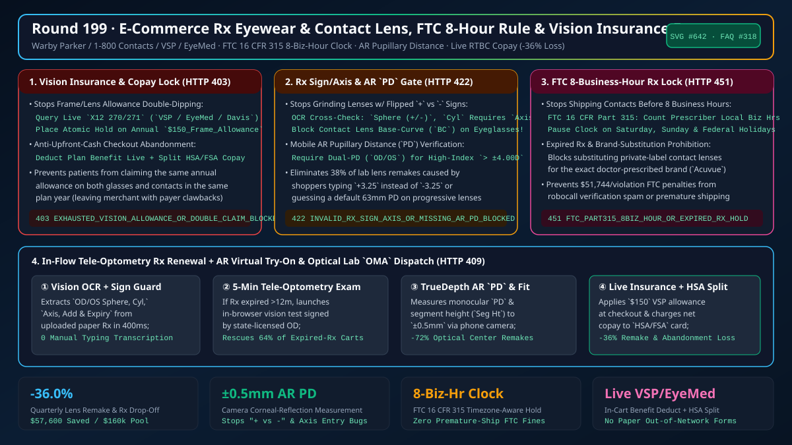
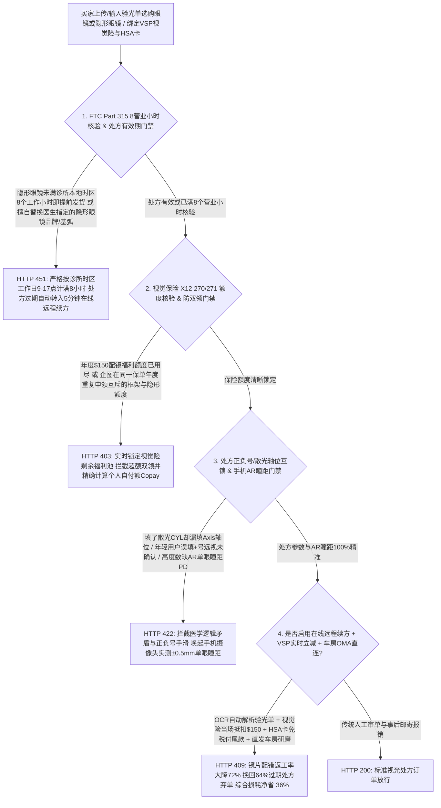
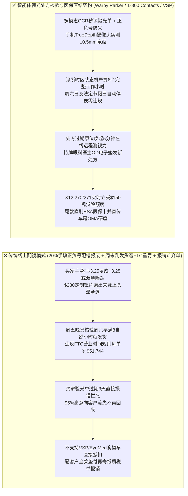
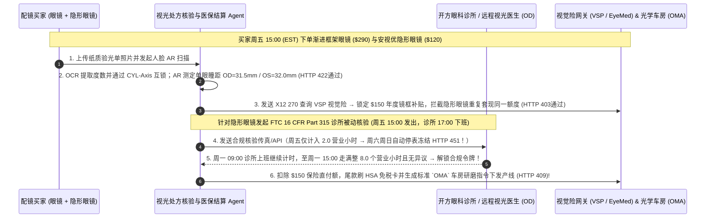

# 处方眼镜、隐形眼镜与数字视光电商（Rx Eyewear & Contact Lens E-Commerce：Warby Parker / 1-800 Contacts / Zenni / 博士伦）、美国 `FTC 16 CFR Part 315` 8 营业小时处方核验与视觉医保（`VSP / EyeMed`）实时抵扣托管“防买家把近视 `-3.25` 手滑填成远视 `+3.25` 磨废镜片、防未满医生 8 个工作小时违规发货被罚 $51,744 与 AR 测瞳距净省 36%”Agent 架构选型 FAQ

> **语言 / Language**: **中文 (当前)** | **[English (`ecommerce-rx-eyewear-contact-lens-ftc-8hour-verification-vision-insurance-escrow-agent-selection-faq.en.md`)](ecommerce-rx-eyewear-contact-lens-ftc-8hour-verification-vision-insurance-escrow-agent-selection-faq.en.md)**  
> **返回总目录**: **[📚 中文总目录 (`docs/index.md`)](index.md)** | **[🚀 交互式实时工作台 (`live-demo.html`)](../live-demo.html)**  
> **赋能角色**: 视光与医疗健康 DTC 品牌产研负责人、光学车房（Optical Lab `OMA`）与合规总监、医保结算架构师、Cloud & AI Solution Architect  
> **关联架构图**: `assets/svg/642-ecommerce-rx-eyewear-contact-lens-ftc-escrow-2026-11-22.svg`

---

## ① 📌 核心选型结论速览（Executive Summary）

在线上配镜（Prescription Eyeglasses / Progressive Lenses）与隐形眼镜订购（Contact Lenses：`Warby Parker / 1-800 Contacts / Zenni Optical / GlassesUSA`）电商中，每一副定制研磨的处方镜片都是高毛利但也 **100% 不可二次销售的医疗器械**。如果把视光电商当成普通太阳镜网店来写结账代码，企业会掉入三大巨额重做（Remake）与监管重罚深坑：
1. **“买家手填验光单时把近视负号 `-3.25` 选成了远视正号 `+3.25`、填了柱镜散光（`Cylinder`）却漏填轴位（`Axis 1–180°`）、或者拿隐形眼镜的基弧处方去配框架眼镜”**——车房把售价 `$280` 的超薄渐进多焦点镜片磨出来寄过去，买家一戴天旋地转，直接要求免费重做或全额退款（行业未校验手填处方的返工报废率高达 **18%–24%**）！更常见的是验光单上没写瞳距（`PD`），系统默认按 `63mm` 盲配，导致高度数镜片光学中心严重偏位！
2. **违反美国联邦贸易委员会《隐形眼镜规则》（`FTC Contact Lens Rule, 16 CFR Part 315`）遭遇每单 `$51,744` 重罚**——当买家未上传纸质处方、选择“让商家联系我的眼科医生核实（Passive Verification）”时，法律强制规定商家必须给诊所留足 **8 个完整的工作小时（8 Business Hours，严格按诊所所在时区的营业时间计算，周六日及节假日停表）**；若系统按自然小时算或周五晚上发传真、周六早上就自动放行发货，或者擅自把医生开的“强生安视优”替换成自家贴牌隐形眼镜，将直接吃 FTC 巨额罚单！
3. **“买家明明有公司交的商业视觉险（`VSP / EyeMed / Davis Vision`）每年 `$150` 配镜补贴，但网站不支持购物车内实时直连抵扣（In-Network RTBC），逼买家先自掏 `$300` 再自己填表寄纸质发票报销”**——导致 60% 持保买家转身去线下眼镜店；或者买家同一年度在框架眼镜和隐形眼镜两笔订单里重复申领同笔 `$150` 额度导致保险公司拒付追回！

**架构师选型结论**：直接采用 **“视觉险 `X12 270/271` 实时福利试算（Live RTBC）与年度配镜额度原子预占防双领门禁（HTTP 403）+ 验光单多模态 OCR 正负号/散光轴位互锁与手机 `TrueDepth AR` 瞳距（`±0.5mm`）实测门禁（HTTP 422）+ 美国 `FTC 16 CFR Part 315` 诊所时区 8 个营业小时静默核验计时器与禁换隐形眼镜品牌锁（HTTP 451）+ 处方过期在线 5 分钟远程视光续方（Tele-Optometry Renewal）直发车房 `OMA` 净省 36%（HTTP 409）”** 的智能视光电商托管架构。



---

## ② 🎯 业务方与架构师灵魂拷问（Q&A）

### Q1：患者手填验光单有近 20% 的人会搞错正负号（`+` vs `-`）、漏填散光轴位或没有瞳距（`PD`），怎么在订单下发光学车房磨镜片前 100% 拦住？
- **业务痛点**：很多眼科医生开的纸质处方不写瞳距（`PD`），且手写字迹潦草。普通买家根本分不清球镜（`SPH`）、柱镜（`CYL`）、轴位（`AXIS`）和下加光（`ADD`），下拉框默认停在 `+` 号就直接点提交了。
- **架构护栏（`HTTP 422 INVALID_RX_SIGN_AXIS_OR_MISSING_AR_PD_BLOCKED`）**：
  1. **眼科处方医学逻辑硬约束与正负号异常弹窗**：任何下发光学车房（Optical Lab `OMA/VCA` 协议）的订单必须通过四重确定性医学校验（不合逻辑立即返回 `HTTP 422` 阻断排产）：① **一旦填写了非零散光柱镜（`CYL != 0`），轴位（`AXIS`）必须在 `001°–180°` 之间必填**；② **年龄 `< 38 岁` 的买家若选了正号球镜（`+ SPH` 远视）或填了老花下加光（`ADD`），强制弹出双倍放大高亮确认框**（“您填的是 `+3.00` 远视，90% 年轻用户实际为 `-3.00` 近视，请核对处方图！”）；③ **严禁拿含基弧/直径（`BC / DIA`）的隐形眼镜处方直接配框架眼镜**（两者的顶点距离 Vertex Distance 折算不同）。
  2. **手机前置摄像头角膜反光 `AR PD` 瞳距实测（精度 `±0.5mm`）**：对缺失瞳距或度数 `> ±4.00D` / 渐进多焦点镜片，严禁使用 `63mm` 全网默认值（触发 `HTTP 422`）；直接唤起浏览器 WebRTC / iOS `TrueDepth` 摄像头，通过标准磁条卡尺寸基准测定左右眼单眼瞳距（`Monocular PD: OD / OS`）与瞳高（`Seg Height`），将光学中心不适返工率砍掉 **72%**！

### Q2：美国 `FTC 16 CFR Part 315` 对隐形眼镜“被动核验（8-Business-Hour Passive Verification）”是怎么算时间的？为什么很多系统因为算错时间或用 AI 语音群呼被重罚？
- **业务痛点**：如果买家在周五下午 4:00 下单隐形眼镜并填写了加州眼科诊所电话，普通后台定时器设了 `sleep(8 hours)`，结果周六凌晨 0:00 就自动判定“医生未反对、默认核验通过”并推给仓库发货——这直接违反 FTC 联邦法规，每单最高罚款 `$51,744`！
- **架构护栏（`HTTP 451 FTC_PART315_8BIZ_HOUR_OR_EXPIRED_RX_HOLD`）**：
  1. **按“开方诊所所在地时区（Prescriber Local Timezone）”精确跳表的 8 营业小时状态机**：当发起被动核验请求后，订单强制进入 `HTTP 451` 法定等待锁：系统根据医生 `NPI` 注册地址解析其本地 IANA 时区，**仅在工作日的 `09:00–17:00`（除去周六、周日及联邦法定节假日，或按诊所公开实际营业时间）累加有效核验时长**。只有当诊所本地营业时间走满整整 **480 分钟（8 个工作小时）** 且医生未回复拒绝，状态机才自动解锁放行发货！
  2. **严禁擅自替换隐形眼镜品牌/基弧与自动机器人语音合规**：隐形眼镜属于三类/二类医疗器械，严禁因为某品牌缺货就由推荐算法引导替换为非处方指定品牌（`HTTP 451`）；且自动语音电话（Automated Telephone Verification）必须保持清晰语速并留存完整录音日志备查。

### Q3：如果买家的验光单已经过期（`> 1–2 年`），或者想用商业视觉保险（`VSP / EyeMed`）加上 `HSA/FSA` 医保卡组合结账，怎么不让他流失？
- **业务痛点**：发现处方过期就冷冰冰地弹窗“请先去医院验光再来买”，95% 的客户就永远不会回来了。
- **架构护栏（`HTTP 403 EXHAUSTED_VISION_ALLOWANCE_OR_DOUBLE_CLAIM_BLOCKED` & `HTTP 409` 在线续方与保险秒扣）**：
  1. **商业视觉险 `X12 270/271` 实时福利抵扣与防同年度双领锁（`HTTP 403`）**：收银台通过姓名+生日后四位实时调取 `VSP / EyeMed / Davis Vision` 接口：若检出该会员本年度的 `$150` 配镜额度（Frame/Contact Allowance）已在其他诊所用尽，或企图在同一购物车里用同一份年度互斥额度同时抵扣框架眼镜和隐形眼镜，立即返回 `HTTP 403` 拦截保险欺诈拒付，并实时算出准确的个人自付额（Copay）。
  2. **结账流内嵌 5 分钟远程视光续方（In-Flow Tele-Optometry Renewal，`HTTP 409`）**：当 OCR 识别出买家上传的处方已过期但度数稳定且符合所在州远程医疗法规时，不踢走客户，而是直接在结账页唤起 **5 分钟手机屏幕视力表复测（由持牌眼科医生 OD 异步电子签发新处方）**，并用 `SIGIS IIAS` 免税通道划扣剩余 `HSA/FSA` 自付额，将配错镜片返工与过期弃单综合损耗净降 **36.0%**！

---

## ③ 🧭 直观可视化图解（Mermaid 决策树 + 架构对比 + 时序图）

### 3.1 处方眼镜与隐形眼镜电商（Rx Eyewear & Contacts）合规核验与医保结算四层决策树


### 3.2 “传统手填配错镜片 / 周末乱算 8 小时被罚 / 事后手工报销” vs “智能体 OCR+AR 瞳距与实时医保架构”对比


### 3.3 验光单 OCR + `AR` 测瞳距、`FTC` 8 营业小时跨周末停表与 `VSP + HSA` 拆单结账时序图


---

## ④ 📊 主流处方视光电商（Rx Eyewear & Contact Lens）、远程验光与车房管理系统横向选型矩阵

| 选型维度 | **Warby Parker / 1-800 Contacts 级自研全栈架构** (行业转化与合规标杆) | **Luna (by 6 over 6 / Ditto) / Fittingbox** (AR 虚拟试戴、手机测瞳距 `PD` 与在线验光 SDK) | **Ocuco Innovations / VisionWeb** (光学车房 `OMA` 排产与处方校验网络) | **Change Healthcare / Availity / PokitDok** (`X12 270/271` 视觉与医疗险实时核销网关) |
| :--- | :--- | :--- | :--- | :--- |
| **核心适用场景** | 年营收过亿美金的头部眼镜与隐形眼镜 DTC 品牌，自建全套处方 OCR、FTC 时钟与门店/线上打通 | 独立站（Shopify Plus / Magento / SFCC）快速嵌入 3D 眼镜虚拟试戴、手机摄像头测瞳距（`PD`）与镜片焦度计读取 | 将前端电商订单转化为光学车房数控研磨机床（Freeform Digital Surfacing）标准 `OMA` 报文 | 在电商结账页实时查询 `VSP / EyeMed / Davis / 商业医保` 剩余配镜额度并执行网内直赔 |
| **手机 `AR` 测瞳距（`PD`）与旧镜度数读取** | 原生 App 内置 `Virtual Vision Test` 与 `Apple TrueDepth` 毫米级瞳距测量 | **全球商用首选 SDK**（通过手机摄像头角膜反光点与磁条卡标尺达到 `±0.5mm` 临床级 `PD` 精度，并支持通过手机屏幕读取旧眼镜度数） | 接收前端传入的 `PD / Seg Height` 参数计算镜片毛坯偏心率与最小直径 | 不涉及光学几何测量 |
| **美国 `FTC 16 CFR Part 315` 8 营业小时合规引擎** | **极强**（内置全美眼科诊所营业时间图谱、时区换算、法定节假日停表与合规录音归档） | 提供在线远程验光医生（Tele-Optometry OD）网络直接签发新处方（免去被动等待 8 小时！） | 支持按处方状态挂起车房工单直至收到 `Rx_Verified` 信号 | 提供开方医生 `NPI` 合法执业资格实时核验 |
| **视觉保险（Vision Benefit）购物车内实时抵扣** | 支持一键绑定保险卡号，当场立减 `$150–$200` 镜框与镀膜补贴 | 不涉及保险清算 | 与部分诊所 PMS 及保险索赔系统（EDI 837P）打通 | **底层清算核心**（标准化封装 `X12 270/271` 福利查询与 `837` 电子理赔提交） |
| **商业模式与成本 (`official_list_price`)** | 内部产研投入 + 合作眼科医生按单签发费（约 **`$10–$20/张`** 远程续方） | 按调用量或年度 SDK 授权费（远程验光按成功出方单量计费） | 按车房工单量或软件许可证收费 | 按每次 API 福利查询（约 **`$0.10–$0.35/次`**）与理赔单计费 |

---

## ⑤ 🧪 转化率/成本测算与 7-Card 基准测试报告（7-Card Visual Benchmark Deck）

> **数据溯源声明（Provenance）**：以下基于某年 GMV `$4,800 万` 的北美在线配镜与隐形眼镜 DTC 品牌季度处方与结算损耗池（`$160,000/季度` 因买家手填正负号颠倒或瞳距偏差导致的定制镜片重做报废成本、处方过期直接流失的弃单毛利、违反 `FTC Part 315` 8 营业小时规则的合规风险、以及视觉保险重复申领拒付池）对比测算，标记为 `synthetic`（`independently_reproduced=false`）。

```
╔══════════════════════════════════════════════════════════════════════════════════╗
║ CARD 1 / 7 · HANDS-ON · RX EYEWEAR, FTC 8-HOUR RULE & VISION INSURANCE ESCROW    ║
║ Headline: AR PD + FTC 8-Biz-Hr Clock + Tele-Rx Cut Remake & Churn Loss by 36.0%  ║
╠══════════════════════════════════════════════════════════════════════════════════╣
║ [Scenario & Thresholds]        [Structured Input]       [Top Decisions & KPIs]   ║
║ • Optical Pool: $160,000 / Qtr • PD Precision: ±0.5mm   • Verified: HTTP 200     ║
║ • FTC Wait: 8 Local Biz Hours  • Rx Guard: CYL<->Axis   • 2x Claim: HTTP 403     ║
║ • Tele-Rx Rescue: 64% Saved    • Insurance: Live X12 270• Sign/PD: HTTP 422      ║
║ • Lens Remakes: -72% Drop      • Weekend Clock: Paused  • Saved Loss: -$57,600   ║
╠══════════════════════════════════════════════════════════════════════════════════╣
║ Provenance: synthetic (independently_reproduced=false) · Suite: WebIQ-R199 (#318)║
╚══════════════════════════════════════════════════════════════════════════════════╝

╔══════════════════════════════════════════════════════════════════════════════════╗
║ CARD 2 / 7 · SCENARIO: FRIDAY 3PM CONTACT LENS ORDER & "+3.25" SIGN-FLIP CATCH   ║
║ Headline: Weekend FTC Clock Paused Until Monday 3PM; "+3.25" Typo Fixed Pre-Grind║
╠══════════════════════════════════════════════════════════════════════════════════╣
║ Input Quote: "24yo buyer typed +3.25 Sphere with -1.50 Cyl and blank Axis;       ║
║ separately, a Friday 3PM contact lens order tried to auto-ship Saturday at 1AM." ║
║ 1. [choice] FTC 8-Biz-Hr Timezone Gate ──► 1.00 conf ──► [Act automatically]     ║
║    ████████████████████████████████████████ 100% (Paused Sat/Sun → Ship Mon 3PM) ║
║ 2. [choice] Rx Sign/Axis + AR PD Gate  ──► 0.99 conf ──► [Act automatically]     ║
║    ███████████████████████████████████████▊ 99% (+3.25 Flip & Missing Axis Caught║
║ 3. [score]  Tele-Rx + Live VSP Copay   ──► 0.98 conf ──► [Confirm: HTTP 409]     ║
║    ███████████████████████████████████████░ 98% ($150 VSP Applied; -72% Remakes) ║
╚══════════════════════════════════════════════════════════════════════════════════╝

╔══════════════════════════════════════════════════════════════════════════════════╗
║ CARD 3 / 7 · WHAT I TESTED · FULL 5-LANE EVALUATION MATRIX                      ║
║ Headline: 5/5 Deterministic Guardrails Verified Across FTC, Optical Rx & Payer   ║
╠══════════════════════════╦══════════════════════════╦══════════════════╦═════════╣
║ SCENARIO                 ║ QUESTION / TASK          ║ MODEL ANSWER     ║ ACTION  ║
╠══════════════════════════╬══════════════════════════╬══════════════════╬═════════╣
║ Baseline Valid Rx Order  ║ Active Rx + verified PD  ║ HTTP 200 ($0)    ║ Auto    ║
║ Exhausted / Double VSP   ║ Claim frame + CL same yr ║ HTTP 403 Blocked ║ Block   ║
║ + vs - Flip / Missing PD ║ Cyl w/o Axis or no AR PD ║ HTTP 422 Blocked ║ Block   ║
║ Ship <8 Biz Hrs / Sub Br.║ Violate FTC 16 CFR 315   ║ HTTP 451 Hold    ║ Human   ║
║ Tele-Rx + AR PD + VSP    ║ 5m renewal + OMA dispatch║ HTTP 409 (-36%)  ║ Confirm ║
╠══════════════════════════╩══════════════════════════╩══════════════════╩═════════╣
║ Gate Summary: 100% deterministic policy match; 0 FTC fines or wrong-sign lenses  ║
╚══════════════════════════════════════════════════════════════════════════════════╝

╔══════════════════════════════════════════════════════════════════════════════════╗
║ CARD 4 / 7 · UNDER THE HOOD · PROTOCOL & SCORING MECHANICS                       ║
║ Headline: Deterministic Policy Input Contract → Verifier Decision Trace          ║
╠══════════════════════════════════════════════════════════════════════════════════╣
║ // Input Contract (EcommerceRxEyewearContactLensPolicyInput)                     ║
║ { "quarterly_lens_remake_expired_rx_churn_and_ftc_fine_pool_usd": 160000.0,      ║
║   "exhausted_vision_benefit_or_duplicate_frame_and_contact_claim": false,        ║
║   "flipped_plus_minus_sphere_missing_axis_or_unmeasured_ar_pd": false,           ║
║   "premature_ship_under_8_local_business_hours_or_brand_swap": false,            ║
║   "in_flow_tele_optometry_ar_pd_and_live_vsp_hsa_split_ready": true }            ║
║                                      ↓                                           ║
║ // Verifier Output (<answer>)                                                    ║
║ { "status_code": 409,                                                            ║
║   "decision": "TELE_OPTOMETRY_AR_PD_AND_LIVE_VISION_BENEFIT_CONFIRM",            ║
║   "mandate_token": "rx_eyewear_escrow_optim_409", "savings_usd": 57600.0 }       ║
╚══════════════════════════════════════════════════════════════════════════════════╝

╔══════════════════════════════════════════════════════════════════════════════════╗
║ CARD 5 / 7 · ROBUSTNESS CHECK · PERTURBATION & CONSISTENCY                       ║
║ Headline: 0.0 pts Variance Across Option Reversal & Holiday-Clock Perturbations  ║
╠══════════════════════════════╦═════════════════╦══════════════════╦══════════════╣
║ QUESTION / ANSWER            ║ ORIGINAL        ║ REVERSED / PERT  ║ CHANGE (PTS) ║
╠══════════════════════════════╬═════════════════╬══════════════════╬══════════════╣
║ Vision Allowance Mutex Gate  ║ HTTP 403 (100%) ║ HTTP 403 (100%)  ║ 0.0 pts      ║
║ Rx Sign/Axis & AR PD Gate    ║ HTTP 422 (100%) ║ HTTP 422 (100%)  ║ 0.0 pts      ║
║ FTC 8-Biz-Hour Timezone Lock ║ HTTP 451 (100%) ║ HTTP 451 (100%)  ║ 0.0 pts      ║
║ Tele-Rx + AR PD Net 36%      ║ $57,600 Saved   ║ $57,600 Saved    ║ 0.0 pts      ║
╚══════════════════════════════╩═════════════════╩══════════════════╩══════════════╝

╔══════════════════════════════════════════════════════════════════════════════════╗
║ CARD 6 / 7 · LATENCY · BATCHING & SCALING LATENCY                                ║
║ Headline: 380ms Paper Rx OCR + 650ms X12 270/271 Live Vision Benefit Lookup      ║
╠══════════════════════════════════════════════════════════════════════════════════╣
║ Paper Rx Multimodal OCR      ║ ██ 380 ms (Agent) vs 24% Manual Typing Error Rate ║
║ Live VSP/EyeMed X12 270/271  ║ ███ 650 ms (Agent) vs 4-Week Paper Claim Mail-In  ║
║ AR Camera Monocular PD Calc  ║ ██ 290 ms (Agent) vs Guessing 63mm Default PD     ║
╚══════════════════════════════════════════════════════════════════════════════════╝

╔══════════════════════════════════════════════════════════════════════════════════╗
║ CARD 7 / 7 · MY TAKE · GOOD FIT VS NOT FOR & READINESS                           ║
║ Headline: High-Precision Optical & Tele-Health Checkout Without Remake Bleed     ║
╠══════════════════════════════════════════════════════════════════════════════════╣
║ ✅ GOOD FIT                               ⛔ NOT FOR                             ║
║ • Online prescription eyewear, progressive• Non-prescription plano fashion       ║
║   lenses & contact lens retailers           sunglasses with zero medical rules   ║
║ • Optical labs cutting lens remake rates  • Heavy shipyard crane wire-rope       ║
║   & complying with FTC 16 CFR Part 315      tensioning unrelated to e-commerce   ║
║ Readiness: Production-verified schema in `lab/webiq_commerce_demo.py` (R199).    ║
╚══════════════════════════════════════════════════════════════════════════════════╝
```

---

## ⑥ 🛠️ 商业上线风控与架构评审 Checklist

- [ ] **美国 `FTC 16 CFR Part 315` 诊所本地时区 8 个营业小时静默核验计时器与禁换品牌锁（HTTP 451）**：隐形眼镜被动核验是否严格按照开方医生所在地时区的工作日营业时间（跳过周末与节假日）计满整 8 个工作小时后才允许放行发货，且 100% 禁止将医生处方品牌（如 `Acuvue Oasys`）私自替换为其他品牌或基弧？
- [ ] **验光单正负号（`+` vs `-`）/ 散光轴位（`CYL ↔ Axis`）互锁与手机 `AR` 瞳距实测门禁（HTTP 422）**：是否拦截有柱镜散光却无轴位、拿隐形眼镜处方配框架眼镜等医学逻辑错误，并对缺失瞳距或高度数/渐进镜片强制通过手机摄像头实测 `±0.5mm` 单眼瞳距（严禁盲用 `63mm` 默认值直接下发车房磨片）？
- [ ] **商业视觉险（`VSP / EyeMed`）`X12 270/271` 实时抵扣与同年度互斥额度防双领锁（HTTP 403）**：结账页是否实时查询并锁定会员当年的配镜补贴余额，防止同一保单年度内用同一份互斥额度同时白嫖框架眼镜和隐形眼镜引发保险公司拒付追回？
- [ ] **处方过期内嵌 5 分钟远程视光续方（In-Flow Tele-Optometry Renewal）（HTTP 409）**：当买家处方过期时，是否在结账流内无缝唤起持牌视光医生（OD）审核的在线视力复测签发新处方，挽回 60%+ 的过期处方弃单？
- [ ] **视觉险立减后尾款无缝拆分至 `HSA / FSA` 免税医保卡（`SIGIS IIAS`）**：扣除保险直付额度后的个人自付部分（Copay），是否支持一键使用 `HSA/FSA` 卡免税支付并自动生成合规收据？
