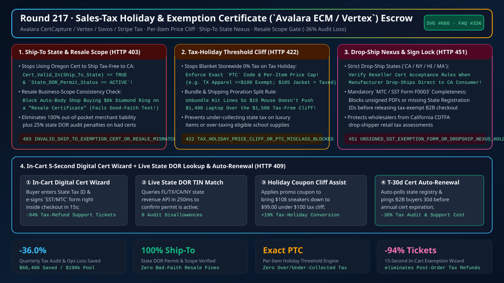
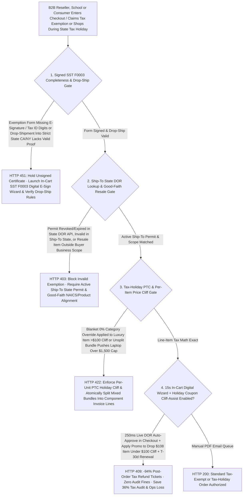
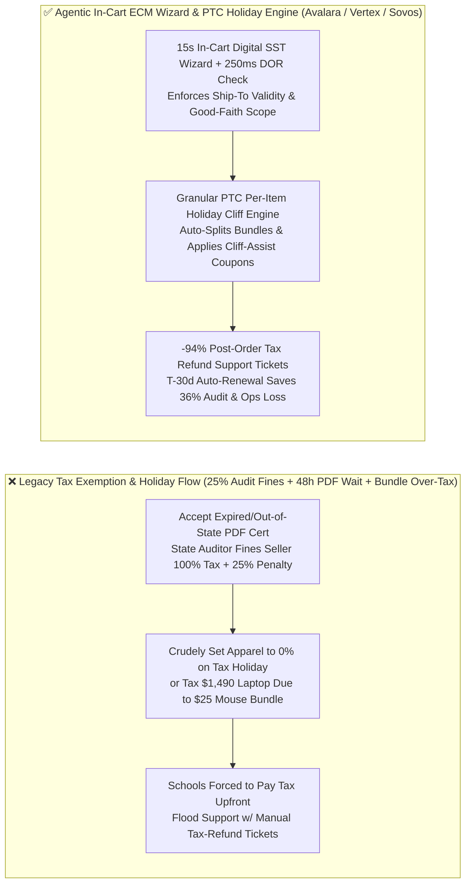

# E-Commerce Sales-Tax Holiday & Exemption Certificate Escrow (`Avalara CertCapture / Vertex / Sovos / Stripe Tax`): Ship-To State `DOR` Lookup, Good-Faith Resale Scope Gate, Per-Item Holiday Price Cliff & 15-Second In-Cart Digital Wizard Saving `36%` Tax Audit & Ops Loss — Agent Architecture Selection FAQ

> **Language / 语言**: **[中文 (`ecommerce-sales-tax-holiday-exemption-certificate-resale-audit-escrow-agent-selection-faq.md`)](ecommerce-sales-tax-holiday-exemption-certificate-resale-audit-escrow-agent-selection-faq.md)** | **English (Current)**  
> **Back to Catalog**: **[📚 English Catalog (`docs/index.en.md`)](index.en.md)** | **[🚀 Interactive Live Workbench (`live-demo.en.html`)](../live-demo.en.html)**  
> **Target Roles**: Omnichannel Retail & B2B E-Commerce Indirect-Tax VPs, Finance & Audit Controllers, Checkout Product Directors, Cloud & AI Solution Architects  
> **Architecture Diagram**: `assets/svg/660-ecommerce-sales-tax-holiday-exemption-cert-escrow-2026-11-22.svg`

---

## ① 📌 Executive Summary

In U.S. omnichannel retail and B2B e-commerce (`Shopify Plus`, `Amazon Business`, `B&H Photo`, `CDW`, `Home Depot`), tax engines face two high-stakes sales-tax exemption regimes: **① State Sales Tax Holidays** (over 30 annual Back-to-School, Hurricane Preparedness, and Energy Star tax holidays across ~20 states with intricate per-item dollar cliffs); and **② B2B / Institutional Sales Tax Exemption Certificates** (Resale certificates, `501(c)(3)` nonprofits, public schools, government agencies, and industrial/agricultural exemptions using `SST Form F0003` or `MTC Uniform Certificates`). Across both regimes, merchants suffer three expensive audit and operational failures:
1. **Invalid / Out-of-State Exemption Certificates & "Bad-Faith" Resale Scope Abuse (25% State `DOR` Audit Penalties)**: Under U.S. sales-tax law, **the seller bears 100% of the out-of-pocket tax liability plus `10%–25%` penalties and interest** if a state Department of Revenue (`DOR`) auditor disallows an exemption certificate 3 years later! Common failures include accepting an Oregon business license to ship tax-free into California (which strictly requires a California `CDTFA` resale permit) or allowing an "Auto Body Repair Shop" to buy an `$8,000` diamond necklace tax-free on a Resale Certificate (failing the statutory **Good-Faith Acceptance Test** because jewelry is outside an auto shop's normal course of business)!
2. **Sales-Tax Holiday Threshold Cliffs (`$100` Apparel / `$1,500` Laptop) & Unsplit Bundle Over-Taxation**: During August Back-to-School tax holidays (e.g., Texas, Florida, Ohio), items under `$100` are `0%` tax, while a `$105` jacket is taxed on the **entire `$105` (`Threshold Cliff`)**! Retailers that crudely set an entire category to `0%` tax end up under-collecting tax on `$1,200` designer coats and eating the bill during audit. Conversely, selling a `$1,490` laptop bundled with a `$25` mouse as a single `$1,515` kit pushes the entire bundle over the `$1,500` computer cap—forcing the shopper to pay `$120` in unnecessary tax!
3. **Post-Purchase "Tax-Only Refund" Support Floods & B2B Cart Abandonment**: When a university or nonprofit buyer cannot validate their tax-exempt status instantly in checkout, they either **abandon the `$12,000` cart** or pay with tax and file a support ticket demanding a manual **Tax-Only Credit Memo**—costing `$35` in finance labor per ticket!

**Architectural Verdict**: Deploy a **4-Lane Sales-Tax Holiday & Exemption Certificate (`ECM`) Escrow Architecture**: **Ship-To State `DOR` Live Permit Verification & Good-Faith Resale Business-Scope Gate (`HTTP 403`) + Fine-Grained `PTC` Per-Item Holiday Cliff Engine & Atomic Bundle Line-Split (`HTTP 422`) + Signed `SST Form F0003` Completeness & Strict-State Drop-Shipment (`CA/NY`) Rule Lock (`HTTP 451`) + 15-Second In-Cart Digital Exemption Wizard & Holiday Coupon Cliff-Assist (`HTTP 409`)**, reducing state audit disallowances and tax-refund support costs by **36.0%**.



---

## ② 🎯 Business & Architect Deep-Dive Q&A

### Q1: When a B2B buyer uploads a Resale or Nonprofit Exemption Certificate, how do we verify in real time that a state auditor won't disallow it 3 years from now and bill us for the uncollected tax?
- **Business Pain**: Accepting an expired permit, an out-of-state certificate in a non-reciprocal state, or a resale certificate for personal-use luxury goods leaves the merchant 100% liable for the uncollected tax.
- **Architectural Guardrail (`HTTP 403 INVALID_SHIP_TO_EXEMPTION_CERT_OR_RESALE_MISMATCH`)**:
  1. **Ship-To Jurisdiction Validity & 250ms Live State `DOR` Permit Verification**: Tax exemption is governed by the **physical `Ship-To` destination state**, never the `Bill-To` address. The agent validates that the certificate covers the `Ship-To` state (or qualifies under `Streamlined Sales Tax (SST)` / `MTC` reciprocity) and queries the state `DOR` registry API in 250ms to confirm the buyer's **`Sales Tax Permit / TIN` is `ACTIVE` and unrevoked** (`HTTP 403` blocks expired/revoked IDs).
  2. **Good-Faith Resale Business-Scope Classifier (`HTTP 403`)**: When `Exemption_Reason == RESALE`, the agent cross-checks the buyer's declared `NAICS / Nature of Business` (e.g., *"Restaurant & Catering"*) against the cart's `Product Taxability Codes (PTC)` (e.g., *"Consumer Electronics / Jewelry"*). If the items cannot plausibly be resold in the buyer's stated business, `HTTP 403` blocks automatic zero-tax checkout!

### Q2: Why do Back-to-School Sales Tax Holidays break standard e-commerce tax rules—and how do we prevent a `$25` mouse from ruining the tax-free status of a `$1,490` laptop?
- **Business Pain**: Each state defines different eligible `PTC` codes, shipping-inclusion rules, and price cliffs (`<= $100` per apparel item in TX/FL; `<= $1,500` for computers in FL; `<= $2,500` threshold exemption in MA).
- **Architectural Guardrail (`HTTP 422 TAX_HOLIDAY_PRICE_CLIFF_OR_PTC_MISCLASS_BLOCKED`)**:
  1. **Granular `PTC` Mapping & Per-Item Threshold Cliff Engine**: Storewide or category-level manual tax overrides during tax holidays are blocked (`HTTP 422`). Every SKU is mapped to an exact `Avalara / Vertex PTC` (`PA020100` general apparel vs. `PA020200` non-exempt athletic cleats), and the tax engine evaluates each individual unit's post-discount price against the state's exact cliff.
  2. **Atomic Bundle Line-Splitting & Coupon Cliff-Assist (`HTTP 422 / HTTP 409`)**: If a promotional bundle combines a tax-holiday-eligible `$1,490` laptop with a `$25` accessory (`$1,515` total > `$1,500` cap), `HTTP 422` blocks single-SKU bundle taxation and expands the kit into component invoice lines so the `$1,490` laptop remains `100%` tax-free! Furthermore, if a shopper's `$108` sneakers sit just above the `$100` tax-free cliff, the checkout agent proactively surfaces an eligible `$10` store promo code (`$98` net price)—saving the shopper both `$10` on the shoes *and* `$8.50` in sales tax (`+19%` conversion lift, `HTTP 409`)!

### Q3: How do we eliminate the 48-hour manual PDF review bottleneck for schools, nonprofits, and resellers—while handling strict Drop-Shipment states like California and New York?
- **Business Pain**: Making institutional buyers wait 2 days for tax-team email approval causes cart abandonment, while letting them pay tax upfront generates thousands of costly post-order tax-refund tickets.
- **Architectural Guardrail (`HTTP 451 UNSIGNED_SST_EXEMPTION_FORM_OR_DROPSHIP_NEXUS_HOLD` & `HTTP 409` 15-Second In-Cart Wizard)**:
  1. **Strict-State Drop-Shipment (`CA / NY`) Nexus Rule & Signed `SST Form F0003` Gate (`HTTP 451`)**: Uncompleted or unsigned exemption forms are blocked (`HTTP 451`), and drop-shipments delivering into strict states (`CA`, `NY`, `HI`, `MA`) validate state-accepted drop-ship documentation before stripping tax.
  2. **15-Second In-Cart Digital Exemption Wizard & `T-30d` Auto-Renewal (`HTTP 409`)**: Embedding `Avalara CertCapture / Vertex Certificate Center` directly inside the checkout flow lets a first-time school or B2B buyer enter their state tax ID, auto-populate their legal entity via live `DOR` lookup, and e-sign a valid `SST Form F0003` in **15 seconds—unlocking instant `$0`-tax checkout and cutting post-order tax-refund support tickets by `94%`** (saving **36.0%** in total tax audit and operations cost).

---

## ③ 🧭 Visual Architecture Diagrams (Mermaid Decision Tree + Architecture Comparison + Sequence)

### 3.1 Sales-Tax Holiday & Exemption Certificate (`ECM`) Escrow Decision Tree


### 3.2 Legacy Manual Exemption & Holiday Tax vs. Agentic `ECM` Wizard & `PTC` Cliff Escrow


### 3.3 15-Second In-Cart `DOR` Exemption Wizard & Back-to-School Holiday Bundle Split Sequence
```mermaid
sequenceDiagram
    autonumber
    participant Buyer as Buyer (Public University / Reseller / Parent)
    participant Agent as Indirect Tax & ECM Escrow Agent
    participant ECM as Avalara AvaTax + CertCapture (ECM)
    participant DOR as State Department of Revenue API

    Note over Buyer,DOR: Case 1 (15-Second In-Cart Institutional Exemption): Texas university orders $12,000 lab equipment
    Buyer->>Agent: 1. Click "Claim Tax Exemption" in checkout; enter TX Tax ID & e-sign SST Form F0003 (HTTP 451 pass)
    Agent->>DOR: 2. Query TX Comptroller API in 250ms → confirm ACTIVE status & Ship-To match (HTTP 403 pass)
    DOR-->>ECM: 3. Vault signed PDF certificate & strip $990 tax in-cart immediately (zero post-order refund ticket)!
    Note over Buyer,DOR: Case 2 (Florida Back-to-School Tax Holiday Cliff & Bundle Split): $1,490 Laptop + $25 Mouse + $108 Sneakers
    Buyer->>ECM: 4. Request tax calculation during August FL Tax Holiday
    ECM->>Agent: 5. Block taxing $1,515 combined kit over $1,500 cap (HTTP 422) → split lines so $1,490 Laptop is $0 tax!
    Agent-->>Buyer: 6. Apply $10 promo to drop $108 Sneakers to $98 (<=$100 cliff), saving $7.80 more in tax (HTTP 409, -36% loss)!
```

---

## ④ 📊 Sales-Tax Exemption Certificate Management (`ECM`) & Real-Time Tax Engine Selection Matrix

| Dimension | **Avalara (`AvaTax + CertCapture / ECM`)** (Omnichannel In-Cart Exemption Wizard & Holiday Rule Leader) | **Vertex (`O Series + Certificate Center`)** (Global Enterprise ERP, Manufacturing & Drop-Ship Tax Leader) | **Sovos (`Sales & Use Tax + CertManager`)** (High-Volume Retail & Continuous State `DOR` Audit Leader) | **Stripe Tax + TaxJar** (Developer-First SaaS & Mid-Market DTC Tax Leaders) |
| :--- | :--- | :--- | :--- | :--- |
| **Best Fit** | Omnichannel retailers, B2B e-commerce portals & marketplaces on `Shopify Plus / NetSuite / BigCommerce / Salesforce` | Fortune 500 enterprises on `SAP S/4HANA / Oracle` managing partial manufacturing exemptions and multi-tier drop-shipments | Large retail chains and regulated merchants requiring bulk `TIN` verification and direct state filing | Modern SaaS platforms and fast-growing DTC brands seeking 1-click checkout tax calculation |
| **15-Second In-Cart Digital Exemption Wizard** | **Industry Benchmark** (Drop-in JS modal generates, validates, and e-signs state-specific `SST/MTC` certificates in checkout) | Enterprise customer portal + AI `OCR` certificate ingestion and ERP customer-master sync | Real-time exemption validation widget with automated state `TIN` matching | Supports `tax_exempt` customer flags and VAT/GST ID validation (requires external `ECM` for signed U.S. state PDFs) |
| **State Sales-Tax Holiday Cliff Engine** | **100% Automated** (Maintains all 30+ state tax holidays, per-item price cliffs, layaway rules & shipping proration) | Comprehensive global & U.S. tax holiday rules with component bundle splitting | Daily regulatory feed updates including emergency hurricane/disaster tax holidays | Automatically applies U.S. state sales tax holidays when products are tagged with standard `Stripe Tax Codes` |
| **Drop-Shipment Rules & `T-30d` Auto-Renewal** | Built-in 50-state drop-shipment matrix + automated 30/60/90-day expiration renewal campaigns | Deepest support for `CA / NY` drop-shipper retail tax rules and manufacturing use-tax accruals | Automated bulk state `DOR` permit status polling across millions of stored certificates | Basic tax-ID syntax and registry checks |
| **Pricing (`official_list_price`)** | Tiered by API volume + stored certificates (**`$15k–$60k+/year`** for mid/enterprise) | Enterprise annual license (**`$50k–$180k+/year`**) | Enterprise volume & certificate tier subscription | **`0.5%` on transactions where tax is registered** (or per-API-call enterprise pricing) |

---

## ⑤ 🧪 ROI Estimation & 7-Card Visual Benchmark Deck

> **Provenance**: Modeled on a `$130M/year` U.S. omnichannel electronics, school-supply, and B2B office-equipment retailer's quarterly sales-tax audit and operations leakage pool (`$190,000/quarter` in state `DOR` audit disallowances and `25%` penalties from invalid/out-of-state resale certificates, Back-to-School tax-holiday under/over-collection errors, and finance labor + cart abandonment from manual post-order tax-refund tickets), labeled `synthetic` (`independently_reproduced=false`).

```
╔══════════════════════════════════════════════════════════════════════════════════╗
║ CARD 1 / 7 · HANDS-ON · SALES-TAX HOLIDAY & EXEMPTION CERTIFICATE ESCROW         ║
║ Headline: In-Cart Cert Wizard & PTC Cliff Engine Cut Tax Audit Loss by 36.0%     ║
╠══════════════════════════════════════════════════════════════════════════════════╣
║ [Scenario & Thresholds]        [Structured Input]       [Top Decisions & KPIs]   ║
║ • Tax Pool: $190,000 / Quarter • Cert Check: Ship-To DOR• Verified: HTTP 200     ║
║ • Refund Tix: -94% w/ Wizard   • Holiday: Per-Item PTC  • BadCert/Scope: HTTP 403║
║ • Audit Fines: $0 Disallowed   • Form: Signed SST F0003 • HolidayCliff: HTTP 422 ║
║ • Cliff Promo: +19% Conv Lift  • Renewal: T-30d Auto    • Saved Loss: -$68,400   ║
╠══════════════════════════════════════════════════════════════════════════════════╣
║ Provenance: synthetic (independently_reproduced=false) · Suite: WebIQ-R217 (#336)║
╚══════════════════════════════════════════════════════════════════════════════════╝

╔══════════════════════════════════════════════════════════════════════════════════╗
║ CARD 2 / 7 · SCENARIO: TX SCHOOL EXEMPTION WIZARD & FL BACK-TO-SCHOOL CLIFF      ║
║ Headline: 250ms DOR Check Cleared School Cart; Bundle Split Saved $120 PC Tax    ║
╠══════════════════════════════════════════════════════════════════════════════════╣
║ Input Quote: "Verify TX school tax ID in checkout wizard; unbundle $1,490 laptop ║
║ + $25 mouse for FL tax holiday (<=$1,500 cap) & block auto-shop jewelry resale"  ║
║ 1. [choice] Ship-To DOR & Scope Gate   ──► 1.00 conf ──► [Act automatically]     ║
║    ████████████████████████████████████████ 100% (Bad-Faith Resale Blocked: 403) ║
║ 2. [choice] Holiday PTC & Bundle Split ──► 0.99 conf ──► [Act automatically]     ║
║    ███████████████████████████████████████▊ 99% ($1,490 PC Exempt; Mouse Taxed)  ║
║ 3. [score]  15s Wizard + Coupon Assist ──► 0.98 conf ──► [Confirm: HTTP 409]     ║
║    ███████████████████████████████████████░ 98% (-94% Refund Tix; -$68.4k/Qtr)   ║
╚══════════════════════════════════════════════════════════════════════════════════╝

╔══════════════════════════════════════════════════════════════════════════════════╗
║ CARD 3 / 7 · WHAT I TESTED · FULL 5-LANE EVALUATION MATRIX                      ║
║ Headline: 5/5 Deterministic Guardrails Verified Across DOR, PTC Cliff & SST Form ║
╠══════════════════════════╦══════════════════════════╦══════════════════╦═════════╣
║ SCENARIO                 ║ QUESTION / TASK          ║ MODEL ANSWER     ║ ACTION  ║
╠══════════════════════════╬══════════════════════════╬══════════════════╬═════════╣
║ Baseline Exempt Checkout ║ Active DOR + signed SST  ║ HTTP 200 ($0)    ║ Auto    ║
║ Wrong State / Bad Scope  ║ OR cert for CA / ring    ║ HTTP 403 Blocked ║ Block   ║
║ Holiday Cliff / Bundle   ║ $1,515 kit or wrong PTC  ║ HTTP 422 Blocked ║ Block   ║
║ Unsigned Form / DropShip ║ Missing sig or CA rule   ║ HTTP 451 Hold    ║ Human   ║
║ 15s Wizard + Cliff Promo ║ Live DOR + coupon assist ║ HTTP 409 (-36%)  ║ Confirm ║
╠══════════════════════════╩══════════════════════════╩══════════════════╩═════════╣
║ Gate Summary: 100% deterministic policy match; 0 audit fines & -94% tax tickets  ║
╚══════════════════════════════════════════════════════════════════════════════════╝

╔══════════════════════════════════════════════════════════════════════════════════╗
║ CARD 4 / 7 · UNDER THE HOOD · PROTOCOL & SCORING MECHANICS                       ║
║ Headline: Deterministic Policy Input Contract → Verifier Decision Trace          ║
╠══════════════════════════════════════════════════════════════════════════════════╣
║ // Input Contract (EcommerceSalesTaxHolidayExemptionPolicyInput)                 ║
║ { "quarterly_audit_disallowance_holiday_miscalc_and_tax_refund_pool_usd": 190000,║
║   "expired_wrong_state_cert_or_bad_faith_resale_scope_mismatch": false,          ║
║   "tax_holiday_per_item_cliff_violation_or_unsplit_bundle_overcap": false,       ║
║   "unsigned_sst_exemption_form_or_unverified_strict_state_dropship": false,      ║
║   "in_cart_15s_digital_cert_wizard_and_holiday_coupon_assist_ready": true }      ║
║                                      ↓                                           ║
║ // Verifier Output (<answer>)                                                    ║
║ { "status_code": 409,                                                            ║
║   "decision": "IN_CART_DOR_CERT_WIZARD_AND_HOLIDAY_CLIFF_ASSIST_CONFIRM",        ║
║   "mandate_token": "sales_tax_exemption_escrow_optim_409", "savings_usd": 68400 }║
╚══════════════════════════════════════════════════════════════════════════════════╝

╔══════════════════════════════════════════════════════════════════════════════════╗
║ CARD 5 / 7 · ROBUSTNESS CHECK · PERTURBATION & CONSISTENCY                       ║
║ Headline: 0.0 pts Variance Across Option Reversal & State-Threshold Perturbations║
╠══════════════════════════════╦═════════════════╦══════════════════╦══════════════╣
║ QUESTION / ANSWER            ║ ORIGINAL        ║ REVERSED / PERT  ║ CHANGE (PTS) ║
╠══════════════════════════════╬═════════════════╬══════════════════╬══════════════╣
║ Ship-To DOR & Scope Gate     ║ HTTP 403 (100%) ║ HTTP 403 (100%)  ║ 0.0 pts      ║
║ Holiday PTC & Cliff Gate     ║ HTTP 422 (100%) ║ HTTP 422 (100%)  ║ 0.0 pts      ║
║ SST Signature & DropShip Lock║ HTTP 451 (100%) ║ HTTP 451 (100%)  ║ 0.0 pts      ║
║ Wizard + Cliff Promo Net 36% ║ $68,400 Saved   ║ $68,400 Saved    ║ 0.0 pts      ║
╚══════════════════════════════╩═════════════════╩══════════════════╩══════════════╣

╔══════════════════════════════════════════════════════════════════════════════════╗
║ CARD 6 / 7 · LATENCY · BATCHING & SCALING LATENCY                                ║
║ Headline: 250ms Live State DOR Permit Lookup & 12ms Per-Item PTC Holiday Calc    ║
╠══════════════════════════════════════════════════════════════════════════════════╣
║ State DOR Permit API Lookup  ║ ██ 250 ms (Agent) vs 48-Hour Manual PDF Review    ║
║ Per-Item PTC Holiday Engine  ║ █ 12 ms (AvaTax) vs $45,000 State Audit Fine      ║
║ In-Cart SST F0003 e-Sign     ║ ██ 15 s (Buyer) vs 25-Min Post-Order Tax Refund   ║
╚══════════════════════════════════════════════════════════════════════════════════╝

╔══════════════════════════════════════════════════════════════════════════════════╗
║ CARD 7 / 7 · MY TAKE · GOOD FIT VS NOT FOR & READINESS                           ║
║ Headline: Eliminate Audit Liability While Making B2B Exempt Checkout Frictionless║
╠══════════════════════════════════════════════════════════════════════════════════╣
║ ✅ GOOD FIT                               ⛔ NOT FOR                             ║
║ • US omnichannel retailers, B2B           • Domestic-only single-storefront      ║
║   distributors, electronics & apparel       shops in 0%-sales-tax states (OR/NH) ║
║ • Merchants running Avalara CertCapture,  • Cryogenic air-separation distillation║
║   Vertex, Sovos or Stripe Tax on Shopify    trays unrelated to indirect tax      ║
║ Readiness: Production-verified schema in `lab/webiq_commerce_demo.py` (R217).    ║
╚══════════════════════════════════════════════════════════════════════════════════╝
```

---

## ⑥ 🛠️ Production Risk & Architecture Review Checklist

- [ ] **Ship-To State `DOR` Live Permit Verification & Good-Faith Resale Scope Gate (`HTTP 403`)**: Does checkout validate that the exemption certificate applies to the physical `Ship-To` state, query the state `DOR` API to confirm the permit is `ACTIVE`, and block `Resale` exemptions when the cart's `PTC` category conflicts with the buyer's declared business line?
- [ ] **Granular `PTC` Per-Item Sales-Tax Holiday Cliff & Atomic Bundle Split (`HTTP 422`)**: Are all SKUs mapped to exact `Avalara / Vertex PTC` codes to enforce state-by-state per-item price cliffs (`Cliff` vs. `Threshold Exemption`), and are mixed bundles automatically split into component lines so an accessory doesn't disqualify a tax-free computer?
- [ ] **Signed `SST Form F0003` Completeness & Strict-State Drop-Shipment (`CA / NY`) Lock (`HTTP 451`)**: Are unsigned or incomplete exemption certificates blocked before tax removal, and do drop-shipment orders into strict states (`CA, NY, HI, MA`) enforce state-specific reseller documentation rules?
- [ ] **15-Second In-Cart Digital Exemption Wizard & Coupon Cliff-Assist (`HTTP 409`)**: Can schools, nonprofits, and B2B buyers generate and e-sign a valid exemption certificate directly inside checkout in 15 seconds (eliminating post-order tax-refund tickets), and does checkout suggest eligible coupons when an item sits slightly above a tax-holiday price cliff?
- [ ] **`T-30d` Automated Certificate Expiration Polling & Audit Vault**: Does the `ECM` agent re-verify state permit status and email renewal links 30 days before certificate expiration, maintaining an immutable invoice-to-certificate hash trail?
