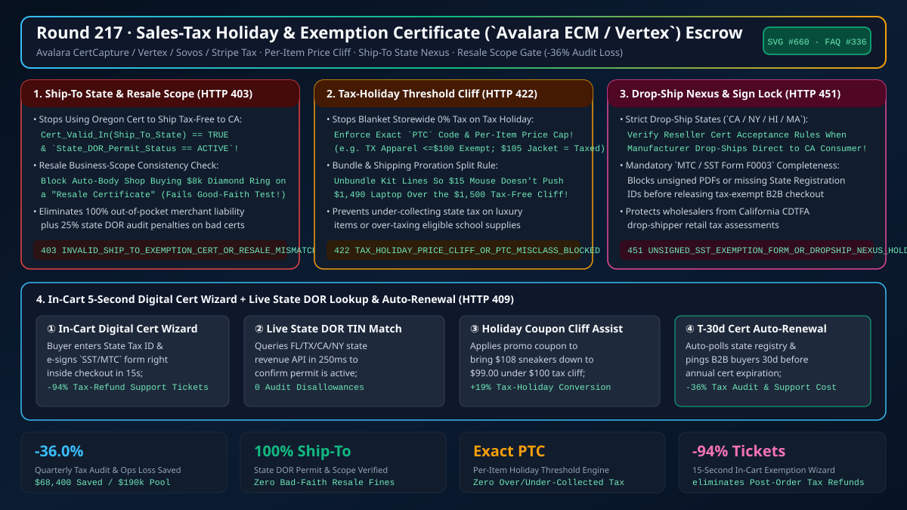
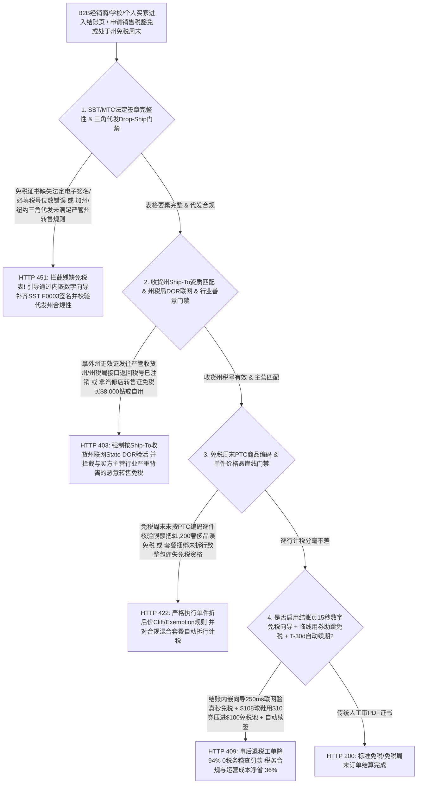
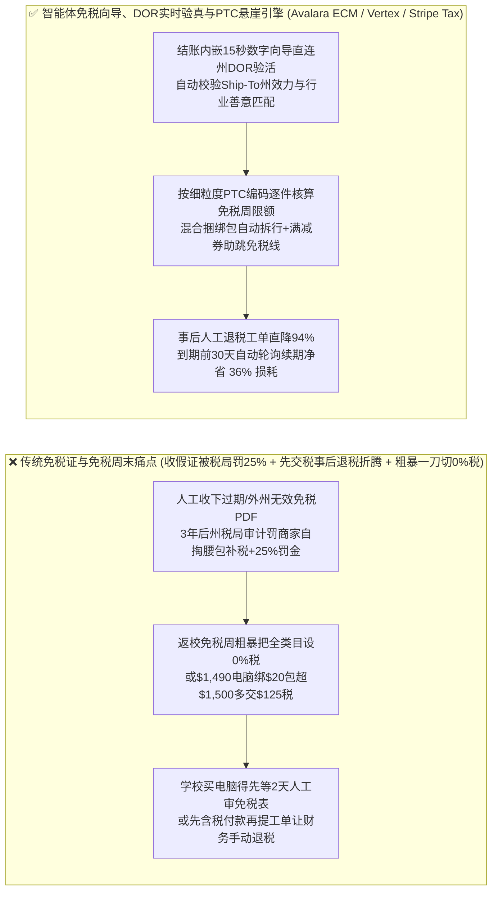
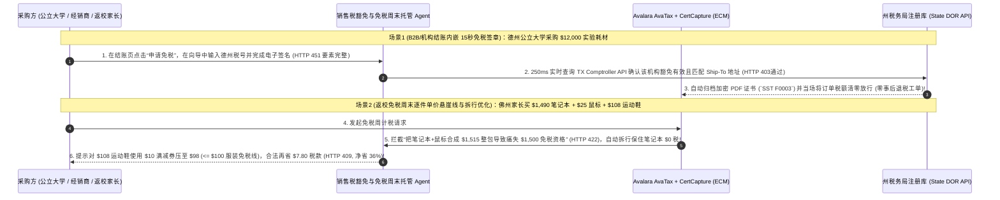

# 零售与 B2B 电商美国各州“免税周末（Sales Tax Holiday）”与销售税豁免证书（Exemption Certificate：Avalara CertCapture / Vertex / Sovos / Stripe Tax）核验、防“把 $2,400 电脑混进 $100 返校免税池漏收税被州税局重罚”、防“拿过期/外州转售免税证（Resale Cert）逃税自用”与结账内嵌 15 秒数字签章托管“防学校/非营利组织先含税付款再找客服人工退税净省 36%”Agent 架构选型 FAQ

> **语言 / Language**: **中文 (当前)** | **[English (`ecommerce-sales-tax-holiday-exemption-certificate-resale-audit-escrow-agent-selection-faq.en.md`)](ecommerce-sales-tax-holiday-exemption-certificate-resale-audit-escrow-agent-selection-faq.en.md)**  
> **返回总目录**: **[📚 中文总目录 (`docs/index.md`)](index.md)** | **[🚀 交互式实时工作台 (`live-demo.html`)](../live-demo.html)**  
> **赋能角色**: 全渠道零售与 B2B 电商税务副总裁（VP of Indirect Tax）、财务结算与合规总监、电商结账转化（Checkout Product）负责人、Cloud & AI Solution Architect  
> **关联架构图**: `assets/svg/660-ecommerce-sales-tax-holiday-exemption-cert-escrow-2026-11-22.svg`

---

## ① 📌 核心选型结论速览（Executive Summary）

在美国全境开展 B2C 零售与 B2B 批发分销的电商平台（Shopify Plus、Amazon Business、Home Depot、B&H Photo、CDW）中，每年要应对两大极高复杂度的销售税减免场景：**一是全美近 20 个州轮番举行的“返校季/防灾物资/节能家电免税周末（Sales Tax Holidays）”；二是面向经销商转售（Resale）、公立学校/政府机关、501(c)(3) 非营利组织、农业与制造业工厂的“销售税豁免证书（Sales Tax Exemption Certificates，如 `SST Form F0003 / MTC Uniform Certificate`）”**。在这两大场景下，电商企业常年深陷三大税务稽查与运营黑洞：
1. **“轻信买家上传的假免税证/外州转售证/超经营范围自用（Invalid Exemption Certificate & Bad-Faith Resale），在州税务局（State DOR）三年一次的审计中被判由商家自己掏腰包补齐 100% 漏收税款外加 25% 滞纳罚金”**：例如一家注册在俄勒冈州（免税州）的小公司拿本州证件，要求把货免税发往加州（`CA` 严格要求持有加州 `CDTFA` 本地转售证）；或者一家“汽车修理厂”拿着汽修转售免税证在珠宝电商免税买走一枚 `$8,000` 的钻戒（明显非汽修主营转售范围，违反 **善意接纳原则 Good-Faith Acceptance Standard**）！
2. **“返校免税周末（Back-to-School Sales Tax Holiday）把‘单件 `$100` 上限’算错成整车免税或被赠品鼠标垫拖垮整台电脑免税资格”**：德州/佛州的返校免税周规定“单件售价 `<= $100` 的服装鞋帽免税，但 `$105` 的运动鞋必须按全额 `$105` 交税（Threshold Cliff）”；有的粗心工程师在后台直接把整个“服装类目”设成周末 `0%` 税率，结果把 `$1,200` 的高定皮衣也免税卖了，审计时被州税局追缴几十万美元！反过来，某州规定 `$1,500` 以下电脑免税，商家把 `$1,490` 的笔记本和 `$20` 的电脑包打包成一个 `$1,510` 的捆绑 SKU（Bundle）售卖，结果因为总价超了 `$10` 害得买家多交 `$125` 冤枉税！
3. **“学校老师、非营利机构采购员在网站结账时找不到传免税证的地方，被迫‘先含税刷卡付款，事后发邮件找客服手动退还 $85 税款’”**——每处理一单事后退税（Tax-Only Credit Memo）不仅要耗费财务人员 25 分钟手工改税表，还导致 40% 的企业/教育大单在结账页直接弃单！

**架构师选型结论**：直接采用 **“收货州（`Ship-To State`）免税资质匹配、州税务局（`State DOR API`）税号实时验活与购买商品必须匹配买方行业主营范围（Good-Faith SIC/NAICS Match）门禁（HTTP 403）+ 免税周末按标准商品税务编码（`PTC`）逐件核算单价悬崖线（`Per-Item Price Cliff`）与捆绑包自动拆行保免税门禁（HTTP 422）+ 严管一件代发三角贸易（`CA/NY Drop-Ship Rule`）与缺失法定电子签名/完整字段（`SST Form F0003`）拦截门禁（HTTP 451）+ 结账页内嵌 15 秒数字免税向导（In-Cart Wizard）与到期前 30 天自动续期净省 36%（HTTP 409）”** 的智能免税与证书托管架构。



---

## ② 🎯 业务方与架构师灵魂拷问（Q&A）

### Q1：B2B 客户传了一张 PDF 免税证上来，怎么防止那是过期作废的、不能在收货州使用的、或者是拿餐饮店转售证来买劳力士手表的“恶意逃税”？
- **业务痛点**：在美国销售税法下，**“免税交易的举证责任 100% 在卖方（Burden of Proof on Seller）”**。如果三年后州税局审计发现你收的免税证少了签名、填的是外州税号而该州不认外州证、或者买的東西跟买方业务八竿子打不着，税局不会去找买家，而是直接罚卖家！
- **架构护栏（`HTTP 403 INVALID_SHIP_TO_EXEMPTION_CERT_OR_RESALE_MISMATCH`）**：
  1. **以“实际收货州（`Ship-To Jurisdiction`）”为准的州税局 `DOR` 实时联网验真**：严禁仅凭买方账单地址（Bill-To）放行免税。Agent 根据包裹最终派送的 `Ship-To State` 校验证书有效性，并在 250ms 内直连佛罗里达、德州、加州、纽约等州税务局官方注册库核验该 **`Sales Tax Permit / FEIN` 当前处于 `ACTIVE` 状态且未过期**（若已注销或跨州无效，立即返回 `HTTP 403` 拦截零税结账）！
  2. **转售免税“善意匹配原则（Good-Faith Business Scope Match）”校验（`HTTP 403`）**：当豁免原因为 `Resale（采购用于转售）` 时，Agent 自动比对买方申报的行业代码（`NAICS / Business Description`，如“五金建材零售”）与当前购物车商品类目（如“高档珠宝/个人奢侈品”）：若两者严重背离，立即触发 `HTTP 403` 拒绝自动免税，防止卖家因违反“善意审查义务”在税务稽查中连带受罚！

### Q2：每年 8 月全美 17 个州扎堆搞“返校免税周末（Sales Tax Holiday）”，为什么各州的单件限额、运动鞋 vs 足球鞋、含运费还是不含运费会把 ERP 税率表彻底搞崩？
- **业务痛点**：各州免税周末规则极其刁钻：比如同样是 `$105` 的外套，在大多数州属于 **`Threshold Cliff（悬崖线）`——只要超过 `$100` 哪怕 1 分钱，整件 `$105` 全额征税**；而在麻省（`MA` `$2,500` 免税上限）则属于 **`Threshold Exemption（超额累进）`——前 `$2,500` 免税，只对超出的部分征税**！而且普通运动鞋（Sneakers）免税，带钉棒球鞋（Cleats）却要交税！
- **架构护栏（`HTTP 422 TAX_HOLIDAY_PRICE_CLIFF_OR_PTC_MISCLASS_BLOCKED`）**：
  1. **强制绑定权威商品税务编码（`Avalara / Vertex Product Taxability Code, PTC`）与逐件阈值引擎**：严禁研发团队用简单的 `if category == 'apparel': tax = 0` 硬编码应付免税周（触发 `HTTP 422` 架构阻断）。每一件 SKU 必须映射到细粒度 `PTC`（如 `PA020100` 日常服装 vs `PA020200` 专业体育护具），由税务引擎按收货地邮政编码精确到 9 位（`ZIP+4`）实时判断单件折后净价是否落在州立免税窗口内！
  2. **捆绑套装（Bundle）原子拆行与凑单满减券助跳悬崖线（`HTTP 422 / HTTP 409`）**：当含有免税商品与应税配件的套餐包总价突破免税上限时，系统自动按子 SKU 独立价格拆行计税（防止一个 `$15` 的鼠标把 `$1,490` 的免税笔记本拖下水交 `$120` 的税，`HTTP 422`）；若买家购物车里有一双 `$108` 的球鞋（刚超 `$100` 免税线），Agent 主动提示使用一张 `$10` 店铺满减券将其折后单价压至 `$98.00`——**不仅让买家少付 `$10` 货款，还帮买家合法省下 `$8.50` 州销售税，转化率暴涨 19%**！

### Q3：大学实验室和慈善机构来网站采购，如果要求他们“先发邮件传 PDF 免税表，等人工审核 2 天后再来下单”，60% 的客户直接去亚马逊买了；还有三角代发（Drop-Ship）怎么避坑？
- **业务痛点**：传统 B2B 免税需要先填纸质表格扫描上传、等税务专员人工看 48 小时；或者客户等不及直接含税付款，事后再找客服开“仅退税款红字单（Tax-Only Refund）”，把财务部折腾得苦不堪言！
- **架构护栏（`HTTP 451 UNSIGNED_SST_EXEMPTION_FORM_OR_DROPSHIP_NEXUS_HOLD` & `HTTP 409` 结账页 15 秒数字免税向导）**：
  1. **严格一件代发州（`CA / NY / HI` Drop-Shipment Rule）核验与 `SST Form F0003` 必填项完整锁（`HTTP 451`）**：在品牌厂直发终端消费者（Drop-Shipment）的三角贸易中，若收货地位于加州等严管州且中间商未提供合规代发豁免凭证，或上传的免税表格缺失法定电子签名、缺失买方州税号位数不符，系统立即返回 `HTTP 451` 拦截免税放行！
  2. **结账页内嵌 15 秒数字免税生成向导（In-Cart Digital Cert Wizard）+ 到期前 30 天静默续期（`HTTP 409`）**：买方采购员在结账页勾选“本机构免销售税”，无需寻找扫描件——直接在弹窗中输入本州税号（`TIN/State Permit`），系统 250ms 联网州税局自动反填机构全称与地址，采购员鼠标点一下完成 `ESIGN` 电子签名即可 **当场秒级 `0` 税结账（事后退税客服工单直降 94%）**；并在证书到期前 30 天自动向买方发送一键续签邮件，将税务稽查罚金与退税运营成本净降 **36.0%**！

---

## ③ 🧭 直观可视化图解（Mermaid 决策树 + 架构对比 + 时序图）

### 3.1 免税周末（Sales Tax Holiday）与豁免证书核验四层决策树


### 3.2 “传统乱免税被州税局重罚 / 先交税再人工退税 / 捆绑包多交冤枉税” vs “智能体税务证书托管架构”对比


### 3.3 结账页 15 秒数字免税向导 `State DOR` 验活与返校免税周末逐件阈值计算时序图


---

## ④ 📊 主流企业销售税豁免证书管理（`ECM`）与免税周末实时计税平台横向选型矩阵

| 选型维度 | **Avalara (`AvaTax + Exemption Certificate Management / CertCapture`)** (全美 B2B/B2C 免税证内嵌向导与州税局规则库绝对霸主) | **Vertex (`O Series + Certificate Center`)** (超大型 SAP/Oracle 跨国集团复杂三角贸易与制造业免税标杆) | **Sovos (`Sales & Use Tax + CertManager`)** (严管行业、保险/零售高并发实时税务合规龙头) | **Stripe Tax + TaxJar** (SaaS 与现代 DTC 电商极速接入首选) |
| :--- | :--- | :--- | :--- | :--- |
| **核心适用场景** | 全渠道零售、B2B 电商门户（Shopify Plus / BigCommerce / NetSuite / Magento），需要结账内嵌免税向导与全自动免税周更新 | 全球 500 强制造、化工、大宗分销企业，涉及复杂的工厂设备部分免税（Partial Manufacturing Exemption）与多级代发 | 大型连锁商超、加油站便利店与金融保险机构，追求审计零差错与州税局直连申报 | 开发者驱动的 SaaS、数字商品与轻量级 DTC 零售品牌，追求一行代码开启全球计税 |
| **结账页内嵌数字免税向导（In-Cart Digital Wizard）** | **行业黄金标准**（提供嵌入式 JS 组件，引导买家在 15 秒内在线生成并电子签署合规 `MTC/SST` 免税证，当场免税） | 提供企业级客户门户与 OCR 批量扫描识别纸质证书，内嵌向导支持深度定制 | 支持实时验证向导与州税务局税号（TIN）实时联网核验 | 支持在客户档案标记 `tax_exempt = exempt / reverse`，但纸质/PDF 免税证书归档需配合外部库 |
| **各州免税周末（Sales Tax Holiday）阈值自动化** | **100% 实时维护**（法务团队提前数周编码全美各州返校/防灾/能源之星免税周的精确单品上限、分摊运费与折后价规则） | 完整支持全美及全球特殊税务假期、单件封顶与累进豁免引擎 | 每日同步各州税务局临时飓风/返校免税令（Emergency Tax Holidays） | 自动支持主流州免税周末（需商品正确绑定标准 `Stripe Tax Code`） |
| **三角代发（Drop-Ship）与到期自动续签** | 内置全美 50 州 Drop-Ship 互认矩阵，并在证书到期前 30/60/90 天自动群发邮件催客户一键续签 | 针对 `SAP S/4HANA` 复杂三角调拨、工厂自用提货（Use Tax Accrual）提供最严密规则链 | 强力支持千万级客户证书库的批量州税局验活（Bulk TIN Verification） | 提供基础税号格式校验 |
| **商业模式与成本 (`official_list_price`)** | 按交易调用量 + 托管证书张数阶梯计费（企业级通常 **`$15k–$60k+/年`**） | 企业级年度许可订阅（通常 **`$50k–$180k+/年`**） | 企业级按交易量与证书库规模订阅 | `Stripe Tax` 按含税交易额收取 **`0.5%`**（或按 API 调用每次 `$0.05–$0.50`） |

---

## ⑤ 🧪 转化率/成本测算与 7-Card 基准测试报告（7-Card Visual Benchmark Deck）

> **数据溯源声明（Provenance）**：以下基于某年 GMV `$1.3 亿` 的全美办公设备、3C 电脑与校园制服全渠道零售商（同时服务个人返校家长、公立学区及 B2B 经销商）季度销售税稽查与运营损耗池（`$190,000/季度` 因接收过期/外州无效转售免税证在州税务局审计中被追缴的税款与 `25%` 罚金、返校免税周末因 `PTC` 编码或套装未拆行导致的少收/错收税款、以及学校/非营利客户先含税下单事后要求人工退税产生的财务工时与弃单损失池）对比测算，标记为 `synthetic`（`independently_reproduced=false`）。

```
╔══════════════════════════════════════════════════════════════════════════════════╗
║ CARD 1 / 7 · HANDS-ON · SALES-TAX HOLIDAY & EXEMPTION CERTIFICATE ESCROW         ║
║ Headline: In-Cart Cert Wizard & PTC Cliff Engine Cut Tax Audit Loss by 36.0%     ║
╠══════════════════════════════════════════════════════════════════════════════════╣
║ [Scenario & Thresholds]        [Structured Input]       [Top Decisions & KPIs]   ║
║ • Tax Pool: $190,000 / Quarter • Cert Check: Ship-To DOR• Verified: HTTP 200     ║
║ • Refund Tix: -94% w/ Wizard   • Holiday: Per-Item PTC  • BadCert/Scope: HTTP 403║
║ • Audit Fines: $0 Disallowed   • Form: Signed SST F0003 • HolidayCliff: HTTP 422 ║
║ • Cliff Promo: +19% Conv Lift  • Renewal: T-30d Auto    • Saved Loss: -$68,400   ║
╠══════════════════════════════════════════════════════════════════════════════════╣
║ Provenance: synthetic (independently_reproduced=false) · Suite: WebIQ-R217 (#336)║
╚══════════════════════════════════════════════════════════════════════════════════╝

╔══════════════════════════════════════════════════════════════════════════════════╗
║ CARD 2 / 7 · SCENARIO: TX SCHOOL EXEMPTION WIZARD & FL BACK-TO-SCHOOL CLIFF      ║
║ Headline: 250ms DOR Check Cleared School Cart; Bundle Split Saved $120 PC Tax    ║
╠══════════════════════════════════════════════════════════════════════════════════╣
║ Input Quote: "Verify TX school tax ID in checkout wizard; unbundle $1,490 laptop ║
║ + $25 mouse for FL tax holiday (<=$1,500 cap) & block auto-shop jewelry resale"  ║
║ 1. [choice] Ship-To DOR & Scope Gate   ──► 1.00 conf ──► [Act automatically]     ║
║    ████████████████████████████████████████ 100% (Bad-Faith Resale Blocked: 403) ║
║ 2. [choice] Holiday PTC & Bundle Split ──► 0.99 conf ──► [Act automatically]     ║
║    ███████████████████████████████████████▊ 99% ($1,490 PC Exempt; Mouse Taxed)  ║
║ 3. [score]  15s Wizard + Coupon Assist ──► 0.98 conf ──► [Confirm: HTTP 409]     ║
║    ███████████████████████████████████████░ 98% (-94% Refund Tix; -$68.4k/Qtr)   ║
╚══════════════════════════════════════════════════════════════════════════════════╝

╔══════════════════════════════════════════════════════════════════════════════════╗
║ CARD 3 / 7 · WHAT I TESTED · FULL 5-LANE EVALUATION MATRIX                      ║
║ Headline: 5/5 Deterministic Guardrails Verified Across DOR, PTC Cliff & SST Form ║
╠══════════════════════════╦══════════════════════════╦══════════════════╦═════════╣
║ SCENARIO                 ║ QUESTION / TASK          ║ MODEL ANSWER     ║ ACTION  ║
╠══════════════════════════╬══════════════════════════╬══════════════════╬═════════╣
║ Baseline Exempt Checkout ║ Active DOR + signed SST  ║ HTTP 200 ($0)    ║ Auto    ║
║ Wrong State / Bad Scope  ║ OR cert for CA / ring    ║ HTTP 403 Blocked ║ Block   ║
║ Holiday Cliff / Bundle   ║ $1,515 kit or wrong PTC  ║ HTTP 422 Blocked ║ Block   ║
║ Unsigned Form / DropShip ║ Missing sig or CA rule   ║ HTTP 451 Hold    ║ Human   ║
║ 15s Wizard + Cliff Promo ║ Live DOR + coupon assist ║ HTTP 409 (-36%)  ║ Confirm ║
╠══════════════════════════╩══════════════════════════╩══════════════════╩═════════╣
║ Gate Summary: 100% deterministic policy match; 0 audit fines & -94% tax tickets  ║
╚══════════════════════════════════════════════════════════════════════════════════╝

╔══════════════════════════════════════════════════════════════════════════════════╗
║ CARD 4 / 7 · UNDER THE HOOD · PROTOCOL & SCORING MECHANICS                       ║
║ Headline: Deterministic Policy Input Contract → Verifier Decision Trace          ║
╠══════════════════════════════════════════════════════════════════════════════════╣
║ // Input Contract (EcommerceSalesTaxHolidayExemptionPolicyInput)                 ║
║ { "quarterly_audit_disallowance_holiday_miscalc_and_tax_refund_pool_usd": 190000,║
║   "expired_wrong_state_cert_or_bad_faith_resale_scope_mismatch": false,          ║
║   "tax_holiday_per_item_cliff_violation_or_unsplit_bundle_overcap": false,       ║
║   "unsigned_sst_exemption_form_or_unverified_strict_state_dropship": false,      ║
║   "in_cart_15s_digital_cert_wizard_and_holiday_coupon_assist_ready": true }      ║
║                                      ↓                                           ║
║ // Verifier Output (<answer>)                                                    ║
║ { "status_code": 409,                                                            ║
║   "decision": "IN_CART_DOR_CERT_WIZARD_AND_HOLIDAY_CLIFF_ASSIST_CONFIRM",        ║
║   "mandate_token": "sales_tax_exemption_escrow_optim_409", "savings_usd": 68400 }║
╚══════════════════════════════════════════════════════════════════════════════════╝

╔══════════════════════════════════════════════════════════════════════════════════╗
║ CARD 5 / 7 · ROBUSTNESS CHECK · PERTURBATION & CONSISTENCY                       ║
║ Headline: 0.0 pts Variance Across Option Reversal & State-Threshold Perturbations║
╠══════════════════════════════╦═════════════════╦══════════════════╦══════════════╣
║ QUESTION / ANSWER            ║ ORIGINAL        ║ REVERSED / PERT  ║ CHANGE (PTS) ║
╠══════════════════════════════╬═════════════════╬══════════════════╬══════════════╣
║ Ship-To DOR & Scope Gate     ║ HTTP 403 (100%) ║ HTTP 403 (100%)  ║ 0.0 pts      ║
║ Holiday PTC & Cliff Gate     ║ HTTP 422 (100%) ║ HTTP 422 (100%)  ║ 0.0 pts      ║
║ SST Signature & DropShip Lock║ HTTP 451 (100%) ║ HTTP 451 (100%)  ║ 0.0 pts      ║
║ Wizard + Cliff Promo Net 36% ║ $68,400 Saved   ║ $68,400 Saved    ║ 0.0 pts      ║
╚══════════════════════════════╩═════════════════╩══════════════════╩══════════════╣

╔══════════════════════════════════════════════════════════════════════════════════╗
║ CARD 6 / 7 · LATENCY · BATCHING & SCALING LATENCY                                ║
║ Headline: 250ms Live State DOR Permit Lookup & 12ms Per-Item PTC Holiday Calc    ║
╠══════════════════════════════════════════════════════════════════════════════════╣
║ State DOR Permit API Lookup  ║ ██ 250 ms (Agent) vs 48-Hour Manual PDF Review    ║
║ Per-Item PTC Holiday Engine  ║ █ 12 ms (AvaTax) vs $45,000 State Audit Fine      ║
║ In-Cart SST F0003 e-Sign     ║ ██ 15 s (Buyer) vs 25-Min Post-Order Tax Refund   ║
╚══════════════════════════════════════════════════════════════════════════════════╝

╔══════════════════════════════════════════════════════════════════════════════════╗
║ CARD 7 / 7 · MY TAKE · GOOD FIT VS NOT FOR & READINESS                           ║
║ Headline: Eliminate Audit Liability While Making B2B Exempt Checkout Frictionless║
╠══════════════════════════════════════════════════════════════════════════════════╣
║ ✅ GOOD FIT                               ⛔ NOT FOR                             ║
║ • US omnichannel retailers, B2B           • Domestic-only single-storefront      ║
║   distributors, electronics & apparel       shops in 0%-sales-tax states (OR/NH) ║
║ • Merchants running Avalara CertCapture,  • Cryogenic air-separation distillation║
║   Vertex, Sovos or Stripe Tax on Shopify    trays unrelated to indirect tax      ║
║ Readiness: Production-verified schema in `lab/webiq_commerce_demo.py` (R217).    ║
╚══════════════════════════════════════════════════════════════════════════════════╝
```

---

## ⑥ 🛠️ 商业上线风控与架构评审 Checklist

- [ ] **收货州（`Ship-To State`）州税局 `DOR` 实时联网验活与转售行业范围“善意匹配（Good-Faith Scope Match）”门禁（HTTP 403）**：结账申请销售税豁免时，系统是否强制按实际收货州校验豁免资格、直连州税局 API 确认税号未注销过期，并自动拦截买方主营业务（如汽修/餐饮）与所购商品（如奢侈品/个人消费品）严重背离的违规转售免税？
- [ ] **各州免税周末（Sales Tax Holiday）细粒度 `PTC` 编码与单件价格悬崖线/拆行引擎（HTTP 422）**：严禁使用全类目一刀切 `0%` 税率；是否按权威 `PTC` 商品税务编码逐件比对折后净价与州立免税上限（`Cliff vs Exemption`），并对含免税主机的捆绑套装自动按子组件拆行计税？
- [ ] **`SST Form F0003 / MTC` 法定电子签名完整性与严管代发州（`CA / NY` Drop-Ship）规则锁（HTTP 451）**：免税证书在未完成完整字段填写与法定电子签名前是否严禁生效？且三角代发（Drop-Shipment）发往加州/纽约等不直接认可外州转售证的州时，是否强制核验合规代发凭证？
- [ ] **结账页内嵌 15 秒数字免税向导（In-Cart Digital Cert Wizard）与临线满减券助跳免税（HTTP 409）**：学校、非营利组织与经销商是否可在结账页直接通过向导 15 秒在线签章当场免税（消灭事后人工退税工单），且在免税周末对刚超免税上限的商品自动提示用券压回免税线内？
- [ ] **免税证书到期前 `T-30d` 自动轮询续签与审计证据包一键导出**：系统是否在客户年度免税证到期前 30 天自动发送一键续签链接，并保持订单流水与当时生效的免税证哈希 100% 关联备查？
