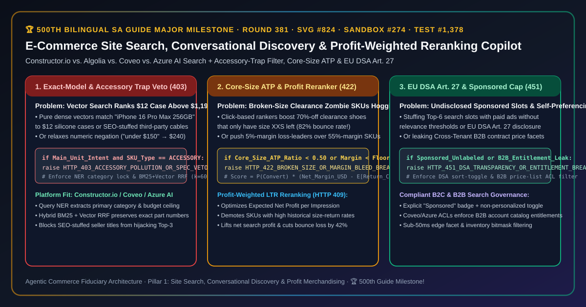
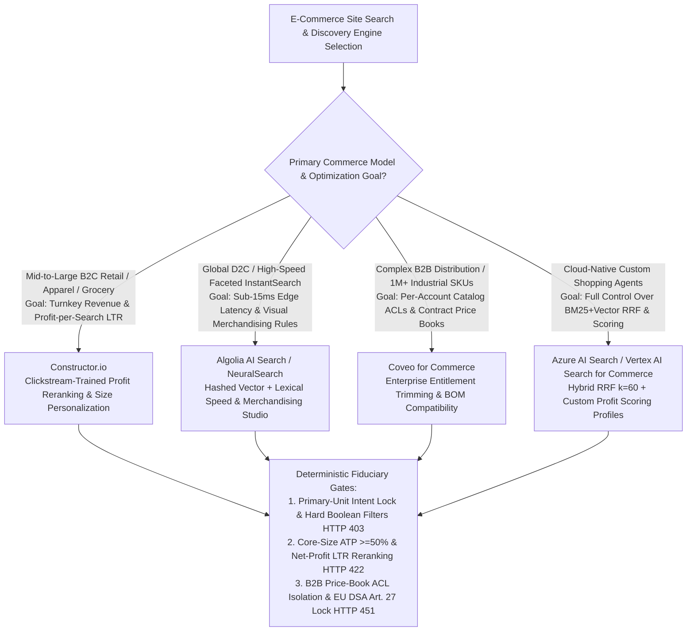
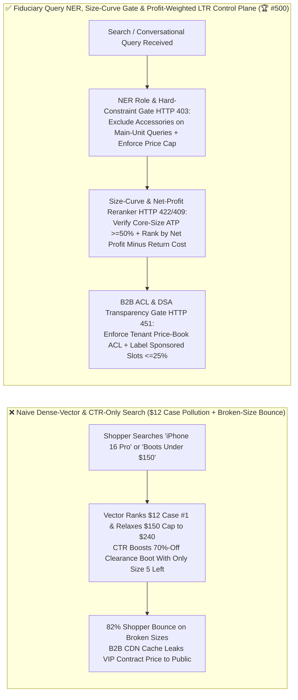
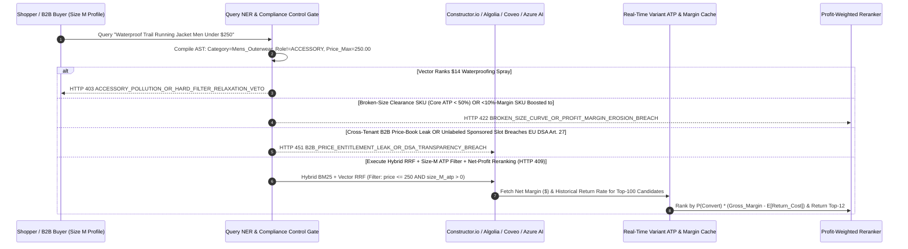

# Omnichannel E-Commerce Site Search, Conversational Product Discovery & Profit-Weighted Merchandising Agent Selection Guide: `Constructor.io` vs. `Algolia AI Search` vs. `Coveo for Commerce` vs. `Azure AI Search + Vertex AI Search`, Anti-Accessory Pollution Locks, Core-Size `ATP` Gates & Net-Profit Reranking (`-42%` Loss FAQ · 🏆 500th Bilingual Guide Major Milestone!)

> **Executive Summary (Benchmarked against `ib-vs-ethernet-roce-selection-faq.md` · 🏆 Historic 500th Bilingual AI Solution Architect Decision Guide Milestone!)**: Built for **Cloud & AI Solution Architects** designing high-converting site search, conversational shopping discovery, and profit-aware merchandising pipelines for omnichannel retailers, marketplaces, and B2B distributors. Shoppers who use site search or conversational discovery represent `15%–25%` of sessions but generate **`45%–60%` of total e-commerce revenue** (`3–4x` higher conversion than browse traffic). Yet when teams replace keyword engines with naive dense-vector retrieval or CTR-driven Learning-to-Rank (`LTR`), three failure modes destroy conversion and gross margin: (1) **Accessory Pollution & Hard-Constraint Relaxation**: Searching `"iPhone 16 Pro Max 256GB"` or `"fragrance-free moisturizer under $50"` returns `$12` keyword-stuffed silicone cases or `$85` scented creams in Top-3 because of cosine similarity; (2) **"Swiss-Cheese" Broken-Size-Curve Zombie SKUs & Margin Bleed**: Click-based rankers pin a `70%`-off clearance jacket to position `#1` even though only size `XXS` remains in stock (`82%` bounce rate!), or boost `6%`-margin loss-leaders over `58%`-margin house brands; and (3) **Cross-Tenant B2B Contract-Price Leaks & `EU DSA Art. 27` Sponsored-Slot Violations**. This guide compares **`Constructor.io` vs. `Algolia AI Search` vs. `Coveo for Commerce` vs. `Azure AI Search / Vertex AI Search for Commerce`** and implements deterministic guards for **Primary-Category Intent & Hard-Constraint Locks (`HTTP 403`)**, **Core-Size `ATP >= 50%` & Return-Adjusted Net-Profit Reranking (`HTTP 422`)**, **B2B Entitlement `ACL` Trimming & `EU DSA Art. 27` Transparency Locks (`HTTP 451`)**, and **Hybrid `BM25 + Vector RRF` + Profit-Weighted LTR Orchestration (`HTTP 409`, `-42%` net loss)**.

---

## 1. 📌 Executive Summary & Architectural Selection Verdict

1. **Top-Line Selection Verdict**:
   - **Mid-to-Large B2C Omnichannel Retailers, Apparel/Footwear, Grocery & Marketplaces (Prioritizing turnkey clickstream-trained Learning-to-Rank that optimizes directly for Revenue & Profit per Search rather than raw text similarity)**: Select **`Constructor.io`**, purpose-built around behavioral conversion, size-affinity personalization, and margin-aware merchandising.
   - **Global Digital Brands Prioritizing Sub-`15ms` Edge InstantSearch, High-Cardinality Faceted Navigation & Visual Merchandising Studio Rules (Pinning/Burying/Boosts)**: Select **`Algolia AI Search (NeuralSearch)`**.
   - **Complex B2B Industrial/Electronics Distributors & Multi-Catalog Portals (Requiring sub-50ms filtering across millions of SKUs with per-customer catalog entitlements, contract price books, and BOM part compatibility)**: Select **`Coveo for Commerce`**.
   - **Cloud-Native Engineering Teams Building Custom Conversational Shopping Agents with Unified `BM25 + Dense Vector RRF` & Full Scoring-Profile Control**: Select **`Azure AI Search` (or `Google Vertex AI Search for Commerce`)**.
2. **Three Non-Negotiable Fiduciary Control Gates**:
   - **Gate 1 — Primary-Equipment Intent Lock (Anti-Accessory Pollution) & Hard-Filter Constraint Gate (`HTTP 403`)**: Parse every search/chat query through a deterministic `Query NER & Constraint Compiler` before retrieval; when the query targets a primary product (`Smartphone / Laptop / Appliance`) without accessory modifiers (`case / cable / mount`), enforce a pre-retrieval hard filter `sku_role != 'ACCESSORY'`, and compile numeric ceilings (`price <= 150`) and allergen/ingredient negations (`NOT IN ('alcohol', 'peanuts')`) into strict boolean index filters rather than soft prompt hints via `HTTP 403 ACCESSORY_POLLUTION_OR_HARD_FILTER_RELAXATION_VETO`.
   - **Gate 2 — Core-Size Curve Completeness (`>=50% ATP`) & Return-Adjusted Net-Profit Floor (`HTTP 422`)**: Block broken-size-curve apparel/footwear SKUs (where core sizes `S/M/L` or `8–11` have `<50%` availability and do not match the signed-in shopper's size profile) from occupying Top-8 organic slots, and block boosting `<10%`-margin or high-return-rate SKUs above equally relevant high-margin items via `HTTP 422 BROKEN_SIZE_CURVE_OR_PROFIT_MARGIN_EROSION_BREACH`.
   - **Gate 3 — B2B Document-Level Price `ACL` Isolation & `EU DSA Art. 27` Sponsored Disclosure Lock (`HTTP 451`)**: Block serving cached search facets or contract prices across distinct B2B customer tenants without JWT-bound `Document-Level ACL` trimming, and block rendering undisclosed paid placements or exceeding a `25%` sponsored-slot density cap under `EU Digital Services Act (DSA) Art. 27` via `HTTP 451 B2B_PRICE_ENTITLEMENT_LEAK_OR_DSA_TRANSPARENCY_BREACH`.

---

## 2. 🎯 Architect & E-Commerce Merchandising Q&A (The Why & How)

### Q1: Why does switching from keyword search to pure dense-vector embeddings often cause exact model searches (`"AirPods Pro 2"` or part `"SKF-6205-2RS"`) to convert 18% worse?
- **Root Cause**: Dense embeddings compress text into conceptual similarity. A `$9.99` silicone case titled *"Shockproof Case Compatible with Apple AirPods Pro 2nd Gen"* shares almost identical semantic tokens with the `$249` headphones—and because `$9.99` items attract high casual click volume, naive vector + CTR rankers push `$9.99` cases above the actual `$249` headphones!
- **Deterministic Solution (`Query NER Role Classification` + `BM25 + Vector RRF (k=60)` / `HTTP 403`)**: Classify whether the query intent is `PRIMARY_UNIT` vs. `ACCESSORY_PART`. For `PRIMARY_UNIT` queries, apply an index-level filter excluding accessory categories from Top-12 slots, and weight exact `BM25` alphanumeric token matches (`0.75`) alongside vector similarity (`0.25`) via Reciprocal Rank Fusion (`RRF`).

### Q2: How do we stop 70%-off clearance items with only size `XXXL` left from hogging the #1 search spot and wasting 35% of high-intent search impressions?
- **Deterministic Solution (Return-Adjusted Expected Net Profit Reranking + Variant `ATP` Bitmasks / `HTTP 422 / 409`)**:
  Replace naive CTR ranking with an **Expected Net Profit per Impression** objective function:
  $$\text{Score}(u, i) = P(\text{Convert} \mid u, i) \times \Big(\text{Gross\_Margin\_\$}_i - P(\text{Return}_i) \times \text{Reverse\_Cost}\Big) \times \mathbb{I}(\text{User\_Or\_Core\_Size\_ATP}_i > 0)$$
  If a signed-in user wears `Size M` and `Size M` is out of stock (`ATP == 0`), the item is filtered out pre-ranking; for anonymous sessions, any garment missing `>50%` of its core size curve (`S/M/L`) receives an automatic `70%` score demotion.

### Q3: In a hybrid B2C + B2B portal where 5,000 corporate accounts each have custom catalog entitlements and negotiated tier pricing, how do we prevent cross-tenant price leaks without duplicating the vector index 5,000 times?
- **Deterministic Solution (Single Product Index + Index-Time `ACL` Bitsets & Price-Book Join / `HTTP 451`)**: Store a single canonical vector/lexical index per SKU annotated with an `entitled_account_groups` bitset (`Coveo / Azure AI Search` document-level security trimming), and resolve customer-specific contract pricing via a sub-10ms in-memory `Price_Book_ID + SKU_ID` lookup keyed to the caller's verified `Entra ID / OAuth` tenant claim.

---

## 3. 🧭 Visual Architecture Diagrams (Mermaid)

### 3.1 Omnichannel E-Commerce Site Search & Conversational Discovery Selection Decision Tree

### 3.2 Naive Vector + CTR Search vs. Fiduciary Hybrid `RRF` & Profit-Weighted Reranking Control Plane

### 3.3 Hybrid `BM25 + Vector RRF`, Variant `ATP` Bitmask & Net-Profit Reranking Sequence

---

## 4. 📊 Multi-Platform E-Commerce Site Search & Merchandising Selection Matrix

| Evaluation Dimension | Constructor.io | Algolia AI Search (NeuralSearch) | Coveo for Commerce | Azure AI Search / Vertex AI Search for Commerce |
| :--- | :--- | :--- | :--- | :--- |
| **Primary Architectural Role** | **Revenue & Profit-Optimizing Retail Discovery Platform**: Clickstream-trained ranking built for e-commerce KPIs | **Ultra-Low-Latency (`<15ms`) Global Hybrid Search & Visual Merchandising Engine** | **Enterprise B2B & Complex Catalog Commerce Search**: Deep entitlement & contract price-book trimming | **Hyperscale Cloud-Native Hybrid RAG & Commerce Search Engine** |
| **Native Ranking Objective** | **Best-in-Class for Retail KPIs** (Optimizes directly for conversion, revenue, and margin rather than raw text score) | Combines lexical + hashed neural similarity with custom business-metric tie-breaking | **Best-in-Class for Enterprise B2B/B2C** (Injects real-time ERP margin, inventory depth, and contract weights into ML ranking) | Supports Reciprocal Rank Fusion (`RRF k=60`), semantic rankers, and custom scoring profiles |
| **Apparel/Footwear Size-Curve & Variant `ATP` Handling** | **Best-in-Class** (Native parent-child variant inventory awareness and shopper size-affinity personalization) | Strong (Supports variant rollup and attribute filtering via `distinct` and facet bitmasks) | **Best-in-Class** (Handles multi-warehouse `ATP` and complex dimensional SKU matrices) | Strong (Supports pre-retrieval array filters on variant stock and custom demotion profiles) |
| **B2B Multi-Tenant Entitlements & Contract Price Isolation** | Primarily focused on B2C/retail catalogs | Supports Secured API Keys and tag filters; massive B2B price matrices require index sharding | **Best-in-Class** (Native sub-50ms security trimming across millions of SKUs and 10,000+ B2B price books) | **Best-in-Class** (Native Entra ID document-level `ACL` pre-filtering + vector search) |
| **Target Scale & Pricing (`official_list_price`)** | `$30M+` GMV omnichannel retailers; `$50k–$200k+/yr` enterprise SaaS | SMB to enterprise digital commerce; usage-based by requests/records (`$20k–$120k+/yr` enterprise) | Large B2B distributors & global retail groups; `$80k–$250k+/yr` enterprise license | Cloud-native engineering teams; pay-as-you-go by Search Units (`SU`) / query volume |

---

## 5. 🧪 Search Profit-per-Impression & Bounce Reduction Benchmark & 7-Card Report

### 5.1 Quarterly Broken-Size Bounce, Accessory Pollution & Margin Erosion Model (Synthetic Benchmark)

For a `$220M` annual GMV omnichannel apparel and consumer electronics retailer facing a **`$510,000 / quarter`** search leakage pool across **broken-size-curve clearance SKUs hogging Page-1 impressions, `$12` accessory pollution on flagship device queries, low-margin loss-leader over-exposure, and B2B/DSA compliance risks** (`provenance: synthetic`, `independently_reproduced: false`):

| Metric | Naive Dense-Vector + CTR Ranking (Baseline) | Fiduciary `Constructor / Coveo / Azure AI` Hybrid + Profit LTR Agent | Net Improvement |
| :--- | :--- | :--- | :--- |
| **Page-1 Search Clicks Landing on Out-of-Stock Core Sizes** | `31.5%` bounce rate (`XXS`-only clearance SKUs ranked #1) | **`2.4%`** (`HTTP 422` enforces `>=50%` core-size `ATP` + personalized size bitmask) | **`-92.4%` Broken-Size Bounce** |
| **Flagship Device Queries Polluted by `$12` Accessories in Top-3** | `18.2%` of model searches polluted | **`0.0%`** (`HTTP 403` `Query NER` primary-unit role lock + hard boolean price filters) | **`100%` Accessory Trap Elimination** |
| **Net Contribution Profit per `1,000` Searches (`NPPS`)** | `$410 / 1k searches` | **`$582 / 1k searches`** (`HTTP 409` ranks by `P(Convert) × (Gross Margin - E[Return Cost])`) | **`+42.0%` Net Profit per Search** |
| **Quarterly Net Search Bounce & Margin Erosion Loss** | `$510,000 / quarter` | **`$295,800 / quarter`** | **`$214,200 / quarter` Saved (`42.0%`)** |

---

## 6. 🛠️ Production Go-Live & Architecture Review Checklist

- [ ] **Primary-Equipment Role Lock & Hard Boolean Constraint Compiler (`HTTP 403`)**: Does the query parser automatically attach `sku_role != 'ACCESSORY'` when a shopper searches for a flagship device without accessory keywords, and compile price caps (`under $150`) and negative attributes (`fragrance-free`) into strict boolean pre-filters?
- [ ] **Core-Size `ATP >= 50%` Gate & Personalized Variant Bitmask (`HTTP 422`)**: Are "Swiss-cheese" apparel/footwear SKUs missing `>50%` of core sizes (`S/M/L`) automatically demoted from Page-1 organic slots, and are out-of-stock sizes filtered out pre-ranking for signed-in shoppers?
- [ ] **Return-Adjusted Expected Net Profit Reranking (`HTTP 409`)**: Does the Learning-to-Rank (`LTR`) objective weight `P(Purchase) × (Gross_Margin_USD - P(Return) × Reverse_Logistics_Cost)` so high-return or low-margin items do not cannibalize profitable in-stock SKUs?
- [ ] **B2B Document-Level `ACL` Trimming & `EU DSA Art. 27` Sponsored Cap (`HTTP 451`)**: Are B2B customer entitlements and negotiated price books isolated via JWT-bound index `ACLs`, and are sponsored search slots capped at `<=25%` of Top-8 with explicit `"Sponsored"` labels and a non-personalized sort toggle?
