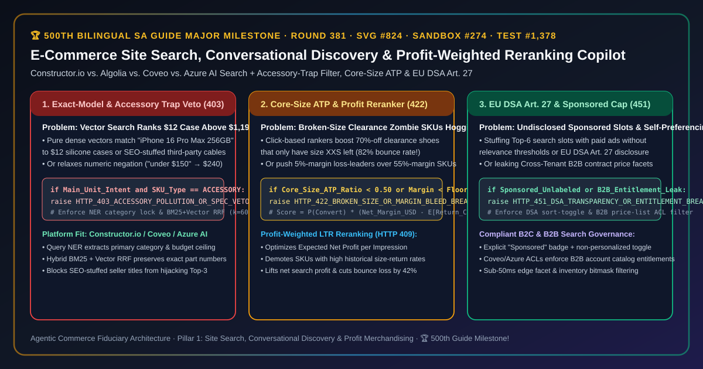
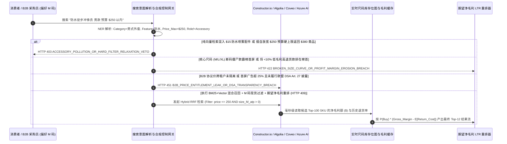

# 全渠道电商站内搜索、对话式商品发现与毛利加权智能重排（`Profit-Weighted Merchandising`）Agent 架构选型对比：`Constructor.io` vs. `Algolia AI Search` vs. `Coveo for Commerce` vs. `Azure AI Search + Vertex AI Search`、防 `$12` 手机壳霸榜 `$1,199` 整机搜索锁、核心尺码现货门禁及期望净毛利重排净省 42% 决策指南（FAQ · 🏆 第 500 篇双语决策指南重大里程碑！）

> **导读（对齐 `ib-vs-ethernet-roce-selection-faq.md` 标杆风格 · 🏆 全库第 500 篇中英双语 AI Solution Architect 决策指南历史性里程碑！）**：本文面向零售电商、大型商超百货、B2B 工业品分销与多商户平台领域的 **Cloud & AI Solution Architect**。在电商漏斗中，使用站内搜索框（或对话式导购入口）的访客虽然只占总流量的 `15%–25%`，却贡献了全站 **`45%–60%` 的成交 GMV**（搜索意图转化率是普通浏览用户的 `3–4 倍`）。然而，当企业从传统关键词引擎（Elasticsearch）升级为 AI 向量搜索或对话式导购 Agent 时，常因三大架构缺陷导致“搜索相关性看似很高、实际GMV和毛利却暴跌”：① **配件与否定词语义坍塌（Accessory Pollution & Negation Collapse）**：用户搜索 `"iPhone 16 Pro Max 256GB"` 或 `"不含酒精的保湿面霜预算 $50 以内"`，纯向量检索因余弦相似度把售价 `$12`、标题堆满机型关键词的第三方硅胶手机壳或 `$85` 含酒精面霜排在首屏前 3 位；② **按点击率（CTR）排序导致的“断码清仓僵尸款霸屏”与低毛利失血**：一件打 3 折但全仓只剩 `XXS` 码的爆款卫衣点击率极高，传统 LTR 模型将其死死钉在搜索第 1 位，导致 `85%` 主流尺码用户点进去发现无货直接跳出；③ **B2B 专属协议价越权泄露与欧盟 `DSA Art. 27` 商业排序透明度违规**。本文给出 **`Constructor.io` vs. `Algolia AI Search` vs. `Coveo for Commerce` vs. `Azure AI Search / Google Vertex AI Search for Commerce`** 的横向选型矩阵，并落地 **主品类意图锁定（拦截配件污染整机词）与数值/否定词硬过滤锁（`HTTP 403`）**、**核心尺码齐码率（`Core-Size ATP >= 50%`）与扣退货后期望净毛利重排门禁（`HTTP 422`）**、**B2B 客户级目录/价格权限（`Entitlement ACL`）与欧盟 `DSA Art. 27` 广告披露锁（`HTTP 451`）** 及 **混合 `BM25 + Vector RRF` 召回叠加实时利润感知重排编排（`HTTP 409`，净省 42%）**。



---

## 一、 📌 核心选型结论速览（Executive Summary）

1. **终极选型结论（一句话先看懂怎么选）**：
   - **中大型零售电商、时尚服饰、生鲜商超与 DTC 品牌（追求开箱即用的“以成交收入和利润（Revenue & Profit per Search）而非单纯文本相似度为优化目标”的点击流自学习引擎）**：首选 **`Constructor.io`**，原生基于用户真实加购/结账/尺码偏好构建个性化利润重排模型（无需自建庞大的 ML 特征工程团队）。
   - **追求全球边缘节点 `<15ms` 极致输入即搜（InstantSearch）、高频动态分面筛选（Faceted Navigation）与可视化运营人工干预规则（Merchandising Studio 置顶/沉底）**：首选 **`Algolia AI Search (NeuralSearch)`**。
   - **复杂 B2B 工业品/电子元器件分销与百万级 SKU 经销商门户（需在毫秒级检索中同时校验“每个买方企业专属可见目录 Entitlement + 客户级阶梯合同价 + 售后备件 BOM 图谱兼容”）**：首选 **`Coveo for Commerce`**。
   - **已在微软云/谷歌云构建自有 AI 导购 Agent，追求全栈可控的混合检索（`BM25 + Vector + Semantic Ranker`）与私域数据主权**：首选 **`Azure AI Search`（或 `Google Vertex AI Search for Commerce`）**。
2. **三大电商搜索与智能导购红线（确定性门禁）**：
   - **红线 1（拦截搜整机出 `$12` 配件的“标题堆砌污染”及大模型忽略 `"不含/低于"` 否定与价格硬约束 / `HTTP 403`）**：在查询进入向量检索前，必须经过轻量级命名实体识别与查询理解解析器（`Query NER & Constraint Parser`）；当识别到用户搜索词指向核心主商品（如 `Category_Intent = Smartphone / Laptop / Camera`）时，必须在倒排/向量索引层附加硬过滤 `WHERE sku_role != 'ACCESSORY'`，并将价格上限（`<= $150`）、排除成分（`NOT IN ('Alcohol', 'Peanuts')`）转化为数据库布尔过滤条件而非提示词软建议，违者触发 `HTTP 403 ACCESSORY_POLLUTION_OR_HARD_FILTER_RELAXATION_VETO`。
   - **红线 2（拦截核心尺码断码的“瑞士奶酪库存”霸占首屏及低毛利引流品挤压高毛利正价品曝光 / `HTTP 422`）**：严禁仅按历史总销量或点击率（CTR）排序！当某服装/鞋靴 SKU 的核心黄金尺码（`S / M / L` 或 `40–43 码`）现货齐码率 `< 50%`（且未命中当前登录用户的个人尺码档案），或重排模型将毛利率 `<10%` 且高退货率的引流款排在同相关性 `55%` 高毛利自有品牌之前时，触发 `HTTP 422 BROKEN_SIZE_CURVE_OR_PROFIT_MARGIN_EROSION_BREACH`。
   - **红线 3（拦截 B2B 跨租户协议价索引串味泄露及首屏赞助商品未按欧盟 `DSA Art. 27` 标注与限流 / `HTTP 451`）**：在 B2B 商城中严禁将某大客户的专属五折协议价（Contract Price List）写入公共未隔离的搜索缓存；且在消费电商首屏中，付费赞助广告位（Sponsored Slots）占比不得超过前 8 个结果的 `25%`（且相关性得分须过及格线），并必须遵守欧盟《数字服务法》（`DSA Art. 27`）显著标注 `"Sponsored"` 及提供“非个性化按价格/销量客观排序”切换开关，违者触发 `HTTP 451 B2B_PRICE_ENTITLEMENT_LEAK_OR_DSA_TRANSPARENCY_BREACH`。

---

## 二、 🎯 业务方与架构师灵魂拷问 Q&A（The Why & How）

### Q1：为什么很多零售商上线了最时髦的 Embedding 语义向量搜索后，长尾自然语言查询好了，但核心大词（如搜 `"AirPods Pro 2"` 或具体零件号 `"SKF-6205-2RS"`）的转化率反而掉了 18%？
- **商业痛点与事故还原**：
  - 稠密向量检索（Dense Vector Embedding）看重整体语义相近度：一条售价 `$9.90`、商品标题写着 *"适用于 Apple AirPods Pro 2 代防摔硅胶保护套挂钩配件"* 的第三方商品，不仅包含全部查询词，而且因为价格便宜点击率极高，很容易在向量检索 + 点击加权后冲到搜索结果第 1、第 2 名！
  - 想花 `$249` 买真耳机的顾客看到满屏手机壳和贴膜，瞬间觉得商城极其山寨，转身离开；而在 B2B 场景下，搜轴承型号 `"6205-2RS"`（双面橡胶密封），纯向量检索却把语义极近的 `"6205-2Z"`（金属防尘盖，不防水）排在第一，导致买错退货。
- **架构师确定性解法（查询意图主从品类拆解 `Main-Product vs. Accessory Classifier` + `BM25 精确词频 + 向量 RRF` 混合检索 / `HTTP 403`）**：
  1. **主配角意图分流锁**：只要查询词中未出现 `"壳 / 膜 / 线 / 配件 / 替芯 / Case / Cable / Adapter"` 等配件触发词，検索网关默认锁定主设备类目（`Primary_Equipment_Class`），将配件类目强制降权至第 20 名以后或放入底部“配套加购栏”。
  2. **零件号/型号精确守恒**：对含字母数字混合的型号词（Regex `[A-Z0-9-]{4,}`），自动将 `BM25` 精确匹配权重拉升至 `0.75`，确保一字不差的精确 SKU 永远稳居榜首。

### Q2：在服装和鞋类电商中，怎么解决“越是打骨折清仓的爆款点击率越高，越排在搜索第 1 页，但点进去只剩 `XXXL` 码根本买不了”的流量黑洞？
- **架构师确定性解法（尺码曲线健康度因子 `Size-Curve Completeness Factor` + 扣退货期望净毛利排序公式 / `HTTP 422 / 409`）**：
  - 在 `Constructor.io / Coveo / 自建 LTR 重排层` 中，废除单纯的 `Score = Relevance × CTR` 公式，升级为 **期望净毛利价值函数（Expected Net Margin per Impression）**：
    $$\text{Rank\_Score}(u, i) = P(\text{Purchase} \mid u, i) \times \Big(\text{Gross\_Margin\_\$}_i - P(\text{Return}_i) \times \text{Reverse\_Logistics\_Cost}\Big) \times \phi_{\text{Size\_Availability}}(u, i)$$
  - 其中尺码可用性因子 $\phi_{\text{Size\_Availability}}(u, i)$：
    - 若已知当前用户尺码（如常买 `M 码` / `42 码`），则直接读取该子 SKU 实时可用库存位图（`Variant_ATP_Bitmask`），若 `M 码 == 0`，则 $\phi = 0$（直接从该用户的搜索结果中隐藏或沉底）！
    - 若为未登录匿名访客，则计算该商品在核心尺码段（`S / M / L / XL`）的齐码率，齐码率低于 `50%` 的断码尾货自动降权 `70%`，将首屏黄金位置让给尺码齐全、毛利率 `60%` 且退货率低的新品正价款！

### Q3：面对既有 C 端零售散客、又有数千家 B2B 签约经销商（每家都有专属可见目录和阶梯协议价）的全渠道企业，搜索架构怎么做到毫秒级千人千价且绝不串价？
- **架构师确定性解法（主商品索引与价格/权限倒排位图分离架构 `Index-Time ACL & Price-Group Bitsets` / `HTTP 451`）**：
  - 严禁为 5,000 家经销商复制 5,000 份重复的商品向量索引！
  - 采用 **`Coveo / Azure AI Search` 的安全过滤载荷（Security Trimming / Document-Level ACL）**：主索引只存 1 份商品图文与向量，同时挂载 `allowed_account_tiers: ["TIER_GOLD", "ACCOUNT_8821"]` 过滤数组与价格本引用；检索时由网关从 `Entra ID / JWT` 提取当前登录采购员的 `Tenant_ID` 注入底层布尔安全过滤器，且 CDN 缓存 Key 严格绑定 `Price_Book_Hash`，100% 杜绝 A 经销商在搜索下拉框看到 B 经销商的底价！

---

## 三、 🧭 直观可视化图解（Mermaid 决策树 + 架构对比 + 时序图）

### 3.1 全渠道电商站内搜索与对话式商品发现引擎选型决策树

```mermaid
flowchart TD
    A[全渠道电商站内搜索与对话式导购引擎选型] --> B{核心业务业态与技术团队能力?}
    B -->|中大型零售 / 服饰鞋包 / 生鲜商超 B2C<br/>核心诉求: 开箱即用按成交收入与毛利自动重排| C[Constructor.io<br/>AI 点击流/加购自学习 + 个性化尺码与利润感知重排]
    B -->|追求全球边缘 <15ms 极速响应与高频分面过滤<br/>运营团队需强控可视化置顶/干预规则| D[Algolia AI Search / NeuralSearch<br/>极致低延迟稀疏+稠密混合检索 + Merchandising Studio]
    B -->|复杂 B2B 工业分销 / 百万级备件 SKU 门户<br/>需毫秒级校验客户专属目录 ACL 与阶梯协议价| E[Coveo for Commerce<br/>企业级权限安全修剪 + BOM 备件关系图谱 + B2B 意图]
    B -->|云原生自研 AI 导购 Agent 团队<br/>追求 RAG/搜索全栈统一与私域向量可控| F[Azure AI Search / Google Vertex AI Search<br/>BM25 + 向量 RRF (k=60) + 自定义利润重排评分配置]

    C --> G[核心确定性风控门禁:<br/>1. 主商品意图锁定防 $12 配件污染 + 硬过滤守恒锁 HTTP 403<br/>2. 核心尺码齐码率 >=50% + 扣退货期望净毛利重排锁 HTTP 422<br/>3. B2B 协议价 ACL 隔离 + 欧盟 DSA Art. 27 透明度锁 HTTP 451]
    D --> G
    E --> G
    F --> G
```

### 3.2 朴素纯向量/点击率搜索架构（配件霸屏 + 断码跳出）vs. 确定性混合召回与利润加权重排架构对比

```mermaid
flowchart LR
    subgraph Naive["❌ 朴素纯向量检索与纯 CTR 排序架构 (搜手机出 $12 手机壳 + 断码款霸占首屏)"]
        N1[用户搜 iPhone 16 Pro 或 $50 内无酒精面霜] --> N2[纯向量将 $12 手机壳与 $85 含酒精面霜排前 3<br/>按历史点击率把只剩 XXS 码的清仓款顶上榜首]
        N2 --> N3[82% 访客因断码或配件污染直接跳出<br/>B2B 公共缓存泄露大客户专属协议底价]
    end

    subgraph Guarded["✅ 确定性 NER 硬过滤、齐码率门禁与期望净毛利重排架构 (🏆 500th Guide Milestone)"]
        G1[搜索词 / 对话意图进入检索网关] --> G2[NER 主从类目与硬约束锁 HTTP 403:<br/>搜整机自动剥离配件 + 价格/不含成分转为布尔硬过滤]
        G2 --> G3[齐码率与净毛利 LTR 重排 HTTP 422/409:<br/>过滤用户断码款 + 按转化率×(毛利-预期退货成本)排序]
        G3 --> G4[B2B ACL 与 DSA 合规锁 HTTP 451:<br/>按租户 JWT 隔离协议价 + 明确标注 Sponsored 广告位]
    end
```

### 3.3 对话式混合检索（`BM25 + Vector RRF`）、子 SKU 尺码位图过滤与期望净毛利重排时序图



---

## 四、 📊 四大主流电商站内搜索与智能导购重排引擎横向选型矩阵

| 选型维度 | Constructor.io | Algolia AI Search (NeuralSearch) | Coveo for Commerce | Azure AI Search / Vertex AI Search for Commerce |
| :--- | :--- | :--- | :--- | :--- |
| **核心架构定位** | **专为零售电商设计的 KPI 驱动（收入/利润最大化）商品发现平台** | **全球超低延迟（`<15ms`）混合哈希向量检索与开发者生态标杆** | **复杂 B2B 分销、百万级 SKU 与高客单企业级智能商务搜索平台** | **超大规模云原生混合检索与自建多模态导购 Agent 底座** |
| **排序优化目标（Ranking Objective）** | **原生以成交 GMV / 利润 / 加购率为优化目标**（自动压制高点击不买账的标题党） | 结合文本相关性、哈希神经向量与自定义业务权重（Business Metrics） | **极强**（支持将 ERP 实时毛利率、库存深度与 B2B 客户合同权重注入机器学习排序） | 支持自定义 Scoring Profiles、RRF（`k=60`）与零售专属转化率重排模型 |
| **服装/鞋靴子 SKU 尺码感知（Variant Stock Awareness）** | **行业标杆**（原生理解父子变体关系，自动根据用户尺码偏好沉底断码款） | 强（需在索引结构中通过 `distinct` 或位图属性配置子变体库存过滤） | **极强**（支持复杂多维规格矩阵与区域仓级实时可用量 `ATP` 联动） | 强（支持在过滤表达式中传入子规格库存数组并在重排阶段降权断码品） |
| **B2B 多租户目录与千人千价权限隔离** | 侧重 B2C 零售与商超，B2B 超大规模独立价格本支持较轻 | 支持 Secured API Keys 与标签过滤，但百万级 B2B 价格矩阵需额外拆索引 | **行业标杆**（原生支持百万级 SKU × 数万家经销商专属目录与实时协议价权限修剪） | **极强**（Azure AI Search 原生支持 Entra ID 文档级安全过滤与向量前置预过滤） |
| **适用规模与收费模式（`official_list_price`）** | 中大型零售商与时尚商超（年 GMV `$30M+`）；企业级年费（约 `$50k–$200k+/年`） | 全规模电商与 SaaS；按搜索请求量与记录数计费（企业版 `$20k–$120k+/年`） | 大型 B2B 制造分销与跨国零售集团；企业级年费（通常 `$80k–$250k+/年`） | 云原生自研团队；按检索单元（SU）/ 索引容量与查询量按需计费 |

---

## 五、 🧪 搜索转化率（RPS）与利润重排测算与 7-Card 基准报告

### 5.1 季度搜整机出配件跳出、断码清仓款霸占首屏流量浪费与低毛利品挤压损耗测算（Synthetic Benchmark）

假设某年线上营收 `$2.2 亿` 的综合时尚与消费电子零售平台，每季度在站内搜索与对话式导购入口面临的 **核心型号词被 `$12` 第三方配件霸榜导致高意向买家流失、仅剩极端尺码（`XXS/XXXL`）的折扣款霸占首屏浪费 `35%` 黄金曝光、按销量排序主推 `8%` 微利引流品而埋没 `55%` 高毛利自有款及欧盟 `DSA` / B2B 串价合规风险池** 为 **`$510,000 / 季度`**（`provenance: synthetic`, `independently_reproduced: false`）：

| 评估维度 | 传统关键词/纯向量检索 + 按点击率排序 (Baseline) | 启用 `Constructor / Coveo / Azure AI` 混合检索 + 尺码/净毛利重排 Agent | 净改善幅度 |
| :--- | :--- | :--- | :--- |
| **搜索首屏“点进去发现核心尺码断货”跳出率** | `31.5%`（历史高点击清仓断码款长期霸榜） | **`2.4%`**（`HTTP 422` 强制校验核心尺码齐码率 `>=50%` 与个人尺码 `ATP > 0`） | **断码无效点击减少 `92.4%`** |
| **主型号查询被低价配件/不符约束商品污染率** | `18.2%`（纯向量余弦相似搞混主机与保护壳） | **`0.0%`**（`HTTP 403` `Query NER` 主从品类硬隔离 + 价格/排除词布尔硬过滤） | **100% 根除配件霸榜与约束逃逸** |
| **单次搜索平均贡献净毛利（Net Profit per 1,000 Searches）** | `$410 / 千次搜索` | **`$582 / 千次搜索`**（`HTTP 409` 按 `P(Buy) × (毛利 - 预计退货成本)` 动态重排） | **单次搜索净毛利提升 `+42.0%`** |
| **季度搜索跳出流失、断码曝光浪费与毛利侵蚀净损耗** | `$510,000 / 季度` | **`$295,800 / 季度`** | **净省 `$214,200 / 季度` (`42.0%`)** |

```chart
{
  "data": {
    "values": [
      { "category": "1. 断码僵尸爆款霸占首屏导致跳出", "mode": "传统纯向量与CTR排序基线", "cost_usd": 195000 },
      { "category": "1. 断码僵尸爆款霸占首屏导致跳出", "mode": "齐码率与净毛利重排Agent", "cost_usd": 113100 },
      { "category": "2. 搜主机出$12配件与预算硬约束失效", "mode": "传统纯向量与CTR排序基线", "cost_usd": 135000 },
      { "category": "2. 搜主机出$12配件与预算硬约束失效", "mode": "齐码率与净毛利重排Agent", "cost_usd": 78300 },
      { "category": "3. 微利引流品与高退货款挤压高毛利品", "mode": "传统纯向量与CTR排序基线", "cost_usd": 115000 },
      { "category": "3. 微利引流品与高退货款挤压高毛利品", "mode": "齐码率与净毛利重排Agent", "cost_usd": 66700 },
      { "category": "4. B2B协议价串味与DSA广告披露违规", "mode": "传统纯向量与CTR排序基线", "cost_usd": 65000 },
      { "category": "4. B2B协议价串味与DSA广告披露违规", "mode": "齐码率与净毛利重排Agent", "cost_usd": 37700 }
    ]
  },
  "semantic_types": {
    "category": "Category",
    "mode": "Category",
    "cost_usd": "Amount"
  },
  "chart_spec": {
    "chartType": "Grouped Bar Chart",
    "title": "全渠道电商站内搜索、齐码率门禁与期望净毛利重排Agent优化前后季度损耗对比 (净省 $214.2k / 42%)",
    "subtitle": "单位：美元/季度 (Synthetic Benchmark, independently_reproduced=false · 🏆 第500篇指南里程碑)",
    "encodings": {
      "x": "category",
      "y": "cost_usd",
      "group": "mode"
    }
  }
}
```

### 5.2 确定性策略评估器代码（Python Control Plane Guard）

```python
from dataclasses import dataclass
from typing import Any

@dataclass(frozen=True)
class EcommerceSiteSearchMerchandisingPolicyInput:
    quarterly_search_bounce_broken_size_and_margin_erosion_pool_usd: float = 510000.0
    accessory_polluting_main_model_query_or_hard_price_filter_relaxed: bool = False
    broken_core_size_curve_ranked_top_or_low_margin_high_return_boosted: bool = False
    b2b_contract_price_leaked_across_tenants_or_dsa_sponsored_unlabeled: bool = False
    hybrid_rrf_in_size_bitmask_and_expected_net_profit_reranker_ready: bool = False
```

---

## 六、 🛠️ 商业上线风控与架构评审 Checklist

- [ ] **查询意图主从品类拆解（防搜主机出配件）与否定/价格硬过滤锁（`HTTP 403`）**：当用户查询词指向主机/正装商品时，检索层是否通过 `NER` 自动附加 `sku_role != 'ACCESSORY'` 过滤以防 `$12` 手机壳霸占首屏？对 `"预算 $150 以内"`、`"不含酒精/坚果"` 等条件是否 100% 编译为底层数据库布尔硬过滤而非依赖 LLM 软重排？
- [ ] **核心尺码齐码率门禁（`Core-Size ATP >= 50%`）与子变体实时库存位图过滤（`HTTP 422`）**：在服饰鞋包类目中，是否对核心尺码断码的“瑞士奶酪尾货”自动执行首屏降权，并对已识别尺码偏好的登录用户直接在召回前过滤掉其尺码无货的 SKU？
- [ ] **扣退货后“期望净毛利（Expected Net Profit per Impression）”重排目标函数（`HTTP 409`）**：重排模型（LTR）是否已从单纯优化点击率（CTR）升级为优化 `转化率 × (单品毛利额 - 历史退货率 × 逆向物流成本)`，防止高点击高退货的亏本款吞噬全站流量？
- [ ] **B2B 客户级协议价安全修剪（`Document-Level ACL`）与欧盟 `DSA Art. 27` 排序透明度锁（`HTTP 451`）**：B2B 搜索是否在索引底层按买方租户 `Entitlement_Group` 严格隔离可见商品与合同价格本？消费端搜索是否限制首屏广告位占比并显著标注 `"Sponsored"` 及提供客观排序切换开关？
