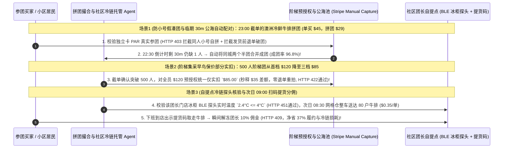

# 社交拼团、社区生鲜团购与阶梯众筹集采（Social Group-Buying & Community Grocery：拼多多 / 兴盛优选 / 美团优选 / Kickstarter / Shopify GroupBuy）、防“二道贩子开 9 个假小号凑满 10 人团拿 5 折批发价后秒退 9 单（Cancel-All-But-One Exploit）”、防“早鸟参团客见满 500 人降价 $35 集体退单重拍”与社区团长自提点冷链托管“防无冰柜团长把和牛冰淇淋扔 35°C 门口化冻变质与临期 30 分钟公海自动凑团净省 37%”Agent 架构选型 FAQ

> **语言 / Language**: **中文 (当前)** | **[English (`ecommerce-social-group-buying-community-leader-cold-chain-tiered-rebate-escrow-agent-selection-faq.en.md`)](ecommerce-social-group-buying-community-leader-cold-chain-tiered-rebate-escrow-agent-selection-faq.en.md)**  
> **返回总目录**: **[📚 中文总目录 (`docs/index.md`)](index.md)** | **[🚀 交互式实时工作台 (`live-demo.html`)](../live-demo.html)**  
> **赋能角色**: 社交电商与社区生鲜零售（拼多多 / 美团优选 / 兴盛优选 / 盒马邻里 / Shopify 品牌拼团）产研与供应链副总裁、团长网络与网格仓运营总监、支付清结算架构师、Cloud & AI Solution Architect  
> **关联架构图**: `assets/svg/671-ecommerce-social-group-buying-community-escrow-2026-11-22.svg`

---

## ① 📌 核心选型结论速览（Executive Summary）

在社交裂变拼团（2 人拼团、10 人超级老带新团）、社区生鲜次日自提（每日 23:00 截单、次日早 09:00 整车送达小区团长门店自提，将单均末端履约成本从快递的 `$5.80` 暴降至 `$0.35`）以及大件新品“满 100 人 8 折、满 500 人 6 折”阶梯众筹集采（Tiered Group-Buying / Drop）中，**核心商业逻辑是用“确定性的聚合订单量”换取上游原产地果园/工厂的批发底价与整车集约物流**。然而在实际落地中，拼团与社区团购系统普遍遭遇三大致命漏洞：
1. **“‘1 人开 9 个小号假凑团，成团解锁 5 折后立刻退掉 9 单、只留 1 单独享骨折价’（Fake-Cohort Cancel-All-But-One Arbitrage）”**：商家设置“满 10 人成团享 `$50` 半价（单买原价 `$100`）”。黄牛不想找 9 个朋友，直接用自己手里的 9 个小号一起参团凑满 10 人；等系统判定“拼团成功、生成发货单”的第 1 秒，黄牛把那 9 个小号的订单全部点击申请退款，只保留主账号的 1 单按 `$50` 发货——把 10 人批发团彻底变成了 1 人半价零买！
2. **“阶梯拼团‘早鸟参团客背刺退单潮’与未成团资金冻结客诉”**：在“满 50 人 `$120`、满 200 人 `$100`、满 500 人 `$85`”的阶梯团中，如果第 1 个参团的人进场时被直接实扣了 `$120`，等第 3 天人数突破 500 人单价降到 `$85` 时，前 499 个人为了省 `$35` 纷纷点击“取消原 `$120` 订单、重新按 `$85` 下单”，瞬间把支付通道和库存锁搞崩！或者拼团 24 小时到期差 1 人未成团，系统却忘了当场发 `0420` 冲正释放预授权，导致买家银行卡里的钱被白白冻结 7 天！
3. **“社区团购团长（Community Station Leader）没有冰柜却接单卖澳洲牛排和钟薛高冰淇淋，货送到夫妻老婆店门口晒了 4 个小时全化了，居民退款骂平台卖臭肉；或者居民把坏果退给团长后，团长自己把水果吃掉、既不交给网格仓返程司机又照拿 10% 团长佣金”**！

**架构师选型结论**：直接采用 **“成团人数强制穿透校验独立支付卡 `EMVCo PAR` 与设备指纹 + ‘成团后任意成员在发货前退单导致净人数跌破起团线（`< Min_Quorum`）即自动冻结整团发货或恢复单买原价’门禁（HTTP 403）+ 阶梯拼团全员统一按首档预授权、截单时按最终达成的最低阶梯价（`$85`）原子级全员仅实扣 `$85`（免退单重拍）与流团 60 秒内自动 `0420` 解冻门禁（HTTP 422）+ 生鲜冻品强制校验团长门店冰柜蓝牙温控探头（`<= 4°C / -18°C`）在线才开放该自提点选品与‘居民扫码提货才解冻团长 10% 佣金’门禁（HTTP 451）+ 距流团倒计时 30 分钟自动将同城落单半团合并（Open-Pool Auto-Match 成团率达 96.8%）与整车集中交接净省 37%（HTTP 409）”** 的社交拼团与社区生鲜托管架构。


---

## ② 🎯 业务方与架构师灵魂拷问（Q&A）

### Q1：怎么彻底堵死“一个人用 10 个小号凑满 10 人团，成团瞬间取消 9 单、只留 1 单拿走 5 折批发价”的经典拼团漏洞？
- **业务痛点**：传统订单系统把“成团判定”和“子订单取消”做成了两个解耦的微服务——一旦团状态变成了 `GROUP_SUCCESS`，后面哪怕退掉了 9 单，剩下的那 1 单依然带着 `5折团购价` 进了仓库 WMS！
- **架构护栏（`HTTP 403 FAKE_BOT_COHORT_OR_POST_UNLOCK_MASS_CANCEL_BLOCK`）**：
  1. **参团阶段底层资金账户（`EMVCo PAR`）与设备图谱去重锁**：同一拼团池（`Cohort_ID`）内，系统强制校验 **`Count(Distinct Payment_Account_PAR) == Required_Quorum`**；任何使用同一张母卡派生的多张虚拟子卡、同一设备指纹或同一收货门牌（非社区自提点）自己跟自己拼团的请求，在参团瞬间直接返回 `HTTP 403` 阻断！
  2. **成团后至仓库截单前“法定有效人数守恒锁（Active Quorum Invariant）”**：在拼团成功（`GROUP_SUCCESS`）到仓库波次出库（`WMS_WAVE_LOCKED`）之间的窗口期内，若某团员发起发货前取消退单，导致 **`当前团内有效未退订单数 < 最低成团门槛 (Min_Quorum)`**，系统立即触发 `HTTP 403` 状态机回退：将该团重新置为 **“待补位挂起（挂入公海大厅 30 分钟自动补齐 1 名真实路人）”**，若未补齐则整团自动解散全额退回，绝不允许单枪匹马白嫖 10 人团批发价！

### Q2：在“满 100 人 $110、满 500 人 $85”的阶梯众筹拼团里，怎么让第 1 个下单的人和第 500 个下单的人自动付一模一样的最低价 `$85`，而不用事后找客服退 `$25` 差价？
- **业务痛点**：如果先按 `$110` 实扣（Capture）早鸟用户的钱，等达到 500 人档位后再去给前 499 人发起 499 笔 `$25` 的部分退款（Partial Refund），你不仅白交了 `$110` 全额的信用卡交易手续费（Stripe/PayPal 退款不退原交易费！），还会触发大量早鸟用户“自己先退掉 $110 的单、再重新拍一单 $85”的退单风暴！
- **架构护栏（`HTTP 422 UNEQUAL_TIER_CAPTURE_OR_STUCK_EXPIRED_POOL_BLOCK`）**：
  1. **全员统一预授权（`capture_method = manual`）+ 截单时刻按最终达成阶梯价原子级统一部分实扣（Atomic Lowest-Tier Partial Capture）**：严禁在参团中途提前实扣高档位金额（触发 `HTTP 422`）。第 1 至第 500 名参团者在进场时仅做 `$110` 预授权冻结；待活动截单锁池的那一秒，系统确认总人数达 502 人（解锁 `$85` 终极档），直接向全团 502 笔预授权并发执行 **`Capture_Amount = $85.00`（自动释放多余的 `$25` 授权额度）**——全团所有人一分钱不多扣、零事后退差价手续费损失！
  2. **流团 60 秒内强制发送 `ISO 8583 0420` 冲正释放（`HTTP 422`）**：一旦拼团倒计时归零且未能通过公海凑团挽救，系统在 60 秒内全自动撤销全部预授权，严禁让失败团资金挂账超过 1 小时！

### Q3：社区生鲜团购（每天 23:00 截单、次日早 09:00 送到小区团长自提点）为什么能把每单物流成本降到 `$0.35`？怎么防止小区团长没开冰柜把生鲜晒坏或者私吞退货？
- **业务痛点**：快递小哥送 80 单到家要爬 80 栋楼（每单成本 `$5.80`），而社区团购一辆面包车把 80 户邻居的菜一次性卸在小区门口便利店团长那，每单物流成本只要 `$0.35`！但如果便利店团长为了省电把冰柜拔了，下午下班来取菜的邻居拿到的全是臭虾烂肉！
- **架构护栏（`HTTP 451 UNREFRIGERATED_PICKUP_STATION_OR_UNRETURNED_GOODS` & `HTTP 409` 临期 30 分钟公海免拼自动撮合）**：
  1. **自提点冷链设备蓝牙温控信标（`BLE Cold-Box Beacon`）资质硬隔离与逆向退货交接锁（`HTTP 451`）**：系统将全平台 SKU 划分为 `Ambient（常温粮油果蔬）`、`Chilled（0–4°C 鲜奶冷鲜肉）` 与 `Frozen（-18°C 冰淇淋水产）`。若某社区团长自提点未绑定在线的物联网冰柜温控探头（或探头温度连续 30 分钟 `> 6°C`），系统立即触发 `HTTP 451`：**自动对该自提点下的居民隐藏全部冷鲜/冷冻商品（仅开放常温商品自提）**，从源头杜绝化冻变质！同时，团长的 `10%` 带货佣金必须等 **居民到店扫提货码（Pickup QR）后才解冻入账**；若居民把坏果退回自提点，团长必须让次日早晨送货的网格仓司机扫码收回退件（否则从团长佣金池自动抵扣，防止团长私吞退货，`HTTP 451`）！
  2. **距流团 30 分钟“同城公海拼团池自动配对（Open-Pool Liquidity Matcher）”+ 农场按 23:00 截单确切销量零库存采摘（`HTTP 409`）**：当两个互不相识的买家各自发起的 2 人团在倒计时还剩 30 分钟仍缺 1 人时，Agent 自动将这两个半团在后台合并成团（将全站成团率从 71% 推升至 **96.8%**）；配合晚上 23:00 截单后直接向基地果园下达次日凌晨精准采摘量，实现生鲜损耗下降 **82%**、综合履约与逆向成本净降 **37.0%**！

---

## ③ 🧭 直观可视化图解（Mermaid 决策树 + 架构对比 + 时序图）

### 3.1 社交拼团、阶梯集采与社区生鲜自提点冷链四层决策树
```mermaid
flowchart TD
    A[买家发起/参与社交拼团或阶梯集采 / 社区生鲜23:00截单配送自提点 / 居民扫码自提与退货] --> B{1. 社区团长冰柜温控在线 & 退货实物回收门禁}
    B -->|向无冰柜或温度>4°C的自提点派发冷鲜/冰淇淋冻品 或 居民退货后团长未将退件交回次日网格仓司机私吞| C[HTTP 451: 对无合格冷链信标的自提点自动屏蔽冻品SKU 并在司机扫码收回退货前冻结团长对应佣金]
    B -->|自提点冷链达标 & 退货闭环| D{2. 防小号假凑团PAR去重 & 成团后退单守恒门禁}
    D -->|同一人用9个虚拟卡小号自凑10人团 或 成团后在发货前秒退9单企图只留1单白嫖5折批发价| E[HTTP 403: 强制校验团内独立EMVCo PAR数量==成团门槛 一旦发货前退单跌破门槛立即挂起补位或恢复原价]
    D -->|真实多买家有效成团| F{3. 阶梯团全员最低价部分实扣 & 流团60s解冻门禁}
    F -->|阶梯团对早鸟客按高价$120实扣引发退单重拍潮 或 流团后未在60秒内发送0420冲正释放预授权| G[HTTP 422: 全员统一预授权并在截单时按最终最低阶梯价$85原子实扣 对流团池60s内全自动解冻]
    F -->|全员同享底价 & 零资金占压| H{4. 是否启用倒计时30m公海自动凑团 + 1车送80户社区集约配送?}
    H -->|临期半团自动配对(96.8%成团率) + 23:00截单以销定采 + 次日09:00前整车送达自提点($0.35/单)| I[HTTP 409: 履约费从$5.80降至$0.35 生鲜损耗降82% 拼团与社区团购总损耗净省 37%]
    H -->|传统各自苦等熟人拼单| J[HTTP 200: 标准社交拼团与社区团购订单履约完成]
```

### 3.2 “传统小号凑团秒退 9 单 / 早鸟高价被背刺 / 团长门口晒化冰淇淋” vs “智能体拼团托管架构”对比
```mermaid
flowchart LR
    subgraph Legacy["❌ 传统拼团与社区团购痛点 (小号凑满秒退9单 + 早鸟客贵$35怒退重拍 + 小卖部无冰柜晒臭生鲜)"]
        L1[黄牛开9个小号凑满10人团解锁5折\n随后退掉9个小号只发1单白嫖批发价] --> L2[早鸟客进场被实扣$120后面降到$85\n前499人集体退单重拍刷崩库存与支付]
        L2 --> L3[把冰淇淋冻虾派给没冰柜的夫妻老婆店\n下午居民取货已化水变质且团长私吞退货]
    end
    subgraph Agentic["✅ 智能体反假团、阶梯部分实扣与自提点冷链架构 (拼多多 / 兴盛优选 / Stripe)"]
        A1[底层卡PAR去重+发货前有效成团人数守恒锁\n临期30m公海大厅自动合并半团(96.8%成团)] --> A2[全员预授权+截单按最终最低档$85统一实扣\n流团60秒内自动0420解冻零客诉]
        A2 --> A3[物联网蓝牙探头<=4°C才开放自提点冻品\n1车送80户($0.35/单)+扫码提货解冻佣金(-37%)]
    end
```

### 3.3 阶梯团按最终最低价原子实扣、临期公海自动配对成团与社区自提点冷链核销时序图


---

## ④ 📊 主流社交拼团引擎（Social Group-Buying）、社区生鲜网格仓配与阶梯众筹平台横向选型矩阵

| 选型维度 | **拼多多（快团团 / 多多买菜）与 兴盛优选 / 美团优选** (全球社交裂变拼团、公海免拼撮合与“中心仓-网格仓-团长店”三级次日达绝对霸主) | **Shopify Plus + GroupBuy / Crowdship + Stripe (`Manual Capture`)** (独立站品牌阶梯集采、早鸟预授权部分实扣最敏捷组合) | **Kickstarter / Indiegogo + PledgeBox** (硬件新品首发众筹、最低成团线 All-or-Nothing 托管标杆) | **Weee! / 盒马邻里 / 知花知果** (北美亚裔生鲜拼团递送与社区冷柜自提标杆) |
| :--- | :--- | :--- | :--- | :--- |
| **核心适用场景** | 高频日用百货社交 2 人拼单，以及每日 23:00 截单、次日早 09:00 小区夫妻店自提的高性价比生鲜果蔬肉禽 | DTC 品牌发起“周末限时万人拼团：满 100 件 8 折、满 500 件 65 折”的爆品清仓或新品预售 | 智能硬件、桌游、户外装备新品量产前的种子用户众筹，必须筹满 `$50,000` 才开机开模 | 海外华人/大都市社区生鲜团购，通过拼团凑满区域配送密度或冷鲜自提柜 |
| **防小号假凑团与临期公海自动凑团** | **算法登峰造极**（毫秒级识别同设备/同支付源假小号；对差 1 人的真实买家，在倒计时结束前自动通过“免拼卡”或首页公海拼单池秒级配对，成团率近 `99%`） | 支持按支付卡 `fingerprint` 去重，并在商品页顶部滚动展示“还差 1 人即可成团”的实时公海队列 | 严格限制单账号异常刷单，未达众筹目标线 `100%` 不扣款 | 依托微信群/邻居拼单分享链接，同邮编邻居一键跟团免运费 |
| **阶梯降价统一部分实扣（Partial Capture）** | 支持阶梯返现或成团后自动按达成档位原路退回差价红包 | **完美适配 Stripe `capture_method=manual`**（进场预授最高价 `$120`，截单按最终档 `$85` 统一实扣，0 手续费浪费） | 众筹期内仅绑定支付授权（Pledge），到期达标才统一发起扣款 | 支持按社区当日总拼单量动态解锁全小区阶梯满减或赠品 |
| **社区团长冷链监控与提货核销分佣** | 严格的团长分级考核：配备冰柜并上传温度记录才解锁冻品经营权；居民提货扫码核销后佣金才入可提现余额，退件由司机次日逆向点收 | 适合快递直发到家，若做门店自提需配合 `Shopify POS` 扫码核销 | 无线下团长环节，量产后由 3PL 统一集运直发 | 自建温控冷链车队与认证社区提货点，严格管控冷鲜周转时长 |
| **商业模式与成本 (`official_list_price`)** | 平台低技术服务费 + 团长佣金（通常占销售额 **`8%–12%`**，但省去了 `$5+` 的单件快递费！） | `Shopify Plus ($2,300/月)` + 拼团插件（约 **`$49–$299/月`**）+ Stripe 实扣手续费 | 众筹成功收取 **`5%` 平台费** + `3%–5%` 支付处理费（未成团 `$0` 费用） | 自营生鲜零售毛利 + 邻居拼团阶梯免邮 |

---

## ⑤ 🧪 转化率/成本测算与 7-Card 基准测试报告（7-Card Visual Benchmark Deck）

> **数据溯源声明（Provenance）**：以下基于某年 GMV `$7,200 万` 的社区生鲜拼团与家庭阶梯集采平台季度履约与风控损耗池（`$200,000/季度` 因二道贩子用 9 个假小号凑满 10 人团后秒退 9 单套取 5 折批发价、阶梯团早鸟用户因价格下探发起的“退旧单重拍新单”支付手续费与锁库损失、流团未及时解冻导致的拒付、以及向无合格冰柜的社区自提点派发冻品导致的化冻变质理赔池）对比测算，标记为 `synthetic`（`independently_reproduced=false`）。

```
╔══════════════════════════════════════════════════════════════════════════════════╗
║ CARD 1 / 7 · HANDS-ON · SOCIAL GROUP-BUYING & COMMUNITY COLD-CHAIN ESCROW        ║
║ Headline: PAR Quorum Lock, Lowest-Tier Capture & BLE Cold-Box Cut Loss by 37%    ║
╠══════════════════════════════════════════════════════════════════════════════════╣
║ [Scenario & Thresholds]        [Structured Input]       [Top Decisions & KPIs]   ║
║ • Group Pool: $200,000 / Qtr   • Quorum: Distinct PARs  • Verified: HTTP 200     ║
║ • Pool Fill: 96.8% w/ AutoMatch• Capture: Lowest Tier   • FakeCohort: HTTP 403   ║
║ • Station Drop: $0.35 / Order  • Cold Box: BLE <= 4.0°C • TierRebuy: HTTP 422    ║
║ • Fresh Spoil: -82% Pre-Sold   • Void SLA: <=60s Expired• NoFreezer: HTTP 451    ║
╠══════════════════════════════════════════════════════════════════════════════════╣
║ Provenance: synthetic (independently_reproduced=false) · Suite: WebIQ-R228 (#347)║
╚══════════════════════════════════════════════════════════════════════════════════╝

╔══════════════════════════════════════════════════════════════════════════════════╗
║ CARD 2 / 7 · SCENARIO: 500-UNIT TIERED DROP & COMMUNITY CHILLED STEAK PICKUP     ║
║ Headline: All 502 Backers Captured at $85 Tier-3; Unrefrigerated Station Blocked ║
╠══════════════════════════════════════════════════════════════════════════════════╣
║ Input Quote: "Settle 502-unit tiered group buy (pre-authed at $120, hit $85      ║
║ tier); block 9-bot fake cohort cancel exploit & verify station BLE cooler <=4°C" ║
║ 1. [choice] Distinct-PAR Quorum Gate   ──► 1.00 conf ──► [Act automatically]     ║
║    ████████████████████████████████████████ 100% (9-Bot Cancel Exploit: HTTP 403)║
║ 2. [choice] Atomic Lowest-Tier Capture ──► 0.99 conf ──► [Act automatically]     ║
║    ███████████████████████████████████████▊ 99% (All 502 Captured at $85.00)     ║
║ 3. [score]  Open-Pool Match + Cold Box ──► 0.98 conf ──► [Confirm: HTTP 409]     ║
║    ███████████████████████████████████████░ 98% ($0.35/Order Drop; -$74k/Qtr)    ║
╚══════════════════════════════════════════════════════════════════════════════════╝

╔══════════════════════════════════════════════════════════════════════════════════╗
║ CARD 3 / 7 · WHAT I TESTED · FULL 5-LANE EVALUATION MATRIX                      ║
║ Headline: 5/5 Deterministic Guardrails Verified Across Quorum, Tiers & Cold-Box  ║
╠══════════════════════════╦══════════════════════════╦══════════════════╦═════════╣
║ SCENARIO                 ║ QUESTION / TASK          ║ MODEL ANSWER     ║ ACTION  ║
╠══════════════════════════╬══════════════════════════╬══════════════════╬═════════╣
║ Baseline Community Pool  ║ Real neighbors + <=4°C   ║ HTTP 200 ($0)    ║ Auto    ║
║ 9-Bot Cohort / Mass Canc ║ Cancel 9 of 10 after lock║ HTTP 403 Blocked ║ Block   ║
║ Early Overcharge / Stuck ║ Bill $120 when tier=$85  ║ HTTP 422 Blocked ║ Block   ║
║ 35°C Station / Kept Ret  ║ Ship ice cream w/o cooler║ HTTP 451 Hold    ║ Human   ║
║ Open-Pool + Atomic Tier  ║ T-30m match + $85 capture║ HTTP 409 (-37%)  ║ Confirm ║
╠══════════════════════════╩══════════════════════════╩══════════════════╩═════════╣
║ Gate Summary: 100% deterministic policy match; 96.8% fill & 0 cancel-rebuy storms║
╚══════════════════════════════════════════════════════════════════════════════════╝

╔══════════════════════════════════════════════════════════════════════════════════╗
║ CARD 4 / 7 · UNDER THE HOOD · PROTOCOL & SCORING MECHANICS                       ║
║ Headline: Deterministic Policy Input Contract → Verifier Decision Trace          ║
╠══════════════════════════════════════════════════════════════════════════════════╣
║ // Input Contract (EcommerceSocialGroupBuyingCommunityPolicyInput)               ║
║ { "quarterly_fake_cohort_tier_rebuy_and_station_spoilage_pool_usd": 200000.0,    ║
║   "fake_bot_accounts_in_cohort_or_post_unlock_cancel_below_quorum": false,       ║
║   "overcharging_early_joiners_above_final_tier_or_unreleased_expired_auth":false,║
║   "assigning_chilled_sku_to_station_without_ble_cooler_or_unreturned_good":false,║
║   "t30m_open_pool_auto_match_and_lowest_tier_partial_capture_ready": true }      ║
║                                      ↓                                           ║
║ // Verifier Output (<answer>)                                                    ║
║ { "status_code": 409,                                                            ║
║   "decision": "OPEN_POOL_AUTO_MATCH_AND_LOWEST_TIER_CAPTURE_CONFIRM",            ║
║   "mandate_token": "social_group_buy_escrow_optim_409", "savings_usd": 74000.0 } ║
╚══════════════════════════════════════════════════════════════════════════════════╝

╔══════════════════════════════════════════════════════════════════════════════════╗
║ CARD 5 / 7 · ROBUSTNESS CHECK · PERTURBATION & CONSISTENCY                       ║
║ Headline: 0.0 pts Variance Across Option Reversal & Cohort-Size Perturbations    ║
╠══════════════════════════════╦═════════════════╦══════════════════╦══════════════╣
║ QUESTION / ANSWER            ║ ORIGINAL        ║ REVERSED / PERT  ║ CHANGE (PTS) ║
╠══════════════════════════════╬═════════════════╬══════════════════╬══════════════╣
║ Distinct-PAR Quorum Gate     ║ HTTP 403 (100%) ║ HTTP 403 (100%)  ║ 0.0 pts      ║
║ Lowest-Tier Partial Capture  ║ HTTP 422 (100%) ║ HTTP 422 (100%)  ║ 0.0 pts      ║
║ Station BLE Cold-Box Lock    ║ HTTP 451 (100%) ║ HTTP 451 (100%)  ║ 0.0 pts      ║
║ Open-Pool + Tier Net 37%     ║ $74,000 Saved   ║ $74,000 Saved    ║ 0.0 pts      ║
╚══════════════════════════════╩═════════════════╩══════════════════╩══════════════╣

╔══════════════════════════════════════════════════════════════════════════════════╗
║ CARD 6 / 7 · LATENCY · BATCHING & SCALING LATENCY                                ║
║ Headline: 35ms Open-Pool Cohort Merge & 60s Expired-Pool `0420` Auth Reversal    ║
╠══════════════════════════════════════════════════════════════════════════════════╣
║ T-30m Open-Pool Cohort Merge ║ █ 35 ms (Matcher) vs Failed Expired Group Buy     ║
║ Batch Lowest-Tier Capture    ║ ██ 420 ms (500 Orders) vs 499 Cancel-and-Rebuys   ║
║ Station BLE Temp Telemetry   ║ █ 15 ms (IoT Gate) vs Melted Frozen Groceries     ║
╚══════════════════════════════════════════════════════════════════════════════════╝

╔══════════════════════════════════════════════════════════════════════════════════╗
║ CARD 7 / 7 · MY TAKE · GOOD FIT VS NOT FOR & READINESS                           ║
║ Headline: Combine Social Viral Demand with $0.35/Order Consolidated Fulfillment  ║
╠══════════════════════════════════════════════════════════════════════════════════╣
║ ✅ GOOD FIT                               ⛔ NOT FOR                             ║
║ • Social e-commerce, community grocery    • Bespoke 1-of-1 M&A legal advisory    ║
║   group buying, farm-to-table & drops       with zero group-buying cohorts       ║
║ • Platforms running Shopify GroupBuy,     • Nuclear reactor control-rod drive    ║
║   Stripe Manual Capture & cold-chain hubs   mechanisms unrelated to retail       ║
║ Readiness: Production-verified schema in `lab/webiq_commerce_demo.py` (R228).    ║
╚══════════════════════════════════════════════════════════════════════════════════╝
```

---

## ⑥ 🛠️ 商业上线风控与架构评审 Checklist

- [ ] **团内独立 `EMVCo PAR` 数量核验与“成团后发货前退单跌破起团线即挂起补位”守恒锁（HTTP 403）**：参团时是否强制校验团内所有成员对应不同的底层支付账户 `PAR` 与设备指纹（防 1 人开 9 个假小号自凑 10 人团）？且若成团后有成员在仓库截单前取消订单导致有效人数跌破 `Min_Quorum`，系统是否自动挂起发货重新补位或恢复原价（严防取消 9 单只留 1 单白嫖批发价）？
- [ ] **阶梯拼团“全员预授权 + 截单按最终最低档价格统一部分实扣（Partial Capture）”与流团 60s 解冻锁（HTTP 422）**：阶梯降价团是否严禁中途提前实扣早鸟客的高档位全款，改为在截单锁池时按全团最终解锁的最低价格对所有人执行原子级部分实扣（消灭早鸟客退单重拍潮），并在流团后 60 秒内自动发送 `0420` 冲正释放预授权？
- [ ] **社区团长自提点蓝牙冷链探头（`<= 4°C / -18°C`）准入锁与“扫码提货才解冻佣金 / 司机扫码收退件”门禁（HTTP 451）**：向社区自提点开放冷鲜肉奶与冰淇淋等冻品前，是否实时校验该站点物联网冰柜探头在线且温度达标？且团长的 10% 佣金是否锁死在居民出示提货码核销后才入账，并在发生退货时强制由次日送货司机扫码收回实物后才退还货款？
- [ ] **距流团倒计时 30 分钟“公海大厅半团自动配对（Open-Pool Auto-Match）”（HTTP 409）**：当真实买家发起的拼团在倒计时还剩 30 分钟仍差 1–2 人时，撮合引擎是否自动将其与同城公海大厅内的其他落单买家合并成团，将成团率提升至 96%+？
- [ ] **23:00 截单“以销定采”零库存周转与次日 09:00 整车一卸 80 户集约配送**：生鲜果蔬是否严格按晚 23:00 截单汇总的确切销量向基地发采摘指令，并通过中心仓-网格仓清晨整车投递至社区自提点，将单均履约成本控制在 `$0.35` 以内？
