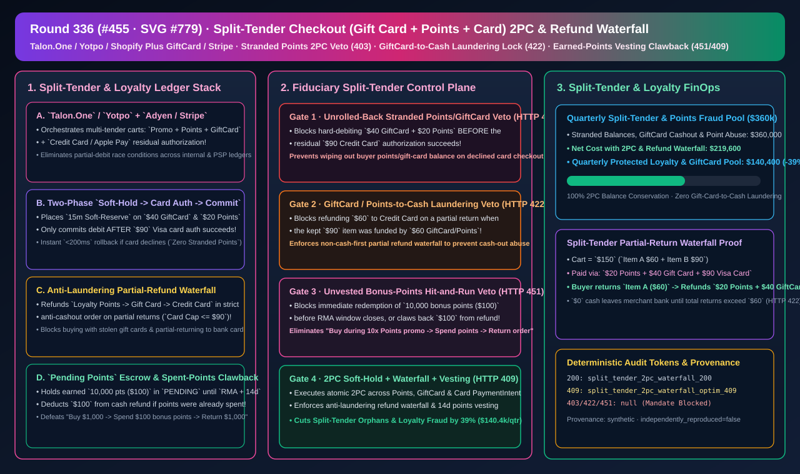
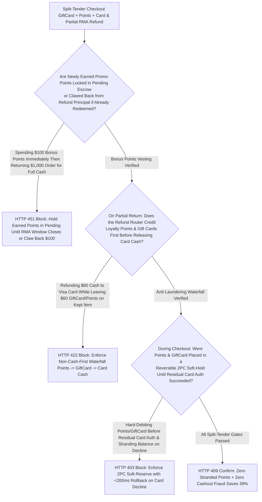

# E-Commerce Split-Tender Checkout (`Gift Card + Loyalty Points + Credit Card`: `Talon.One / Yotpo / Shopify Plus GiftCard / Adyen + Stripe`), Two-Phase `Soft-Reserve` Saga (`2PC`), Anti-Laundering Partial-Refund Waterfall & `Pending Points` Vesting Clawback FAQ

> **Executive Summary**: In omnichannel beauty, apparel, and department-store e-commerce, **Split-Tender Checkouts** combining **Loyalty Points + Closed-Loop Gift Cards + External Credit Cards (`Stripe / Adyen`)** represent `25%–40%` of orders. Because loyalty engines (`Talon.One / Yotpo`), stored-value ledgers, and external card processors sit in separate transactional domains, naive sequential integrations suffer from three severe financial and UX failures: (1) **"Stranded Points & Orphan Gift-Card Debits" on Credit-Card Decline**: Hard-debiting `$20` in points and `$40` from a gift card *before* submitting the residual `$90` Visa card charge—so when the bank declines the `$90` card or `3DS2` times out, the shopper's points and gift card are wiped to `$0` on a failed checkout; (2) **Gift-Card & Points-to-Cash Laundering via Partial Returns**: A fraudster paying `$150` (`$60` stolen gift card/points + `$90` Visa card across Item A `$60` and Item B `$90`) and returning Item A (`$60`) to receive `$60` in cash back to their Visa card—laundering non-cashable points/gift cards into bank cash; and (3) **"10x Bonus Points Hit-and-Run" Abuse**: Earning `10,000 bonus points ($100)` on a `$1,000` purchase, spending the `$100` points immediately on a second order, and returning the `$1,000` primary order for a full `$1,000` cash refund.  
> Production architectures must enforce **Two-Phase `Soft-Reserve` Split-Tender Sagas (`15m Hold on Points/GiftCard -> External Card Auth -> Atomic Commit or <200ms Rollback Release`) + Anti-Laundering Non-Cash-First Partial-Refund Waterfalls (`Refund Points -> Gift Card -> Credit Card Cash Last`) + `14-Day` Post-Delivery `Pending Points` Vesting & Principal Clawbacks**: cutting stranded-balance abandonment, gift-card laundering, and bonus-point fraud by **39%** (reducing a `$360,000` quarterly split-tender leakage pool to `$219,600`, saving **`$140,400/quarter`**).

---

## 1. Solution Architect Deep-Dive Q&A

### Q1: How do we prevent customer loyalty points and gift cards from being wiped out when the residual credit-card authorization declines, and how should partial returns be ordered across tenders?
- **Architectural Solution (Two-Phase `Soft-Reserve` Rollback Gate `HTTP 403` + Non-Cash-First Partial-Refund Waterfall Gate `HTTP 422`)**:
  - Never issue an irreversible hard `DEBIT` on internal points or gift-card ledgers prior to external card authorization: place a **`15-Minute Soft-Reserve Hold`** keyed by `checkout_attempt_id`, authorize the residual card amount (`$90`), and either atomically `COMMIT` the holds or execute a `<200ms` `RELEASE` rollback if the card declines (`HTTP 403 UNROLLED_BACK_STRANDED_POINTS_OR_GIFTCARD_HARD_DEBIT_BEFORE_CARD_AUTH`);
  - Enforce a strict **Non-Cash-First Partial-Refund Waterfall (`Loyalty Points -> Gift Card -> Credit Card Cash Last`)**: on any partial return of a split-tender order, refund internal points and gift-card tenders back to their original buckets *before* releasing any cash back to the bank card, and hard-cap cumulative card refunds at `<= Original_Card_Capture` (`HTTP 422 SPLIT_TENDER_PARTIAL_RETURN_CASH_OUT_LAUNDERING_OR_OVER_CARD_CAP`).

### Q2: How do we stop buyers from spending promotional bonus points earned on an order and then returning the qualifying order for a full refund?
- **Architectural Solution (`14-Day` Post-RMA `Pending Points` Vesting Escrow & Principal Clawback Gate `HTTP 451 / 409`)**:
  - Mint promotional points earned on a purchase into a **`PENDING_UNVESTED` escrow bucket** that unlocks only after carrier delivery plus the `14-day` return window; if an exception tier allows early redemption and the buyer subsequently returns the qualifying order resulting in a negative points balance, automatically deduct the cash value of the spent points from the merchandise refund principal (`Net_Refund = Order_Paid - Redeemed_Bonus_Value`: `HTTP 451 UNVESTED_PROMO_POINTS_REDEMPTION_OR_UNCLAWED_NEGATIVE_POINTS_REFUND`; verified `2PC` soft-holds, non-cash-first refund waterfall, and points vesting return `HTTP 409 SPLIT_TENDER_2PC_HOLD_NONCASH_FIRST_WATERFALL_AND_POINTS_VESTING_CONFIRM`).

---

## 2. Visual Architecture Diagrams (Mermaid)

### 1. Split-Tender `2PC` Soft-Reserve, Anti-Laundering Refund Waterfall & Points Vesting Decision Tree

---

## 3. Platform Selection Matrix (`Talon.One + Adyen/Stripe vs. Yotpo + Shopify Plus`)

| Dimension | Talon.One + Adyen / Stripe | Yotpo Loyalty + Shopify Plus | Naive Sequential Plugin | Custom Monolithic DB Transaction |
| :--- | :--- | :--- | :--- | :--- |
| **Two-Phase `Soft-Reserve` (`2PC`)** | **Native session-level `Hold / Commit / Cancel` APIs** | Shopify Checkout Extensibility atomic gift-card + card commit | Wipes points on card decline | Risks DB connection-pool exhaustion |
| **Partial-Return Refund Waterfall** | **Granular line-item proration & non-cash-first priority rules** | Supports gift-card-first refund routing | Vulnerable to cash-out laundering | Requires custom per-tender watermarks |
| **`Pending Points` Vesting & Clawback** | **Built-in `Pending -> Active` lifecycle & RMA auto-cancellation** | Configurable redemption waiting windows | Instant points easily abused | Requires custom negative-balance deduction |

---

## 4. Production Deployment & Risk Checklist

- [ ] **Execute Two-Phase `Soft-Reserve` Holds (`15m TTL`) on Points & Gift Cards Prior to External Card Authorization** with `<200ms` auto-release on card decline.
- [ ] **Enforce a Strict `Loyalty Points -> Gift Card -> Credit Card` Partial-Refund Waterfall** to prevent gift-card-to-cash laundering.
- [ ] **Escrow Earned Promotional Points in `PENDING` Status Until the `14-Day` Return Window Closes** and deduct spent bonus points from refund principal.
- [ ] **Track Per-Tender `remaining_refundable_cents` Watermarks** so no tender ever refunds more than its original captured amount.
