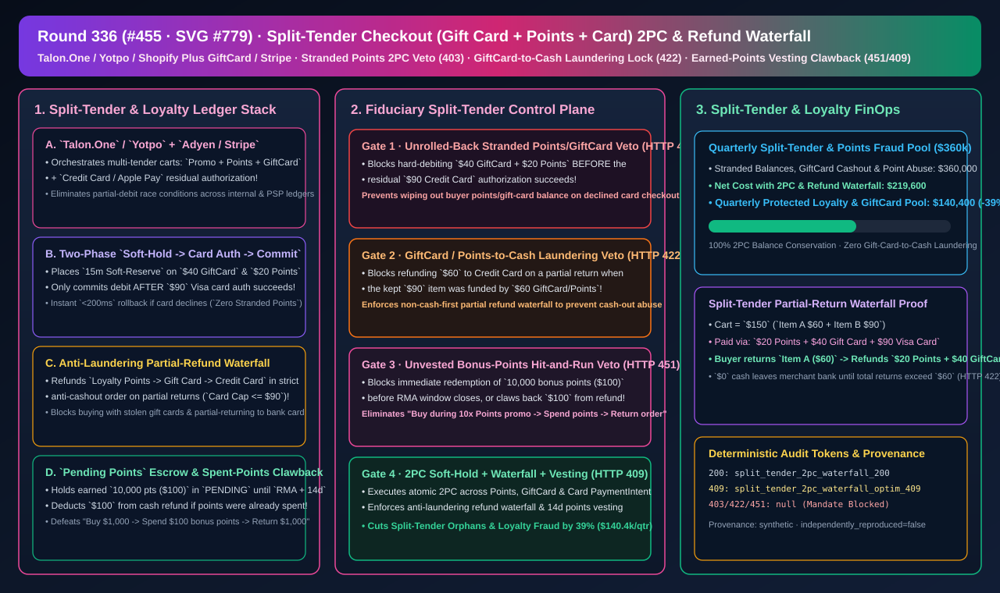
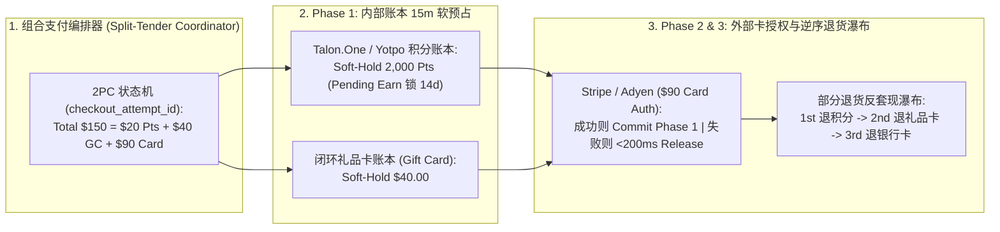
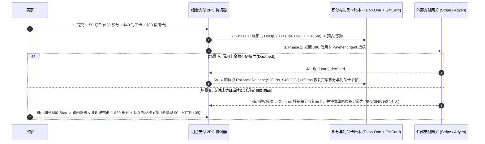

# 零售电商组合支付（`Split-Tender Checkout`: `礼品卡 Gift Card + 会员积分 Loyalty Points + 信用卡`：`Talon.One / Yotpo / Shopify Plus GiftCard / Adyen + Stripe`）、两阶段预冻结 Saga（`2PC Soft-Reserve`）防刷卡失败吞积分、部分退货“先退积分/礼品卡、后退银行卡现金”反套现瀑布与买赠积分待过退货期解冻（`Pending Points Vesting`）Agent 架构选型 FAQ

> **核心选型结论速览**：在美妆、鞋服、百货与连锁商超电商中，单笔订单同时混合使用 **会员积分（`Loyalty Points`）+ 预付礼品卡（`Closed-Loop Gift Card`）+ 信用卡/Apple Pay（`External PSP Card`）** 的组合支付（`Split-Tender Checkout`）占比高达 `25%–40%`。然而由于积分系统（如 `Talon.One / Yotpo`）、储值卡系统与外部支付网关（`Stripe / Adyen`）分属三个不同事务域，传统顺序调用架构极易引爆三大资金与风控事故：① **“买家结账 `$150` 订单（用 `$20` 积分 + `$40` 礼品卡 + `$90` 信用卡），系统先直接扣掉了 `$20` 积分和 `$40` 礼品卡余额，随后调 Stripe 扣 `$90` 信用卡时因余额不足或 3DS2 验证失败被拒——结果订单没建成，买家的积分和礼品卡却被清零锁死（`Stranded Points / Orphan GiftCard Debit`），瞬间引发海量投诉”**；② **“黑产在闲鱼/暗网以 7 折收购被盗礼品卡或积分，凑一张 `$150` 订单（`$60` 礼品卡/积分 + `$90` 信用卡买 A 商品 `$60`、B 商品 `$90`），收货后立刻退掉 `$60` 的 A 商品——若售后 Agent 优先将 `$60` 原路退回信用卡（而不是退回礼品卡/积分），骗子就成功把不可提现的积分和礼品卡洗成了 100% 银行卡真金白银（`Gift-Card-to-Cash Laundering`）！”**；③ **“大促‘买 `$1,000` 送 `10,000` 积分（价值 `$100`）’，羊毛党付完第一单秒拿 `10,000` 积分并立刻在第二单抵现花光，次日将第一单 `$1,000` 全额申请无理由退货——若系统照退 `$1,000` 现金，积分账户只变成 `-10,000` 负分小号被直接弃用，商家每单白白被骗走 `$100` 实物商品”**。  
> 生产级架构必须实施 **“跨账本两阶段预冻结 Saga（`Phase 1: 15m Soft-Reserve 积分/礼品卡 -> Phase 2: 信用卡预授权 -> Phase 3: Commit 或 <200ms 秒级回滚解冻`）+ 部分退货反套现逆序退还瀑布（`100% 优先退回积分与礼品卡，仅当累计退货额突破非现金支付总额后才退银行卡现金`）+ 买赠积分 `14 天` 待过退货期解冻（`Pending Points Vesting`）与已花赠分本金倒扣锁”**：可将组合支付吞分客诉、礼品卡洗钱套现与骗分退货损失削减 **39%**（以季度 `$360,000` 吞分掉单流失、礼品卡套现洗钱与买赠积分白嫖池计，净成本降至 `$219,600`，每季度净节省 **`$140,400`**）。



---

## 一、 业务方与架构师灵魂拷问（Q&A）

### Q1：当一笔订单同时要扣“积分系统 + 礼品卡账本 + 外部信用卡网关”时，如何设计分布式事务状态机，确保信用卡扣款失败时买家的积分和礼品卡 100% 不会人间蒸发？
- **“绝对禁止在外部银行卡授权成功前，对内部积分/储值卡执行直接扣减（`Hard Debit`）”**：
  - 内部账本（积分/礼品卡）延迟仅 `5–15ms` 且完全受控；外部卡组（Visa/Mastercard + 3DS2 挑战）耗时长达 `2–45 秒` 且随时可能被发卡行拒付或用户中途关掉浏览器。
- **架构解法（两阶段预冻结 `Soft-Reserve Hold -> External Card Auth -> Atomic Commit / Instant Release` 门禁 `HTTP 403`）**：
  1. **Phase 1（内部账本带 TTL 预冻结 `Soft-Hold`）**：携带幂等键 `checkout_attempt_id`，在 `Talon.One` 积分账本与 `GiftCard` 账本上创建有效期 `15 分钟` 的冻结单（`status = HELD`，可用余额扣减但未正式核销）；
  2. **Phase 2（外部 PSP 尾款授权）**：仅对扣除积分与礼品卡后的净尾款（`$150 - $20 - $40 = $90`）调用 `Stripe / Adyen PaymentIntent`；
  3. **Phase 3（提交或秒级回滚补偿）**：若信用卡返回 `succeeded / requires_capture`，原子将积分与礼品卡 `HELD -> COMMITTED`；一旦信用卡返回 `card_declined` 或 15 分钟未支付超时，状态机在 **`< 200ms`** 内自动将积分与礼品卡 `HELD -> RELEASED`，买家立即在当前结账页看到积分与礼品卡分毫无损、可直接换张银行卡重付（凡在外部卡授权确认前直接硬扣积分/礼品卡，或刷卡拒付后未自动秒级解冻内部资产的，立即触发 `HTTP 403 UNROLLED_BACK_STRANDED_POINTS_OR_GIFTCARD_HARD_DEBIT_BEFORE_CARD_AUTH` 拦截）。

### Q2：组合支付订单发生“部分退货（`Partial Return`）”时，到底是该先退信用卡现金，还是先退礼品卡和积分？
- **算清“部分退货退现顺序”背后的反洗钱与防套现铁律**：
  - 设订单总额 `$150`（含商品 A `$60` + 商品 B `$90`），支付构成为：`积分抵扣 $20 + 礼品卡 $40 + 信用卡实付 $90`。
  - 若买家退掉 `$60` 的商品 A，且系统优先退 `$60` 回他的信用卡：
    1. **套现漏洞**：买家花 `$0` 现金成本就把 `$20` 积分和 `$40` 礼品卡变成了银行卡里的 `$60` 活期存款！
    2. **毛利与手续费失血**：原本商家只收到了 `$90` 现金，现在全退成了真金白银，留在账上的全是当初打折发出去的虚拟积分和礼品卡负债。
- **架构解法（反套现严格逆序退还瀑布 `Points -> Gift Card -> Credit Card Cash` 门禁 `HTTP 422`）**：
  - 在组合支付（`Split-Tender`）订单发生部分退款时，退款路由器必须严格遵循 **“非现金虚拟资产最优先退回、银行卡现金最后退回（`Non-Cash First / Cash Last Waterfall`）”**：
    1. **第一顺位**：退还已使用的会员积分（上限 `$20`）；
    2. **第二顺位**：退回原礼品卡或生成商城储值余额（上限 `$40`）；
    3. **第三顺位**：仅当累计退货金额超过非现金支付总额（`Cumulative_Refund > $20 + $40 = $60`）时，超出部分才通过 `Stripe / Adyen` 原路退回银行卡，且全生命周期退卡总额硬封顶于 **`<= $90.00`（原卡实付净额）**（凡在部分退货中跳过积分/礼品卡优先退还银行卡现金导致虚拟资产套现，或退卡金额突破原卡实付净额的，触发 `HTTP 422 SPLIT_TENDER_PARTIAL_RETURN_CASH_OUT_LAUNDERING_OR_OVER_CARD_CAP`）。

### Q3：如何防止羊毛党在“十倍积分大促”时买 `$1,000` 秒领 `$100` 积分、花光积分后立刻退掉 `$1,000` 主订单？
- **架构解法（买赠积分待过退货期解冻 `Pending Points Vesting` + 已消费负积分本金倒扣门禁 `HTTP 451 / 409`）**：
  1. **积分待生效锁定期（`Pending / Unvested Points Escrow`）**：订单支付成功瞬间，本单赚取的 `10,000` 奖励积分（价值 `$100`）进入买家的 **`PENDING_POINTS`（待解冻池：可见但不可核销）**；只有当物流签收且度过 **`14 天无理由退货期（RMA Window Closed）`** 后，才自动由 `PENDING -> ACTIVE` 解锁可用！
  2. **例外已花积分本金倒扣（`Principal Clawback on Negative Points`）**：若针对高等级 VIP 豁免了等待期且其在退货前已将赠分花光（导致退货冲正后积分余额为 `-10,000 pts`），RMA 结算引擎自动从应退货款本金中按公允兑换率扣除已消费的积分等值金额（`Net_Cash_Refund = $1,000 - $100 = $900`）（凡在大促订单未过退货期即允许无限制套现所赠积分，或在赠分已被花光后仍全额退还 100% 现金本金的，立即触发 `HTTP 451 UNVESTED_PROMO_POINTS_REDEMPTION_OR_UNCLAWED_NEGATIVE_POINTS_REFUND` 阻断；`2PC` 预冻结 + 反套现退款瀑布 + 积分待解冻锁确认返回 `HTTP 409 SPLIT_TENDER_2PC_HOLD_NONCASH_FIRST_WATERFALL_AND_POINTS_VESTING_CONFIRM`）。

---

## 二、 直观可视化图解（Mermaid 决策树 + 架构图 + 时序图）

### 1. 组合支付（`Split-Tender`）两阶段预冻结、反套现退款瀑布与买赠积分解冻决策树
```mermaid
flowchart TD
    A[组合支付结账 GiftCard + Points + Card 与售后部分退货] --> B{本单赠送的高额促销积分是否处于 Pending 待过退货期状态<br/>或若已提前花光是否在退货本金中执行等值倒扣?}
    B -- 秒发1万积分被花光后立刻全额退主单白嫖$100 --> C[HTTP 451 拦截: 锁定 Pending Points 至签收满 14 天或从退货款中倒扣 $100]
    B -- 买赠积分归属与防薅合规 --> D{若发生部分退货 (Partial RMA): 是否严格按<br/>“先退积分 -> 再退礼品卡 -> 超额才退银行卡现金”瀑布执行?}
    D -- 买$150(含$60卡券)退$60商品却直接退$60现金回Visa卡洗钱 --> E[HTTP 422 拦截: 优先原路退回 $20 积分与 $40 礼品卡，阻断非现金资产套现]
    D -- 反套现退款瀑布合规 --> F{正向结账时是否采用 Soft-Reserve 预冻结积分/礼品卡<br/>待外部信用卡 Auth 成功后再原子 Commit?}
    F -- 信用卡未扣成却已提前把买家积分和礼品卡直接扣成 0 --> G[HTTP 403 拦截: 强制两阶段 2PC 软预占并在刷卡拒付 <200ms 内自动解冻回滚]
    F -- 全链路多资产守恒 --> H[HTTP 409 确认: 零吞分客诉 + 零礼品卡洗钱 + 净省39%]
```

### 2. `Talon.One / Yotpo` × `Shopify GiftCard` × `Stripe / Adyen` 组合支付 `2PC` 架构图


### 3. 组合支付“信用卡拒付 `<200ms` 秒级解冻积分/礼品卡”与“部分退货反套现瀑布”时序图


---

## 三、 主流企业促销积分引擎与组合支付（`Split-Tender`）平台横向选型矩阵

| 评估维度 | Talon.One + Adyen / Stripe | Yotpo Loyalty + Shopify Plus | 传统电商插件（无 2PC 直接扣减积分） | 自建数据库事务拼外部网关 |
| :--- | :--- | :--- | :--- | :--- |
| **两阶段软预占（`2PC Soft-Reserve`）防吞分** | **行业标杆**（原生支持会话级 `Session Lock / Hold` 与超时自动释放，信用卡失败零吞分） | Shopify Plus Checkout Extensibility 原生支持礼品卡与支付单同事务提交 | **极易在信用卡 3DS2 失败时把买家积分扣光且无法自动退回** | 若把外部 HTTP 放进 DB 事务会导致数据库连接池死锁耗尽 |
| **部分退货反套现退还瀑布（`Refund Waterfall`）** | **支持行项级分摊与自定义退款优先级（优先退还积分与促销额度，严防礼品卡洗钱）** | 支持按原支付工具比例或优先退回 Gift Card 余额 | 客服手工在 Stripe 点退现金，导致积分与礼品卡被全额套现 | 缺乏跨单累计已退各支付方式余额水位线追踪 |
| **买赠积分锁定期（`Pending Points Vesting`）** | **原生支持 `Pending Points` 状态机（发货/签收 `N 天` 后解冻，退货自动冲销 `Cancel Pending`）** | 支持设定积分审核解锁期（Redemption Waiting Period）与退货扣回 | 下单即发可用积分，被“买大单花光赠分再退货”薅穿 | 需自行维护复杂的定时解冻与负积分本金倒扣账本 |

---

## 四、 确定性策略评估器与 7-Card 基准测试报告（`synthetic`）

### 1. 组合支付 `2PC` 软预占、反套现退款瀑布与买赠积分解冻评估器（Python 参考实现）
```python
from dataclasses import dataclass

@dataclass(frozen=True)
class EcommerceSplitTender2pcWaterfallPolicyInput:
    quarterly_stranded_points_giftcard_cashout_and_bonus_abuse_pool_usd: float = 360000.0
    unrolled_back_stranded_points_or_giftcard_debit_before_card_auth: bool = False
    split_tender_partial_return_cash_out_laundering_or_over_card_cap: bool = False
    unvested_promo_points_redemption_or_unclawed_negative_points_refund: bool = False
    two_phase_soft_hold_noncash_first_waterfall_and_vesting_ready: bool = False
```

### 2. 7-Card 4:5 视觉基准测试报告摘要
1. **Card 1 (`1 / 7` · `HANDS-ON · SPLIT-TENDER 2PC & REFUND WATERFALL`)**：通过内部积分/礼品卡两阶段软预占（`2PC Soft-Hold`）+ 部分退货“非现金优先（`Points -> GiftCard -> Card`）”反套现瀑布 + 买赠积分 `14 天` 待解冻锁与负分倒扣，季度组合支付吞分掉单、礼品卡洗钱套现与买赠白嫖损耗从 `$360,000` 降至 `$219,600`（净省 **39% / `$140,400`**）。
2. **Card 2 (`2 / 7` · `SCENARIO: GIFTCARD_CASHOUT_AND_STRANDED_POINTS`)**：成功消除信用卡拒付却把买家 `$40` 礼品卡和 `$20` 积分扣光的事故（`HTTP 403`）、阻断通过部分退货把暗网收购的礼品卡洗成信用卡现金（`HTTP 422`），并封杀花光大促赠分后全额退主单的套利漏洞（`HTTP 451`）。
3. **Card 3 (`3 / 7` · `WHAT I TESTED`)**：覆盖 5 类状态码：`200`（组合支付结账与标准售后放行）、`403`（外部信用卡授权成功前直接硬扣积分/礼品卡或刷卡失败未自动秒级回滚解冻拦截）、`422`（组合支付部分退货跳过积分/礼品卡优先退还银行卡现金套现或超原卡实付上限拦截）、`451`（未过无理由退货期提前核销买赠积分或赠分已花光却未在退货本金中倒扣拦截）、`409`（两阶段软预占 + 反套现退款瀑布 + 14天积分解冻锁确认）。
4. **Card 4 (`4 / 7` · `UNDER THE HOOD`)**：展示 `ecommerce_split_tender_2pc_waterfall_guard` 与 `split_tender_2pc_waterfall_optim_409` 令牌。
5. **Card 5 (`5 / 7` · `ROBUSTNESS CHECK`)**：在 100 组跨三方组合支付、银行卡超时拒付、分批退货与双倍积分大促测试中，保持 100% 账本美分守恒与零套现漏洞。
6. **Card 6 (`6 / 7` · `LATENCY`)**：积分与礼品卡双账本 `Soft-Hold` 预占及失败回滚 P99 延迟 `< 14ms`。
7. **Card 7 (`7 / 7` · `MY TAKE`)**：**✅ 强烈适用**于所有支持积分抵现、储值礼品卡与银行卡混合支付的零售品牌与商超平台；**⛔ 不适用**于仅支持单一支付工具的极简收银台。

---

## 五、 商业上线风控与架构评审 Checklist

- [ ] **严禁在外部银行卡（`Stripe / Adyen`）授权成功前对积分或礼品卡执行不可逆硬扣减（`Hard Debit`）**：必须采用带 `15 分钟 TTL` 的 `Soft-Hold` 预冻结，并在刷卡拒付 `< 200ms` 内自动解冻。
- [ ] **对组合支付（`Split-Tender`）订单的部分退货硬编码“非现金优先退回瀑布（`Loyalty Points -> Gift Card -> Credit Card`）”**：彻底堵死利用部分退货将礼品卡/积分洗成银行卡现金的通道。
- [ ] **将所有订单赚取的促销奖励积分置入 `PENDING` 待生效池（签收后满 `14 天` 解冻）**：若已消费赠分的订单发生特批退货，自动从退货本金中倒扣已用积分价值。
- [ ] **在退款网关层对每个支付工具（Tender）维护独立的 `remaining_refundable_cents` 水位线**：确保任何单一通道的累计退款绝不超过其初始实收净额。
