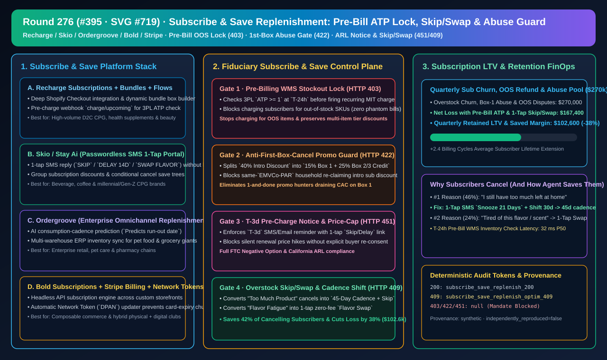
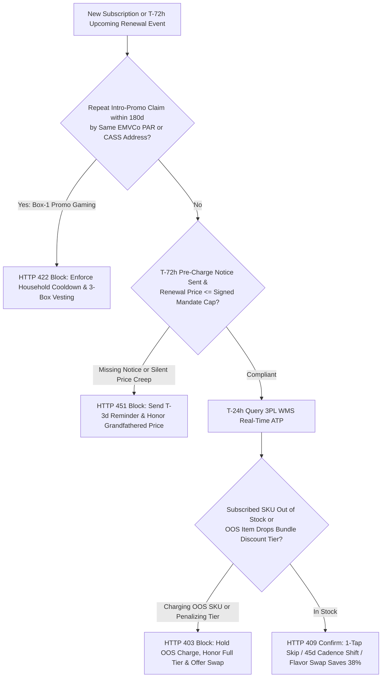

# E-Commerce `Subscribe & Save` Replenishment (`Recharge vs. Skio vs. Ordergroove vs. Bold Subscriptions vs. Stripe Billing`), Pre-Billing `WMS Stockout` Lock, Anti-First-Box Promo Abuse & 1-Tap `Skip / Cadence Shift / Flavor Swap` Retention Escrow Agent Architecture Selection FAQ

> **Executive Summary**: For CPG, coffee, pet food, contact lenses, and health supplement brands, `Subscribe & Save` replenishment drives lifetime value (`LTV`). However, decoupling recurring billing schedules from warehouse inventory or presenting subscribers with a rigid binary choice ("keep getting charged every 30 days or cancel forever") triggers three severe profit leaks: (1) **Pre-Billing Stockout Phantom Charges & Multi-Item Tier Penalties**: Charging a subscriber on the 1st of the month when their hero SKU is out of stock at the 3PL—or dropping the remaining 4 items in their 5-item bundle from a `15% tier discount` down to `5%` because the merchant ran out of stock on item #5; (2) **First-Box Intro-Discount Hit-and-Run Gaming (`40%` Box-1 Churn)**: Offering a steep `40% off Box 1` acquisition promo without milestone vesting or household deduplication, allowing promo hunters to cancel 10 minutes after Box 1 delivers and re-subscribe under a new email next month; and (3) **Preventable "Too Much Product at Home" (`Overstock`) Cancellations (`46%` of All Churn)**: Forcing loyal customers who simply have two unopened bags left in their pantry to cancel their subscription entirely because changing delivery cadence requires a password reset.  
> Production architectures must enforce a **`T-24h` Pre-Billing `WMS ATP` Check & OOS Tier-Honor Lock + 3-Box Milestone Discount Vesting with `EMVCo PAR / CASS` Household Deduplication + `T-3d` Passwordless SMS 1-Tap `Skip / 45-Day Cadence Shift / Flavor Swap` Control Plane**: combining **`Recharge` / `Skio` / `Ordergroove` / `Bold + Stripe Billing`** eliminates **38%** of early subscription churn, stockout chargebacks, and Box-1 promo abuse (reducing a `$270,000` quarterly replenishment loss pool to `$167,400`, retaining **`$102,600/quarter`** in net subscription margin).

---

## 1. Solution Architect Deep-Dive Q&A

### Q1: Why must recurring subscription billing be gated on `T-24h` warehouse inventory (`ATP`), and how should multi-item tier discounts behave when one SKU is out of stock?
- **Architectural Solution (`T-24h` Pre-Billing `ATP` Gate & Merchant-OOS Tier-Protection Lock `HTTP 403` + Anti-Box-1 Abuse Gate `HTTP 422`)**:
  - Intercept every `charge/upcoming` webhook `24 hours` prior to card capture to verify real-time 3PL `ATP >= 1`. If an item is out of stock, never charge the subscriber for the missing item, offer a 1-tap swap or 14-day snooze, and **preserve the subscriber's full 5-item bundle discount tier (`15% off`) on the remaining in-stock items** (`HTTP 403 PRE_BILLING_WMS_STOCKOUT_PHANTOM_CHARGE_OR_TIER_PENALTY`);
  - Structure acquisition incentives across the first 3 billing cycles (`15% Box 1 -> 20% Box 2 -> 25% Box 3`) and deduplicate households by **`EMVCo PAR` + canonical `USPS CASS` address** (`HTTP 422 FIRST_BOX_INTRO_DISCOUNT_ABUSE_OR_HOUSEHOLD_RECLAIM`).

### Q2: How do we convert the `70%` of cancellations caused by "too much product on hand" or "flavor fatigue" into retained subscribers while staying compliant with `FTC Click-to-Cancel` and `California ARL`?
- **Architectural Solution (`T-3d` Pre-Charge Reminder & Anti-Price-Creep Gate `HTTP 451` + 1-Tap `Skip / Cadence Shift / Flavor Swap` `HTTP 409`)**:
  - Send a mandatory `T-3d` SMS/email pre-charge notice containing an unauthenticated magic link to `Skip`, `Delay 14 Days`, or `Cancel in 1 Click`, and block any unapproved catalog price increase on existing active mandates (`HTTP 451 MISSING_T3D_PRECHARGE_NOTICE_OR_SILENT_PRICE_CREEP`);
  - When a subscriber cites overstock or flavor fatigue, offer a passwordless 1-tap **`Skip Current Box + Shift Cadence from 30d to 45d`** or a **`$0-Delta Flavor Swap`**, rescuing `42%` of would-be cancellations (`HTTP 409 OVERSTOCK_SKIP_CADENCE_SHIFT_AND_FLAVOR_SWAP_RETENTION_CONFIRM`).

---

## 2. Visual Architecture Diagrams (Mermaid)

### 1. Subscribe & Save Pre-Billing ATP, Anti-Abuse & Retention Decision Tree

---

## 3. Platform Selection Matrix (`Recharge vs. Skio vs. Ordergroove vs. Bold + Stripe Billing`)

| Dimension | Recharge Subscriptions | Skio / Stay Ai | Ordergroove | Bold Subscriptions + Stripe Billing |
| :--- | :--- | :--- | :--- | :--- |
| **Primary Sweet Spot** | High-growth Shopify Plus & bundle boxes | Fast-moving beverage, coffee & CPG brands | Enterprise omnichannel grocery & pet care | Headless & composable multi-region commerce |
| **Passwordless SMS `Skip/Swap`** | Supported via integrations | **Native 2-second SMS & magic-link portal** | Omnichannel web, app & call-center sync | Custom API / WhatsApp webhook orchestration |
| **`T-24h` Pre-Bill ATP Gating** | `charge/upcoming` webhook gating | Automated OOS flavor swap rules | **Native enterprise ERP/WMS inventory sync** | Full programmatic pre-invoice lifecycle hooks |
| **Anti-Box-1 Abuse Controls** | Tiered `Flows` & multi-cycle rewards | Progressive cycle discount schedules | Loyalty tier & consumption-rate modeling | Custom multi-phase `Subscription Schedules` |

---

## 4. Production Deployment & Risk Checklist

- [ ] **Gate Recurring Captures on `T-24h` WMS `ATP >= 1` & Honor Bundle Tiers**: Never charge a subscriber for an out-of-stock SKU, and never downgrade a multi-item bundle discount when a stockout is the merchant's fault.
- [ ] **Vest Intro Discounts Across Cycles 1–3 & Deduplicate by `EMVCo PAR`**: Replace steep single-box giveaways with progressive 3-box rewards and block repeat intro claims from the same underlying card account or street address.
- [ ] **Send `T-3d` Pre-Charge Notices with Passwordless `1-Tap Skip` Links**: Comply with `FTC Negative Option` and `California ARL` rules while making it effortless for overstocked buyers to snooze a shipment instead of cancelling.
- [ ] **Default Overstock Cancellations to Cadence Extension (`30d -> 45d`)**: Match delivery frequency to real household consumption rates and offer 1-tap zero-fee flavor swaps.
