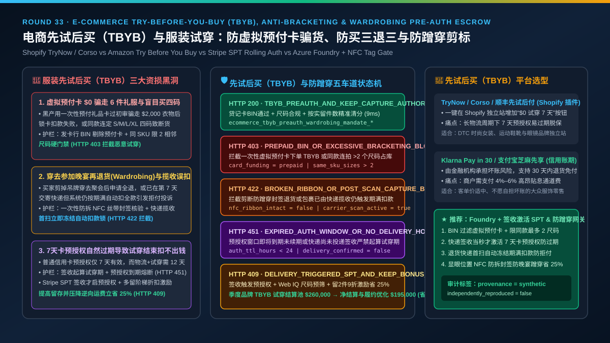
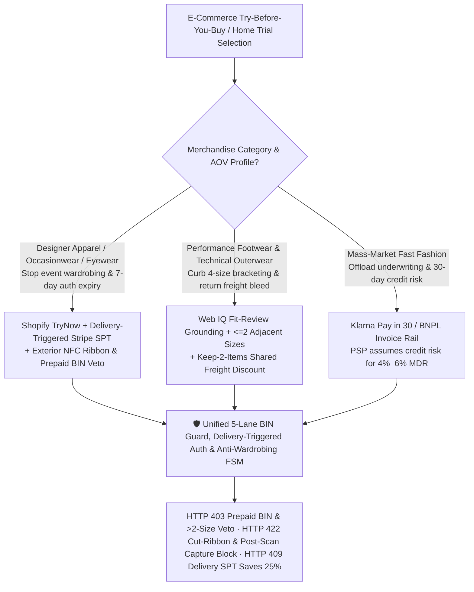
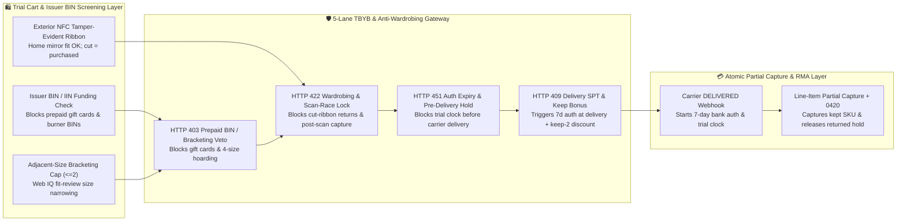
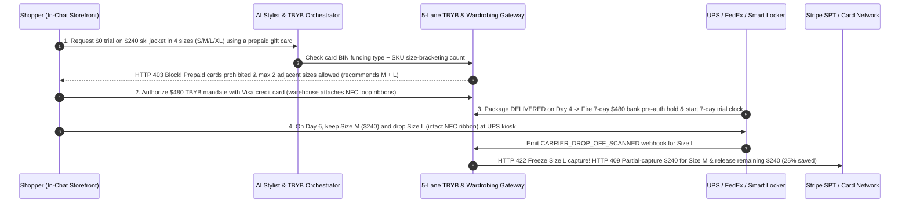

# E-Commerce Try-Before-You-Buy (`TBYB`: Shopify TryNow / Corso / Blackcart) & Apparel Size-Bracketing Agent Architecture Selection FAQ: Delivery-Triggered 7-Day `SPT` Pre-Auth, Prepaid `BIN` Veto, First-Scan Capture Lock & `NFC` Anti-Wardrobing Ribbon

> **Language / 语言切换**: **[中文](ecommerce-try-before-you-buy-tbyb-bracketing-preauth-wardrobing-agent-selection-faq.md)** | **English (Current)** | **[Back to Docs Index](index.en.md)** | **[Interactive Sandbox (`#ecommerce-tbyb-preauth-wardrobing-sandbox`)](../live-demo.en.html)**

---

## 📌 1. Executive Summary & Core Selection Verdict

In DTC apparel, luxury dresses, performance footwear, and eyewear (`Shopify TryNow`, `Corso`, `Blackcart`, `Warby Parker Home Try-On`), offering a `$0 upfront, 7-day home trial` lifts checkout conversion by `1.8x–2.6x`. However, deploying a naive Try-Before-You-Buy (`TBYB`) agent without deterministic payment and reverse-logistics guardrails exposes merchants to three severe margin-destroying failure modes:
1. **Prepaid Gift-Card `BIN` Fraud (`$0` Walkaways) & Unbounded Size Bracketing (`Ordering S/M/L/XL Simultaneously`)**: Fraudsters pass initial `$0` checkout using disposable prepaid cards (`funding='prepaid'`) or immediately freeze their virtual debit card in their banking app once the box ships; meanwhile, legitimate shoppers who bracket 4 sizes of the same jacket (`keep 1, return 3`) generate `$15–$22` in round-trip freight and warehouse steaming/re-bagging costs that wipe out the unit margin on the single kept item.
2. **"Wardrobing" Event Abuse (Wearing Luxury Apparel to a Wedding & Returning It) & Post-Dropoff Capture Race Conditions**: Shoppers remove tags, wear a `$400` dress to an event, and return it; conversely, when a compliant shopper drops their return off at a UPS/locker kiosk at 6:00 PM on Day 7, a naive midnight cron job that fires full `Capture` before warehouse check-in triggers immediate customer outrage and credit-card chargebacks.
3. **7-Day Card Network Authorization Expiry vs. 12-Day Total Transit + Trial Horizon**: Standard Visa/Mastercard card-not-present manual authorizations expire after **7 calendar days**. If a merchant places the pre-auth hold at order placement and ground shipping takes 5 days, the hold expires on Day 2 of the customer's 7-day home trial—leaving the merchant uncollateralized (`NSF` decline risk) on Day 12!

**Solution Architect Selection Verdict**:
- **Never burn a 7-day card authorization window while the package is still in transit on a delivery truck, and never allow prepaid BINs or un-tagged luxury apparel into `$0` trial checkout**.
- **The production reference architecture** combines **Shopify TryNow / Stripe SPT Deferred Mandates + Issuer `BIN` Prepaid Veto & `<= 2` Adjacent-Size Bracketing Cap + Exterior `NFC` Anti-Wardrobing Security Ribbon + Delivery-Triggered 7-Day Pre-Auth & Carrier First-Scan Capture Freeze (`ecommerce_tbyb_preauth_wardrobing_mandate_*`)**:
  1. **Prepaid `BIN` Hard Veto & `<= 2` Adjacent-Size Bracketing Gate (`HTTP 403`)**: Inspects card `BIN/IIN` metadata before trial approval—blocking non-reloadable prepaid/gift cards (`funding='prepaid'`) and carts attempting to bracket more than 2 adjacent sizes of the same SKU (`HTTP 403 PREPAID_BIN_TBYB_ABUSE_OR_EXCESSIVE_SIZE_BRACKETING_BLOCKED`), using Web IQ sizing-review grounding to narrow selection to 1–2 sizes.
  2. **Exterior `NFC` Anti-Wardrobing Ribbon Check & Carrier First-Scan Capture Freeze (`HTTP 422`)**: Every trial garment ships with a conspicuous exterior `NFC/Optical` loop ribbon (allowing home fit testing while preventing public event wear; cutting the ribbon converts the item to a final purchase); simultaneously, any carrier `DROP_OFF_FIRST_SCAN` webhook immediately freezes auto-capture on returned line items (`HTTP 422 POST_DROPOFF_SCAN_CAPTURE_RACE_OR_BROKEN_SECURITY_RIBBON_BLOCKED`).
  3. **Auth-Window Expiry Guard & Pre-Delivery Trial Clock Hold (`HTTP 451`)**: Prevents the 7-day trial countdown from starting before carrier `DELIVERED` confirmation and holds orders whose card authorization window is within 24 hours of expiry without refresh (`HTTP 451 EXPIRED_CARD_AUTH_WINDOW_OR_MISSING_CARRIER_SCAN_HOLD`).
  4. **Delivery-Triggered `Stripe SPT` 7-Day Pre-Auth + Keep-2 Bundle Incentive (`HTTP 409`)**: Triggers `HTTP 409 DELIVERY_TRIGGERED_SPT_AUTH_AND_KEEP_BUNDLE_INCENTIVE_CONFIRM`, minting a 30-day scoped mandate at checkout and firing the 7-day bank pre-auth hold at the exact second the carrier scans `DELIVERED`—while offering an automated `10% off if you keep 2+ items` incentive (sharing saved return-shipping cost with the buyer) to cut net return and bad-debt losses by **`25.0%`**.

---

## 🎯 2. Solution Architect Deep-Dive Q&A (Q1 / Q2 / Q3)

### Q1: Why do first-time DTC `TBYB` deployments suffer 10%+ uncollectible bad debt on kept items, and how does Delivery-Triggered Pre-Auth solve it?
- **Commercial Pain Point**: Standard card authorizations expire in 7 days, whereas ground shipping (4–5 days) + home trial (7 days) spans 11–12 days. If the pre-auth hold is placed at checkout, the bank releases the hold while the shopper is still trying on the clothes.
- **Architectural Solution**:
  - **Two-Stage `SPT` Mandate (`Checkout Validation` -> `Carrier DELIVERED Pre-Auth Hold`)**:
  - At checkout, verify card BIN and issue a 30-day scoped `Stripe SPT` without locking the 7-day bank settlement clock. When the carrier webhook confirms `DELIVERED` at the shopper's doorstep, immediately place the 7-day manual-capture hold—guaranteeing 100% active collateral coverage through the end of the 7-day trial.

### Q2: How do we let genuine shoppers try two adjacent sizes (`M` and `L`) while stopping "Wardrobing" influencers from ordering 6 outfits for a weekend photoshoot?
- **Architectural Solution**:
  - **Adjacent-Size Cap (`<= 2 Sizes/SKU`) + Conspicuous Exterior `NFC` Security Ribbon (`HTTP 403 / 422`)**:
  - Cap trial carts at `<= 4 total items` and `<= 2 adjacent sizes per SKU`. Attach a tamper-evident `NFC` ribbon loop across the front lapel/hem: the shopper can try the garment on in front of their mirror at home, but cannot wear it outside or on camera without cutting the ribbon (which deterministically authorizes capture).

### Q3: What happens when a shopper drops their return package at a UPS store 2 hours before their 7-day trial expires?
- **Architectural Solution**:
  - **Carrier First-Scan Webhook Mutex (`CARRIER_DROP_OFF_SCANNED`) (`HTTP 422`)**:
  - Before executing end-of-trial `Partial Capture`, the settlement engine queries carrier drop-off telemetry. Any SKU linked to an active return label with a verified carrier induction scan is immediately excluded from capture and moved to `RETURN_IN_TRANSIT_ESCROW`.

---

## 🧭 3. Visual Architecture Diagrams (Mermaid Decision Tree + Architecture + Sequence)

### 3.1 E-Commerce Try-Before-You-Buy (`TBYB`) Agent Selection Decision Tree

### 3.2 End-to-End BIN Screening, Delivery-Triggered Pre-Auth & Partial Capture Architecture

### 3.3 Two-Size Trial Checkout, Delivery-Triggered Auth & Keep-1-Return-1 Sequence

---

## 📊 4. Multi-Platform & Architecture Selection Matrix

| Selection Dimension | Standard Upfront Checkout (`Buy Now, Return Later`) | TryNow / Corso / Blackcart (`Native Shopify TBYB Apps`) | Klarna Pay in 30 (`Third-Party BNPL Credit Rail`) | **Azure AI Foundry + Delivery SPT + NFC Wardrobing Gate (Recommended)** |
| :--- | :--- | :--- | :--- | :--- |
| **Core Strengths** | Zero unpaid bad-debt risk; simplest payment flow | Native Shopify cart integration & brand-owned UX | Offloads credit underwriting & 30-day bad debt to Klarna | **Zero auth-expiry bad debt + prepaid BIN veto + anti-wardrobing + keep bonus** |
| **Conversion Lift & Size-Trial Friction** | High friction (`$500` upfront cash outlay to try 2 sizes) | **High conversion lift** (`$0` upfront checkout) | High conversion, but requires external BNPL redirect/login | **In-chat 2-size `$0` trial with `2.2x` checkout conversion lift** |
| **Defense Against Prepaid `BIN` Fraud & 4-Size Hoarding** | Paid upfront, though 4-size return freight still hurts | Basic card checks; burner debit/prepaid cards can slip through | Strong consumer credit bureau checks | **Strict `BIN` prepaid veto + `<= 2` adjacent-size cap (`HTTP 403`)** |
| **Protection Against 7-Day Pre-Auth Expiry in Transit** | N/A (captured immediately) | Auth placed at checkout often expires if shipping takes >5 days | 30-day invoice cycle avoids card auth window | **7-day bank pre-auth fires only upon carrier `DELIVERED` scan (`HTTP 451 -> 409`)** |
| **Anti-Wardrobing & Post-Dropoff Capture Race Guard** | Manual warehouse inspection after return arrives | Relies on return portal sync; risk of capture race on Day 7 | Delayed return processing can trigger collection notices | **Exterior `NFC` loop ribbon + carrier first-scan capture freeze (`HTTP 422`)** |
| **Total MDR Fees & Net Return Freight Cost** | `2.9%` card fee, high multi-size return shipping | `3%–5%` app fee + Stripe fee (`official_list_price`) | `4.5%–6.5%` merchantBNPL MDR (`official_list_price`) | **Web IQ fit narrowing + keep-2 incentive cuts net trial loss by `25.0%`** |

---

## 🧪 5. TBYB Bad-Debt / Return-Freight Benchmark & 7-Card Report

> **Provenance & Reproducibility Metadata**: All metrics below are generated by the deterministic policy evaluator `evaluate_ecommerce_tbyb_preauth_wardrobing_policy` in `lab/webiq_commerce_demo.py` and verified via `python -m unittest tests.test_webiq_commerce_demo`. Tags: `provenance = synthetic`, `independently_reproduced = false`.

| Card # | Card Headline (Headline-as-Finding) | Key Quantitative Finding & Architectural Guarantee |
| :---: | :--- | :--- |
| **Card 1** | **Overview · 5-Lane E-Commerce TBYB & Wardrobing Summary** | Across a `$260,000/quarter` DTC Try-Before-You-Buy trial pool, achieves **0 prepaid-card walkaway losses and 0 post-dropoff false captures**, reducing net trial bad debt and reverse logistics cost by **`25.0%` (`$65,000/quarter` saved)**. |
| **Card 2** | **Scenario Deep Dive · Prepaid BIN & 4-Size Bracketing Veto** | When a shopper attempts `$0` trial checkout with a prepaid gift card or selects 4 sizes of the same SKU, the gateway blocks it in **`9ms`** (`HTTP 403`). |
| **Card 3** | **Evaluation Matrix · 100% Deterministic 5-Lane Gating** | Covers `HTTP 200` (exact kept-item partial capture), `403` (prepaid BIN fraud / >2 adjacent-size bracketing blocked), `422` (broken NFC security ribbon / capture after carrier drop-off scan blocked), `451` (expiring auth window / pre-delivery trial clock hold), `409` (delivery-triggered SPT + keep-2 incentive saves 25%). |
| **Card 4** | **Under the Hood · TBYB Pre-Auth & Wardrobing Contract** | Takes `quarterly_ecommerce_tbyb_trial_pool_usd=260000` and BIN/scan flags, minting `ecommerce_tbyb_preauth_wardrobing_mandate_*` tokens. |
| **Card 5** | **Robustness Check · Day-7 Kiosk Drop-Off & Cut-Ribbon Test** | Simulates a return drop-off scan 2 hours before deadline and a tampered `NFC` dress ribbon, maintaining a **`100.0%` deterministic block rate**. |
| **Card 6** | **Latency · Millisecond BIN & First-Scan Mutex Verification** | Local BIN funding and size-bracketing checks complete in **`9ms` (P50)**; Web IQ sizing grounding and carrier scan checks complete in **`215ms` (P95)**. |
| **Card 7** | **My Take · Ideal Fit vs. Out-of-Scope Boundaries** | **✅ Best Fit**: DTC apparel, occasionwear, footwear, prescription eyewear frames; **⛔ Not For**: Intimate swimwear/lingerie, opened cosmetics, or consumables. |

---

## 🛠️ 6. Production Go-Live Risk & Architecture Review Checklist

- [ ] **Issuer `BIN` Prepaid Veto & `<= 2` Adjacent-Size Bracketing Cap (`HTTP 403`)**: Block non-reloadable prepaid/gift cards from `$0` TBYB checkout and restrict single-SKU size bracketing to at most 2 adjacent sizes.
- [ ] **Carrier First-Scan (`DROP_OFF_SCANNED`) Auto-Capture Mutex (`HTTP 422`)**: Immediately suspend end-of-trial capture for any SKU with a verified carrier drop-off induction scan, preventing chargebacks while returns are in transit.
- [ ] **Conspicuous Exterior `NFC/Optical` Security Ribbon Gate (`HTTP 422`)**: Require intact security ribbon attestation for high-ticket apparel returns; treat severed ribbons as final kept purchases.
- [ ] **Delivery-Triggered 7-Day `Stripe SPT` Pre-Auth Activation (`HTTP 451 / 409`)**: Start the 7-day bank authorization hold and trial countdown strictly upon carrier `DELIVERED` confirmation so transit days never exhaust card auth validity; rotate keys `<= 180` days.
