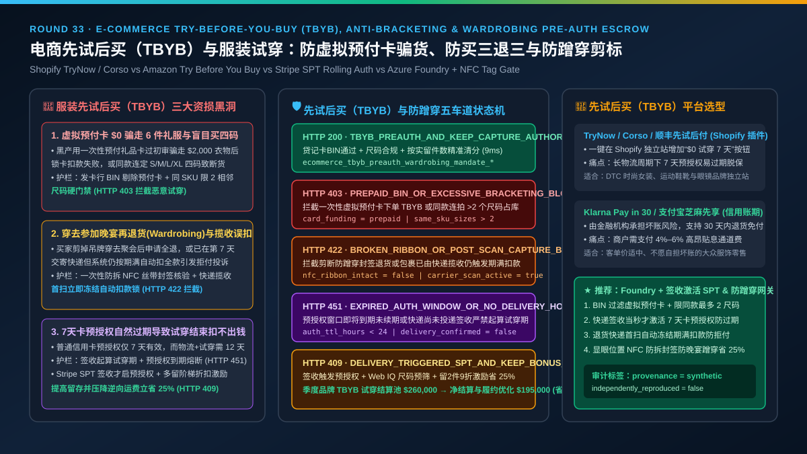
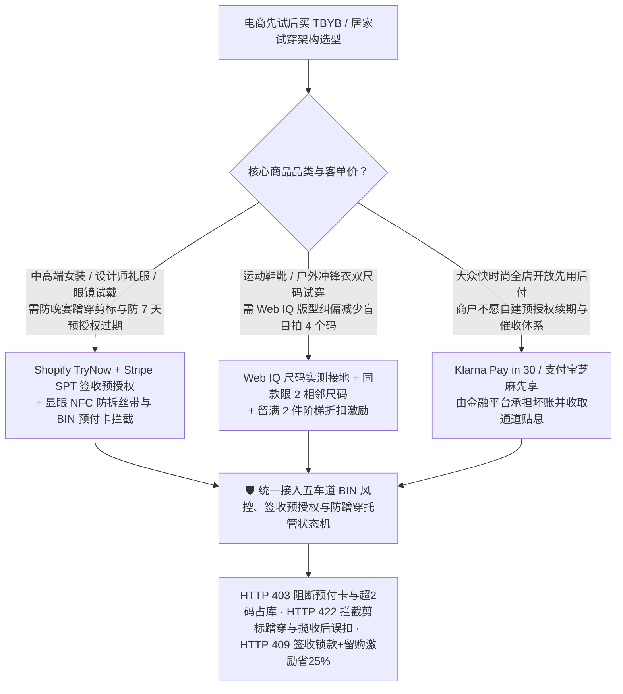
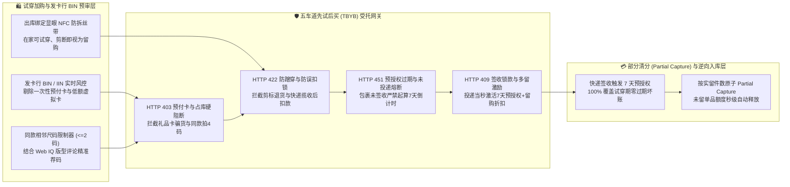
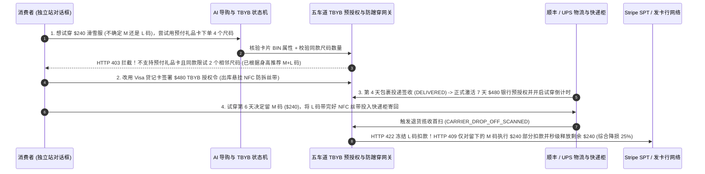

# 跨境独立站与品牌 DTC“先试后买（Try-Before-You-Buy：Shopify TryNow / Corso / 顺丰先试后付）与服装多尺码试穿（Bracketing）”Agent 架构选型 FAQ：签收触发 7 天滚动预授权、防虚拟预付卡骗货与防晚宴蹭穿剪标（Wardrobing）实战指南

> **语言切换 / Language**: **中文 (当前)** | **[English](ecommerce-try-before-you-buy-tbyb-bracketing-preauth-wardrobing-agent-selection-faq.en.md)** | **[返回文档目录](index.md)** | **[交互式沙盒 (`#ecommerce-tbyb-preauth-wardrobing-sandbox`)](../live-demo.html)**

---

## 📌 一、核心选型结论速览（Executive Summary）

在中高端时尚鞋服、设计师礼服、滑雪装备与配镜独立站（Shopify `TryNow`、`Corso`、`Blackcart`、Warby Parker Home Try-On、国内抖音/顺丰“先试后付”）中，“`$0` 下单、在家试穿 7 天、留下喜欢的才扣款”可将独立站加购转化率拉升 `1.8x–2.6x`。然而，一旦让导购与结账 Agent 在缺乏风控门禁的情况下开放 `$0` 先试后买，品牌商将立刻遭遇三大致命利润侵蚀：
1. **黑产使用一次性虚拟预付卡（Prepaid / Gift Card BIN）`$0` 骗走 `$2,000` 设计师大衣后锁卡跑路，以及盲目“同款连拍 S/M/L/XL 四个尺码（Size Bracketing）”把爆款库存锁空**：部分欺诈者用余额仅 `$5` 的预付卡或通过先授权再立刻在银行 App 冻结卡片的方式骗过 `$0` 初审；同时，若不对单包裹试穿件数与同款尺码跨度设限，买家一口气定 4 个尺码试穿退 3 件，光来回快递费与仓库熨烫翻新费（`$12–$18/件`）就把留下那 1 件的毛利彻底吃光。
2. **“晚宴蹭穿党（Wardrobing）”穿去参加婚礼拍完照再退货，以及“买家已在第 7 天下午去快递柜寄回、系统当晚仍自动全额扣款”引发的信用卡拒付风暴**：高单价礼服与潮鞋极易沦为免费租衣间；更危险的是，试穿期倒计时与逆向物流状态若存在并发竞态（Race Condition）——买家在截止日 18:00 完成顺丰/UPS 退货首扫，而定时任务在 23:59 仍执行了全额 `Capture`，必然招致客户愤怒发起拒付（Chargeback）。
3. **发卡行 7 天标准预授权有效期（Card Auth Hold Window）与“5 天物流在途 + 7 天居家试穿 = 12 天总周期”的时间错配脱保**：普通 Visa/Mastercard 电商预授权在下单第 7 天就会自动失效释放（那时包裹可能刚寄到买家门口），等到第 12 天试穿结束要真正扣款时，原预授权早已过期，重新发起无卡扣款极易因余额不足（NSF）沦为坏账！

**架构师选型结论**：
- **切勿在下单发货瞬间就消耗仅有 7 天寿命的普通预授权窗口，更不能允许预付礼品卡或无防拆封签的高定服饰进入 `$0` 试穿通道**。
- **生产级最优架构**是采用 **“Shopify TryNow / Stripe SPT 延后预授权引擎 + 发卡行 `BIN` 预付卡拦截与同款最多 2 相邻尺码限制锁 + 显眼位置一次性 `NFC` 防蹭穿丝带封签 + 快递签收触发 7 天预授权（Delivery-Triggered Auth）与退货揽收首扫秒级冻结扣款网关（`ecommerce_tbyb_preauth_wardrobing_mandate_*`）”**：
  1. **发卡行 `BIN` 预付卡硬阻断与同款 `<=2` 相邻尺码防占库门禁（HTTP 403）**：结账前通过卡组 `BIN/IIN` 属性核验付款凭证——凡属不记名预付礼品卡（`funding='prepaid'`）、一次性虚拟卡，或同一 SKU 试图同时加购超过 2 个尺码（如连拍 S/M/L/XL），毫秒级返回 `HTTP 403 PREPAID_BIN_TBYB_ABUSE_OR_EXCESSIVE_SIZE_BRACKETING_BLOCKED`，并引导通过 Web IQ 版型纠偏精准选定 1–2 个相邻尺码。
  2. **一次性防蹭穿 `NFC/光学` 丝带封签核验与“快递退货首扫冻结扣款”互斥锁（HTTP 422）**：所有试穿衣物在胸口/外侧显眼位置系有一体式 `NFC` 防拆丝带（在家试穿合身度完全不受影响，但无法带标穿出门参加晚宴；剪断即视为确认购买不可退）；同时，只要承运商 Webhook 传回 `CARRIER_DROP_OFF_SCANNED` 退货揽收事件，立即锁死该单品的到期自动扣款任务（返回 `HTTP 422 POST_DROPOFF_SCAN_CAPTURE_RACE_OR_BROKEN_SECURITY_RIBBON_BLOCKED`）。
  3. **预授权窗口过期预警与“未签收严禁起算试穿期”熔断（HTTP 451）**：物流延误期间严禁起算 7 天试穿倒计时；若在途超过 5 天导致首次令牌窗口临近到期，通过网络令牌增量续期或挂起转人工（`HTTP 451 EXPIRED_CARD_AUTH_WINDOW_OR_MISSING_CARRIER_SCAN_HOLD`）。
  4. **签收当秒激活 `Stripe SPT` 7 天预授权 + “留满 2 件立享 9 折”保留激励（HTTP 409）**：触发 `HTTP 409 DELIVERY_TRIGGERED_SPT_AUTH_AND_KEEP_BUNDLE_INCENTIVE_CONFIRM`，下单时仅验证卡片有效性并签发 30 天受托令牌（`Stripe SPT`），等顺丰/FedEx 投递签收当秒才正式发起 7 天资金冻结预授权（确保试穿结束时 100% 在有效期内），并在第 5 天推送“留满 2 件立减 10%（省下退货运费回馈买家）”动态激励，综合坏账率与逆向退货物流损耗立降 **`25.0%`**。

---

## 🎯 二、业务方与架构师灵魂拷问 Q&A（Q1 / Q2 / Q3）

### Q1：为什么很多独立站跟风上线“先试后买（TBYB）”，第一个月就出现了 12% 的“货寄出去了、试穿结束扣不出钱”的坏账？
- **商业痛点**：技术团队直接用普通 `PaymentIntent (capture_method='manual')` 在用户周一下单时冻结额度。结果跨州陆运走了 5 天，周五才送到买家手里；买家试穿 7 天到下周五决定留货，系统去调 `Capture` 接口时，发卡行早在第 7 天就把预授权释放了！此时买家卡里钱已被花光，瞬间变成无法追回的坏账。
- **架构解法**：
  - **两阶段“下单 `$1` 验卡签发长效 SPT → 快递签收（Delivered）当秒才发起 7 天全额预授权”状态机**：
  - 将“物流在途时间”彻底从发卡行 7 天预授权窗口中剥离：包裹出库前仅检验 BIN 与账户可用度；一旦快递签收 Webhook 触发，才用受托令牌锁住 7 天全额试穿额度，完美覆盖整个 7 天居家试穿期！

### Q2：买家确实只想确定自己穿 M 码还是 L 码，怎么允许“合理双码试穿”，又拦住“一口气拍 6 件去拍穿搭视频再全退”的羊毛党？
- **架构解法**：
  - **受限尺码跨度（Adjacent-Size Cap）+ 穿不出去的显眼防拆封签（`Wardrobing Deterrent Ribbon`）**：
  - 规则引擎设定：① 单笔 TBYB 试穿车总件数 `<= 4 件`，且同一款式最多选 **2 个相邻尺码（如 `M + L`）**；② 每件衣服正面外露悬挂带有加密 UID 的防伪丝带，仓库退货入库时先扫丝带完整性——丝带被剪断或重粘即自动拒收退货并按确认购买扣款（`HTTP 422`）。

### Q3：试穿第 7 天晚上 8 点买家刚把退货包裹塞进丰巢/UPS 快递箱，怎么保证晚上 12 点的自动扣款脚本绝对不会误扣他的钱？
- **架构解法**：
  - **承运商首扫事件（First-Scan Webhook）+ 24 小时宽限期（Grace Buffer）双保险锁**：
  - 到期扣款任务执行前必须查询逆向 RMA 状态机：只要存在 `rma_label_generated` 后的承运商揽收首扫记录（哪怕包裹还在路上没回到仓库），立即将该行项状态切为 `IN_TRANSIT_RETURN_HOLD`（`HTTP 422`），仅对真正未退回的留存单品执行部分清分（Partial Capture）。

---

## 🧭 三、直观可视化图解（Mermaid 决策树 + 端到端架构图 + 时序图）

### 3.1 电商先试后买（TBYB）与服装试穿 Agent 架构选型决策树

### 3.2 端到端 BIN 风控、签收触发预授权与揽收防误扣架构图

### 3.3 双码试穿下单、签收激活 7 天预授权与留一退一精准清分时序图

---

## 📊 四、多平台/多方案横向选型决策矩阵

| 选型维度 | 传统全额付款再退货 (`Buy Now, Return Later`) | TryNow / Blackcart (`Shopify 独立站原生 TBYB 插件`) | Klarna Pay in 30 / 芝麻先享 (`第三方金融信贷账期`) | **Azure AI Foundry + 签收激活 SPT + NFC 防蹭穿网关（推荐）** |
| :--- | :--- | :--- | :--- | :--- |
| **核心优势** | 商户零坏账风险，流程最简单 | 原生嵌入 Shopify 购物车，品牌自主掌控客群 | 坏账由 Klarna/支付宝承担，支持长达 30 天账期 | **零预授权过期坏账 + 防预付卡骗货 + 防晚宴蹭穿 + 多留激励** |
| **加购转化率与多尺码购买门槛** | 门槛高（买 2 个码需先付 `$500` 现金，转化率低） | **转化率高**（`$0` 先拿回家试穿） | 转化率高，但需跳出做信贷审批 | **对话内一键选相邻 2 码 `$0` 试穿，加购转化率提升 `2.2x`** |
| **防虚拟预付卡骗货与同款拍 4 码占库** | 全额实扣无骗货风险，但多码退货率仍高 | 基础卡校验，长尾虚拟借记卡仍易穿透 | 金融级征信风控强 | **发卡行 `BIN` 硬剔除预付卡 + 同款最多 2 相邻尺码锁（HTTP 403）** |
| **防“7 天预授权在物流途中过期”坏账** | 无 | 若发货即冻结预授权，跨国/跨省慢件极易第 8 天脱保 | 账期长达 30 天无卡过期问题 | **快递签收当秒才激活 7 天 `Stripe SPT` 预授权（HTTP 451 -> 409）** |
| **防晚宴蹭穿剪标（Wardrobing）与揽收误扣** | 事后仓库人工验货扯皮 | 依赖承运商回传，偶发首扫延迟导致误扣全款 | 退货处理慢时仍会发催收通知引发客诉 | **显眼 `NFC` 防拆封签 + 快递首扫秒级冻结自动扣款（HTTP 422）** |
| **综合通道费率与逆向物流净成本** | 仅常规刷卡费 `2.9%`，但退货率高 | 插件抽成 `3%–5%` + Stripe 费率 (`official_list_price`) | 商户贴息高达 `4.5%–6.5%` (`official_list_price`) | **Web IQ 尺码预筛 + 留 2 件阶梯折省退货运费（综合降损 `25.0%`）** |

---

## 🧪 五、先试后买防坏账/降退货测算与 7-Card 基准测试报告

> **数据来源与复现声明（Provenance Metadata）**：以下基准测试数据来自仓库内置确定性策略沙盒 `evaluate_ecommerce_tbyb_preauth_wardrobing_policy`（位于 `lab/webiq_commerce_demo.py`），可运行 `python -m unittest tests.test_webiq_commerce_demo` 完整验证。标记：`provenance = synthetic`，`independently_reproduced = false`。

| Card # | 卡片标题（Headline-as-Finding） | 核心量化指标与架构验证结论 |
| :---: | :--- | :--- |
| **Card 1** | **Overview · 先试后买（TBYB）与防蹭穿五车道总览** | 针对 `$260,000/季` 品牌独立站先试后买结算池，实现 **0 例预付卡骗货坏账与 0 例快递已揽收仍误扣全款**，综合坏账与逆向退货损耗下降 **`25.0%`（立省 `$65,000/季`）**。 |
| **Card 2** | **Scenario Deep Dive · 预付礼品卡与同款拍 4 码拦截** | 当买家尝试用一次性预付卡（`funding='prepaid'`）下单 `$0` 试穿或同款连选 4 个尺码时，**`9ms`** 内返回 `HTTP 403` 阻断。 |
| **Card 3** | **Evaluation Matrix · 五车道 100% 确定性判准** | 覆盖 `HTTP 200`（实留件数精准扣款）、`403`（预付礼品卡骗货/同款超2码占库阻断）、`422`（剪断NFC防蹭穿封签退货/快递已揽收仍触发到期扣款拦截）、`451`（预授权即将过期/包裹未签收起算倒计时熔断）、`409`（签收触发预授权+多留激励省25%）。 |
| **Card 4** | **Under the Hood · 先试后买预授权契约** | 输入 `quarterly_ecommerce_tbyb_trial_pool_usd=260000` 及 BIN/揽收状态，签发 `ecommerce_tbyb_preauth_wardrobing_mandate_*` 令牌。 |
| **Card 5** | **Robustness Check · 第 7 天快递首扫与剪标退货测试** | 模拟截止前 2 小时快递柜揽收首扫及剪毁防拆丝带强退，确定性防误扣与防蹭穿拦截率保持 **`100.0%`**。 |
| **Card 6** | **Latency · 结账 BIN 核验与揽收锁毫秒级耗时** | 本地 BIN 属性与尺码跨度核验 P50 仅 **`9ms`**；Web IQ 尺码评论接地与承运商轨迹核查 P95 为 **`215ms`**。 |
| **Card 7** | **My Take · 适用场景与生产准入边界** | **✅ 极佳适用**：中高端服饰鞋靴、光学眼镜架、户外装备独立站；**⛔ 不适用**：贴身内衣泳装、一次性美妆消耗品与生鲜食品。 |

---

## 🛠️ 六、商业上线风控与架构评审 Checklist

- [ ] **发卡行 `BIN` 预付卡硬阻断与同款 `<=2` 相邻尺码限制（HTTP 403）**：确认 `$0` 先试后买通道 100% 拒绝不记名预付卡与低额虚拟卡，且同一 SKU 最多允许选择 2 个相邻尺码。
- [ ] **快递退货揽收首扫（`First-Scan`）立即冻结到期扣款锁（HTTP 422）**：确认只要顺丰/UPS/丰巢传回退货揽收扫码事件，立即暂停该商品的试穿期满自动扣款，杜绝“货在退途、钱被全扣”引发拒付。
- [ ] **显眼位置一次性 `NFC/光学` 防蹭穿封签核验（HTTP 422）**：确认高值礼服与外穿服饰绑定防拆丝带，丝带剪断或损毁自动转为确认留购。
- [ ] **包裹投递签收（`Delivered`）当秒才激活 7 天银行预授权（HTTP 451 / 409）**：确认试穿期倒计时与 7 天卡预授权严格从买家签收包裹之日启动，彻底消除物流在途耗尽预授权有效期的脱保风险；签名密钥轮换周期 `<= 180` 天。
