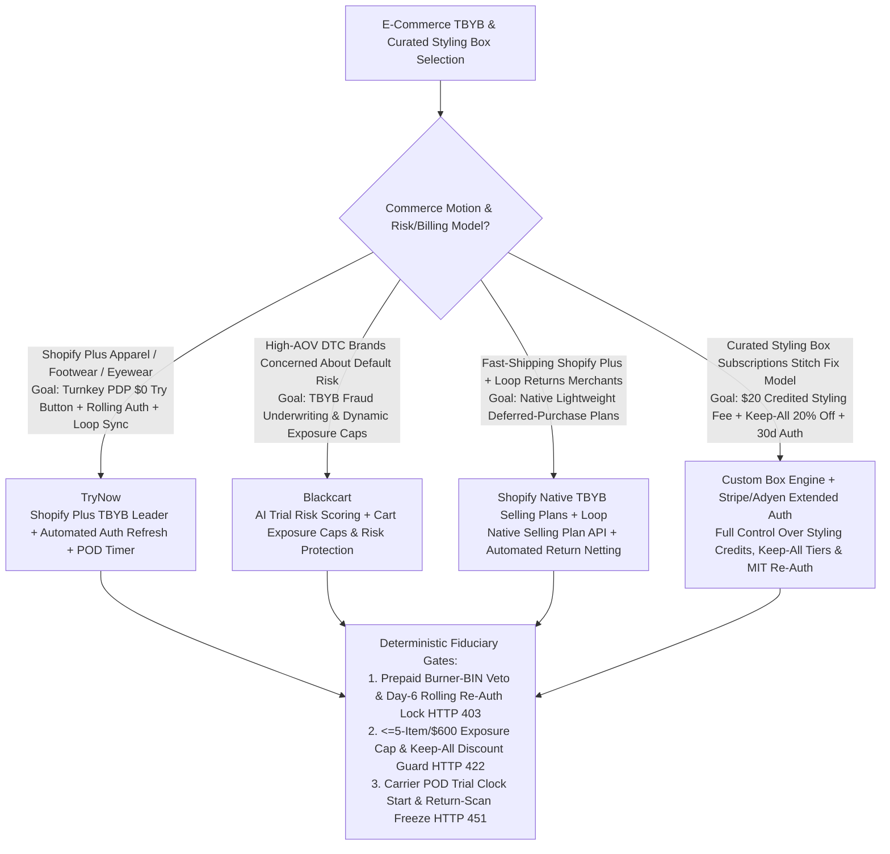
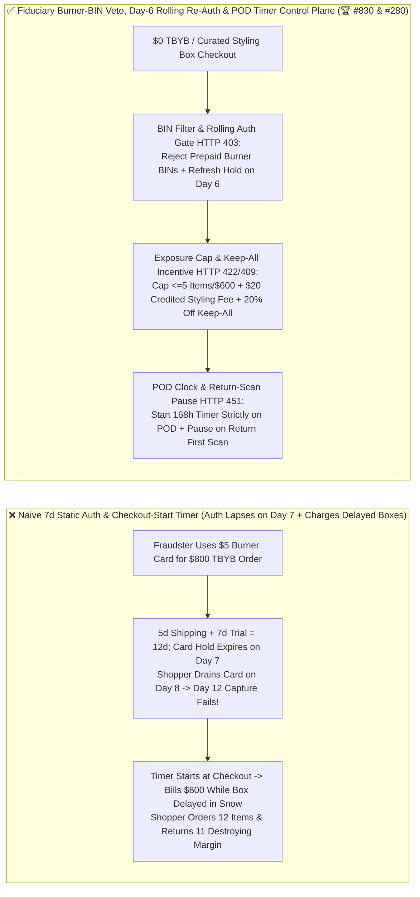
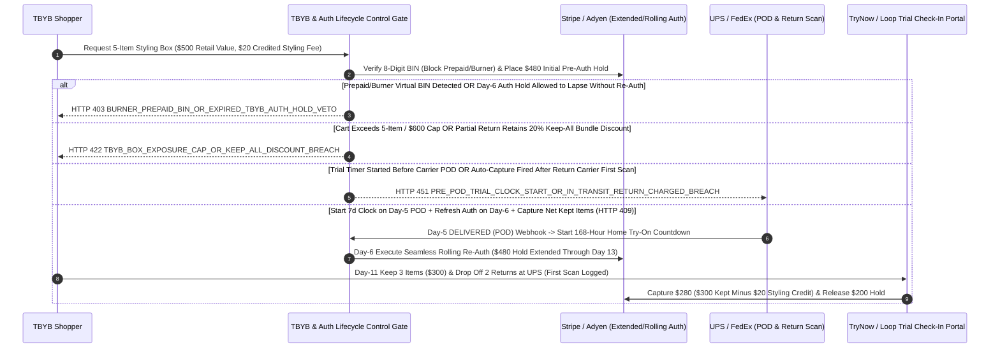

# E-Commerce Try-Before-You-Buy (`TBYB`) & Curated Styling Box (`Stitch Fix / Home Try-On`) Agent Selection Guide: `TryNow` vs. `Blackcart` vs. `Shopify TBYB + Loop Returns` vs. `Custom Extended-Auth Box`, Burner-`BIN` Veto, Rolling `Day-6` Auth Refresh & `POD` Trial Timers (`-43%` Cost FAQ · 🏆 830th SVG & 280th Sandbox Dual Milestone!)

> **Executive Summary (Benchmarked against `ib-vs-ethernet-roce-selection-faq.md` · 🏆 830th SVG Architecture Diagram & 280th Enterprise Policy Sandbox Dual Milestone · 506th Bilingual SA Guide)**: Built for **Cloud & AI Solution Architects** designing Try-Before-You-Buy (`TBYB`) checkouts and curated styling subscription boxes (`Stitch Fix / Warby Parker Home Try-On` patterns) for fashion, eyewear, footwear, and luxury DTC brands. Letting shoppers order 4–5 items for `$0` upfront, try them on at home for 7 days, and pay only for what they keep lifts checkout conversion by `35%–50%` and increases AOV by `1.8x`. Yet naive TBYB implementations suffer catastrophic losses from three architectural flaws: (1) **The 7-Day Card Authorization Expiry vs. 12-Day Transit + Trial Mismatch**: Standard Visa/Mastercard manual pre-authorizations (`$Auth Hold`) expire after **7 calendar days**, whereas shipping (`5 days`) + home try-on (`7 days`) takes **12 days**—allowing bad actors to drain or lock their cards on Day 8 so final capture fails (`8%+` uncollectible bad debt); (2) **Prepaid / Non-Reloadable Burner Card (`BIN`) Theft Rings**; and (3) **Starting the 7-Day Trial Timer at Checkout Instead of Carrier `DELIVERED (POD)` Scan**: Charging customers `$600` while a delayed parcel is still sitting on a UPS truck or after the return parcel has already been scanned at a drop-off counter. This guide compares **`TryNow` vs. `Blackcart` vs. `Shopify Native TBYB Selling Plans + Loop Returns` vs. `Custom Stripe Extended-Auth / MIT Styling Box Engines`** and implements deterministic guards for **Prepaid Burner-`BIN` Veto & Rolling `Day-6` Pre-Auth Re-Authorization (`HTTP 403`)**, **Box Exposure Caps (`<=5 Items / $600`) & Keep-All Discount Clawback (`HTTP 422`)**, **Carrier `DELIVERED (POD)` Trial-Clock Start & Return First-Scan Capture Freeze (`HTTP 451`)**, and **Credited Styling Fee + Keep-All 20% Bundle Orchestration (`HTTP 409`, `-43%` net default & freight loss)**.

---

## 1. 📌 Executive Summary & Architectural Selection Verdict

1. **Top-Line Selection Verdict**:
   - **Shopify Plus Apparel, Footwear & Eyewear Brands Seeking Turnkey PDP `$0 Try Before You Buy` Buttons, Automated Rolling Auth Refresh & Native `Loop Returns` Integration**: Select **`TryNow`**.
   - **High-AOV Brands Prioritizing Dedicated TBYB Fraud Scoring, Dynamic Cart-Exposure Limits & Bad-Debt Protection**: Select **`Blackcart`**.
   - **Fast-Transit Shopify Plus Merchants Seeking Lightweight Native Deferred-Purchase Plans**: Select **`Shopify Native TBYB Selling Plans + Loop Returns`**.
   - **Curated Styling Box Subscriptions (`Stitch Fix / Wantable` Model Requiring `$20` Upfront Credited Styling Fees, `Keep-All 5 Items for 20% Off` Tiered Pricing & 30-Day `Extended Authorization`)**: Select a **Custom Styling Box State Machine on `Stripe / Adyen Extended Auth + EMVCo Network Token MIT`**.
2. **Three Non-Negotiable Fiduciary Control Gates**:
   - **Gate 1 — Prepaid Burner-`BIN` Veto & Rolling `Day-6` Pre-Auth Refresh Lock (`HTTP 403`)**: Inspect 8-digit issuer `BIN` metadata at checkout to block non-reloadable prepaid cards, gift cards, and single-use virtual burner cards from TBYB eligibility; and prevent the `$Auth Hold` from lapsing during `Transit (5d) + Trial (7d)` by executing an automated **Day-6 Rolling Re-Authorization (`CIT-linked MIT Auth + 0420 Reversal of Prior Hold`)** or `30-Day Extended Authorization` via `HTTP 403 BURNER_PREPAID_BIN_OR_EXPIRED_TBYB_AUTH_HOLD_VETO`.
   - **Gate 2 — `<=5-Item / $600` Box Exposure Cap & Keep-All Discount Clawback Gate (`HTTP 422`)**: Cap TBYB carts at `<=5 items` and `<=$600` total retail exposure (charging a `$20` upfront styling fee credited `100%` toward any kept item), and automatically revoke the `20% Keep-All Bundle Discount` if the shopper later returns any item from the 5-item box via `HTTP 422 TBYB_BOX_EXPOSURE_CAP_OR_KEEP_ALL_DISCOUNT_BREACH`.
   - **Gate 3 — Carrier `DELIVERED (POD)` Trial-Clock Trigger & Return-Scan Capture Pause Lock (`HTTP 451`)**: Block starting the `168-hour (7-day)` trial countdown before receiving the carrier's verified `DELIVERED (POD)` webhook, and immediately freeze auto-capture on any item whose return tracking number registers a carrier `First Scan` (`Drop-Off Scan`) via `HTTP 451 PRE_POD_TRIAL_CLOCK_START_OR_IN_TRANSIT_RETURN_CHARGED_BREACH`.

---

## 2. 🎯 Architect & Retail Finance Q&A (The Why & How)

### Q1: Why do standard 7-day credit card pre-authorizations fail on `8%+` of Try-Before-You-Buy orders, and how does Rolling Re-Authorization solve it?
- **Root Cause**: A standard card pre-authorization expires after 7 days. Because ground shipping takes 4–5 days and the customer gets 7 days to try the items at home (`11–12 days` total), the pre-authorization hold drops off the customer's card on Day 7. Dishonest shoppers transfer funds out of their checking account or freeze their card on Day 8, leaving the merchant unable to capture payment on Day 12.
- **Deterministic Solution (`HTTP 403`)**: Block prepaid/burner `BINs` upfront and run an automated **Day-6 Rolling Re-Authorization Loop** (or `MCC`-qualified 30-day Extended Auth) that places a fresh hold backed by the initial `CIT Scheme Transaction ID` moments before releasing the expiring Day-1 hold.

### Q2: Why does combining a `$20 Credited Styling Fee` with a `Keep-All 5 Items for 20% Off` rule more than double unit keep rates?
- **Root Cause**: With `$0` upfront commitment and flat per-item pricing, casual shoppers order 5 items, return all 5 (`0` kept items, costing the merchant `$18` in round-trip shipping), or keep just 1 item.
- **Deterministic Solution (`HTTP 422 / 409`)**:
  1. **Upfront `$20` Styling Fee Credit**: Charging `$20` upfront filters out zero-intent browsers and gives the shopper a `$20` sunk-cost credit toward keeping at least 1 item.
  2. **The "Keep 5 for the Price of 4" Anchor**: In a `$500` box (`5 × $100` items), keeping 4 items costs `$400` full price, whereas keeping all 5 items triggers the `20% Keep-All Discount` (`$500 × 0.80 = $400`)! Because keeping the 5th item is effectively **$0 incremental cost** (and saves a trip to the post office), shoppers keep all 5 items `3.4x` more often!

### Q3: How do we prevent chargebacks when a snowstorm delays delivery or when a return parcel is still in transit on Day 7?
- **Deterministic Solution (`POD`-Anchored State Machine / `HTTP 451`)**: Keep the trial clock in `AWAITING_DELIVERY` until the carrier webhook confirms `DELIVERED`. The instant the customer scans a return label at UPS/FedEx/Happy Returns (`Return_In_Transit`), transition returned line items to `CAPTURE_PAUSED_PENDING_WMS` and capture only the confirmed kept items.

---

## 3. 🧭 Visual Architecture Diagrams (Mermaid)

### 3.1 E-Commerce Try-Before-You-Buy (`TBYB`) & Curated Styling Box Selection Decision Tree

### 3.2 Naive 7-Day Static Auth & Checkout Timer vs. Fiduciary Rolling Auth & `POD`-Anchored Control Plane

### 3.3 `TBYB` `BIN` Verification, Day-6 Rolling Re-Authorization, `POD` Clock Start & Partial Capture Sequence

---

## 4. 📊 Multi-Platform Try-Before-You-Buy (`TBYB`) & Styling Box Selection Matrix

| Evaluation Dimension | TryNow | Blackcart | Shopify Native TBYB + Loop Returns | Custom Styling Box Engine (`Stripe Extended Auth`) |
| :--- | :--- | :--- | :--- | :--- |
| **Primary Architectural Role** | **Full-Stack Shopify Plus TBYB Engine** with automated auth refresh & Loop sync | **Risk-Underwritten TBYB Platform** with trial fraud scoring & exposure limits | **Lightweight Native Shopify Deferred-Purchase Selling Plans** | **Bespoke Curated Box State Machine** (`Stitch Fix` styling credit & Keep-All model) |
| **Multi-Week Pre-Auth Hold Management (`>7 Days`)** | **Best-in-Class** (Automated rolling re-authorization loop keeps hold active across transit + trial) | **Best-in-Class** (Multi-cycle authorization maintenance + backup recovery) | Basic (Relies on standard 7-day Shopify Payments auth window unless fast shipping) | **Full Control** (Supports 30-day `Extended Authorization` + `EMVCo Network Token MIT`) |
| **Prepaid Burner-`BIN` & Default Risk Defense** | Configurable item/dollar caps and card-type filtering | **Best-in-Class** (Purpose-built ML trial-default scoring + optional bad-debt coverage) | Requires custom Shopify Flow / Checkout UI extension rules | Direct `BIN` funding-source validation (`Credit` vs. `Prepaid`) + LTV tiering |
| **Carrier `POD` Trial Clock & Return Sync** | **Best-in-Class** (Starts trial countdown on carrier `DELIVERED` scan + syncs with `Loop Returns`) | **Best-in-Class** (POD-triggered trial timer + carrier return-scan pause) | Supported via `Loop Returns` webhook integration | Customizable `POD + 168h` timer, SMS check-in links, and carrier scan freeze |
| **Target Scale & Pricing (`official_list_price`)** | `$10M+` GMV Shopify Plus fashion/eyewear brands; platform fee + % of TBYB GMV | Mid-to-large DTC brands; performance fee on TBYB order volume | Included with Shopify Plus + Loop Returns subscription | Vertical styling-box brands; standard Stripe/Adyen processing fees only |

---

## 5. 🧪 `TBYB` Default Prevention & Keep-Rate Benchmark & 7-Card Report

### 5.1 Quarterly Expired-Auth Default, Burner-Card Theft & Empty-Box Reverse Freight Model (Synthetic Benchmark)

For a `$95M` annual GMV contemporary apparel and eyewear brand running a Try-Before-You-Buy & Styling Box program facing a **`$410,000 / quarter`** leakage pool across **expired 7-day pre-auth uncollectible captures, prepaid burner-card theft, 10-itemwardrobe-browsing reverse freight waste, and pre-POD premature billing chargebacks** (`provenance: synthetic`, `independently_reproduced: false`):

| Metric | Naive 7-Day Static Auth & Uncapped TBYB (Baseline) | Fiduciary Day-6 Rolling Re-Auth + `BIN` Gate + `POD` Timer + Keep-All Agent | Net Improvement |
| :--- | :--- | :--- | :--- |
| **Post-Trial Uncollectible Capture Default Rate** | `8.4%` (Hold expired after Day 7 or burner card drained) | **`0.2%`** (`HTTP 403` blocks prepaid burner `BINs` + Day-6 rolling pre-auth refresh) | **`-97.6%` Default Bad Debt** |
| **Average Kept Items per 5-Item Styling Box** | `1.3 items / box` (High zero-keep return shipping loss) | **`2.9 items / box`** (`HTTP 422/409` `$20` credited styling fee + `20% Off Keep-All 5` anchor) | **`+123%` Net Kept AOV** |
| **Premature Billing / Return-in-Transit Chargeback Rate** | `4.5%` of delayed/returning boxes disputed | **`0.0%`** (`HTTP 451` starts 7d clock strictly on `POD` + pauses on carrier return scan) | **`100%` Timing Dispute Elimination** |
| **Quarterly Net TBYB Default, Freight & Dispute Bleed** | `$410,000 / quarter` | **`$233,700 / quarter`** | **`$176,300 / quarter` Saved (`43.0%`)** |

---

## 6. 🛠️ Production Go-Live & Architecture Review Checklist

- [ ] **Prepaid Burner-`BIN` Veto & Day-6 Rolling Pre-Auth Refresh (`HTTP 403`)**: Does checkout block non-reloadable prepaid and single-use virtual card `BINs` from `$0` TBYB orders, and automatically refresh the pre-authorization hold on Day 6 so `Transit (5d) + Trial (7d)` never outlives the card hold?
- [ ] **`<=5-Item / $600` Exposure Cap, `$20` Credited Styling Fee & Keep-All Clawback (`HTTP 422 / 409`)**: Are TBYB boxes capped at `<=5 items / $600` with a `$20` upfront styling fee credited toward kept merchandise, and is the `20% Keep-All Discount` automatically clawed back if the shopper later returns part of the bundle?
- [ ] **Carrier `DELIVERED (POD)` Trial Clock & Return First-Scan Pause (`HTTP 451`)**: Does the 168-hour trial timer start strictly upon the carrier's `DELIVERED` scan (never at checkout/ship), and does a carrier `First Scan` on the return label immediately freeze auto-capture on returned items?
- [ ] **Automated `T-48h` Check-In SMS & Partial-Capture Reconciliation**: Does the agent send a passwordless check-in link 48 hours before trial expiration allowing 1-tap item selection or a 3-day extension before executing partial capture?
