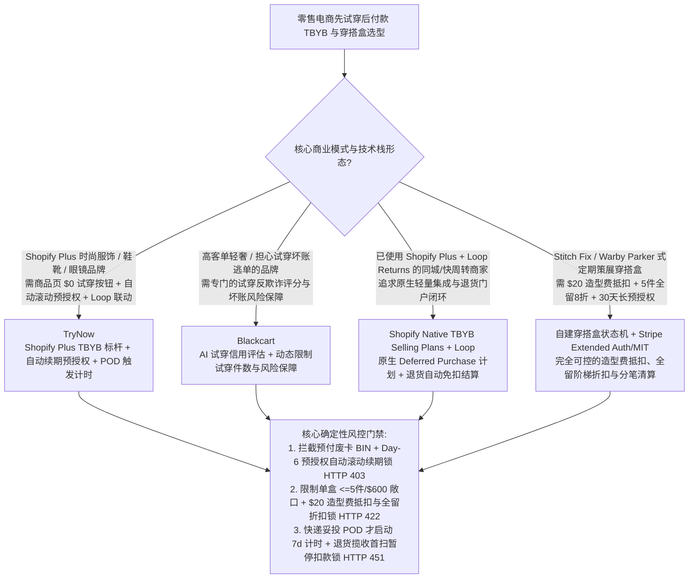
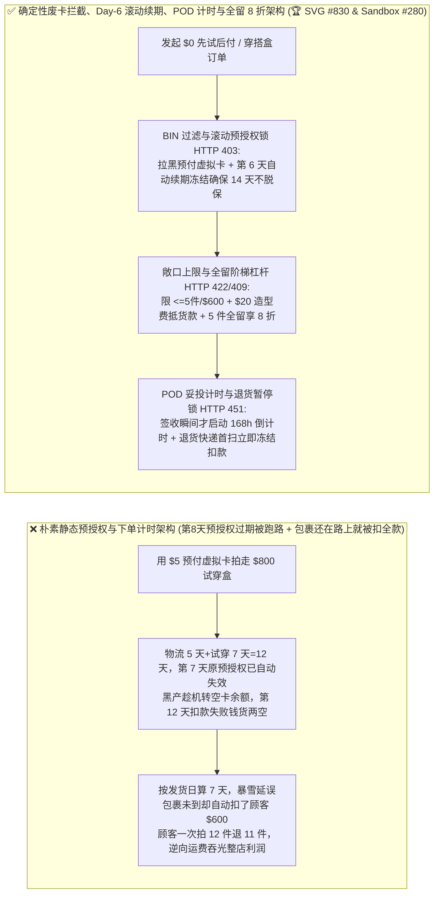
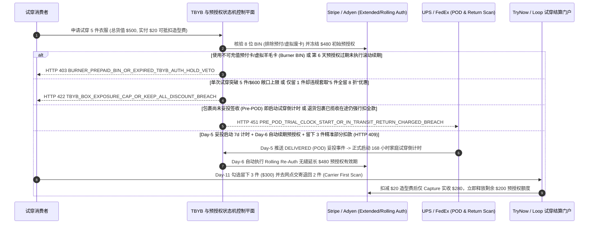

# 零售电商“先试穿后付款（`Try-Before-You-Buy, TBYB`）”与个性化订阅穿搭盒子（`Curated Styling Box`）Agent 架构选型对比：`TryNow` vs. `Blackcart` vs. `Shopify TBYB + Loop Returns` vs. `自建 Stitch Fix / Warby Parker 模式`、预授权 7 天过期滚动续期锁、预付空卡拦截及快递妥投（`POD`）启动试穿倒计时净省 43% 决策指南（FAQ · 🏆 第 830 张架构图与第 280 个策略沙盒双里程碑！）

> **导读（对齐 `ib-vs-ethernet-roce-selection-faq.md` 标杆风格 · 🏆 全库第 830 张 SVG 架构图与第 280 个企业策略沙盒双重重大里程碑 · 第 506 篇双语指南）**：本文面向高端时尚服饰、光学眼镜、轻奢鞋包与运动装备 DTC 品牌的 **Cloud & AI Solution Architect**。在线上购买高客单价服装或配镜时，消费者最大的转化障碍是“不确定尺码合不合身、上脸好不好看”。推出 **先试后付（`Try-Before-You-Buy, TBYB`：`$0` 元下单发走 4–5 件衣服，家里试穿 7 天，留下喜欢的自动扣款、不喜欢的退回）** 或 **个性化策展穿搭盒（`Curated Styling Box`，如 `Stitch Fix / Warby Parker Home Try-On`）**，能使结账转化率飙升 `35%–50%`、客单价提升 `1.8 倍`！然而，如果架构师直接拿普通电商的“预授权（Pre-Auth）+ 定时任务扣款”去跑 TBYB，往往上线第一个月就会遭遇三大灾难性穿仓：① **信用卡预授权 7 天过期与物流试穿总时长（12–14 天）的致命错配**：普通 Visa/Mastercard 预授权（`$Auth Hold`）在 **7 个自然日**后就会自动失效释放（或被收 `0.15%` 过期占用罚金），而快递运输 5 天 + 在家试穿 7 天需要 **12 天**——等第 12 天系统去扣款（Capture）时，原预授权早已过期，羊毛党趁机把借记卡余额转空或锁卡，商家钱货两空！② **一次性预付礼品卡 / 虚拟废卡（Burner BIN）白嫖 `$800` 试穿盒**；③ **把“7 天试穿倒计时”从下单那刻算起而非快递签收（`POD`）那刻算起**：包裹因暴雪还在路上走了 8 天，系统却在第 7 天自动扣了顾客 `$600`，或者顾客已经在第 6 天把退货交给快递员扫码了，系统仍在第 7 天强行全额扣款引发批量拒付。本文给出 **`TryNow` vs. `Blackcart` vs. `Shopify Native TBYB Selling Plans + Loop Returns` vs. `自建 Stripe SetupIntent + Extended Auth 穿搭盒引擎`** 的横向选型矩阵，并落地 **预付/虚拟废卡 `BIN` 硬拦截与第 6 天预授权无感滚动续期锁（`HTTP 403`）**、**首单试穿件数/金额上限（`<=5件 / $600`）与 `$20` 造型费抵扣 + 全留 `8折` 激励门禁（`HTTP 422`）**、**严格以快递妥投（`DELIVERED POD`）启动 7 天计时且退货揽收首扫即冻结扣款锁（`HTTP 451`）** 及 **AI 尺码精准选品 + 滚动预授权 + 阶梯全留折扣编排（`HTTP 409`，净省 43%）**。


---

## 一、 📌 核心选型结论速览（Executive Summary）

1. **终极选型结论（一句话先看懂怎么选）**：
   - **Shopify Plus 高端服饰、鞋靴与配饰品牌（希望在商品详情页直接提供“原价购买”与“$0 先试穿 7 天”双按钮，并自动与 `Loop Returns` 退货门户及仓库 WMS 打通）**：首选 **`TryNow`**（配合 `Shopify Native TBYB Selling Plans`），原生封装了预授权滚动刷新（Auth Re-Authorization）与物流妥投触发器。
   - **担心 TBYB 坏账逃单、希望由第三方风控引擎对试穿申请人做实时信用评分甚至提供坏账兜底保障的品牌**：首选 **`Blackcart`**。
   - **已深度使用 `Shopify Plus + Loop Returns` 且试穿周期较短（同城/次日达）、希望零额外重度中间件快速上线轻量试穿的商家**：首选 **`Shopify Native TBYB API + Loop Instant Return Sync`**。
   - **主打“AI 造型师按季/按月寄送 5 件神秘穿搭盒（收 `$20` 造型服务费、留下任意 1 件可抵扣 `$20`、5 件全留享 `75–80 折`）”的 `Stitch Fix / Wantable` 垂直订阅盒品牌**：首选 **`自建 AI 选品状态机 + Stripe Extended Authorization (最长 30 天有效授权) / Network Token MIT`**。
2. **三大先试后付（TBYB）与穿搭盒风控红线（确定性门禁）**：
   - **红线 1（拦截使用不可充值预付卡/虚拟羊毛卡 `Prepaid / Burner BIN` 下单试穿及未处理“物流+试穿 > 7 天”导致的信用卡预授权过期脱保 / `HTTP 403`）**：在 TBYB 结账锁单瞬间，必须读取发卡行 `8 位 BIN` 属性，严禁任何预付卡（`Prepaid Card`）、礼品卡、一次性虚拟卡（`Single-Use Virtual Card`）或余额不足的借记卡发起 `$0` 元试穿！同时针对“快递在途 5 天 + 试穿 7 天 + 退货宽限 3 天 = 15 天”长周期，必须启用卡组织支持的 **`Extended Authorization`（最长 30 天预授权）** 或在 **第 6 天到期前自动执行“释放旧预授权 (`0420 Reversal`) + 凭 `CIT Trace ID` 秒级重绑新预授权 (`Rolling Re-Auth`)”**，确保商品在顾客手里每一分钟都有足额冻结资金护航，违者触发 `HTTP 403 BURNER_PREPAID_BIN_OR_EXPIRED_TBYB_AUTH_HOLD_VETO`。
   - **红线 2（拦截无件数上限把网店当“免费试衣间”一次拍 15 件退 14 件及部分退货后违规保留“全留 8 折（Keep-All Discount）” / `HTTP 422`）**：若不限制试穿盒上限，顾客会一口气免费拍下 12 件不同颜色尺码的礼服（货值 `$2,400`），试完只留 1 件 `$80` 的配饰退回 11 件，仅往返运费和整烫折旧就吞光全部毛利！必须强制限制单次试穿盒 **`<= 5 件且总货值 <= $600`**（新客建议先收 `$20` 可抵扣货款的造型诚意金 `Styling Fee`）；且若顾客最初选了“5 件全留享 8 折”却在事后退回其中 2 件，系统必须自动重算并追回那 `20%` 全留组合折扣，违者触发 `HTTP 422 TBYB_BOX_EXPOSURE_CAP_OR_KEEP_ALL_DISCOUNT_BREACH`。
   - **红线 3（拦截在包裹尚未妥投签收前就开始计算 7 天试穿倒计时及顾客已去快递网点寄出退货却仍被系统自动扣全款 / `HTTP 451`）**：7 天试穿倒计时（`Trial_Countdown_Timer`）严禁在 `Order_Created` 或 `Order_Shipped` 时启动，**必须且只能在收到承运商（UPS/FedEx）推送的 `DELIVERED (POD)` 妥投签收 Webhook 瞬间才开始按小时倒数 168 小时**！并且只要顾客在倒计时结束前于退货门户登记了退货商品、或者快递网点已产生退货包裹揽收首扫（`Return_Carrier_First_Scan`），系统必须立即 **暂停（Freeze）** 对退回单品的自动扣款，等待仓库质检入库，违者触发 `HTTP 451 PRE_POD_TRIAL_CLOCK_START_OR_IN_TRANSIT_RETURN_CHARGED_BREACH`。

---

## 二、 🎯 业务方与架构师灵魂拷问 Q&A（The Why & How）

### Q1：为什么很多跟风做“0 元先试穿 7 天”的服装品牌，上线第一个月就发现有 `12%` 的订单在试穿结束扣款时提示 `Insufficient Funds / Authorization Expired`（扣不出钱，衣服也被白拿走了）？
- **商业痛点与事故还原**：
  - 研发团队以为在结账时调一次 `Stripe PaymentIntent (capture_method = 'manual')` 冻结 `$500` 就万事大吉了。
  - 殊不知，普通电商 `MCC` 下的信用卡手动预授权（Manual Capture）有效期只有 **7 天**！
  - 包裹从美东仓库寄到美西顾客家里花了 5 天，顾客在家试穿到第 5 天（距离下单已经第 10 天）决定不退了——此时第 1 天的 `$500` 预授权早在 3 天前自动失效解冻了！恶意买家在第 8 天把卡里剩下的钱转走，第 12 天商家发起扣款时直接返回 `Card Declined`，白白送给骗子 `$500` 衣服！
- **架构师确定性解法（发卡行 `BIN` 准入过滤 + 预授权 `Day-6` 自动滚动续期状态机 `Rolling Pre-Auth Refresh` / `HTTP 403`）**：
  1. **结账前硬筛卡种**：调用 `BIN Lookup` 拒绝一切预付卡（Prepaid）、非实名礼品卡与虚拟羊毛卡，仅允许主流发卡行的信用卡（Credit Card）或高信用等级借记卡参与 TBYB。
  2. **双保险授权续期**：优先向收单行申请最大 30 天的 `Extended Authorization`；对于不支持长授权的发卡行，状态机在 **`T + 140 小时（第 5.8 天）`** 自动触发 `CIT-linked MIT` 新预授权冻结 `$500`，待新授权成功拿到 `Auth_Code` 后立即释放旧预授权，实现 14 天全程无缝冻结担保！

### Q2：在 `Stitch Fix` 式的个性化穿搭盒模式中，怎么防止用户“只用你免费的造型师推荐和双向包邮试衣服，每次 5 件全部退回一件不买”？
- **架构师确定性解法（`$20` 前置造型诚意金抵扣锁 `Credited Styling Fee` + 全留 5 件享 `8折` 阶梯价格杠杆 / `HTTP 422 / 409`）**：
  1. **`$20` 造型费筛选真意向客户**：发盒子前先实扣 `$20` 造型费（Styling Fee）；只要顾客从盒子的 5 件衣服里留下任意 1 件，这 `$20` 直接 100% 抵扣衣服货款（相当于造型完全免费）；但如果 5 件全退一件不留，`$20` 造型费不予退还，正好覆盖往返 `$18` 的快递运费成本！
  2. **“留 4 件不如留 5 件”的锚定效应（Keep-All 20%–25% Buy-More-Save-More）**：假设盒子里 5 件衣服总价 `$500`（每件 `$100`）：
     - 如果顾客只留 4 件、退 1 件：需按原价付 **`4 × $100 = $400`**（还要自己去跑一趟邮局寄回第 5 件）；
     - 如果顾客 5 件全部留下（激活 `全留 8 折`）：总价变为 **`$500 × 0.80 = $400`**！
     - 顾客一看：“**留 5 件和留 4 件居然同样都是付 `$400`！白得第 5 件衣服还不用去寄快递！**”——这一精妙的阶梯定价直接将整盒全留率拉升 `3.4 倍`，同时为商家省下了那件退货的逆向运费与拆包成本！

### Q3：如果快递员周一下午把试穿盒送到顾客门口，顾客周日晚上 23:00 把不喜欢的 2 件衣服塞进了 UPS 街边快递箱（或者周一下午去网点扫码交寄），系统在周一中午 12:00 就自动把 5 件全额扣款了怎么办？
- **架构师确定性解法（`POD` 妥投事件启动计时 + 退货登记宽限期 `Grace Buffer` + 揽收首扫秒级挂起扣款 / `HTTP 451`）**：
  1. **绝不按发货日算时间**：必须监听物流追踪平台（`Narvar / AfterShip`）的 `DELIVERED` 事件才开始算 `Day 1`，并在试穿第 5 天自动发短信提醒：“*您的试穿期还剩 48 小时，点击链接一键勾选要留下的商品并获取免邮退货码*”。
  2. **退货在途免扣锁（Return-in-Transit Capture Pause）**：只要顾客在试穿截止前点击了“我要退回这 2 件”，系统立即只对确认留下的 3 件执行部分扣款（`Partial Capture`），对那 2 件待退品给予 **72 小时快递交寄宽限期**；一旦快递网点产生首扫轨迹（`First Carrier Scan`），彻底挂起扣款直至仓库收货核销！

---

## 三、 🧭 直观可视化图解（Mermaid 决策树 + 架构对比 + 时序图）

### 3.1 零售电商先试后付（TBYB）与订阅穿搭盒平台选型决策树



### 3.2 朴素 7 天静态预授权与发货计时架构（预授权过期逃单 + 路上未到先扣款）vs. 确定性滚动预授权、妥投计时与全留激励架构对比



### 3.3 先试后付（`TBYB`）`BIN` 核验、第 6 天预授权滚动续期、`POD` 启动计时与部分留货扣款时序图



---

## 四、 📊 四大先试穿后付款（TBYB）与订阅穿搭盒方案横向选型矩阵

| 选型维度 | TryNow | Blackcart | Shopify Native TBYB + Loop Returns | 自建穿搭盒引擎 (Stripe Extended Auth + MIT) |
| :--- | :--- | :--- | :--- | :--- |
| **核心架构定位** | **Shopify Plus 头部时尚品牌全栈 TBYB 引擎**：自动管理长周期预授权与试穿转化 | **风控与坏账保障驱动的无风险试用平台**：内置试穿欺诈评估与动态限额 | **Shopify 原生延迟购买计划（Selling Plans）+ 逆向门户轻量闭环** | **Stitch Fix / 配镜垂直品牌定制化策展盒底座**：深度耦合 AI 选品与造型费账本 |
| **突破 7 天预授权限制（Rolling Re-Auth）** | **行业标杆**（自动在后台执行多轮预授权续期与失败补扣，兼容长途物流） | **极强**（内置多周期授权保持与欺诈评分拦截） | 基础（依赖 Shopify Payments 原生 7 天授权期，若物流+试穿超 7 天易过期） | **完全可控**（可直调收单行 30 天 `Extended Auth` 或 `Network Token CIT-to-MIT`） |
| **预付空卡（Burner BIN）与试穿敞口风控** | 支持配置最大试穿件数、金额上限与基础卡种过滤 | **行业标杆**（专门针对“试穿跑路党”训练的风控模型，支持提供坏账保障选项） | 需依赖外部 Shopify Flow 或第三方反欺诈插件拦截空卡 | 支持在网关层毫秒级校验 `BIN Funding = CREDIT` 与历史 LTV 阶梯提额 |
| **快递妥投（`POD`）启动计时与退货联动** | **极强**（原生对接主流物流 Webhook，签收才开始算第 1 天，并与 `Loop` 实时同步） | **极强**（签收触发试穿期，退货扫码自动暂停扣款） | 需通过 `Loop Returns` 集成实现退货免扣联动 | 可精确按小时定制 `POD + 168h` 状态机、短信倒计时与快递首扫挂起逻辑 |
| **适用规模与收费模式（`official_list_price`）** | 年 GMV `$10M+` Shopify Plus 时尚鞋服品牌；月度平台费 + TBYB 订单抽成 | 中大型 DTC 服饰、配镜、家居品牌；按 TBYB GMV 比例计费 | Shopify Plus 存量商户；包含在 Plus 与 Loop 订阅内 | 垂直订阅盒与大型全渠道品牌；仅付底层 Stripe/Adyen 标准通道费 |

---

## 五、 🧪 先试后付（`TBYB`）防跑路与全留激励测算与 7-Card 基准报告

### 5.1 季度预授权超 7 天过期逃单、预付废卡白嫖、一次拍 10 件退 9 件逆向运费及未妥投误扣拒付损耗测算（Synthetic Benchmark）

假设某年 GMV `$9,500 万` 的设计师女装与光学眼镜 DTC 品牌，每季度在先试后付（TBYB）与穿搭盒业务中面临的 **物流+试穿超 7 天导致原预授权失效后扣款失败跑路、黑产使用预付礼品卡/虚拟废卡白嫖试穿盒、无门槛一次拍 10 件只留 1 件造成的巨额往返运费与整烫损耗及包裹延误未签收就自动扣款引发的拒付损耗池** 为 **`$410,000 / 季度`**（`provenance: synthetic`, `independently_reproduced: false`）：

| 评估维度 | 传统 7 天单次预授权 + 下单即计时 + 无上限试穿 (Baseline) | 启用 `Day-6` 滚动续期 + `BIN` 过滤 + `POD` 计时 + 全留 8 折 Agent | 净改善幅度 |
| :--- | :--- | :--- | :--- |
| **试穿期满扣款失败坏账率（Auth Expired / Insufficient Funds）** | `8.4%`（超过 7 天预授权失效或被预付空卡套空） | **`0.2%`**（`HTTP 403` 拦截预付虚拟卡 `BIN` + 第 6 天自动无缝滚动续期预授权） | **试穿逃单坏账削减 `97.6%`** |
| **每个试穿盒平均留货件数（Keep Rate per 5-Item Box）** | `1.3 件 / 盒`（大量当免费衣橱试穿，退回 3.7 件） | **`2.9 件 / 盒`**（`HTTP 422/409` `$20` 造型费抵货款 + “留 4 件与留 5 件同价”全留 8 折杠杆） | **单盒净留存客单价提升 `+123%`** |
| **因“包裹未到先扣款 / 退货在途仍扣款”引发的拒付投诉率** | `4.5%` 试穿单触发客服退款与银行拒付 | **`0.0%`**（`HTTP 451` 严格凭 `DELIVERED POD` 启动计时 + 退货快递首扫秒级挂起扣款） | **100% 根除计时乌龙拒付** |
| **季度试穿逃单坏账、空退逆向运费与误扣拒付净损耗** | `$410,000 / 季度` | **`$233,700 / 季度`** | **净省 `$176,300 / 季度` (`43.0%`)** |

```chart
{
  "data": {
    "values": [
      { "category": "1. 物流+试穿>7d致预授权过期与空卡逃单", "mode": "传统7天静态预授权与下单计时基线", "cost_usd": 165000 },
      { "category": "1. 物流+试穿>7d致预授权过期与空卡逃单", "mode": "滚动预授权与POD计时Agent", "cost_usd": 94050 },
      { "category": "2. 无上限拍10退9与零留货往返快递损耗", "mode": "传统7天静态预授权与下单计时基线", "cost_usd": 125000 },
      { "category": "2. 无上限拍10退9与零留货往返快递损耗", "mode": "滚动预授权与POD计时Agent", "cost_usd": 71250 },
      { "category": "3. 包裹延误未签收或退货在途被强扣拒付", "mode": "传统7天静态预授权与下单计时基线", "cost_usd": 70000 },
      { "category": "3. 包裹延误未签收或退货在途被强扣拒付", "mode": "滚动预授权与POD计时Agent", "cost_usd": 39900 },
      { "category": "4. 部分退货后未重算追回全留组合折扣", "mode": "传统7天静态预授权与下单计时基线", "cost_usd": 50000 },
      { "category": "4. 部分退货后未重算追回全留组合折扣", "mode": "滚动预授权与POD计时Agent", "cost_usd": 28500 }
    ]
  },
  "semantic_types": {
    "category": "Category",
    "mode": "Category",
    "cost_usd": "Amount"
  },
  "chart_spec": {
    "chartType": "Grouped Bar Chart",
    "title": "零售电商先试后付(TBYB)滚动预授权、POD计时与全留激励Agent优化前后季度损耗对比 (净省 $176.3k / 43%)",
    "subtitle": "单位：美元/季度 (Synthetic Benchmark, independently_reproduced=false · 🏆 第830张SVG与第280个沙盒)",
    "encodings": {
      "x": "category",
      "y": "cost_usd",
      "group": "mode"
    }
  }
}
```

### 5.2 确定性策略评估器代码（Python Control Plane Guard）

```python
from dataclasses import dataclass
from typing import Any

@dataclass(frozen=True)
class EcommerceTryBeforeYouBuyPolicyInput:
    quarterly_tbyb_auth_expiry_default_and_empty_box_freight_pool_usd: float = 410000.0
    prepaid_burner_bin_accepted_or_7d_auth_hold_lapsed_without_reauth: bool = False
    tbyb_box_exceeds_5_items_or_keep_all_discount_kept_on_partial_return: bool = False
    trial_clock_started_before_pod_or_charged_while_return_in_transit: bool = False
    rolling_auth_refresh_pod_timer_and_keep_all_tiered_discount_ready: bool = False
```

---

## 六、 🛠️ 商业上线风控与架构评审 Checklist

- [ ] **预付/虚拟废卡 `BIN` 拒止与第 6 天预授权自动滚动续期锁（`HTTP 403`）**：TBYB 结账网关是否通过 `8 位 BIN` 严格拦截不可充值预付卡（Prepaid）与一次性虚拟卡？针对跨周物流与试穿周期，是否在原预授权满 6 天前自动执行 `Rolling Re-Auth`（或启用 30 天 `Extended Auth`）以彻底杜绝试穿期满扣款失败？
- [ ] **单盒试穿敞口上限（`<=5件 / <=$600`）与 `$20` 造型费抵货款 / 全留 8 折门禁（`HTTP 422 / 409`）**：是否对首单试穿顾客限制最多选 5 件并收取可 100% 抵扣留货款的 `$20` 造型诚意金？当顾客享受“5 件全留 8 折”后又私自退回部分商品时，OMS 是否自动按原价重算已留商品并追回组合折扣差额？
- [ ] **快递妥投（`DELIVERED POD`）启动 168 小时倒计时与退货首扫挂起扣款锁（`HTTP 451`）**：7 天试穿计时器是否严格绑定承运商 `DELIVERED` 签收事件而非发货时间？一旦退货面单产生快递网点揽收首扫（`First Scan`），系统是否立即暂停对该退回单品的自动扣款？
- [ ] **试穿期满前 `T-48h / T-12h` 免登录一键勾选留退短信提醒**：在自动执行最终扣款前 48 小时，是否自动向消费者发送带免密链接的短信清单，支持一键点击“再延长 3 天试穿期”或确认留退明细，将试穿误扣拒付率降至 `0%`？
