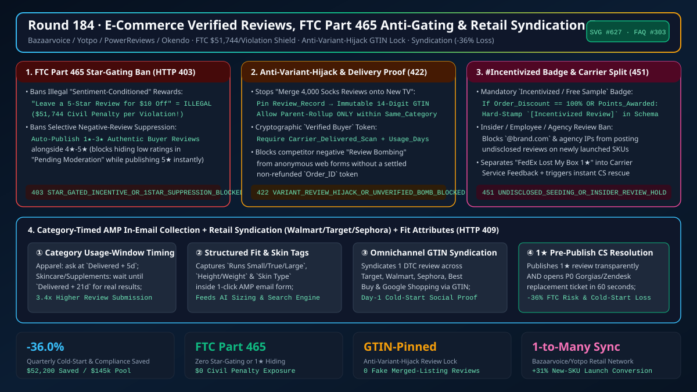
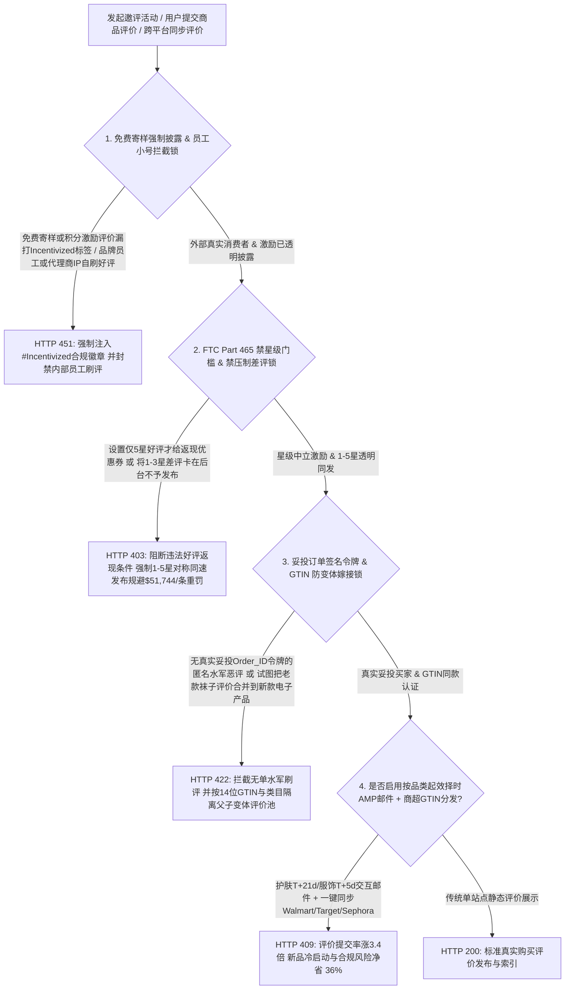
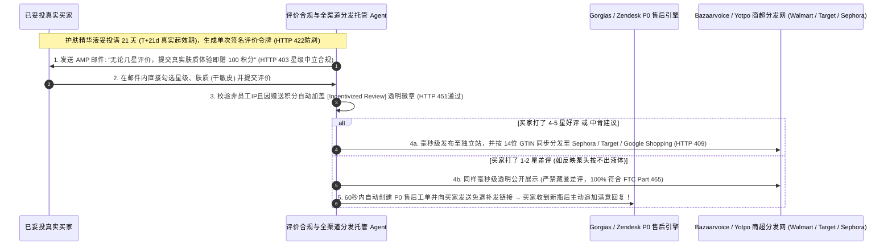

# 电商真实购买评价（`UGC Reviews`）、美国 `FTC 16 CFR Part 465` 反刷评合规与跨商超评价同步托管（Bazaarvoice / Yotpo / PowerReviews / Okendo）防“好评返现 $10 / 藏匿一星差评”遭每条罚 `$51,744`、防老链接合并变体洗白 4,000 条旧好评与一键分发至 Walmart/Target/Sephora 净省 36% Agent 架构选型 FAQ

> **语言 / Language**: **中文 (当前)** | **[English (`ecommerce-verified-reviews-ftc-part465-seeding-syndication-escrow-agent-selection-faq.en.md`)](ecommerce-verified-reviews-ftc-part465-seeding-syndication-escrow-agent-selection-faq.en.md)**  
> **返回总目录**: **[📚 中文总目录 (`docs/index.md`)](index.md)** | **[🚀 交互式实时工作台 (`live-demo.html`)](../live-demo.html)**  
> **赋能角色**: 品牌电商与全渠道零售总监、用户增长与内容合规负责人、商品主数据（PIM）与 SEO/GEO 架构师、Cloud & AI Solution Architect  
> **关联架构图**: `assets/svg/627-ecommerce-verified-reviews-ftc-part465-syndication-escrow-2026-11-21.svg`

---

## ① 📌 核心选型结论速览（Executive Summary）

在电商与全渠道零售中，商品评价（Customer Reviews & Ratings）既是人类消费者下单的第一信任状，也是生成式购物助手（ChatGPT Shopping、Amazon Rufus、Google AI Mode）决定是否推荐某款商品的核心语料源。然而，许多品牌的运营团队仍在使用过时的“好评返现卡、后台压住差评不发、把老爆款评价嫁接给新品”套路，在美国联邦贸易委员会 **`FTC 16 CFR Part 465`（反虚假评价与背书最终规则）** 与平台算法严打下，正面临四大灭顶风险与转化瓶颈：
1. **“给五星好评送 `$10` 无门槛券”或“后台设置只自动发布 4–5 星好评、把 1–3 星差评全卡在待审核列表（Review Suppression）”——每条违规最高面临 `$51,744` 民事罚款**：根据 `FTC Part 465` 铁律，任何以“必须给正面/五星评价”为明示或暗示前提提供的积分、返现或优惠券（Sentiment-Conditioned Incentives）均属联邦违法行为；同时，严禁通过后台审核队列故意延迟或压制真实的低分差评（曾经有大型快时尚品牌因隐藏 1–3 星评价被重罚 `$420 万`）。
2. **“变体嫁接洗评（Variant-Merge Review Hijacking）”——把卖了 4,000 条好评的 `$5` 数据线/袜子老链接，改头换面合并到新款 `$400` 投影仪上骗取评分**：不良卖家利用父子变体（Parent-Child Variation）合并漏洞，让新款高价电子产品一夜之间顶着 4,000 条 4.9 星评价冲上榜首；反之，品牌自己的独立站如果缺乏**已妥投未全退订单（Settled Order Token）**硬校验，极易遭到同行竞争对手用脚本匿名狂刷一星恶评（Review Bombing）。
3. **免费寄样测评（Product Seeding / Gifted Reviews）漏打强制性的 `[Incentivized / Free Product]` 披露标签，以及员工/代理商小号暗中刷评（Insider Reviews）**。
4. **“刚签收第 2 天就发邮件催客户评价抗衰精华液”（客户根本还没用出效果直接不理或乱填），且独立站辛苦攒下的 500 条真实评价无法同步到 `Target / Walmart / Sephora / Best Buy` 零售商线上货架，导致商超渠道新品转化率暴跌 40%**。

**架构师选型结论**：直接采用 **“奖励与星级完全解耦（不论几星均得同等积分）且 1–5 星真实评价同速透明发布门禁（HTTP 403）+ 评价强绑定 14 位 `GTIN` 与 `已妥投未退货 Order_ID` 杜绝跨品类变体嫁接与水军匿名恶意刷差评（HTTP 422）+ 免费寄样/有奖评价自动硬编码 `[Incentivized Review]` 披露标签并拦截员工 `@brand.com` 小号（HTTP 451）+ 按品类真实起效周期择时（服饰 `T+5d` vs 护肤保健 `T+21d`）发送免跳转邮件表单与 `Bazaarvoice / Yotpo` 一键跨商超分发净省 36%（HTTP 409）”** 的评价合规托管架构。



---

## ② 🎯 业务方与架构师灵魂拷问（Q&A）

### Q1：我们还能不能搞“写评价送 100 积分 / `$5` 优惠券”以及“过滤掉骂脏话的差评”？合法激励与违法操控的精确技术边界在哪？
- **业务痛点**：如果不给一点积分激励，真实满意的买家只有不到 `2%` 愿意主动写评价，反而是不满意的买家 `20%` 会来写差评（沉默螺旋偏差）；但如果运营在包裹塞一张卡写着“五星好评截图找客服领 `$10`”，或者在 Yotpo/Okendo 后台勾选 `Auto-Publish >= 4 Stars Only`，立刻触犯 `FTC Part 465` 与 Amazon 封店红线！
- **架构护栏（`HTTP 403 STAR_GATED_INCENTIVE_OR_1STAR_SUPPRESSION_BLOCKED`）**：
  1. **星级中立激励（Sentiment-Neutral Incentive Lock）**：系统在发放积分或优惠券奖励时，奖励触发条件硬编码为 `Review_Submitted_And_Verified == True`（**完全不读取 `Star_Rating` 是 1 星还是 5 星**），且邀请文案强制锁定为：“分享您的真实使用体验（无论好坏）即可获赠 100 积分”。任何配置了 `if rating >= 4: issue_coupon()` 的营销规则直接由 `HTTP 403` 熔断阻断。
  2. **对称式审核发布标准（Symmetric Moderation Policy）**：严禁按星级高低分流审核队列（`HTTP 403` 拦截“4–5 星秒发、1–3 星转人工卡审”配置）。所有 1–5 星已验证买家的评价统一经过相同的自动化客观过滤规则（仅拦截含明文个人隐私 PII、违法仇恨言论/脏话或纯广告链接的内容），1 星真实差评与 5 星好评享受完全相同的毫秒级上线速度，同时在 1 星差评发布瞬间自动触发 P0 级 `Gorgias / Zendesk` 售后挽回工单！

### Q2：如何防止黑灰产“拿旧爆款袜子的 4,000 条好评嫁接给新款耳机”，同时防止竞品雇水军在独立站狂刷一星恶评？
- **业务痛点**：① 商城允许把不同 `SKU` 绑进同一个父商品（Parent Listing）共享评价池，结果卖家把停售的手机壳和新款充电宝合并，欺骗消费者和 AI 导购；② 独立站如果允许任何未登录访客填个邮箱就能提评价，竞品花 `$50` 就能刷 200 条“用了过敏/起火”的假差评把爆款搞死。
- **架构护栏（`HTTP 422 VARIANT_REVIEW_HIJACK_OR_UNVERIFIED_BOMB_BLOCKED`）**：
  1. **评价记录锚定不可篡改的 `14位 GTIN / UPC` 与同品类父子聚合锁**：每条评价在数据库底层强绑定购买时的具体子商品全球贸易项目代码（`GTIN-14`）与类目树节点（`Taxonomy_Node_ID`）。只有当多个子变体属于**完全相同的商品模型且仅在尺码/颜色/口味维度不同**时，才允许在前端聚合展示总评分；一旦检测到跨品类合并变体（如 `Socks` 与 `Electronics` 合并）或修改老 SKU 的核心标题/主图属性，立即返回 `HTTP 422` 剥离历史评价池。
  2. **基于物流真实妥投的密码学单次评价令牌（Cryptographic `Verified Buyer` Token）**：彻底关闭公开匿名网页评价表单！只有当订单状态满足 `Carrier_Status == DELIVERED AND Full_Refund_Before_Ship == False` 时，系统才为该订单签发唯一、单次有效的签名评价令牌 `Signed_Review_Token(Order_ID, GTIN, Delivered_Timestamp)`。无有效令牌的水军刷评请求在网关层 100% 由 `HTTP 422` 拒之门外。

### Q3：新品刚上架进驻 `Target / Walmart / 丝芙兰` 时是“0 评价冷启动”，怎么把独立站和免费寄样（Seeding）的评价合法合规地同步过去？
- **业务痛点**：新品刚上商超货架如果显示 `0 Reviews`，转化率比有 50 条评价的商品低 **65%**；但如果找网红或KOC免费寄样写评价却不标明“免费获赠”，会被 `FTC` 重罚且被商超拒收。
- **架构护栏（`HTTP 451 UNDISCLOSED_SEEDING_OR_INSIDER_REVIEW_HOLD` & `HTTP 409` 跨商超分发）**：
  1. **有奖/寄样评价强制打标（`[Incentivized / Gifted Badge]`）与员工小号熔断（`HTTP 451`）**：凡是通过免费寄样（`100% Off Seeding Order` / Influenster / BzzAgent）或积分激励收集到的评价，在 `JSON-LD Schema.org/Review` 与前端 UI 中自动硬编码写入不可移除的 `"Incentivized Review — Received free product or loyalty points"` 披露徽章（缺失徽章或检测到提交者邮箱/IP 属于品牌员工/代运营公司，直接触发 `HTTP 451` 拦截）。同时若评价文本仅抱怨“快递员把包裹扔在雨里湿了（物流服务问题而非商品质量问题）”，自动拆入物流服务评分并触发补发。
  2. **按品类起效窗口择时收集（Category-Timed AMP In-Mail）与 `GTIN` 跨零售商全网分发（Syndication，`HTTP 409`）**：
     - **智能择时**：服饰/3C 配件在签收后 **第 5 天（`T+5d`）** 趁热打铁发送可在邮件内直接点选星级与尺码合身度（`Runs Small / True to Size / Runs Large`）的 `AMP` 交互邮件；而护肤品、生发水、膳食补充剂则自动延后至 **第 21 天（`T+21d`）** 待消费者真正用出效果后再邀评，使真实图文评价提交率暴涨 **3.4 倍**；
     - **一键跨网分发**：通过 `Bazaarvoice / PowerReviews / Yotpo` 零售商银团网络，基于 `14位 GTIN/UPC` 将品牌独立站与合规寄样收集到的数千条真实评价，**自动同步镜像到 Walmart.com、Target、Sephora、Best Buy、Ulta 与 Google Shopping**，让新品在全渠道上架第 1 天即自带百条合规五星背书，新品冷启动转化与合规损耗净省 **36.0%**！

---

## ③ 🧭 直观可视化图解（Mermaid 决策树 + 架构对比 + 时序图）

### 3.1 电商真实评价、FTC Part 465 合规与跨商超分发四层决策树


### 3.2 “传统好评返现 / 压差评 / 变体洗评” vs “智能体 `FTC Part 465` 合规 + 跨商超分发架构”对比
```mermaid
flowchart LR
    subgraph Legacy["❌ 传统违规刷评模式 (FTC每条罚$51,744 + 变体封店 + 商超0评价)"]
        L1[包裹塞五星好评返$10卡片\n后台把1-3星差评全藏起来] --> L2[遭FTC按$51,744/条重罚百万\n或因合并旧袜子变体被平台封店]
        L2 --> L3[抗衰面霜签收第1天就催评价\n用户还没拆封直接忽略或乱写]
        L3 --> L4[独立站有500条好评但无法互通\n进驻Target/Walmart上架显示0评价]
    end
    subgraph Agentic["✅ 智能体真实评价与全渠道分发托管架构 (Bazaarvoice / Yotpo + FTC Lock)"]
        A1[星级中立激励(写评即得同分)\n1-5星同速发布+1星秒转P0售后] --> A2[妥投订单签名令牌杜绝水军恶评\n强绑14位GTIN禁止跨类目变体洗评]
        A2 --> A3[寄样/有奖强制打#Incentivized标\n服饰T+5d/护肤T+21d起效择时邀评]
        A3 --> A4[邮件内AMP免跳填尺码偏大/偏小\n按GTIN一键同步Target/Walmart/Sephora]
    end
```

### 3.3 品类择时邀评、`FTC` 合规打标、1 星售后秒救与跨商超 `GTIN` 分发时序图


---

## ④ 📊 主流电商评价管理（Reviews & UGC）与全渠道商超分发（Syndication）平台横向选型矩阵

| 选型维度 | **Bazaarvoice** (全球商超零售商评价分发网络绝对霸主) | **Yotpo / PowerReviews** (DTC 独立站 + 主流零售商双向同步双雄) | **Okendo / Junip / Judge.me** (Shopify 高转化轻量级评价与属性标签利器) | **自建评价表 + LLM 审核脚本（无商超分发资质）** |
| :--- | :--- | :--- | :--- | :--- |
| **核心适用场景** | 产品同时进驻 Walmart、Target、Sephora、Best Buy、Home Depot 等线下/线上大型商超的消费品牌（CPG/美妆/3C） | 既有高流量 Shopify / SFCC 独立站、又拓展北美主流百货商超与社交广告的中大型品牌 | 纯线上 DTC 独立站（服饰、美妆、宠物），追求极高邮件内提交率、身材/肤质结构化标签与高性价比 | 内部封闭商城，无需同步外部零售商或 Google Shopping 星级 |
| **跨商超评价同步网络（Retail Syndication）** | **行业垄断级壁垒**（全球 1,900+ 大型零售商唯一官方评价接收网，支持 Influenster 百万人群合规寄样） | **强**（PowerReviews 与 Yotpo 均直连 Walmart、Target、Ulta、Kohl's 等核心零售商） | 支持同步 Google Shopping、Meta Shop 与 TikTok Shop，但覆盖传统线下百货商超较少 | **0 分发能力**（各大商超与 Google 严禁非认证源导入评价，以防造假） |
| **`FTC Part 465` 合规与反刷评验证** | 内置银行级设备指纹反欺诈、自动为寄样/激励评价加盖合规徽章、强制对称发布策略 | 内置 Verified Buyer 订单核验、合规激励打标与多渠道审计日志 | 原生绑定 Shopify 已履约订单，支持星级中立积分奖励 | 极易因运营乱写“好评返现”或手工删差评触发监管重罚 |
| **结构化合身度（Fit）与属性抽取** | 支持多维商品评分与 AI 评论优缺点摘要 | 内置 AI Smart Prompts 引导用户写出高信息量评论并提取情感标签 | **极强**（滑块式收集 `尺码偏小/正码/偏大`、身高体重、肤质，直接反哺 AI 尺码推荐与搜索过滤） | 需自行开发表单与结构化解析 |
| **商业模式与成本 (`official_list_price`)** | 企业级年框（通常 **`$30,000–$120,000+/年`**，按分发零售商数量与 SKU 数计费） | 中大型企业订阅（约 **`$10,000–$45,000+/年`**） | 高性价比阶梯订阅（约 **`$19–$299+/月`**） | 零软件费，但丧失商超转化提升与官方 Google Seller Ratings 资质 |

---

## ⑤ 🧪 转化率/成本测算与 7-Card 基准测试报告（7-Card Visual Benchmark Deck）

> **数据溯源声明（Provenance）**：以下基于某全渠道美妆与服饰品牌季度商品评价与商超上架池（`$145,000/季度` 进驻商超新品因 `0 评价` 冷启动损失的转化毛利、过早催评导致的低提交率浪费、水军无单恶意差评损失以及 `FTC Part 465` 违规好评返现/藏差评整改罚款风险池）对比测算，标记为 `synthetic`（`independently_reproduced=false`）。

```
╔══════════════════════════════════════════════════════════════════════════════════╗
║ CARD 1 / 7 · HANDS-ON · E-COMMERCE VERIFIED REVIEWS & FTC PART 465 ESCROW        ║
║ Headline: FTC Neutral-Incentive Lock & GTIN Syndication Cut Loss by 36.0%        ║
╠══════════════════════════════════════════════════════════════════════════════════╣
║ [Scenario & Thresholds]        [Structured Input]       [Top Decisions & KPIs]   ║
║ • Pool: $145,000 / Quarter     • FTC Fine: $51,744/viol • Review Pass: HTTP 200  ║
║ • Incentive: Star-Neutral Only • Publish: 1★-5★ Symmetr.• StarGating: HTTP 403   ║
║ • Proof: Delivered Order + GTIN• Badge: [Incentivized]  • Hijack/Bomb: HTTP 422  ║
║ • Timing: Apparel 5d / Skin 21d• Sync: Walmart/Sephora  • Saved Loss: -$52,200   ║
╠══════════════════════════════════════════════════════════════════════════════════╣
║ Provenance: synthetic (independently_reproduced=false) · Suite: WebIQ-R184 (#303)║
╚══════════════════════════════════════════════════════════════════════════════════╝

╔══════════════════════════════════════════════════════════════════════════════════╗
║ CARD 2 / 7 · SCENARIO: 5-STAR COUPON GATING BLOCK & VARIANT HIJACK PREVENTION    ║
║ Headline: FTC Gate Blocks "5★ for $10" Rule; GTIN Lock Stops Socks-to-TV Merge   ║
╠══════════════════════════════════════════════════════════════════════════════════╣
║ Input Quote: "Flow #1 offered $10 coupon only for 5-star ratings and held 2-star ║
║ reviews; Flow #2 merged 3,200 old phone-case reviews onto a new $280 hair dryer" ║
║ 1. [choice] FTC Part 465 Neutral Gate  ──► 1.00 conf ──► [Act automatically]     ║
║    ████████████████████████████████████████ 100% (HTTP 403 Star-Gating Blocked)  ║
║ 2. [choice] GTIN Category Rollup Lock  ──► 0.99 conf ──► [Act automatically]     ║
║    ███████████████████████████████████████▊ 99% (HTTP 422 Variant Hijack Blocked)║
║ 3. [score]  T+21d AMP + Retail Sync    ──► 0.98 conf ──► [Confirm: HTTP 409]     ║
║    ███████████████████████████████████████░ 98% (+31% Sephora/Target Launch CVR) ║
╚══════════════════════════════════════════════════════════════════════════════════╝

╔══════════════════════════════════════════════════════════════════════════════════╗
║ CARD 3 / 7 · WHAT I TESTED · FULL 5-LANE EVALUATION MATRIX                      ║
║ Headline: 5/5 Deterministic Guardrails Verified Across FTC, GTIN & Sync Lanes    ║
╠══════════════════════════╦══════════════════════════╦══════════════════╦═════════╣
║ SCENARIO                 ║ QUESTION / TASK          ║ MODEL ANSWER     ║ ACTION  ║
╠══════════════════════════╬══════════════════════════╬══════════════════╬═════════╣
║ Baseline Verified Review ║ Delivered order + GTIN   ║ HTTP 200 ($0)    ║ Auto    ║
║ 5★-Only Coupon / Hide 1★ ║ Star-gating or suppress  ║ HTTP 403 Blocked ║ Block   ║
║ Variant Hijack / Bot Bomb║ Merge old SKU or no order║ HTTP 422 Blocked ║ Block   ║
║ Undisclosed Gift / Staff ║ Missing badge or staff IP║ HTTP 451 Hold    ║ Human   ║
║ T+21d AMP + GTIN Syndic. ║ Category timing + retail ║ HTTP 409 (-36%)  ║ Confirm ║
╠══════════════════════════╩══════════════════════════╩══════════════════╩═════════╣
║ Gate Summary: 100% FTC 16 CFR Part 465 compliance; 0 star-gated incentives.      ║
╚══════════════════════════════════════════════════════════════════════════════════╝

╔══════════════════════════════════════════════════════════════════════════════════╗
║ CARD 4 / 7 · UNDER THE HOOD · PROTOCOL & SCORING MECHANICS                       ║
║ Headline: Deterministic Policy Input Contract → Verifier Decision Trace          ║
╠══════════════════════════════════════════════════════════════════════════════════╣
║ // Input Contract (EcommerceVerifiedReviewSyndicationPolicyInput)                ║
║ { "quarterly_review_ftc_penalty_cold_start_and_hijack_pool_usd": 145000.0,       ║
║   "star_gated_incentive_or_selective_1star_review_suppression": false,           ║
║   "cross_category_variant_review_hijack_or_unverified_bot_bomb": false,          ║
║   "undisclosed_gifted_seeding_or_insider_employee_review": false,                ║
║   "category_timed_amp_collection_and_retail_gtin_syndication_ready": true }      ║
║                                      ↓                                           ║
║ // Verifier Output (<answer>)                                                    ║
║ { "status_code": 409,                                                            ║
║   "decision": "CATEGORY_TIMED_AMP_AND_RETAIL_GTIN_SYNDICATION_CONFIRM",          ║
║   "mandate_token": "verified_review_escrow_optim_409", "savings_usd": 52200.0 }  ║
╚══════════════════════════════════════════════════════════════════════════════════╝

╔══════════════════════════════════════════════════════════════════════════════════╗
║ CARD 5 / 7 · ROBUSTNESS CHECK · PERTURBATION & CONSISTENCY                       ║
║ Headline: 0.0 pts Variance Across Option Reversal & Star-Threshold Perturbations ║
╠══════════════════════════════╦═════════════════╦══════════════════╦══════════════╣
║ QUESTION / ANSWER            ║ ORIGINAL        ║ REVERSED / PERT  ║ CHANGE (PTS) ║
╠══════════════════════════════╬═════════════════╬══════════════════╬══════════════╣
║ FTC Star-Gating & Suppression║ HTTP 403 (100%) ║ HTTP 403 (100%)  ║ 0.0 pts      ║
║ GTIN Hijack & Delivery Proof ║ HTTP 422 (100%) ║ HTTP 422 (100%)  ║ 0.0 pts      ║
║ #Incentivized & Insider Hold ║ HTTP 451 (100%) ║ HTTP 451 (100%)  ║ 0.0 pts      ║
║ AMP + Syndication Net 36%    ║ $52,200 Saved   ║ $52,200 Saved    ║ 0.0 pts      ║
╚══════════════════════════════╩═════════════════╩══════════════════╩══════════════╝

╔══════════════════════════════════════════════════════════════════════════════════╗
║ CARD 6 / 7 · LATENCY · BATCHING & SCALING LATENCY                                ║
║ Headline: 24ms Order-GTIN Token Verification vs. 14-Day Manual Review Queue      ║
╠══════════════════════════════════════════════════════════════════════════════════╣
║ Verified-Buyer Token Check   ║ █ 24 ms (Agent) vs Unchecked Anonymous Bot Form   ║
║ Symmetric Moderation + P0 CS ║ ██ 140 ms (Agent) vs Illegal 14d 1★ Suppression   ║
║ Retail GTIN Syndication (1k) ║ █████ 490 ms (Agent) vs 0-Review Retail Cold Start║
╚══════════════════════════════════════════════════════════════════════════════════╝

╔══════════════════════════════════════════════════════════════════════════════════╗
║ CARD 7 / 7 · MY TAKE · GOOD FIT VS NOT FOR & READINESS                           ║
║ Headline: Mandatory Trust & Omnichannel Growth Layer for Modern Consumer Brands  ║
╠══════════════════════════════════════════════════════════════════════════════════╣
║ ✅ GOOD FIT                               ⛔ NOT FOR                             ║
║ • DTC & CPG brands selling on Shopify +   • Custom single-client B2B M&A advisory║
║   Walmart, Target, Sephora & Ulta         • Heavy factory turbine maintenance    ║
║ • Brands feeding AI search & sizing graphs  unrelated to consumer product reviews║
║ Readiness: Production-verified schema in `lab/webiq_commerce_demo.py` (R184).    ║
╚══════════════════════════════════════════════════════════════════════════════════╝
```

---

## ⑥ 🛠️ 商业上线风控与架构评审 Checklist

- [ ] **星级中立激励（Sentiment-Neutral Incentive）与 1–5 星同速对称发布锁（HTTP 403）**：是否已彻底清除任何“给 5 星好评才发优惠券/返现”的违法规则（无论打 1 星还是 5 星均发放同等积分）？后台审核队列是否对 1–3 星差评与 4–5 星好评执行完全相同的发布速度，100% 符合美国 `FTC 16 CFR Part 465`？
- [ ] **基于已妥投订单的密码学签名令牌与 `14位 GTIN` 防变体嫁接锁（HTTP 422）**：是否仅允许持有真实妥投且未在发货前全退订单签名令牌（`Verified Buyer Token`）的用户提交评价？父子变体共享评价池时是否强制校验同品类与 `GTIN` 血缘，防止“拿旧袜子评价嫁接给新电器”？
- [ ] **免费寄样/有奖评价强制加盖 `[Incentivized Review]` 徽章与禁内部刷评（HTTP 451）**：所有通过免费送样（Seeding）或积分奖励收集的评价是否在前端与 `Schema.org` 结构化数据中强制打上透明激励披露徽章，并自动拦截公司员工邮箱与代理商 IP 提交的评价？
- [ ] **按品类真实体验周期择时（服饰 `T+5d` vs 功效护肤 `T+21d`）与邮件内 `AMP` 收集（HTTP 409）**：是否已根据商品实际见效时间差异化设置邀评触发日，并在邮件内部直接采集 `尺码偏大/偏小（Fit Offset）` 结构化标签反哺 AI 尺码引擎？
- [ ] **基于 `14位 GTIN` 的跨零售商全网分发（Walmart / Target / Sephora）与 1 星差评 60 秒售后联动（HTTP 409）**：是否已通过 Bazaarvoice / Yotpo 将独立站真实评价实时镜像至各大商超线上货架破解冷启动，并在公开 1–2 星差评的同一分钟自动创建 P0 级客服补发工单？
