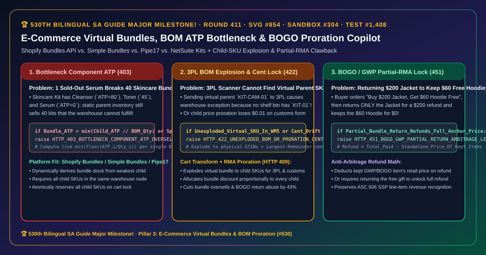
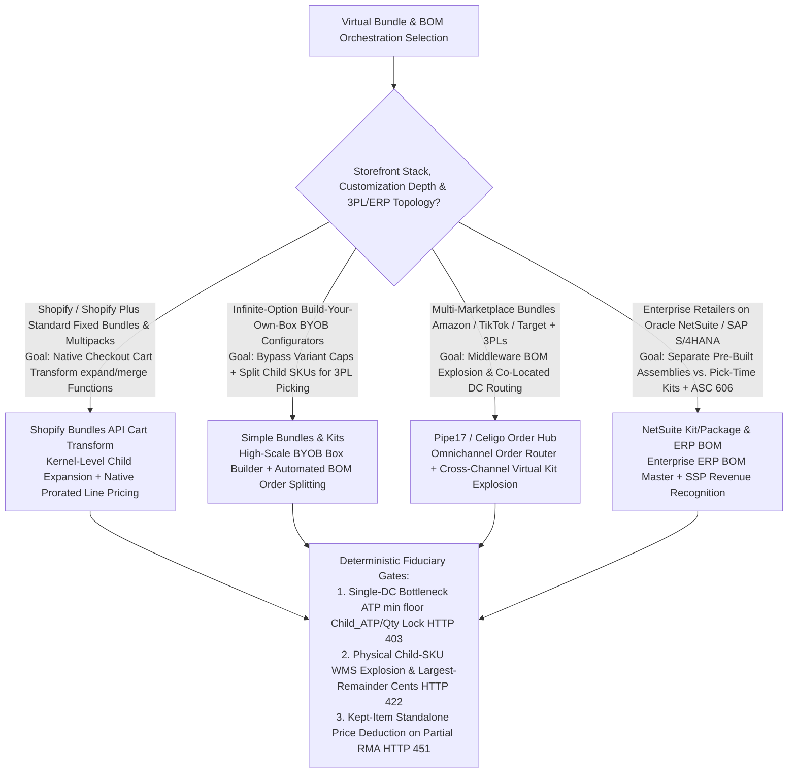
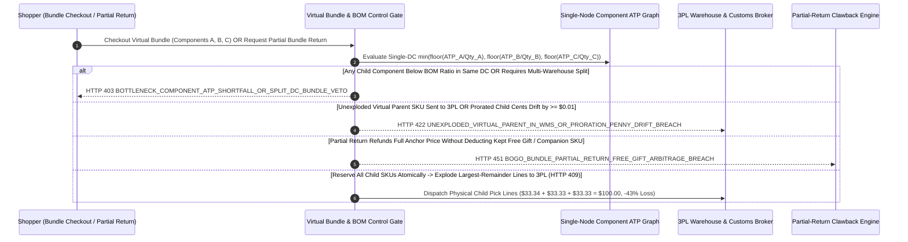

# E-Commerce Virtual Product Bundles & `BYOB` Kits, Bottleneck Component `ATP`, `3PL WMS` `BOM` Explosion & `BOGO / GWP` Partial-Return Clawback Agent Selection Guide: `Shopify Bundles API` vs. `Simple Bundles` vs. `Pipe17` vs. `NetSuite Kit/Package` (`-43%` Loss FAQ · 🏆 530th Bilingual SA Guide Major Milestone!)

> **Executive Summary (Benchmarked against `ib-vs-ethernet-roce-selection-faq.md` · 🏆 530th Bilingual SA Guide Major Milestone · Round 411 · SVG #854 · Sandbox #304)**: Built for **Cloud & AI Solution Architects** designing virtual product bundling, Build-Your-Own-Box (`BYOB`) configurators, `3PL WMS` Bill-of-Materials (`BOM`) explosion, and partial-return refund proration for DTC brands and omnichannel retailers. Curated bundles (`4-Step Skincare Routine`, `Camera + Lens Kit`) and `Buy-One-Get-One (BOGO) / Gift-With-Purchase (GWP)` promotions lift Average Order Value (`AOV`) by **`30%–45%`**. Yet virtual kitting (where components sit in separate warehouse bins and are assembled at pick time) introduces three severe operational and financial vulnerabilities: (1) **Bottleneck Component Stockouts & Cross-DC Overselling**: A 4-piece kit has 80 Cleansers and 50 Toners, but the Vitamin C Serum sells out individually (`ATP == 0`)—without real-time **`Bundle_ATP = min(floor(Child_ATP_i / BOM_Qty_i))`** calculation per warehouse node, the storefront oversells 40 unfulfillable kits; (2) **Unexploded Virtual Parent SKUs Freezing `3PL WMS` Pick Queues & `$0.01` Rounding Drift on Customs/ERP Lines**; and (3) **`BOGO / GWP` Partial-Return Arbitrage ("Buy $200 Jacket + Get $60 Hoodie Free -> Return Only the $200 Jacket for a Full $200 Refund")**. This guide compares **`Shopify Bundles API (Cart Transform)` vs. `Simple Bundles` vs. `Pipe17 / Celigo` vs. `NetSuite Kit/Package`** and implements deterministic guards for **Single-Node Bottleneck `ATP` Graph Locks (`HTTP 403`)**, **Physical Child-SKU `BOM` Explosion & Largest-Remainder Penny Conservation (`HTTP 422`)**, **Kept-Item Standalone-Price Deduction on Partial Returns (`HTTP 451`)**, and **`ASC 606 SSP` Line-Item Proration (`HTTP 409`, `-43%` net loss)**.



---

## 1. 📌 Executive Summary & Architectural Selection Verdict

1. **Top-Line Selection Verdict**:
   - **Shopify & Shopify Plus Storefronts Selling Fixed Multi-SKU Bundles & Multipacks Seeking Native Checkout-Level Child-SKU Expansion**: Select **`Shopify Bundles API (Native Cart Transform Functions)`**.
   - **Brands Offering Infinite-Option Build-Your-Own-Box (`BYOB`) Configurators (Exceeding Variant Limits) or Wholesale Case-Pack Breakdown**: Select **`Simple Bundles & Kits`**.
   - **Multi-Channel Brands Selling Virtual Kits Across `Amazon / TikTok Shop / Target Plus / Shopify` Fulfilled by External `3PL WMS` Nodes (`ShipBob / Radial`)**: Select **`Pipe17`** or **`Celigo`**.
   - **Mid-to-Enterprise Retailers Standardized on `Oracle NetSuite / SAP` Requiring Strict Separation of Pre-Built `Assembly Items` vs. Pick-Time `Kit/Package Items` & `ASC 606 SSP` Allocation**: Select **`NetSuite Kit/Package + ERP BOM Engine`**.
2. **Three Non-Negotiable Fiduciary Control Gates**:
   - **Gate 1 — Single-Warehouse Bottleneck Component `ATP` Graph Lock (`HTTP 403`)**: Never maintain a static inventory counter on a virtual bundle parent SKU; dynamically compute available bundle inventory per fulfillment node $k$ as:
     $$\text{Bundle\_ATP}_{k} = \min_{i \in \text{BOM}} \left\lfloor \frac{\text{Child\_ATP}_{i,k}}{\text{BOM\_Qty}_{i}} \right\rfloor$$
     and block checkout if `Bundle_ATP_k < Requested_Qty` (forbidding splitting a single low-margin virtual kit across two separate warehouses) via `HTTP 403 BOTTLENECK_COMPONENT_ATP_SHORTFALL_OR_SPLIT_DC_BUNDLE_VETO`.
   - **Gate 2 — Physical Child-SKU `BOM` Explosion & Largest-Remainder Penny Conservation (`HTTP 422`)**: Explode every virtual bundle into its underlying physical child SKUs (with individual `14-Digit GTINs` and `10-Digit HS Codes`, stripping the non-physical parent SKU from the pick list) before transmitting to the `3PL WMS` or customs broker, and allocate the bundle's net paid price across child lines using the **Largest-Remainder Method** so $\sum \text{Child\_Net\_Cents} \equiv \text{Bundle\_Paid\_Cents}$ (`$0.00` rounding drift) via `HTTP 422 UNEXPLODED_VIRTUAL_PARENT_IN_WMS_OR_PRORATION_PENNY_DRIFT_BREACH`.
   - **Gate 3 — Kept-Item Standalone-Price Deduction on Partial Bundle / `BOGO` / `GWP` Returns (`HTTP 451`)**: When a buyer initiates a partial return on a discounted bundle, `BOGO`, or `Gift-With-Purchase (GWP)` order (returning the anchor item while keeping the free gift or discounted companion items), cap the maximum refund at:
     $$\text{Max\_Refund\_Cents} = \max\left(0,\; \text{Total\_Bundle\_Paid\_Cents} - \sum_{j \in \text{Kept\_Items}} \text{Standalone\_Regular\_Price}_{j}\right)$$
     (or require the free gift to be returned in the same `RMA`) via `HTTP 451 BOGO_BUNDLE_PARTIAL_RETURN_FREE_GIFT_ARBITRAGE_BREACH`.

---

## 2. 🎯 Architect & E-Commerce Merchandising Q&A (The Why & How)

### Q1: How do opportunistic shoppers exploit "Buy $200 Jacket, Get $60 Hoodie Free (`GWP / BOGO`)" promotions to steal the `$60` hoodie for `$0`?
- **Root Cause**: If checkout records the Jacket at `$200.00` and the free Hoodie at `$0.00` on the order ledger, a naive returns portal (`RMA`) allows the buyer to select *only* the Jacket for return and refunds `$200.00`—leaving the buyer with a free `$60` Hoodie and `$0` net spend!
- **Deterministic Solution (`Checkout SSP Proration` + `Kept-Item Retail Deduction Formula` / `HTTP 422 & HTTP 451`)**:
  1. At checkout, prorate the `$60` discount across both items by Standalone Selling Price (`SSP = 200 : 60`), recording the Jacket at `$153.85` and the Hoodie at `$46.15` (`Sum = $200.00`).
  2. In the RMA portal, if the buyer returns only the Jacket and keeps the Hoodie, revoke the bundle discount by deducting the kept Hoodie's `$60.00` standalone price (`Refund = $200.00 - $60.00 = $140.00`), or require both items to be scanned at the return bar for a `$200.00` refund.

### Q2: Why does sending a virtual bundle SKU directly to a 3PL warehouse (`ShipBob / Radial`) freeze fulfillment or fail international customs clearance?
- **Deterministic Solution (`Pre-WMS BOM Explosion` + `Per-Component HS Code & Largest-Remainder Allocation` / `HTTP 422`)**: Warehouse bins store physical child barcodes (`Cleanser`, `Toner`, `Cosmetic Bag`), not the virtual marketing SKU (`HOLIDAY-GLOW-SET`). Furthermore, a cosmetic bag (`HS Chapter 42`) and a skin serum (`HS Chapter 33`) carry different customs duty rates. Exploding the parent SKU into prorated child lines with Largest-Remainder cent conservation satisfies both the 3PL barcode scanner and customs authorities.

---

## 3. 🧭 Visual Architecture Diagrams (Mermaid)

### 3.1 E-Commerce Virtual Bundles & `BOM` Orchestration Platform Selection Decision Tree



### 3.2 Naive Static Bundle Inventory & `$0` Gift Line vs. Fiduciary Bottleneck `ATP`, `BOM` Explosion & Anti-Arbitrage Control Plane

```mermaid
flowchart LR
    subgraph Naive["❌ Naive Static Kit Stock & $0 GWP Line (40 Oversold Kits + $0 Free-Hoodie Return Arbitrage)"]
        N1[Static Parent Stock OR Buy $200 Jacket Get $0 Hoodie] --> N2[Child Serum Sells Out Individually -> Storefront Oversells 40 Kits<br/>Sends Unexploded Virtual SKU KIT-01 to 3PL -> Scanner Freeze]
        N2 --> N3[Buyer Returns Only $200 Jacket for Full $200 Refund -> Keeps $60 Hoodie Free<br/>3-Item $100 Kit Splits Into 3x $33.33 -> $0.01 ERP/Customs Mismatch]
    end

    subgraph Guarded["✅ Fiduciary Bottleneck ATP, Largest-Remainder BOM & Anti-Arbitrage Control Plane (🏆 #530)"]
        G1[Bundle Add-to-Cart / Partial RMA Request] --> G2[Bottleneck Component ATP Gate HTTP 403:<br/>Compute Single-DC min(floor(ATP_i/Qty_i)) + Atomic Child Reserve]
        G2 --> G3[BOM Explosion & Cent-Conservation Gate HTTP 422/409:<br/>Explode to Physical Child GTINs + Largest-Remainder ($33.34/$33.33/$33.33)]
        G3 --> G4[Partial-RMA Clawback Gate HTTP 451:<br/>Deduct Kept Item's Standalone Retail Price From Partial Refund]
    end
```

### 3.3 Real-Time Bottleneck `ATP` Reservation, Largest-Remainder `BOM` Explosion & Partial-Return Clawback Sequence



---

## 4. 📊 Multi-Platform Virtual Bundle & `BOM` Orchestration Selection Matrix

| Evaluation Dimension | Shopify Bundles API (`Cart Transform`) | Simple Bundles & Kits | Pipe17 / Celigo (`Order Hub`) | NetSuite Kit/Package & Assembly |
| :--- | :--- | :--- | :--- | :--- |
| **Primary Architectural Role** | **Shopify-Native Checkout `expand / merge` Bundle Engine** | **Infinite-Option `BYOB` Box Builder & 3PL Splitter** | **Omnichannel Marketplace-to-3PL `BOM` Order Hub** | **Enterprise ERP `Assembly vs. Kit` & `ASC 606` Core** |
| **Real-Time Bottleneck `ATP` Sync** | **Kernel-Level Speed**: Automatically derives bundle stock from weakest child | Real-time sync across single, nested, and wholesale multipack SKUs | Aggregates physical 3PL child inventory and broadcasts kit `ATP` to all channels | Distinguishes pre-packaged `Assembly` stock from virtual `Kit` components |
| **`3PL WMS` Child-SKU `BOM` Explosion** | Native `expand` operation converts bundle into child lines at checkout | Splits bundles into physical child SKUs for 3PLs while preserving UI grouping | **Best-in-Class Cross-Channel**: Explodes Amazon/TikTok virtual kits before 3PL push | Native Sales Order (`SO`) to Item Fulfillment component expansion |
| **Price Proration & Partial-Return Math** | Proportional line-item discount allocation across expanded child SKUs | Assigns weighted component prices for accurate partial refunds & customs | Largest-Remainder cent conservation between storefront and ERP | **Best-in-Class `ASC 606`**: Allocates revenue by Standalone Selling Price (`SSP`) |
| **Commercial Model (`official_list_price`)** | **`$0` native API / Shopify Bundles app** (`0%` transaction fee) | Free starter tier; paid plans `~$24–$149/mo` (`0%` GMV commission) | Annual/monthly order-volume & connector tier | Included in NetSuite ERP Order Management & Inventory license |

---

## 5. 🧪 Bottleneck `ATP`, `3PL` Explosion & Anti-`BOGO`-Abuse Benchmark & 7-Card Report

### 5.1 Quarterly `BOGO` Partial-Return Arbitrage, Bottleneck Oversells & `3PL` Freeze Model (Synthetic Benchmark)

For a `$135M` annual GMV omnichannel beauty and apparel brand facing a **`$390,000 / quarter`** bundling & promotion leakage pool across **`BOGO / GWP` partial-return arbitrage (returning the main item to keep the free gift), oversold holiday bundles from single-component stockouts, `3PL WMS` pick exceptions on unexploded virtual SKUs, and `$0.01` proration reconciliation errors** (`provenance: synthetic`, `independently_reproduced: false`):

| Metric | Static Parent Stock, `$0` GWP Line & Raw Parent SKU (Baseline) | Fiduciary Bottleneck `ATP` + Largest-Remainder `BOM` + RMA Clawback | Net Improvement |
| :--- | :--- | :--- | :--- |
| **Virtual Bundle Orders Unfulfillable Due to 1 Component Stockout** | `3.9%` of peak-season bundle orders | **`0.0%`** (`HTTP 403` real-time single-DC `min(floor(Child_ATP / Qty))` lock) | **`100%` Bundle Oversell Elimination** |
| **`BOGO / GWP` Partial Returns Resulting in Free-Gift Cashout** | `6.4%` of promo returns exploit loophole | **`0.0%`** (`HTTP 451` deducts kept item's standalone retail price from refund) | **`100%` Return-Arbitrage Elimination** |
| **`3PL WMS` Virtual-SKU Pick Freezes & Customs Cent-Drift Errors** | `2.2%` pick holds / hundreds of `$0.01` diffs | **`0.0%`** (`HTTP 422/409` physical child `GTIN` explosion + Largest-Remainder cents) | **`100%` Touchless `3PL` & ERP Sync** |
| **Quarterly Net `BOGO` Abuse, Oversell & `3PL` Exception Loss** | `$390,000 / quarter` | **`$222,300 / quarter`** | **`$167,700 / quarter` Saved (`43.0%`)** |

---

## 6. 🛠️ Production Go-Live & Architecture Review Checklist

- [ ] **Single-Warehouse Bottleneck Component `ATP` Lock (`HTTP 403`)**: Is virtual bundle availability computed dynamically per warehouse node as `min(floor(Child_ATP_i / BOM_Qty_i))`, blocking cross-warehouse splits on low-margin kits?
- [ ] **Physical Child-SKU `BOM` Explosion & Largest-Remainder Penny Lock (`HTTP 422`)**: Are virtual parent SKUs exploded into physical child `GTIN / HS Code` lines before reaching the 3PL or customs, with Largest-Remainder rounding guaranteeing zero `$0.01` drift?
- [ ] **Kept-Item Standalone-Price Deduction on Partial `BOGO / GWP` Returns (`HTTP 451`)**: Does the RMA engine calculate partial bundle refunds as `Total_Paid - Standalone_Price_of_Kept_Items` (or require the free gift to be returned)?
- [ ] **`ASC 606 SSP` Line-Item Revenue Allocation (`HTTP 409`)**: Are bundle discounts allocated across child components proportional to Standalone Selling Price (`SSP`) for accurate tax, customs, and ERP revenue recognition?
