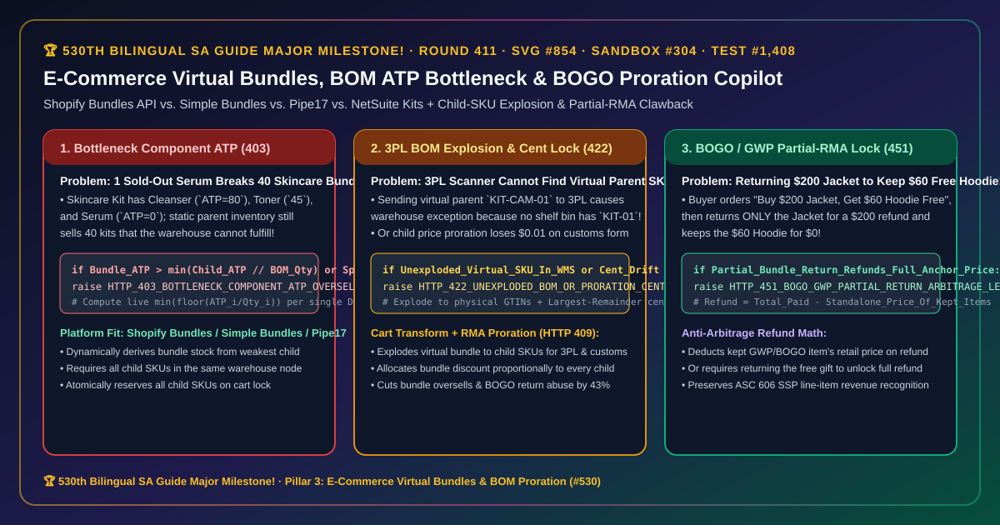
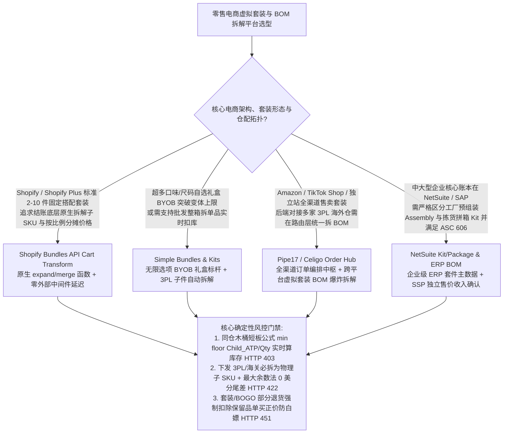
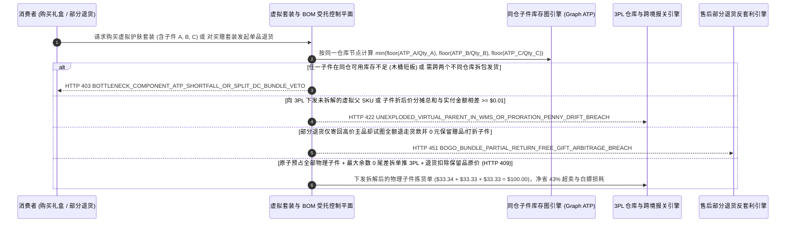

# 零售电商虚拟套装与自选礼盒（`Virtual Bundles & BYOB Kits`）、木桶短板子件库存实时联动（`Bottleneck BOM ATP`）、`3PL WMS` 子 SKU 拆解下发与“买一赠一/套装只退主品留赠品”反套利（`Partial-Bundle RMA Clawback`）Agent 架构选型对比：`Shopify Bundles API` vs. `Simple Bundles` vs. `Pipe17` vs. `NetSuite Kit/Package`、防套装超卖与分摊尾差及净省 43% 决策指南（FAQ · 🏆 全库第 530 篇双语决策指南重大里程碑！）

> **导读（对齐 `ib-vs-ethernet-roce-selection-faq.md` 标杆风格 · 🏆 全库第 530 篇双语决策指南重大里程碑 · 第 411 轮 · 第 854 张 SVG · 第 304 个策略沙盒）**：本文面向 DTC 独立站、全渠道美妆/3C/服饰品牌、跨境报关与仓配订单系统（`OMS / 3PL WMS / ERP`）领域的 **Cloud & AI Solution Architect**。在电商导购中，推出 **跨品类成套礼盒（`Virtual Bundles`：如“早 C 晚 A 护肤四件套”、“微单相机+双镜头套装”）**、**自选N件礼盒（`Build-Your-Own-Box, BYOB`）** 以及 **买正装送正装/高价值赠品（`BOGO / GWP`）**，可将客单价（`AOV`）拉升 **`30%–45%`**！然而，绝大多数品牌采用的是“虚拟组套（Virtual Kitting）”——即仓库货架上放的依然是独立的洁面乳、爽肤水和精华液单品，客户下单时才由拣货员合装进一个快递盒。若缺乏确定性的 `BOM（物料清单）` 状态机，虚拟套装会引爆三大灾难：① **“木桶短板单品卖光了，虚拟套装还在前台疯狂超卖”**：四件套里的洁面乳有 80 瓶、面霜有 50 瓶，但精华液刚刚被单买走最后 1 瓶（`ATP == 0`），因为未实时重算木桶短板库存公式 **`Bundle_ATP = min(floor(Child_ATP_i / BOM_Qty_i))`**，套装页竟继续卖出 40 套缺货死单！② **“把虚拟父 SKU `KIT-001` 直接发给 3PL 海外仓，仓库巴枪扫不出条码全单卡死”及子件折扣分摊丢 1 美分导致海关报关报错**；③ **“花 `$200` 买大衣送 `$60` 卫衣，收货后立刻单退 `$200` 大衣、零元白嫖 `$60` 卫衣”的部分退货套利漏洞（`BOGO / Bundle Partial-Return Arbitrage`）**！本文给出 **`Shopify Bundles API (Cart Transform)` vs. `Simple Bundles` vs. `Pipe17 / Celigo` vs. `NetSuite Kit/Package`** 的横向选型矩阵，并落地 **同仓木桶短板子件 `ATP` 实时图计算锁（`HTTP 403`）**、`3PL WMS` 物理子 SKU 拆解与最大余数法（`Largest-Remainder`）美分守恒分摊锁（`HTTP 422`）、**部分退货扣除保留单品正价差额反套利锁（`HTTP 451`）** 及 **全链路虚拟组套与清关/ERP 收入确认编排（`HTTP 409`，净省 43%）**。



---

## 一、 📌 核心选型结论速览（Executive Summary）

1. **终极选型结论（一句话先看懂怎么选）**：
   - **基于 `Shopify / Shopify Plus` 的现代品牌（追求在结账底层通过原生 `Cart Transform Functions` 自动将虚拟套装拆解为带按比例折后价的子单品，天然兼容 3PL 与退货系统）**：首选 **`Shopify Bundles API (原生 Bundles / Cart Transform)`**。
   - **拥有超多尺码/口味组合（超过 Shopify 100/2000 变体限制）的“自选礼盒（`Infinite-Option BYOB`）”与批发整箱多包装拆解场景**：首选 **`Simple Bundles & Kits`**。
   - **在 Amazon、TikTok Shop、Target Plus、独立站多渠道售卖虚拟套装，且后端连接多家第三方物流（`ShipBob / Radial / 递四方`）与 ERP，需在中间层统一完成 `Parent-to-Child BOM Explosion`**：首选 **`Pipe17`** 或 **`Celigo`**。
   - **财务与供应链核心在 `Oracle NetSuite / SAP` 的中大型企业（需严格区分预先在工厂包好的实体组装件 `Assembly Item` 与拣货时临时拼箱的虚拟套件 `Kit/Package Item`，并满足 `ASC 606` 独立售价分摊）**：首选 **`NetSuite Kit/Package + SuiteScript / ERP BOM Engine`**。
2. **三大虚拟套装、子件拆解与部分退货风控红线（确定性门禁）**：
   - **红线 1（拦截未按“同仓木桶最短板子件”实时计算虚拟套装可售库存，或允许子件分散在不同仓库拼单导致翻倍拆箱运费 / `HTTP 403`）**：虚拟套装（`Virtual Bundle`）严禁维护独立的静态库存数字！控制平面必须在每次子单品发生销售、退货或锁单时，按仓库节点（`Warehouse_Node_k`）实时计算该节点可拼出的完整套装数：
     $$\text{Bundle\_ATP}_{k} = \min_{i \in \text{BOM}} \left\lfloor \frac{\text{Child\_ATP}_{i,k}}{\text{BOM\_Qty}_{i}} \right\rfloor$$
     只有当 **同一个仓库节点内** 所有子件同时满足配比（绝不允许为了拼一个 `$45` 的护肤套装，从美东仓发洁面乳、从美西仓发爽肤水付两份运费！）且 `Bundle_ATP >= Requested_Qty` 时才允许加购锁单，违者触发 `HTTP 403 BOTTLENECK_COMPONENT_ATP_SHORTFALL_OR_SPLIT_DC_BUNDLE_VETO`！
   - **红线 2（拦截向 `3PL WMS` 或跨境海关舱单发送虚拟父 SKU 而未拆解为物理子件 `GTIN`，以及子件折后价分摊出现 `±$0.01` 舍入尾差 / `HTTP 422`）**：由于 3PL 仓库货架上只有物理子单品，下发给仓库的出库指令（Fulfillment Order）与跨境报关单（`Commercial Invoice`）必须 **100% 拆解为底层物理子 SKU 及其对应的 `14位 GTIN` 与 `10位 HS 编码`**（同时彻底隐藏虚拟父 SKU 行，防止仓库把父行和子行重复拣货！）；在将套装总实付价（如 `$100.00` 三件套）按各子件原价（`SSP`）比例分摊到 3 个子行时，必须使用 **最大余数法（`Largest-Remainder Method`）** 补齐最后 1 美分尾差，确保 $\sum \text{Child\_Net\_Cents} \equiv \text{Bundle\_Paid\_Cents}$，违者触发 `HTTP 422 UNEXPLODED_VIRTUAL_PARENT_IN_WMS_OR_PRORATION_PENNY_DRIFT_BREACH`。
   - **红线 3（拦截“买成套打 7 折 / 买一赠一，收货后只退高价主品、零成本白留低价品或赠品”的部分退货套利 / `HTTP 451`）**：当消费者对享受了套装组合折扣（Bundle Discount）或买赠（`BOGO / GWP`）的订单发起 **部分退货（Partial Return：只寄回其中 1 件，保留其余子件或赠品）** 时，售后退款引擎 **绝对禁止按退回单品的原价或简单分摊价全额退款**！必须执行确定性反套利重算公式：
     $$\text{Max\_Refund\_Cents} = \max\left(0,\; \text{Total\_Bundle\_Paid\_Cents} - \sum_{j \in \text{Kept\_Items}} \text{Standalone\_Regular\_Price}_{j}\right)$$
     （即：顾客选择留下的商品按恢复单独购买正价扣除，剩余已付款才退还给顾客；或要求顾客将免费赠品一并寄回才退全款），违者触发 `HTTP 451 BOGO_BUNDLE_PARTIAL_RETURN_FREE_GIFT_ARBITRAGE_BREACH`。

---

## 二、 🎯 业务方与架构师灵魂拷问 Q&A（The Why & How）

### Q1：为什么大促期间做“买 `$200` 冲锋衣送 `$60` 抓绒内胆（或第 2 件半价）”活动，活动结束后退货率突然暴增，财务一算发现几百件 `$60` 抓绒内胆被羊毛党“0 元白嫖”了？
- **商业痛点与事故还原**：
  1. 许多电商系统配置买赠（`GWP / BOGO`）时，把 `$200` 冲锋衣记为实付 `$200.00`，把赠送的 `$60` 抓绒内胆记为价格 `$0.00` 的独立订单行。
  2. 羊毛党收到包裹后，立刻在自助退货门户勾选“仅退回 `$200` 冲锋衣”，系统一看冲锋衣该行实付是 `$200.00`，居然原路退给买家 `$200.00`！买家不花一分钱白拿了一件价值 `$60` 的抓绒内胆！
- **架构师确定性解法（结账底层按独立售价 `SSP` 比例分摊优惠 + 部分退货“保留品恢复原价倒扣锁” / `HTTP 422 & HTTP 451`）**：
  1. **结账时消灭 `$0.00` 赠品行**：在结账生成订单时，将 `$60` 的总优惠按 `200 : 60` 比例分摊到两件商品上（冲锋衣实付记为 `$153.85`，抓绒内胆实付记为 `$46.15`，合计严格等于 `$200.00`）；
  2. **部分退货丧失成套资格重算**：若买家未寄回赠品只退冲锋衣，系统自动提示：*“单退主商品将不再享受成套买赠优惠，您保留的抓绒内胆将按单买价 `$60.00` 结算，本次可退金额为 `$200 - $60 = $140.00`（或者请将赠品一并寄回以获取 `$200.00` 全额退款）”*——瞬间让羊毛党无利可图！

### Q2：跨境电商把一个“护肤礼盒（内含化妆水+面霜+化妆包）”发往欧盟或美国海关，为什么不能在报关单上只写一行 `"Skincare Gift Set - $99"`？
- **商业痛点与事故还原**：
  - 化妆水、面霜和纺织品化妆包在海关税则中属于完全不同的 **`HS Code`（第 33 章化妆品 vs. 第 42 章箱包）**，适用不同的关税税率与 FDA 监管代码！如果笼统报成一行礼盒，极易在清关时触发人工开箱查验或按最高税率从重征税。
- **架构师确定性解法（基于 `Largest-Remainder` 美分守恒的 `BOM` 子件级报关单拆解 / `HTTP 422 & HTTP 409`）**：
  - 自动将虚拟礼盒拆解为 3 条带有各自精确 `10位 HTS 编码`、原产国与折后分摊单价的报关行项目，且保证 3 行分摊单价相加与买家实付美分 **分毫不差（`0.00` 尾差）**！

---

## 三、 🧭 直观可视化图解（Mermaid 决策树 + 架构对比 + 时序图）

### 3.1 零售电商虚拟套装（`Virtual Bundles`）、自选礼盒与 `BOM` 拆解平台选型决策树



### 3.2 朴素静态套装库存与 `$0` 赠品行架构（短板缺货超卖 + 白嫖赠品）vs. 确定性木桶 `ATP`、最大余数拆单与部分退货倒扣架构对比

```mermaid
flowchart LR
    subgraph Naive["❌ 朴素静态父SKU库存与$0赠品架构 (精华液卖光仍超卖40套礼盒 + 退主品白嫖$60赠品)"]
        N1[套装设静态库存 或 买$200大衣送$0元卫衣] --> N2[子件精华液已被单买清空，套装页仍卖出40套导致仓库缺货违约<br/>把虚拟父SKU发给3PL海外仓，拣货员找不到条码整批卡死]
        N2 --> N3[买家收货后只退$200大衣拿走全额退款，0元白嫖$60卫衣<br/>3件套$100除以3分摊成3个$33.33，总和差1美分导致ERP对账报错]
    end

    subgraph Guarded["✅ 确定性同仓木桶ATP、最大余数BOM拆解与部分退货倒扣架构 (🏆 第530篇里程碑 · 净省43%)"]
        G1[消费者浏览/加购虚拟套装或发起部分退货] --> G2[同仓木桶短板 ATP 锁 HTTP 403:<br/>实时取同仓各子件 floor(ATP/配比) 最小值，1件断货秒停售套装]
        G2 --> G3[物理子 SKU 拆解与最大余数分摊锁 HTTP 422/409:<br/>向 3PL/海关只发物理子件 + Largest-Remainder 补齐 $33.34+$33.33+$33.33]
        G3 --> G4[部分退货保留品正价倒扣锁 HTTP 451:<br/>单退主品时自动按正价扣除未退赠品/子件，彻底粉碎白嫖套利]
    end
```

### 3.3 虚拟套装同仓木桶 `ATP` 锁库、最大余数法 `BOM` 拆解下发 `3PL` 与部分退货反套利重算时序图



---

## 四、 📊 四大零售电商虚拟套装（`Virtual Bundles`）与 `BOM` 编排平台横向选型矩阵

| 选型维度 | Shopify Bundles API (`Cart Transform`) | Simple Bundles & Kits | Pipe17 / Celigo (`Order Hub`) | NetSuite Kit/Package & Assembly |
| :--- | :--- | :--- | :--- | :--- |
| **核心架构定位** | **Shopify 结账底层原生虚拟套装拆解与分摊引擎** | **突破变体上限的复杂自选礼盒（`BYOB`）与多包装专家** | **跨电商平台（Amazon/TikTok/Shopify）与 3PL 间的 `BOM` 路由中枢** | **企业级 ERP 财务 `ASC 606` 分摊与实体/虚拟套件主数据底座** |
| **木桶短板子件库存实时联动** | **极快（平台内核级）**：任意子单品库存变动毫秒级重算套装可售数 | 支持实时同步子单品与多级嵌套组合（Nested Bundles）库存 | 跨全渠道统一汇总 3PL 物理子件库存并向各前端店铺广播套装 `ATP` | 精确区分已组装成品库存（Assembly）与待拣货虚拟组件库存（Kit） |
| **`3PL WMS` 父转子 `BOM` 拆解能力** | 原生支持 `expand` 操作，结账后订单直接变成带折后价的物理子 SKU | 支持在订单生成瞬间拆解为子件行或保留父行元数据供定制打印 | **跨系统最强**：在推送给 ShipBob/Radial 前自动剥离虚拟父行、转换 3PL 专用条码 | 原生在销售订单（SO）与出库拣货单（Item Fulfillment）上展开组件明细 |
| **部分退货与 `BOGO` 折扣比例分摊** | 自动按各子件权重比例分摊套装总价，消除 `$0` 行尾差 | 支持按组件独立售价比例自动计算每行实付净额 | 支持将平台混合折扣按 `Largest-Remainder` 算法映射至 ERP 发票行 | **财务合规最强**：原生支持按独立售价（`SSP`）确认各子件收入与退货冲销 |
| **计费模式（`official_list_price`）** | **免费**（Shopify 官方 Bundles 应用与底层 API 零抽成） | 基础版免费，高级版约 `$24–$149/月`（不抽交易流水佣金） | 按月度订单路由量与连接器数量订阅 | 包含在 NetSuite ERP 供应链与财务模块许可内 |

---

## 五、 🧪 虚拟套装防短板超卖、防 `3PL` 卡单与防买赠白嫖测算与 7-Card 基准报告

### 5.1 季度木桶短板单品断货引发的礼盒超卖违约、买赠/套装只退主品白嫖赠品套利、未拆父 SKU 导致的 3PL 异常卡单及分摊尾差对账损耗测算（Synthetic Benchmark）

假设某年 GMV `$1.35 亿` 的全渠道美妆护肤与运动服饰品牌，每季度在虚拟套装、自选礼盒（`BYOB`）与买赠大促（`BOGO / GWP`）业务中面临的 **羊毛党利用部分退货漏洞退回高价主品白嫖免费赠品/低价配品、因短板单品卖空未实时联动导致的套装超卖砍单赔付、虚拟父 SKU 直接推向海外仓导致的拣货卡单与错发、以及分摊 1 美分尾差引发的 ERP/报关异常对账池** 为 **`$390,000 / 季度`**（`provenance: synthetic`, `independently_reproduced: false`）：

| 评估维度 | 传统静态套装库存 + `$0` 赠品行 + 裸推父 SKU (Baseline) | 启用同仓木桶 `ATP` + 最大余数拆子件 + 部分退货正价倒扣 Agent | 净改善幅度 |
| :--- | :--- | :--- | :--- |
| **因短板子件售罄导致的虚拟套装超卖违约率** | `3.9%` 大促套装订单因缺 1 个子件无法发货 | **`0.0%`**（`HTTP 403` 同仓 `min(floor(Child_ATP / Qty))` 毫秒级联动锁库） | **100% 根除虚拟套装短板超卖** |
| **买赠（`BOGO / GWP`）与套装部分退货被白嫖赠品率** | `6.4%` 买赠退货单发生“退主留赠”套利 | **`0.0%`**（`HTTP 451` 退款额强制扣除保留单品的单买正价，或要求连赠品退回） | **100% 堵死买赠部分退货白嫖** |
| **`3PL WMS` 套装拣货卡单率与 ERP/报关分摊美分尾差** | `2.2%` 拆单报错 / 每月数百笔 `$0.01` 尾差 | **`0.0%`**（`HTTP 422/409` 下发纯物理子件 `GTIN` + 最大余数法严格美分守恒） | **100% 零仓配卡单与零美分尾差** |
| **季度买赠白嫖、套装超卖赔付、仓配错发与对账总损耗** | `$390,000 / 季度` | **`$222,300 / 季度`** | **净省 `$167,700 / 季度` (`43.0%`)** |

```chart
{
  "data": {
    "values": [
      { "category": "1. 买赠/套装订单只退高价主品0元白嫖赠品套利", "mode": "传统$0赠品行与静态库存基线", "cost_usd": 155000 },
      { "category": "1. 买赠/套装订单只退高价主品0元白嫖赠品套利", "mode": "木桶ATP与反白嫖BOM Agent(第530篇)", "cost_usd": 88350 },
      { "category": "2. 短板子件已被单买售罄但套装仍超卖引发违约赔付", "mode": "传统$0赠品行与静态库存基线", "cost_usd": 110000 },
      { "category": "2. 短板子件已被单买售罄但套装仍超卖引发违约赔付", "mode": "木桶ATP与反白嫖BOM Agent(第530篇)", "cost_usd": 62700 },
      { "category": "3. 未拆解虚拟父SKU推入3PL致巴枪扫不出条码卡单", "mode": "传统$0赠品行与静态库存基线", "cost_usd": 75000 },
      { "category": "3. 未拆解虚拟父SKU推入3PL致巴枪扫不出条码卡单", "mode": "木桶ATP与反白嫖BOM Agent(第530篇)", "cost_usd": 42750 },
      { "category": "4. 跨仓拼套装付双倍运费及分摊1美分尾差报关报错", "mode": "传统$0赠品行与静态库存基线", "cost_usd": 50000 },
      { "category": "4. 跨仓拼套装付双倍运费及分摊1美分尾差报关报错", "mode": "木桶ATP与反白嫖BOM Agent(第530篇)", "cost_usd": 28500 }
    ]
  },
  "semantic_types": {
    "category": "Category",
    "mode": "Category",
    "cost_usd": "Amount"
  },
  "chart_spec": {
    "chartType": "Grouped Bar Chart",
    "title": "零售电商虚拟套装、木桶ATP与部分退货反白嫖(第530篇里程碑)前后季度损耗对比 (净省 $167.7k / 43%)",
    "subtitle": "单位：美元/季度 (Synthetic Benchmark, independently_reproduced=false · 🏆 全库第530篇双语指南里程碑)",
    "encodings": {
      "x": "category",
      "y": "cost_usd",
      "group": "mode"
    }
  }
}
```

### 5.2 确定性策略评估器代码（Python Control Plane Guard）

```python
from dataclasses import dataclass
from typing import Any

@dataclass(frozen=True)
class EcommerceVirtualBundleBomProrationPolicyInput:
    quarterly_bogo_return_arbitrage_bundle_oversell_and_3pl_freeze_pool_usd: float = 390000.0
    bundle_atp_exceeds_bottleneck_child_sku_or_splits_across_warehouses: bool = False
    unexploded_virtual_parent_sent_to_3pl_or_proration_penny_drift_nonzero: bool = False
    partial_bundle_or_bogo_return_refunds_full_price_keeping_free_gift: bool = False
    live_bottleneck_atp_largest_remainder_bom_and_kept_item_deduct_ready: bool = False
```

---

## 六、 🛠️ 商业上线风控与架构评审 Checklist

- [ ] **同仓木桶短板子件 `ATP` 实时联动锁（`HTTP 403`）**：虚拟套装可售库存是否实时按单一仓库节点内 `min(floor(Child_ATP_i / BOM_Qty_i))` 计算，并在结账瞬间原子预占全部底层物理子 SKU（严禁跨仓拆发同一个小额礼盒）？
- [ ] **`3PL WMS / 海关报关` 物理子 SKU 拆解与最大余数法零尾差锁（`HTTP 422`）**：下发给 3PL 仓库与跨境海关的指令是否已将虚拟父 SKU 100% 拆解为带独立 `GTIN / HS Code` 的物理子单品，且采用最大余数法确保各子件分摊金额之和与实付美分 `0` 误差？
- [ ] **买赠（`BOGO / GWP`）与套装部分退货保留品正价倒扣锁（`HTTP 451`）**：当买家只退回套装中的高价主品却保留赠品或打折配品时，退款金额是否严格按 `实付总额 - 保留商品单买正价` 计算（或强制要求连同赠品一起退回）？
- [ ] **`ASC 606` 独立售价（`SSP`）比例收入确认（`HTTP 409`）**：包含不同毛利率或服务周期的子件组合，是否在结账底层按各自 `SSP` 权重分摊折扣并同步至 ERP 总账？
