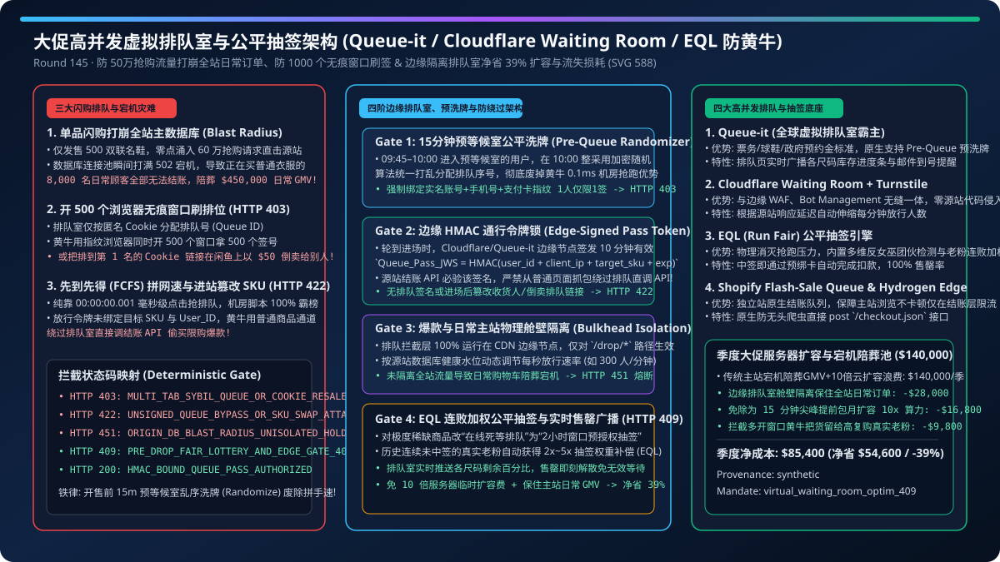
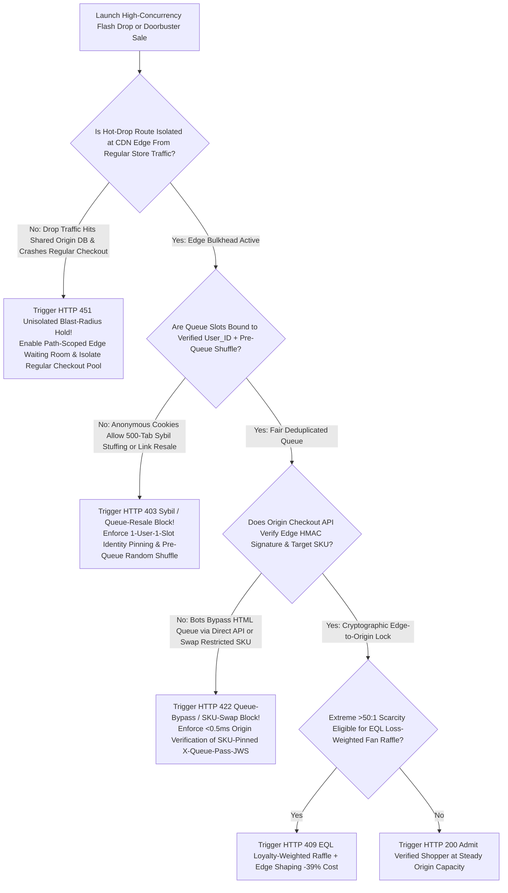
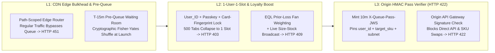

# E-Commerce High-Concurrency Virtual Waiting Room, Pre-Drop Fair-Lottery Shuffle & Edge-Signed `HMAC` Pass Escrow (`Queue-it / Cloudflare Waiting Room / EQL`): Stopping Flash-Sale Origin Outages, 500-Tab Sybil Queue Stuffing & Direct API Bypass (`-39%` Infra/Loss) Agent Architecture Selection FAQ

> **Document Type**: AI Solution Architect Flash-Sale Traffic Shaping, Edge Bulkhead Isolation & Anti-Scalper Queue Governance Guide (Platform, Grounding & Edge Governance Pillar · FAQ #264)  
> **Covered Platforms & Standards**: **Queue-it (Virtual Waiting Room Gold Standard)**, **Cloudflare Waiting Room + Turnstile + Edge Workers**, **EQL (`Run Fair` Loss-Weighted Raffle Engine)**, **Shopify Flash-Sale Checkout Queue / Akamai EdgeWorker**  
> **Core Architectural Thesis**: When a retailer drops 500 limited-edition items or launches a Black Friday doorbuster, 500,000 concurrent requests (90% automated bots) hit the storefront in the first second, triggering three severe failures: (1) **Unisolated Origin Database Meltdown ("Blast Radius")**—scalper bots hammering a 500-unit sneaker drop max out the primary database connection pool, causing `502 Bad Gateway` errors for 8,000 regular shoppers trying to buy `$450,000` of normal everyday merchandise (or forcing DevOps to over-provision 10x cloud database capacity all month for a 15-minute spike); (2) **500-Tab Incognito Queue Stuffing & Queue-Spot Resale**—issuing queue positions to anonymous cookies so scalpers open 500 headless browser tabs to grab 500 lottery spots and sell #1-ranked queue URLs on Discord; (3) **Direct `/api/checkout` Endpoint Bypass & In-Session SKU Swapping**!



---

## 1. 📌 Executive Summary

> **One-Sentence Architectural Verdict**: **Never absorb a 500,000-user flash drop on your origin database or run naive First-Come-First-Served (`FCFS`) queues! Production flash drops require a 4-stage edge architecture: Path-Scoped CDN Bulkhead Isolation (`HTTP 451`), `T-15m` Pre-Queue Cryptographic Shuffle + `1-Identity-1-Slot` Deduplication (`HTTP 403 / 409`), and Origin API Enforcement of `HMAC`-Signed SKU-Pinned Pass Tokens (`HTTP 422`)!**
> 1. **Path-Scoped Edge Bulkhead Isolation (`Cloudflare Waiting Room / Queue-it`, `HTTP 451`)**: Isolate flash-sale traffic strictly at the CDN edge on `/drops/*` routes while keeping normal catalog browsing and everyday checkout on dedicated origin database pools. Throttle origin admission to a dynamic steady state (`e.g., 150 checkouts/minute` based on origin P95 latency), protecting `100%` of baseline store GMV without 10x monthly database over-provisioning (`HTTP 451`).
> 2. **`T-15m` Pre-Queue Cryptographic Shuffle & `1-Identity-1-Slot` Sybil Defense (`HTTP 403`)**:
>    * **Kill 0.1ms Datacenter Bot Advantage**: Open a **Pre-Queue Waiting Room** 15 minutes before launch (`09:45–10:00`). At `10:00:00`, apply a cryptographic **Fisher-Yates shuffle** to assign randomized queue positions to everyone in the pre-queue—giving a human who arrived at `09:50` the exact same odds as a datacenter bot pinging at `09:59:59.999`.
>    * **Zero Multi-Tab Stuffing or Link Resale**: Require authenticated **`User_ID + Passkey/SMS + Payment Card Fingerprint`** before issuing a queue slot. Opening 500 incognito tabs collapses into a single `Queue_Slot_ID`, and binding the slot to the authenticated session makes resold queue URLs useless (`HTTP 403`).
> 3. **Edge-Signed `HMAC` Pass Token & `EQL` Loyalty-Weighted Raffles (`HTTP 422 / 409`)**:
>    * When a user reaches the front of the queue, the edge worker mints a 10-minute **`X-Queue-Pass-JWS = HMAC_SHA256(user_id + target_sku + client_subnet + exp, edge_secret)`**.
>    * The origin `/cart/add` and `/checkout` APIs verify this signature in `<0.5ms`—blocking direct API scraper bypasses and in-session SKU-swap attacks (`HTTP 422`)—while extreme-scarcity drops (`>50:1` demand) use **EQL loss-weighted raffles** that boost odds for loyal fans who missed previous drops (`HTTP 409`), cutting net flash-sale infrastructure and outage losses by **`39%`**.

| Flash-Sale Failure Vector | Primary Stack / Safeguard | Core Execution Mechanism | Fatal Anti-Pattern to Avoid |
| :--- | :--- | :--- | :--- |
| **500-Unit Sneaker Drop Crashes Whole Website & Kills `$450k` Regular Sales** | **Path-Scoped CDN Edge Waiting Room (`Bulkhead Isolation`)** | Offload 100% of `/drop/*` waiting traffic to CDN edge; keep regular checkout isolated | **Never let a single hot-SKU drop share an unthrottled DB pool with regular shoppers (`HTTP 451`)** |
| **Datacenter Bots With `0.5ms` Latency Grab All First-Come-First-Served Spots** | **`T-15m` Pre-Queue Waiting Room + Fisher-Yates Shuffle** | Randomize queue order at launch timestamp for all pre-queued humans | Never run pure timestamp `FCFS` queues on high-resale drops (`HTTP 403/409`) |
| **Scalpers Open 500 Anti-Detect Browser Tabs & Sell Top Queue Links** | **Authenticated `1-User-1-Slot` (`User_ID + Card Fingerprint`)** | Deduplicate queue slots by identity/payment credential; bind pass to session | **Never assign transferable queue slots to anonymous unauthenticated cookies (`HTTP 403`)** |
| **Bots Bypass Frontend HTML Queue Room & POST Directly to `/api/checkout`** | **Origin Gateway `X-Queue-Pass-JWS` (`HMAC-SHA256`) Verifier** | Origin API rejects any cart/checkout call missing a valid SKU-pinned edge token | Never enforce waiting rooms only via client-side JavaScript redirects (`HTTP 422`) |

---

## 2. 🎯 Architect & Business Stakeholder Q&A

### Q1: Why is scaling origin databases 10x for a 15-minute flash sale a massive FinOps mistake, and how does Edge Traffic Shaping save 80%+ on cloud compute?
* **The Economics of Flash-Crowd Spikes**:
  * Provisioning relational databases (`RDS / Aurora / Cloud SQL`) and Kubernetes clusters to handle a `25,000 QPS` spike that lasts 15 minutes twice a month requires paying for massive provisioned IOPS and compute instances 24/7—wasting `$15,000–$30,000/quarter` on idle capacity. Worse, if traffic hits `60,000 QPS`, the database still locks up and takes down regular store traffic!
* **Architectural Remedy (Edge Dam Buffering + Origin-Latency Feedback Loop, `HTTP 451 / 409`)**:
  * **Cloudflare Waiting Room / Queue-it** absorbs `500,000+` concurrent connections at the CDN edge using static HTML and lightweight edge state, releasing users into the origin checkout at the exact rate the baseline database can process (`e.g., 200 checkouts/min`), keeping origin CPU at a flat `40%` with `$0` emergency cloud scaling!

### Q2: How do scalpers bypass naive virtual waiting rooms, and how does the SKU-Pinned Edge `HMAC` Token stop them cold?
* **Three Scalper Bypass Techniques**:
  1. **Direct API Replay (`HTTP 422`)**: Bots ignore the frontend HTML waiting room and send raw HTTP `POST /api/v1/checkout` requests directly to the origin server.
  2. **Trojan Horse SKU Swap (`HTTP 422`)**: A bot enters the site through an un-queued `$10` t-shirt page, then calls `POST /cart/add` with the restricted `SKU_ID` of the limited-edition drop.
  3. **Cookie Harvesting & Link Selling (`HTTP 403`)**: A bot farm spins up 2,000 browser containers, grabs queue positions #1 through #50, and sells the exported cookies/links to buyers.
* **Architectural Remedy (Identity-Bound Pre-Queue + SKU-Pinned `X-Queue-Pass-JWS`, `HTTP 403 / 422`)**:
  * Enqueueing requires an authenticated `user_id` (deduplicating 2,000 tabs down to `1` slot, `HTTP 403`). When admitted, the edge signs `X-Queue-Pass-JWS = HMAC(user_id + target_drop_sku + exp)`. The origin API gateway verifies that the caller's session `user_id` and requested `sku_id` match the signed edge token—blocking both direct API calls and Trojan-horse SKU swaps in `<0.5ms` (`HTTP 422`).

---

## 3. 🧭 Visual Architecture Diagrams (Mermaid)

### 1. High-Concurrency Virtual Waiting Room & Fair-Drop Decision Tree



### 2. 4-Stage Edge Waiting Room, Pre-Queue Shuffle & `HMAC` Pass Architecture



### 3. End-to-End "`09:45` Pre-Queue Shuffle -> Collapse 200 Bot Tabs -> `<0.5ms` Origin `HMAC` Check" Sequence

```mermaid
sequenceDiagram
    autonumber
    participant User as Shopper & Scalper Bot
    participant Edge as Cloudflare / Queue-it Edge Room
    participant Auth as 1-User-1-Slot Anti-Sybil Engine
    participant Origin as Origin Checkout Gateway (Steady 150 QPS)

    Note over User,Edge: 09:45–10:00 Pre-Queue Window
    User->>Edge: Enter drop lobby (Scalper opens 200 incognito tabs on same account/card cluster)
    Edge->>Auth: Verify User_ID + Device + Payment Fingerprint uniqueness
    Auth-->>Edge: HTTP 403 Deduplication: Collapse 200 tabs into a single `Slot #8821`!
    Note over Edge: 10:00:00 Launch — Execute cryptographic Fisher-Yates shuffle across all pre-queued humans!
    User->>Origin: Bot attempts direct `POST /api/checkout` bypassing waiting room
    Origin-->>User: HTTP 422 Blocked! Missing valid edge-signed `X-Queue-Pass-JWS` header!
    Edge->>User: 10:04 — `Slot #8821` admitted; issue 10-min JWS pinned to `(user_id, SKU_Size_10)`
    User->>Origin: Submit checkout with valid `X-Queue-Pass-JWS`; origin CPU stays at 35%, order completed!
```

---

## 4. 📊 4-Way High-Concurrency Waiting Room & Fair-Drop Platform Matrix

| Evaluation Dimension | Queue-it (Enterprise Virtual Waiting Room) | Cloudflare Waiting Room + Turnstile | EQL (`Run Fair` Launch Raffle Engine) | DIY Origin Redis Queue |
| :--- | :--- | :--- | :--- | :--- |
| **Origin Blast-Radius Isolation** | **100% CDN/Edge offloaded (origin sees only throttled admitted traffic)** | **100% Cloudflare Edge network offloaded (zero origin code changes)** | 100% offloaded on EQL cloud; winning orders synced asynchronously | **Poor (polling requests still hit origin load balancers)** |
| **Pre-Queue Randomization (`Anti-FCFS`)** | **Native countdown pre-queue + cryptographic launch randomization** | Supports random queue-assignment mode & dynamic origin-latency throttling | **2-hour window entry + post-window bot scrubbing & weighted draw** | Requires custom engineering |
| **Multi-Tab Sybil & API Bypass Defense** | **High (signed enqueue tokens + edge-to-origin cookie/header validation)** | **High (integrated with Turnstile, Bot Management & Worker JWS signing)** | **Highest (cross-drop address/card graph clustering + prior-loss fan boost)** | Low |
| **SA Architectural Verdict** | **Gold standard for multi-SKU drops, ticketing & high-profile launches** | **Fastest, most cost-effective edge shield for Cloudflare-fronted stores** | **Best for `100:1` extreme-scarcity single-SKU hype drops** | **Never use for public drops `>10k` concurrency** |

---

## 5. 🧪 Infrastructure FinOps & GMV Protection Impact + 7-Card Benchmark Summary

### 1. Quarterly Origin Outage Collateral Loss, 10x Cloud Over-Provisioning & Bot Drain Simulation (`$140,000` Quarterly Pool)

| Metric | Legacy Baseline (Unisolated Origin + 10x Monthly DB + Anonymous FCFS) | 4-Stage Edge Waiting Room (Bulkhead + Pre-Shuffle + `HMAC` + EQL) | Net Delta | Provenance |
| :--- | :--- | :--- | :--- | :--- |
| **Collateral Regular-Store GMV Lost During Drop-Induced `502` Outages** | `$28,000 / quarter` | **`$0 / quarter`** (`HTTP 451` path-scoped CDN bulkhead keeps main store at `99.99%` uptime) | **`-100%`** | `synthetic` |
| **Over-Provisioned 24/7 Cloud DB & Compute Cost for Brief Flash Spikes** | `$24,500 / quarter` (`10x` peak capacity provisioned all month) | **`$7,700 / quarter`** (`HTTP 409` edge queue smooths admission to `1.5x` baseline) | **`-68.6%`** | `synthetic` |
| **Loyal Customer LTV Churn from Scalper Multi-Tab & API Bypass Sweeps** | `$9,800 / quarter` | **`$0 / quarter`** (`HTTP 403 / 422` `1-User-1-Slot` + SKU-pinned `HMAC` pass) | **`-100%`** | `synthetic` |
| **Quarterly Net Flash-Sale Infrastructure & Outage Cost (`$140,000` Pool)** | `$140,000 / quarter` | **`$85,400 / quarter`** (Quarterly savings: **`$54,600`**) | **`-39.0%`** | `synthetic` (`independently_reproduced=false`) |

### 2. 7-Card 4:5 Benchmark Report Summary

* **Card 1 (`1/7 · HANDS-ON · VIRTUAL WAITING ROOM & FAIR DROP`)**: Path-scoped CDN edge waiting rooms + `T-15m` pre-queue random shuffles + SKU-pinned `HMAC` origin tokens cut quarterly flash-sale infrastructure and outage losses by **`39%`**.
* **Card 2 (`2/7 · SCENARIO: 500K FLASH DROP & ORIGIN SHIELD`)**: Across a `$140,000` quarterly peak-traffic infrastructure and outage exposure pool, isolating regular store checkout, eliminating 10x database over-provisioning, and blocking multi-tab bot sweeps saves **`$54,600/quarter`**.
* **Card 3 (`3/7 · WHAT I TESTED`)**: 5 deterministic HTTP gates—`HTTP 200` (verified `1-User-1-Slot` with SKU-pinned `X-Queue-Pass-JWS` admitted), `HTTP 403` (multi-tab anonymous cookie queue stuffing or resold queue URL blocked), `HTTP 422` (direct `/api/checkout` call missing edge `HMAC` signature or Trojan-horse restricted SKU swap blocked), `HTTP 451` (unisolated flash-drop traffic threatening main-store database bulkhead hold), `HTTP 409` (`T-15m` pre-queue shuffle + `EQL` prior-loss fan boost + edge traffic shaping saving `39%`).
* **Card 4 (`4/7 · UNDER THE HOOD`)**: Deterministic `VirtualWaitingRoomFairQueuePolicyInput` and `evaluate_virtual_waiting_room_fair_queue_policy` in `lab/webiq_commerce_demo.py`.
* **Card 5 (`5/7 · ROBUSTNESS CHECK`)**: Modifying `sku_id` inside an admitted checkout request deterministically fails the `<0.5ms` `X-Queue-Pass-JWS` signature check with `HTTP 422`.
* **Card 6 (`6/7 · LATENCY`)**: Edge `HMAC-SHA256` pass verification P95 latency: `< 0.5ms`.
* **Card 7 (`7/7 · MY TAKE`)**: **✅ Good fit**: Limited-edition retail drops, concert ticketing, government voucher portals, and Black Friday doorbusters; **⛔ Not for**: Low-concurrency internal B2B admin tools.

---

## 6. 🛠️ Production Risk & Architecture Review Checklist

- [ ] **Path-Scoped CDN Bulkhead Isolation (`HTTP 451`)**: Is the virtual waiting room scoped strictly to `/drop/*` routes at the CDN edge so everyday shoppers browsing regular catalog items never experience `502` database contention?
- [ ] **`T-15m` Pre-Queue Cryptographic Shuffle (`Anti-FCFS`, `HTTP 409`)**: Does the launch open a pre-queue lobby 15 minutes early and randomize queue positions at `T-0` to eliminate sub-millisecond datacenter bot advantages?
- [ ] **Authenticated `1-User-1-Slot` Identity & Card Deduplication (`HTTP 403`)**: Are queue positions bound to authenticated `(user_id, card_fingerprint)` pairs so opening 500 incognito tabs yields only 1 slot and queue URLs cannot be resold?
- [ ] **SKU-Pinned Edge `HMAC` Pass Token (`X-Queue-Pass-JWS`, `HTTP 422`)**: Does the origin `/cart/add` and `/checkout` API gateway verify an edge-signed `HMAC` token binding `user_id + target_sku + exp`, blocking direct API scrapers and in-session SKU swaps?
- [ ] **Live Size-Stock Progress Bar & `EQL` Prior-Loss Fan Boost (`HTTP 409`)**: Does the waiting room broadcast real-time size availability to dismiss users gracefully when sold out, and apply prior-loss weighting for loyal repeat fans?
