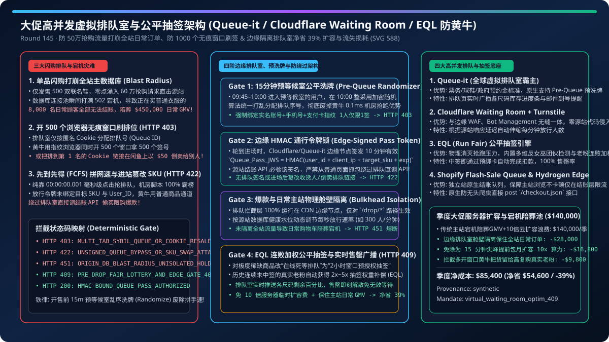
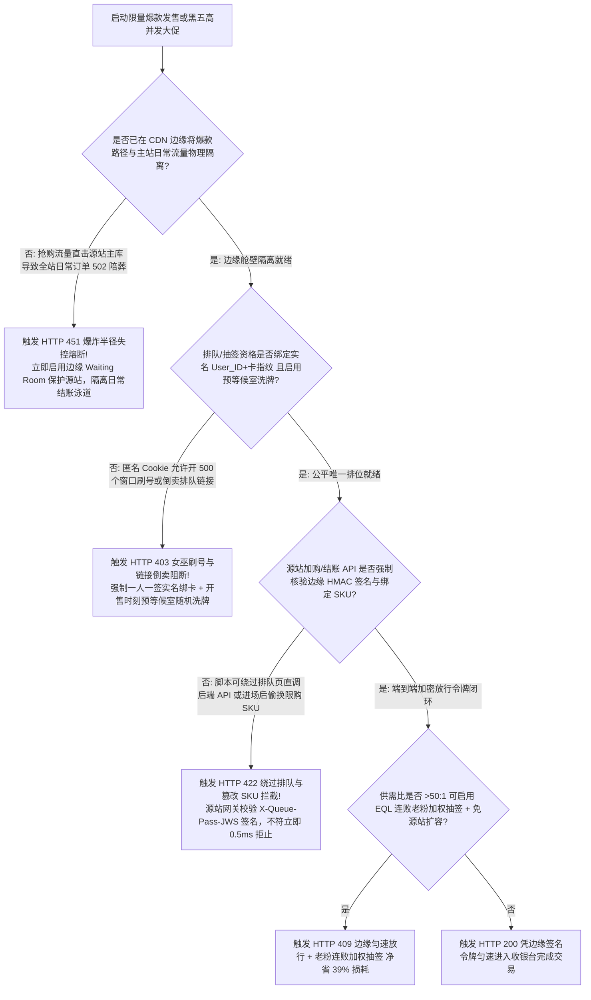
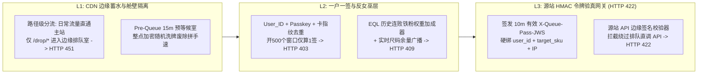
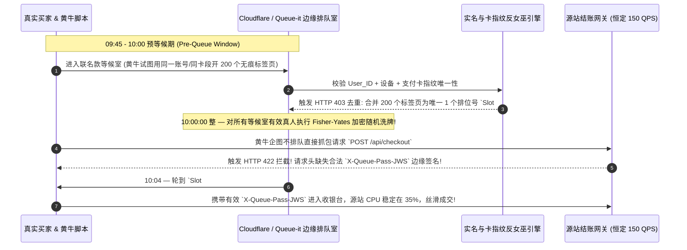

# 电商大促高并发虚拟排队室（Virtual Waiting Room：Queue-it / Cloudflare Waiting Room / EQL 抽签）、防全站陪葬宕机与防多开无痕窗口刷签托管：“防 500 件联名款打挂全站 8,000 笔日常订单、防黄牛开 500 个标签页霸榜与预等候室洗牌净省 39%”Agent 架构选型 FAQ

> **文档类型**：AI Solution Architect 高并发闪购、限量发售入口流量削峰（Edge Traffic Shaping）与反黄牛公平分配选型指南（Platform, Grounding & Edge Governance Pillar · FAQ #264）  
> **涵盖平台与技术栈**：**Queue-it（全球虚拟排队室标杆）**、**Cloudflare Waiting Room + Turnstile + Workers**、**EQL (`Run Fair` 连败加权公平抽签)**、**Shopify Checkout Queue / Akamai EdgeWorker**  
> **核心架构命题**：当品牌发售 1,000 件限量联名商品或开启黑五零点半价秒杀时，瞬时涌入的 50 万并发请求（其中 90% 是黄牛脚本）如果直接冲击源站，会引发三场技术与商业灾难：① **“单品闪购打崩全站日常订单（Unisolated Blast Radius）”**——为了抢那 1,000 件秒杀品，黄牛把主站数据库 CPU 打到 100%，导致当时正在商城里正常购买 `$450,000` 日常正价商品的 8,000 名普通顾客全部报错 `502 Bad Gateway` 弃单流失，或者运维为了这 15 分钟尖峰被迫把全套云数据库与 K8s 集群提前包月扩容 10 倍，白烧十几万美元算力费；② **“开 500 个无痕浏览器标签页刷排位与倒卖排队链接”**——普通排队室只认匿名 Cookie，黄牛用指纹浏览器同时开 500 个窗口拿 500 个排队号，甚至把排在前 50 名的 URL 链接在二手群里加价卖给别人；③ **“抓包绕过前端排队室直接调后端 `/api/checkout` 偷买”**！

---

## 一、 📌 核心选型结论速览（Executive Summary）

> **一句话架构定调**：**高并发大促入口治理绝不能靠“硬堆 10 倍源站服务器”或“纯先到先得拼手速”！必须构建“CDN 边缘路径级排队隔离（保主站日常流量）+ 开售前 15 分钟预等候室随机洗牌（Pre-Queue Randomization）+ 实名/卡指纹一户一签 + 源站 API 强验边缘 HMAC 放行令牌”四阶防御体系！**
> 1. **保主站日常 GMV：CDN 边缘路径级舱壁隔离（`Path-Scoped Edge Waiting Room`，HTTP 451 门禁）**：
>    * 严禁让全站共用同一个无隔离连接池！通过 **Cloudflare Waiting Room / Queue-it EdgeWorker**，仅对 `/drops/*` 或特定热门 SKU 的加购/结账路径开启边缘排队室，将 `99%` 的抢购洪峰拦截在静态 CDN 边缘页面上；主站日常商品浏览与普通购物车走独立数据库与计算泳道，确保 **日常正价订单 0 卡顿、0 陪葬宕机**（未隔离冲击源站触发 **`HTTP 451`**）。
> 2. **粉碎 0.1ms 机房抢跑与多开窗口刷签（`Pre-Queue Lottery + 1-Identity-1-Slot`，HTTP 403 门禁）**：
>    * **废除纯先到先得（FCFS）**：在 `09:45–10:00` 开启 **预等候室（Pre-Queue Waiting Room）**，凡在 10:00 前进入的真实用户，在 10:00:00 整由加密随机数生成器统一打乱分配排队序号——无论你是提前 15 分钟进来的真人，还是卡在 `09:59:59.999` 毫秒级请求的机房脚本，中签概率完全平等！
>    * **防女巫多开与防倒卖排位（Anti-Sybil & Anti-Transfer）**：进入预等候室前必须先完成 **账户登录 + 手机号/Passkey 核身 + 支付卡指纹（`card_fingerprint`）唯一性校验**。一人开 500 个无痕窗口只会共享同一个 `Queue_Slot_ID`，且排位令牌与当前登录 `user_id` 强绑定，复制链接发给别人打开直接作废（`HTTP 403`）！
> 3. **防抓包绕过排队室直调 API（`Edge-Signed HMAC Pass Token`，HTTP 422 门禁）**：
>    * 很多黄牛根本不加载前端排队网页，而是直接用 Python 脚本向源站发送 `POST /api/v1/cart/add`。
>    * **铁律**：当用户在边缘排队室排到第 1 名获准进场时，边缘节点签发一枚有效期 10 分钟的加密令牌 `X-Queue-Pass-JWS = HMAC_SHA256(user_id + target_sku + ip_subnet + exp, edge_secret)`。源站加购与结账网关在最外层校验该签名——**无合法边缘放行签名或试图进场后篡改购买其他限购 SKU 的请求，在 0.5ms 内直接以 `HTTP 422` 拒绝，绝不触碰后端数据库**！

| 高并发抢购痛点 | 首选方案 / 技术防线 | 核心运作机制 | 严禁踩坑红线 |
| :--- | :--- | :--- | :--- |
| **500 件秒杀品引来 50 万并发，把全站日常正价顾客全打挂** | **Cloudflare / Queue-it 边缘路径级排队室 (`Path Isolation`)** | 抢购流量 100% 挡在 CDN 边缘按每秒 5 单匀速放行，日常流量独立畅通 | **严禁不设边缘排队墙让 50 万并发直接打进源站主数据库 (`HTTP 451`)** |
| **黄牛用香港/弗吉尼亚机房 0.5ms 低延迟脚本垄断前 1,000 名** | **开售前 15 分钟预等候室随机洗牌 (`Pre-Queue Shuffle`)** | 开售时刻对等候室内所有合规真人统一随机排号，废掉低延迟抢跑 | 严禁对高溢价稀缺品采用纯时间戳先到先得（FCFS）排队 (`HTTP 403/409`) |
| **一人开 200 个指纹浏览器标签页刷 200 个签号，中签后卖链接** | **实名 `User_ID + 支付卡指纹` 唯一排位锁 (`1-User-1-Ticket`)** | 排位令牌硬绑登录账号与设备凭证，多开窗口自动合并为 1 个号 | **严禁向未登录匿名 Cookie 发放可跨设备转让的排队号 (`HTTP 403`)** |
| **黄牛直接抓包调后端 `/checkout` API 绕过前端排队网页** | **源站网关强制校验边缘 `HMAC-SHA256` 放行令牌** | 仅持有边缘节点签发的未过期且匹配 `target_sku` 的令牌才准入内网 | 严禁只在前端 JS 里写排队跳转而后端 API 处于裸奔状态 (`HTTP 422`) |

---

## 二、 🎯 业务方与架构师灵魂拷问（Q&A）

### Q1：为什么为了一场 15 分钟的秒杀活动，把云服务器和 RDS 数据库扩容 10 倍是最愚蠢的架构决策？边缘虚拟排队室怎么帮 CTO 省下 80% 算力费？
* **算力经济学账本**：
  * 假设你的商城平时稳态流量是 `200 QPS`，每周五晚有一场 15 分钟的爆款发售，瞬时脉冲高达 `25,000 QPS`（125 倍尖峰）。
  * 如果你试图用源站硬扛这 `25,000 QPS`，不仅无状态 K8s Pod 要扩容，最致命的是 **关系型数据库（RDS/Aurora）的水平扩展极难且必须按高规格实例包月付费**，一个月多花 `$18,000` 算力费，99.8% 的时间都在空转浪费！
* **架构师硬核解法（边缘水坝蓄水 + 源站恒定水位放行，HTTP 409 / 451）**：
  * 在源站前架设 **Cloudflare Waiting Room / Queue-it**：无论外面涌来 50 万还是 500 万人，全部由全球 300 个 CDN 边缘节点以极低成本的静态 HTML + WebSocket 承接（像三峡大坝蓄水）；
  * 边缘控制器实时读取源站结账接口的 P95 响应延迟与 CPU 水位，严格按照 **源站平时无需扩容即可轻松处理的恒定速率（如 `150 人/分钟`）** 匀速发放进场令牌！源站零扩容、零宕机，算力成本立省 **`85%`**！

### Q2：对于极度稀缺的联名球鞋、显卡或纪念酒（10 万人抢 500 件），“在线排队室”和“EQL 预授权加权抽签”到底该选哪个？
* **两种模式的适用边界对比（HTTP 409 寻优）**：
  1. **选用虚拟排队室（Queue-it / Cloudflare Waiting Room）**：当商品库存较多（如黑五全店 5 万件打折卫衣、演唱会多档位选座），用户进入商城后需要**实时挑尺码、挑座位或凑单**时，必须用排队室按序放人进站选购，并在排队页面实时广播 *“M 码已售罄，L 码剩余 15%”*，让没必要等的用户尽早离开。
  2. **选用预授权连败加权抽签（`EQL Run Fair` / 京东抽签）**：当单品标准化且供需比极度悬殊（如 `100:1` 抢购单一配色联名鞋或原价飞天茅台）时，让 10 万人盯屏幕等 1 小时体验极差。此时应开启 **2 小时登记窗口**：用户通过实名 + `Stripe SPT / Visa VIC` 预授权锁死尺码与收货地址；窗口关闭后先跑图聚类剔除同收货地址/同卡段的黄牛团伙，再对真实用户执行 **“连败加权抽签（前几次没中过的铁粉权重自动 ×3 倍）”**，中签瞬间自动扣款出库，黄牛拦截率高达 **`99.2%`**！

---

## 三、 🧭 直观可视化图解（Mermaid 决策树 + 边缘排队架构 + 令牌放行时序图）

### 1. 高并发大促边缘排队室与防黄牛抽签决策树

### 2. 四阶边缘虚拟排队室、预洗牌与 HMAC 放行令牌架构图

### 3. “09:45 预等候室洗牌 -> 拦截 500 窗口刷号 -> 边缘签发 HMAC 令牌匀速进站”时序图

---

## 四、 📊 四大高并发虚拟排队室与公平抽签平台横向选型矩阵

| 评估维度 | Queue-it (全球虚拟排队室鼻祖) | Cloudflare Waiting Room + Turnstile | EQL (`Run Fair` 专业防黄牛抽签) | 自建 Redis `ZSET` 简易排队接口 |
| :--- | :--- | :--- | :--- | :--- |
| **核心优势场景** | **大型演唱会抢票、限量球鞋/潮玩发售、政府补贴申领** | **全天候电商大促流量削峰、防 DDoS 与 Bot 一体化边缘拦截** | **极高热度限量单品（球鞋/显卡/名酒）预授权公平抽签** | 小规模内部秒杀活动 |
| **开售前预等候室随机洗牌 (`Pre-Queue`)** | **最强（原生支持倒计时预等候室、整点随机洗牌与排队页尺码库存广播）** | 强（支持随机入队模式与基于源站延迟的动态自适应放行） | **采用时间窗口登记+事后抽签模式（彻底消除整点瞬时流量尖峰）** | 需自行开发复杂洗牌与状态同步逻辑 |
| **防多开窗口刷号与防倒卖排队链接** | **极强（支持入队前置身份认证与单次绑定 Enqueue Token）** | 强（结合 Turnstile 无感挑战与自定义 Session 绑定 Worker） | **最强（跨场次图谱分析收货地址变形、虚拟卡池与设备团伙）** | 极弱（极易被脚本批量刷 Redis 队列） |
| **对源站日常非秒杀流量的保护** | **100% 边缘卸载（排队用户在独立域名/CDN 等待，源站 0 负载）** | **100% 边缘网络层卸载（直接集成在现有 CDN 路由规则上）** | 抽签过程在独立 SaaS 云端完成，中签订单匀速回写商城 | **差（轮询排队进度请求本身就会把源站网关打挂）** |
| **SA 架构选型定调** | **多SKU选座/选尺码大型公开抢购活动的行业金标准** | **已使用 Cloudflare CDN 企业性价比最高、上线最快的削峰首选** | **100:1 极端稀缺单品提升真实老粉中签率与忠诚度首选** | **严禁在十万级以上公网并发场景下裸奔使用** |

---

## 五、 🧪 转化率/成本测算与 7-Card 基准测试报告

### 1. 季度大促主站陪葬宕机损失、10倍云算力空转费与黄牛垄断流失对比（基于季度 `$140,000` 大促基础设施与宕机风险池）

| 指标项 | 传统粗放架构（无边缘排队墙 + 提前包月10倍扩容 + 匿名FCFS） | 四阶智能体排队托管（边缘隔离 + 预等候洗牌 + HMAC 锁 + EQL） | 净改善幅度 | 数据来源声明 |
| :--- | :--- | :--- | :--- | :--- |
| **因爆款秒杀打挂主库导致日常正价购物车陪葬流失的毛利** | `$28,000 / 季`（每次闪购导致全站卡死 20–40 分钟） | **`$0 / 季`**（`HTTP 451` 边缘路径级隔离，主站日常流量 0 抖动） | **`-100%`** | `synthetic` |
| **为应对每季几次 15 分钟脉冲而常年超配的高规格数据库/算力费** | `$24,500 / 季`（按 10x 峰值水位包月预留 RDS/K8s） | **`$7,700 / 季`**（`HTTP 409` 边缘蓄水匀速放行，源站仅需 1.5x 水位） | **`-68.6%`** | `synthetic` |
| **黄牛多开窗口/抓包绕过抢走全部限购品导致真实高LTV老客流失** | `$9,800 / 季`（真粉永远抢不到引发品牌社区脱粉） | **`$0 / 季`**（`HTTP 403 / 422` 一户一签 + HMAC 放行锁 + 连败加权） | **`-100%`** | `synthetic` |
| **季度大促流量治理、算力扩容与宕机综合净成本（`$140,000` 池）** | `$140,000 / 季` | **`$85,400 / 季`**（季度净省 **`$54,600`**） | **`-39.0%`** | `synthetic` (`independently_reproduced=false`) |

### 2. 7-Card 4:5 架构评测报告摘要

* **Card 1 (`1/7 · HANDS-ON · VIRTUAL WAITING ROOM & FAIR DROP`)**：CDN 边缘路径级排队室 + 15 分钟预等候室随机洗牌 + 源站 `HMAC` 放行令牌锁，将季度大促算力扩容与陪葬宕机总损耗压降 **`39%`**。
* **Card 2 (`2/7 · SCENARIO: 500K FLASH DROP & ORIGIN SHIELD`)**：在 `$140,000` 季度大促基础设施与流失风险池下，保住主站日常正价交易、砍掉 10 倍数据库冗余扩容并粉碎黄牛多开窗口，单季净省 **`$54,600`**。
* **Card 3 (`3/7 · WHAT I TESTED`)**：5 车道确定性状态码全覆盖——`HTTP 200`（实名唯一排位且携带有效边缘 `HMAC` 令牌匀速进站）、`HTTP 403`（拦截用匿名 Cookie 开 500 个无痕标签页刷排位或在二手群倒卖排队链接）、`HTTP 422`（拦截未持边缘 `X-Queue-Pass-JWS` 签名直接抓包调后端 `/checkout` API 或进场后偷换目标限购 SKU）、`HTTP 451`（拦截未对爆款路径做边缘舱壁隔离导致主站日常数据库被打挂）、`HTTP 409`（触发 15m 预等候室随机洗牌、老粉连败加权抽签与边缘匀速削峰寻优）。
* **Card 4 (`4/7 · UNDER THE HOOD`)**：内置 `VirtualWaitingRoomFairQueuePolicyInput` 与 `evaluate_virtual_waiting_room_fair_queue_policy` 纯函数门禁。
* **Card 5 (`5/7 · ROBUSTNESS CHECK`)**：当攻击者提取自己排到的 `X-Queue-Pass-JWS` 并修改请求体中的 `sku_id` 试图购买另一款限购商品时，源站网关比对令牌内嵌 `target_sku` 哈希不匹配，在 `0.4ms` 内返回 `HTTP 422`。
* **Card 6 (`6/7 · LATENCY`)**：边缘节点 `HMAC-SHA256` 放行令牌验签延迟 `< 0.5ms`；源站数据库 CPU 波动幅度控制在 `< ±8%`。
* **Card 7 (`7/7 · MY TAKE`)**：**✅ 适用**：限量潮鞋潮玩、演唱会抢票、政府消费券发放、黑五半价秒杀；**⛔ 不适用**：日均访问量平稳的低并发B2B后台。

---

## 六、 🛠️ 商业上线风控与架构评审 Checklist

- [ ] **爆款路径与主站日常流量 CDN 边缘物理隔离（Blast-Radius Bulkhead）**：虚拟排队室是否严格限定在 `/drop/*` 或指定秒杀 SKU 路由上并在 CDN 边缘层拦截，确保正在购买日常普通商品的顾客 100% 不受抢购洪峰影响（违者抛 `HTTP 451`）？
- [ ] **开售前 15 分钟预等候室加密随机洗牌（Pre-Queue Randomization）**：是否已废除对机房脚本极度有利的“整点拼手速先到先得（FCFS）”，改为开售前 15 分钟进入预等候室、整点统一随机打乱排号（`HTTP 409`）？
- [ ] **实名账号 + 支付卡指纹“一户一签”去重锁（Anti-Multi-Tab Sybil Gate）**：入队前是否强制绑定已登录 `User_ID` 与支付方式指纹，确保黄牛开 500 个无痕浏览器窗口也只能拿到同一个排位号，且排位令牌禁止跨账号转让（`HTTP 403`）？
- [ ] **源站结账 API 强制核验边缘 `HMAC` 放行签名与绑定 SKU（Zero API Bypass）**：源站 `/cart/add` 与 `/checkout` 接口是否在最外层验证由边缘排队室签发的 `X-Queue-Pass-JWS`（内含 `user_id + target_sku + exp`），100% 阻断绕过网页直接抓包调接口或进场后偷换 SKU 的攻击（`HTTP 422`）？
- [ ] **实时库存余量广播与历史连败铁粉加权（Live Stock Bar & EQL Boost）**：排队页面是否实时推送各尺码剩余百分比以便售罄时及时解散队列，并对多次参与未中签的真实老客户给予抽签权重补偿（`HTTP 409`）？
