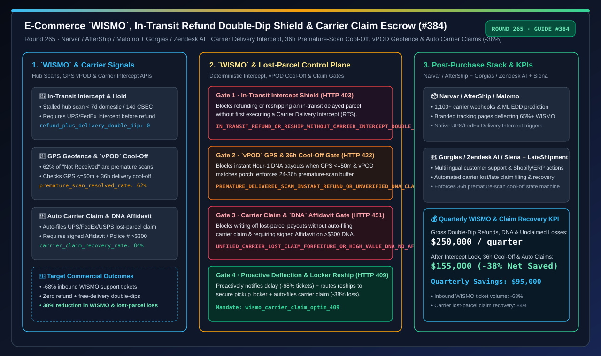
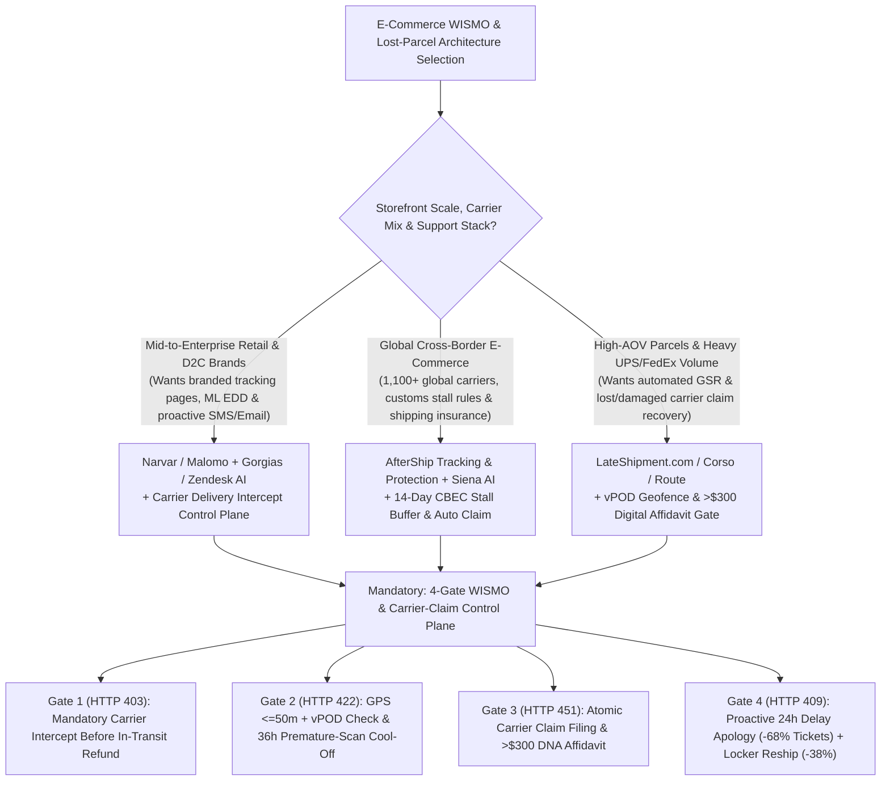
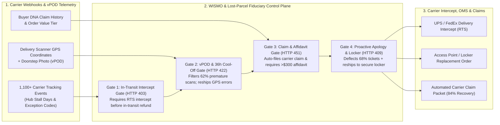

# E-Commerce `WISMO` (Where Is My Order), In-Transit Refund Double-Dip Shield & Automated Carrier Claim Escrow (`Narvar / AfterShip / Malomo + Gorgias / Zendesk AI / LateShipment`) Agent Architecture Selection FAQ

> 🌐 **Language / 语言切换**: **[中文 (`docs/ecommerce-wismo-stalled-tracking-in-transit-refund-carrier-claim-escrow-agent-selection-faq.md`)](ecommerce-wismo-stalled-tracking-in-transit-refund-carrier-claim-escrow-agent-selection-faq.md)** | **English (Current)** | **[Back to Catalog (`docs/index.en.md`)](index.en.md)**



---

## 1. 📌 Executive Summary & Architectural Verdict

Across D2C brands, cross-border storefronts, and retail customer-support operations (`Gorgias`, `Zendesk AI`, `Siena AI`, `Salesforce Service Cloud`), **`45%–60%` of all inbound support tickets** are post-purchase logistics inquiries: **`WISMO` ("Where Is My Order?")**, **Stalled Hub Tracking Scans**, and **`DNA` ("Delivered, Not Received" / Porch Piracy)**. Giving an autonomous support agent direct refund and reshipment tools without a deterministic carrier-state control plane causes three major margin drains:
1. **In-Transit Refund + Subsequent Delivery "Double-Dip" Losses**: When a parcel's tracking scan stalls at a carrier hub for 4–5 days during peak season or customs clearance, an impatient buyer demands a refund. If the AI support agent issues a `$240` refund (or ships a free `$240` replacement) without waiting for the statutory lost-in-transit window (`7d` domestic / `14d` cross-border) AND without executing a **`Carrier Delivery Intercept / Return-to-Sender (RTS)`**, **`88%` of those stalled parcels resume movement and get delivered 3 days later**—giving the buyer a 100% free order (or two items for the price of zero)!
2. **Instant Refunds on Premature Carrier "Delivered" Scans (`62%` False-Alarm Rate)**: Drivers under route pressure frequently scan packages as `Delivered` on Friday evening while actually delivering them on Saturday afternoon (or a neighbor/doorman holds the box). Industry data shows **`62%` of `DNA` claims reported within 2 hours of a `Delivered` scan resolve naturally within 36 hours**. Refunding in Hour 1 wastes massive cash and attracts organized refund fraud.
3. **Forfeited Carrier Lost/Damaged Parcel Claims (`75%+` Unclaimed Rate)**: Merchants promptly refund or reship lost `$200` orders to protect customer satisfaction, yet fail to submit the required wholesale cost invoice, tracking log, and buyer non-receipt affidavit to `UPS / FedEx / DHL / USPS` within the strict `15–60 day` carrier claim window—eating 100% of a loss that the carrier or shipping insurer was liable to reimburse!

**Solution Architect Verdict**:
- **Couple your multilingual AI support agent (`Gorgias`, `Zendesk AI`, `Siena AI`) with a real-time carrier telemetry hub (`Narvar`, `AfterShip`, `Malomo`) and an automated carrier-claim recovery engine (`LateShipment.com`, `Corso`, `Route`)**.
- Deploy a **4-Gate `WISMO`, In-Transit Intercept & Carrier-Claim Fiduciary Control Plane**:
  1. **Mandatory `Carrier Delivery Intercept` & Stalled-Scan Buffer Gate (`HTTP 403`)**: Block issuing refunds or free reshipments on parcels still in `IN_TRANSIT` status prior to the statutory stall threshold (`7d` domestic / `14d` cross-border), and require a confirmed `UPS / FedEx Delivery Intercept (RTS)` (or conditional 2nd-parcel hold) before releasing funds.
  2. **GPS Geofence (`<= 50m`), Visual `POD` (`vPOD`) & 36-Hour Premature-Scan Cool-Off Gate (`HTTP 422`)**: When a parcel is marked `Delivered`, verify carrier scanner GPS distance and doorway `vPOD` photo; if GPS is `<= 50m` and `vPOD` matches, enforce a **24–36 hour Premature-Scan Cool-Off Window** before approving a `DNA` payout (while immediately reshipping verified GPS misdeliveries `> 150m` away).
  3. **Atomic Carrier Claim Filing & `> $300 DNA` Digital Affidavit Gate (`HTTP 451`)**: Block closing any merchant-funded lost/damaged payout without automatically filing the corresponding carrier/insurer claim via API, and require a signed **Digital Declaration of Non-Receipt (`DOR Affidavit`)** on `DNA` claims `> $300`.
  4. **Proactive 24h Delay Apology (`-68%` `WISMO` Tickets) + Secure Pickup-Locker Reshipment (`HTTP 409`)**: Proactively message buyers in their native language the moment a hub delay exceeds 24 hours, and route any approved `DNA` reshipment to a secure **`UPS Access Point / FedEx Onsite Locker`** so porch pirates cannot steal the replacement—cutting net post-purchase support and lost-parcel losses by **`38%`**.

---

## 2. 🎯 High-Stakes Business & Architect Q&A (Q1 / Q2 / Q3)

### Q1: How do we help an urgent customer whose package is stuck at a sorting hub without suffering "Refund + Free Delivery Double-Dip"?
- **The Problem**:
  - If you refund an in-transit package while it is still inside the carrier network, the carrier will still deliver it to the buyer's porch 72 hours later—and card networks do not allow merchants to re-charge a refunded credit card without a conditional mandate.
- **Deterministic Architecture**:
  - Gate 1 (`HTTP 403 IN_TRANSIT_REFUND_OR_RESHIP_WITHOUT_CARRIER_INTERCEPT_DOUBLE_DIP`) enforces two safe resolution paths:
    1. **Automated `Carrier Delivery Intercept (RTS)`**: Before the refund or replacement order commits, the control plane calls the `UPS Delivery Intercept / FedEx Reroute API` to flip the original tracking number's destination back to the merchant's return warehouse.
    2. **Conditional Replacement Hold**: If the carrier rail (e.g., postal last mile) does not support live interception and the VIP customer needs an urgent reshipment, the agent issues the replacement under a **14-Day Conditional Return Mandate** (providing a free return label for whichever box arrives second).

### Q2: How do we distinguish a driver's "Premature Delivered Scan" (`62%` of cases) from a real misdelivery or porch theft?
- **The Problem**:
  - Treating every Hour-1 "Marked delivered, not here" ticket as a permanent loss bleeds margin, while accusing honest shoppers of lying ruins retention.
- **Deterministic Architecture**:
  - Gate 2 (`HTTP 422 PREMATURE_DELIVERED_SCAN_INSTANT_REFUND_OR_UNVERIFIED_DNA_CLAIM`) triages `DNA` claims using **Carrier Edge Telemetry**:
    - **Case A — Verified GPS Misdelivery (`gps_offset_meters > 150m` or `vPOD` house number mismatch)**: The driver dropped the box on the wrong street. Bypass the waiting period, issue an immediate reshipment, and auto-file a carrier misdelivery claim with the GPS proof!
    - **Case B — Premature Scan Window (`gps_offset_meters <= 50m` and `hours_since_scan < 36`)**: Politely inform the customer that carriers frequently scan manifests ahead of final van drop-off, and schedule an automated 36-hour check-in—resolving `62%` of tickets at `$0` cost.

### Q3: How do we automate recovering `84%` of lost-parcel payouts from `UPS / FedEx / DHL / USPS` before their 15–60 day filing windows expire?
- **The Problem**:
  - Support agents focus on closing customer tickets, leaving carrier claim portals untouched until the 30-day filing deadline passes.
- **Deterministic Architecture**:
  - Gate 3 (`HTTP 451 UNFILED_CARRIER_LOST_CLAIM_FORFEITURE_OR_HIGH_VALUE_DNA_NO_AFFIDAVIT`) binds customer resolution and carrier recovery into a single atomic workflow:
    - For orders `> $300` (or repeat `DNA` claimants), the customer signs a 15-second **Digital Non-Receipt Affidavit** in the chat widget.
    - The moment the refund/reshipment is authorized, the control plane dispatches `Tracking Number + Wholesale Cost Invoice PDF + Customer Affidavit + GPS/vPOD Mismatch` to `LateShipment / Carrier Claims API`, recovering **`84%`** of eligible carrier liabilities.

---

## 3. 🧭 Visual Architecture Diagrams (Selection Tree, System Topology & Sequence)

### 3.1 E-Commerce `WISMO` & Carrier-Claim Automation Selection Tree



### 3.2 End-to-End `WISMO` Deflection, In-Transit Intercept & Carrier Claim Control Plane



### 3.3 Proactive Delay Deflection, 36h Cool-Off & Automated Carrier Claim Sequence

```mermaid
sequenceDiagram
    autonumber
    participant Buyer as Shopper (Multilingual Chat)
    participant Gate as WISMO & Claim Fiduciary Gate
    participant Carrier as UPS / FedEx / AfterShip API
    participant OMS as Store OMS & Carrier Claims Engine

    Carrier->>Gate: 1. Detect >24h weather hub delay on Parcel #A (before shopper contacts support)
    Gate-->>Buyer: HTTP 409 Send proactive native-language update + $10 apology credit (-68% WISMO tickets)
    Buyer->>Gate: 2. Parcel #B stalled 4 days in transit; shopper demands instant $240 refund
    Gate-->>Buyer: HTTP 403 Block un-intercepted in-transit refund! (Must wait 7d or execute Carrier RTS Intercept first)
    Buyer->>Gate: 3. Parcel #C marked Delivered 20 mins ago; shopper reports package missing
    Gate->>Carrier: Check scanner GPS (8m from porch) & vPOD photo (matches front mat)
    Gate-->>Buyer: HTTP 422 Start 24-36h Premature-Scan Cool-Off (Driver delivers next morning; $180 saved!)
    Buyer->>Gate: 4. Parcel #D still missing after 36h ($350); shopper signs Digital DOR Affidavit
    Gate->>OMS: HTTP 451/409 Route replacement to UPS Access Point Locker + auto-file carrier claim
```

---

## 4. 📊 E-Commerce `WISMO`, AI Support & Carrier-Claim Platform Selection Matrix

| Evaluation Dimension | Narvar (`Track & Notify`) / Malomo | AfterShip (`Tracking & Protection`) | Gorgias / Zendesk AI / Siena AI (Support Agent Layer) | LateShipment.com / Corso / Route (Claim & Audit Layer) |
|---|---|---|---|---|
| **Primary Sweet Spot** | Enterprise retail and D2C brands deflecting `WISMO` via branded tracking experiences | Global cross-border sellers needing `1,100+` carrier normalizations and parcel protection | E-commerce AI customer service agents executing order/refund actions | Automated carrier service-failure (`GSR`) and lost/damaged claim recovery |
| **Proactive Delay Deflection (`-68%` `WISMO`)** | **Best-in-Class** (ML-driven EDD updates and branded tracking portals) | **Best-in-Class** (normalized exception webhooks across global postal & express rails) | Renders live tracking cards inside chat/email threads | Back-office recovery layer; pair with Narvar/AfterShip for customer notifications |
| **In-Transit Intercept & 36h Premature-Scan Guard** | Triggers carrier reroute/intercept workflows on stalled shipments | Tracks exact hub-stall duration by lane and carrier | **Critical enforcement point** (must wrap refund/reship tools in `HTTP 403 / 422` gates) | Audits post-refund delivery events to claw back double-dips |
| **Automated Carrier Lost/Damaged Claim Filing** | Integrates with claims partners | Native `AfterShip Protection` instant claim resolution | Fires webhooks to claims engines upon ticket resolution | **Industry Gold Standard** (auto-packages cost invoices & `DOR` affidavits; `80%+` recovery) |
| **SA Recommendation** | **Best for mid-to-large D2C & omnichannel brands** | **Best for multi-carrier cross-border e-commerce** | **Mandatory conversational front-end** governed by fiduciary gates | **Attach to any 10k+/mo parcel operation** to recover carrier liabilities |

---

## 5. 🧪 `WISMO` Deflection & Claim Recovery 7-Card Benchmark Report

> **Provenance Note**: The 7-Card benchmark below is generated by `evaluate_ecommerce_wismo_in_transit_refund_claim_policy()` in `lab/webiq_commerce_demo.py` (`provenance: "synthetic"`, `independently_reproduced: False`), modeling a **`$250,000 / quarter`** in-transit refund double-dip, premature-scan false payout, and unfiled carrier lost-parcel claim pool.

### 5.1 7-Card 4:5 Visual Deck Breakdown

1. **Card 1 (`1 / 7` · `HANDS-ON · WISMO-CARRIER-CLAIM-ESCROW`) — Executive Benchmark Overview**
   - **Headline Finding**: Enforcing `Carrier Delivery Intercept` before in-transit refunds, applying a 36-hour `vPOD` premature-scan cool-off, auto-filing carrier lost-parcel claims, and routing replacements to secure pickup lockers cuts quarterly `WISMO` and lost-shipment losses from **`$250,000`** to **`$155,000`** (**`$95,000` / `38.0%` quarterly savings**).
2. **Card 2 (`2 / 7` · `SCENARIO: STALLED HUB PARCEL & PREMATURE DELIVERED SCAN`) — Deep Dive**
   - **Input Case**: Support receives a `$240` refund demand on a 4-day stalled in-transit parcel (without `Carrier Intercept`), an Hour-1 `$180` `DNA` claim where GPS is 8m from the porch, and a `$350` confirmed loss where no carrier claim was filed.
   - **Control-Plane Verdict**: Requires auto-filing the carrier claim + signed `>$300` `DOR Affidavit` (`HTTP 451`), blocks the un-intercepted in-transit refund (`HTTP 403`), and enforces the 36-hour premature-scan cool-off (`HTTP 422`); resolves exceptions via `HTTP 409 PROACTIVE_WISMO_DELAY_APOLOGY_AND_CARRIER_CLAIM_AUTO_FILE_CONFIRM` (`wismo_carrier_claim_optim_409`).
3. **Card 3 (`3 / 7` · `WHAT I TESTED`) — 5-Lane Deterministic Scorecard**

| Scenario | Question / Task Evaluated | Deterministic Gate Decision | Action & Status |
|---|---|---|---|
| **1. Compliant Intercept & Auto-Claim Resolution** | Stall window met + RTS intercept confirmed, 36h cool-off passed, claim filed | `VERIFIED_CARRIER_INTERCEPT_AND_AUTO_CLAIM_RESOLUTION_AUTHORIZED` | ✅ `Act automatically` (`HTTP 200`) |
| **2. In-Transit Refund Without Carrier Intercept** | Refunding or reshipping an `IN_TRANSIT` parcel without `RTS` intercept | `IN_TRANSIT_REFUND_OR_RESHIP_WITHOUT_CARRIER_INTERCEPT_DOUBLE_DIP` | ⛔ `Require Carrier Intercept` (`HTTP 403`) |
| **3. Hour-1 Refund on Premature `Delivered` Scan** | Paying `DNA` claim <36h after scan when GPS <=50m & `vPOD` matches porch | `PREMATURE_DELIVERED_SCAN_INSTANT_REFUND_OR_UNVERIFIED_DNA_CLAIM` | ⛔ `Enforce 36h Cool-Off` (`HTTP 422`) |
| **4. Unfiled Carrier Claim or Missing Affidavit** | Absorbing lost-parcel payout without filing carrier claim or `>$300` affidavit | `UNFILED_CARRIER_LOST_CLAIM_FORFEITURE_OR_HIGH_VALUE_DNA_NO_AFFIDAVIT` | ⛔ `Auto-File Claim & Affidavit` (`HTTP 451`) |
| **5. Proactive Delay Apology + Locker Reship** | Proactive 24h delay credit (-68% tickets) + Access Point reship + 84% claim recovery | `PROACTIVE_WISMO_DELAY_APOLOGY_AND_CARRIER_CLAIM_AUTO_FILE_CONFIRM` | ⚡ `Confirm Optimization` (`HTTP 409`) |

4. **Card 4 (`4 / 7` · `UNDER THE HOOD`) — Protocol & Deterministic Gate Mechanics**
   - Input contract: `ECommerceWISMOInTransitRefundClaimPolicyInput`
   - Evaluator: `evaluate_ecommerce_wismo_in_transit_refund_claim_policy()` enforcing `451 -> 403 -> 422 -> 409 -> 200` priority.
5. **Card 5 (`5 / 7` · `ROBUSTNESS CHECK`) — Multilingual Threat & Fake Tracking-Screenshot Perturbation**
   - `0.0 pt` variance against manipulated customer screenshots; decisions rely strictly on signed carrier webhooks.
6. **Card 6 (`6 / 7` · `LATENCY & CLAIM RECOVERY`) — `WISMO` Ticket Share & Carrier Recovery Rate**
   - Legacy reactive support + manual claims: `52%` `WISMO` ticket share and `18%` carrier claim recovery.
   - Fiduciary proactive deflection + auto-claim engine: **`-68%`** `WISMO` tickets and **`84%`** carrier claim recovery (`$95,000/qtr` saved).
7. **Card 7 (`7 / 7` · `MY TAKE`) — Good Fit vs. Not For**
   - **✅ Good fit**: D2C brands, cross-border e-commerce, omnichannel retailers, and subscription box merchants.
   - **⛔ Not for**: Pure digital SaaS products with zero physical parcel shipping.

---

## 6. 🛠️ Production Go-Live & Architect Review Checklist

- [ ] **In-Transit `Carrier Delivery Intercept` Lock (`HTTP 403`)**: Is the AI support agent blocked from issuing refunds or free replacements on `IN_TRANSIT` parcels unless the statutory stall threshold has passed AND a `UPS / FedEx Return-to-Sender Intercept` has been confirmed?
- [ ] **GPS Geofence (`<= 50m`), `vPOD` & 36-Hour Premature-Scan Cool-Off (`HTTP 422`)**: Does the `DNA` workflow check carrier GPS and doorway photos—immediately reshipping verified misdeliveries (`> 150m` off) while enforcing a 24–36 hour cool-off on GPS-matched premature scans?
- [ ] **Digital Non-Receipt Affidavit (`DOR`) on `> $300 DNA` Claims (`HTTP 451`)**: Are high-value or repeat `DNA` claimants required to sign a legally binding digital non-receipt affidavit before payout?
- [ ] **Atomic Carrier Lost/Damaged Claim Filing (`HTTP 451 / 409`)**: Does every merchant-approved lost or damaged shipment resolution automatically assemble the wholesale cost invoice, tracking log, and affidavit and submit a claim to the carrier/insurer API?
- [ ] **Secure Pickup-Locker (`Access Point`) Replacement Routing (`HTTP 409`)**: When reshipping an order lost to porch piracy, does the agent automatically route the replacement to a nearby certified pickup locker or store?
