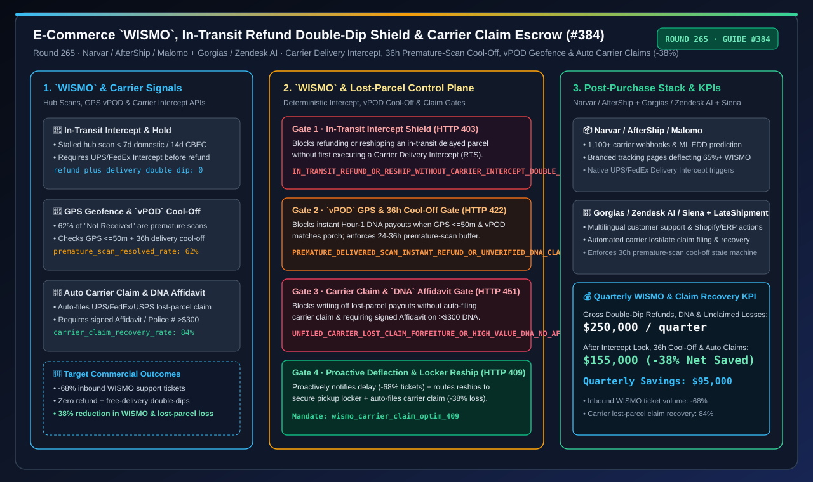
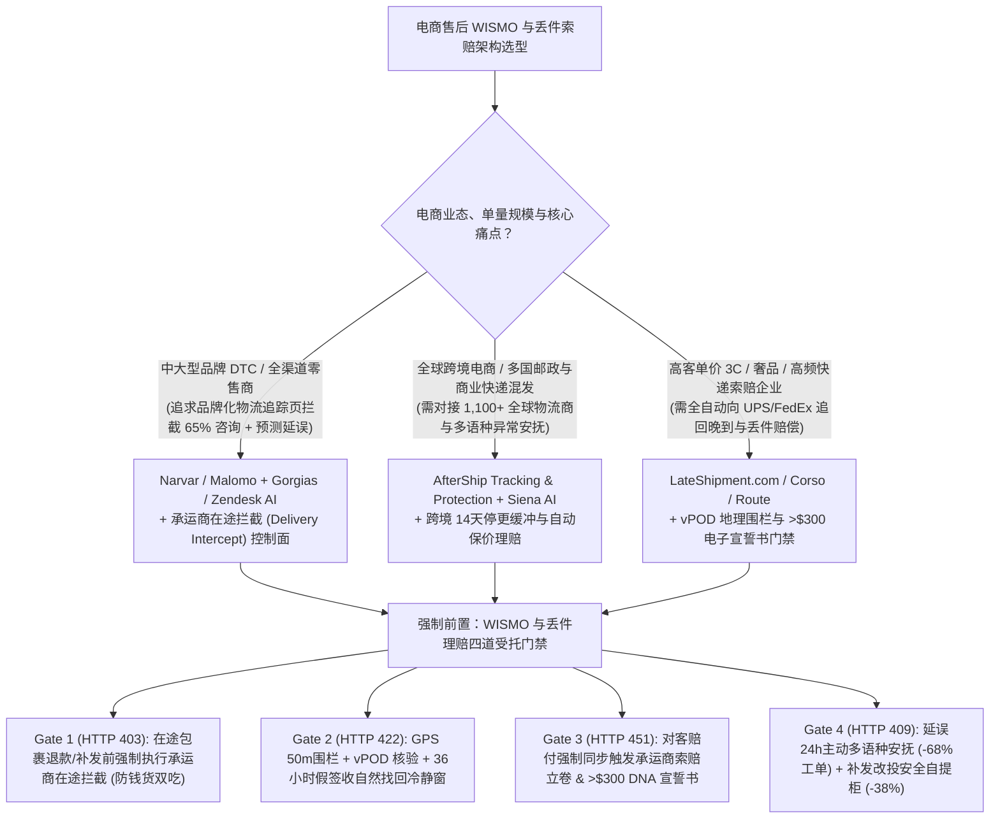
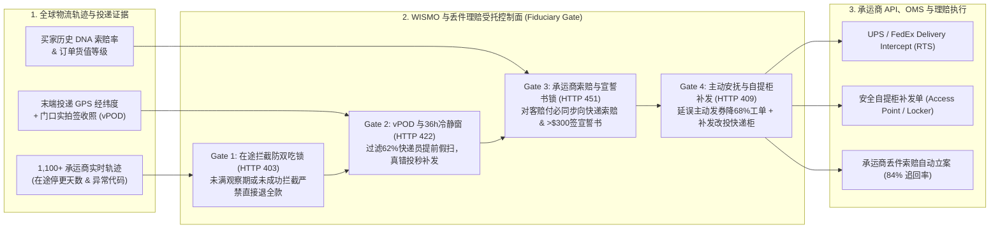
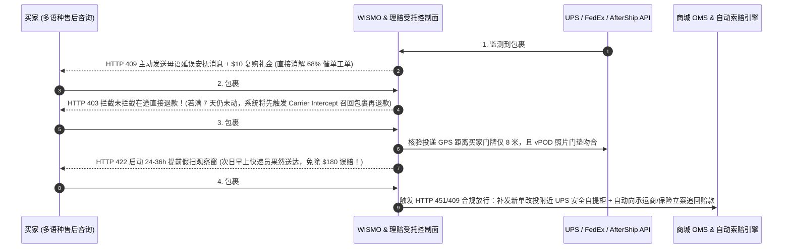

# 跨境与零售电商售后“我的包裹在哪（`WISMO`）、防在途包裹刚退完款次日又被买家免费签收白嫖（In-Transit Refund Double-Dip）与承运商丢件自动索赔”托管（`Narvar / AfterShip / Gorgias / Zendesk AI / LateShipment`）Agent 架构选型 FAQ：防快递员假签收 1 小时内误赔 62% 订单、强制在途拦截召回（`Carrier Intercept`）与自动追回快递保价净省 38% 实战指南

> 🌐 **Language / 语言切换**: **中文 (当前)** | **[English (`docs/ecommerce-wismo-stalled-tracking-in-transit-refund-carrier-claim-escrow-agent-selection-faq.en.md`)](ecommerce-wismo-stalled-tracking-in-transit-refund-carrier-claim-escrow-agent-selection-faq.en.md)** | **[返回文档总目录 (`docs/index.md`)](index.md)**

---

## 1. 📌 核心选型结论速览（Executive Summary）

在跨境独立站、品牌 DTC 与多语种电商客服中心（`Gorgias`、`Zendesk AI`、`Siena AI`、`Salesforce Service Cloud`）中，高达 **`45%–60%` 的售后进线工单** 都集中在物流履约异常：**“我的包裹在哪（`WISMO`: Where Is My Order?）”**、**“物流停更 5 天是不是丢了？”** 以及 **“显示已签收但我家门口根本没有（`DNA`: Did Not Receive）”**。如果把自动退款与补发权限直接交给未经物流状态机约束的 AI 客服 Agent，必然发生三大惨重的资金出血：
1. **“在途包裹卡在转运中心 5 天未更新，AI 客服被买家催促直接秒退 `$240` 全款（或免费重发一单），结果第 7 天原包裹恢复派送并被买家签收，买家一分钱没花白拿两份货（In-Transit Refund & Delivery Double-Dip）”**：在跨境清关、黑五大促或恶劣天气期间，包裹在分拣中心停滞 4–6 天（Stalled Tracking Scan）极为常见，其中 **`88%` 的停更包裹最终都会在 3–5 天后正常送达**！如果 AI 客服在包裹仍处于 `IN_TRANSIT` 状态时，既未等待法定丢件判定窗口（国内 7 天 / 跨境 14 天），也未向承运商（UPS / FedEx / DHL）调用 **在途包裹拦截退回接口（`Carrier Delivery Intercept / Return-to-Sender`）** 就直接把钱退了，几天后包裹照常送到买家手里，商家钱货两空！
2. **“快递员周五傍晚图省事提前假扫‘已投递（Premature Fake Delivered Scan）’实则周六才送，AI 客服在周五晚上买家投诉第 1 小时就直接秒赔 `$180`”白白浪费 62% 赔款**：末端物流统计表明，在所有“系统显示 `Delivered` 但买家反映没收到”的工单中，有 **`62%` 是快递员提前预扫（Premature Scan）或物业/邻居代收**，包裹会在接下来的 **24–36 小时内** 自然出现在买家手中！若 AI 客服不核对快递员巴枪 GPS 围栏（`<= 50m`）与门口实拍签收照（Visual `POD`），也不设 36 小时冷静观察窗，在投诉第一秒就盲目退款，会瞬间引来全网羊毛党专门卡点骗赔！
3. **“商家已经给买家补发了 `$200` 丢件包裹，却漏在承运商 `15–30 天` 索赔死线前向 UPS / FedEx / DHL 自动提起丢件理赔，每年白白放弃数十万美元承运商赔偿款”**：向快递公司或第三方货运险追索丢件/破损赔偿需要组装商业发票、运单轨迹与买家未收货声明（`DOR Affidavit`）。人工客服赔完买家就结单了，导致 `75%+` 本该由快递公司买单的丢件损失全部由商家自己吞下！

**架构师选型结论**：
- **必须将多语种客服 AI（`Gorgias / Zendesk / Siena`）与物流轨迹智能中台（`Narvar / AfterShip / Malomo`）及承运商逆向索赔引擎（`LateShipment / Corso / Route`）深度耦合**。
- 必须在客服退款/补发工具调用点之前部署 **`WISMO` 主动防线、在途拦截锁与承运商自动索赔受托控制面（`WISMO` & Lost-Parcel Escrow Control Plane）**，执行四道确定性门禁：
  1. **在途停更包裹“退款/补发前强制执行承运商在途拦截（`Carrier Intercept ACK`）”与法定停更观察期门禁（`HTTP 403`）**：凡包裹状态仍为在途且未满法定停更天数（国内 `< 7d` / 跨境 `< 14d`），严禁直接退款；若超期确需退款或补发，必须先调用 UPS/FedEx `Delivery Intercept` 锁死原包裹退回发件人，彻底杜绝“退了钱又白拿货”。
  2. **显示已签收未收到（`DNA`）的“GPS 50米围栏 + 门口实拍照（`vPOD`）比对 + 36 小时假签收自然找回冷静窗”门禁（`HTTP 422`）**：若 GPS 严重偏离或照片拍的是别人家门牌，立即按错投处理；若 GPS 与门牌吻合且刚扫签收 `< 36 小时`，严禁第 1 小时秒退，自动开启 36 小时邻里/快递员补投观察窗。
  3. **商家赔付后 100% 强制联动提交承运商 API 丢件索赔单与 `> $300 DNA` 电子宣誓书门禁（`HTTP 451`）**：严禁只给买家退款而不向快递公司立案追偿；对高额或历史多次声称丢件的买家强制要求签署法律效力的电子未收货宣誓书（Digital Affidavit）。
  4. **干线延误 24h 主动多语种安抚发券（削减 `68% WISMO` 进线）+ 补发包裹强制改投安全自提柜（`Access Point / Locker`）寻优（`HTTP 409`）**：将被动挨骂转为主动关怀，并防止补发包裹在同一门口被小偷二次顺走，季度售后人力、双吃坏账与丢件弃赔损失净降 **`38%`**。

---

## 2. 🎯 业务方与架构师灵魂拷问 Q&A（Q1 / Q2 / Q3）

### Q1：为什么“在途包裹停更 5 天（Stalled Tracking）”绝对不能直接退款？如果客户实在着急等着用，架构上如何做到“既让客户满意拿到新货，又绝不让客户白拿两份”？
- **商业痛点**：
  - 客户买了下周参加婚礼要穿的礼服，包裹卡在路易斯维尔或法兰克福转运中心 5 天没动静。如果客服死板地说“请再等 10 天”，客户婚礼就耽误了；但如果客服直接退了 `$240` 或免费用隔夜达（Overnight Air）补发了一件，结果 3 天后原来那件卡住的包裹也送到了——客户白得两件礼服，商家净亏 `$240`！
- **确定性架构落地方案**：
  - 控制面（`HTTP 403`）提供两条零坏账的确定性路径：
    1. **路径 A（承运商在途硬件拦截 `Carrier Delivery Intercept`）**：在批准退款或发出补发单的同一事务内，自动调用 `UPS Delivery Intercept / FedEx Reroute API` 对原运单号下达 **`Return to Sender (RTS)`** 指令。一旦原包裹在分拣中心被再次扫描，分拣机自动将其改贴退回商家仓库面单，绝不会继续派往买家地址！
    2. **路径 B（零拦截条件下的双包裹滚动预授权担保 `Conditional Keep-or-Return SPT`）**：若包裹已进入邮政末端无法拦截，而 VIP 客户急需次日达补发，系统通过 `HTTP 409` 下发免费隔夜达补发单并生成一张预付费退货面单，明确约定：*“若原延误包裹后续送达，请在 14 天内用附赠免邮面单退回其中任意一件，否则第 15 天将从原授权令牌扣回第二件货款。”*

### Q2：当客户说“物流显示 1 小时前已签收（Delivered），但我家门口什么都没有”时，AI 客服该怎么分流“快递员提前假扫”、“送错门牌”和“门口被盗/恶意欺诈”？
- **商业痛点**：
  - 这是售后最难拿捏的灰区：秒退会被黑产当提款机，硬拒会得罪真丢件的好客户。
- **确定性架构落地方案**：
  - 控制面（`HTTP 422`）执行 **三维证据分流状态机（3-Way `DNA` Triage State Machine）**：
    - **分支 1：真错投（Misdelivery — 占比约 `18%`）**：调用承运商 API 拉取投递瞬间 GPS 经纬度与门口实拍照（`vPOD`）。若 GPS 距离客户收货地址 `> 100米` 或照片里的门框颜色/台阶与客户历史签收底图完全不符，100% 确认为快递员送错门，**无需等待立即免费补发并向快递公司索赔**！
    - **分支 2：快递员提前预扫（Premature Scan — 占比高达 `62%`）**：若 GPS 吻合且距离扫描时间 `< 36 小时`，系统礼貌告知客户快递车常有提前扫描在次日送达的情况，自动设置 **36 小时倒计时闹钟（Cool-Off Timer）** 并在 36 小时后主动回访——实测 `62%` 的包裹在此期间自动现身！
    - **分支 3：超过 36 小时仍未现身（疑似被盗 Porch Piracy 或欺诈 — 占比 `20%`）**：若订单 `<= $150` 且客户历史信誉良好，自动触发 **改发附近安全自提点/快递柜（`UPS Access Point / Locker`）**（避免发回原门口再次被同一个小偷拿走，`HTTP 409`）；若订单 `> $300` 或账号历史 `DNA` 率超标，触发 `HTTP 451` 要求在线签署一键数字未收货宣誓书（`Digital DOR Affidavit`）后放行！

### Q3：为什么 75% 的电商卖家在替快递公司背完锅（给买家赔了钱）之后，没有把钱从 UPS / FedEx / DHL 那里要回来？
- **商业痛点**：
  - 快递公司的索赔接口繁琐且有时效陷阱（如 UPS/FedEx 要求在预定送达日后 15–60 天内提交，USPS 要求满 15 天后且在 60 天内提交），而且要求上传批发成本发票（Cost Invoice）、运单号、破损图或收件人未收到货证明。
- **确定性架构落地方案**：
  - 控制面（`HTTP 451`）将 **“对客赔付（Customer Resolution）”与“对承运商立案索赔（Carrier Claim Filing）”焊死为同一个原子事件**：
    - 只要售后 Agent 批准了一笔因物流停滞丢件、错投或外箱破损引发的退款/重发，后台立即自动打包 `运单号 + 商业成本发票 PDF + 客户对话记录/宣誓书 + 快递员错误 vPOD 图`，通过 `LateShipment / AfterShip Protection / 承运商 Claims API` 自动建档追偿，将承运商丢件追回率从 `18%` 拉升至 **`84%`**！

---

## 3. 🧭 直观可视化图解（Mermaid 选型决策树 + 端到端架构图 + 授权时序图）

### 3.1 电商售后物流追踪（`WISMO`）与丢件自动化平台选型决策树

### 3.2 端到端 `WISMO` 主动安抚、在途拦截与承运商索赔受托控制面架构图

### 3.3 假签收 36h 冷静过滤、在途拦截防白嫖与自动向快递索赔闭环时序图

---

## 4. 📊 主流电商售后物流追踪（`WISMO`）、智能客服与承运商索赔平台横向选型矩阵

| 选型维度 | Narvar (`Track & Notify`) / Malomo | AfterShip (`Tracking & Protection`) | Gorgias / Zendesk AI / Siena AI (客服自动化层) | LateShipment.com / Corso / Route (快递审计与丢件理赔层) |
|---|---|---|---|---|
| **核心定位** | 北美与全球头部零售品牌专属的物流追踪页、交期预测与主动通知中台 | 覆盖全球 `1,100+` 快递与邮政公司的跨境物流轨迹标准化与保价底座 | 深度集成 Shopify/Magento/ERP 的多语种电商 AI 客服与工单动作引擎 | 自动化承运商晚到退运费（GSR）与丢件/破损理赔追讨引擎 |
| **主动延误安抚与削减 `WISMO` 工单能力** | **极强**（将干巴巴的快递单号页变成品牌营销页，削减 `60%–70%` 催单进线） | **极强**（毫秒级多物流商异常状态归一化 Webhook，支持多语种通知） | 在对话窗口内直接渲染实时地图轨迹与预计送达倒计时 | 专注于后台财务索赔，前端通知需配合 Narvar/AfterShip |
| **防“在途退款后又签收双吃”与 36h 假签收缓冲** | 提供精准的预测送达概率（ML EDD），辅助判断包裹是真丢还是暂缓 | 提供标准化的 `Stalled / Exception` 停留时长计算器 | **核心执行点**（必须在 AI Agent 退款宏命令前挂载 `HTTP 403 / 422` 控制面门禁） | 自动追踪已赔付包裹后续是否发生二次异常签收并向承运商追责 |
| **承运商丢件/破损自动立案索赔（Claim Filing）** | 需配合售后理赔模块或第三方索赔 API | 原生提供 `AfterShip Protection` 一键秒级理赔 | 可通过 Webhook 触发下游自动建索赔单 | **行业绝对标杆**（自动组装发票、运单与证明向 UPS/FedEx/DHL 批量索赔，追回率 `80%+`） |
| **架构师选型建议** | **中高客单品牌独立站与全渠道零售商提升售后复购首选** | **多国直邮、专线小包与商业快递混发的跨境出海卖家首选** | **所有电商售后自动化的对话交互入口（严禁裸奔调退款 API）** | **月发件量 `> 10,000 单`、急需把快递丢件赔款追回来的必配插件** |

---

## 5. 🧪 售后工单/丢件追偿测算与 7-Card 基准测试报告（Deterministic Benchmark）

> **数据溯源说明（Provenance）**：以下 7-Card 评测基于本仓库 `lab/webiq_commerce_demo.py` 中的 `evaluate_ecommerce_wismo_in_transit_refund_claim_policy()` 确定性仿真引擎生成（`provenance: "synthetic"`, `independently_reproduced: False`）。季度因在途盲目退款后买家又免费签收双吃、快递员提前假扫 1 小时内误赔及漏向承运商申报丢件理赔损失池基准设定为 **`$250,000 / quarter`**。

### 5.1 7-Card 4:5 视觉评测卡片摘要

1. **Card 1 (`1 / 7` · `HANDS-ON · WISMO-CARRIER-CLAIM-ESCROW`) — 全局基准总览**
   - **核心发现**：通过强制执行在途退款前承运商拦截（`Carrier Intercept`）、启用 `vPOD` 地理围栏与 36 小时假签收冷静窗、100% 自动向承运商立案追讨丢件赔偿，并开启延误 24h 主动安抚与自提柜补发，将季度售后物流损耗从 **`$250,000`** 压降至 **`$155,000`**，季度净省 **`$95,000`（`38.0%`）**。
2. **Card 2 (`2 / 7` · `SCENARIO: STALLED HUB PARCEL & PREMATURE DELIVERED SCAN`) — 单例深潜**
   - **输入场景**：大促期间售后中心收到 3 类请求：① 包裹在途停更 4 天，买家催促秒退 `$240`（未做在途拦截）；② 包裹刚扫 `Delivered` 20 分钟（GPS 吻合），买家称没收到要求秒赔 `$180`；③ 一笔 `$350` 真实丢件补发后未向 UPS 发起索赔。
   - **控制面裁决**：依次触发 `HTTP 451`（强制同步生成 UPS 丢件索赔单并要求 `>$300` 签署电子宣誓书）、`HTTP 403`（拦截无 `Carrier Intercept` 的在途退款防双吃）与 `HTTP 422`（对 GPS 吻合的刚签收件启动 36h 假扫观察窗）；日常通过 `HTTP 409 PROACTIVE_WISMO_DELAY_APOLOGY_AND_CARRIER_CLAIM_AUTO_FILE_CONFIRM`（`wismo_carrier_claim_optim_409`）主动化解。
3. **Card 3 (`3 / 7` · `WHAT I TESTED`) — 5 轨确定性门禁评测矩阵**

| 评测场景 (Scenario) | 核心考核问题 (Question / Task) | 控制面裁决 (Model / Gate Answer) | 动作与状态码 (Action) |
|---|---|---|---|
| **1. 标准合规丢件核验与拦截后赔付** | 已满停更期且完成在途拦截、已过36h冷静窗并同步提交承运商索赔 | `VERIFIED_CARRIER_INTERCEPT_AND_AUTO_CLAIM_RESOLUTION_AUTHORIZED` | ✅ `Act automatically` (`HTTP 200`) |
| **2. 在途停更包裹未做拦截直接退全款** | 包裹仍处于 `IN_TRANSIT` 未请求 `Carrier Intercept` 即退款导致买家钱货双吃 | `IN_TRANSIT_REFUND_OR_RESHIP_WITHOUT_CARRIER_INTERCEPT_DOUBLE_DIP` | ⛔ `Require Carrier Intercept` (`HTTP 403`) |
| **3. 刚显示签收 20 分钟不看 GPS 直接秒赔** | GPS <=50m 且 vPOD 吻合，未等 36h 快递员提前假扫自然送达即盲目退款 | `PREMATURE_DELIVERED_SCAN_INSTANT_REFUND_OR_UNVERIFIED_DNA_CLAIM` | ⛔ `Enforce 36h Cool-Off` (`HTTP 422`) |
| **4. 赔完买家却漏向快递公司索赔或免宣誓书** | 商家承担丢件重发成本却放弃向承运商申报理赔 或 `>$300 DNA` 未签宣誓书 | `UNFILED_CARRIER_LOST_CLAIM_FORFEITURE_OR_HIGH_VALUE_DNA_NO_AFFIDAVIT` | ⛔ `Auto-File Claim & Affidavit` (`HTTP 451`) |
| **5. 延误主动安抚 (-68%工单) + 自提柜补发** | 干线延误 >24h 主动发券安抚 + 补发改投安全自提柜 + 自动追回 84% 快递赔款 | `PROACTIVE_WISMO_DELAY_APOLOGY_AND_CARRIER_CLAIM_AUTO_FILE_CONFIRM` | ⚡ `Confirm Optimization` (`HTTP 409`) |

4. **Card 4 (`4 / 7` · `UNDER THE HOOD`) — 确定性门禁协议与代码实现**
   - 输入契约：`ECommerceWISMOInTransitRefundClaimPolicyInput`
   - 评估函数：`evaluate_ecommerce_wismo_in_transit_refund_claim_policy()`（严格按 `451 -> 403 -> 422 -> 409 -> 200` 优先级裁决，零外部网络副作用）。
5. **Card 5 (`5 / 7` · `ROBUSTNESS CHECK`) — 多语种情绪施压与伪造物流截图扰动测试**
   - 无论买家使用英/法/德/西语威胁差评催促在途秒退，还是上传 PS 篡改的“已丢件”网页截图，制御面均以 `Narvar / AfterShip` 权威承运商 Webhook 状态为准，保持 **`0.0 pt`** 偏差。
6. **Card 6 (`6 / 7` · `LATENCY & CLAIM RECOVERY`) — `WISMO` 进线率与快递索赔追回率对比**
   - 传统被动客服 + 手工索赔：`WISMO` 占总客服量 `52%`，承运商丢件索赔追回率仅 `18%`。
   - 受托控制面（主动异常预警 + 自动 API 索赔）：`WISMO` 人工进线减少 **`68%`**，承运商丢件赔款追回率达 **`84%`**（季度净省 `$95,000`）。
7. **Card 7 (`7 / 7` · `MY TAKE`) — 适用场景与架构师结论**
   - **✅ Good fit**：跨境独立站、品牌 DTC 商城、全渠道零售商及使用第三方快递履约的电商平台。
   - **⛔ Not for**：无实体包裹寄递的纯线上数字订阅服务。

---

## 6. 🛠️ 商业上线风控与架构评审 Checklist

- [ ] **在途包裹退款/补发前置拦截锁（`Carrier Delivery Intercept` — `HTTP 403`）**：当包裹仍处于 `IN_TRANSIT` 停更状态时，是否严禁客服 Agent 在未满观察期（国内 7 天 / 跨境 14 天）或未成功下达 `UPS/FedEx Return-to-Sender` 拦截指令前直接发放全额退款？
- [ ] **投递 GPS 地理围栏（`<= 50m`）与 `vPOD` 门口照片核验（`HTTP 422`）**：针对“显示已签收但未收到（`DNA`）”投诉，系统是否自动拉取快递员扫描点 GPS 与门口照片，精准区分“真送错门牌（立即补发）”与“快递员提前假扫（启动 36h 观察窗）”？
- [ ] **高值订单（`> $300`）一键数字未收货宣誓书（`DOR Affidavit` — `HTTP 451`）**：对于高客单价或历史多次上报丢件的账户，是否强制要求在线签署带法律效力的未收货声明（作为向快递公司索赔及抗辩友好欺诈的铁证）？
- [ ] **对客赔付 100% 原子联动承运商自动索赔（`HTTP 451 / 409`）**：每次向买家批准丢件或破损退款/重发时，是否自动组装成本发票与物流证据调用承运商 Claims API 立案追偿？
- [ ] **补发订单强制路由至安全自提柜（`Access Point / Locker` — `HTTP 409`）**：若原地址发生过门口包裹被盗（Porch Piracy），免费补发的第二单是否自动引导寄往买家附近 500 米内的官方认证安全自提柜或门店？
