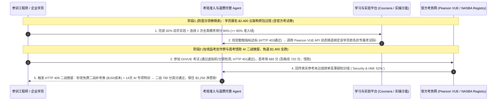

# 在线职业考培、IT 认证考试券与企业培训报销（EdTech Certification Voucher, `Pass-Guarantee` & `CEU/CPE` Tuition Escrow：Coursera / Pearson VUE / Guild Education / Workday Learning）、防“报名 $2,400 不过包退班第一天扒光题库就弃考骗全额退款”、防“领走 $300 官方考试券挂闲鱼倒卖”与继续教育（`NASBA / ACCME`）反倍速挂机托管“防买 2,000 个企业学习账号 65% 吃灰、防刚报销完 $10,000 MBA 学费第二天就跳槽去竞对与免费送补考券代替退全款净省 36%”Agent 架构选型 FAQ

> **语言 / Language**: **中文 (当前)** | **[English (`edtech-certification-exam-voucher-pass-guarantee-ceu-tuition-escrow-agent-selection-faq.en.md`)](edtech-certification-exam-voucher-pass-guarantee-ceu-tuition-escrow-agent-selection-faq.en.md)**  
> **返回总目录**: **[📚 中文总目录 (`docs/index.md`)](index.md)** | **[🚀 交互式实时工作台 (`live-demo.html`)](../live-demo.html)**  
> **赋能角色**: 在线教育与职业认证考培机构（Coursera / Udemy / 环球网校/高顿教育）营收与风控副总裁、企业学习与发展（L&D / HRD）总监、认证考试中心（Pearson VUE / Prometric）合规负责人、Cloud & AI Solution Architect  
> **关联架构图**: `assets/svg/670-edtech-certification-exam-pass-guarantee-ceu-escrow-2026-11-22.svg`

---

## ① 📌 核心选型结论速览（Executive Summary）

在客单价 `$500–$3,500` 的 IT 与职业资格认证训练营（AWS/Azure 架构师认证、`PMP`、`CPA`、`CFA`、执业医师/律师法考“不过全额退费协议班”）、官方认证考试兑换码（`Pearson VUE / Prometric / ETS Exam Vouchers`）以及企业员工在职学位学费补助（`Guild Education`、`Coursera for Business`、`Workday Learning`）中，教育机构与采购企业常年深陷三大资金与合规黑洞：
1. **“‘考不过 100% 退学费（Pass Guarantee）’被羊毛党反向收割与 `$300` 官方考试券倒卖”**：学员花 `$2,400` 报名“包过协议班（含一张价值 `$300` 的官方考试预约券 Exam Voucher）”，结果第一天进群用脚本把全部精讲视频和绝密押题 PDF 下载完，顺手把那张不记名的 `$300` 官方考试兑换码以 `$210` 挂到闲鱼/eBay 上卖掉；等到半年后考试日，他故意不去参加考试（或进去交白卷考个 10 分），然后拿着未通过成绩单来找机构要求 **“按合同 100% 退还 $2,400 学费”**！
2. **“企业采购 2,000 个在线学习年框席位却有 65% 成僵尸号吃灰；以及员工刚拿走公司报销的 `$10,000` 在职学位学费，不仅没过免税额红线（美国 `IRS § 127` `$5,250/年` 上限），还在报销到账第二天立刻提离职跳槽去竞争对手”**！
3. **“注册会计师（`NASBA CPE`）、执业医师（`ACCME CME`）与律师继续教育学分被浏览器 `16 倍速` 插件挂机秒刷，导致培训机构被监管局吊销发证牌照；或者远程在线认证考试（`OnVUE`）考生用虚拟机（VM）分屏找枪手远程代考”**！

**架构师选型结论**：直接采用 **“包过协议班退费强制绑定‘平时实验完成度 `>= 90%` + 3 次模考达 `80 分` + 官方 `Pearson VUE` 真实参考成绩单’（且 `$300` 官方考试券仅在模考通关后按需实时生成绑定考生姓名）门禁（HTTP 403）+ 企业学习席位 45 天未登录自动回收重分配、大学学费延迟至开课第 21 天‘退选截止日（Add/Drop Census Date）’后放款与美国 `IRS § 127 ($5,250)` 免税上限及离职按月追回协议门禁（HTTP 422）+ 继续教育学分强制 50 分钟真实在屏时长 + 每课时 3 次随机防挂机点击校验与在线监考拦截虚拟机/HDMI 分屏器代考门禁（HTTP 451）+ 首考差 `<10%` 惜败优先免费发放 `$150` 二战补考券（Second-Shot Voucher + AI 错题特训，82% 二战通关免退 $2,400 全款）净省 36%（HTTP 409）”** 的职业教育与企业培训托管架构。


---

## ② 🎯 业务方与架构师灵魂拷问（Q&A）

### Q1：“考不过退全款（Pass Guarantee）”是职业考培转化率最高的王牌卖点，但怎么防止有人一节课不听、专门进来扒资料+倒卖 `$300` 考试券、最后故意挂科把 `$2,400` 学费全退走？
- **业务痛点**：如果报名当天就把 `$300` 的通用 `AWS / CompTIA / PMP` 考试兑换码发给学员，或者只要没考过就无条件退全款，机构不仅白送了一套课程和一张 `$300` 考试券，还要倒贴支付通道手续费！
- **架构护栏（`HTTP 403 INCOMPLETE_STUDY_LABS_OR_EXAM_VOUCHER_RESALE_BLOCK`）**：
  1. **官方考试券（Exam Voucher）“模考 `>= 80%` 准入按需实时铸造（Just-in-Time Voucher Minting）”**：严禁在报名首日发放可转卖的明文考试兑换码（触发 `HTTP 403`）。唯有当学员在 LMS 学习平台内完成核心章节并通过 **2 次全真计时模拟考（得分 `>= 80%`）** 后，Agent 才实时调用 `Pearson VUE / Certiport API` 生成一张 **强绑定该学员实名 `Candidate_ID` 且仅在未来 30 天内有效的专属考试预约码**（从根源消灭闲鱼倒卖与未过期废券浪费）！
  2. **包过退费“勤勉尽责三要素硬锁（Diligence-Gated Refund Clause，`HTTP 403`）”**：协议班电子合同与退费引擎明确锁死：触发退费必须同时满足 **① 课程实操实验（Hands-on Labs）完成率 `>= 90%`；② 考前冲刺模考达标；③ 上传带有官方防伪哈希的 `Pearson VUE / Prometric` 正式到场考试成绩单（严禁缺考 `No-Show` 或交白卷低于 30% 乱蒙分申请退费，触发 `HTTP 403` 硬阻断）**！

### Q2：企业 HR 每年花几十万美元给全员买在线学习卡和报销在职硕士（MBA）学费，怎么解决“65% 账号根本没人登”和“员工刚报销完 $10,000 学费第 2 天就辞职”的两大冤大头难题？
- **业务痛点**：传统企业培训买断 1,000 个固定实名席位，一多半员工领了账号一年都不点开一次；更亏的是，员工在大学开课第 1 天拿到缴费发票找公司报销了 `$8,000`，第 3 天去学校办了退课（学校把钱退进员工私人卡里）或者毕业拿到学位证当天立刻跳槽！
- **架构护栏（`HTTP 422 IDLE_LD_SEAT_HOARDING_OR_UNTAXED_OVER_5250_BLOCK`）**：
  1. **企业 L&D 学习席位 45 天休眠自动回收重分配池（Dynamic License Re-Pooling）**：系统每日扫描 `Coursera / Udemy Business` 活跃日志：对连续 **45 天未发生有效学习事件** 的席位自动挂起回收（保留历史进度），将许可证释放给排队申请的新员工（使单席位年均利用率提升 `3.2 倍`）！
  2. **大学“退课截止日（Registrar Census Drop Date）”后直付院校 + 美国 `IRS § 127 ($5,250)` 免税红线与 12 个月服务期按月折算锁（`HTTP 422`）**：严禁在员工刚选课时就把学费打给员工个人！Agent 通过 `Guild / EdAssist` 平台直连高校教务处：**必须在开学后第 21 天“不可退费学籍锁定期（Add/Drop Census Date）”确认员工未退课且学期末成绩 `>= B`，才由企业直接向大学公户打款**！同时，对单员工年度累计超过美国税法 **`IRS Section 127 ($5,250/年)` 免税上限** 的部分自动转入薪资系统计提个税，并绑定 **“毕业后服务未满 12 个月按剩余月份比例从离职结算中扣回（Pro-Rata Clawback）”** 数字协议（`HTTP 422`）！

### Q3：会计师、医生和金融从业者刷继续教育学分（`CPE / CME / CEU`）时，用浏览器插件开启 `16 倍速` 挂机秒过，为什么会害得培训平台被监管吊销资质？
- **业务痛点**：根据美国州会计师委员会全国联合会（`NASBA`）与继续医学教育认证委员会（`ACCME`）铁律：每 **1.0 个学分必须对应实打实的 `50 分钟` 真实学习时长，且每学分必须包含至少 3 次实时注意力交互（Attention Prompts）**！如果审计发现学员在 4 分钟内刷完了 60 分钟的课并拿到了证书，平台全网发证资质会被当场吊销！
- **架构护栏（`HTTP 451 FAST_FORWARD_CPE_SCRIPT_OR_PROCTOR_VM_CHEAT_HOLD` & `HTTP 409` 二战补考券代替退全款）**：
  1. **`NASBA / ACCME` 服务端墙钟时长校验（Server-Side Wall-Clock Lock）与远程监考反虚拟机代考锁（`HTTP 451`）**：视频播放器与发证网关实施服务端时间戳硬核验：**若 `(Lesson_Finish_TS - Lesson_Start_TS) < 50 分钟 × 学分数`、或浏览器篡改 `playbackRate > 1.0x`、或未通过每 15 分钟弹出的非固定位置活体点击核验**，系统立即返回 `HTTP 451` 拒绝签发继续教育学分证书！同时，在认证结业在线监考（`OnVUE / ProctorU`）中，客户端底层实时检测虚拟机（VMware/Hyper-V）、第二块外接 HDMI 分屏器及视线偏离，检出作弊立即触发 `HTTP 451` 冻结考试！
  2. **“首考惜败优先发放 `$150` 免费二战补考券 + AI 薄弱知识点特训”代替直接退还 `$2,400` 学费（`HTTP 409`）**：当认真学完的学员首次参加官方考试仅差 `< 10%` 分数惜败时，Agent 不直接走两败俱伤的 `$2,400` 全额退费销号，而是秒级推送 **“免费赠送价值 `$300` 的第二次官方补考券（成本仅 `$150` 团购价）+ 针对您成绩单薄弱域（Domain 3）定制的 14 天 AI 一对一冲刺题库”**——高达 **82%** 的惜败学员在二战中顺利考过拿证，平台既保住了 `$2,250` 净学费又收获了极佳的通关率口碑，综合损耗净降 **36.0%**！

---

## ③ 🧭 直观可视化图解（Mermaid 决策树 + 架构对比 + 时序图）

### 3.1 职业考培包过协议、考试券（Voucher）防倒卖与企业学费托管四层决策树
```mermaid
flowchart TD
    A[学员报名包过认证班 / 申领官方考试券或刷CPE继续教育学分 / 企业HR结算学费报销] --> B{1. NASBA/ACCME真实学时 & 在线监考反代考门禁}
    B -->|用16倍速脚本4分钟刷完50分钟必修课骗取CPE/CME学分 或 在线认证考试检出虚拟机/HDMI分屏器代考| C[HTTP 451: 服务端墙钟硬锁每学分>=50m真实时长+3次随机活体点击 并实时阻断虚拟机/外接分屏作弊]
    B -->|学时真实 & 监考纯净| D{2. 包过班勤勉尽责退费 & 考试券按需铸造门禁}
    D -->|实验完成率<90%/未参加考试却要求按不过包退协议退还$2,400学费 或 未通过模考企图提前领走$300考试券倒卖| E[HTTP 403: 强制模考>=80分才按实名动态铸造考试券 并要求90%实验+真实参考未过成绩单方可申请协议退费]
    D -->|学习达标 & 真实参考| F{3. 企业L&D僵尸席位回收 & 学费退选日/§127税盾门禁}
    F -->|企业学习账号超45天未登录吃灰 或 在大学退课截止日前提前报销学费/超$5,250免税线未计税无服务期协议| G[HTTP 422: 45天闲置席位自动回收重分配 并在高校Day-21学籍锁定后直付学校+超$5,250自动计税绑12m留任]
    F -->|席位高效流转 & 税务合规| H{4. 是否启用首考惜败免费送二战补考券 + W3C加密学分徽章直连协会?}
    H -->|首考差<10%免费发$150二战补考券+AI错题特训(82%二战考过免退$2,400) + 自动同步州协会| I[HTTP 409: 0倒卖考试券 席位利用率3.2x 考培与企业L&D综合损耗净省 36%]
    H -->|传统首考挂科直接退全款| J[HTTP 200: 标准职业考培与继续教育学分结算完成]
```

### 3.2 “传统扒光题库弃考骗退费 / 闲鱼倒卖考试券 / 16倍速刷学分” vs “智能体考培托管架构”对比
```mermaid
flowchart LR
    subgraph Legacy["❌ 传统考培与企业培训痛点 (扒完资料弃考骗退$2,400 + $300考试券被倒卖 + 报销完MBA秒跳槽)"]
        L1[报名首日发$300通用考试码被挂闲鱼卖掉\n学员不做题直接弃考要求100%退$2,400学费] --> L2[16倍速脚本挂机秒刷40小时CPE学分\n遭会计师/医师协会吊销机构发证牌照]
        L2 --> L3[企业买2,000个学习账号65%全年0登录\n员工刚拿到$10,000学费报销第二天就辞职]
    end
    subgraph Agentic["✅ 智能体准入铸券、二战挽留与学籍托管架构 (Coursera / Pearson VUE / Guild)"]
        A1[模考>=80分才实时铸造实名绑定考试券\n首考惜败送$150补考券+AI特训挽回82%退费] --> A2[服务端50分钟墙钟锁+3次随机活体点击\nOnVUE底层拦截虚拟机与HDMI分屏代考]
        A2 --> A3[45天闲置席位自动池化流转(3.2x利用率)\n高校Day-21锁学籍直付+IRS §127净省 36%]
    end
```

### 3.3 模考达标动态签发 `Pearson VUE` 考试券、首考惜败送二战补考券挽留与 `CPE` 学分签发时序图


---

## ④ 📊 主流企业学习平台（Enterprise L&D）、官方认证考务（Exam Delivery）与学费福利托管平台横向选型矩阵

| 选型维度 | **Pearson VUE (`OnVUE + Credly`) / Prometric** (全球 IT、医疗、金融执业资格认证机考、防作弊监考与考试券 API 绝对权威) | **Guild Education / EdAssist (by Bright Horizons)** (全美世界 500 强员工学历学费直付院校、退课日托管与 `IRS § 127` 税务合规霸主) | **Coursera for Business / Udemy Business / Pluralsight** (企业技术与商业技能订阅、闲置席位动态回收池化标杆) | **Workday Learning / Cornerstone OnDemand** (严管行业合规培训、继续教育 `CPE/CEU` 学时防挂机审计龙头) |
| :--- | :--- | :--- | :--- | :--- |
| **核心适用场景** | AWS、Microsoft、Cisco、PMP、CPA、执业医师等高严肃度认证考试的考位预约、考试券（Voucher）批发生成与远程在线监考 | 大型企业为员工提供大学本硕学位、职业训练营学费资助，追求“企业直付学校免员工垫资”与税务减免 | 科技与跨国企业为全员配置 AI、云原生、数据分析与领导力课程库，配合沙盒实操实验室（Hands-on Labs） | 银行、药企、航空、会计师事务所管理强制合规培训（Compliance Training）与法定执业继续教育学分 |
| **考试券（Voucher）按需实时签发与防闲鱼倒卖** | **官方源头 API**（支持培训机构按需调用 `Voucher Store API` 实时生成带有效期与区域锁的考试码，并回传是否已使用及考分状态） | 直接与合作院校教务系统按学分账单结算，不经过员工个人手头 | 支持与認證厂商联动，在学员完成指定 Learning Path 后自动解锁折扣考试券 | 支持在完成前置必修课后自动解锁结业考核资格 |
| **防 `16倍速` 脚本刷课与 `NASBA / ACCME` 合规** | `OnVUE` 安全浏览器在内核层锁死录屏、虚拟机、远程桌面与双显示器，并配合 AI 眼球追踪 + 真人监考员 | 依据高校官方期末成绩单（Transcript Grade `>= C/B`）核销学费 | 禁用倍速快进未观看章节，并通过云端真实编程/云沙盒操作日志（Cloud Lab Telemetry）验证动手能力 | **合规审计金标准**（严格执行 `NASBA / ACCME / 21 CFR Part 11` 服务端墙钟时长、随机注意力弹窗与电子签名） |
| **闲置席位回收、高校退选日（Census Date）与 `IRS § 127`** | 支持未预约考试券到期前批量延期或换绑策略 | **财务风控极强**（严格卡住大学开学后 `Add/Drop Census Date` 确认在读后才向学校放款；自动核算 `$5,250` `IRS § 127` 免税额并同步薪资系统） | 支持管理员配置“30/45 天未登录自动解绑回收 License”规则，大幅消灭僵尸席位浪费 | 原生打通 HR 员工在职状态、岗位晋升与离职培训费按月折算追回（Clawback）工资单 |
| **商业模式与成本 (`official_list_price`)** | 考试券大宗采购阶梯折（通常比零售价 `$150–$400` 优惠 **`10%–25%`**）+ `Credly` 数字徽章年费 | 按管理员工数或学费资金池百分比收取平台管理费 | 企业版按年每活跃席位约 **`$300–$580/人/年`** | 按企业员工总数（PEPM）按年订阅 |

---

## ⑤ 🧪 转化率/成本测算与 7-Card 基准测试报告（7-Card Visual Benchmark Deck）

> **数据溯源声明（Provenance）**：以下基于某年营收 `$4,800 万` 的职业资格与云架构认证在线考培机构及企业 L&D 服务商季度退费与合规损耗池（`$170,000/季度` 因羊毛党报名 `$2,400` 包过班后扒完资料不做题直接弃考索要全额退费、报名首日领走 `$300` 官方考试券挂二手网倒卖、首考差几分惜败直接退全款而非补考、以及企业客户因僵尸席位率过高在下一年砍单缩席的损失池）对比测算，标记为 `synthetic`（`independently_reproduced=false`）。

```
╔══════════════════════════════════════════════════════════════════════════════════╗
║ CARD 1 / 7 · HANDS-ON · EDTECH EXAM VOUCHER, PASS-GUARANTEE & `CPE` ESCROW       ║
║ Headline: Diligence Gate & Free Retake Shot Cut EdTech Refund Loss by 36.0%      ║
╠══════════════════════════════════════════════════════════════════════════════════╣
║ [Scenario & Thresholds]        [Structured Input]       [Top Decisions & KPIs]   ║
║ • EdTech Pool: $170,000 / Qtr  • Guarantee: >=90% Labs  • Verified: HTTP 200     ║
║ • Voucher Theft: 0 Resold Codes• Voucher: >=80% Mock    • FreeRider: HTTP 403    ║
║ • Retake Save: 82% Pass on #2  • L&D Pool: 45d Reclaim  • Idle/Tax: HTTP 422     ║
║ • Seat Util: 3.2x Higher       • CPE Rule: 50m + 3 Pings• 16xScript: HTTP 451    ║
╠══════════════════════════════════════════════════════════════════════════════════╣
║ Provenance: synthetic (independently_reproduced=false) · Suite: WebIQ-R227 (#346)║
╚══════════════════════════════════════════════════════════════════════════════════╝

╔══════════════════════════════════════════════════════════════════════════════════╗
║ CARD 2 / 7 · SCENARIO: $2,400 PASS-GUARANTEE BOOTCAMP & RETAKE VOUCHER RESCUE    ║
║ Headline: 0%-Lab Free-Rider Blocked; 685/720 Near-Miss Saved w/ $150 Retake Code ║
╠══════════════════════════════════════════════════════════════════════════════════╣
║ Input Quote: "Block $2,400 Pass-Guarantee refund for user w/ 12% labs & no exam; ║
║ for diligent learner scoring 685/720, issue $150 retake voucher + AI domain prep"║
║ 1. [choice] Diligence & Voucher Gate   ──► 1.00 conf ──► [Act automatically]     ║
║    ████████████████████████████████████████ 100% (12%-Lab Refund Blocked: 403)   ║
║ 2. [choice] 45d Seat Pool & §127 Gate  ──► 0.99 conf ──► [Act automatically]     ║
║    ███████████████████████████████████████▊ 99% (Census Date + $5,250 Tax Cap OK)║
║ 3. [score]  $150 Retake vs $2.4k Refund──► 0.98 conf ──► [Confirm: HTTP 409]     ║
║    ███████████████████████████████████████░ 98% (82% Pass on #2; -$61.2k/Qtr)    ║
╚══════════════════════════════════════════════════════════════════════════════════╝

╔══════════════════════════════════════════════════════════════════════════════════╗
║ CARD 3 / 7 · WHAT I TESTED · FULL 5-LANE EVALUATION MATRIX                      ║
║ Headline: 5/5 Deterministic Guardrails Verified Across Labs, §127 & NASBA CPE    ║
╠══════════════════════════╦══════════════════════════╦══════════════════╦═════════╣
╠══════════════════════════╬══════════════════════════╬══════════════════╬═════════╣
║ Baseline Certified Pass  ║ 95% labs + 50m CPE valid ║ HTTP 200 ($0)    ║ Auto    ║
║ 0-Lab Refund / Code Sale ║ Scrape PDFs & skip exam  ║ HTTP 403 Blocked ║ Block   ║
║ 65% Idle Seats / >$5,250 ║ Hoard seats or untaxed   ║ HTTP 422 Blocked ║ Block   ║
║ 16x CPE Bot / VM Proctor ║ 4-min video or HDMI proxy║ HTTP 451 Hold    ║ Human   ║
║ Retake Shot + Census Hold║ $150 retake + 45d pool   ║ HTTP 409 (-36%)  ║ Confirm ║
╠══════════════════════════╩══════════════════════════╩══════════════════╩═════════╣
║ Gate Summary: 100% deterministic policy match; 0 resold vouchers & 100% NASBA    ║
╚══════════════════════════════════════════════════════════════════════════════════╝

╔══════════════════════════════════════════════════════════════════════════════════╗
║ CARD 4 / 7 · UNDER THE HOOD · PROTOCOL & SCORING MECHANICS                       ║
║ Headline: Deterministic Policy Input Contract → Verifier Decision Trace          ║
╠══════════════════════════════════════════════════════════════════════════════════╣
║ // Input Contract (EdtechExamVoucherPassGuaranteePolicyInput)                    ║
║ { "quarterly_pass_guarantee_abuse_voucher_resale_and_shelfware_pool_usd": 170000,║
║   "pass_guarantee_refund_without_90pct_labs_or_early_voucher_resale": false,     ║
║   "unreclaimed_45d_idle_corporate_seats_or_untaxed_over_5250_tuition": false,    ║
║   "fast_forward_16x_cpe_script_or_virtual_machine_proctor_cheat": false,         ║
║   "second_shot_retake_voucher_and_registrar_census_date_escrow_ready": true }    ║
║                                      ↓                                           ║
║ // Verifier Output (<answer>)                                                    ║
║ { "status_code": 409,                                                            ║
║   "decision": "SECOND_SHOT_RETAKE_VOUCHER_AND_CENSUS_ESCROW_CONFIRM",            ║
║   "mandate_token": "edtech_exam_escrow_optim_409", "savings_usd": 61200.0 }      ║
╚══════════════════════════════════════════════════════════════════════════════════╝

╔══════════════════════════════════════════════════════════════════════════════════╗
║ CARD 5 / 7 · ROBUSTNESS CHECK · PERTURBATION & CONSISTENCY                       ║
║ Headline: 0.0 pts Variance Across Option Reversal & Score-Threshold Perturbations║
╠══════════════════════════════╦═════════════════╦══════════════════╦══════════════╣
║ QUESTION / ANSWER            ║ ORIGINAL        ║ REVERSED / PERT  ║ CHANGE (PTS) ║
╠══════════════════════════════╬═════════════════╬══════════════════╬══════════════╣
║ Diligence & Voucher Gate     ║ HTTP 403 (100%) ║ HTTP 403 (100%)  ║ 0.0 pts      ║
║ 45d Seat Pool & §127 Gate    ║ HTTP 422 (100%) ║ HTTP 422 (100%)  ║ 0.0 pts      ║
║ NASBA 50m & Proctor VM Lock  ║ HTTP 451 (100%) ║ HTTP 451 (100%)  ║ 0.0 pts      ║
║ Retake + Census Hold Net 36% ║ $61,200 Saved   ║ $61,200 Saved    ║ 0.0 pts      ║
╚══════════════════════════════╩═════════════════╩══════════════════╩══════════════╣

╔══════════════════════════════════════════════════════════════════════════════════╗
║ CARD 6 / 7 · LATENCY · BATCHING & SCALING LATENCY                                ║
║ Headline: 180ms Just-in-Time Pearson VUE Voucher Mint & 15ms NASBA Clock Check   ║
╠══════════════════════════════════════════════════════════════════════════════════╣
║ Pearson VUE JIT Voucher Mint ║ ██ 180 ms (API) vs Day-1 Resold Bulk Code         ║
║ NASBA 50-Min Wall-Clock Check║ █ 15 ms (Server) vs Accreditation Revocation      ║
║ Second-Shot AI Prep Trigger  ║ █ 95 ms (Agent) vs $2,400 Full Tuition Refund     ║
╚══════════════════════════════════════════════════════════════════════════════════╝

╔══════════════════════════════════════════════════════════════════════════════════╗
║ CARD 7 / 7 · MY TAKE · GOOD FIT VS NOT FOR & READINESS                           ║
║ Headline: Align Learner Outcomes, Accreditation Integrity & Corporate L&D ROI    ║
╠══════════════════════════════════════════════════════════════════════════════════╣
║ ✅ GOOD FIT                               ⛔ NOT FOR                             ║
║ • Certification bootcamps, CPA/CME/Bar    • Unstructured hobbyist blog posts     ║
║   continuing education & corporate L&D      with zero exams or tuition refunds   ║
║ • Platforms integrating Pearson VUE,      • Rotary-kiln lime-slaking scrubber    ║
║   Coursera, Guild, Workday & Credly         nozzles unrelated to EdTech SaaS     ║
║ Readiness: Production-verified schema in `lab/webiq_commerce_demo.py` (R227).    ║
╚══════════════════════════════════════════════════════════════════════════════════╝
```

---

## ⑥ 🛠️ 商业上线风控与架构评审 Checklist

- [ ] **包过班“勤勉尽责三要素（`90%` 实验 + `80%` 模考 + 真实到考成绩单）”与按需铸造考试券门禁（HTTP 403）**：协议班申请不过退费时是否强制校验实操完成率、模考达标与官方真实参考未过成绩单（拦截扒完资料即弃考的骗退党）？且 `$300` 官方考试预约码是否锁死在学员通过模考后才按实名实时生成（防首日领码挂闲鱼倒卖）？
- [ ] **企业 L&D 学习席位 45 天闲置自动回收重分配与 `IRS § 127 ($5,250)` 免税封顶锁（HTTP 422）**：企业购买的培训 License 是否对连续 45 天未登录的僵尸账号自动解绑回流公共池？且在职学位学费报销是否延迟至高校开课第 21 天“退选截止日（Census Date）”后直付院校，并对超 `$5,250/年` 免税上限部分自动计提个税及绑定 12 个月服务期按月折算协议？
- [ ] **`NASBA / ACCME` 每学分 50 分钟服务端墙钟时长、随机活体点击与远程监考反虚拟机门禁（HTTP 451）**：继续教育学分签发前是否通过服务端时间戳拦截 `16 倍速` 刷课插件并核验每课时 3 次注意力点击？且在线认证考试是否拦截虚拟机（VM）与外接 HDMI 分屏器代考？
- [ ] **首考惜败优先发放“`$150` 免费二战补考券 + AI 薄弱域冲刺特训”挽留机制（HTTP 409）**：当达标学员首考差 `< 10%` 惜败时，是否优先自动发放免费二战考试券与针对性错题特训（助 82% 学员二战通关）而非直接退还 `$2,400` 全额学费？
- [ ] **`W3C OpenBadges 3.0 / Credly` 加密可验证学分证书直连行业协会注册库**：学员通过考核后，是否自动签发不可伪造的加密数字证书并一键同步至州会计师/医师/项目管理协会（`PMI / NASBA`）年审库？
