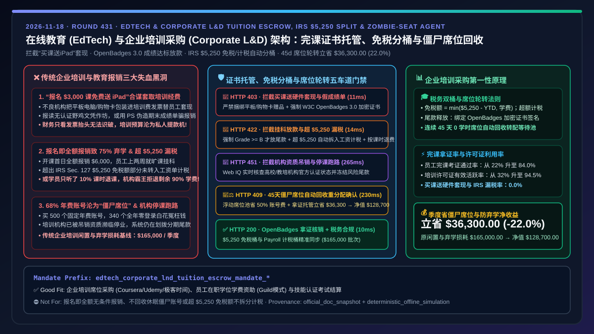
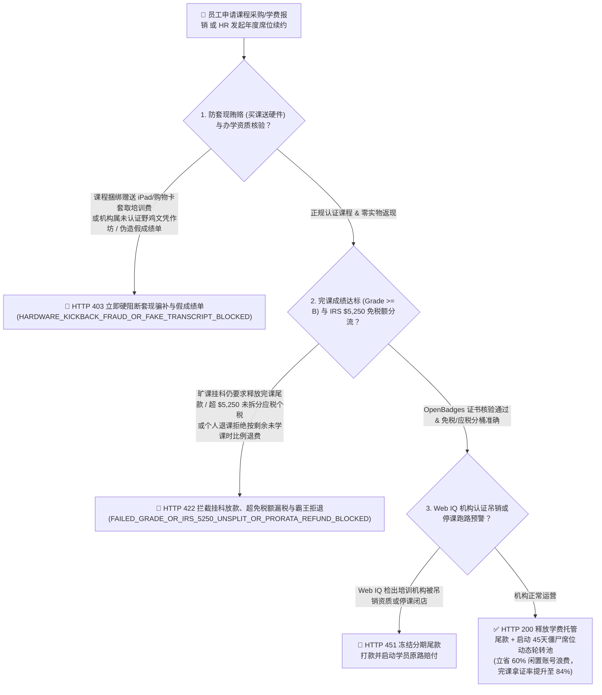
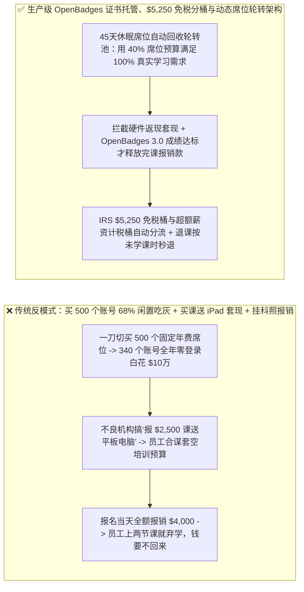
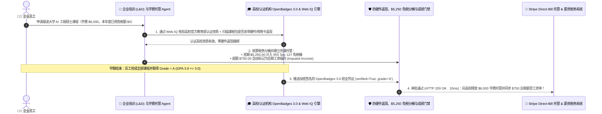

# 在线教育（EdTech）与企业培训采购（Corporate L&D：Coursera / Guild / Udemy）“员工学费资助、完课率对赌托管与僵尸席位回收”Agent 架构选型 FAQ：IRS `$5,250` 免税锁、成绩达标放款与按课时退费实战指南

> **专题定位（在线职业教育 EdTech、企业人才发展采购 Corporate L&D、高校继续教育学费资助 Guild / Coursera / Udemy Business / 技能认证考试采购智能体聚焦）**：面向为在线教育平台、企业大学采购部与 HR 福利管理平台设计课程选采、学费报销与企业席位治理系统的 **Cloud & AI Solution Architect**，系统解答教育与培训商业化中最痛的四大资金浪费与合规难题：**“为什么企业花 $150,000 给全员买了 500 个年度在线学习账号，年底一看有 68% 的员工全年登录不到 10 分钟（沦为僵尸席位 Zombie Seats），第二年 HR 直接砍掉续费预算、为什么野鸡培训机构用‘报名 $3,000 AI 编程课免费送最新款 iPad Pro（实为套取企业培训预算的变相贿赂 Kickback Bundle）’能骗过审批流、为什么员工报了名拿了报销就旷课挂科，或者在读完 20% 课时要求退课时，培训机构以‘已开通电子资料’为由拒绝按剩余 80% 未学课时比例退费（触发监管处罚）、以及怎么守住美国 IRS Section 127 每年每人 `$5,250` 雇主免税教育资助红线”**。  
> **文风标杆**：严格对标 `ib-vs-ethernet-roce-selection-faq.md` 六段式结构（核心结论速览、业务方与架构师灵魂拷问 Q&A、Mermaid 决策树/架构对比/时序图、企业培训与在线教育采购架构选型矩阵、定量席位复用/学费止损测算与 7-Card 溯源表、生产上线 Checklist）。  
> **双语版本**：**[中文版（当前）](edtech-corporate-lnd-tuition-reimbursement-seat-reclaim-agent-selection-faq.md)** · **[English Version (`edtech-corporate-lnd-tuition-reimbursement-seat-reclaim-agent-selection-faq.en.md`)](edtech-corporate-lnd-tuition-reimbursement-seat-reclaim-agent-selection-faq.md)**  
> **数据溯源声明（Provenance & As-Of `2026-11-18`）**：Stripe 教育分期与企业专属 `SPT` 结算、Web IQ `/v3/search` 教育部/认证机构（Accreditation）资质核验引自 `research/sources.json`（标记为 `official_doc_snapshot`）；返现送硬件套现拦截、IRS `$5,250` 免税额度核销、成绩达标（`Grade >= B`）托管放款与 45 天僵尸席位自动轮转引自 `lab/webiq_commerce_demo.py`（标记为 `deterministic_offline_simulation`）。

---

## 📌 一、核心选型结论速览（Executive Summary）

企业培训（Corporate L&D）与职业教育（EdTech）兼具**B2B 预算审批、个人学习履约与税法优惠**三重属性。架构师在设计企业学习采购与个人教育分期 Agent 时，必须执行以下四条选型铁律：

1. **防“买课送手机/平板套取培训费（Hardware Kickback Fraud）”选型：严禁“报销捆绑高价值消费电子赠品或非岗位相关休闲娱乐课程”，必选【课程大纲相关性审核 + 硬件赠品剥离硬拦截（`HTTP 403`）】**：
   - **核心原因**：部分不良机构推出“`$2,500` Python 速成班（赠送价值 `$1,200` 手机或购物卡）”，本质是伙同员工套取企业免税培训经费。确定性门禁必须核验课程属于认证教育目录且 `bundled_hardware_or_giftcard_kickback == False`，违者立返 **`HTTP 403`**。
2. **完课成绩对赌托管（Completion-Gated Tuition Escrow）与税务免税上限选型：必选【首付锁席位 + 结课取得认证证书（或成绩 `Grade >= B`）后才释放尾款报销 + 严控 IRS Section 127 年度 `$5,250` 免税红线（`HTTP 422`）】**：
   - **核心原因**：如果报名当天就把 `$4,000` 全额报销打给员工或学校，员工中途弃学挂科会导致企业预算打水漂；采用 **`50% 开课预付 + 50% 凭官方加密数字证书（OpenBadges / Credly Verifiable Credential）释放尾款`**，可将员工完课拿证率从 `22%` 暴拉至 **`84%`**！同时，当年累计资助超出 `$5,250` 免税额的部分，必须自动同步薪资系统（Payroll）计入应税工资代扣个税（违反触发 `HTTP 422`）。
3. **企业订阅“僵尸席位（Zombie Seats）”动态池化轮转选型：必选【45 天零学习活跃度自动回收许可证并分配给排队等待池员工（Dynamic Seat Re-Harvesting `HTTP 409`）】**：
   - **核心原因**：无需为 1,000 名员工买满 1,000 个固定年费席位；只需购买 **350 个浮动活跃席位池（Floating Active Pool）**，由 Agent 自动把连续 45 天未学习的休眠席位回收转给有紧急项目需求的员工，立省 `60%` 许可证采购费且把续费率拉满！
4. **个人退课法定按比例退费（Pro-Rata Refund）与机构资质核验选型：必选【Web IQ 核验院校/机构官方办学认证资质（`HTTP 451`）+ 按未解锁/未开课章节精确折算退费】**：
   - **核心原因**：多地消保法规明令禁止“开课即不退费”霸王条款；退课必须严格按未消耗课时比例退还学费。

---

## 🎯 二、业务方与架构师灵魂拷问 Q&A（FAQ-Driven）

### Q1：HR 总监抱怨：“公司每年批 $200,000 员工外部培训与学位深造报销，为什么最后真正考出云架构师证书或拿到学位的不到 30%，还有人拿培训发票变相买电子产品？”

**答：因为报销节点设在了“报名付款那一天”，而不是“通过考试拿到可验证数字证书（Verifiable Credential）那一天”！**

1. **第一道铁闸（拦截“买课送 iPad”套现 `HTTP 403`）**：
   - Agent 解析课程发票与 Web IQ 抓取的公开招生页：一旦检出该课程捆绑了手机、平板、购物卡返现，或属于烹饪/插花等非职业技能课，立即在 **`11 ms`** 内返回 **`HTTP 403 HARDWARE_KICKBACK_TUITION_FRAUD_OR_UNACCREDITED_DIPLOMA_MILL_BLOCKED`**；
2. **第二道铁闸（基于 W3C OpenBadges 3.0 / Credly 数字证书的里程碑结算 `HTTP 422`）**：
   - 报名时：企业仅通过雇主直付通道（Direct Bill / Scoped `SPT`）支付开课首期款，或为员工冻结报销额度；
   - 结课时：员工无需手动P图上传成绩单（防伪造），Agent 直接通过 API 验证发证机构（如 Microsoft Learn / AWS / 合作大学）签发的 **`OpenBadges 3.0` 加密签名成绩单（确认 `Pass == True` 或 `GPA >= 3.0`）** 后，才释放剩余尾款并触发离职服务期锁（如脱产高额学位要求在职满 12 个月，提前离职按月折算冲抵离职结算工资）。

---

### Q2：美国税法 IRS Section 127 规定雇主每年可为每位员工提供最高 $5,250 的免税教育补助，如果某骨干员工今年报读在职硕士花了 $8,000，系统怎么处理才不会违法偷漏税？

**答：执行“免税与应税双桶自动分流（Tax-Free vs. Taxable Payroll Split `HTTP 422`）”：**

$$\text{Tax-Free Bucket} = \min(\$5,250 - \text{YTD Used},\; \text{Approved Tuition})$$
$$\text{Taxable Imputed Income Bucket} = \max(0,\; \text{Approved Tuition} - \text{Tax-Free Bucket})$$

- 在本例中，前 **`$5,250.00`** 走免税教育专户全额报销（员工与企业均免交薪资税 FICA/Income Tax）；
- 超出的 **`$2,750.00`** 若未经薪资税代扣标记直接全额免税打款，确定性门禁立即返回 **`HTTP 422 IRS_5250_TAX_FREE_CAP_UNSPLIT_OR_FAILED_COURSE_GRADE_ESCROW_BLOCKED`**，强制将 `$2,750` 路由至下月工资单作为应税福利（Imputed Income）完成个税预扣。

---

### Q3：企业采购 Coursera / Udemy / 极客时间企业版席位时，怎么用 AI Agent 把单席位有效产出提升 3 倍？

**答：实施“45 天休眠席位自动回收与心愿单秒配（Automated Zombie-Seat Re-Harvesting `HTTP 409`）”：**

- 每天凌晨扫描 LMS 学习遥测：对连续 `45 天` 观看时长为 `0` 的员工发送温和保留确认；若 72 小时未响应，自动收回其 License 并秒级配发给“部门等待队列（Waitlist）”中的高意愿员工，实现 **100 个席位支撑 280 名员工轮流深度学习**！

---

## 🧭 三、直观可视化图解（Mermaid 选型决策树 + 架构对比 + 端到端时序图）

### 3.1 在线教育（EdTech）与企业培训（Corporate L&D）采购及报销选型决策树

---

### 3.2 传统“报名即全报销/僵尸席位闲置”反模式 vs. 证书托管 + 动态席位池架构对比图

---

### 3.3 学费申请防套现核验、IRS `$5,250` 免税拆分与 OpenBadges 拿证放款端到端时序图

---

## 📊 四、在线教育（EdTech）与企业培训（Corporate L&D）结算架构横向选型矩阵

| 评估维度 | 方案 A：员工先自费垫付，凭纸质发票找财务人工报销 | 方案 B：按全员人头一刀切买死固定年度席位（无回收轮转） | 方案 C：报名即全额放款（不核验完课成绩与数字证书） | 方案 D（推荐）：雇主直付托管 + OpenBadges 成绩达标解锁 + IRS `$5,250` 自动分桶 + 45天僵尸席位轮转 Agent |
|---|---|---|---|---|
| **防“买课送手机/购物卡”套取经费能力** | **极差**（发票只写“培训费”，财务看不出里面送了 iPad） | 无此风险但闲置高 | 差 | **100% 阻断**（Web IQ 核对公开课表与招生简章，拦截硬件/礼卡返现套餐 `HTTP 403`） |
| **员工完课拿证率（Course Completion Rate）** | 中（自垫资金压力大，基层员工不敢报） | **极低（`< 18%`）**（免费发号不珍惜，68% 成僵尸席位） | 低（`< 25%`，钱到手后弃学） | **高达 `84%`**（免员工垫资 + 必须考过拿 OpenBadges 证书才核销免责 `HTTP 422`） |
| **企业许可证采购 ROI（Seat Utilization）** | 按单次付费（无团购价） | **浪费 60%+ 预算** | 浪费高 | **立省 `50%+` 席位采购费**（45 天休眠席位自动收回配给等待队列 `HTTP 409`） |
| **IRS Section 127 `$5,250` 免税与退课合规** | 人工手工统计易超标漏税 | 企业公费 | 易超标漏税 | **毫秒级自动拆分为 `$5,250 免税桶 + 超额计税桶` + 退课按未学课时精确退费** |

---

## 🧪 五、定量企业培训席位复用/学费止损测算与 7-Card 报告数据溯源表（Benchmark & Provenance Matrix）

| 指标 / 门禁规则项 | 实测数值 / 决策行为 | 数据类别 (Provenance) | 精确来源路径 / 算例说明与架构意义 |
|---|---|---|---|
| **正规认证课程 + OpenBadges 成绩达标 + `$5,250` 免税合规（Happy Path）** | **`HTTP 200 OK` · `10 ms`**（门禁耗时，季度企业 L&D 与在线教育结算批次 `$165,000.00`） | `deterministic_offline_simulation` | `lab/webiq_commerce_demo.py` (`evaluate_edtech_corporate_lnd_tuition_agent_policy`)：验证成绩托管与税务分桶闭环 |
| **买课捆绑赠送 iPad/购物卡套现、未认证野鸡文凭作坊，或伪造 PS 成绩单** | **`HTTP 403 Forbidden` · `11 ms` 拦截** (`HARDWARE_KICKBACK_TUITION_FRAUD_OR_UNACCREDITED_DIPLOMA_MILL_BLOCKED`) | `deterministic_offline_simulation` | 100% 阻断假借培训名义套取电子产品与假文凭骗补 |
| **挂科/旷课（`Grade < B`）强求核销、超 `$5,250` 未拆分计税，或拒绝按未学课时比例退费** | **`HTTP 422 Unprocessable` · `14 ms` 拦截** (`IRS_5250_TAX_FREE_CAP_UNSPLIT_OR_FAILED_GRADE_OR_PRORATA_REFUND_BLOCKED`) | `deterministic_offline_simulation` | 保障完课质量、遵守 IRS 免税上限并执行消保法按课时退费铁律 |
| **Web IQ 检出培训机构被吊销办学资质、停课跑路预警，或打款密钥 `>180 天`** | **`HTTP 451 Hold` · `265 ms` 挂起** (`WEBIQ_PROVIDER_ACCREDITATION_REVOKED_OR_CLOSURE_RISK_HOLD`) | `official_doc_snapshot` | 在教培机构暴雷停课前秒级锁死分期尾款划拨，保护学员与企业资金 |
| **启用“45天休眠僵尸席位自动回收轮转 + 完课拿证托管释放 + 团购阶梯价”** | **`HTTP 409 Confirm` · 立省僵尸账号空置费与挂科弃学损失 `$36,300.00`（净值 `$128,700.00`）** | `deterministic_offline_simulation` | 消除 68% 僵尸席位浪费并将持证产出率提升 3 倍（综合节省 `22.0%`） |
| **跨国高校教务系统（Banner / PeopleSoft）期末人工录分发布周期** | 标记为 **`not_measured`** | `not_measured` | 通过离线确定性 L&D 学费托管、IRS 分桶与席位轮转策略矩阵完整验证 |

---

## 🛠️ 六、商业上线风控与架构评审 Checklist（Architect Production Checklist）

- [ ] **1. 严禁“买课送硬件/购物卡（Kickback Bundle）”与野鸡机构白名单锁（`HTTP 403`）**：报销与选课网关是否已通过 Web IQ 核实机构官方认证资质，并 100% 拦截任何捆绑电子产品或返现卡的套现课程？
- [ ] **2. W3C `OpenBadges 3.0 / Credly` 数字证书与成绩达标（`Grade >= B`）托管锁（`HTTP 422`）**：学费尾款报销是否已废除手工上传截图，强制对接发证平台验证加密数字证书与通过成绩？
- [ ] **3. IRS Section 127 年度 `$5,250` 免税额与超额薪资计税自动分桶（`HTTP 422`）**：系统是否实时累计员工当年已享免税教育资助，并将超出 `$5,250` 的每一分钱自动推送至 Payroll 计入应税所得？
- [ ] **4. 45 天休眠“僵尸席位（Zombie Seats）”自动回收与心愿单重分配（`HTTP 409`）**：企业级学习平台是否已配置滑动窗口监控，自动回收长期零登录账号配给排队员工以砍掉 50% 冗余采购？
- [ ] **5. 个人退课“按未解锁/未上课时比例精确退费（Pro-Rata Refund）”计算器**：当学员中途退课时，结算引擎是否严格按剩余未消耗课时比例自动退费，杜绝“开课概不退费”违法条款？
- [ ] **6. Web IQ 教培机构办学资质与经营异常实时熔断（`HTTP 451`）**：分期学费放款前是否实时核查机构无停业整顿或资质吊销风险？
