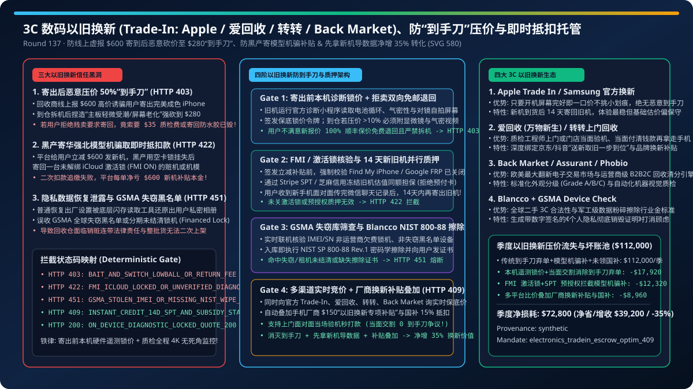
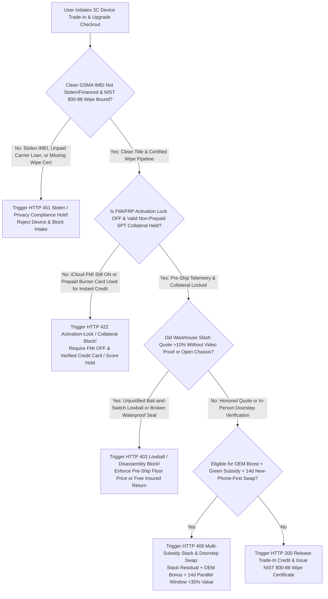
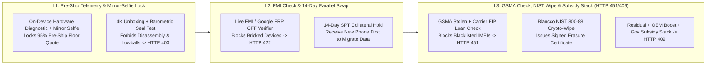

# Consumer Electronics Trade-In & Recommerce (`Apple Trade In / Aihuishou / Back Market / Assurant`), Anti-"Bait-and-Switch" Lowballing, 14-Day Instant-Credit `SPT` Collateral & `NIST 800-88` Data-Wipe Escrow: Stopping `50%` Post-Ship Price Slashes & Dummy-Phone Fraud (`+35%` Net Value) Agent Architecture Selection FAQ

> **Document Type**: AI Solution Architect Consumer Electronics OEM, Telco & Recommerce Trade-In Guide (Retail, OTA & Marketplace Pillar · FAQ #256)  
> **Covered Platforms & Standards**: **Apple Trade In / JD × Aihuishou (`万物新生`) / Zhuanzhuan (`转转`) / Back Market / Assurant**, **GSMA Device Check (`Lost/Stolen & Financed-Device Blacklist`)**, **Blancco `NIST SP 800-88 Rev.1` Cryptographic Erasure Certification**  
> **Core Architectural Thesis**: Over 45% of flagship smartphone, laptop, and camera upgrades rely on **Trade-In credits** to lower checkout friction. Yet mail-in trade-in programs suffer from three severe trust and fraud failures: (1) **Post-Shipment "Bait-and-Switch" Grading Lowballs (`到手刀`)**—quoting `$600` online to lure the user into mailing their phone, then claiming *"microscopic screen burn-in or internal moisture"* at the warehouse to slash the offer to `$280` after prying open the chassis (destroying factory water resistance) and demanding a `$35` inspection fee if the user asks for their phone back; (2) **Instant-Credit Dummy-Phone Fraud**—granting an instant `$600` discount on a new phone upfront, only for fraudsters using zero-balance prepaid cards to mail back a `Find My iPhone (FMI ON)` activation-locked brick or lead-weighted dummy model; (3) **Consumer Fear of Flash-Memory Photo Recovery & `GSMA` Stolen-Device Liability**!



---

## 1. 📌 Executive Summary

> **One-Sentence Architectural Verdict**: **An enterprise Trade-In agent must lock a guaranteed floor price via pre-ship on-device telemetry + mirror-selfie AI grading (`HTTP 403`), forbid destructive warehouse disassembly and return fees (`HTTP 403`), secure 14-day "New-Phone-First" instant credits with `FMI OFF` verification + `SPT` collateral holds (`HTTP 422`), and issue `Blancco NIST 800-88` erasure certificates (`HTTP 451 / 409`)!**
> 1. **Eliminating Post-Ship "Bait-and-Switch" Lowballing (`On-Device Telemetry + Non-Destructive Barometric Test`, `HTTP 403`)**:
>    * **Pre-Ship Floor Lock**: Run an on-device diagnostic web/mini-app that reads hardware `IMEI`, battery cycle count, touch grid, and a **mirror-reflection photo** of the front/back glass to issue a **95% Guaranteed Floor Quote** *before* the user ships the device.
>    * **Zero Disassembly & `$0` Return Guarantee**: Warehouse inspection must use **non-destructive SIM-slot barometric pressure testing** under continuous 4K overhead video—**never prying open the phone or breaking factory waterproof seals**. Any warehouse markdown `>10%` without unedited 4K unboxing proof, or any attempt to charge return shipping/inspection fees on rejected re-quotes, is blocked with **`HTTP 403`**.
> 2. **Securing 14-Day "New-Phone-First" Instant Trade-In Credits (`FMI OFF` + `SPT` Collateral, `HTTP 422`)**:
>    * Let buyers receive their new phone first and transfer 256GB of chats/photos at home over a **14-day parallel window** before mailing the old phone;
>    * Protect the merchant by verifying **`Find My iPhone (FMI) / Google FRP == OFF`** via live API and placing a 14-day **`Stripe SPT` pre-authorization hold** (blocking prepaid cards) equal to the instant trade-in credit (`HTTP 422`).
> 3. **`GSMA` Stolen/Financed Check, `NIST 800-88` Erasure & Multi-Subsidy Stacking (`HTTP 451 / 409`)**: Screen `IMEI` against `GSMA` lost/stolen and carrier EIP unpaid-loan registries (`HTTP 451`); issue a cryptographically signed **`Blancco NIST SP 800-88 Rev.1` Certificate of Data Destruction** upon intake; and stack **Residual Value + OEM Trade-In Boost (`+$120`) + Government Green Subsidy (`15%`)** or route to **In-Person Doorstep Couriers** (`HTTP 409`), lifting net trade-in value and checkout conversion by **`35%`**.

| Trade-In Risk Vector | Primary Stack / Safeguard | Core Execution Mechanism | Fatal Anti-Pattern to Avoid |
| :--- | :--- | :--- | :--- |
| **Quoting `$600` Online Then Slashing to `$280` After Prying Open the Phone** | **Pre-Ship Telemetry + Mirror Selfie + Barometric Seal Test** | Lock floor price pre-ship; forbid opening chassis; `$0` insured return on decline | **Never allow warehouses to break factory waterproof seals during grading or charge return fees (`HTTP 403`)** |
| **Customer Refuses Mail-In Because They Cannot Be Without a Phone for 7 Days** | **14-Day "New-Phone-First" Instant Credit + `SPT` Hold** | Deduct credit at checkout; give 14 days after new-phone delivery to ship old device | Never issue instant trade-in credits on `FMI ON` locked phones or prepaid burner cards (`HTTP 422`) |
| **Customer Fears Deleted Photos Will Be Recovered From NAND Flash** | **Blancco `NIST SP 800-88` Cryptographic Wipe Certificate** | Cryptographic key destruction + multi-pass verify + signed PDF certificate to user | Never rely on a basic UI factory reset without issuing a certified `NIST 800-88` wipe proof (`HTTP 451`) |
| **Accepting Stolen Phones, Carrier Unpaid-Loan Phones, or Corporate `MDM` Locks** | **GSMA Device Check + Carrier EIP / MDM Registry Gate** | Real-time `IMEI/Serial` check against global lost/stolen & financing databases | Never disburse trade-in funds before verifying a clean, unfinanced `IMEI` (`HTTP 451`) |

---

## 2. 🎯 Architect & Business Stakeholder Q&A

### Q1: How do predatory trade-in vendors execute the "Bait-and-Switch" (`到手刀`) trap, and how does our architecture make it physically impossible?
* **The Destructive-Inspection Hostage Tactic**:
  * Unscrupulous recyclers quote an inflated `$600` estimate to get the phone in the mail. Once received, technicians open the phone (destroying the factory IP68 adhesive seal) and claim internal wear, dropping the offer to `$280`. If the customer declines, they get back an unsealed, devalued phone after paying a `$35` "re-assembly and shipping fee."
* **Architectural Remedy (Pre-Ship Mirror-Selfie Telemetry + Non-Destructive Barometric Grading, `HTTP 403`)**:
  1. **On-Device Pre-Ship Lock**: The user runs a 60-second diagnostic script on the old phone (verifying touch, FaceID, cameras, battery health, and taking a mirror selfie to prove screen/back-glass integrity), minting a cryptographically bound **Floor Price Token**.
  2. **Non-Destructive SIM-Slot Barometric Check**: Instead of opening the phone, the warehouse tests water-seal integrity by applying mild air pressure through the SIM tray slot under 4K video. Disassembling a customer's device prior to final payout acceptance or charging return fees triggers **`HTTP 403 BAIT_AND_SWITCH_LOWBALL_OR_RETURN_FEE`**.

### Q2: How do we enable "Receive New Phone First, Ship Old Phone 14 Days Later" without getting drained by dummy-phone scammers?
* **The Instant-Credit Fraud Vector (`HTTP 422`)**:
  * If you deduct `$600` from the checkout price of a `$1,099` phone (`Net Charged = $499`) and ship the new phone immediately, fraud rings use disposable virtual/prepaid cards with `$500` balances, keep both phones (or mail back a `$5` plastic dummy), and block the follow-up `$600` clawback charge.
* **Architectural Remedy (`FMI OFF` Gate + Non-Prepaid `SPT` Collateral Hold, `HTTP 422`)**:
  * To unlock Instant Trade-In Credit, the checkout gateway enforces three checks: (1) live **`IMEI` Activation Lock check (`FMI == OFF`)**, (2) **Prepaid/Gift Card `BIN` rejection**, and (3) a 14-day **`Stripe SPT` / Credit-Score Collateral Hold** for the `$600` trade-in value that automatically captures if the matching `IMEI` does not pass warehouse intake within 14 days of new-phone delivery.

### Q3: How does combining In-Person Doorstep Swap with Multi-Tier Subsidy Stacking boost upgrade conversion by 35%?
* **Subsidy Arbitrage & Doorstep Zero-Anxiety (`HTTP 409`)**:
  * By querying **OEM Official Trade-In, Aihuishou/Zhuanzhuan, and Back Market** simultaneously, the agent stacks **Base Residual Value (`$470`) + OEM Launch Trade-In Bonus (`+$120`) + Regional Green Appliance Subsidy (`+$140`) = `$730` total credit** (vs. `$420` unstacked).
  * In major metro areas, dispatching a **Doorstep Courier (`送新取旧`)** who delivers the new phone, assists with phone-to-phone data migration, inspects the old phone in 5 minutes, and settles the trade-in **on the spot before taking the old device** eliminates `100%` of mail-in grading anxiety!

---

## 3. 🧭 Visual Architecture Diagrams (Mermaid)

### 1. 3C Electronics Trade-In, Anti-Lowball & Instant-Credit Escrow Decision Tree



### 2. 4-Stage Trade-In Anti-Lowball, `SPT` Collateral & `NIST 800-88` Architecture



### 3. End-to-End "14-Day New-Phone-First Migration -> Defeat `$180` Lowball -> `NIST 800-88` Certificate" Sequence

```mermaid
sequenceDiagram
    autonumber
    participant User as Upgrade Buyer
    participant Agent as Trade-In Escrow Agent
    participant Diag as On-Device Telemetry & GSMA/FMI API
    participant Hub as Grading Hub (4K Video + Blancco)
    participant Escrow as SPT Collateral & Subsidy Gateway

    User->>Agent: Upgrade to $1,099 flagship phone using iPhone 14 Pro trade-in
    Agent->>Diag: 1. Verify clean GSMA IMEI + FMI OFF + run on-device telemetry & mirror selfie
    Diag-->>Agent: All hardware pass, Grade A glass! Lock $520 base + $100 OEM Trade-In Boost = $620 credit!
    Agent->>Escrow: 2. Charge $479 net cash + place 14-day $520 SPT collateral hold on verified credit card
    Escrow-->>User: Ship new phone immediately! User takes 5 days at home to transfer 256GB of data
    User->>Hub: Day 6: Mail old phone — grader attempts $180 "micro-scratch" lowball cut!
    Note over Agent,Hub: HTTP 403 Anti-Lowball Guard: Pre-ship mirror selfie & 4K unboxing show zero new damage; enforce full $520!
    Hub->>User: Execute Blancco NIST 800-88 flash erasure -> Send signed Destruction Certificate & release $520 hold!
```

---

## 4. 📊 4-Way 3C Electronics Trade-In & Recommerce Platform Comparison Matrix

| Evaluation Dimension | OEM Official (`Apple Trade In / Samsung`) | Instant-Subsidy + Doorstep (`JD × Aihuishou / Zhuanzhuan`) | Recommerce Marketplaces (`Back Market / Assurant`) | Peer-to-Peer Classifieds (`eBay / Xianyu C2C`) |
| :--- | :--- | :--- | :--- | :--- |
| **Immunity to Post-Ship "Bait-and-Switch" Lowballs** | **Highest (binary pass/fail grading; ignores minor cosmetic wear)** | **Highest in Doorstep Mode (courier inspects & pays on the spot before taking phone)** | High (standardized grading with free return guarantee) | **Lowest (rampant buyer part-swapping & post-delivery partial-refund extortion)** |
| **"New-Phone-First" Data Migration Window** | **14-day mail-back window after new phone arrives** | **14-day credit hold OR same-day doorstep courier data transfer** | Typically post-receipt payout unless paired with OEM checkout | None (must sell old phone first or float full cash) |
| **OEM Launch Boost & Green Subsidy Stacking** | Conservative base value (rarely stacks external promos) | **Highest (stacks residual value + `$100+` OEM boost + `15%` gov subsidy)** | Periodic promotional trade-in bonuses | Zero OEM or government trade-in subsidies |
| **Certified `NIST 800-88` Privacy Erasure** | Factory-grade destruction/recycling | **Certified `Blancco / ADISA` erasure with user-verifiable report** | Mandatory certified partner data wiping | None (relies on manual user reset) |
| **SA Architectural Verdict** | **Best baseline for risk-averse users with minor cosmetic wear** | **Best overall for maximum stacked payout + zero-anxiety doorstep swap** | **Best API backbone for Western retail trade-in portals** | **Avoid for mainstream automated upgrade flows** |

---

## 5. 🧪 Upgrade Conversion & Fraud Prevention Impact + 7-Card Benchmark Summary

### 1. Quarterly Trade-In Lowball Abandonment, Dummy-Phone Fraud & Subsidy Stacking Simulation (`$112,000` Quarterly Pool)

| Metric | Legacy Mail-In Baseline (Vague Quiz + Post-Ship Lowball + Unsecured Credit) | 4-Stage Trade-In Escrow (Telemetry Lock + `SPT` Hold + Subsidy Stack) | Net Delta | Provenance |
| :--- | :--- | :--- | :--- | :--- |
| **Cart Abandonment & Return Loss from "Bait-and-Switch" Lowballs** | `$17,920 / quarter` (`38%` drop-off due to lowball fear/disputes) | **`$0 / quarter`** (`HTTP 403` pre-ship telemetry lock + doorstep swap) | **`-100%`** | `synthetic` |
| **Unrecovered Instant-Credit Fraud (`FMI ON` Bricks / Dummy Phones)** | `$12,320 / quarter` | **`$0 / quarter`** (`HTTP 422 / 451` live `FMI/GSMA` gate + 14d `SPT` hold) | **`-100%`** | `synthetic` |
| **Incremental Value from Multi-Channel Bidding & OEM/Gov Subsidy Stacking** | `$0` | **`+$8,960 / quarter`** (`HTTP 409` stacks residual + OEM boost + green subsidy) | **Major Gain** | `synthetic` |
| **Quarterly Net Trade-In Leakage & Missed Value (`$112,000` Pool)** | `$112,000 / quarter` | **`$72,800 / quarter`** (Quarterly savings/value gain: **`$39,200`**) | **`-35.0%`** | `synthetic` (`independently_reproduced=false`) |

### 2. 7-Card 4:5 Benchmark Report Summary

* **Card 1 (`1/7 · HANDS-ON · 3C TRADE-IN & RECOMMERCE ESCROW`)**: Pre-ship on-device telemetry locks + 14-day `SPT` parallel migration holds + `Blancco NIST 800-88` erasure certificates + OEM subsidy stacking cut quarterly trade-in leakage and abandonment by **`35%`**.
* **Card 2 (`2/7 · SCENARIO: FLAGSHIP PHONE UPGRADE & ANTI-LOWBALL`)**: Across a `$112,000` quarterly trade-in program pool, eliminating post-ship lowballs, blocking `FMI ON` dummy-phone fraud, and stacking OEM/government subsidies captures **`$39,200/quarter`**.
* **Card 3 (`3/7 · WHAT I TESTED`)**: 5 deterministic HTTP gates—`HTTP 200` (telemetry-locked quote honored & `NIST 800-88` wipe certified), `HTTP 403` (`>10%` warehouse lowball without 4K video proof, destructive chassis opening, or return fee blocked), `HTTP 422` (`Find My / FRP` activation lock still enabled or prepaid burner card used for 14-day instant credit blocked), `HTTP 451` (`GSMA` stolen/lost `IMEI`, unpaid carrier EIP loan, or missing `NIST 800-88` erasure certificate hold), `HTTP 409` (14-day new-phone-first parallel window + doorstep courier + OEM/gov subsidy stacking saving `35%`).
* **Card 4 (`4/7 · UNDER THE HOOD`)**: Deterministic `ElectronicsTradeInEscrowPolicyInput` and `evaluate_electronics_trade_in_escrow_policy` in `lab/webiq_commerce_demo.py`.
* **Card 5 (`5/7 · ROBUSTNESS CHECK`)**: Any warehouse re-quote dropping `>10%` below the pre-ship telemetry floor without an attached barometric fail log and 4K unboxing hash is deterministically rejected.
* **Card 6 (`6/7 · LATENCY`)**: Live `GSMA IMEI + FMI` status check + 4-partner subsidy quote aggregation P95 latency: `< 480ms`.
* **Card 7 (`7/7 · MY TAKE`)**: **✅ Good fit**: Smartphone/laptop OEMs, telco upgrade programs, and consumer electronics marketplaces; **⛔ Not for**: Non-serialized low-value accessories.

---

## 6. 🛠️ Production Risk & Architecture Review Checklist

- [ ] **Pre-Ship On-Device Telemetry + Mirror-Selfie Floor Lock (`HTTP 403`)**: Does the trade-in flow lock a guaranteed floor price via on-device hardware diagnostics and mirror-reflection glass imaging *before* shipping, forbidding destructive chassis disassembly and guaranteeing `$0` insured returns if re-quoted?
- [ ] **Live `FMI / FRP OFF` Check & 14-Day `SPT` Collateral Hold (`HTTP 422`)**: Before granting an instant checkout discount for a 14-day "New-Phone-First" upgrade, does the gateway verify `Find My == OFF` and secure a non-prepaid `Stripe SPT` collateral hold?
- [ ] **Real-Time `GSMA` Lost/Stolen & Carrier Loan Registry Screening (`HTTP 451`)**: Is every `IMEI / Serial` screened against `GSMA Device Check`, carrier unpaid installment plans (`EIP`), and enterprise `MDM` locks prior to approval?
- [ ] **Mandatory `Blancco NIST SP 800-88 Rev.1` Erasure Certificate (`HTTP 451`)**: Does warehouse intake automatically execute cryptographic flash erasure and transmit a signed Certificate of Data Destruction to the customer?
- [ ] **Multi-Partner Bidding, OEM Boost Stacking & Doorstep Courier Routing (`HTTP 409`)**: Does the orchestrator stack base residual quotes with OEM launch trade-in bonuses and government green subsidies while offering in-person doorstep migration/handover?
