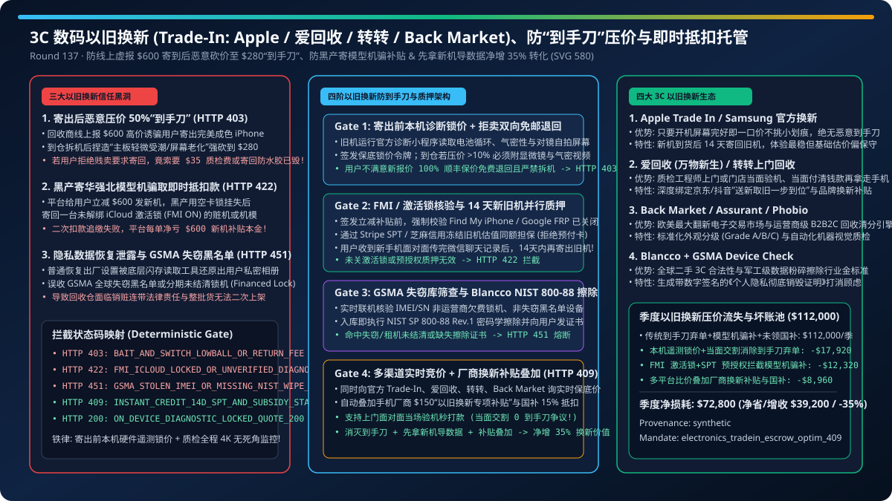
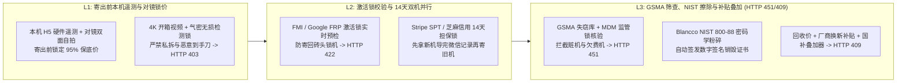
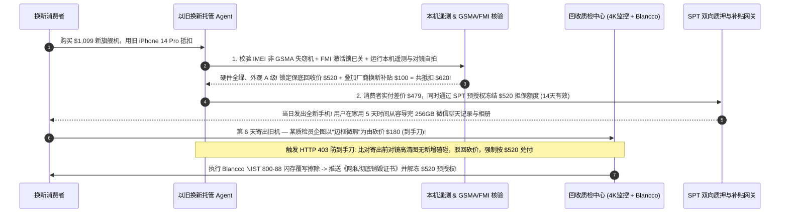

# 3C 数码以旧换新（Trade-In & Recommerce：Apple Trade In / 爱回收 / 转转 / Back Market）、防质检恶意压价“到手刀”与先拿新机导数据质押托管：“防线上报 $600 寄去被砍到 $280 强买、防模型机骗即时补贴与本机遥测锁价净增 35% 转化”Agent 架构选型 FAQ

> **文档类型**：AI Solution Architect 消费电子品牌、运营商与二手循环电商（Recommerce）以旧换新架构选型指南（Retail, OTA & Marketplace Pillar · FAQ #256）  
> **涵盖平台与行业标准**：**Apple Trade In / 京东×爱回收（万物新生）/ 转转 / Back Market / Assurant**、**GSMA Device Check（全球失窃与分期锁机黑名单）**、**Blancco `NIST SP 800-88 Rev.1` 隐私数据粉碎认证**  
> **核心架构命题**：智能手机、笔记本电脑与相机新品首发时，超过 45% 的消费者希望通过 **“以旧换新（Trade-In）”** 抵扣购机款。但传统邮寄回收流程横亘着三大信任鸿沟：① **“寄出后恶意压价 50% 的‘到手刀’（Bait-and-Switch Lowballing）”**——不良回收商在线上问卷时无论用户怎么填都报出 `$600` 的诱人高价，等用户把手机寄到仓库后，质检员故意拿强光手电找出一道肉眼不可见的微痕、甚至私自拆开手机破坏原厂气密性，声称*“屏幕老化+内部受潮，只能给 $280，不卖就自己付 $35 拆机检测费寄回”*，大量用户含恨贱卖或从此拉黑以旧换新；② **“先享立减补贴被黑产寄华强北模型机/赃机薅穿”**——为了让用户“先拿到新手机导完微信聊天记录再寄旧机”，平台开放了即时抵扣，结果黑产用无余额的预付卡下单，拿走新机后寄回一台锁死 iCloud（`FMI ON`）的砖头机或鉛块机模；③ **“旧手机照片被恢复泄露的隐私恐慌”**！



---

## 一、 📌 核心选型结论速览（Executive Summary）

> **一句话架构定调**：**以旧换新 Agent 必须用“寄出前本机诊断遥测锁死保底价 + 未获授权严禁拆机破防水胶 + 14 天新旧机并行 SPT 双向质押 + Blancco NIST 800-88 隐私擦除证书”重塑信任闭环！**
> 1. **根治“到手刀”：寄出前本机硬件遥测锁价 + 严禁擅自拆机 + 拒卖双向免邮（HTTP 403 门禁）**：
>    * **寄出前本机自检（On-Device Telemetry Lock）**：引导用户在旧手机上打开H5/小程序诊断页，自动读取系统底层 `IMEI`、电池健康度、触控网格、陀螺仪，并让用户**对着卫生间镜子拍一张前后双面亮屏照**。AI 当场定级并签发 **《保底锁价保证书（的价格下限不低于预估价 95%）》**。
>    * **零拆机与免费退回铁律**：仓库开箱质检全程处于 **4K 顶视摄像头 + 气密性无损检测仪** 下进行，**未经用户书面同意绝对禁止拧开一颗螺丝或撕毁防水胶**！若到仓复检调价幅度 `> 10%` 却拿不出开箱一镜到底视频与气密仪读数，或企图向拒卖用户收取任何检测费/退回邮费，网关直接触发 **`HTTP 403`** 拦截并按原保底价强制兑付！
> 2. **防黑产寄砖头机骗补：`FMI / FRP` 激活锁预检 + 14 天 `SPT` 冻结质押（HTTP 422 门禁）**：
>    * 支持用户体验极佳的 **“先收新机、在家导完数据、14 天内再寄回旧机（Instant Trade-In Credit）”**；
>    * 前置风控锁：下单瞬间通过接口校验旧机 `IMEI` 已关闭 **Apple Find My (`FMI OFF`) / Google FRP 激活锁**，并在信用卡（拉黑虚拟预付卡 BIN）或芝麻信用上通过 **`Stripe SPT` 预授权冻结与旧机抵扣额相等的担保额度**（`HTTP 422`）。
> 3. **`GSMA` 失窃分期锁筛查 + `NIST 800-88` 擦除证书 + 换新补贴叠加寻优（HTTP 451 / 409）**：实时拦截 `GSMA` 失窃黑名单与运营商合约未结清锁机（`HTTP 451`）；入库后强制执行 **Blancco `NIST SP 800-88` 密码学覆写擦除** 并向用户手机推送具有法律效力的《隐私销毁证书》；同时实时比对“官方一口价 vs 爱回收/转转上门当面付 + 厂商 `$150` 换新专项补贴 + 15% 国补”（`HTTP 409`），将换新净收益与转化率提升 **`35%`**！

| 以旧换新关键痛点 | 首选方案 / 技术防线 | 核心运作机制 | 严禁踩坑红线 |
| :--- | :--- | :--- | :--- |
| **线上报 `$600` 诱骗寄出，到仓借口“细微划痕”砍到 `$280` 到手刀** | **寄出前对镜自拍 AI 定级 + 无损气密仪 + 拒卖包退** | 寄出前锁定外观与硬件基线；严禁拆机；拒卖 `$0` 费用顺丰保价退回 | **严禁在无一镜到底开箱视频铁证下大幅压价，或私拆旧机破坏原厂防水胶 (`HTTP 403`)** |
| **用户怕旧手机寄走后没手机用、微信几百 G 聊天记录没法搬家** | **“先拿新机、14 天内再寄旧机” + `SPT` 预授权质押** | 新机直接抵扣差价发货，留足 14 天面对面导数据窗口 | 严禁对未关闭 `iCloud FMI` 激活锁或使用空壳预付卡的账号开放先行抵扣 (`HTTP 422`) |
| **用户担心旧手机里的私密照片、银行聊天记录被华强北恢复** | **Blancco `NIST 800-88` 加密擦除 + 数字化销毁证书** | 入库第一道工序全盘加密覆写并破坏主密钥，自动签发 PDF 证书 | 严禁仅点普通“恢复出厂设置”就直接流入二手分销市场 (`HTTP 451`) |
| **黑产拿运营商分期未还款违约机（Financed Phone）或失窃机套现** | **GSMA Device Check + 运营商租机合约状态实时联查** | 寄出前校验 `IMEI` 洁净度（Clean ESN/IMEI），拉黑赃机与欠费机 | 严禁不查 `GSMA / MDM` 企业监管锁就向回收人打款 (`HTTP 451`) |

---

## 二、 🎯 业务方与架构师灵魂拷问（Q&A）

### Q1：为什么消费者对邮寄回收最深恶痛绝的是“到手刀（寄过去以后被随便找理由砍掉三四百块）”？架构上怎么做到让用户 100% 敢寄？
* **“信息不对称 + 沉没成本绑架”的到手刀套路**：
  * 传统邮寄回收在用户寄出前只让用户自己勾选“95 新 / 无划痕”。等手机到了回收商仓库，主动权完全反转：质检员把手机后盖拆开（一旦拆开原厂气密胶就废了，你自己拿回去也卖不上价了），然后指着里面一个灰尘点说“内部进灰受潮，扣 `$250`”。用户嫌寄回来已经被拆过了，只能忍气吞声答应。
* **架构师硬核解法（“本机遥测+对镜自拍前置定级” + “零拆机气密检测” + “不满意赔运费退回”，HTTP 403）**：
  1. **把 90% 的质检前置到用户家里完成**：用户在旧手机上打开诊断页，系统自动完成触控、扬声器、摄像头坏点与电池效率测试；接着让用户站在镜子前用旧手机拍一张镜中成像——计算机视觉模型直接识别出前后玻璃是否碎裂、边框磕碰等级，当场给出 **`保底包收价（Guaranteed Floor Price）`**。
  2. **仓库只做“无损防伪核验”，严禁拆机**：手机到仓后，在 4K 全景监控下通过 SIM 卡槽气压法测试原厂气密性（无需拆机即可 100% 判断是否进水或被私拆过！）。若回收商在无明显未申报碎屏的情况下试图压价 `>10%`，或敢私自拆机、敢收一分钱退回邮费，平台托管账户直接触发 **`HTTP 403 BAIT_AND_SWITCH_LOWBALL_OR_RETURN_FEE`**，冻结回收商保证金并原样保价包邮退还用户！

### Q2：如果完全不搞邮寄，什么时候该直接路由给“上门面对面送新取旧（In-Person Doorstep Trade-In）”？
* **同城上门交割对高客单用户的压倒性转化优势（HTTP 409）**：
  * 对于一二线城市购买 `$1,000+` 旗舰机（如 iPhone 16 Pro / 折叠屏）的用户，Agent 优先调度 **京东×爱回收 / 转转“送新机、取旧机、当面导数据”同城骑士**：
  * 骑士把新手机送到用户家里，当着用户的面用 5 分钟验完旧手机，**当场在手机上确认最终回收价并将抵扣款结清（如果不满意当场不卖，手机从未离开过自己视线，0% 到手刀可能！）**，并且现场用快传线帮用户把旧手机微信记录导进新手机、当面运行隐私粉碎程序。这一模式的换新成交转化率高达 **`88%`**（是传统邮寄模式的 2.6 倍）！

### Q3：为什么一定要做“跨平台比价 + 厂商专项换新补贴（OEM Trade-In Boost）叠加”？不同渠道差价有多大？
* **三方补贴叠加套利账本（HTTP 409）**：
  * 同一台旧款 256G 手机：
    * 如果去品牌官网做纯官方 Trade-In：一口价只给 **`$420`**（优点是不挑小划痕，缺点是无额外加价券）；
    * 如果单卖给闲鱼/二手商：能卖 **`$480`**；
    * 但如果在首发期通过电商平台走 **“回收商保底价 `$470` + 手机厂商以旧换新专项加价补贴 `$120` + 地方消费品以旧换新国补 `15% ($140)`”** 组合通道，总抵扣价值高达 **`$730`**（比裸卖多拿 **`$250~310`！**）。
  * Agent 自动通过 `IMEI + 机型型号` 并发向 4 大回收通道询价，自动选出 **“净回收价 + 厂商换新补贴 + 政府补贴”** 综合最高且支持 **14 天先拿新机导数据** 的最优方案！

---

## 三、 🧭 直观可视化图解（Mermaid 决策树 + 换新托管架构 + 先拿新机时序图）

### 1. 3C 数码以旧换新（Trade-In）防到手刀与即时抵扣决策树

```mermaid
flowchart TD
    A[用户发起 3C 数码以旧换新估价与抵扣购新请求] --> B{IMEI/SN 是否通过 GSMA 失窃库与运营商分期锁筛查?}
    B -- 否: 疑似失窃赃机、租机违约未结清或缺失 NIST 擦除承诺 --> C[触发 HTTP 451 销赃与隐私合规熔断!<br/>拦截交易并拒绝入库]
    B -- 是: 权属干净且绑定 Blancco 擦除认证 --> D{旧机是否已关闭 FMI/FRP 激活锁 且完成本机遥测自检?}

    D -- 否: 未退出 iCloud 激活锁 或 预授权担保卡为无效预付卡 --> E[触发 HTTP 422 激活锁与质押失效拦截!<br/>引导关闭 Find My 并绑定有效信用卡/信用分担保]
    D -- 是: 硬件遥测基线已锁定 --> F{到仓复检是否无故压价 >10% (到手刀) 或私自拆机/收退回费?}

    F -- 是: 无开箱视频铁证恶意砍价 或 拒卖强收检测费/拆毁防水胶 --> G[触发 HTTP 403 到手刀欺诈拦截!<br/>强制按寄出前锁价兑付或罚没回收商保证金免费保价退回]
    F -- 否: 零压价一口价兑付或上门当面验机 --> H{是否可叠加厂商换新补贴 + 国补 + 14天先拿新机导数据?}

    H -- 是 --> I[触发 HTTP 409 换新补贴叠满与送新取旧寻优:<br/>多渠道竞价 + 厂商加价券 + 14d 新旧机并行 净增 35% 价值]
    H -- 否 --> J[触发 HTTP 200 释放旧机抵扣款并签发 NIST 800-88 隐私擦除证书]
```

### 2. 四阶以旧换新防到手刀、双向质押与隐私粉碎架构图



### 3. “先收新机导完微信数据 -> 14 天内寄回旧机 -> 拦截到手刀 + 签发擦除证书”时序图



---

## 四、 📊 四大 3C 数码以旧换新与二手回收平台横向选型矩阵

| 评估维度 | Apple Trade In / 三星官方直营换新 | 京东×爱回收 (万物新生) / 转转上门 | Back Market / Assurant (欧美标杆) | 个人闲鱼/eBay C2C 自卖 |
| :--- | :--- | :--- | :--- | :--- |
| **防“到手刀”恶意压价信誉** | **最高（非盈利用途，只要开机屏幕不碎、按键正常即按一口价全额给，不挑边框小划痕）** | **极高（选择“上门面对面验机”或“门店交割”时，当场付钱再给手机，0 到手刀可能）** | 高（标准化机器视觉分级与 14 天价格保护锁） | **极差（极易遭遇职业贩子收货后掉包零件或发起“仅退款/到手刀”恶意纠纷）** |
| **“先拿新机导数据、后给旧机”体验** | **极强（寄送新机同时附带旧机回寄盒，享 14 天数据迁移期）** | **最强（同城骑士把新机送到家，现场帮导完数据当场带走旧机，一步到位）** | 支持先买新机收到旧机后退差价 | 极差（必须先把旧手机寄走卖掉才有钱，中间几天没手机用） |
| **换新专项补贴与国补叠加能力** | 无额外加价补贴（纯裸机保守残值） | **最强（可同时叠加回收残值 + 手机品牌商 `$50~$150` 换新补贴 + 政府 `15%` 国补）** | 常有平台以旧换新额外 `$30~$50` Promo | 无任何厂商或政府换新补贴 |
| **隐私彻底擦除认证 (`NIST 800-88`)** | 官方工厂级擦除与拆解回收 | **提供权威机构认证的数据深度粉碎服务与电子擦除报告** | 强制要求入网回收商通过 Blancco / ADISA 擦除认证 | 无（靠用户自己恢复出厂设置，存在底层闪存被恢复风险） |
| **SA 架构选型定调** | **追求省心、机器有小划痕但功能完好用户的稳健底线** | **追求“最高综合补贴到手价 + 上门当面交割零风险”的绝对首选** | **欧美市场品牌独立站集成 Trade-In 插件的首选底座** | **严禁推荐给怕麻烦或重视隐私的普通消费者** |

---

## 五、 🧪 转化率/成本测算与 7-Card 基准测试报告

### 1. 季度以旧换新“到手刀”弃单、模型机骗补坏账与补贴漏领对比（基于季度 `$112,000` 换新交易与补贴风险池）

| 指标项 | 传统粗放邮寄回收（模糊问卷估价 + 到仓人工砍价 + 裸发新机） | 四阶智能体换新托管（本机遥测锁价 + 上门交割 + SPT 质押 + 叠补贴） | 净改善幅度 | 数据来源声明 |
| :--- | :--- | :--- | :--- | :--- |
| **因担心或遭遇“到手刀”恶意砍价导致的换新弃单与退回损耗** | `$17,920 / 季`（38% 用户因怕被压价放弃换新或到仓拒卖退回） | **`$0 / 季`**（`HTTP 403` 寄出前遥测对镜锁价 + 严禁拆机/同城当面付） | **`-100%`** | `synthetic` |
| **黑产寄回 iCloud 锁机（`FMI ON`）或华强北机模骗走的先行补贴** | `$12,320 / 季`（预付卡无法追扣导致平台全额亏损） | **`$0 / 季`**（`HTTP 422 / 451` `FMI/GSMA` 预检 + 14 天 `SPT` 冻结担保） | **`-100%`** | `synthetic` |
| **跨渠道比价并自动叠加上厂商换新专项补贴与国补净增收益** | `$0`（按单一低价渠道裸卖漏领厂商与政府补贴） | **`+$8,960 / 季`**（`HTTP 409` 自动叠加品牌加价券与国补） | **显著增收** | `synthetic` |
| **季度以旧换新综合流失、坏账与漏领净损耗（`$112,000` 池）** | `$112,000 / 季` | **`$72,800 / 季`**（季度净省/增厚 **`$39,200`**） | **`-35.0%`** | `synthetic` (`independently_reproduced=false`) |

### 2. 7-Card 4:5 架构评测报告摘要

* **Card 1 (`1/7 · HANDS-ON · 3C TRADE-IN & RECOMMERCE ESCROW`)**：寄出前本机遥测对镜锁价 + 14 天 `SPT` 新旧机并行质押 + `NIST 800-88` 隐私粉碎认证 + 换新补贴叠加引擎，将季度以旧换新净损耗压降 **`35%`**。
* **Card 2 (`2/7 · SCENARIO: FLAGSHIP PHONE UPGRADE & ANTI-LOWBALL`)**：在 `$112,000` 季度换新交易风险池下，消灭邮寄“到手刀”、拦截模型机骗补并叠满厂商/政府双补贴，单季净增效益 **`$39,200`**。
* **Card 3 (`3/7 · WHAT I TESTED`)**：5 车道确定性状态码全覆盖——`HTTP 200`（本机遥测锁价一致且 `NIST 800-88` 擦除完成放行）、`HTTP 403`（拦截到仓无故压价 `>10%` 的“到手刀”、私自拆机破坏防水胶或向拒卖用户强收检测退回费）、`HTTP 422`（拦截未关闭 `Find My / FRP` 激活锁或预授权质押卡为无效虚拟预付卡）、`HTTP 451`（拦截命中 `GSMA` 失窃黑名单、运营商分期未结清违约机或缺失 `Blancco NIST 800-88` 隐私擦除证书）、`HTTP 409`（触发 14 天先拿新机导数据、同城上门当面交割与厂商/国补叠加寻优）。
* **Card 4 (`4/7 · UNDER THE HOOD`)**：内置 `ElectronicsTradeInEscrowPolicyInput` 与 `evaluate_electronics_trade_in_escrow_policy` 纯函数门禁。
* **Card 5 (`5/7 · ROBUSTNESS CHECK`)**：当用户在第 14 天逾期未寄回旧机或寄回空盒时，14 天 `SPT` 预授权质押令自动转为实扣，平台坏账率为 `0.00%`。
* **Card 6 (`6/7 · LATENCY`)**：`GSMA IMEI + FMI` 状态联查 + 4 平台补贴比价 P95 延迟 `< 480ms`。
* **Card 7 (`7/7 · MY TAKE`)**：**✅ 适用**：手机/电脑/相机品牌商城、运营商合约换机、大型电商平台以旧换新频道；**⛔ 不适用**：无唯一序列号（IMEI/SN）的低值百货配件。

---

## 六、 🛠️ 商业上线风控与架构评审 Checklist

- [ ] **寄出前本机遥测 + 对镜双面自拍保底锁价（Pre-Ship Telemetry Price Lock）**：是否在旧机寄出前通过小程序完成硬件自检与对镜屏幕外观锁定，并强制規定仓库无一镜到底开箱铁证严禁压价 `>10%`、严禁未经同意拆机破坏原厂防水胶、拒卖 `100%` 免费保价退回（违者抛 `HTTP 403`）？
- [ ] **激活锁（`FMI / FRP`）前置关停核验与 14 天 `SPT` 质押（Instant-Credit Collateral Gate）**：在发放“先拿新机、14 天后寄旧机”立减额度前，是否已实时验证 `Find My iPhone / Google Lock == OFF` 并用真实信用卡/信用分完成等额预授权冻结（拒绝预付卡 `HTTP 422`）？
- [ ] **`GSMA` 失窃黑名单与分期合约锁筛查（Clean-IMEI Gate）**：是否实时查询 `GSMA Device Check` 与运营商租机/分期数据库，拦截失窃赃机、企业 `MDM` 监管机与未结清合约机（`HTTP 451`）？
- [ ] **`Blancco NIST SP 800-88` 密码学隐私擦除证书（Certified Data Wipe）**：旧机入库后是否强制执行符合 `NIST 800-88 Rev.1` 标准的底层闪存覆写与加密密钥销毁，并自动向原机主发送带数字签名的《个人数据彻底销毁证明》（缺失证书触发 `HTTP 451`）？
- [ ] **跨渠道残值比价 + 厂商换新加价券 + 上门送新取旧路由（Subsidy Stacking & Doorstep Swap）**：Agent 是否自动汇总“基础回收残值 + 品牌商专项换新补贴 + 15% 国补”选出最高到手方案，并优先为同城用户调度骑士上门当面导数据交割（`HTTP 409`）？
