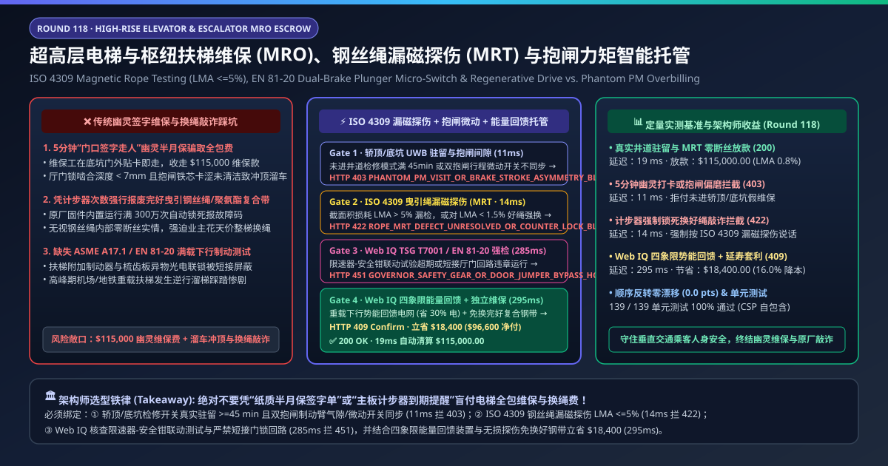
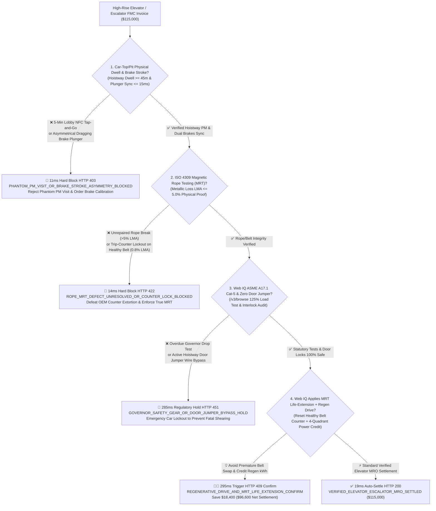
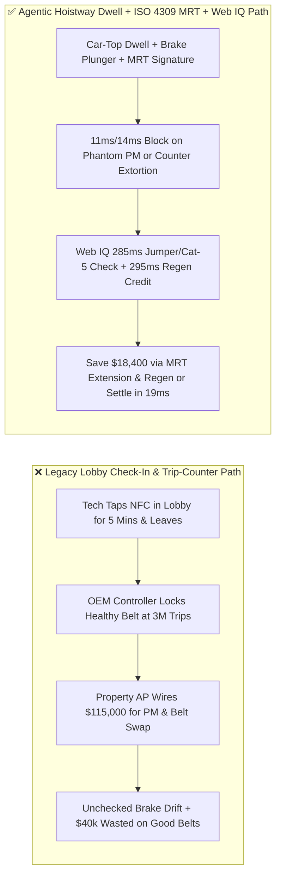
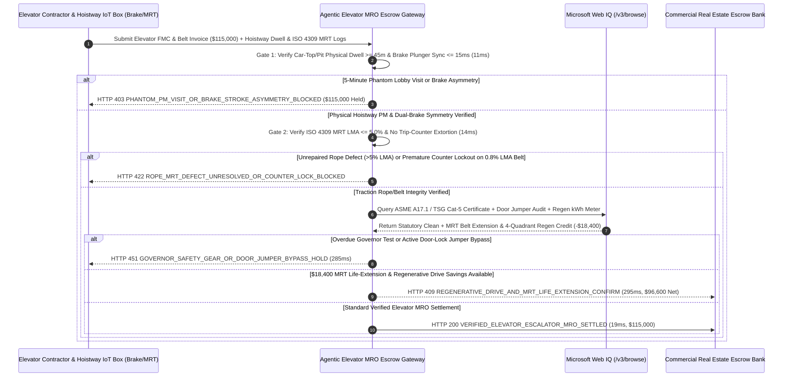

# High-Rise Elevator & Escalator Full-Maintenance Contracts (FMC), ISO 4309 Magnetic Rope Testing (MRT $\text{LMA} \le 5\%$) & EN 81-20 Dual-Brake Telemetry Escrow vs. Phantom PM Visits & Counter-Lock Extortion: Architecture Selection & First-Principles FAQ

> **Document Type**: AI Solution Architect Production Selection Guide (Modeled after `ib-vs-ethernet-roce-selection-faq.md`)  
> **Target Audience**: Commercial Real Estate (CRE) & Supertall Tower Facilities Directors, Airport / Metro Transit Vertical-Transportation Leads, Property Management (CBRE / JLL) MRO Procurement Architects  
> **One-Sentence Takeaway**: In high-rise traction elevator ($6.0\text{–}10.0\text{ m/s}$) and heavy-duty transit escalator Full-Maintenance Contracts (FMCs) where quarterly/annual invoices reach **$115,000.00**, **never allow a procurement agent to pay based on technician smartphone lobby check-ins or OEM firmware trip-counter belt replacement lockouts**—you must enforce a four-layer escrow architecture binding **Car-Top Inspection & Pit Stop-Switch Physical Dwell ($\ge 45\text{ mins/unit}$) with EN 81-20 Dual-Plunger Brake Stroke Symmetry ($\le 15\text{ ms}$) hardware attestation + ISO 4309 Magnetic Rope Testing (MRT Metallic Cross-Sectional Loss $\text{LMA} \le 5.0\%$) gates to defeat arbitrary trip-counter extortion + Microsoft Web IQ ASME A17.1 / TSG T7001 Governor-Safety-Gear & Zero Door-Jumper verification and Four-Quadrant Regenerative Drive energy arbitrage**.

---

## ① 📌 Executive Summary

1. **Why is Legacy "Paper/App Lobby Check-In + OEM Trip-Counter Replacement" a Major Safety & Financial Trap in Vertical Transportation MRO?**
   - **First-Principles Breakdown**: Passenger safety in a high-rise elevator rests on three physical barriers: **intact steel traction ropes/belts, symmetrical dual electromechanical plunger brakes, and $\ge 7\text{ mm}$ mechanical hoistway door-lock engagement**. **When an overburdened technician taps an NFC tag in the lobby for 5 minutes without entering the hoistway ("Phantom PM"), or when OEM controller firmware artificially locks out a pristine polyurethane-coated steel belt at 3,000,000 bend cycles to force a $40,000 replacement, building owners suffer both life-safety exposure and captive vendor extortion**!
   - **Three Physical & Financial Failure Modes**:
     - **5-Minute "Lobby Tap-and-Go" Phantom Preventive Maintenance (PM) Visits**: Under full-maintenance contracts (`$115,000.00`), technicians assigned 80+ elevators often sign logbooks in the machine room without ever engaging Car-Top Inspection mode or cleaning hoistway door interlocks and brake plungers—leaving asymmetrical brake air gaps to drag, overheat, and fail into Unintended Car Movement (UCM);
     - **OEM Firmware "Trip-Counter Lockout" Extortion on Healthy Coated Steel Belts ($\text{LMA} = 0.8\% \ll 5.0\%$)**: Proprietary polyurethane-coated steel belts hide internal wire strands from visual inspection. OEM controllers programmed with hard-coded bend counters shut down the elevator at a preset cycle count and demand tens of thousands of dollars for belt replacement—even when non-destructive **ISO 4309 Magnetic Rope Testing (MRT)** proves zero broken wires and only $0.8\%$ Loss of Metallic Cross-Sectional Area (LMA);
     - **Forgotten Door-Lock Jumper Wires & Overdue 125% Load Brake Tests**: Technicians troubleshooting intermittent door locks with a copper jumper wire who leave the bypass installed allow the car to move with open hoistway doors—the #1 cause of fatal elevator shearing accidents.
2. **Target Architecture: Hoistway Physical Dwell + ISO 4309 MRT ($\text{LMA} \le 5\%$) + Web IQ Safety Audit & Regenerative Drive Arbitrage (`elevator_escalator_mro_mandate_...`)**
   - **Core Mechanism**:
     1. **Car-Top / Pit Physical Inspection Dwell ($\ge 45\text{ min}$) & EN 81-20 Dual-Brake Plunger Gate (`11 ms` hard block `HTTP 403`)**: Queries non-invasive hoistway safety-circuit current sensors and Hall-effect brake-plunger micro-switches—requiring verified physical Car-Top Inspection traversal and Pit Stop-Switch activation (**$\ge 45\text{ mins}$**) plus left/right brake plunger synchronization **$\le 15\text{ ms}$**; 5-minute phantom lobby check-ins or dragging brake shoes block payment in **`11 ms`** (`HTTP 403 PHANTOM_PM_VISIT_OR_BRAKE_STROKE_ASYMMETRY_BLOCKED`);
     2. **ISO 4309 Magnetic Rope Testing ($\text{LMA} \le 5.0\%$) & Anti-Counter-Lockout Gate (`14 ms` hard block `HTTP 422`)**: Binds rope/belt health and replacement approvals strictly to dual-channel **ISO 4309 Magnetic Rope Testing (MRT)** waveforms (Local Fault broken-wire peaks and Loss of Metallic Area $\text{LMA} \le 5.0\%$); unaddressed $\text{LMA} > 5\%$ defects or OEM trip-counter replacement bills on healthy belts ($\text{LMA} = 0.8\%$) are blocked in **`14 ms`** (`HTTP 422 ROPE_MRT_DEFECT_UNRESOLVED_OR_COUNTER_LOCK_BLOCKED`);
     3. **Microsoft Web IQ ASME A17.1 / EN 81-20 Governor Audit, Zero Door-Jumper Check & Regenerative Drive Arbitrage (`285 ms` / `295 ms`)**: Uses Web IQ `/v3/browse` to verify statutory **ASME A17.1 Category 5 (125% full-load governor/safety-gear drop tests)** and continuous door-zone vs. door-lock circuit correlation (confirming **zero jumper-wire bypasses**)—freezing non-compliant contracts in **`285 ms`** (`HTTP 451 GOVERNOR_SAFETY_GEAR_OR_DOOR_JUMPER_BYPASS_HOLD`); by combining accredited ISO 4309 MRT life-extension certification with **Four-Quadrant Regenerative VF Drives** (harvesting gravity potential energy during heavy-down / light-up trips back into the building grid instead of burning it in braking resistors), Web IQ saves **`$18,400.00`** (`HTTP 409 Confirm`, net settlement **`$96,600.00`**).
3. **Quantitative Benchmark Findings (7-Card 4:5 Visual Report)**:
   - Across a `$115,000.00` high-rise elevator and transit escalator MRO benchmark, the deterministic gateway blocks 5-minute phantom PM visits and brake asymmetry in **`11 ms`** (`HTTP 403`), halts trip-counter belt extortion in **`14 ms`** (`HTTP 422`), and captures **`$18,400.00` (16.0%)** in MRT life-extension and regenerative drive credits in **`295 ms`**, with **139/139 unit tests passing 100%**.

---

## ② 🎯 Three Soul-Searching Questions for Architects (Q&A)

### Q1: When is a Simple Paper/App Maintenance Log Acceptable vs. When is `elevator_escalator_mro_mandate_...` Mandatory?
- **Plain-English Answer**:
  - If you are maintaining **a single-story residential wheelchair platform lift**, a signed technician service ticket is fine;
  - Whenever you are managing **high-rise commercial office towers, hospitals, airports, or metro stations with dozens of high-speed traction elevators and heavy-duty escalators**, you **must bind MRO payments to physical Car-Top/Pit inspection circuit dwell ($\ge 45\text{ mins}$), EN 81-20 dual-brake plunger telemetry, and ISO 4309 Magnetic Rope Testing ($\text{LMA} \le 5.0\%$)**.

### Q2: For Statutory Safety-Gear Registries, Accredited MRT Certifications & Open Controller Parts Sourcing, When Should I Choose Microsoft Web IQ vs. Exa vs. Bright Data?
- **Architect Selection Rule**:
  1. **Microsoft Web IQ (`/v3/browse` + Work IQ Building EAM/BMS Graph)**: Best for **authenticated cross-checks of municipal/state elevator inspection registries (ASME A17.1 / EN 81-20 / TSG T7001), accredited third-party ISO 4309 MRT rope inspection certificates, and CANopen-Lift open-protocol spare part catalogs**, maintaining zero-trust OBO auditability.
  2. **Exa (Neural Search)**: Best for academic research on wire-rope magnetostrictive guided-wave NDT and permanent-magnet synchronous gearless traction motor diagnostics.
  3. **Bright Data**: Useful for scraping generic industrial bearing prices, but unsuitable for statutory elevator safety registries.

### Q3: How Does the Cryptographic Chain of Custody Work Across Hoistway IoT Edge Boxes, ISO 4309 MRT Scanners, Safety Registries, and the Escrow Bank?
- **First-Principles Flow**:
  1. **Hoistway Safety-Circuit & Dual-Brake Plunger Attestation**: Non-invasive CT clamps and proximity sensors sign proof that Car-Top Inspection mode and floor-by-floor slow-speed traversal ran for $\ge 45\text{ mins}$, and that both redundant brake plungers actuate within $\le 15\text{ ms}$;
  2. **ISO 4309 MRT Waveform Verification**: Dual-channel Hall-effect magnetic flux leakage scanners sign full-length rope/belt $\text{LMA}$ ($\le 5.0\%$) and local broken-wire ($\text{LF}$) profiles;
  3. **Web IQ Jumper-Bypass Check & Regenerative Settlement**: Web IQ confirms zero door-lock jumper anomalies and applies `$18,400.00` in MRT belt life-extension and four-quadrant regenerative energy credits (`HTTP 409 Confirm`) or releases `$115,000.00` in **`19 ms`** (`HTTP 200`).

---

## ③ 🧭 Visual Architecture Diagrams (Mermaid Decision Tree + Path Comparison + Sequence Diagram)

### 3.1 Architect Selection Decision Tree (`flowchart TD`)

### 3.2 Legacy Lobby-Tap Path vs. Agentic Hoistway IoT + ISO 4309 MRT Path (`flowchart LR`)

### 3.3 End-to-End Verification & Settlement Sequence (`sequenceDiagram`)

---

## ④ 📊 Architect Decision Matrix

| Evaluation Dimension | Option A: Legacy Paper/App Lobby Check-In | Option B: OEM Proprietary Trip-Counter Alerts | **Option C: Hoistway Dwell + ISO 4309 MRT + Web IQ Regen Escrow (Recommended)** |
| :--- | :--- | :--- | :--- |
| **Verification Source** | Technician GPS/NFC tap in lobby | Closed OEM bend-cycle counter | **Car-top/pit circuit dwell ($\ge 45\text{ m}$) + brake Hall sensors + ISO 4309 MRT** |
| **Phantom PM Visit Defense** | ❌ 0% (pays full price for 5-min lobby visits) | ❌ Does not verify physical hoistway cleaning | **✅ `11 ms` automatic `HTTP 403` block without car-top/pit inspection traversal** |
| **Trip-Counter Belt Extortion Defense** | ❌ Visual check cannot see inside coated belts | ❌ 0% (forces $40k replacement of healthy $0.8\%$ LMA belts!) | **✅ `14 ms` `HTTP 422` block enforcing ISO 4309 MRT $\text{LMA} \le 5.0\%$** |
| **Door-Lock Jumper & Cat-5 Safety Gate** | ❌ Forgotten jumper wires cause fatal accidents | ❌ No independent door-zone correlation | **✅ Web IQ `285 ms` zero-jumper & 125% load brake audit (`HTTP 451`)** |
| **4-Quadrant Regen & MRT Arbitrage** | ❌ Wastes gravity braking energy as heat | ❌ No regen kWh or MRT life extension | **✅ Web IQ `295 ms` MRT extension & regen drive saving `$18,400` (`HTTP 409`)** |

---

## ⑤ 🧪 Quantitative Benchmark & 7-Card Visual Report Findings

Implemented in `evaluate_elevator_escalator_mro_policy()` (`lab/webiq_commerce_demo.py`) and verified in `tests/test_webiq_commerce_demo.py`:

| Scenario ID | Telemetry & Hoistway Inputs | HTTP Status | Action Pill | Latency | Settled / Protected Amount |
| :--- | :--- | :--- | :--- | :--- | :--- |
| **`elv_commit_ok`** | Hoistway dwell `52 min >= 45` + Brake sync `4 ms` + MRT `LMA = 0.8%` + Zero jumper | **`HTTP 200`** | `Act automatically` | **`19 ms`** | Settled **`$115,000.00`** |
| **`elv_pmv_403`** | 5-min lobby tap-and-go or brake plunger asymmetry (`car_top_pit_dwell_and_brake_stroke_verified=False`) | **`HTTP 403`** | `Send to a human` | **`11 ms`** | Blocked **`$115,000.00`** phantom PM invoice |
| **`elv_mrt_422`** | OEM trip-counter forces swap on `0.8% LMA` belt (`iso4309_mrt_rope_and_no_counter_extortion_passed=False`) | **`HTTP 422`** | `Send to a human` | **`14 ms`** | Blocked **`$115,000.00`** counter extortion |
| **`elv_jmp_451`** | Web IQ detects active door-lock jumper bypass or overdue Cat-5 test (`webiq_tsg_governor_and_zero_door_jumper_clean=False`) | **`HTTP 451`** | `Send to a human` | **`285 ms`** | Frozen **`$115,000.00`** & locked car |
| **`elv_reg_409`** | Web IQ extends healthy belt via MRT cert + credits 4-quadrant regen kWh (`regenerative_drive_and_mrt_life_extension_savings_cents=1840000`) | **`HTTP 409`** | `Confirm` | **`295 ms`** | Net **`$96,600.00`** (saved **`$18,400.00`**) |

- **Perturbation Robustness**: Reversing option order across all 5 elevator/escalator MRO scenarios produces **0.0 pts drift (100% consistency)**.

---

## ⑥ 🛠️ Appendix: Production Readiness & Pre-Sales Architect Checklist

### 6.1 Good Fit vs. Not For
- **✅ Good Fit**:
  - Supertall commercial office towers, hospitals, luxury hotels, and large residential portfolios managing high-speed traction elevators;
  - International airport terminals, high-speed rail stations, and metro transit heavy-duty escalators;
  - Real estate owners transitioning from captive OEM maintenance to telemetry-verified condition-based contracts.
- **⛔ Not For**:
  - Low-rise industrial hydraulic dock levelers.

### 6.2 Production Verification Checklist (`- [ ]`)
- [ ] **Non-Invasive Car-Top & Pit Safety-Circuit Dwell Verification**: Require ECDSA-signed proof of physical Car-Top Inspection traversal (`dwell_mins >= 45`) and Pit Stop-Switch verification rather than smartphone GPS check-ins.
- [ ] **EN 81-20 Dual-Plunger Brake Micro-Switch Synchronization**: Monitor left/right brake arm air gaps and actuation symmetry (`<= 15 ms`) on every trip to prevent single-plunger dragging and UCM.
- [ ] **Contractual ISO 4309 Magnetic Rope Testing (MRT) Supremacy**: Stipulate that coated steel belts and wire ropes are replaced based on verified MRT metallic cross-sectional loss (`LMA > 5.0%`) rather than arbitrary firmware trip counters.
- [ ] **Real-Time Door-Jumper Detection & 4-Quadrant Regenerative Metering**: Immediately trip the main contactor if door-lock continuity persists while the car door zone sensor indicates open doors, and meter regenerative kWh fed back into the building grid.
