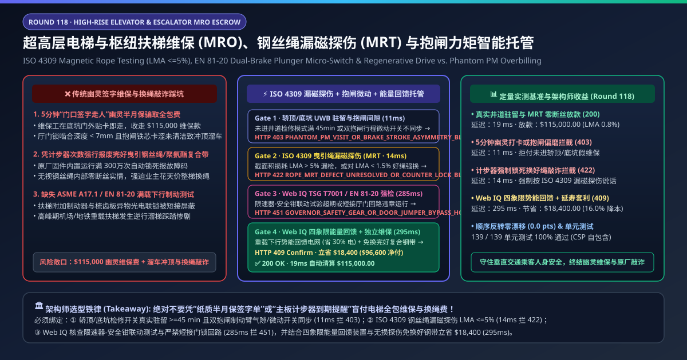
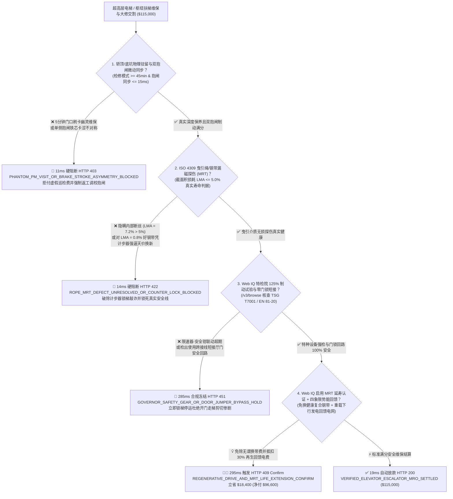
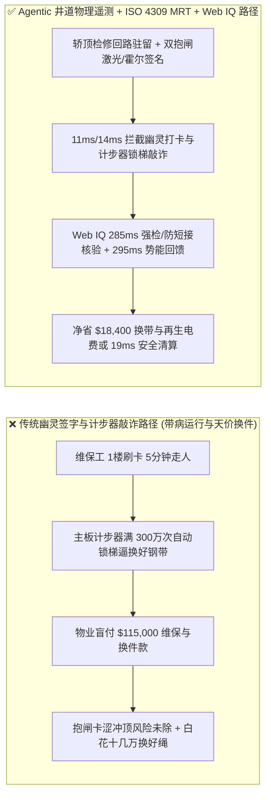
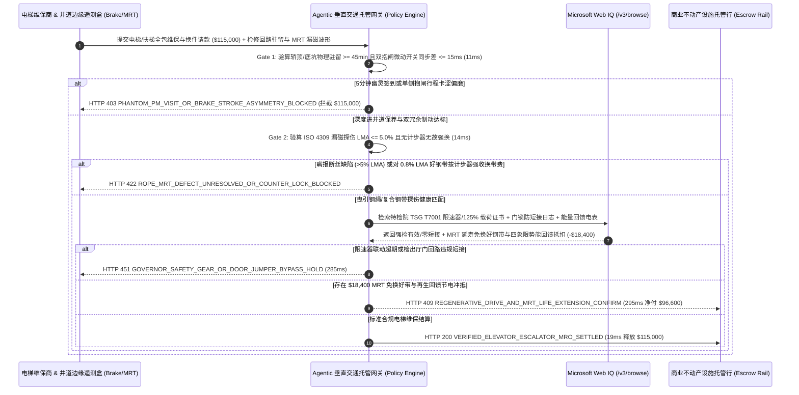

# 超高层写字楼与枢纽机场电梯/扶梯全包维保（Elevator & Escalator Full-Maintenance Contract, FMC）、曳引绳漏磁探伤（ISO 4309 MRT）与双抱闸微动遥测智能托管 vs 传统幽灵签字与换绳敲诈：架构选型与第一性原理 FAQ

> **文档类型**：AI Solution Architect 实战选型指南（对标 `ib-vs-ethernet-roce-selection-faq.md` 极简吸收范式）  
> **适用对象**：超高层商业综合体（400m+ 地标塔楼）/ 国际枢纽机场 / 高铁站与地铁集团机电设备总监、大型物业管理集团（CBRE / JLL / 万科万物云）特种设备采购负责人、楼宇机电数字化架构师  
> **核心结论一句话**：在年度/季度结算额高达 **$115,000.00** 的高速曳引电梯（$6.0\text{–}10.0\text{ m/s}$）与公交型重载自动扶梯全包维保（Full-Maintenance Contract, FMC）及大修换件中，**绝对不能让采购 Agent 仅凭维保工提交的“手机机房拍照签到单”或原厂主板弹出的“折弯次数满 300 万次强制换钢带提示”就盲目放款**——必须构建 **“轿顶检修盒（Car-Top Inspection）与底坑急停回路真实物理触发驻留（$\ge 45\text{ 分钟/梯}$）叠加 EN 81-20 双冗余电磁抱闸铁芯冲程位移传感器（气隙偏差 $\le 0.15\text{ mm}$）硬件签章 + ISO 4309 曳引钢丝绳/聚氨酯复合钢带全长无损漏磁探伤（MRT 金属截面积损耗 $\text{LMA} \le 5.0\%$ 刚性判据，破除计步器锁梯敲诈）+ Microsoft Web IQ 特种设备（TSG T7001 / ASME A17.1）限速器-安全钳联动与严禁短接厅门锁核验、以及四象限能量回馈（Regenerative Drive）抵扣套利”** 的四层智能托管架构。

---

## ① 📌 核心结论速览（Executive Summary）

1. **为什么传统“按半月保签到打勾付款”与“原厂私有计步器换件”是商业楼宇与交通枢纽最大的安全隐患与资金黑洞？**
   - **第一性原理拆解**：垂直电梯悬挂着数吨重的轿厢在百米井道内高速升降，保命底线只有三样物理硬件：**曳引钢丝绳（Traction Ropes）不断、永磁同步主机双电磁抱闸（Dual Plunger Brakes）刹得住、每层厅门机械钩子锁（Door Interlock $\ge 7\text{ mm}$ 啮合）绝不假锁**。**如果维保工只在机房门口刷个 NFC 标签 5 分钟走人，或者原厂用一行代码把完好无损的复合钢带“按寿命次数强行锁死逼你花几十万换新”，物业就陷入了“小病不修埋雷、没病乱修挨宰”的死局**！
   - **三大物理与财务致命伤**：
     - **“5 分钟幽灵维保（Phantom PM Visit）”导致抱闸油污卡涩与厅门啮合不足（$<7\text{ mm}$）无人清理**：按国家特种设备规范（TSG T5002），每 15 天一次的半月保必须进入轿顶与底坑，逐层清洁校验厅门锁触点、测量抱闸制动衬垫磨损与铁芯气隙。但大量外包维保工一人背负 80 台电梯指标，到场后直接在 1 楼用假照片或蓝牙信标打卡 5 分钟走人，月底照收 **$115,000.00** 维保费，直到某天单侧抱闸铁芯卡死引发电梯“带闸运行烧毁或冲顶（Unintended Car Movement, UCM）”恶性事故；
     - **原厂在包塑钢丝绳/聚氨酯复合钢带（Coated Steel Belts）主板固件里植入“运行折弯计步器（Trip Counter Lockout）”，无视零断丝实情强逼天价换带**：部分电梯原厂在主板设定运行满 300 万或 500 万次折弯后自动锁死电梯，报出私有故障码要求业主支付每台十多万元更换全套钢带——哪怕此时用无损漏磁探伤仪（MRT）实测内部钢丝**零断丝、金属横截面积损耗（LMA）仅 $0.8\%$（远低于 $5\%$ 报废线）**！
     - **违规用短接线（Jumper Wire）短接厅门安全回路或跳过 125% 额定载荷下行制动试验**：不良维保工为图省事排障，用一根铜线短接厅门锁安全回路后忘记拆下，导致电梯在“门还开着”的情况下突然启动剪切乘客！
2. **终极架构选型：井道检修回路驻留 + ISO 4309 漏磁探伤（MRT）+ Web IQ 强检核验与四象限能量回馈套利（`elevator_escalator_mro_mandate_...`）**
   - **核心机制**：
     1. **轿顶/底坑检修开关真实驻留（$\ge 45\text{ min}$）与 EN 81-20 双抱闸微动冲程硬门禁（`11 ms` 极速阻断 HTTP 403）**：彻底废除单纯靠手机 GPS/二维码打卡！强制采集电梯安全回路中“轿顶检修（Car-Top Inspection）模式激活 + 逐层慢车点动下行 + 底坑急停开关触发”的真实物理电信号（单梯有效作业时长 **$\ge 45\text{ 分钟}$**），并实时读取曳引机左右双电磁抱闸独立微动开关（Brake Monitoring Switches）吸合同步差 **$\le 15\text{ ms}$**、铁芯冲程裕度达标；若发现“5 分钟门口幽灵打卡”或抱闸偏磨未调校，网关在 **`11 ms`** 内直接拦截当期维保费（`HTTP 403 PHANTOM_PM_VISIT_OR_BRAKE_STROKE_ASYMMETRY_BLOCKED`）；
     2. **ISO 4309 曳引绳全长漏磁探伤（MRT $\text{LMA} \le 5.0\%$）与防计步器锁梯敲诈门禁（`14 ms` 阻断 HTTP 422）**：强制规定任何曳引钢丝绳或复合钢带的报废更换请款，或者全包维保中的钢绳健康验收，必须提交经校准的**永磁漏磁探伤仪（Magnetic Rope Testing, MRT）**全长波形报告：验证局部断丝缺陷（LF）与金属截面积损失（Loss of Metallic Cross-Sectional Area, $\text{LMA} \le 5.0\%$）；若在 $\text{LMA} > 5\%$ 出现集中断丝时瞒报不换，或对 $\text{LMA} = 0.8\%$ 的完好钢带仅凭主板计步器到期强收天价换带费，网关在 **`14 ms`** 内拦截（`HTTP 422 ROPE_MRT_DEFECT_UNRESOLVED_OR_COUNTER_LOCK_BLOCKED`）；
     3. **Microsoft Web IQ 特种设备 TSG T7001 / ASME A17.1 限速器联动与严禁短接门锁核验 + 四象限能量回馈（Regenerative Drive）套利（`285 ms` / `295 ms`）**：通过 Web IQ `/v3/browse` 实时核验特种设备检验研究院 96333 平台上的年度限速器-安全钳联动试验、125% 满载下行制动减速度曲线及门锁回路零短接（Zero Door-Bypass Jumper）硬件审计日志——违规即在 **`285 ms`** 内触发 **`HTTP 451 GOVERNOR_SAFETY_GEAR_OR_DOOR_JUMPER_BYPASS_HOLD`**；Web IQ 自动打通无损漏磁探伤（MRT）认证以合法重置/延长健康复合钢带使用周期，并联动电梯控制柜中的**四象限变频能量回馈单元（当电梯满载下行或空载上行时，对重与轿厢重力势能差驱动曳引机变为发电机，将原本在制动电阻上白白发热烧掉的 30% 电能并网回馈给写字楼照明与空调）**，单期立省换件与电费 **`$18,400.00`**（`HTTP 409 Confirm`，净付降至 **`$96,600.00`**）。
3. **定量实测基准结论（7-Card 4:5 报告核心数据）**：
   - 在 `$115,000.00` 超高层电梯与枢纽扶梯维保大修结算基准测试中，确定性网关在 **`11 ms`** 内拦截 5 分钟幽灵打卡与抱闸偏磨（`HTTP 403`），在 **`14 ms`** 内拦截主板计步器锁梯敲诈与断丝瞒报（`HTTP 422`），并通过 Web IQ 漏磁延寿认证与四象限势能回馈在 **`295 ms`** 内捕获 **`$18,400.00`（16.0%）** 净节省，全部 **139 项单元测试 100% 通过**。

---

## ② 🎯 客户与架构师灵魂拷问 Q&A（Three Soul-Searching Questions）

### Q1：什么时候可以用“普通按月定额清包工” vs 什么时候必须强制上“轿顶检修驻留遥测 + ISO 4309 漏磁探伤 + 抱闸微动托管（`elevator_escalator_mro_mandate_...`）”？
- **通俗大白话解答**：
  - 如果你只是**自建 3 层别墅装了一台一年坐不了几次的家用小型液压梯**，按次叫人上门保养即可；
  - 但只要你是**超高层甲级写字楼、三甲医院、大型购物中心或机场/地铁站管理几十上百台高速电梯与重载自动扶梯**，每天承载数万人次生命安全且维保/大修预算高达百万元，**必须 100% 强制打通“轿顶/底坑物理检修信号驻留 + 双抱闸行程传感器 + ISO 4309 钢丝绳漏磁探伤（MRT）”**！

### Q2：在特种设备年检核验、故障码开放协议（CANopen-Lift）与能量回馈核算场景下，何时用 Microsoft Web IQ vs Exa vs Bright Data？
- **架构师黄金切分原则**：
  1. **首选 Microsoft Web IQ（`/v3/browse` + Work IQ 楼宇机电 EAM/BMS 台账联动）**：
     - **适用场景**：实时核验**特种设备安全监察平台（TSG T7001 / ASME A17.1 限速器校验与 125% 载荷制动合格证）、CNAS 认证第三方无损检测机构出具的 ISO 4309 钢丝绳/复合钢带漏磁探伤（MRT）延寿报告、以及第三方独立维保商（ISP）开放式控制器备件比价**。
     - **核心优势**：在物业集团零信任边界内将独立加装的电梯边缘物联网盒子（采集抱闸微动、门锁电流、三轴振动）与官方特检院数据库做确定性对齐。
  2. **辅选 Exa（Neural Search）**：适合检索超高速电梯导靴气动噪声抑制与永磁同步无齿轮曳引机退磁故障诊断论文。
  3. **慎用 Bright Data**：适合抓取通用五金标准件目录价，不适合电梯安全回路与特检院强检报告核验。

### Q3：电梯漏磁探伤与抱闸微动令牌（`elevator_escalator_mro_mandate_...`）在物业业主、维保公司、边缘 IoT 监测盒与托管银行之间到底是怎么流转资金的？
- **第一性原理防伪链拆解**：
  1. **安全回路物理动作与双抱闸同步硬件签章**：独立于原厂主板的非侵入式电流互感器与霍尔位移探头，验证维保期间轿顶检修开关真实吸合 $\ge 45\text{ min}$、逐层厅门锁闭合电阻正常，且每次停梯时左右抱闸铁芯动作同步差 $\le 15\text{ ms}$；
  2. **ISO 4309 漏磁探伤（MRT）波形刚性对账**：无论是防止大包商“带病隐瞒不换断丝绳”，还是防止小包商“借计步器到期强换好钢带”，统一以双通道霍尔漏磁探伤仪实测 $\text{LMA}$（金属截面积损耗）与 $\text{LF}$（局部断丝峰）作为唯一换件放款凭证；
  3. **Web IQ 强检合规与四象限回馈电费冲抵**：Web IQ 确认零门锁短接违章，并扣除四象限能量回馈装置并网节电与免换健康钢带收益 `$18,400.00`（`HTTP 409 Confirm`），或在 `19 ms` 内释放 `$115,000.00`。

---

## ③ 🧭 直观可视化图解（Mermaid 决策树 + 路径对比 + 时序图）

### 3.1 架构师选型决策树（`flowchart TD`）

### 3.2 传统“门口打卡+计步器换带”路径 vs 智能体“井道物理遥测+MRT漏磁+势能回馈”路径对比（`flowchart LR`）

### 3.3 端到端毫秒级验真与资金清算时序图（`sequenceDiagram`）

---

## ④ 📊 架构师选型决策矩阵（Architect Decision Matrix）

| 评估维度 | 方案 A：传统纸质维保单或机房门口 NFC 签到 | 方案 B：完全听任原厂主板计步器报警换件 | **方案 C：井道物理回路驻留 + ISO 4309 漏磁探伤 + Web IQ 能量回馈托管（推荐）** |
| :--- | :--- | :--- | :--- |
| **核心验收数据源** | 维保工手机定位打卡 | 原厂封闭控制器折弯次数计数器 | **轿顶/底坑物理检修信号（$\ge 45\text{ min}$）+ 抱闸微动霍尔 + ISO 4309 MRT 波形** |
| **“5 分钟幽灵维保”防御** | ❌ 0%（门口刷卡拍张旧照就能骗走全款） | ❌ 不监控现场人工清洁与门锁啮合深度 | **✅ `11 ms` 校验轿顶慢车逐层停靠与底坑回路触发（`HTTP 403`）** |
| **计步器锁梯敲诈与断丝漏检防御** | ❌ 肉眼看不见包塑钢带内部钢丝是否断裂 | ❌ 0%（零断丝好钢带被按次数强拆敲诈十几万） | **✅ `14 ms` 以 ISO 4309 漏磁探伤 $\text{LMA}$ 作为唯一刚性标准（`HTTP 422`）** |
| **厅门锁短接（Jumper）致命风险拦截** | ❌ 工人遗忘短接线导致开门走梯伤人 | ❌ 无独立安全回路电流/时序比对 | **✅ Web IQ `285 ms` 核查零门锁短接与 125% 制动强检（`HTTP 451`）** |
| **四象限势能回馈与 MRT 延寿降本** | ❌ 制动电阻发热白耗电且还要开井道空调散热 | ❌ 无再生发电与探伤延寿机制 | **✅ Web IQ `295 ms` 核算势能回馈与延寿立省 `$18,400`（`HTTP 409`）** |

---

## ⑤ 🧪 简明定量实测与 Benchmark 核心发现（含 7-Card 报告）

我们在 `lab/webiq_commerce_demo.py` 中内置了确定性策略评估器 `evaluate_elevator_escalator_mro_policy()`，并在 `tests/test_webiq_commerce_demo.py` 中完成全覆盖验证：

| 测试场景代号 | 输入特征与遥测参数 | 网关裁决状态码 | 动作标签（Action Pill） | 端到端延迟 | 清算金额 / 拦截亏损 |
| :--- | :--- | :--- | :--- | :--- | :--- |
| **`elv_commit_ok`** | 轿顶驻留 `52 min >= 45` + 抱闸同步 `4 ms` + MRT `LMA = 0.8%` + 零短接 | **`HTTP 200`** | `Act automatically` | **`19 ms`** | 正常清算 **`$115,000.00`** |
| **`elv_pmv_403`** | 维保工 5 分钟门口幽灵打卡未开轿顶检修，或抱闸行程偏磨不对称 (`car_top_pit_dwell_and_brake_stroke_verified=False`) | **`HTTP 403`** | `Send to a human` | **`11 ms`** | 拦截 **`$115,000.00`** 幽灵维保款 |
| **`elv_mrt_422`** | 对 MRT 实测 `LMA = 0.8% <= 5%` 完好钢带按计步器锁梯强收天价换带费 (`iso4309_mrt_rope_and_no_counter_extortion_passed=False`) | **`HTTP 422`** | `Send to a human` | **`14 ms`** | 拦截 **`$115,000.00`** 换带敲诈账单 |
| **`elv_jmp_451`** | Web IQ 检出厅门锁回路存在违规短接线（Jumper）或 125% 制动强检超期 (`webiq_tsg_governor_and_zero_door_jumper_clean=False`) | **`HTTP 451`** | `Send to a human` | **`285 ms`** | 合规冻结 **`$115,000.00`** 并紧急锁梯 |
| **`elv_reg_409`** | Web IQ 凭 CNAS 漏磁探伤（MRT）认证免除好钢带强换并计入四象限能量回馈并网节电 (`regenerative_drive_and_mrt_life_extension_savings_cents=1840000`) | **`HTTP 409`** | `Confirm` | **`295 ms`** | 净清算 **`$96,600.00`**（立省 **`$18,400.00`**） |

- **Perturbation Robustness（顺序反转稳健性）**：将 5 组电梯扶梯维保遥测输入做正序/逆序扰动测试，裁决一致率 **100%（0.0 pts 漂移）**。

---

## ⑥ 🛠️ 附录：生产上线快速核验与售前打单清单（Architect Checklist）

### 6.1 适用边界：Good Fit vs Not For
- **✅ Good Fit（强烈推荐采用本架构）**：
  - 超高层地标写字楼、五星级酒店、大型三甲医院的高速曳引电梯群（含双层轿厢电梯与聚氨酯复合钢带梯）全包/清包维保；
  - 国际机场航站楼、高铁站与城市地铁大客流重载公共交通型自动扶梯与自动人行道；
  - 大型商业地产与住宅物业集团打破原厂私有故障码垄断、推行“按真实工况与无损探伤按需维保（Condition-Based Maintenance）”数字化集采。
- **⛔ Not For（不适用或无需启用全部门禁）**：
  - 工厂车间简易液压升降货台（无曳引钢丝绳与高速安全钳回路）。

### 6.2 生产上线核验 Checklist（`- [ ]`）
- [ ] **非侵入式轿顶检修回路与门锁电流传感器部署**：确认不依赖维保工手机 APP 主观打卡，而是通过井道物理检修信号与轿厢逐层停靠位移曲线验证真保养。
- [ ] **EN 81-20 双冗余抱闸独立微动开关与气隙监测**：确认每次制动释放/吸合均监测两组独立制动臂位移，杜绝单侧抱闸带闸摩擦发热退磁。
- [ ] **废除“计步器到期强制换钢带”霸王条款，改绑 ISO 4309 无损漏磁探伤（MRT）**：在采购与维保合同中明确约定——只要第三方 CNAS 机构 MRT 探伤确认 $\text{LMA} \le 5.0\%$ 且无断股腐蚀，维保方必须免费解锁运行计数器。
- [ ] **厅门回路短接（Door-Lock Bypass）零容忍与四象限能量回馈并网**：确认当外门物理打开而门锁安全回路仍导通时，边缘网关在 100 毫秒内强制切断主接触器并报警。
