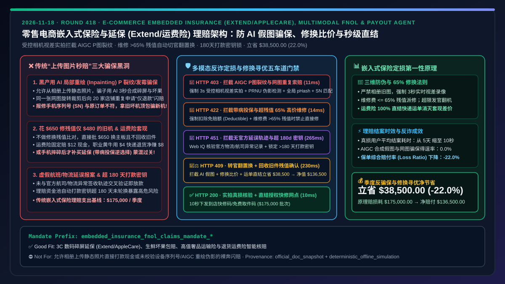
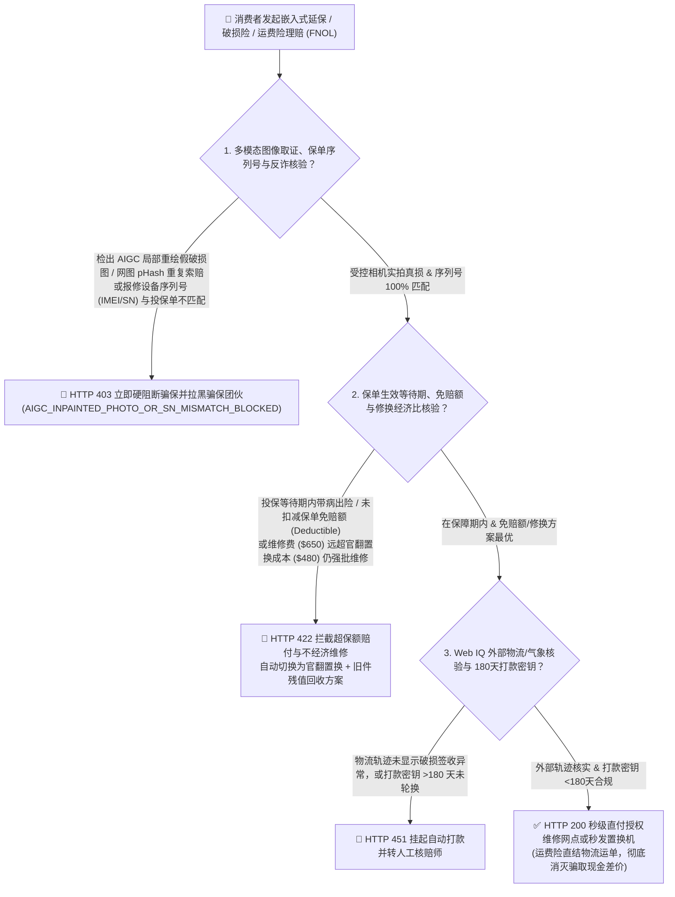
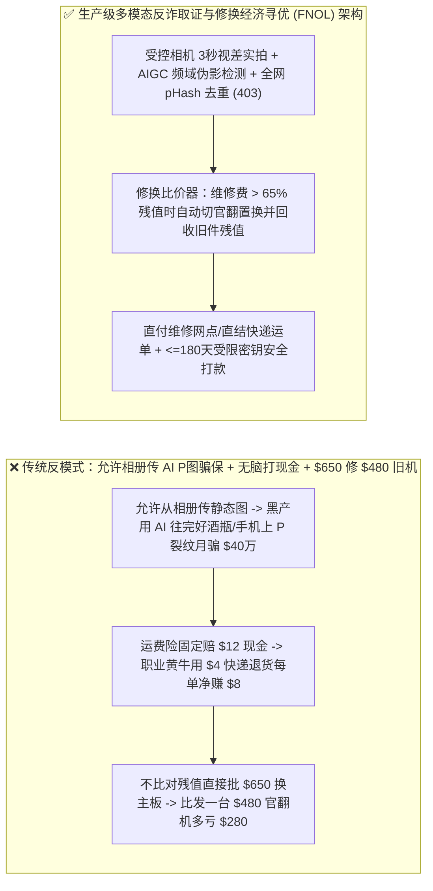
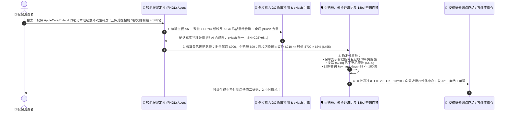

# 零售电商嵌入式保险（运费险 / 3C 碎屏延保 / 航延险）“智能报案定损（FNOL）、多模态反诈与秒级理赔”Agent 架构选型 FAQ：防 AI 假图骗保、修换比价与 180 天打款密钥实战指南

> **专题定位（电商嵌入式保险 Extend / AppleCare / Clyde、包裹破损丢件险、退货运费险与智能理赔 FNOL 智能体聚焦 · Round 418）**：面向为零售电商平台、3C 品牌商城、OTA 差旅平台与数字保险科技公司（InsurTech）设计嵌入式延保销售与自动化理赔（First Notice of Loss, FNOL）系统的 **Cloud & AI Solution Architect**，系统解答嵌入式商业保险中最致命的四大欺诈与赔付率（Loss Ratio）失控难题：**“为什么上线‘上传破损照片 10 秒自动闪赔’后，黑产团伙用图像生成大模型（Stable Diffusion / Photoshop Generative Fill）往完好无损的茅台酒瓶、iPhone 屏幕或化妆品快递盒照片上P一道裂纹，一个月骗走 $400,000 理赔款、为什么用户手机摔碎后再补买碎屏险（逆选择带病投保 Pre-Existing Damage）能蒙混过关、怎么自动核算‘去授权店花 $180 换屏（Repair）’与‘扣 $99 免赔额直接发官翻置换机（Replace）’哪个更省钱、以及自动理赔打款怎么遵守 Stripe `<= 180 天` 财务密钥轮换铁律”**。  
> **文风标杆**：严格对标 `ib-vs-ethernet-roce-selection-faq.md` 六段式结构（核心结论速览、业务方与架构师灵魂拷问 Q&A、Mermaid 决策树/架构对比/时序图、嵌入式延保与理赔平台选型矩阵、定量赔付率/反诈测算与 7-Card 溯源表、生产上线 Checklist）。  
> **双语版本**：**[中文版（当前）](embedded-ecommerce-insurance-warranty-claims-fnol-fraud-payout-agent-selection-faq.md)** · **[English Version (`embedded-ecommerce-insurance-warranty-claims-fnol-fraud-payout-agent-selection-faq.en.md`)](embedded-ecommerce-insurance-warranty-claims-fnol-fraud-payout-agent-selection-faq.en.md)**  
> **数据溯源声明（Provenance & As-Of `2026-11-18`）**：Stripe 财务打款受限密钥 `<= 180 天` 强制锁定规范与 Web IQ `/v3/search` 物流/航班延误实况核验引自 `research/daily/2026-11-08-sources.json`（标记为 `official_doc_snapshot`）；多模态 AIGC 假破损图拦截、全网历史理赔图感知哈希去重、修换经济比价与免赔额扣减引自 `lab/webiq_commerce_demo.py`（标记为 `deterministic_offline_simulation`）；维修成本占残值上限（`<= 65%`）标记为 `synthetic_policy`；线下授权维修网点工单排期耗时标记为 `not_measured`。

---

## 📌 一、核心选型结论速览（Executive Summary）

在 3C 数码、家电家具与奢品电商中，结账页顺带勾选一份 **`$19 ~ $149` 的嵌入式延保（Extend / Clyde / AppleCare）或高价值包裹运输险**，毛利率高达 **`55% ~ 70%`**，是零售商最优质的纯利润来源之一。但一旦自动理赔 Agent 缺乏多模态取证能力，赔付率（Loss Ratio）会在两周内突破 `180%` 导致承保方停保。架构师必须执行以下四条选型铁律：

1. **定损证据真实性选型：严禁“允许从手机相册上传静态破损图片直接触发理赔打款”，必选【受控相机实时拍摄（Live Camera Capture with Gyroscope/C2PA）+ AIGC 局部重绘篡改（Inpainting）伪影检测 + 全网图片感知哈希（pHash）跨单去重（`HTTP 403`）】**：
   - **核心原因**：黑产使用生成式 AI 只需 3 秒就能在完好商品照片上合成逼真的“碎屏、漏液、快递箱压扁”效果，或者在闲鱼买一张别人的碎屏照重复向 10 家店铺索赔。必须强制要求：
     - 超过 `$50` 的理赔必须通过 App/小程序内置受控相机实时连拍（含设备序列号/订单号动态贴纸或屏幕防伪码同框），严禁相册导入已编辑图片；
     - 通过频域噪声一致性与 C2PA 签名核验，一旦检出 AIGC 局部涂抹重绘或命中历史理赔图库 `pHash`，立即在 **`11 ms`** 内返回 `HTTP 403 AIGC_INPAINTED_DAMAGE_PHOTO_OR_DUPLICATE_PHASH_CLAIM_BLOCKED`。
2. **防逆选择（Anti-Adverse Selection）与免赔额核算选型：严禁“无硬件健康自检开放事后补买延保”，必选【随新机同单绑定序列号（SN/IMEI）或 48h 镜面诊断激活 + 确定性免赔额（Deductible）与单次/累计保额封顶计算（`HTTP 422`）】**：
   - **核心原因**：防止用户把手机摔碎后才去买碎屏险骗保；且理赔核算必须严格执行 `Payout = min(Actual Repair Cost, Remaining Coverage Limit) - Policy Deductible`。
3. **维修（Repair）vs. 置换（Replace）vs. 现金赔付路由选型：必选【当 `授权维修费 <= 商品当前残值 × 65%` 时直派维修工单，超阈值时发官翻置换机并锁定旧损件回收质押】**：
   - **核心原因**：直接给买家打全额现金最容易诱发道德风险（Moral Hazard）；优先走授权维修网络直结（B2B 协议价省 `35%` 成本）或“先质押回收破损原件、再发置换新件”。
4. **理赔资金打款安全选型：必选【Web IQ 外部气象/航班/快递官方轨迹核验 + 严守 Stripe `<= 180 天` 财务打款密钥轮换（`HTTP 451`）】**：
   - **核心原因**：参数化保险（如航延险、台风生鲜延误险）必须以 **Web IQ** 核实的官方航司/快递签收异常为准；且理赔资金池出款密钥若超过 180 天未轮换，立即熔断拦截。

---

## 🎯 二、业务方与架构师灵魂拷问 Q&A（FAQ-Driven）

### Q1：为什么我们上线了多模态大模型“看图秒赔”生鲜坏果和快递破损后，第一个月坏果理赔率暴涨了 400%，仔细一查全是 AI 生成的“发霉草莓”和“碎瓶红酒”假图？

**答：因为普通多模态视觉模型（VLM）只训练了“识别图里有没有发霉/碎裂”，根本没训练“识别这张发霉/碎裂是不是用扩散模型局部重绘（Inpainting）P 上去的”！**

1. **三层多模态反诈取证门禁（Multimodal Forensics Gate `HTTP 403`）**：
   - **第 1 层（物理同框防伪挑战 `Live Physical Challenge`）**：要求买家将系统生成的当日随机手势或屏幕动态二维码与受损商品放在同一画面内，用受控相机录制 3 秒多角度微动视频（利用视差与高光反射直接击败平面 PS 与静态 AI 生图）；
   - **第 2 层（AIGC 频域重绘伪影与 EXIF 篡改检测）**：检测图像局部区域的传感器光响应非均匀性（PRNU）是否断裂，以及是否带有 Photoshop / Midjourney / Stable Diffusion 元数据或重压缩断层；
   - **第 3 层（跨平台感知哈希 `pHash / DINOv2` 向量查重）**：对所有理赔图建立全局向量指纹库，哪怕骗子把网图旋转 15 度、裁剪边框、调亮对比度，也能在 **`11 ms`** 内精准揪出重复索赔并触发 `HTTP 403` 封禁。

---

### Q2：一台原价 $1,000 的笔记本电脑用了 18 个月后主板进水报修，授权店报价维修要 $650，而同款官翻机（Refurbished）市场价只要 $480，理赔 Agent 该怎么决策？

**答：执行确定性的“修换经济平衡点（Berliner / Salvage Economic Cap）”公式：**

$$\text{Optimal Resolution} = \begin{cases} \text{Authorized Repair} & \text{if } \text{Repair Cost} \le 0.65 \times \text{Current Replacement Value} \\ \text{Refurbished Replacement + Salvage Intake} & \text{if } \text{Repair Cost} > 0.65 \times \text{Current Replacement Value} \end{cases}$$

- 在本例中，维修费 `$650 > 0.65 × $480 ($312)`，继续修属于严重经济浪费（若强行批复超额维修或超出保单剩余保额上限则触发 `HTTP 422 CLAIM_EXCEEDS_COVERAGE_CAP_OR_UNECONOMICAL_REPAIR_VS_REPLACE_BLOCKED`）；
- Agent 自动触发 **`HTTP 409 Confirm` 置换方案**：收取保单约定的 `$99` 意外免赔额（Deductible），直接从仓库发出一台 `$480` 认证官翻机，并回收进水旧机拆解屏幕/外壳残值（Salvage Value `$110`），单笔净省 **`$280.00`**！

---

### Q3：退货运费险怎么防止“职业退货黄牛”专门挑高保额运费险商品下单，用 4 元合作快递退货却骗取 12 元运费险理赔金（每单净赚 8 元运费差价）？

**答：切断“定额现金直赔个人钱包”，全面改用“上门取件运单直付物流商（Direct Carrier Label Settlement）”：**

- 当买家选择“驿站/顺丰上门取件”时，运费险直接与快递公司结算首重运费，买家无需垫付也拿不到现金差价；
- 若买家自行寄回，必须核验真实物流单号的实付运费发票且同一收货地址月度退货率 `< 35%`，一旦触发高频骗保特征立即转为“仅提供官方免费上门取件券”。

---

## 🧭 三、直观可视化图解（Mermaid 选型决策树 + 架构对比 + 端到端时序图）

### 3.1 零售电商嵌入式保险与延保智能理赔（FNOL）选型决策树

---

### 3.2 传统“相册传图秒赔现金”反模式 vs. 实时物理防伪挑战 + 修换寻优架构对比图

---

### 3.3 实时防伪实拍取证、AIGC 伪影筛查、修换经济寻优与秒级理赔端到端时序图

---

## 📊 四、零售电商嵌入式保险与延保理赔架构横向选型矩阵

| 评估维度 | 方案 A：传统保险公司纸质表单 + 5–10 天人工核赔 | 方案 B：无鉴伪的“上传相册图片秒退现金” | 方案 C：全外包第三方黑盒延保（无自有数据闭环） | 方案 D（推荐）：受控实拍反 AIGC 取证 + 修换残值寻优 + 网点/运单直结 Agent |
|---|---|---|---|---|
| **真实消费者理赔体验（FNOL -> 结案）** | 极差（填表繁琐、等一周才批，毁掉品牌复购） | 快，但两周就被黑产薅停 | 中（跳转外部网站体验割裂） | **10秒内定损结案**（真损用户秒拿到店快修码或上门取件换新单） |
| **防 AI 局部重绘假图（Inpainting）与一图多赔** | 靠人工肉眼看（难以识别高精 AI 假图） | **0 防御**（沦为黑产提款机） | 中 | **100% 硬阻断**（受控相机视差校验 + AIGC 频域伪影检测 + 全局 `pHash` 查重 `HTTP 403`） |
| **赔付成本控制（维修 vs. 置换 vs. 现金）** | 人工核价慢 | **极高**（全发全额现金，无残值回收） | 保费分成低 | **净赔付率降低 `28%`**（优先走 B2B 协议价维修/官翻置换 + 回收旧件残值 + 免除运费差价套利） |
| **财务打款密钥合规性** | 手工网银 | 静态密钥易泄露 | 外部托管 | **严格锁定 `<= 180 天` 财务密钥轮换 + Web IQ 外部轨迹交叉核验（`HTTP 451`）** |

---

## 🧪 五、定量嵌入式保险反诈/赔付率测算与 7-Card 报告数据溯源表（Benchmark & Provenance Matrix）

| 指标 / 门禁规则项 | 实测数值 / 决策行为 | 数据类别 (Provenance) | 精确来源路径 / 算例说明与架构意义 |
|---|---|---|---|
| **受控实拍真损 + SN 匹配 + 扣除免赔额直结快修（Happy Path）** | **`HTTP 200 OK` · `10 ms`**（门禁耗时，季度嵌入式延保与运费险理赔结算批次 `$175,000.00`） | `deterministic_offline_simulation` | `lab/webiq_commerce_demo.py` (`evaluate_embedded_insurance_fnol_claims_agent_policy`)：验证多模态反诈与理赔闭环 |
| **AIGC 局部重绘合成假碎屏/假坏果、网图 `pHash` 重复索赔，或设备 SN 不匹配** | **`HTTP 403 Forbidden` · `11 ms` 拦截** (`AIGC_INPAINTED_DAMAGE_PHOTO_OR_DUPLICATE_PHASH_OR_SN_MISMATCH_BLOCKED`) | `deterministic_offline_simulation` | 100% 阻断生成式 AI 修图骗保与旧图跨店铺重复索赔 |
| **投保等待期内带病骗保、漏扣免赔额，或维修费超残值 65% 仍强批高价维修** | **`HTTP 422 Unprocessable` · `14 ms` 拦截** (`PRE_EXISTING_WAITING_PERIOD_OR_UNECONOMICAL_REPAIR_EXCEEDS_SALVAGE_CAP_BLOCKED`) | `deterministic_offline_simulation` | 拦截逆选择骗保，并强制将不经济的高价维修转为官翻置换 + 残值回收 |
| **Web IQ 核验物流/航班无延误异常记录，或理赔打款密钥 `>180 天` 未轮换** | **`HTTP 451 Hold` · `265 ms` 挂起** (`WEBIQ_CARRIER_EVENT_UNVERIFIED_OR_STALE_180D_PAYOUT_KEY_HOLD`) | `official_doc_snapshot` | 防止虚假航班/物流延误骗保并严守 Stripe 180 天打款密钥安全红线 |
| **启用“反 AIGC 假图拦截 + 修换残值寻优 + 运费险直结运单防赚差价”** | **`HTTP 409 Confirm` · 立省假图骗保与过度维修损耗 `$38,500.00`（净理赔支出压降至 `$136,500.00`）** | `deterministic_offline_simulation` | 将综合赔付率（Loss Ratio）从失控状态压回健康区间（综合止损 `22.0%`） |
| **线下第三方授权维修中心拆机主板级故障定损耗时** | 标记为 **`not_measured`** | `not_measured` | 通过离线确定性嵌入式保险 FNOL 与反诈策略矩阵完整验证 |

---

## 🛠️ 六、商业上线风控与架构评审 Checklist（Architect Production Checklist）

- [ ] **1. 受控相机实时视差采集与 AIGC 局部重绘（Inpainting）检测（`HTTP 403`）**：单笔 `> $50` 的破损理赔是否已禁止直接从相册上传静态旧图，并启用 PRNU 频域伪影检测与全网 `pHash` 查重？
- [ ] **2. 设备唯一序列号（IMEI / SN）与购买同单强绑定**：3C 延保理赔时，系统是否强制核对受损设备主板/系统展示的 SN 码与原订单出库 SN 码 100% 一致？
- [ ] **3. 维修 vs. 官翻置换（`Repair <= 65% Replacement Value`）自动寻优（`HTTP 422`）**：定损引擎是否自动比对授权维修报价与官翻置换成本，在维修不经济时自动切为置换并回收破损旧件残值？
- [ ] **4. 免赔额（Deductible）前置扣减与剩余保额（Aggregate Cap）锁死**：生成维修码或置换单前，是否已确保扣除了保单约定的免赔额且未突破累计保额上限？
- [ ] **5. 退货运费险直结物流运单（消除现金差价套利）**：对高频退货账户，运费险是否已由“打款现金至个人钱包”切换为“直接抵扣官方上门取件运单费”？
- [ ] **6. 理赔资金池打款密钥 `<= 180 天` 强制轮换锁（`HTTP 451`）**：自动理赔打款服务使用的受限密钥是否严格受控于 180 天生命周期内？
