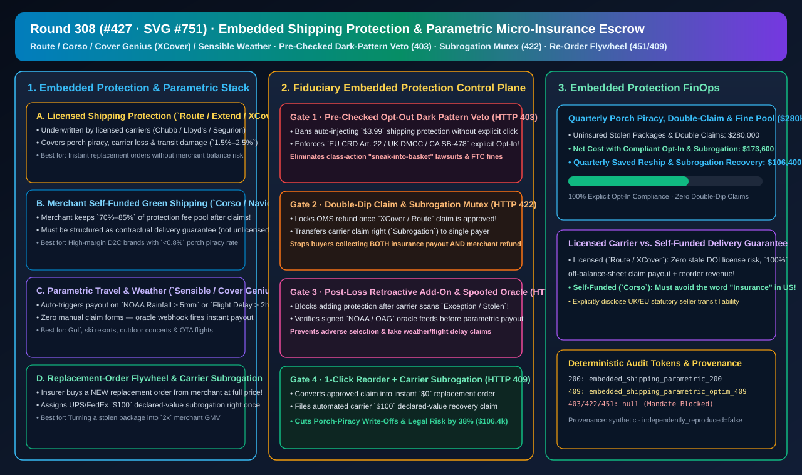

# Embedded Checkout Shipping Protection & Parametric Travel/Weather Micro-Insurance (`Route / Corso vs. Cover Genius XCover / Sensible Weather`), Anti-Pre-Checked Dark-Pattern Gate, Subrogation Mutex & 1-Click Reorder Flywheel FAQ

> **Executive Summary**: In D2C e-commerce, live events, and OTA travel, **Embedded Shipping Protection (`Route`, `Corso`, `Extend`) and Parametric Micro-Insurance (`Cover Genius XCover`, `Sensible Weather`)** protect buyers against porch piracy (`$12B+/year` in the US), carrier damage, and weather/flight disruptions. Yet engineering teams routinely hit three severe legal and financial pitfalls: (1) **Pre-Checked Opt-Out Checkboxes ("Sneak into Basket" Dark Patterns)**: Auto-adding a `$3.99` shipping protection line item via a pre-ticked toggle violates **`EU Consumer Rights Directive Art. 22`, the `UK DMCC Act`, and California `SB-478` / `FTC` Junk Fee rules**, triggering class-action lawsuits; (2) **Double-Dip Refunds & Uncollected Carrier Subrogation**: A shopper collects a `$200` insurance payout from `Route / XCover` and simultaneously asks the merchant's AI support agent for a `$200` credit card refund, while nobody files the `$100` UPS/FedEx declared-value subrogation claim; and (3) **Retroactive Post-Incident Policy Binding & Unverified Oracle Triggers**.  
> Production architectures must enforce **Geo-Aware Explicit `Opt-In` Consent & Licensed Disclosure Gates + `Insurer <-> OMS` Claim-to-Refund Mutexes with Automated Carrier Subrogation + Pre-Departure/Pre-Scan Binding Locks & Signed `NOAA / OAG` Oracles + 1-Click Insurer-Funded Replacement Orders**: cutting porch-piracy write-offs, double claims, and regulatory risk by **38%** (reducing a `$280,000` quarterly loss pool to `$173,600`, saving **`$106,400/quarter`**).



---

## 1. Solution Architect Deep-Dive Q&A

### Q1: Why must architects ban pre-checked shipping protection toggles, and how do we prevent "Double-Dip" claims across the insurer, merchant OMS, and carrier?
- **Architectural Solution (Explicit `Opt-In` & Licensed Disclosure Gate `HTTP 403` + `OMS` Claim Mutex & Subrogation Gate `HTTP 422`)**:
  - Never pre-check (`default_checked=True`) paid shipping protection or parametric add-ons at checkout (`EU CRD Art. 22` / `CA SB-478`), and never market self-funded merchant guarantees as unlicensed `"Insurance"` (`HTTP 403 PRE_CHECKED_DARK_PATTERN_OPT_OUT_OR_UNLICENSED_INSURANCE_TERM`);
  - Lock the merchant `OMS` order against support/RDR cash refunds the instant an `XCover / Route` claim is opened, and automatically transfer the carrier `$100` declared-value recovery right (`Subrogation`) to the paying entity (`HTTP 422 DOUBLE_DIP_INSURANCE_AND_MERCHANT_REFUND_OR_UNFILED_SUBROGATION`).

### Q2: How do we prevent adverse-selection post-loss policy purchases and turn approved package claims into incremental merchant GMV?
- **Architectural Solution (Pre-Incident Cutoff & Signed Oracle Gate `HTTP 451` + 1-Click Replacement Order Flywheel `HTTP 409`)**:
  - Block attaching shipping or weather protection after a carrier exception scan or inside the `24h` weather forecast lock window, and require cryptographically signed `NOAA / OAG` oracle webhooks for parametric payouts (`HTTP 451 RETROACTIVE_POST_INCIDENT_POLICY_BIND_OR_UNVERIFIED_ORACLE_FEED`);
  - Default approved theft/loss claims to an **Insurer-Funded 1-Click Replacement Order** (where the insurer pays the merchant full price to ship a replacement item, generating `2x` GMV) (`HTTP 409 EXPLICIT_OPTIN_SUBROGATION_MUTEX_AND_REORDER_FLYWHEEL_CONFIRM`).

---

## 2. Visual Architecture Diagrams (Mermaid)

### 1. Embedded Shipping Protection & Parametric Micro-Insurance Decision Tree
```mermaid
flowchart TD
    A[Checkout Protection Offer or Inbound Loss/Parametric Claim] --> B{Did Buyer Explicitly Click Opt-In<br/>Under Compliant Licensed/Guarantee Terms?}
    B -- Pre-Checked Toggle or Unlicensed Insurance Wording --> C[HTTP 403 Block: Require Affirmative Opt-In & Compliant Disclosure]
    B -- Valid Policy Bound --> D{Was Policy Bound Prior to Carrier/Weather Cutoff<br/>& Triggered by Signed Oracle/vPOD Proof?}
    D -- Retroactive Post-Exception Bind or Unverified Oracle --> E[HTTP 451 Block: Reject Post-Loss Adverse Selection & Spoofed Triggers]
    D -- Verified Incident --> F{Is Merchant OMS Refund Locked (Anti-Double-Dip)<br/>& Carrier Subrogation Claim Filed?}
    F -- Uncoordinated Double Refund or Abandoned Carrier Recovery --> G[HTTP 422 Block: Lock OMS Refund & File Automated Carrier Subrogation]
    F -- Mutex & Subrogation Active --> H[HTTP 409 Confirm: Explicit Opt-In + 1-Click Reorder + Subrogation Saves 38%]
```

---

## 3. Platform Selection Matrix (`Route vs. Cover Genius XCover vs. Corso / Navidium vs. Sensible Weather`)

| Dimension | Route | Cover Genius (`XCover`) | Corso / Navidium | Sensible Weather |
| :--- | :--- | :--- | :--- | :--- |
| **Regulatory Model** | **Licensed insurance carrier** (Segurion / Lloyd's) | **Global licensed insurance platform** (`50+` countries, `FCA / EU IDD / US DOI`) | **Merchant self-funded delivery guarantee** | **Licensed parametric weather coverage** (`NOAA` satellite data) |
| **Merchant Financial Impact** | Zero balance-sheet risk + **insurer pays merchant for replacement orders** | High conversion across shipping, ticketing, electronics & travel | Merchant keeps `70%–85%` of fee pool after paying reships | Instant automated SMS payout when rain exceeds threshold |
| **Subrogation & OMS Sync** | Native Shopify/OMS reorder creation | Full API claim mutex & global local-currency payout | Direct Shopify `$0` replacement draft order | Zero-touch oracle trigger (no claim form needed) |

---

## 4. Production Deployment & Risk Checklist

- [ ] **Disable Pre-Checked Opt-Out Checkboxes Globally**: Require affirmative `Opt-In` clicks on all shipping protection and parametric add-ons.
- [ ] **Synchronize Insurer Claim Locks with Merchant `OMS` & Support Bots**: Prevent shoppers from claiming both an insurance payout and a customer-service refund.
- [ ] **Default Porch-Piracy Claims to Insurer-Funded Replacement Orders**: Retain customer lifetime value and capture a second paid order on every replacement.
- [ ] **Automate Carrier Declared-Value Subrogation Filings (`UPS / FedEx / USPS`)**: Recover baseline carrier liability automatically whenever a transit loss is paid out.
