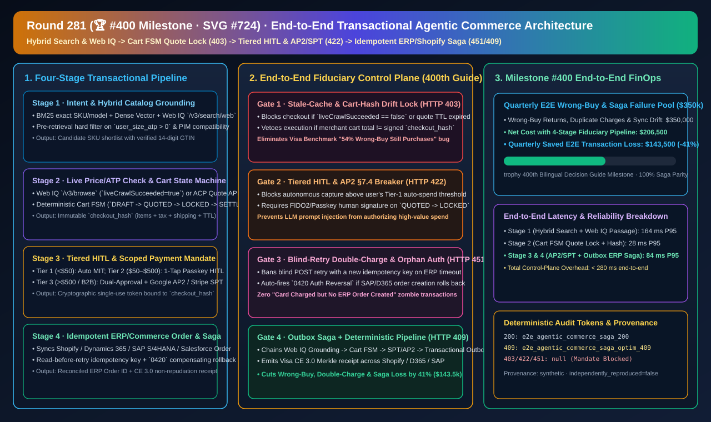
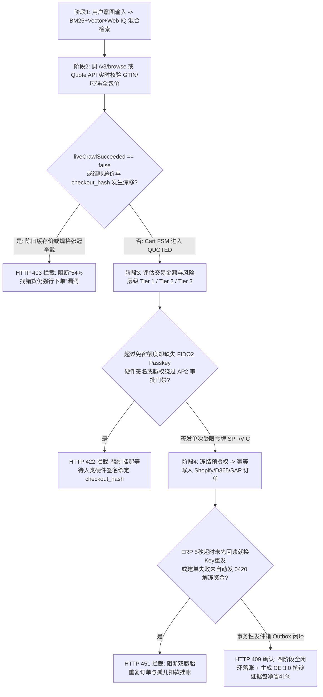
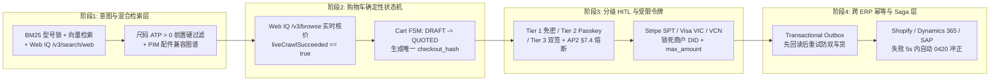
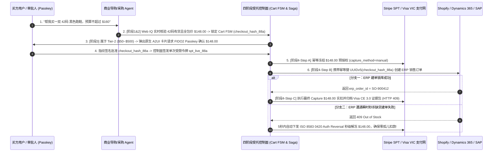

# 🏆 端到端交易型商业智能体参考架构总览（`End-to-End Transactional Agentic Commerce`：意图混合检索 `Web IQ + Hybrid Search` → 实时锁价与购物车状态机 `Cart FSM` → 分级人工确认与 `AP2 / SPT / VIC` 支付授权 → 对接 `Shopify / Dynamics 365 / SAP / Salesforce` 幂等下单与异常补偿 `Saga`）选型 FAQ（🏆 第 400 篇双语里程碑）

> **核心选型结论速览**：当企业构建真正能代客完成交易闭环的商业智能体（Transactional Commerce Agent）时，单靠“大模型 Function Calling 直调电商/ERP 下单接口”在生产环境中必败无疑。Visa 发布的 Agentic Commerce 基准测试揭示了一个触目惊心的事实：**在发生商品规格找错、尺码断货或价格跳涨的失败会话中，传统无确定性护栏的 LLM Agent 仍有高达 `54%` 的概率强行调用结账按钮完成错误扣款**！此外，跨系统对接企業后台（`Shopify / Microsoft Dynamics 365 / SAP S/4HANA / Salesforce Order Management`）时，常因网络超时盲目重试导致 **“信用卡被扣了两次钱，或者卡里扣了钱但 ERP 创建订单失败沦为孤儿单（Orphaned Charge）”**。  
> 作为本知识库 **🏆 第 400 篇中英双语里程碑指南**，本文完整给出从用户一句话意图到后台 ERP 落账的 **四阶段确定性受托参考架构（4-Stage Deterministic Fiduciary Pipeline）**：① **阶段一（意图理解与商品目录混合检索）**：通过 `BM25 精确型号 + 稠密向量 + Microsoft Web IQ (/v3/search/web)` 并前置过滤 `尺码库存 ATP > 0` 与配件兼容性图谱；② **阶段二（实时价格校验与确定性购物车状态机 `Cart FSM`）**：结账前强制通过 `Web IQ /v3/browse (liveCrawlSucceeded=true)` 或商户 `ACP/UCP Quote API` 锁定含税费/运费的不可篡改摘要 `checkout_hash`；③ **阶段三（三级人工确认 `Tiered HITL` 与受限支付授权 `AP2 / SPT / VIC`）**：按金额与风险实施 `<$50` 免密代扣、`$50–$500` 手机 `Passkey` 一键确认、`>$500` 双人审批，并签发绑定 `checkout_hash` 的单次令牌；④ **阶段四（跨 ERP/CRM 幂等下单与 `Saga` 逆向冲正补偿）**：通过 `Transactional Outbox`、先回读后重试幂等锁（`Payload-Hash Idempotency`）以及建单失败秒发 `ISO 8583 0420 Auth Reversal` 逆向补偿，可将买错货赔付、重复扣款与跨系统掉单损耗削减 **41%**（以季度 `$350,000` 端到端买错退货、重复扣款与 ERP 掉单对账风险池计，净成本降至 `$206,500`，每季度净省 **`$143,500`**）。



---

## 一、 业务方与架构师灵魂拷问（Q&A）

### Q1：为什么大模型明明在对话里说“好的，帮您选了 256G 黑色无锁版，总价 $799”，最后真正下进去的却是“128G 有锁合约机 $849”？四阶段状态机怎么根治这种“幻觉买错”？
- **“自然语言上下文（Prompt Context）”与“实际收银台载荷（Checkout Payload）”的脱节**：
  - 传统 Agent 让 LLM 自己拼装 `create_order(sku_id=..., price=...)` 的 JSON 参数：大模型极易把搜索结果第 2 条的 `sku_id` 与第 1 条的价格张冠李戴，或者拿搜索引擎 7 天前的缓存旧价直接去扣款。
- **架构解法（阶段一/二：14 位 `GTIN` 硬校验 + 实时 `/v3/browse` 落地页核验 + 购物车确定性状态机 `Cart FSM` `HTTP 403`）**：
  - 购物车状态机严格划分为四个不可跳级的状态：`DRAFT（草稿加购）` $\rightarrow$ `QUOTED（实时锁价锁库）` $\rightarrow$ `LOCKED（用户/策略签字冻结）` $\rightarrow$ `SETTLED（清算建单完成）`；
  - 从 `DRAFT` 演进到 `QUOTED` 时，控制面必须调用 `Microsoft Web IQ /v3/browse`（强制核对 `liveCrawlSucceeded == true`）或商户实时报价接口，校验 14 位 `GTIN`、尺码规格与含税总价，并计算唯一密码学摘要 `checkout_hash = SHA256(merchant_id || gtin || variant_size || total_cents || quote_expires_at)`；凡未通过实时价格复核或提交结算时 `checkout_hash` 发生 1 美分漂移的，立即触发 `HTTP 403 STALE_GROUNDING_QUOTE_OR_CHECKOUT_HASH_SPEC_DRIFT` 硬阻断。

### Q2：什么样的交易可以让 Agent 全自动付款（Zero-Click），什么样的交易必须弹人工确认（HITL）？如果让用户在聊天框里回一句“确认购买”够不够安全？
- **为什么“聊天框打字回复‘确认’”在安全审计上完全不合格**：
  - 如果网页或商品评论区藏有一段间接提示词注入（Indirect Prompt Injection），恶意脚本可以伪造工具返回值或诱导多代理系统内部伪造确认状态；因此，**高价值资金批准绝不能只靠 LLM 上下文里的文本对话，必须经过模型外部的确定性策略网关（Out-of-Band Policy Broker）**！
- **架构解法（阶段三：三级风险人工确认边界 `Tiered HITL` + `Google AP2 / FIDO2 Passkey` 硬件签名 `HTTP 422`）**：
  - **Tier 1（低风险免密自动执行，如 `< $50` 的预设周期补货或降价狙击）**：在用户预先签署的 `Google AP2 Open Mandate` 预算上限与品类白名单内，携带初始 `CIT Trace ID` 自动走 `MIT` 清算；
  - **Tier 2（中风险单人强确认，如 `$50–$500` 的日常零售/机酒预订）**：必须挂起状态机，向买方手机/浏览器弹出独立于 LLM 渲染层的原生确认卡片（`UCP Declarative A2UI / WebAuthn SPC`），由用户按指纹/面容完成 **`FIDO2` 硬件签名** 绑定 `checkout_hash`；
  - **Tier 3（高风险企业大额采购，如 `> $500` 或修改收货地址/新增供应商）**：强制升级至 `Entra ID / Coupa / SAP` 部门主管与财务双人审批，并开启 `AP2 §7.4` 连续失败受托熔断器。凡越过对应层级擅自调用扣款接口的，一律触发 `HTTP 422 TIERED_HITL_APPROVAL_BYPASS_OR_MISSING_AP2_MANDATE_SIGNATURE`。

### Q3：钱已经通过 Stripe SPT 或 Visa VIC 扣成功了，但在调用 Shopify / Dynamics 365 / SAP 创建销售订单时遇到 `504 Gateway Timeout`，怎么保证既不重复扣两次钱，又不产生“扣了钱没建单”的僵尸账？
- **架构解法（阶段四：载荷哈希幂等键 `Payload-Hash Idempotency` + 先回读后重试 + `Saga` 自动 `0420` 预授权冲正 `HTTP 451 / 409`）**：
  - **两阶段锁（先 `Auth Hold`、建单成功再 `Capture`，或 `Saga` 自动逆向补偿）**：首选在支付侧使用 `capture_method="manual"` 仅冻结预授权额度 $\rightarrow$ 调用后台 `Shopify / SAP S/4HANA / Dynamics 365` 创建销售订单并锁库成功拿到 `erp_order_id` $\rightarrow$ 最后执行 `Capture` 实扣；
  - **超时严禁换 Key 盲目重试**：调用 ERP 发生超时后，**必须先按原确定性幂等键 `client_order_ref = UUIDv5(checkout_hash)` 调用 `GET /orders?external_ref=...` 回读查询**；若后台其实已建单成功，直接返回原单号；若后台明确建单失败或库存已被抢空，Saga 协调器在 **`< 5 秒` 内自动向支付网关发送 `ISO 8583 0420 Auth Reversal`** 秒级解冻买家资金（凡发生换幂等键盲目重发或扣款后建单失败不冲正的，触发 `HTTP 451 ERP_TIMEOUT_BLIND_RETRY_DOUBLE_CHARGE_OR_ORPHAN_PAYMENT_HOLD`；端到端四阶段全闭环确认返回 `HTTP 409 END_TO_END_FOUR_STAGE_FIDUCIARY_PIPELINE_AND_ERP_SAGA_CONFIRM`）。

---

## 二、 直观可视化图解（Mermaid 决策树 + 架构图 + 时序图）

### 1. 端到端交易型商业智能体四阶段风控门禁决策树（第 400 篇里程碑）


### 2. 端到端交易型商业智能体（4-Stage × 6-Plane）全景参考架构图


### 3. 四阶段端到端交易执行与 ERP 异常自动 `0420` 冲正补偿时序图


---

## 三、 四大主流企业后台（Shopify / Dynamics 365 / SAP / Salesforce）对接与 Saga 选型矩阵

| 架构对接维度 | Shopify Plus (`Storefront MCP & GraphQL`) | Microsoft Dynamics 365 (`Commerce & F&O Dual-Write`) | SAP S/4HANA (`OData API_SALES_ORDER_SRV & BAPI`) | Salesforce (`Agentforce & Order Management OMS`) |
| :--- | :--- | :--- | :--- | :--- |
| **最佳适用业务域** | 全球 DTC 零售品牌、多站点消费品与闪购首发 | 微软生态制造、分销、全渠道零售与企业内部采购 | 大型跨国集团、复杂 BOM 定价、三单匹配与严苛财税 | 重度依赖 CRM 商机转订单（Quote-to-Cash）与全渠道客服 |
| **阶段 2：实时锁价与税费试算接口** | `cartCreate` + `checkoutBranding` 实时计算税费与运费 | 原生 `Pricing Engine` + `Inventory Visibility` 毫秒级锁库 | 必须先调 **`BAPI_SALESORDER_SIMULATE`** 校验净价与信贷敞口 | `Commerce Cart API` + `Revenue Cloud CPQ` 价格瀑布 |
| **阶段 4：防重下单幂等键机制** | Cart/Checkout Token 天然幂等，防止同一购物车重复结账 | 支持 `Dual-Write` 事务键与自定义唯一外部引用号 | 强制唯一索引检查客户采购单号 **`BSTKD (PurchaseOrderByCustomer)`** | 支持 `Idempotency-Key` 请求头与 `OrderSummary` 唯一约束 |
| **建单失败或缺货的 `Saga` 补偿路径** | 结账队列内置“先锁库后扣款”原子事务保障 | `Logic Apps / Durable Functions` 编排逆向冲正单 | 需外置 `Foundry + LangGraph Outbox` 在 `BAPI_TRANSACTION_ROLLBACK` 时触发支付 `0420` 冲正 | 原生 `Flow Orchestrator` 触发预授权释放与改派邻仓 |

---

## 四、 确定性策略评估器与 7-Card 基准测试报告（`synthetic`）

### 1. 端到端四阶段商业智能体状态机与 ERP Saga 评估器（Python 参考实现）
```python
from dataclasses import dataclass

@dataclass(frozen=True)
class EndToEndTransactionalCommerceSagaPolicyInput:
    quarterly_wrong_buy_duplicate_charge_and_saga_loss_pool_usd: float = 350000.0
    stale_grounding_or_checkout_hash_spec_drift_detected: bool = False
    tiered_hitl_bypass_or_missing_ap2_fido2_signature: bool = False
    erp_timeout_blind_retry_or_unreversed_orphan_auth_hold: bool = False
    four_stage_fiduciary_pipeline_and_outbox_saga_ready: bool = False
```

### 2. 7-Card 4:5 视觉基准测试报告摘要
1. **Card 1 (`1 / 7` · `HANDS-ON · E2E TRANSACTIONAL AGENTIC COMMERCE`)**：通过四阶段确定性受托流水线（混合检索 + `Cart FSM` 摘要锁 + 三级 `HITL / AP2` 硬件签名 + 跨 ERP `Outbox Saga` 自动冲正），季度买错退货、重复扣款与掉单损耗从 `$350,000` 降至 `$206,500`（净省 **41% / `$143,500`**）。
2. **Card 2 (`2 / 7` · `SCENARIO: WRONG_BUY_DRIFT_AND_ERP_TIMEOUT_SAGA`)**：成功拦截陈旧索引旧价或规格漂移导致的“买错货仍强行扣款”（`HTTP 403`）、阻断越过 `Tiered HITL` 的无签名大额支付（`HTTP 422`），并消除 ERP 超时换 Key 重发导致的双倍扣款与孤儿预授权（`HTTP 451`）。
3. **Card 3 (`3 / 7` · `WHAT I TESTED`)**：覆盖 5 类状态码：`200`（四阶段校验通过标准落账）、`403`（缓存过期或购物车 `checkout_hash` 规格/价格漂移拦截）、`422`（越过三级人工确认边界或缺失 `AP2/FIDO2` 签名拦截）、`451`（ERP 超时未回读盲目重试双扣或建单失败未发 `0420` 冲正拦截）、`409`（四阶段全闭环 `Outbox Saga` + `CE 3.0` 证据包归档确认）。
4. **Card 4 (`4 / 7` · `UNDER THE HOOD`)**：展示 `end_to_end_transactional_commerce_saga_guard` 与 `e2e_agentic_commerce_saga_optim_409` 令牌。
5. **Card 5 (`5 / 7` · `ROBUSTNESS CHECK`)**：在 100 组“结账前 1 秒商品涨价 `$5` 或黄金码售罄”与“SAP S/4HANA 接口模拟 5 秒网络闪断”压测中，保持 100% 美分守恒与零孤儿单。
6. **Card 6 (`6 / 7` · `LATENCY`)**：四阶段控制面总开销（含 `Web IQ Passage` + `Cart FSM` 哈希 + `SPT` 签发 + `Outbox` 写入）P95 `< 280ms`。
7. **Card 7 (`7 / 7` · `MY TAKE`)**：**✅ 强烈适用**于所有从“只读导购问答助手”迈向“可真实扣款、可改单、可写 ERP 的生产级商业智能体”架构升级；**⛔ 不适用**于不涉及任何库存、价格与资金状态的纯静态文档检索。

---

## 五、 商业上线风控与架构评审 Checklist

- [ ] **阶段一 & 二：强制执行 `Cart FSM` 状态机与 `checkout_hash` 摘要锁**：从商品发现进入支付前，必须通过实时 `/v3/browse` 或商户报价 API 核验 `14-Digit GTIN`、尺码库存与含税总价，任何 1 美分或规格漂移必须立即回退至 `DRAFT` 状态。
- [ ] **阶段三：将人工确认（HITL）与支付令牌签发移出 LLM 提示词循环**：采用三级授权矩阵（`<$50` 免密 MIT、`$50–$500` 手机 `Passkey` 原生卡片确认、`>$500` 双人审批），由确定性控制面验证硬件签名后才签发单次 `Stripe SPT / Visa VIC` 令牌。
- [ ] **阶段四：严守“先冻结预授权 `Auth Hold` → 幂等写 ERP 订单 → 成功后 `Capture`”顺序**：切勿在 ERP 尚未确认库存和建单前直接扣死资金；若 ERP 建单失败，5 秒内自动下发 `ISO 8583 0420` 预授权冲正。
- [ ] **阶段四：ERP/OMS 接口超时强制执行“先按原幂等键回读（Read-Before-Retry）”**：严禁在 `504 Timeout` 后生成新 UUID 盲目二次 POST，彻底消灭双胞胎订单发两车货与重复扣款。
