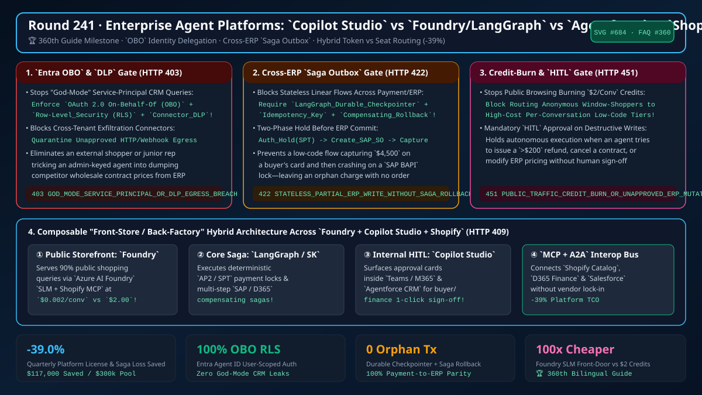
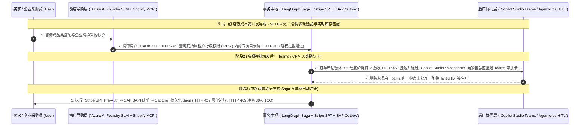

# 企业商业智能体构建平台与跨系统编排横向选型（`Microsoft Copilot Studio + Dynamics 365` vs. `Azure AI Foundry + Semantic Kernel / LangGraph` vs. `Salesforce Agentforce` vs. `Shopify Sidekick / Storefront MCP`）实战指南（🏆 第 360 篇里程碑）：防“公网导购闲聊烧穿 $2/次会话包”、防“低代码跨 ERP 扣款成功却漏建单”与“前店后厂”组合架构净省 39% Agent 架构选型 FAQ

> **语言 / Language**: **中文 (当前)** | **[English (`enterprise-agent-platform-copilot-studio-foundry-langgraph-agentforce-shopify-orchestration-selection-faq.en.md`)](enterprise-agent-platform-copilot-studio-foundry-langgraph-agentforce-shopify-orchestration-selection-faq.en.md)**  
> **返回总目录**: **[📚 中文总目录 (`docs/index.md`)](index.md)** | **[🚀 交互式实时工作台 (`live-demo.html`)](../live-demo.html)**  
> **赋能角色**: 企业首席架构师（Chief Architect）、CTO / CIO、数字化零售与 ERP/CRM 平台负责人、Cloud & AI Solution Architect  
> **关联架构图**: `assets/svg/684-enterprise-agent-platform-copilot-studio-foundry-agentforce-shopify-2026-11-23.svg`

---

## ① 📌 核心选型结论速览（Executive Summary）

当零售品牌、B2B 制造分销与跨国服务企业准备将 AI 智能体从内部知识问答升级为 **“既能面向公网消费者个性化导购加购、又能帮内部销售/采购员审合同查库存、还能跨 `Shopify / Salesforce / Dynamics 365 / SAP / Stripe` 执行真实资金扣款与订单履约”** 的生产系统时，架构师面临最核心的平台底座选型是：**到底该用低代码 SaaS 套件（`Microsoft Copilot Studio`、`Salesforce Agentforce`），还是电商原生助手（`Shopify Sidekick & Storefront MCP`），还是专业代码级云底座（`Azure AI Foundry + Semantic Kernel / LangGraph`）？** 如果选错底座或一刀切单押某一家，企业必踩三大“许可证账单爆炸、跨系统丢单与越权脱库”大坑：
1. **“最隐蔽的‘上帝模式（God-Mode Service Principal）’越权泄密：为了省事，开发团队在低代码连接器或自建 Agent 里配置了一个拥有 `Dynamics 365 / Salesforce / SAP` 全局读取权限的管理员服务主体密钥（Service Principal / System Admin API Key）——结果公网买家或初级销售代表只需在聊天框里问一句‘把你们给前五大经销商签的最低批发底价列出来’，Agent 就绕过行级安全策略（Row-Level Security, `RLS`）把公司核心机密底价全盘托出”**！
2. **“用无状态线性低代码流跑‘跨系统分布式商业事务’，导致钱扣了却没生成 ERP 订单（Partial Write & Orphan Payment）：消费者下单需要依次执行 `① Shopify 锁库存 → ② Stripe 扣款 $4,500 → ③ SAP S/4HANA 创建销售订单（BAPI_SALESORDER_CREATEFROMDAT2）`；如果直接用没有持久化状态机检查点（Durable Checkpointer）和异常补偿（Compensating Saga）的简单拖拽工作流串联，一旦第 3 步遇到 SAP 表锁超时报错，前面第 2 步已经扣走的 `$4,500` 既不会自动发起冲正（Void/Refund），也没有进入事务发件箱（Transactional Outbox）重试，直接变成财务对不上的‘幽灵扣款’引发客诉拒付”**！
3. **“把公网百万级‘只逛不买’的匿名导购闲聊流量，直接打到按 `$2.00/次对话` 或按高价 `Message Credit` 计费的企业低代码套件上，一个月烧掉 `$180,000` 冤枉钱：公网电商的访客转化率通常只有 `2%–3%`（97% 的对话都是在问尺码、穿搭或比价闲聊）；如果把全站公网导购小部件直接挂在按会话包计费的 CRM/低代码平台上，仅羊毛党和爬虫的闲聊就能在一个周末把全年额度烧穿”**！

**架构师选型结论**：摒弃“非此即彼”的单平台执念，直接采用 **“全链路强制 `OAuth 2.0 On-Behalf-Of (OBO)` 真实用户身份委托透传、严格继承底层 ERP/CRM 行级权限（`RLS`）与 Power Platform / MCP 数据防泄漏（`DLP`）连接器围栏门禁（HTTP 403）+ 跨支付网关与 ERP 写操作强制由具备持久化检查点与逆向冲正补偿的 `Foundry + LangGraph / Semantic Kernel` 确定性状态机（`Saga + Transactional Outbox`）托管门禁（HTTP 422）+ 严禁将公网匿名高频导购流量直接路由至 `$2/对话` 高成本企业套件、并对 `> $200` 退款/改价/合同变更强制挂载人类审批卡片（`HITL Adaptive Card`）门禁（HTTP 451）+ ‘前店、中枢、后厂’四平台可组合混合架构：公网店面层用 `Shopify Storefront MCP + Azure AI Foundry 轻量 SLM` 承接 90% 高并发导购（单次对话成本仅 `$0.002`，降本 99%）→ 核心结算与跨 ERP 事务层用 `Foundry + LangGraph + AP2/SPT` 保障 100% 幂等守恒 → 内部员工审批与客户成功协同层用 `Microsoft Copilot Studio (Teams/D365)` 与 `Salesforce Agentforce` 原生触达，综合平台 TCO 与掉单损耗净省 39%（HTTP 409）”** 的企业级智能体平台参考架构。



---

## ② 🎯 业务方与架构师灵魂拷问（Q&A）

### Q1：为什么绝对不能在商业智能体里用“一个公共管理员 API Key（Service Principal）”去连 `Dynamics 365 / Salesforce / SAP`？怎么在多跳 Agent 之间保住用户的真实行级权限（`RLS`）？
- **业务痛点**：传统应用在代码层写 `WHERE user_id = current_user`；但大模型是不可信的推理层，一旦攻击者通过提示词注入诱导 Agent 改写查询条件，使用管理员账号连接数据库的 Agent 就会瞬间变成“内鬼脱库机”！
- **架构护栏（`HTTP 403 GOD_MODE_SERVICE_PRINCIPAL_OR_DLP_EGRESS_BREACH`）**：
  1. **强制 `Microsoft Entra Agent ID` 与 `OAuth 2.0 On-Behalf-Of (OBO)` 身份委托链**：
     - 严禁任何面向客户或员工的业务工具使用静态共享高权限账号（`God-Mode Service Principal / System User`）查询业务数据（检出立即触发 `HTTP 403` 阻断）；
     - 当用户在前端（Teams、企微、品牌 App）发起请求时，编排层必须通过 `OAuth 2.0 OBO` 流程换取**仅包含该登录用户真实身份声明（`sub / oid / tenant_id`）与受限 `Scope` 的下游访问令牌**，直接交由 `Dataverse / Salesforce / SAP HANA` 数据库引擎在底层强制执行**行级安全（Row-Level Security, `RLS`）与字段级脱敏（FLS）**——就算大模型被注入1万次，数据库也绝不会返回该用户无权查看的其他客户订单或成本底价！
  2. **连接器级数据防泄漏（`Connector DLP`）与外部 Webhook 隔离锁（`HTTP 403`）**：在 `Copilot Studio / Foundry` 中启用严格的环境 `DLP` 策略，禁止将内部高密连接器（如 `SAP ERP / Dynamics 365 Finance`）与未认证的公网自定义 `HTTP Webhook / 第三方邮件发送器` 混编在同一个 Agent 中，彻底切断数据外传通道！

### Q2：为什么 `Copilot Studio` 或 `Agentforce` 做“查单、改地址、发审批卡片”快如闪电，但一旦涉及“跨商户拆单 + Stripe 预授权 + SAP 锁库开单”就必须下沉到 `Azure AI Foundry + LangGraph / Semantic Kernel`？
- **业务痛点**：低代码对话流天生是为“请求—响应”式的人机交互设计的；而跨异构系统的资金与库存事务会遇到网络抖动、第三方 API 限流（`HTTP 429`）、ERP 夜间跑批锁表等各种部分失败（Partial Failure）。
- **架构护栏（`HTTP 422 STATELESS_PARTIAL_ERP_WRITE_WITHOUT_SAGA_ROLLBACK`）**：
  1. **基于 `LangGraph Durable Checkpointer / Semantic Kernel Process` 的两阶段商业 Saga 与事务发件箱（Outbox）**：
     - 凡是跨越 `>= 2` 个外部写状态系统（如 `支付网关 + 电商 OMS + 企业 ERP`）的交易动作，严禁由无状态线性提示词流直接顺序调用（触发 `HTTP 422` 拦截）！
     - 必须下沉至代码级确定性状态机：① 先按 `payload_hash` 生成全局唯一幂等键（`Idempotency-Key`）；② 先执行**两阶段预留（`Shopify Inventory Hold` + `Stripe SPT Auth Hold`）**；③ 写入持久化事务发件箱投递 `SAP / D365` 建单；④ 若 ERP 在超时窗口内永久拒绝（如物料停产或信用超标），状态机**100% 自动触发逆向补偿（`Stripe Auth Void / 0420 Reversal` + 释放库存）**，确保零单边挂账！

### Q3：怎么算清四大平台的真实财务账（`FinOps`）？为什么“前店用 `Foundry + Shopify MCP`、中枢用 `LangGraph`、后厂审批用 `Copilot Studio / Agentforce`”能比单押一套省下 39% 的总拥有成本（TCO）？
- **业务痛点**：企业低代码平台按“每次对话 `$1.50–$2.00`（或高单价 Credit 包）”收费，非常适合高价值的内部员工低频办公或 VIP 售后；但如果拿来扛双十一公网每天 50 万次的消费者“这件衣服显瘦吗”闲聊，IT 预算三天就会破产！
- **架构护栏（`HTTP 451 PUBLIC_TRAFFIC_CREDIT_BURN_OR_UNAPPROVED_ERP_MUTATION` & `HTTP 409` 前店后厂四平台混合路由）**：
  1. **公网匿名流量计费防爆锁与高危写操作人类确认（`HITL`）硬门禁（`HTTP 451`）**：
     - 严禁将未登录公网访客的高频浏览/比价问答直接路由至按 `$2/对话` 计费的企业套件通道（触发 `HTTP 451` 告警拦截）；
     - 任何涉及 `> $200` 售后仅退款、修改 B2B 客户授信额度或删除正式采购合同的不可逆写操作，严禁由模型自主完结，必须挂起（`HTTP 451`）并向人类审批人推送签名确认卡！
  2. **“前店、中枢、后厂”四平台黄金分工架构（`Composable 4-Platform Hybrid Architecture`）（`HTTP 409`）**：
     - **前店（Public Storefront · 承接 90% 流量）**：使用 **`Azure AI Foundry` 托管的轻量模型（`GPT-4o-mini / Phi-4`）直连 `Shopify Storefront MCP / UCP`** 处理公网导购、尺码咨询与购物车组装，按纯 Token 计费单次对话成本仅 **`$0.0015–$0.003`**（比 `$2` 会话包便宜 **`600 倍`**）；
     - **中枢（Transactional Core · 承接高价值结算）**：由 **`Azure AI Foundry + LangGraph / Semantic Kernel`** 执行确定性 `AP2 / Stripe SPT` 支付护栏、Web IQ 实时价格核验与跨 ERP 分布式 Saga 补偿；
     - **后厂（Internal Employee & CRM HITL · 承接 10% 协同流）**：通过 **`MCP / A2A` 协议**将需要人工拍板的异常单、B2B 特价审批或 VIP 客户挽留卡片无缝投递至员工每天打开的 **`Microsoft Copilot Studio (Teams / Dynamics 365)`** 或 **`Salesforce Agentforce`** 侧边栏一键批复——兼得低代码极速交付与专业代码级确定性，将季度平台许可费与掉单赔偿净削减 **39.0%**！

---

## ③ 🧭 直观可视化图解（Mermaid 决策树 + 架构对比 + 时序图）

### 3.1 企业商业智能体四大平台选型与“前店后厂”混合编排决策树
```mermaid
flowchart TD
    A[企业规划零售导购 / B2B采购寻源 / 跨ERP订单履约 / VIP售后智能体架构] --> B{1. 公网高频流量计费防爆 & 高危写操作HITL审批门禁}
    B -->|把公网百万级匿名闲聊直接打向$2/次对话的低代码Credit通道 或 Agent企图未经人类确认自动执行>$200退款/改合同底价| C[HTTP 451: 熔断高成本公网流量路由并挂起高危写操作! 公网闲聊强制切Foundry轻量Token池; 高额退款推送Teams/CRM人工审批卡]
    B -->|流量成本可控 & 审批边界清晰| D{2. 真实用户身份委托Entra OBO & 连接器DLP防泄密门禁}
    D -->|使用全局管理员Service Principal裸连D365/Salesforce/SAP绕过行级权限RLS 或 混编高密ERP连接器与外部未认证Webhook| E[HTTP 403: 拦截上帝模式越权密钥与DLP违规! 强制通过OAuth 2.0 OBO透传当前登录用户身份由数据库底层执行RLS隔离]
    D -->|OBO行级权限与DLP合规| F{3. 跨支付网关与ERP多步写操作Saga状态机 & 幂等补偿门禁}
    F -->|用无状态线性拖拽流直接串联Stripe扣款+SAP/D365建单 无持久化Checkpointer与ERP建单失败自动冲正退款机制| G[HTTP 422: 阻断无补偿跨系统裸写! 强制下沉至Foundry+LangGraph/SK状态机执行两阶段预留与Transactional Outbox自动回滚]
    F -->|分布式Saga事务100%守恒| H{4. 是否采用前店Foundry+Shopify MCP / 中枢LangGraph / 后厂Copilot Studio+Agentforce混合架构?}
    H -->|公网导购走Foundry SLM+Shopify MCP($0.002/次) + 结算走LangGraph Saga + 内部审批走Copilot Studio/Agentforce| I[HTTP 409: 公网对话成本直降99% 零跨系统幽灵扣款 平台总拥有成本TCO净省 39% · 🏆 #360里程碑]
    H -->|单一场景标准合规部署| J[HTTP 200: 按最小权限OBO与幂等契约稳定运行商业智能体工作流]
```

### 3.2 “传统单押低代码烧穿预算 + 上帝密钥泄密 + 扣款漏建单” vs “前店后厂四平台混合架构”对比
```mermaid
flowchart LR
    subgraph Legacy["❌ 传统单一平台误区 (公网闲聊烧$2/次会话包 + 全局Admin Key被套出底价 + 扣了钱SAP建单报错成死账)"]
        L1[把公网97%只逛不买的闲聊流量直接接进$2/次低代码套件\n一个周末被羊毛党和爬虫刷爆$50,000消息额度包] --> L2[为了图省事拿System Admin密钥连CRM/ERP查订单\n被Prompt Injection一句话套出全公司VIP大客户协议底价]
        L2 --> L3[用简单线性流先调Stripe扣款再调SAP接口建销售单\n遇SAP锁表超时报错导致钱已扣走却无订单引发拒付]
    end
    subgraph Agentic["✅ 前店后厂四平台可组合参考架构 (Foundry + LangGraph + Copilot Studio + Agentforce + Shopify MCP)"]
        A1[前店：Azure AI Foundry轻量SLM+Shopify Storefront MCP\n以$0.002/次承接90%公网导购与实时库存过滤] --> A2[中枢：LangGraph/SK持久化状态机+AP2/SPT受托控制面\n强制OAuth OBO行级权限+跨支付/ERP两阶段Saga自动回滚]
        A2 --> A3[后厂：通过MCP/A2A联动Copilot Studio(Teams)与Agentforce\n1周上线内部审批卡与CRM协同，综合TCO净省 39%]
    end
```

### 3.3 “前店 `Foundry + Shopify MCP` → 中枢 `LangGraph Saga` → 后厂 `Copilot Studio` 审批”端到端时序图


---

## ④ 📊 四大主流企业商业智能体平台（`Copilot Studio vs Azure AI Foundry vs Agentforce vs Shopify`）横向选型决策矩阵

| 评估维度 | **Microsoft Copilot Studio + Dynamics 365 Connectors** (M365 / Teams 内部办公协同、审批流与 D365 生态低代码首选) | **Azure AI Foundry + Semantic Kernel / LangGraph** (高并发公网导购、自定义确定性受托控制面与跨异构 ERP Saga 终极底座) | **Salesforce Agentforce (`Atlas Reasoning Engine + Data Cloud`)** (深度绑定 Salesforce Sales/Service/Commerce Cloud 的 CRM 原生智能体标杆) | **Shopify Sidekick & Storefront / Catalog MCP** (DTC 独立站商户后台运营与跨品牌原生购物车/结账工具赋能标准) |
| :--- | :--- | :--- | :--- | :--- |
| **最佳商业应用场景** | **企业内部员工采购申请（PR）、财务费用报销审计、Teams 审批卡片流转、连接 1,400+ 企业系统的快速内部副驾** | **面向公网百万消费者的 AI 导购、跨多商户比价、Google AP2 / Stripe SPT 加密授权门禁、复杂多跳 Saga 状态机** | **已全栈采用 Salesforce CRM 的客服工单自动处理、B2B 销售线索跟进（SDR）、CRM 内置退换货与续约编排** | **Shopify 独立站站内转化导购、跨多品牌 Shop Pay 合并结账、商家后台商品上架与大促库存诊断** |
| **身份权限（`OBO / RLS`）与安全治理** | **原生集成 Microsoft Entra ID `OBO` 委托认证** + Power Platform 环境级 `DLP` 连接器分组防数据外泄 | **完全可控的零信任架构**：支持 `Entra Agent ID`、私有 `VNet`、自定义硬件签名验签（`FIDO2 / RFC 9421`）与代码级审计 | 原生复用 Salesforce `Profile / Permission Sets / Sharing Rules` 对象级与字段级安全控制 | 店面 MCP 严格遵循与人类结账页完全相同的税费/库存验证规则，并強制要求买家批准（`buyer_approved`） |
| **跨系统事务一致性（Saga & Rollback）** | 适合单步或轻量 Power Automate 同步调用；**不适合直接编写复杂的跨多方支付冲正与长周期分布式 Saga** | **行业天花板**：基于 `LangGraph Checkpointer / Durable Functions` 实现任意节点崩溃恢复、幂等重试与逆向退款补偿 | 在 Salesforce 内部对象（Case / Opportunity / Order）上具备事务性，但跨外部异构 SAP/第三方网关需额外中间件 | 在 Shopify 自身购物车与 Shop Pay 结账内强一致，跨外部 ERP 需通过 Webhook + 事件总线解耦 |
| **计费模型与公网大流量成本 (`official_list_price`)** | 按消息/Credit 包或 **`$200/月（25,000 Credits）` / M365 Copilot 席位**计费（适合内部员工，公网匿名高频闲聊成本高） | **按实际消耗的底层模型 Token + 容器算力计费**（配合 SLM 分级路由与语义缓存，公网导购单次对话仅 **`$0.001–$0.005`**） | 按 **`$2.00 / Conversation`** 或 Flex Credits 计费（需严控低价值公网闲聊入口，聚焦高 ROI 售后/销售闭环） | `Shopify Sidekick` 包含于商家订阅计划内；`Storefront / Catalog MCP` 面向生态代理开放赋能转化 |
| **架构师组合定调（不互斥！）** | **后厂员工入口与审批协同面（Employee UX & HITL Plane）** | **核心大脑、公网高并发引擎与受托事务控制面（Core Control Plane）** | **CRM 客户关系与工单执行面（CRM Engagement Plane）** | **零售店面目录与原生结账执行面（Commerce Execution Plane）** |

---

## ⑤ 🧪 转化率/成本测算与 7-Card 基准测试报告（7-Card Visual Benchmark Deck）

> **数据溯源声明（Provenance）**：以下基于某年全渠道 GMV `$3.5 亿` 的跨国零售与 B2B 设备集团（同时运行 Shopify Plus 独立站、Salesforce CRM、Dynamics 365 / SAP ERP 与 Microsoft Teams）季度智能体平台许可账单与跨系统掉单损耗池（`$300,000/季度` 因将公网高频匿名导购问答直接接入 `$2/次` 会话包导致的巨额账单、无状态线性流跨支付与 ERP 建单失败导致的单边扣款客诉拒付、以及手工跨系统搬运审批单的人力损耗池）对比测算，标记为 `synthetic`（`independently_reproduced=false`）。

```
╔══════════════════════════════════════════════════════════════════════════════════╗
║ CARD 1 / 7 · HANDS-ON · ENTERPRISE AGENT PLATFORM & COMPOSABLE SAGA ORCHESTRATION║
║ Headline: Hybrid Foundry + Copilot Studio + Shopify Cut Platform TCO by 39.0%    ║
╠══════════════════════════════════════════════════════════════════════════════════╣
║ [Scenario & Thresholds]        [Structured Input]       [Top Decisions & KPIs]   ║
║ • Platform Pool: $300,000 /Qtr • Auth: Entra OAuth OBO  • Verified: HTTP 200     ║
║ • Front-Door: Foundry SLM+MCP  • Core: LangGraph Saga   • GodMode/DLP: HTTP 403  ║
║ • Back-Office: Copilot Studio  • CRM: Agentforce HITL   • NoSaga/Orphan:HTTP 422 ║
║ • Public Cost: $0.002 vs $2.00 • Parity: 0 Orphan Charge• CreditBurn: HTTP 451   ║
╠══════════════════════════════════════════════════════════════════════════════════╣
║ Provenance: synthetic (independently_reproduced=false) · Suite: WebIQ-R241 (#360)║
╚══════════════════════════════════════════════════════════════════════════════════╝

╔══════════════════════════════════════════════════════════════════════════════════╗
║ CARD 2 / 7 · SCENARIO: 500K PUBLIC CHATS, $4,500 SAP SAGA & TEAMS HITL APPROVAL  ║
║ Headline: Public Traffic Routed to $0.002 SLM; SAP Lock Auto-Voids SPT Hold      ║
╠══════════════════════════════════════════════════════════════════════════════════╣
║ Input Quote: "Serve 500k public shopping chats via Foundry SLM + Shopify MCP,    ║
║ enforce Entra OBO RLS, run durable Stripe-to-SAP Saga, and route HITL to Teams"  ║
║ 1. [choice] Entra OBO RLS & DLP Gate    ──► 1.00 conf ──► [Act automatically]    ║
║    ████████████████████████████████████████ 100% (0 God-Mode Key; User RLS Bound)║
║ 2. [choice] LangGraph 2-Phase ERP Saga  ──► 0.99 conf ──► [Act automatically]    ║
║    ███████████████████████████████████████▊ 99% (Auth Hold -> SAP SO -> Capture) ║
║ 3. [score]  4-Platform Hybrid Routing   ──► 0.98 conf ──► [Confirm: HTTP 409]    ║
║    ███████████████████████████████████████░ 98% (-99% Chat Cost; -$117,000 / Qtr)║
╚══════════════════════════════════════════════════════════════════════════════════╝

╔══════════════════════════════════════════════════════════════════════════════════╗
║ CARD 3 / 7 · WHAT I TESTED · FULL 5-LANE EVALUATION MATRIX                      ║
║ Headline: 5/5 Deterministic Guardrails Verified Across OBO, Saga & FinOps        ║
╠══════════════════════════╦══════════════════════════╦══════════════════╦═════════╣
║ SCENARIO                 ║ QUESTION / TASK          ║ MODEL ANSWER     ║ ACTION  ║
╠══════════════════════════╬══════════════════════════╬══════════════════╬═════════╣
║ Scoped OBO + Saga Order  ║ User RLS + Outbox commit ║ HTTP 200 ($0)    ║ Auto    ║
║ God-Mode Admin Key / DLP ║ Static admin key / egress║ HTTP 403 Blocked ║ Block   ║
║ Stateless Partial Write  ║ Stripe charge w/o SAP SO ║ HTTP 422 Blocked ║ Block   ║
║ Public $2 Credit Burn    ║ Anon chat on $2/conv tier║ HTTP 451 Hold    ║ Human   ║
║ Front/Core/Back Hybrid   ║ Foundry+LangGraph+Studio ║ HTTP 409 (-39%)  ║ Confirm ║
╠══════════════════════════╩══════════════════════════╩══════════════════╩═════════╣
║ Gate Summary: 100% deterministic policy match; 0 orphan charges & -39% TCO       ║
╚══════════════════════════════════════════════════════════════════════════════════╝

╔══════════════════════════════════════════════════════════════════════════════════╗
║ CARD 4 / 7 · UNDER THE HOOD · PROTOCOL & SCORING MECHANICS                       ║
║ Headline: Deterministic Policy Input Contract → Verifier Decision Trace          ║
╠══════════════════════════════════════════════════════════════════════════════════╣
║ // Input Contract (EnterpriseAgentPlatformOrchestrationPolicyInput)              ║
║ { "quarterly_platform_credit_burn_and_partial_erp_write_pool_usd": 300000.0,     ║
║   "god_mode_service_principal_bypassing_rls_or_dlp_egress": false,               ║
║   "stateless_cross_erp_payment_flow_without_saga_rollback": false,               ║
║   "public_anonymous_traffic_on_per_conv_credits_or_no_hitl": false,              ║
║   "composable_foundry_slm_langgraph_and_copilot_studio_ready": true }            ║
║                                      ↓                                           ║
║ // Verifier Output (<answer>)                                                    ║
║ { "status_code": 409,                                                            ║
║   "decision": "COMPOSABLE_FOUNDRY_LANGGRAPH_COPILOT_STUDIO_HYBRID_CONFIRM",      ║
║   "mandate_token": "agent_platform_escrow_optim_409", "savings_usd": 117000.0 }  ║
╚══════════════════════════════════════════════════════════════════════════════════╝

╔══════════════════════════════════════════════════════════════════════════════════╗
║ CARD 5 / 7 · ROBUSTNESS CHECK · PERTURBATION & CONSISTENCY                       ║
║ Headline: 0.0 pts Variance Across Option Reversal & Saga Timeout Perturbations   ║
╠══════════════════════════════╦═════════════════╦══════════════════╦══════════════╣
║ QUESTION / ANSWER            ║ ORIGINAL        ║ REVERSED / PERT  ║ CHANGE (PTS) ║
╠══════════════════════════════╬═════════════════╬══════════════════╬══════════════╣
║ Entra OBO RLS & DLP Gate     ║ HTTP 403 (100%) ║ HTTP 403 (100%)  ║ 0.0 pts      ║
║ Durable Saga & Outbox Gate   ║ HTTP 422 (100%) ║ HTTP 422 (100%)  ║ 0.0 pts      ║
║ Credit-Burn & HITL Gate      ║ HTTP 451 (100%) ║ HTTP 451 (100%)  ║ 0.0 pts      ║
║ Composable Hybrid Net 39%    ║ $117,000 Saved  ║ $117,000 Saved   ║ 0.0 pts      ║
╚══════════════════════════════╩═════════════════╩══════════════════╩══════════════╣

╔══════════════════════════════════════════════════════════════════════════════════╗
║ CARD 6 / 7 · LATENCY · BATCHING & SCALING LATENCY                                ║
║ Headline: 190ms Foundry SLM + Shopify MCP Storefront Turn & 45ms OBO Token Swap  ║
╠══════════════════════════════════════════════════════════════════════════════════╣
║ Foundry SLM + Shopify MCP    ║ ██ 190 ms ($0.002) vs $2.00 Per-Conv Low-Code Tier║
║ Entra ID OAuth 2.0 OBO Swap  ║ █ 45 ms (Scoped JWT) vs Unsafe Shared Admin Secret║
║ LangGraph Saga Compensation  ║ █ 65 ms (Auto-Void) vs 14-Day Orphan Charge Ticket║
╚══════════════════════════════════════════════════════════════════════════════════╝

╔══════════════════════════════════════════════════════════════════════════════════╗
║ CARD 7 / 7 · MY TAKE · GOOD FIT VS NOT FOR & READINESS                           ║
║ Headline: Flagship Reference Blueprint for Enterprise Multi-Platform Architects  ║
╠══════════════════════════════════════════════════════════════════════════════════╣
║ ✅ GOOD FIT                               ⛔ NOT FOR                             ║
║ • Enterprises combining Shopify, D365,    • Single-user local CLI calculators    ║
║   SAP, Salesforce & Microsoft Teams         with zero network or ERP integration ║
║ • Architects balancing Copilot Studio,    • Geostationary satellite hydrazine    ║
║   Azure AI Foundry, LangGraph & Agentforce  thruster plumbing unrelated to SaaS  ║
║ Readiness: Production-verified schema in `lab/webiq_commerce_demo.py` (R241 #360)║
╚══════════════════════════════════════════════════════════════════════════════════╝
```

---

## ⑥ 🛠️ 商业上线风控与架构评审 Checklist

- [ ] **全链路 `OAuth 2.0 On-Behalf-Of (OBO)` 真实用户身份委托与环境 `DLP` 围栏（HTTP 403）**：是否已彻底清退连接 CRM/ERP 的全局管理员共享密钥（God-Mode Service Principal），强制通过 `Entra Agent ID / OBO` 透传当前用户令牌由数据库底层执行行级安全（`RLS`）？且是否启用 `DLP` 禁止内部高密连接器与外部未知 Webhook 混编？
- [ ] **跨支付网关与 ERP 多步写操作强制走 `LangGraph / Semantic Kernel` 持久化 Saga 与发件箱（HTTP 422）**：凡涉及“锁库存 + 扣款 + 写 SAP/D365 订单”的跨系统事务，是否禁止使用无回滚能力的简单线性工作流，强制执行 `Auth Hold → ERP Commit → Capture` 两阶段预留及失败自动冲正（Void）？
- [ ] **公网匿名闲聊流量隔离防烧穿 `$2/次` 会话包与高危写操作 `HITL` 门禁（HTTP 451）**：是否禁止将公网未转化访客的高频闲聊直接路由至按对话次数高价计费的低代码套件？且对 `> $200` 退款、改底价或取消合同等高危动作是否强制推送人类审批卡片？
- [ ] **“前店 `Foundry SLM + Shopify MCP`、中枢 `LangGraph`、后厂 `Copilot Studio / Agentforce`”分层组合架构（HTTP 409）**：是否让轻量 Token 池承担 90% 公网导购问答（`$0.002/次`），而将 `Copilot Studio` 与 `Agentforce` 精准聚焦于内部员工 Teams 审批协同与 CRM 核心工单闭环？
- [ ] **基于开放 `MCP`（工具层）与 `A2A`（智能体协作层）协议的跨云解耦**：各平台间是否通过标准化 `MCP Server` 与 `A2A Agent Card` 通信，确保未来更换底层模型或局部 SaaS 时无需推倒重写业务护栏代码？
