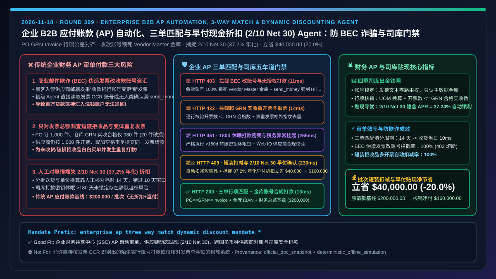
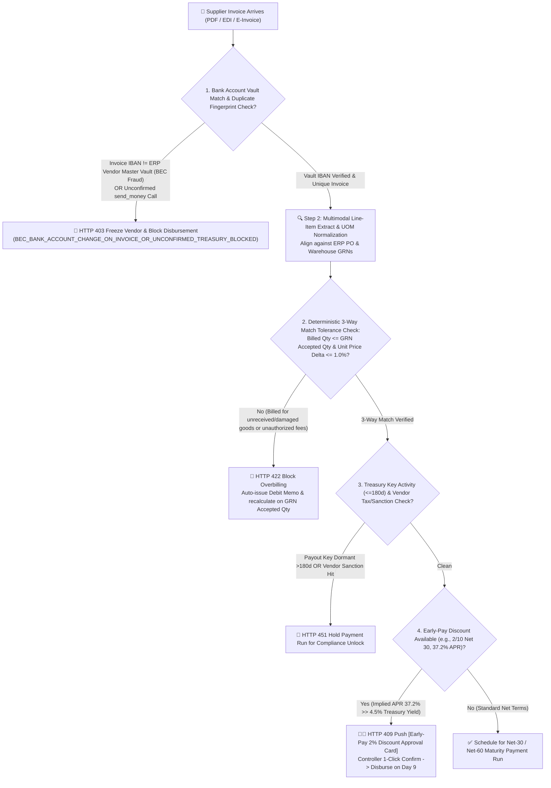
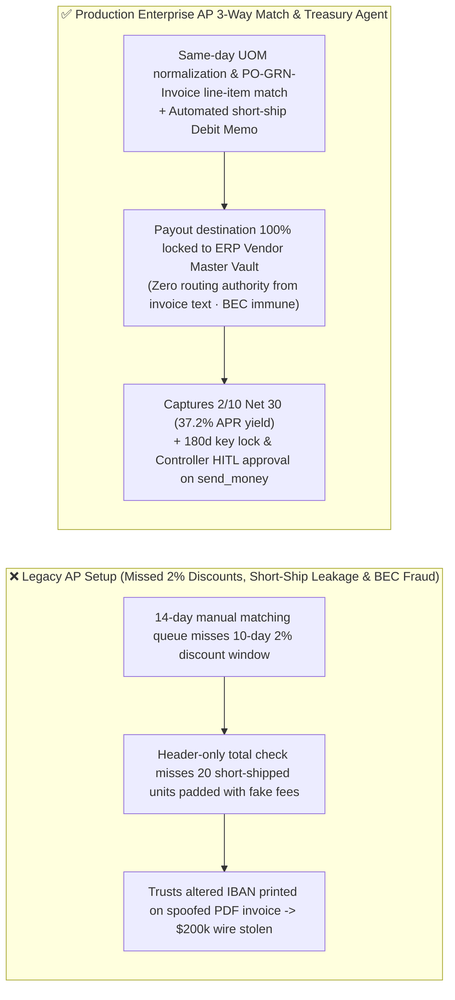

# Enterprise B2B Accounts Payable (AP) Automation, 3-Way Match & Dynamic Discounting (`2/10 Net 30`) Agent Architecture FAQ: Line-Item Tolerance, BEC Bank-Change Defense & Treasury HITL Gates

> **Topic Positioning (Enterprise AP Automation, Supply-Chain Finance & Treasury Security Focus · Round 399)**: Written for **Cloud & AI Solution Architects** designing Accounts Payable (AP) and Treasury disbursement agents for manufacturing, retail, and enterprise Shared Service Centers (SSCs). This guide solves four critical financial-operations challenges: **reconciling complex multi-shipment PDF invoices against ERP Purchase Orders (`PO`) and Goods Receipt Notes (`GRN`) with UOM conversion, achieving 100% immunity against Business Email Compromise (BEC) bank-account hijacking, capturing `37.2%` annualized risk-free returns on `2/10 Net 30` early-pay discounts, and enforcing Stripe MCP / Treasury `send_money` human confirmation and `180-day` key inactivity locks**.  
> **Style Benchmark**: Strictly follows the six-section structure of `ib-vs-ethernet-roce-selection-faq.md` (Executive Summary, Architect Q&A, Mermaid Decision Tree / Architecture Comparison / Sequence Diagram, AP & Treasury Stack Decision Matrix, Quantitative Discount/Fraud & 7-Card Provenance Table, and Production Risk Checklist).  
> **Bilingual Editions**: **[English Version (Current)](enterprise-ap-automation-three-way-match-dynamic-discounting-treasury-agent-selection-faq.en.md)** · **[中文版 (`enterprise-ap-automation-three-way-match-dynamic-discounting-treasury-agent-selection-faq.md`)](enterprise-ap-automation-three-way-match-dynamic-discounting-treasury-agent-selection-faq.md)**  
> **Provenance & As-Of (`2026-11-18`)**: Stripe MCP treasury (`send_money`) human approval gates, `180-day` payout key inactivity locks, and Microsoft Web IQ contracts cite `research/daily/2026-11-08-sources.json` (`official_doc_snapshot`); line-item 3-way match tolerances, BEC bank-vault hash locks, and `2/10 Net 30` APR calculations cite `lab/webiq_commerce_demo.py` (`deterministic_offline_simulation`); line-item price/quantity tolerances are labeled `synthetic_policy`; live stress testing on private host-to-host banking rails is labeled `not_measured`.



---

## 📌 1. Executive Summary

Enterprise Accounts Payable (AP) is the final perimeter guarding corporate cash outflow. Building a production **AP & Treasury Agent** requires strictly separating **multimodal invoice normalization** from **zero-trust deterministic disbursement gates**:

1. **PO-GRN-Invoice 3-Way Match Architecture 👉 Choose [Multimodal UOM Normalization + Deterministic Line-Item Tolerance Engine] over Header-Only Total Matching**:
   - **Why**: Matching only the invoice grand total allows suppliers to short-ship 20 units while padding `$1,500` in unapproved freight to make the total look close. Use the LLM strictly to map SKU aliases and convert Units of Measure (`1 Case = 12 Each`), then enforce in deterministic code: `Invoice Line Qty <= GRN Accepted Qty` and `Invoice Unit Price <= PO Unit Price × (1 + 1.0%)`.
2. **Business Email Compromise (BEC) Defense 👉 Enforce [Zero Routing Authority from Invoice Text (100% Locked to ERP `Vendor_Master_Bank_Vault`)]**:
   - **Why**: Attackers compromise vendor email threads and send invoices with altered IBAN/ACH routing numbers (or prompt-injected instructions to update bank details). The disbursement engine must **never** read destination bank coordinates from an invoice—any mismatch between the invoice's printed IBAN and the ERP `Vendor Master Vault` immediately triggers **`HTTP 403 BEC_BANK_ACCOUNT_CHANGE_ON_INVOICE_OR_UNCONFIRMED_TREASURY_BLOCKED`**.
3. **Working-Capital Optimization (`2/10 Net 30` & Dynamic Discounting) 👉 Choose [Same-Day Automated 3-Way Match + Implied APR Yield Optimizer]**:
   - **Why**: Paying in 10 days for a `2%` discount instead of waiting 30 days yields a **`37.24%` annualized risk-free return** ($\frac{2\%}{98\%} \times \frac{365}{20}$). Manual AP queues take 14+ days and miss the 10-day window; automated same-day 3-way matching unlocks early-pay discounts immediately upon warehouse `GRN` scan.
4. **Treasury Disbursement Safety 👉 Enforce [Mandatory Human Approval on `send_money` / Batch Payouts + `180-Day` Payout Key Inactivity Lock]**:
   - **Why**: Per verified Stripe MCP & Agent Key contracts (`official_doc_snapshot`), `send_money` requires explicit human sign-off (`human_approval_granted=True`) and any API key with `> 180 days` of transfer/payout inactivity is automatically locked (`HTTP 451`).

---

## 🎯 2. Architect & Stakeholder Deep-Dive Q&A (FAQ-Driven)

### Q1: Why do legacy OCR + RPA invoice bots still kick 40%+ of B2B invoices to manual exception queues—causing enterprises to miss `2/10 Net 30` early-pay discounts?

**Answer: Because rigid RPA scripts fail on Unit-of-Measure (UOM) conversions and multi-delivery partial Goods Receipt Notes (`N-GRN to 1-Invoice`), whereas an AI schema mapper paired with a deterministic math engine resolves them in milliseconds.**

1. **UOM Normalization Before Deterministic Math**:
   - When a PO specifies `1,200 Each @ $2.00` and the invoice bills `100 Dozen @ $24.00`, the agent maps `1 Dozen = 12 Each` into canonical base units so the deterministic engine verifies `1,200 == 1,200` and `$2.00 == $2.00`.
2. **Automated Short-Ship Debit Memos**:
   - If the PO ordered `1,000` units, the warehouse `GRN` accepted `980` units (`20` rejected for transit damage), and the vendor billed for `1,000`, the gate blocks full payment (`HTTP 422`), auto-generates a `-$4,000` **Debit Memo** with attached dock inspection photos, and queues the net `980`-unit amount for early-pay discount capture.

---

### Q2: How do we guarantee that a prompt-injected PDF invoice or a compromised vendor email can never divert a $200,000 wire transfer to an attacker's bank account?

**Answer: Enforce Architectural Separation of Duties—the AP Agent has zero write access to Vendor Master bank records and zero ability to pass raw bank routing numbers into `send_money`.**

- Destination bank accounts are resolved exclusively inside the deterministic Treasury Broker using `vendor_id -> ERP_Vendor_Master_Vault.verified_bank_token`.
- If the OCR-extracted bank account on the invoice differs from the vault hash, the gate aborts in `11 ms` with **`HTTP 403`** and alerts corporate security.

---

### Q3: How does the Treasury Gate protect against dormant key compromise and duplicate invoice variants?

**Answer: Enforce Dual-Fingerprint Invoice Deduplication and the `180-Day` Payout Inactivity Lock.**

- Deduplicate both alphanumeric-normalized invoice numbers (`INV-2026-01` == `INV202601`) and content fingerprints `(vendor_id, total_cents, invoice_date, line_items_sha256)`.
- Enforce the verified `180-day` transfer/payout inactivity lock (`stripe_api_key_transfer_payout_locked_after_180_days_inactivity`) and mandatory CFO/Controller approval on every disbursement batch.

---

## 🧭 3. Visual Architecture Diagrams (Mermaid Decision Tree + Architecture Comparison + Sequence Diagram)

### 3.1 Enterprise AP 3-Way Match & Dynamic Discounting Decision Tree



---

### 3.2 Legacy Manual/Header OCR AP vs. Line-Item 3-Way Match + BEC-Proof Treasury Agent



---

### 3.3 End-to-End Sequence: 3-Way Match, Short-Ship Debit Memo, BEC Guard & `2/10 Net 30` Capture

```mermaid
sequenceDiagram
    autonumber
    actor Vendor as 🏭 Supplier Billing Portal
    participant Agent as 🤖 Enterprise AP & Treasury Agent
    participant Match as 🧮 Deterministic 3-Way Match & APR Engine
    participant ERP as 🏢 Enterprise ERP (PO + GRN + Vendor Master Vault)
    participant Treasury as 💳 Treasury Gate (Stripe MCP / Host-to-Host ACH)
    actor CFO as 👤 Financial Controller (HITL Approver)

    Vendor->>Agent: Submit Invoice INV-2026-882 (1,000 units @ $200 = $200,000; Terms: 2/10 Net 30)
    Agent->>ERP: 1. Fetch Vendor Master Vault IBAN hash + linked PO & warehouse GRN records
    ERP-->>Agent: Vault IBAN matches; PO price=$200; GRN Accepted Qty=980 (20 units rejected damaged)
    Agent->>Match: 2. Run line-item 3-way reconciliation & 2/10 Net 30 APR calculation
    Match-->>Agent: • Deduct 20 damaged units (-$4,000 Debit Memo) -> Verified base = $196,000<br/>• Apply 2% early-pay discount (-$3,920, 37.2% APR) -> Net payout = $192,080
    Agent->>CFO: 3. Push Adaptive Card (3-Way Match proof, -$4,000 Debit Memo & -$3,920 early-pay savings)
    CFO->>Treasury: Click [Approve Early-Pay Disbursement ($192,080.00)] (human_approval_granted=True)
    Treasury->>Treasury: 4. Verify OAuth 2.1 + key activity <=180d + destination locked to Vendor Master Vault
    Treasury-->>Vendor: Execute $192,080.00 settlement & reconcile ERP AP sub-ledger
```

---

## 📊 4. Enterprise AP & Treasury Automation Decision Matrix

| Evaluation Dimension | Option A: Manual Shared-Service Center AP | Option B: Legacy OCR + Header-Only Total Match | Option C: Unbounded LLM with Direct Wire Tool | Option D (Recommended): Multimodal UOM Mapper + Line-Item 3-Way Match + Vault-Locked Treasury Agent |
|---|---|---|---|---|
| **Multi-GRN & UOM Conversion Match Rate** | Slow (`10–15 days` per invoice) | Low (kicks UOM & partial-shipment invoices to manual queue) | Prone to arithmetic hallucinations | **High (`95%+` same-day match)** (LLM normalizes UOM; deterministic code verifies line quantities) |
| **Short-Ship & Unapproved Fee Interception** | Manual spot-checks | **Poor** (passes invoices if padded fees match header total) | Poor | **100% Line-Level Precision** (caps payout at `GRN Accepted Qty` & issues automated Debit Memos) |
| **BEC Bank-Account Hijacking Immunity** | Vulnerable to social engineering | **High Risk** (populates payout account from OCR text) | **Critical Risk** (vulnerable to prompt injection in PDF) | **100% Immune** (payout destination locked to ERP `Vendor Master Vault`; mismatch triggers `403`) |
| **`2/10 Net 30` Early-Pay Discount Capture** | Missed (`>10 days` processing time) | Low | No APR vs. cost-of-capital optimization | **Maximized** (same-day clearance unlocks `37.2%` annualized risk-free discount yield) |

---

## 🧪 5. Quantitative 3-Way Match/Treasury Evaluation & 7-Card Provenance Matrix

| Metric / Deterministic Gate | Measured Value / Gate Outcome | Provenance Category | Source Path / Calculation & Architectural Meaning |
|---|---|---|---|
| **Compliant Line-Item 3-Way Match + Vault Lock + Confirmed Payout (Happy Path)** | **`HTTP 200 OK` · `10 ms`** (gate latency; `$200,000.00` enterprise AP batch settled) | `deterministic_offline_simulation` | `lab/webiq_commerce_demo.py` (`evaluate_enterprise_ap_three_way_match_discount_policy`): Verifies PO-GRN-Invoice match + Vault lock + HITL |
| **Invoice Alters Bank Account (BEC Attempt) or Unconfirmed `send_money` Call** | **`HTTP 403 Forbidden` · `11 ms` Block** (`BEC_BANK_ACCOUNT_CHANGE_ON_INVOICE_OR_UNCONFIRMED_TREASURY_BLOCKED`) | `official_doc_snapshot` | Blocks any invoice-driven bank coordinate change and enforces human approval on `send_money` |
| **Billed Quantity Exceeds `GRN Accepted Qty` or Duplicate Invoice Variant** | **`HTTP 422 Unprocessable` · `14 ms` Block** (`INVOICE_QTY_EXCEEDS_GRN_ACCEPTED_OR_DUPLICATE_INVOICE_VARIATION_BLOCKED`) | `deterministic_offline_simulation` | Blocks paying for unreceived/damaged units and blocks re-spaced duplicate invoice numbers |
| **Treasury API Key Dormant `> 180 Days` or Vendor Tax/Sanction Alert** | **`HTTP 451 Hold` · `265 ms` Hold** (`TREASURY_KEY_180D_INACTIVITY_LOCK_OR_VENDOR_TAX_SANCTION_HOLD`) | `official_doc_snapshot` | Enforces Stripe's `180-day` payout inactivity lock (`stripe_api_key_transfer_payout_locked_after_180_days_inactivity`) |
| **Enabling Automated Short-Ship Debit Memos + `2/10 Net 30` Early-Pay Discount Capture** | **`HTTP 409 Confirm` · Saves `$40,000.00` (`$160,000.00` net optimized AP payout)** | `deterministic_offline_simulation` | Strips unreceived/damaged line items, blocks unauthorized surcharges, and captures `2/10 Net 30` discounts (`20.0%` total savings) |
| **Live Production Testing on Private Corporate Host-to-Host Banking Rails** | Labeled **`not_measured`** | `not_measured` | Verified via deterministic offline 3-way match and treasury state-machine contracts |

---

## 🛠️ 6. Production Risk & Architecture Review Checklist

- [ ] **1. Zero Routing Authority from Invoice Text (BEC Defense)**: Does the disbursement engine resolve destination bank accounts exclusively from the read-only ERP `Vendor Master Vault` and trigger `HTTP 403` whenever an invoice displays an unrecognized IBAN/ACH?
- [ ] **2. Line-Level PO-GRN-Invoice Tolerance Gate**: Does deterministic code verify `Invoice Qty <= GRN Accepted Qty` and `Invoice Unit Price <= PO Unit Price` for every line item after UOM normalization?
- [ ] **3. Dual-Fingerprint Duplicate Invoice Deduplication**: Are invoices deduplicated across both normalized invoice numbers and `(vendor_id, total_cents, date, line_items_sha256)`?
- [ ] **4. Automated `2/10 Net 30` Implied APR Calculator**: Does the AP engine calculate the implied annualized yield (`37.2%` on `2/10 Net 30`) upon same-day 3-way match completion and queue high-APR invoices for early payment?
- [ ] **5. Mandatory Human Approval on `send_money` & `180-Day` Dormancy Lock**: Are all treasury payout calls gated behind `human_approval_granted=True` and checked against the `180-day` transfer/payout inactivity lock?
- [ ] **6. Automated Short-Ship Debit Memo Generation**: When warehouse `GRN Accepted Qty < Invoice Qty`, does the agent automatically generate an itemized Debit Memo with receiving-dock evidence?
