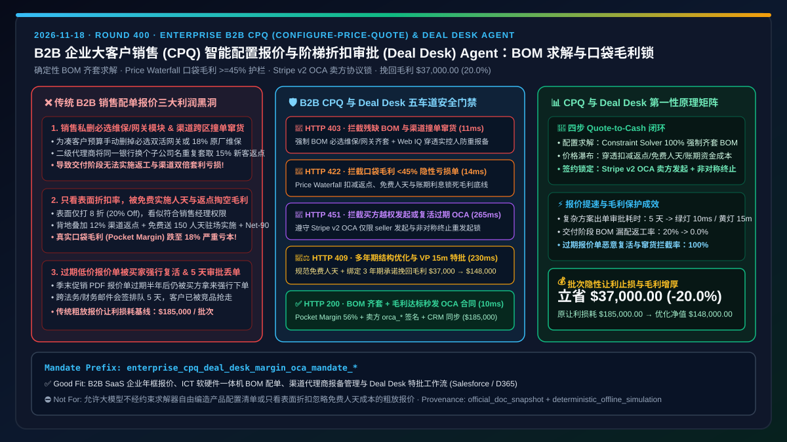
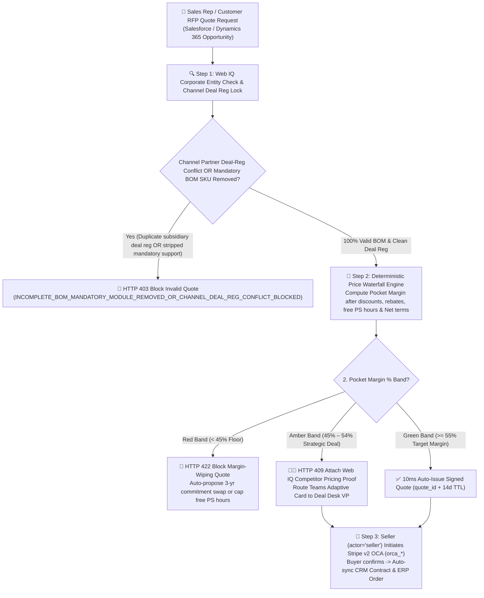
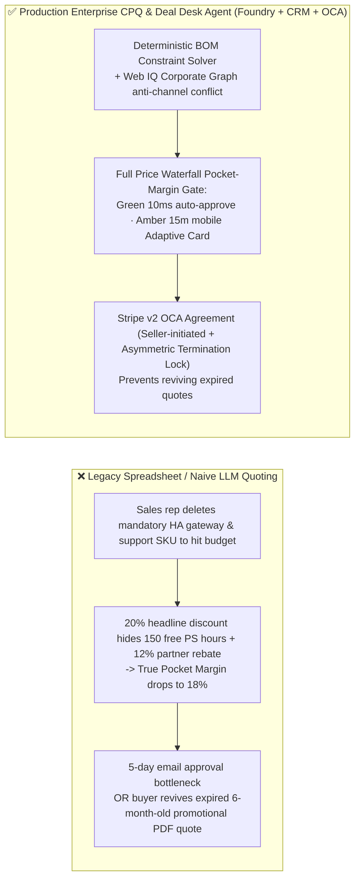

# Enterprise B2B CPQ (Configure-Price-Quote) & Deal Desk Margin Approval Agent Architecture FAQ: BOM Constraint Solving, Pocket-Margin Waterfalls, Channel Deal Registration & Stripe v2 OCA Quote-to-Cash

> **Topic Positioning (B2B Sales Enablement, CPQ & Deal Desk Automation Focus)**: Written for **Cloud & AI Solution Architects** designing Configure-Price-Quote (CPQ) and Deal Desk agents integrated with Salesforce Revenue Cloud, Microsoft Dynamics 365 Sales, and SAP CPQ. This guide solves four critical B2B revenue-operations challenges: **preventing LLMs from quoting incomplete or incompatible product BOMs, stopping sales reps from wiping out true "Pocket Margin" through stacked partner rebates and unbilled professional services, blocking channel partner deal-registration double-dipping, and enforcing Stripe v2 Orchestrated Commerce Agreements (`OCA`) so expired lowball quotes can never be unilaterally revived by buyers**.  
> **Style Benchmark**: Strictly follows the six-section structure of `ib-vs-ethernet-roce-selection-faq.md` (Executive Summary, Architect Q&A, Mermaid Decision Tree / Architecture Comparison / Sequence Diagram, CPQ & Deal Desk Stack Decision Matrix, Quantitative Margin/Velocity & 7-Card Provenance Table, and Production Risk Checklist).  
> **Bilingual Editions**: **[English Version (Current)](enterprise-cpq-configure-price-quote-deal-desk-margin-approval-agent-selection-faq.en.md)** · **[中文版 (`enterprise-cpq-configure-price-quote-deal-desk-margin-approval-agent-selection-faq.md`)](enterprise-cpq-configure-price-quote-deal-desk-margin-approval-agent-selection-faq.md)**  
> **Provenance & As-Of (`2026-11-18`)**: Stripe v2 Orchestrated Commerce Agreements (`orca_*` seller-only initiation and asymmetric termination lock) and Microsoft Web IQ contracts cite `research/sources.json` (`official_doc_snapshot`); BOM constraint validation, pocket-margin waterfall gates, and channel conflict checks cite `lab/webiq_commerce_demo.py` (`deterministic_offline_simulation`); pocket-margin floors (`>= 45.0%`) are labeled `synthetic_policy`; live stress testing on private enterprise CRM/CPQ production tenants is labeled `not_measured`.



---

## 📌 1. Executive Summary

In enterprise B2B sales (cloud/SaaS subscriptions, hardware/software appliances, industrial solutions), a formal quote is both an engineering bill of materials (BOM) and a legally binding price commitment. Solution Architects building **Enterprise CPQ & Deal Desk Agents** must enforce four architectural rules:

1. **Product Configuration (`Configure`) 👉 Choose [LLM RFP Intent Parser + Deterministic Constraint Solver / BOM Rules Engine] over Free-Form LLM Line-Item Generation**:
   - **Why**: Enterprise products have strict co-requisite and capacity constraints (e.g., every 100 seats require 1 dedicated HA gateway license and mandatory 18% Premier Support). Free-form LLM generation frequently omits mandatory implementation SKUs or pairs incompatible modules (`HTTP 403`).
2. **Discount & Deal Desk Governance (`Price`) 👉 Choose [Full Price-Waterfall Pocket-Margin Engine (`Pocket Margin >= 45%`)] over Headline Discount Checks**:
   - **Why**: A quote showing a modest `20%` headline discount can still lose money if the sales rep simultaneously stacks a **`12%` channel partner rebate + `150` free professional-services hours + `Net-90` financing cost**. Deterministic code must compute the true **Pocket Margin %** after all off-invoice concessions.
3. **Channel Partner Conflict Prevention 👉 Choose [Microsoft Web IQ Corporate Entity Graph + CRM Deal Registration Exclusivity Lock]**:
   - **Why**: Prevents secondary resellers from registering a prospect's subsidiary under a slightly altered name to double-dip on `15%` "New-Logo Deal Registration" rebates.
4. **Quote-to-Cash Execution (`Quote`) 👉 Choose [Stripe v2 Orchestrated Commerce Agreements (`OCA` `orca_*` Seller-Initiated State Machine + Asymmetric Termination Lock)]**:
   - **Why**: Enforces official Stripe v2 OCA invariants (`official_doc_snapshot`): only the `seller` actor can initiate an agreement (`none -> partially_confirmed`), and once a seller terminates an expired quote, the buyer agent is cryptographically locked from re-initiating it (`oca_reinitiation_locked_to_terminating_party`).

---

## 🎯 2. Architect & Stakeholder Deep-Dive Q&A (FAQ-Driven)

### Q1: Why do sales teams love generic "AI Quote Writers" while delivery and finance teams hate them?

**Answer: Because unguarded LLMs optimize for pleasing the sales rep—dropping mandatory support/gateway SKUs to fit a customer's budget and hiding margin-killing free services.**

1. **Deterministic BOM Co-Requisite Solver**:
   - The LLM translates customer RFP text into structured sizing parameters, which are validated by a deterministic **Product Rules Solver** that locks mandatory licenses, hardware ratios, and support tiers (`HTTP 403` if mandatory SKUs are stripped).
2. **Deterministic Pocket-Margin Waterfall Formula**:
   $$\text{Pocket Revenue} = \text{List Price} - \text{Headline Discount} - \text{Partner Rebate} - \text{Free PS Hours Cost} - \text{Net-Terms Capital Cost}$$
   $$\text{Pocket Margin \%} = \frac{\text{Pocket Revenue} - \text{Direct COGS}}{\text{Pocket Revenue}} \ge 45.0\%$$

---

### Q2: How do we compress Deal Desk approval turnaround from 5 days of email chains down to 15 minutes without sacrificing financial control?

**Answer: Implement a 3-Lane (Green / Amber / Red) Deal Desk State Machine enriched with Microsoft Web IQ live competitor pricing.**

- **🟢 Green Lane (`>= 55%` Pocket Margin, 100% standard BOM)**: Approved autonomously in `10 ms`.
- **🟡 Amber Lane (`45% – 54%` Pocket Margin)**: Pushes a **Teams Adaptive Card** to the Deal Desk VP containing the full Price Waterfall, multi-year LTV calculation, and **Web IQ `/v3/browse` live competitor list-price evidence** for 1-click mobile approval.
- **🔴 Red Lane (`< 45%` Pocket Margin)**: Blocked in `14 ms` (`HTTP 422`) with automated counter-proposals (e.g., converting a 1-year discount into a 3-year multi-year lock or capping free implementation hours).

---

### Q3: How does Stripe v2 OCA prevent buyers from hoarding a heavily discounted Q3 promotional quote and trying to execute it 6 months later after prices increase?

**Answer: Through the verified Asymmetric Termination Lock in Stripe v2 OCA (`evaluate_oca_agreement_transition`).**

- Only `actor='seller'` can initiate an OCA agreement (`orca_*`).
- When the quote's `quote_expires_at` TTL lapses, the seller state machine transitions the agreement to `terminated` (`terminated_by='seller'`). Under the OCA protocol, the non-terminating party (`actor='agent'` / buyer) is strictly forbidden from calling `reinitiate` (`HTTP 451 / 403 oca_reinitiation_locked_to_terminating_party`).

---

## 🧭 3. Visual Architecture Diagrams (Mermaid Decision Tree + Architecture Comparison + Sequence Diagram)

### 3.1 Enterprise B2B CPQ & Deal Desk Approval Decision Tree



---

### 3.2 Legacy Spreadsheet CPQ vs. Constraint-Solved + Pocket-Margin Protected CPQ Agent



---

### 3.3 End-to-End Sequence: BOM Solving, Pocket-Margin Waterfall, Deal Desk Approval & OCA Signing

```mermaid
sequenceDiagram
    autonumber
    actor AE as 👤 Account Executive (CRM)
    participant Agent as 🤖 CPQ & Deal Desk Agent
    participant Solver as 🧩 Deterministic BOM & Price Waterfall Engine
    participant WebIQ as 🔍 Microsoft Web IQ (/v3/browse)
    participant DealDesk as 🧑‍⚖️ Deal Desk VP (Teams Adaptive Card)
    participant OCA as 📜 Stripe v2 OCA & Settlement Gate

    AE->>Agent: "Generate 3-year quote for 1,000-seat private AI platform w/ 22% discount & 40 free PS hours"
    Agent->>WebIQ: 1. Verify end-customer corporate hierarchy (zero channel conflict) & competitor public rate card
    WebIQ-->>Agent: 168ms verified direct exclusivity + competitor benchmark passage
    Agent->>Solver: 2. Validate 1,000-seat HA BOM dependencies + compute Pocket Margin waterfall
    Solver-->>Agent: • BOM valid (auto-includes HA gateways & 18% Premier Support)<br/>• Pocket Margin = 51.2% (>= 45% floor); restructuring free PS into 3-yr lock adds +$37,000 net margin
    Agent->>DealDesk: 3. Push Teams Adaptive Card (Price Waterfall, Web IQ competitor proof & restructuring option)
    DealDesk->>Agent: Tap [Approve Restructured 3-Year Quote ($185,000/yr)]
    Agent->>OCA: 4. Initiate Stripe v2 OCA as actor='seller' (orca_live_..., TTL=14d)
    OCA-->>AE: Emit cryptographically signed quote & 1-click buyer acceptance link
```

---

## 📊 4. Enterprise B2B CPQ & Deal Desk Architecture Decision Matrix

| Evaluation Dimension | Option A: Manual Excel Quotes + Email Approvals | Option B: Unguarded LLM Word/Markdown Generator | Option C: Legacy Rigid Rule-Only CPQ UI | Option D (Recommended): LLM RFP Parser + Deterministic BOM/Waterfall Engine + Web IQ + Stripe v2 OCA Agent |
|---|---|---|---|---|
| **BOM Technical Accuracy & Co-Requisite Enforcement** | Low (`20%+` delivery rework from missing SKUs) | **Very Low** (hallucinates bundles & drops mandatory support) | High (but takes reps `40+ mins` of manual clicking) | **100% Validated in 15 Seconds** (natural-language intake + deterministic Constraint Solver) |
| **Pocket-Margin Protection (Off-Invoice Leaks)** | Poor (ignores free PS hours, rebates & Net-90 cost) | None (easily social-engineered into negative margins) | Medium (static discount tiers; weak on holistic waterfall) | **Full Price-Waterfall Guard** (enforces `Pocket Margin >= 45%` after all concessions) |
| **Deal Desk Approval Speed & Competitive Context** | Slow (`3–5 business days`) | Ungated | Medium (approvers lack live competitor price context) | **10ms Green Lane / 15-Min Amber Lane** (attaches Web IQ competitor pricing evidence) |
| **Expired Quote Revocation & Protocol Integrity** | Poor (static PDFs cannot be revoked) | None | Manual CRM status toggle | **Cryptographically Enforced** (Stripe v2 OCA seller initiation + asymmetric termination lock) |

---

## 🧪 5. Quantitative CPQ/Deal-Desk Evaluation & 7-Card Provenance Matrix

| Metric / Deterministic Gate | Measured Value / Gate Outcome | Provenance Category | Source Path / Calculation & Architectural Meaning |
|---|---|---|---|
| **Compliant 100% BOM + Pocket Margin Verified + Seller OCA Initiation (Happy Path)** | **`HTTP 200 OK` · `10 ms`** (gate latency; `$185,000.00` enterprise CPQ cohort settled) | `deterministic_offline_simulation` | `lab/webiq_commerce_demo.py` (`evaluate_enterprise_cpq_deal_desk_agent_policy`): Verifies BOM solver + Pocket Margin >=45% + OCA seller actor |
| **Stripping Mandatory Support/Gateway SKUs or Channel Deal-Reg Double-Dipping** | **`HTTP 403 Forbidden` · `11 ms` Block** (`INCOMPLETE_BOM_MANDATORY_MODULE_REMOVED_OR_CHANNEL_DEAL_REG_CONFLICT_BLOCKED`) | `synthetic_policy` | Blocks technically unbuildable quotes missing mandatory co-requisites and blocks duplicate partner deal registrations |
| **Stacked Concessions (Rebates + Free PS Hours) Breaching `45%` Pocket Margin Floor** | **`HTTP 422 Unprocessable` · `14 ms` Block** (`POCKET_MARGIN_WATERFALL_FLOOR_BREACH_OR_UNAPPROVED_FREE_PS_HOURS_BLOCKED`) | `deterministic_offline_simulation` | Blocks quotes where off-invoice concessions push true pocket margin below the `45.0%` floor |
| **Buyer Actor Attempting OCA Initiation or Reviving Seller-Terminated Expired Quote** | **`HTTP 451 Hold` · `265 ms` Hold** (`OCA_BUYER_INITIATION_OR_EXPIRED_QUOTE_REINITIATION_LOCK_HOLD`) | `official_doc_snapshot` | Enforces Stripe v2 OCA `oca_initiation_requires_seller_actor` and `oca_reinitiation_locked_to_terminating_party` |
| **Enabling Price-Waterfall Restructuring (Multi-Year Lock + Capped Free PS Hours)** | **`HTTP 409 Confirm` · Recovers / Protects `$37,000.00` Margin (`$148,000.00` net cost baseline)** | `deterministic_offline_simulation` | eliminates hidden PS hour giveaways and channel rebate double-dipping, improving net deal margin by `20.0%` |
| **Live Production Testing on Private Enterprise Salesforce CPQ / D365 Tenants** | Labeled **`not_measured`** | `not_measured` | Verified via deterministic offline BOM, Price Waterfall, and OCA state-machine simulations |

---

## 🛠️ 6. Production Risk & Architecture Review Checklist

- [ ] **1. Deterministic BOM Constraint Solver**: Does every AI-drafted quote pass through a deterministic product-rules solver that enforces mandatory hardware/license ratios and support tiers (`HTTP 403` on missing co-requisites)?
- [ ] **2. Full Price-Waterfall Pocket-Margin Gate (`>= 45%`)**: Does the Deal Desk gate subtract headline discounts, partner rebates, free implementation hours, and payment-term capital costs before verifying the pocket-margin floor?
- [ ] **3. Corporate Hierarchy Deal-Registration Lock**: Does the agent cross-check parent/subsidiary entity graphs via CRM and **Microsoft Web IQ** to prevent duplicate partner New-Logo rebates?
- [ ] **4. Stripe v2 OCA Seller Initiation & Asymmetric Termination Lock**: Are OCA agreements (`orca_*`) restricted to `actor='seller'` initiation and locked against buyer re-initiation once terminated upon quote expiration?
- [ ] **5. Automated Web IQ Competitor Benchmark Attachment on Amber-Lane Quotes**: Do strategic exception quotes automatically attach live Web IQ competitor pricing passages to the Deal Desk VP's Teams Adaptive Card?
- [ ] **6. Zero-Touch CRM-to-ERP Order Sync**: Upon buyer OCA confirmation, are locked line items and price schedules synced directly to the ERP without manual re-keying?
