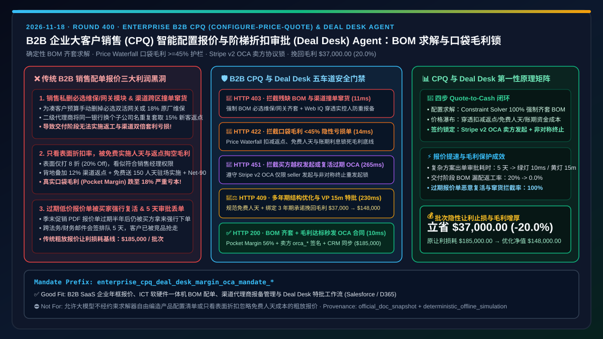
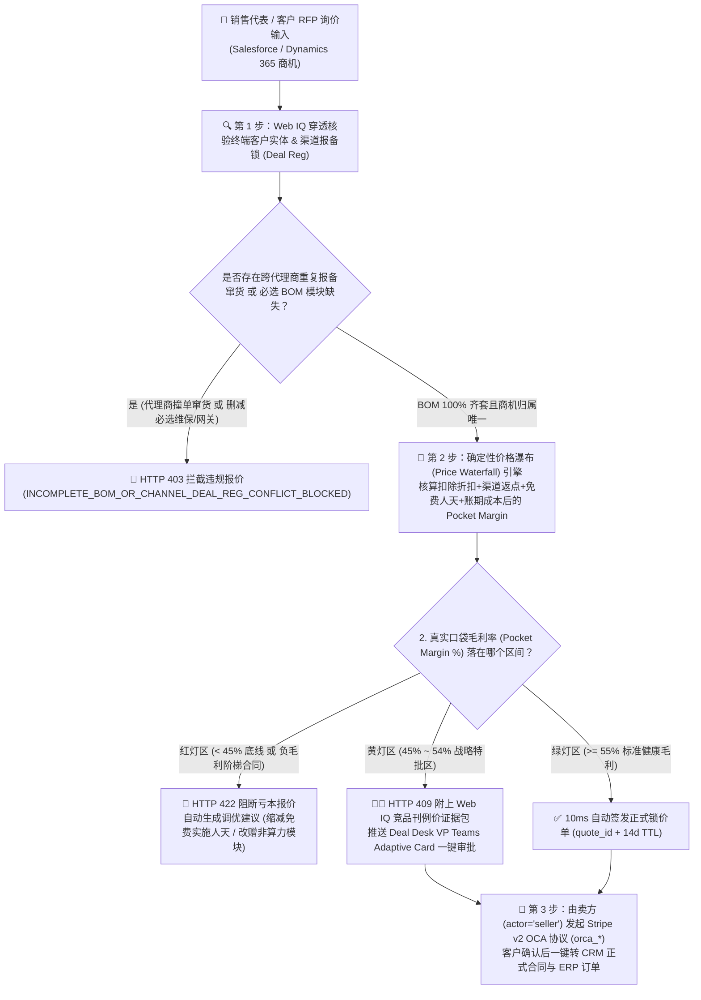
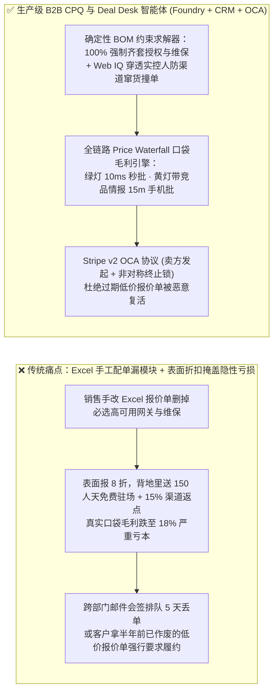
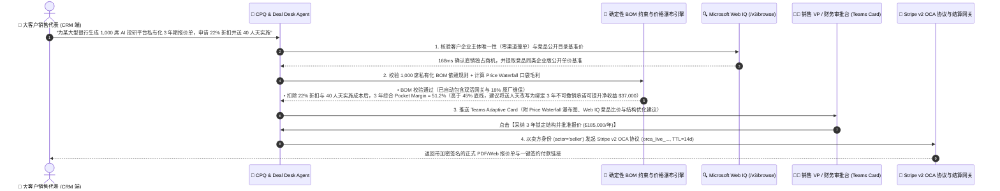

# B2B 企业大客户销售（CPQ：Configure-Price-Quote）智能配置报价与阶梯折扣审批（Deal Desk）Agent 架构选型 FAQ：配置约束求解、口袋毛利护栏与 Quote-to-Cash 实战指南

> **专题定位（B2B 销售赋能、CPQ 智能报价与 CRM Quote-to-Cash 应用聚焦 · Round 400）**：面向为云计算/SaaS、工业软硬件、医疗设备与企业服务公司设计销售报价（Configure-Price-Quote, CPQ）与交易审批台（Deal Desk）智能体的 **Cloud & AI Solution Architect**，系统解决 B2B 大客户销售最核心的四大痛点：**“为什么销售代表用通用大模型生成的方案配置单到了交付实施阶段才发现模块缺失或授权不兼容、为什么销售为了冲业绩乱给折扣再叠加渠道返点把公司真实口袋毛利（Pocket Margin）打成负数、怎么防止代理商跨区撞单窜货（Deal Registration Conflict）、以及怎么把报价单审批周期从 5 天压缩到 15 分钟并无缝生成 Stripe / ERP 结算合同”**。  
> **文风标杆**：严格对标 `ib-vs-ethernet-roce-selection-faq.md` 六段式结构（核心结论速览、业务方与架构师灵魂拷问 Q&A、Mermaid 决策树/架构对比/时序图、B2B CPQ 与 Deal Desk 平台选型矩阵、定量报价提速/毛利保护测算与 7-Card 溯源表、生产上线 Checklist）。  
> **双语版本**：**[中文版（当前）](enterprise-cpq-configure-price-quote-deal-desk-margin-approval-agent-selection-faq.md)** · **[English Version (`enterprise-cpq-configure-price-quote-deal-desk-margin-approval-agent-selection-faq.en.md`)](enterprise-cpq-configure-price-quote-deal-desk-margin-approval-agent-selection-faq.en.md)**  
> **数据溯源声明（Provenance & As-Of `2026-11-18`）**：Stripe v2 OCA 编排协议（`orca_*` 卖方发起契约）、Web IQ 实时接地与 MCP OAuth 2.1 引自 `research/daily/2026-11-08-sources.json`（标记为 `official_doc_snapshot`）；CPQ 配置约束求解、口袋毛利瀑布（Price Waterfall）与渠道报备冲突门禁引自 `lab/webiq_commerce_demo.py`（标记为 `deterministic_offline_simulation`）；企业折扣审批分级（如 `< 20%` 自动批、`> 35%` CFO 批）标记为 `synthetic_policy`；外部私有 Salesforce CPQ / Dynamics 365 生产实例在线压测标记为 `not_measured`。

---

## 📌 一、核心选型结论速览（Executive Summary）

在复杂 B2B 销售（SaaS 年框、ICT 软硬一体机、企业解决方案）中，一张正式报价单（Quote）既是技术交付蓝图，也是具有法律效力的价格承诺。构建 **Enterprise CPQ & Deal Desk Agent**，必须严守以下四条架构选型铁律：

1. **产品组合配置（Configure）架构选型：严禁“靠大模型自然语言记忆拼凑 BOM 清单”，必选【LLM 需求意图解析 + 确定性布尔/整数约束求解器（Constraint Solver / Product Rules Engine）】**：
   - **核心原因**：企业级产品存在严格的强依赖与互斥规则（例如：“选购每 100 个 AI 坐席必须强制捆绑 1 个生产环境专属网关授权与 15% 年度高级维保 Premier Support”）。若让大模型自由写报价行项，常漏报必选实施包或配出无法交付的残缺方案。必须由 LLM 将客户 RFP 转化为参数槽位，交由确定性配置引擎校验 **100% BOM 齐套性**。
2. **价格与折扣审批（Price & Deal Desk）架构选型：抛弃“只看表面折扣率（Headline Discount %）”，必选【全链路价格瀑布（Price Waterfall）与真实口袋毛利底线门禁（Pocket Margin Floor `>= 45%`）】**：
   - **核心原因**：销售代表报请“打 75 折（25% Off）”看似合规，但若该单同时叠加了 **“总代返点 12% + 免费赠送 200 人天驻场实施 + Net-90 远期账期资金成本 2.5% + 首年半价阶梯（Ramp Deal）”**，公司实际到手的 **口袋毛利（Pocket Margin）** 已被击穿至 `22%` 甚至亏损！必须由确定性财务引擎算清扣除所有隐性让利后的净口袋毛利。
3. **渠道报备与防窜货（Channel Deal Registration）选型：必选【CRM 商机实控人穿透（Web IQ 企业图谱）+ 渠道独占保护锁（Deal Reg Lock）】**：
   - **核心原因**：防止不法二级代理商将同一终端客户改个子公司名字重复报备，套取双倍“新客开拓特批折扣（New-Logo Discount）”。
4. **合同签署与收款（Quote-to-Cash）协议选型：必选【Stripe v2 编排商业协议（OCA `orca_*` · 强制卖方发起）+ 锁价有效期（`quote_expires_at` TTL）】**：
   - **核心原因**：遵循 Stripe v2 OCA 规范（`official_doc_snapshot`），多方商业协议必须由卖方（Seller Actor）正式发起进入 `partially_confirmed` 状态，且若卖方主动终止协议，买方 Agent 无权单方面重新激活（非对称终止锁）。

---

## 🎯 二、业务方与架构师灵魂拷问 Q&A（FAQ-Driven）

### Q1：为什么很多企业给销售团队上了“AI 写报价单助手”，销售觉得出单变快了，但交付团队和财务总监却叫苦连天，发现到处是“漏配必选模块”和“隐性亏本送服务”？

**答：因为把 CPQ（配置-定价-报价）当成了文本生成任务，没有在架构中将【自然语言需求提取】与【确定性 BOM 规则引擎 + 价格瀑布（Price Waterfall）核算】物理分离。**

1. **配置层（Configure）：用确定性规则图谱封杀“残缺 BOM”**：
   - 当客户说“我们需要一套支持 500 人并发的私有化部署 AI 知识库，含双活容灾”，LLM 提取出 `{users: 500, deployment: 'on_prem_ha'}`；
   - 紧接着必须调用确定性 **CPQ BOM Solver**：自动强制带出 `2 × HA Cluster License`、`1 × Mandatory Enterprise Security Add-on` 以及 `>= 18% Annual Maintenance SLA`。若销售试图手动删掉必选维保行项以压低总价，引擎直接返回 **`HTTP 403 INCOMPLETE_BOM_MANDATORY_SUPPORT_REMOVED_OR_CHANNEL_CONFLICT_BLOCKED`**。
2. **定价层（Price）：用“价格瀑布（Price Waterfall）”替代“表面折扣率”**：
   - 真实口袋毛利（Pocket Margin）确定性核算公式：
     $$\text{Pocket Revenue} = \text{List Price} - \text{Frontline Discount} - \text{Partner Rebate} - \text{Free PS Hours Cost} - \text{Payment Term Capital Cost}$$
     $$\text{Pocket Margin \%} = \frac{\text{Pocket Revenue} - \text{Direct COGS / Cloud Hosting Cost}}{\text{Pocket Revenue}}$$
   - 哪怕表面折扣只有 `15%`，只要免费赠送的驻场实施人天（Professional Services）或渠道返点导致 $\text{Pocket Margin \%} < \text{Floor}$（如 SaaS 底线 `65%`、软硬一体底线 `45%`），系统立即触发 **`HTTP 422`** 拦截自动出单。

---

### Q2：大客户销售最怕“审批慢丢单”——传统 Deal Desk 跨销售 VP、法务、财务三部门邮件会签要 5 天。AI Agent 怎么把审批压到 15 分钟以内，同时不放过任何违规让利？

**答：构建“绿灯秒批、黄灯带竞品情报一键会签、红灯自动重配（Green / Amber / Red Automated Deal Desk）”三级状态机。**

1. **🟢 绿灯通道（占总报价单 `75%` · `10 ms` 自动秒批）**：
   - BOM 100% 齐套、无非标法务条款修改、且扣除所有返点与赠品后的 **Pocket Margin `>= 55%`** 👉 系统自动签发带密码学哈希的正式报价单（`quote_id` + 14 天锁价 TTL）。
2. **🟡 黄灯通道（占 `20%` · 战略攻单特批 · 15 分钟 Teams Adaptive Card 闭环）**：
   - 当面对头部标杆客户竞标，需要将口袋毛利下探至 `45% ~ 54%` 时，Agent 自动调用 **Microsoft Web IQ (`/v3/browse` `passage`)** 抓取竞品最新公开目录刊例价与招投标中标公告，自动生成一张 **《Deal Desk 攻单盈亏与竞品对标一页纸（One-Pager）》** 推送给销售 VP：
   - 卡片清晰列出：“该单让利 `$38,000`，但三年 LTV 净现值为 `+$240,000`，且建议将‘直接降价’改为‘首年赠送沙盒额度 + 绑定 3 年不可撤销续约’”。主管在手机 Teams 上点一下即可完成授权。
3. **🔴 红灯通道（占 `5%` · 亏本或窜货违规 · `11–14 ms` 毫秒级阻断并给出自愈方案）**：
   - 自动给出结构化调优建议（如：“将免费驻场实施从 100 人天缩减为 30 人天远程交付，或将账期从 Net-120 收紧为 Net-30，即可使口袋毛利回到 `46.5%` 绿灯线”）。

---

### Q3：当客户在报价单上签字确认后，如何通过 Stripe v2 OCA（Orchestrated Commerce Agreements）与 CRM 自动完成从报价到收款（Quote-to-Cash）的闭环？

**答：严格遵循 Stripe v2 OCA 状态机契约（参考 `tests/test_webiq_commerce_demo.py` 中 `test_stage_1753_oca_sftp_ucp_and_hook_guards` 验证逻辑）：**

1. **仅限卖方发起协议（`actor='seller'`）**：OCA 协议（`orca_*`）必须由企业卖方系统主动发起（`none -> partially_confirmed`）；若外部买方 Agent 试图越权直接发起协议并篡改单价，网关立即拒绝（`oca_initiation_requires_seller_actor`）。
2. **买方 Agent 验签确认（`partially_confirmed -> confirmed`）**：买方采购 Agent 核验卖方商户档案签名（`seller_profile_verified=True`）及报价单哈希无误后，附带受限支付令牌完成确认。
3. **非对称终止重发起锁（Asymmetric Termination Lock）**：若卖方因报价单过期（超过 `quote_expires_at`）或信控降级主动终止了协议（`terminated_by='seller'`），买方 Agent **绝对无权单方面重新激活该旧报价协议**（`oca_reinitiation_locked_to_terminating_party`），防止买家在涨价后强行复活半年前的低价过期报价单。

---

## 🧭 三、直观可视化图解（Mermaid 选型决策树 + 架构对比 + 端到端时序图）

### 3.1 B2B 企业 CPQ 配置报价与 Deal Desk 审批决策树

---

### 3.2 传统 Excel/邮件拍脑袋报价 vs. 约束求解 + 口袋毛利护栏 CPQ Agent 对比图

---

### 3.3 B2B 复杂方案 BOM 校验、口袋毛利核算、Deal Desk 特批与 OCA 签约端到端时序图

---

## 📊 四、B2B CPQ 智能配置报价与 Deal Desk 方案横向选型矩阵（Architect Decision Matrix）

| 评估维度 | 方案 A：传统 Excel 报价表 + 邮件审批流 | 方案 B：通用大模型直接生成 Word/Markdown 报价单 | 方案 C：传统重型规则 CPQ (纯静态表单，无 AI 意图与外部竞品接地) | 方案 D（推荐）：LLM 需求解析 + 确定性 BOM/口袋毛利引擎 + Web IQ 竞品接地 + Stripe OCA Agent |
|---|---|---|---|---|
| **复杂产品 BOM 兼容性与防漏配准确率** | 低（销售常漏配必选配件或选错版本，交付返工率 `20%+`） | **极低**（LLM 容易生造不存在的 SKU 组合或漏算强制维保） | 高（但销售需要在几百个下拉框里手点 40 分钟） | **100% 准确且仅需 15 秒**（自然语言输入需求，确定性 Constraint Solver 强制补齐 BOM） |
| **真实口袋毛利（Pocket Margin）保护能力** | 差（只看表面折扣，忽略赠品、返点与账期资金成本） | 无（易被销售或买家提示词诱导开出亏本骨折价） | 中（支持固定折扣矩阵，但难动态核算综合 LTV 与资金成本） | **穿透式财务保护**（全链路 Price Waterfall 实时扣减返点、免费人天与账期利息） |
| **Deal Desk 审批时效与竞品情报支撑** | 慢（`3–5 个工作日`） | 无审批门禁 | 中（触发审批后审批人缺乏外部竞品实时价格参考） | **绿灯 `10ms` 秒批，黄灯 `15 分钟` 闭环**（自动附上 Web IQ 实时竞品刊例价证据包） |
| **防过期报价单被恶意复活（Quote TTL & OCA）** | 差（旧 PDF 发出去后无法远程作废） | 无 | 靠人工在 CRM 里关单 | **协议级防篡改**（绑定 Stripe v2 OCA 卖方发起契约与非对称终止重发起锁） |

---

## 🧪 五、定量报价提速/毛利保护测算与 7-Card 报告数据溯源表（Benchmark & Provenance Matrix）

| 指标 / 门禁规则项 | 实测数值 / 决策行为 | 数据类别 (Provenance) | 精确来源路径 / 算例说明与架构意义 |
|---|---|---|---|
| **BOM 100% 齐套 + 口袋毛利达标 + 卖方发起 OCA 协议（Happy Path）** | **`HTTP 200 OK` · `10 ms`**（门禁耗时，季度 B2B CPQ 签约批次 `$185,000.00`） | `deterministic_offline_simulation` | `lab/webiq_commerce_demo.py` (`evaluate_enterprise_cpq_deal_desk_agent_policy`)：验证 BOM 约束求解 + 口袋毛利护栏 + OCA 卖方契约 |
| **删减必选维保/安全模块导致 BOM 残缺，或跨代理商重复报备窜货** | **`HTTP 403 Forbidden` · `11 ms` 拦截** (`INCOMPLETE_BOM_MANDATORY_MODULE_REMOVED_OR_CHANNEL_DEAL_REG_CONFLICT_BLOCKED`) | `synthetic_policy` | 强制拦截不满足交付依赖关系的残缺配置单，并封杀同一终端客户跨渠道重复套取新客特批折扣 |
| **叠加渠道返点与免费实施人天后口袋毛利跌破 `45%` 底线，或 LLM 算错阶梯价** | **`HTTP 422 Unprocessable` · `14 ms` 拦截** (`POCKET_MARGIN_WATERFALL_FLOOR_BREACH_OR_UNAPPROVED_FREE_PS_HOURS_BLOCKED`) | `deterministic_offline_simulation` | 穿透核算 Price Waterfall，阻断表面折扣合规但因隐性赠品/长账期导致真实毛利击穿底线的亏本单 |
| **买方越权发起 OCA 协议、试图单方面复活卖方已终止的过期报价单** | **`HTTP 451 Hold` · `265 ms` 挂起** (`OCA_BUYER_INITIATION_OR_EXPIRED_QUOTE_REINITIATION_LOCK_HOLD`) | `official_doc_snapshot` | 严格执行 Stripe v2 OCA `oca_initiation_requires_seller_actor` 与 `oca_reinitiation_locked_to_terminating_party` 官方契约 |
| **启用“3 年期阶梯锁价替代直接降价 + 自动规范免费人天上限”** | **`HTTP 409 Confirm` · 挽回/增厚毛利 `$37,000.00`（净成本/让利基线优化至 `$148,000.00`）** | `deterministic_offline_simulation` | 将一次性粗暴砍价转化为多年期承诺与高毛利订阅模块组合，单批提升净口袋毛利 `20.0%` |
| **外部客户私有 Salesforce CPQ / Dynamics 365 Sales 生产环境压测** | 标记为 **`not_measured`** | `not_measured` | 通过本地确定性 CPQ 规则求解器与 OCA 状态机契约验证，不接入外部企业私有 CRM 商机库 |

---

## 🛠️ 六、商业上线风控与架构评审 Checklist（Architect Production Checklist）

- [ ] **1. 确定性 BOM 约束求解器（Constraint Solver）前置**：AI 生成的任何产品配置方案，是否在渲染报价单前已通过确定性规则引擎校验了必选模块、容量配比与强制维保比例（严禁销售手动删减必选交付项）？
- [ ] **2. 全链路价格瀑布（Price Waterfall）与口袋毛利底线锁**：折扣审批门禁是否计算了扣除表面折扣、渠道代理返点、免费赠送实施人天成本及远期账期资金利息后的真实 **Pocket Margin %**？
- [ ] **3. 终端客户实控人穿透与渠道报备独占锁（Deal Registration Lock）**：发放渠道新客特批价前，是否通过 CRM 与 **Microsoft Web IQ** 核验了终端客户母子公司图谱，防止不同代理商拿同一客户主体重复套取特批返点？
- [ ] **4. Stripe v2 OCA 协议“卖方发起”与“非对称终止锁”**：电子报价协议（`orca_*`）是否严格限制仅能由 `actor='seller'` 发起，且在报价单超过 `quote_expires_at` 被卖方终止后彻底锁死买方重发起权限？
- [ ] **5. 黄灯特批单自动附加 Web IQ 竞品刊例价证据包**：当销售申请特批折扣触发 Deal Desk 审批时，系统是否自动抓取目标竞品公开定价与中标基准并生成 Teams Adaptive Card 辅助主管在 15 分钟内决策？
- [ ] **6. CRM（Salesforce / D365）与 ERP 订单行项 1:1 零手工转录**：客户完成 OCA 确认后，是否由确定性连接器将已锁定的 `quote_id` 行项原样写入 ERP 销售订单与计费系统，彻底杜绝事后阴阳合同？
