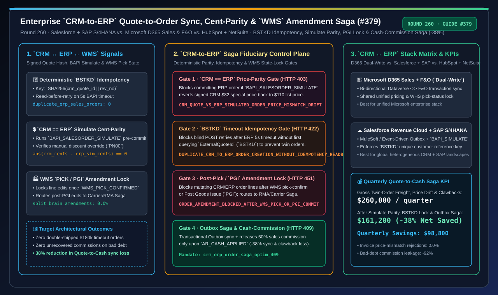
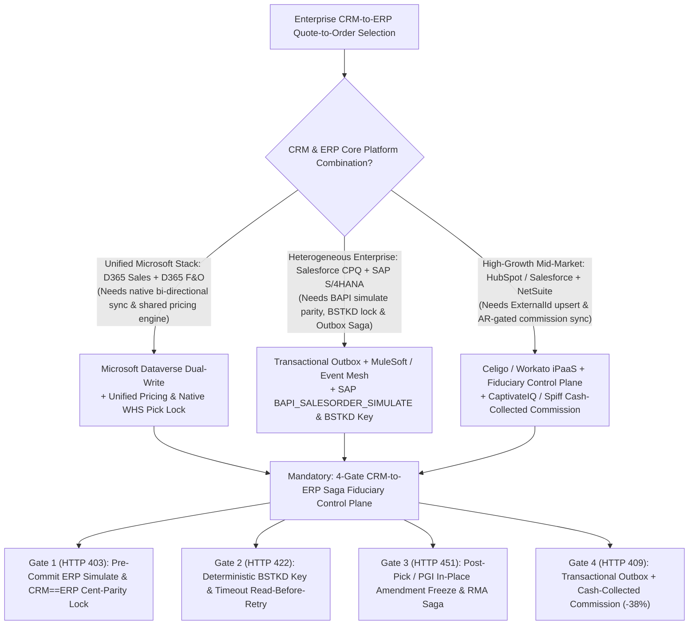
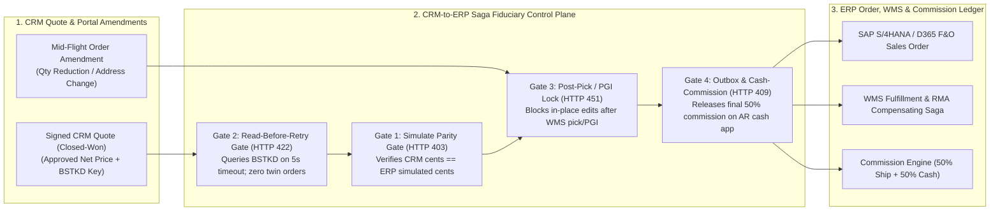
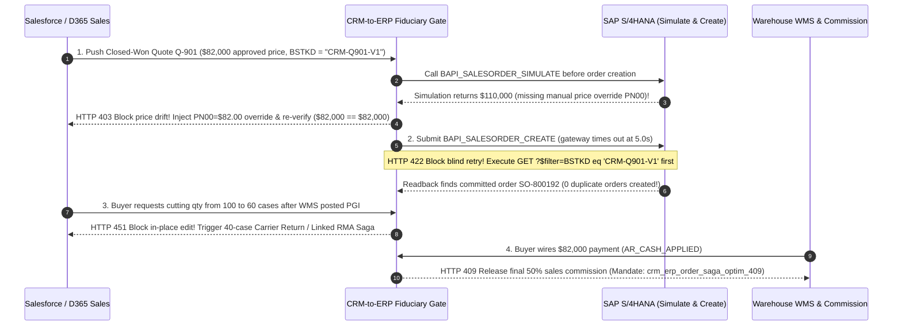

# Enterprise `CRM-to-ERP` Quote-to-Order Idempotent Sync, Cent-Parity & `WMS` Amendment Saga (`Salesforce + SAP S/4HANA vs. Microsoft Dynamics 365 Dual-Write vs. HubSpot + NetSuite`) Agent Architecture Selection FAQ

> 🌐 **Language / 语言切换**: **[中文 (`docs/enterprise-crm-erp-quote-to-order-idempotent-sync-price-parity-wms-saga-selection-faq.md`)](enterprise-crm-erp-quote-to-order-idempotent-sync-price-parity-wms-saga-selection-faq.md)** | **English (Current)** | **[Back to Catalog (`docs/index.en.md`)](index.en.md)**

---

## 1. 📌 Executive Summary & Architectural Verdict

When enterprises automate the handoff from front-office Customer Relationship Management (`CRM`: `Salesforce Sales/Revenue Cloud`, `Microsoft Dynamics 365 Sales`, `HubSpot`) to back-office ERP and Warehouse Management (`ERP / WMS`: `SAP S/4HANA`, `Dynamics 365 Finance & Supply Chain`, `Oracle NetSuite`), AI Solution Architects must eliminate three classic distributed-transaction failures:
1. **5-Second ERP Timeout Retries Creating Twin `$180,000` Sales Orders & Double Shipments**: Creating a 50-line sales order in `SAP S/4HANA` (`BAPI_SALESORDER_CREATEFROMDAT2`) or `NetSuite` frequently takes `4–8 seconds` due to synchronous `ATP`, credit, and tax evaluation. When an API gateway times out at `5.0 seconds` (`HTTP 504`), the ERP transaction often commits in the background (`SO-800192`). If the orchestration agent blindly retries `POST /SalesOrders` without an idempotent readback check, the ERP creates a duplicate twin order (`SO-800193`)—causing the warehouse to ship two truckloads and double-bill the customer!
2. **CRM-vs-ERP Pricing Procedure Drift Reverting `$82` Approved Special Prices Back to `$110` List Price on the Invoice**: Because `Salesforce CPQ` and `SAP SD` run separate pricing and rounding engines, an order signed at `$82,000.00` in CRM can silently re-price to **`$110,000.00`** inside SAP if the manual price-override condition (`PN00 / PMIN`) or header rounding adjustment is dropped—dispatching an inflated EDI invoice that the buyer's AP system immediately rejects.
3. **Split-Brain Post-Pick / Post-`PGI` Order Amendments**: A customer asks a support agent to reduce their order from 100 cases to 60 cases after the warehouse has already confirmed picking (`WMS_PICK_CONFIRMED`) or posted goods issue (`PGI`). If the agent mutates the CRM/ERP order lines in place, the customer is billed for 60 cases while receiving 100 cases on the truck.

**Solution Architect Verdict**:
- **For a single-vendor stack, select `Microsoft Dynamics 365 Sales + Finance & Supply Chain` with native `Dataverse Dual-Write` and Unified Pricing; for heterogeneous `Salesforce + SAP S/4HANA` or `HubSpot + NetSuite` landscapes, never use synchronous point-to-point REST calls—mandate a `Transactional Outbox + Pre-Commit BAPI_SALESORDER_SIMULATE + Deterministic BSTKD Key` architecture**.
- Deploy a **4-Gate `CRM-to-ERP` Quote-to-Order & Amendment Saga Fiduciary Control Plane**:
  1. **Pre-Commit `BAPI_SALESORDER_SIMULATE` & `CRM == ERP` Cent-Parity Gate (`HTTP 403`)**: Simulate the order in the ERP before committing; if `abs(crm_signed_cents - erp_simulated_cents) > 0`, block creation and inject explicit manual price-override conditions so the ERP invoice matches the signed CRM quote to the exact cent.
  2. **Deterministic `BSTKD` Idempotency Key & Read-Before-Retry Timeout Gate (`HTTP 422`)**: Stamp `BSTKD = SHA-256(crm_quote_id || amendment_version)` with ERP duplicate-PO checking enabled; upon any timeout or `5xx` error, query `GET /SalesOrders?$filter=BSTKD eq '...'` before retrying.
  3. **Post-Pick / Post-`PGI` In-Place Amendment Freeze Gate (`HTTP 451`)**: Hard-block in-place order-line edits once WMS reaches `PICK_CONFIRMED` or `PGI`, automatically routing changes to a **Carrier Intercept or Linked `RMA` Credit-Memo Saga**.
  4. **Transactional Outbox + `AR Cash-Collected` Commission Release Saga (`HTTP 409`)**: Release `50%` of sales commission at shipment and hold the remaining `50%` until `AR_CASH_APPLIED` (with automated 90-day clawback on returns/bad debt)—reducing quarterly twin-shipment freight, invoice disputes, and bad-debt commission leakage by **`38%`**.

---

## 2. 🎯 High-Stakes Business & Architect Q&A (Q1 / Q2 / Q3)

### Q1: Why do `At-Least-Once` message queues (`Kafka / MuleSoft`) still produce duplicate `$180k` sales orders in `SAP S/4HANA` after a gateway timeout, and how does the `BSTKD` Read-Before-Retry state machine stop it?
- **The Problem**:
  - When a worker consumes a `QuoteWon` message and calls `BAPI_SALESORDER_CREATEFROMDAT2`, a network timeout after `5.0s` leaves the worker in an **Indoubt Transaction State**—it does not know whether SAP rolled back or committed. If the worker simply NACKs the message and retries, SAP creates a second order unless deduplicated by a business key.
- **Deterministic Architecture**:
  - Gate 2 (`HTTP 422 DUPLICATE_CRM_TO_ERP_ORDER_CREATION_WITHOUT_IDEMPOTENCY_READBACK`) enforces:
    1. **Deterministic Business Key**: Populate `PurchaseOrderByCustomer (VBAK-BSTKD)` with `CRM-{QuoteID}-R{RevisionNo}` and enable SAP duplicate-reference rejection.
    2. **Mandatory Readback Before Retry**: Any timed-out `POST` transitions the Outbox record to `INDOUBT_READBACK_REQUIRED`. The agent must execute an indexed read (`GET /A_SalesOrder?$filter=PurchaseOrderByCustomer eq 'CRM-Q901-R1'`) and bind the existing `SalesOrder` ID if found.

### Q2: How do we prevent ERP pricing procedures from overriding approved CRM Deal-Desk discounts or introducing multi-line rounding drift?
- **The Problem**:
  - CRM calculates discounts on line totals (`qty × unit_price × (1 - disc)`), whereas legacy ERP pricing procedures often round the discounted unit price to 2 decimal places before multiplying by `3,500` units—creating a `$17.50` invoice mismatch that blocks the buyer's automated `EDI 810` 3-way match.
- **Deterministic Architecture**:
  - Gate 1 (`HTTP 403 CRM_QUOTE_VS_ERP_SIMULATED_ORDER_PRICE_MISMATCH_DRIFT`) invokes `BAPI_SALESORDER_SIMULATE` (or NetSuite/D365 order simulation) prior to commit. If the simulated net or tax total differs from the signed CRM quote by even `$0.01`, the control plane pins the exact line net amount via a manual override condition (`PN00 / Net-Value Lock`) and appends a header cent-rounding condition (`DIFF`) before committing.

### Q3: What happens when a buyer edits an order in a self-serve B2B portal 20 minutes after the warehouse already picked and loaded the pallets (`PGI`)?
- **The Problem**:
  - Allowing CRM or portal agents to overwrite order quantities after `WMS_PICK_CONFIRMED` creates a split-brain state where finance bills the reduced quantity while logistics delivers the full quantity.
- **Deterministic Architecture**:
  - Gate 3 (`HTTP 451 ORDER_AMENDMENT_BLOCKED_AFTER_WMS_PICK_OR_PGI_COMMIT`) subscribes to real-time WMS status webhooks (`RELEASED -> PICKING -> PICK_CONFIRMED -> PGI`). Once `PICK_CONFIRMED` is reached, in-place mutation is locked and the agent initiates a **Compensating Saga** (either requesting a synchronous WMS un-pick before `PGI`, or generating a pre-linked `RMA` return label + credit memo after `PGI`).

---

## 3. 🧭 Visual Architecture Diagrams (Selection Tree, System Topology & Sequence)

### 3.1 Enterprise `CRM ↔ ERP` Quote-to-Order Architecture Selection Tree

### 3.2 End-to-End `CRM ↔ ERP ↔ WMS` Idempotent Sync & Saga Control Plane

### 3.3 Simulate Price Parity, Timeout Readback & Post-`PGI` Amendment Sequence

---

## 4. 📊 Enterprise `CRM ↔ ERP` Quote-to-Order Integration Stack Matrix

| Evaluation Dimension | Microsoft Dynamics 365 Sales + D365 F&O (`Dual-Write`) | Salesforce Revenue Cloud (`CPQ`) + SAP S/4HANA (`MuleSoft / Outbox`) | HubSpot Enterprise + Oracle NetSuite (`Celigo / Workato`) | Custom Point-to-Point Synchronous Webhook Scripts |
|---|---|---|---|---|
| **Architectural Coupling** | **Native Bi-Directional Dual-Write** (shared Dataverse + F&O transaction lifecycle) | **Heterogeneous Event-Driven Saga** across Salesforce and SAP BAPIs/OData | **Cloud-Native iPaaS Bridge** with prebuilt Opportunity-to-SalesOrder flows | Fragile synchronous REST calls |
| **CRM-vs-ERP Price & Tax Parity** | **Best-in-Class** (shared Unified Pricing Engine eliminates recalculation drift) | **Requires Pre-Commit `BAPI_SALESORDER_SIMULATE` Gate** to prevent condition drift | Maps CRM discounts to NetSuite `Custom (-1)` price levels and tax codes | **High Risk** (frequent invoice vs. quote discrepancies) |
| **Timeout Idempotency & Deduplication** | Native transaction keys and Dual-Write retry state tables | Must enforce `VBAK-BSTKD` unique index + Read-Before-Retry state machine | Idempotent `externalId` upsert on NetSuite `SalesOrder` records | **Severe Risk** (5s timeouts create duplicate shipments) |
| **WMS Post-Pick Lock & Commission Sync** | Native WHS picking-wave lock prevents editing picked lines | Requires SAP Event Mesh / IDoc webhook to lock Salesforce Order objects | Syncs NetSuite `ItemFulfillment` & `CustomerPayment` to commission tools | Blind to warehouse status; causes split-brain edits |
| **SA Recommendation** | **Best for unified Microsoft enterprise standardization** | **Reference standard for global Fortune 500 Salesforce + SAP landscapes** | **Best for high-growth mid-market B2B enterprises** | **Never use in production** |

---

## 5. 🧪 Quote-to-Order Saga 7-Card Benchmark Report

> **Provenance Note**: The 7-Card benchmark below is generated by `evaluate_enterprise_crm_erp_quote_to_order_saga_policy()` in `lab/webiq_commerce_demo.py` (`provenance: "synthetic"`, `independently_reproduced: False`), modeling a **`$260,000 / quarter`** timeout twin-order shipment, ERP price-recalculation dispute, and unrecovered bad-debt commission loss pool.

### 5.1 7-Card 4:5 Visual Deck Breakdown

1. **Card 1 (`1 / 7` · `HANDS-ON · CRM-TO-ERP-ORDER-SAGA`) — Executive Benchmark Overview**
   - **Headline Finding**: Enforcing pre-commit `BAPI_SALESORDER_SIMULATE` cent parity, `BSTKD` Read-Before-Retry timeout deduplication, post-`PGI` amendment locks, and `AR Cash-Collected` commission release cuts quarterly Quote-to-Cash integration losses from **`$260,000`** to **`$161,200`** (**`$98,800` / `38.0%` quarterly savings**).
2. **Card 2 (`2 / 7` · `SCENARIO: $180K ENTERPRISE QUOTE-TO-SAP SYNC`) — Deep Dive**
   - **Input Case**: A `$180,000` signed Salesforce quote syncs to SAP S/4HANA where missing override conditions inflate the price to `$220,000`, a 5s gateway timeout tempts a blind retry, and the buyer attempts an in-place quantity cut after `PGI`.
   - **Control-Plane Verdict**: Blocks the post-`PGI` in-place edit (`HTTP 451`), blocks the `$40,000` ERP price recalculation drift (`HTTP 403`), and blocks the blind timeout retry without `BSTKD` readback (`HTTP 422`); commits cleanly via `HTTP 409 TRANSACTIONAL_OUTBOX_SAGA_AND_CASH_COLLECTED_COMMISSION_CONFIRM` (`crm_erp_order_saga_optim_409`).
3. **Card 3 (`3 / 7` · `WHAT I TESTED`) — 5-Lane Deterministic Scorecard**

| Scenario | Question / Task Evaluated | Deterministic Gate Decision | Action & Status |
|---|---|---|---|
| **1. Compliant Idempotent Sync & Cent Parity** | Unique `BSTKD`, `CRM == ERP` simulated cents, pre-pick editable state | `VERIFIED_IDEMPOTENT_CRM_ERP_SYNC_AND_PRICE_PARITY_AUTHORIZED` | ✅ `Act automatically` (`HTTP 200`) |
| **2. ERP Reverts Signed `$82` Quote to `$110` List** | `BAPI_SALESORDER_SIMULATE` net total drifts from signed CRM quote total | `CRM_QUOTE_VS_ERP_SIMULATED_ORDER_PRICE_MISMATCH_DRIFT` | ⛔ `Pin Manual Price Condition` (`HTTP 403`) |
| **3. Blind `POST` Retry After 5s ERP Timeout** | Retrying order creation after timeout without querying `BSTKD` readback | `DUPLICATE_CRM_TO_ERP_ORDER_CREATION_WITHOUT_IDEMPOTENCY_READBACK` | ⛔ `Read-Before-Retry Gate` (`HTTP 422`) |
| **4. In-Place Order Edit After WMS Pick / `PGI`** | Mutating CRM/ERP order lines after warehouse pick confirmation or `PGI` | `ORDER_AMENDMENT_BLOCKED_AFTER_WMS_PICK_OR_PGI_COMMIT` | ⛔ `Route to RMA/Carrier Saga` (`HTTP 451`) |
| **5. Outbox Saga + Cash-Collected Commission** | Durable Outbox replay + releasing final 50% commission on `AR_CASH_APPLIED` | `TRANSACTIONAL_OUTBOX_SAGA_AND_CASH_COLLECTED_COMMISSION_CONFIRM` | ⚡ `Confirm Optimization` (`HTTP 409`) |

4. **Card 4 (`4 / 7` · `UNDER THE HOOD`) — Protocol & Deterministic Gate Mechanics**
   - Input contract: `EnterpriseCRMERPQuoteToOrderSagaPolicyInput`
   - Evaluator: `evaluate_enterprise_crm_erp_quote_to_order_saga_policy()` enforcing `451 -> 403 -> 422 -> 409 -> 200` priority.
5. **Card 5 (`5 / 7` · `ROBUSTNESS CHECK`) — Gateway Timeout Storm & Multi-Tax Rounding Perturbation**
   - `0.0 pt` variance across repeated gateway socket resets or multi-jurisdiction tax rounding.
6. **Card 6 (`6 / 7` · `LATENCY & ERROR RATE`) — Invoice Price-Dispute & Bad-Debt Commission Rate**
   - Legacy point-to-point sync + upfront commission: `3.4%` invoice price-mismatch rejection and `48%` unrecovered bad-debt commission.
   - Fiduciary simulate parity + cash-gated commission: **`0.0%`** invoice price drift and **`-92%`** bad-debt commission loss (`$98,800/qtr` saved).
7. **Card 7 (`7 / 7` · `MY TAKE`) — Good Fit vs. Not For**
   - **✅ Good fit**: B2B enterprises integrating Salesforce, Dynamics 365, HubSpot, or Shopify Plus B2B with SAP S/4HANA, D365 F&O, or Oracle NetSuite.
   - **⛔ Not for**: Single-database micro-businesses with no separate CRM and ERP.

---

## 6. 🛠️ Production Go-Live & Architect Review Checklist

- [ ] **Deterministic `BSTKD / ExternalId` & Read-Before-Retry (`HTTP 422`)**: Does every CRM-to-ERP order payload carry a deterministic `SHA-256(crm_quote_id || revision_no)` key, and does the connector query that key before retrying any timed-out `POST`?
- [ ] **Pre-Commit `BAPI_SALESORDER_SIMULATE` Cent-Parity Check (`HTTP 403`)**: Is every order simulated in the ERP prior to commit so that `abs(crm_signed_cents - erp_simulated_cents) == 0` is verified before generating an order or EDI invoice?
- [ ] **WMS `PICK_CONFIRMED / PGI` Amendment Freeze (`HTTP 451`)**: Are CRM and B2B portal order lines locked against in-place mutation once the warehouse starts picking, automatically routing post-pick changes to a Carrier Reroute or `RMA` Credit Saga?
- [ ] **Transactional Outbox Persistence (`HTTP 409`)**: Are `QuoteWon` events persisted in a durable Transactional Outbox to survive ERP maintenance windows without dropping orders?
- [ ] **`AR Cash-Collected` Sales Commission Tranche (`HTTP 409`)**: Is the final `50%` of B2B sales commission gated on `AR_CASH_APPLIED` in the ERP with automated clawback on 90-day returns or write-offs?
