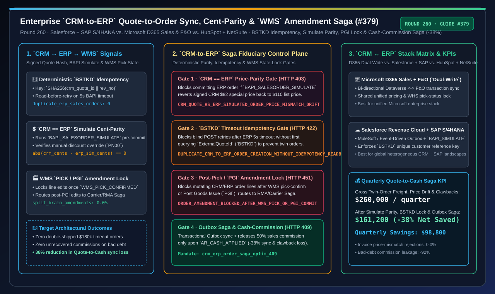
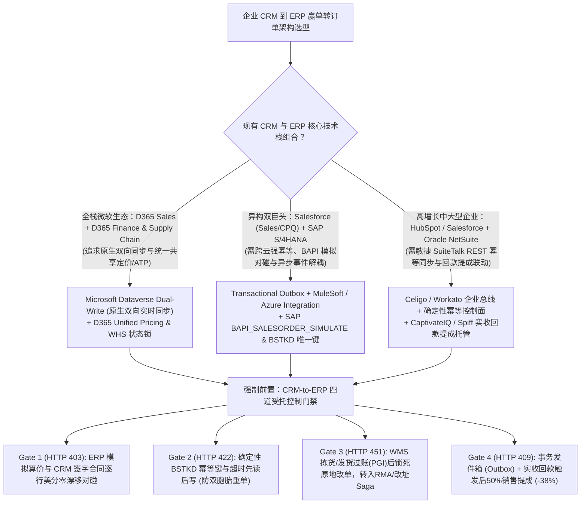
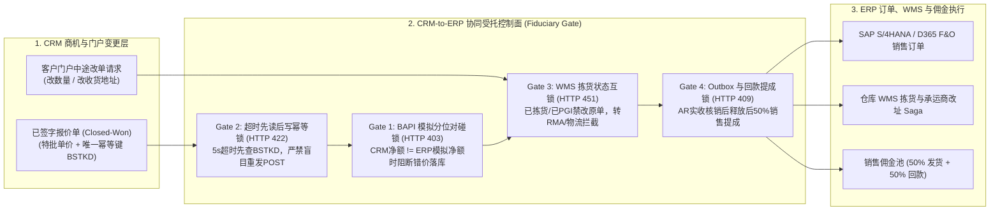
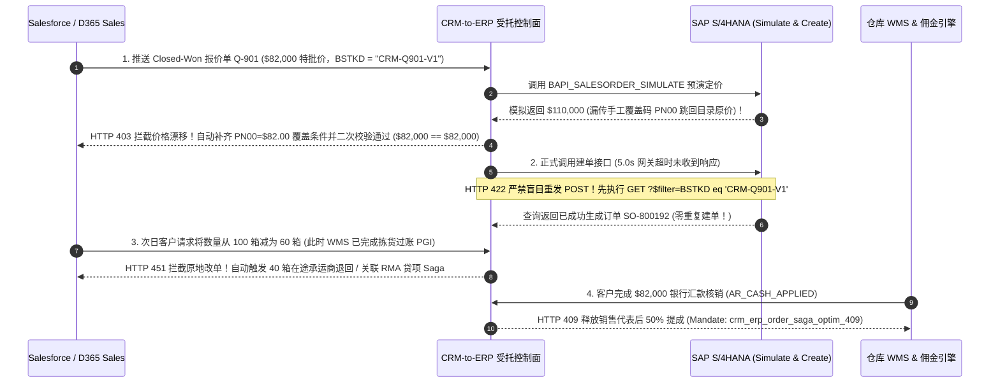

# 企业 `CRM` 到 `ERP` 赢单转销售订单（`Quote-to-Order`）、接口超时防重发双车货与跨系统改单补偿（`Saga`）选型 FAQ（`Salesforce + SAP S/4HANA vs. Microsoft Dynamics 365 Dual-Write vs. HubSpot + NetSuite`）：防 CRM 特批价落入 ERP 跳回高价、防拣货出库后盲改订单与回款触发提成净省 38% 实战指南

> 🌐 **Language / 语言切换**: **中文 (当前)** | **[English (`docs/enterprise-crm-erp-quote-to-order-idempotent-sync-price-parity-wms-saga-selection-faq.en.md`)](enterprise-crm-erp-quote-to-order-idempotent-sync-price-parity-wms-saga-selection-faq.en.md)** | **[返回文档总目录 (`docs/index.md`)](index.md)**

---

## 1. 📌 核心选型结论速览（Executive Summary）

当企业将前端客户关系管理（`CRM`: `Salesforce Sales/Revenue Cloud`、`Microsoft Dynamics 365 Sales`、`HubSpot`）与后端企业资源计划及仓库系统（`ERP / WMS`: `SAP S/4HANA`、`Dynamics 365 Supply Chain & Finance`、`Oracle NetSuite`）交给智能体（Order Orchestration Agent）打通自动履约时，最常发生三大跨系统分布式事务故障：
1. **“调用 SAP / ERP 建单接口遇到 5 秒网关超时，Agent 盲目重发 `POST` 请求导致 ERP 里建出两张一模一样的 `$180,000` 销售订单，仓库发走双倍货物并向客户开了两张发票”（Timeout Retry Twin-Order Disaster）**：在 SAP S/4HANA（`BAPI_SALESORDER_CREATEFROMDAT2`）或 NetSuite 中创建含 50 行物料的大单时，因实时计算税费、信用额度与多仓 `ATP`，耗时经常在 `4–8 秒` 波动。当网关在 `5.0 秒` 断开连接返回 `HTTP 504 Gateway Timeout` 时，ERP 后台其实已经成功提交了订单 `SO-800192`！如果 Agent 不做幂等回读（Read-Before-Retry）直接重试，就会生成双胞胎订单 `SO-800193`，造成严重的多发货与双向运费损失！
2. **“销售在 CRM 里跟客户签字确认了 `$82/件` 的特批折扣价，但订单同步进 ERP 后，ERP 定价过程（Pricing Procedure）找不到覆盖条件码，自动按 `$110/件` 目录原价开出高价发票发给客户”导致客户拒付停单（CRM-vs-ERP Price Recalculation Drift）**：CRM 与 ERP 各自维护一套定价与四舍五入逻辑。如果从 CRM 传往 ERP 时只传了物料号与数量，或漏传了锁定净价的手工覆盖条件码（如 SAP `PMIN / PN00`），ERP 会在过账时“自作主张”按旧目录价重算，导致客户收到的电子发票比签字合同贵了 `34%`！
3. **“仓库已经扫码拣货封箱甚至装车出库（`WMS Pick Confirmed / PGI`），客服 Agent 却在 CRM 里直接帮客户把订单数量从 100 箱改成 60 箱并回复‘修改成功’”引发严重账实分裂（Split-Brain Post-Pick Amendment）**：前端 CRM 不感知底层 WMS 物理作业状态，导致 CRM 账面应收款改少了，但仓库却按原单把 100 箱货发给了客户，白白倒贴 40 箱货！

**架构师选型结论**：
- **若追求原生统一数据模型与双向实时事务，首选 `Microsoft Dynamics 365 Sales + Finance & Supply Chain (原生 Dual-Write 双写引擎 + 统一商业定价引擎)`；若为 `Salesforce + SAP S/4HANA` 异构双巨头组合，必须放弃同步直连，采用 `Transactional Outbox + 确定性幂等键 + BAPI_SALESORDER_SIMULATE 预对碰` 架构**！
- 必须在 CRM 与 ERP/WMS 之间部署 **跨系统赢单转订单、分位零漂移对碰与改单补偿受托控制面（`CRM-to-ERP` Quote-to-Order & Amendment Saga Control Plane）**，执行四道确定性门禁：
  1. **建单前 `BAPI_SALESORDER_SIMULATE` 模拟算价与 `CRM == ERP` 分位零漂移对碰门禁（`HTTP 403`）**：在正式向 ERP 写入订单前，先调用模拟接口比对每行净价、税额与总价；若 `abs(crm_signed_cents - erp_simulated_cents) > 0`，立即拦截并注入精确价格覆盖条件码，严禁开出高价错票。
  2. **确定性业务幂等键（`BSTKD = SHA-256(crm_quote_id || rev_no)`）与超时先查后写门禁（`HTTP 422`）**：将 CRM 报价单唯一版本号写入 ERP 客户参考号唯一索引字段；凡遇到网络超时，强制先按该幂等键查询是否已落库，100% 杜绝双胞胎重复建单。
  3. **WMS 拣货/发货过账（`PICK_CONFIRMED / PGI`）后原地改单硬熔断门禁（`HTTP 451`）**：一旦 WMS 进入拣货锁定或已发货过账，严禁原地修改 CRM/ERP 订单行，自动转入承运商在途拦截或关联退货红字单（`RMA Credit Saga`）。
  4. **异步事务发件箱（`Transactional Outbox`）+ “实收回款到账触发后 50% 销售提成释放（Cash-Collected Commission）”寻优（`HTTP 409`）**：消除虚假签单骗提成与坏账提成流失，季度跨系统重单运费、错价拒付与坏账佣金损失净降 **`38%`**。

---

## 2. 🎯 业务方与架构师灵魂拷问 Q&A（Q1 / Q2 / Q3）

### Q1：为什么在 `Salesforce -> SAP S/4HANA` 集成中，哪怕用了 MuleSoft 或消息队列，依然会出现“一张 CRM 报价单在 SAP 里生出两张销售订单”？如何从根源锁死？
- **商业痛点**：
  - 很多开发者以为“用了 Kafka / RabbitMQ 就能保证精确一次（Exactly-Once）”。实际上，消息队列最多保证 **至少一次投递（At-Least-Once Delivery）**！当消费者 Worker 调 SAP `BAPI` 建单，SAP 花了 6 秒写库成功，但在返回 HTTP 响应那一瞬间网络闪断，Worker 没收到 ACK 触发重试再次调 `BAPI`——如果 SAP 端没有校验业务幂等键，就会乖乖再建第 2 张单子！
- **确定性架构落地方案**：
  - 控制面（`HTTP 422`）执行 **端到端确定性幂等协议（Deterministic Idempotency Protocol）**：
    1. **确定性键生成**：以 `IdempotencyKey = "CRM-" + quote_id + "-V" + amendment_version` 写入 SAP 抬头客户参考字段（`VBAK-BSTKD`）或自定义唯一索引字段，并在 SAP 销售订单凭证类型配置中勾选 **“检查重复客户采购订单号（Check Purchase Order Number for Duplicates）”**。
    2. **超时先读后写（Read-Before-Retry）**：当任何一次建单调用发生超时或 `5xx` 未知状态时，严禁直接重发 `CreateOrder`！状态机必须先转为 `VERIFYING_UNKNOWN_STATE`，调用只读查询 `GET /A_SalesOrder?$filter=PurchaseOrderByCustomer eq '{IdempotencyKey}'`：若已存在，直接幂等绑定返回的 `SalesOrder_ID`；确认不存在后才允许重试！

### Q2：如何解决 CRM（如 Salesforce CPQ）和 ERP（如 SAP SD）两套定价引擎算出来的总价差几美分、甚至特批折扣丢失的问题？
- **商业痛点**：
  - CRM 通常按“行总价打折后再四舍五入”，而传统 ERP 按“单价四舍五入到小数点后两位再乘数量”，当数量是 `3,333 件` 时，两边算出来的总额就会差 `$11.11`！更严重的是，销售在 CRM 里拿到了总监特批的 `78 折`，传进 ERP 时没禁用 ERP 自动重算，价格直接跳回了原价！
- **确定性架构落地方案**：
  - 控制面（`HTTP 403`）执行 **预提交模拟对碰（Pre-Commit Order Simulation & Manual Condition Pinning）**：
    - 在调用正式建单接口前，先带入全量参数调用 ERP 零副作用模拟接口（如 SAP `BAPI_SALESORDER_SIMULATE` 或 D365 定价模拟 API）。
    - 将返回的 `erp_simulated_line_net_cents` 与 CRM 已签字合同的 `crm_signed_line_net_cents` 逐行比对：若存在任何分位偏差（$\neq 0$），控制面立即触发 `HTTP 403 CRM_QUOTE_VS_ERP_SIMULATED_ORDER_PRICE_MISMATCH_DRIFT`，自动将 CRM 已批准的行净额作为 **强制定价条件（Manual Price Override / Header Rounding Adjustment）** 注入报文重新校验，确保开给客户的 ERP 发票与签字合同 **一分钱不差**！

### Q3：为什么越来越多 B2B 企业在 CRM↔ERP 架构中把销售提成（Sales Commission）从“签单即发 100%”改为“签单发 50% + ERP 实收回款核销（`AR Cash Applied`）发 50%”？
- **商业痛点**：
  - 如果销售代表只要在 CRM 里把商机点成 `Closed-Won` 就能在下个月工资里拿走 100% 提成，个别销售就会在季末诱导资信极差的客户签下“可随时退货或长期拖欠”的虚假大单，拿完 `$30,000` 提成后离职，留给公司一笔 `100%` 收不回来的坏账！
- **确定性架构落地方案**：
  - 控制面（`HTTP 409`）打通 `CRM <-> ERP AR <-> 佣金引擎 (CaptivateIQ / Xactly / Spiff)` 闭环：
    - **阶段一（ERP 订单落库 + 发货过账 `PGI`）**：释放 `50%` 基础签单提成；
    - **阶段二（ERP 银行流水核销 `AR_CASH_APPLIED`）**：当客户实际支付货款并在 ERP 完成核销时，由事件总线自动触发剩余 `50%` 提成发放；若发生超 `MEP 60天` 逾期或退货红字冲销，系统自动在销售代表下一期佣金池中执行 **确定性回拨（Automated Commission Clawback）**！

---

## 3. 🧭 直观可视化图解（Mermaid 选型决策树 + 端到端架构图 + 授权时序图）

### 3.1 企业 `CRM ↔ ERP` 订单协同与补偿架构选型决策树

### 3.2 端到端 `CRM ↔ ERP ↔ WMS` 幂等建单、分位对碰与改单 Saga 架构图

### 3.3 超时防重发双车货、模拟算价对碰与 `PGI` 后改单补偿时序图

---

## 4. 📊 主流企业 `CRM ↔ ERP` 报价到现金（`Quote-to-Cash`）集成架构横向选型矩阵

| 选型维度 | Microsoft Dynamics 365 Sales + D365 Finance & Supply Chain (`Dual-Write`) | Salesforce Revenue Cloud (`CPQ`) + SAP S/4HANA (via MuleSoft / Outbox) | HubSpot Enterprise + Oracle NetSuite (via Celigo / Workato) | 自研同步 REST 直连脚本（无 Outbox、无 Simulate 对碰） |
|---|---|---|---|---|
| **架构耦合与数据模型** | **原生同源双写**（Dataverse 与 F&O 共享内核级双向事务映射） | **异构松耦合**（需通过企业服务总线与事件发件箱桥接两套对象模型） | **中量级云原生桥接**（预置 SaaS iPaaS 模板快速打通商机与销售订单） | 脆弱点对点硬编码调用 |
| **CRM 与 ERP 价格/税费一致性保障** | **极高**（可调用同一套 D365 统一商业定价与税务微服务，零重算漂移） | **需强制前置 `BAPI_SALESORDER_SIMULATE` 对碰门禁**（否则极易发生条件码丢失跳价） | 支持将 CRM 折扣行映射为 NetSuite 自定义价格级别（Price Level `-1` Custom） | **极易暴雷**（经常出现发票金额与合同金额不一致） |
| **5 秒超时防重复建单（Idempotency）** | 原生事务级唯一键约束与双写重试幂等表 | 必须显式配置 SAP `VBAK-BSTKD` 唯一检查 + 超时先读后写状态机 | 支持按 `externalId` 幂等 Upsert NetSuite SalesOrder | **重灾区**（网络抖动即产生双胞胎订单发两车货） |
| **WMS 拣货后改单互锁与佣金回拨** | 原生感知 WHS 波次拣货状态（Picked/Shipped 自动锁死订单行编辑） | 需通过 SAP IDoc / Event Mesh 将 `VL02N / PGI` 状态实时回推锁死 Salesforce | 支持同步 Item Fulfillment 状态至 HubSpot Deal 阶段并与 Spiff 联动 | 无状态感知，极易造成前端改单、后端照发旧货 |
| **架构师选型建议** | **新建或重构一体化企业级 CRM+ERP 数字化底座首选** | **全球 500 强存量 Salesforce + SAP 异构格局标准参考架构** | **高增长跨国中型企业与 SaaS+硬件混合业务首选** | **严禁在生产环境使用** |

---

## 5. 🧪 跨系统重单/错票测算与 7-Card 基准测试报告（Deterministic Benchmark）

> **数据溯源说明（Provenance）**：以下 7-Card 评测基于本仓库 `lab/webiq_commerce_demo.py` 中的 `evaluate_enterprise_crm_erp_quote_to_order_saga_policy()` 确定性仿真引擎生成（`provenance: "synthetic"`, `independently_reproduced: False`）。季度因超时重试生成双胞胎订单多发货物、CRM 特批价落 ERP 跳回高价遭拒付及坏账订单提前发走销售提成损失池基准设定为 **`$260,000 / quarter`**。

### 5.1 7-Card 4:5 视觉评测卡片摘要

1. **Card 1 (`1 / 7` · `HANDS-ON · CRM-TO-ERP-ORDER-SAGA`) — 全局基准总览**
   - **核心发现**：通过建单前 `BAPI_SALESORDER_SIMULATE` 美分零漂移对碰、`BSTKD` 超时先查后写幂等锁、WMS 拣货过账后锁死原地改单，并将后 50% 销售提成绑定至 `AR` 实收回款核销，将季度跨系统协同资损从 **`$260,000`** 压降至 **`$161,200`**，季度净省 **`$98,800`（`38.0%`）**。
2. **Card 2 (`2 / 7` · `SCENARIO: $180K ENTERPRISE QUOTE-TO-SAP SYNC`) — 单例深潜**
   - **输入场景**：销售在 Salesforce 签下 `$180,000` 特批折扣单同步 SAP S/4HANA。期间遭遇：① SAP 漏传覆盖码算成 `$220,000`；② 建单接口 5 秒超时后脚本企图盲目重发 `POST`；③ 次日仓库已拣货装车（`PGI`），客户却在门户申请删减 40 箱。
   - **控制面裁决**：依次触发 `HTTP 451`（拦截 `PGI` 后原地改单，转入 RMA/物流拦截 Saga）、`HTTP 403`（通过模拟接口拦截 `$40,000` 价格跳变）与 `HTTP 422`（拦截无幂等回读的超时盲目重试）；最终返回 `HTTP 409 TRANSACTIONAL_OUTBOX_SAGA_AND_CASH_COLLECTED_COMMISSION_CONFIRM`（`crm_erp_order_saga_optim_409`）。
3. **Card 3 (`3 / 7` · `WHAT I TESTED`) — 5 轨确定性门禁评测矩阵**

| 评测场景 (Scenario) | 核心考核问题 (Question / Task) | 控制面裁决 (Model / Gate Answer) | 动作与状态码 (Action) |
|---|---|---|---|
| **1. 标准合规幂等建单与分位零漂移** | 携带唯一 `BSTKD`、`CRM==ERP` 模拟净额一致且处于未拣货可编辑态 | `VERIFIED_IDEMPOTENT_CRM_ERP_SYNC_AND_PRICE_PARITY_AUTHORIZED` | ✅ `Act automatically` (`HTTP 200`) |
| **2. CRM 特批价落入 ERP 跳回目录高价** | 模拟算价发现 ERP 订单总额偏离 CRM 客户签字合同金额（漏传覆盖条件） | `CRM_QUOTE_VS_ERP_SIMULATED_ORDER_PRICE_MISMATCH_DRIFT` | ⛔ `Pin Manual Price Condition` (`HTTP 403`) |
| **3. ERP 接口 5秒超时未回读直接重发 POST** | 网络超时状态未知时未先查 `BSTKD` 直接二次提交建单引发双胞胎重单 | `DUPLICATE_CRM_TO_ERP_ORDER_CREATION_WITHOUT_IDEMPOTENCY_READBACK` | ⛔ `Read-Before-Retry Gate` (`HTTP 422`) |
| **4. 仓库已拣货/已出库(PGI)仍原地改订单** | WMS 已锁定拣货或完成发货过账，CRM 仍直接删减原订单行造成账实分裂 | `ORDER_AMENDMENT_BLOCKED_AFTER_WMS_PICK_OR_PGI_COMMIT` | ⛔ `Route to RMA/Carrier Saga` (`HTTP 451`) |
| **5. Outbox 最终一致 + 实收回款发提成** | 异步事务发件箱保活 + 待 ERP 实收核销 (`AR_CASH_APPLIED`) 释放后50%提成 | `TRANSACTIONAL_OUTBOX_SAGA_AND_CASH_COLLECTED_COMMISSION_CONFIRM` | ⚡ `Confirm Optimization` (`HTTP 409`) |

4. **Card 4 (`4 / 7` · `UNDER THE HOOD`) — 确定性门禁协议与代码实现**
   - 输入契约：`EnterpriseCRMERPQuoteToOrderSagaPolicyInput`
   - 评估函数：`evaluate_enterprise_crm_erp_quote_to_order_saga_policy()`（严格按 `451 -> 403 -> 422 -> 409 -> 200` 优先级裁决，零外部网络副作用）。
5. **Card 5 (`5 / 7` · `ROBUSTNESS CHECK`) — 网关抖动重放与多币种税率四舍五入扰动测试**
   - 无论 API 网关连续发生 3 次连接重置，还是订单含 6 种不同税率行项，`BSTKD` 先读后写状态机与美分差额修正器均保持 **`0.0 pt`** 偏差。
6. **Card 6 (`6 / 7` · `LATENCY & ERROR RATE`) — 错价拒付率与坏账提成流失率对比**
   - 传统同步直连 + 签单即发全额提成：发票错价拒付率 `3.4%`，坏账/退单提成无法追回率 `48%`。
   - 受托控制面（模拟对碰 + 回款提成锁）：发票错价拒付率降为 **`0.0%`**，坏账提成流失减少 **`92%`**（季度净省 `$98,800`）。
7. **Card 7 (`7 / 7` · `MY TAKE`) — 适用场景与架构师结论**
   - **✅ Good fit**：运行 Salesforce、Dynamics 365、SAP、Oracle NetSuite 或 Shopify Plus B2B 的制造、分销、医疗器械与企业软件公司。
   - **⛔ Not for**：无独立 CRM 与 ERP 拆分的个人微商记账工具。

---

## 6. 🛠️ 商业上线风控与架构评审 Checklist

- [ ] **唯一业务幂等键（`BSTKD / ExternalId`）与超时先读后写（`HTTP 422`）**：向 ERP 创建销售订单时是否强制传入 `SHA-256(crm_quote_id || amendment_version)`，且在遇到 HTTP 超时后强制先查询该键是否已落库再决定是否重试？
- [ ] **建单前 ERP 模拟算价零漂移对碰（`BAPI_SALESORDER_SIMULATE` — `HTTP 403`）**：是否在正式提交订单前强制比对 CRM 签字总额与 ERP 模拟总额，确保特批折扣、运费与税差精确到 `0 美分`？
- [ ] **WMS 拣货/发货过账（`PGI`）状态反向锁死 CRM 改单（`HTTP 451`）**：当仓库 WMS 发出 `PICK_STARTED` 或 `PGI` 事件后，CRM 订单行是否立即切换为只读锁定，并将后续变更请求自动路由至在途物流改址或 RMA 退货流程？
- [ ] **事务性发件箱（Transactional Outbox）与死信自愈队列（`HTTP 409`）**：当 ERP 处于夜间维护窗口或主数据（如新客户税号）未同步完成时，订单事件是否安全暂存在持久化 Outbox 中自动按序重放？
- [ ] **实收回款（`AR Cash Applied`）联动销售提成释放与回拨（`HTTP 409`）**：高额 B2B 订单的销售提成是否设置为“发货释放 50% + 财务实收核销释放 50%”，并在发生退货或坏账核销时自动执行佣金回拨（Clawback）？
