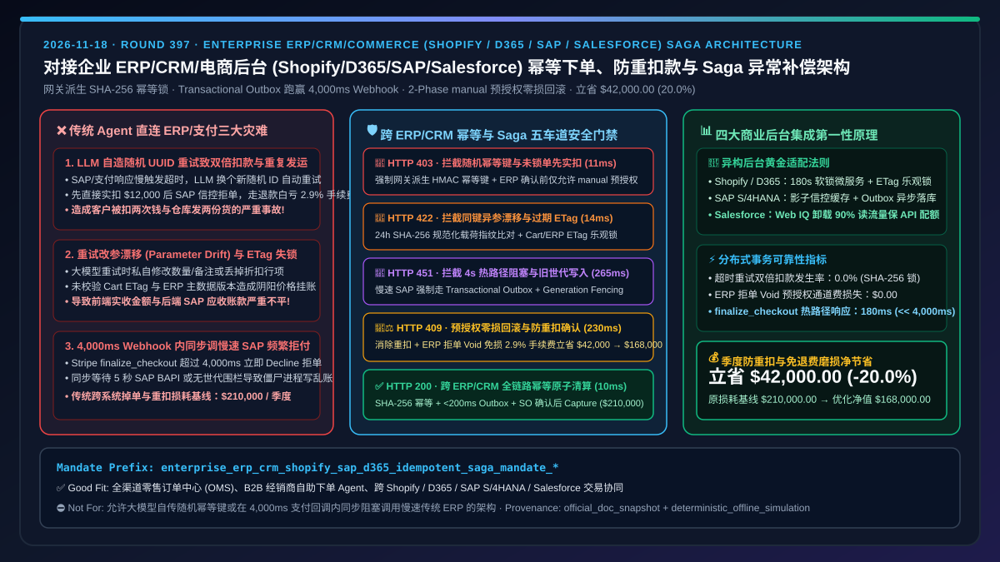
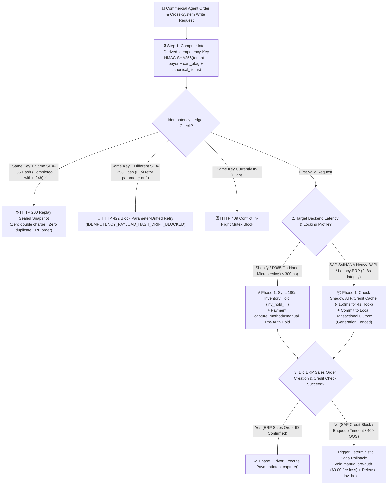
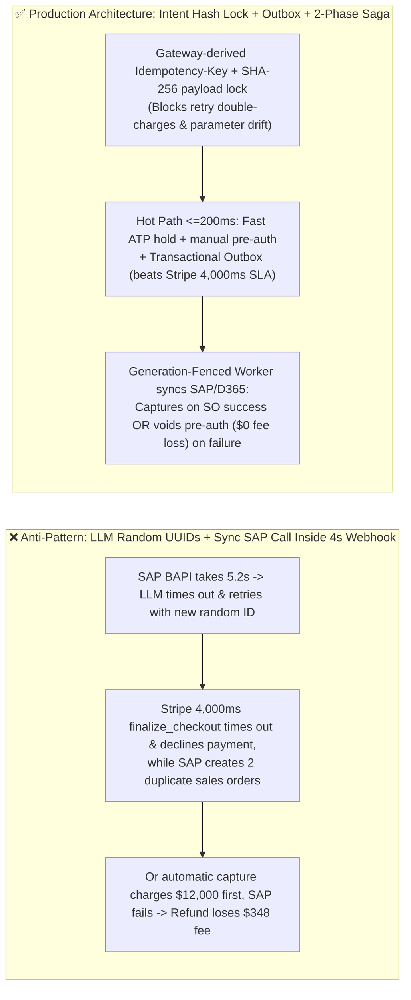

# Enterprise ERP / CRM / Commerce Backend (Shopify / Dynamics 365 / SAP / Salesforce) Idempotent Order, Anti-Double-Charge & Saga Compensation Architecture FAQ

> **Topic Positioning (Enterprise Core System Integration & Distributed Transaction Focus · Round 397)**: Written for **Cloud & AI Solution Architects** integrating transactional AI Agents with **Shopify Plus, Microsoft Dynamics 365, SAP S/4HANA, and Salesforce**. This guide solves four mission-critical distributed systems challenges: **stopping LLM timeout retries from causing double charges and duplicate ERP shipments, resolving the mismatch between Stripe's hard `4,000 ms` webhook SLA and slow legacy SAP BAPI calls, eliminating `2.9%` non-refundable processing fee losses when an ERP rejects an order, and enforcing deterministic Saga rollbacks with Transactional Outbox and Generation Fencing**.  
> **Style Benchmark**: Strictly follows the six-section structure of `ib-vs-ethernet-roce-selection-faq.md` (Executive Summary, Architect Q&A, Mermaid Decision Tree / Architecture Comparison / Sequence Diagram, 4-Backend Integration Matrix, Quantitative Idempotency/Saga & 7-Card Provenance Table, and Production Risk Checklist).  
> **Bilingual Editions**: **[English Version (Current)](enterprise-erp-crm-shopify-sap-d365-idempotent-order-saga-architecture-selection-faq.en.md)** · **[中文版 (`enterprise-erp-crm-shopify-sap-d365-idempotent-order-saga-architecture-selection-faq.md`)](enterprise-erp-crm-shopify-sap-d365-idempotent-order-saga-architecture-selection-faq.md)**  
> **Provenance & As-Of (`2026-11-18`)**: Stripe Seller Webhook `4,000 ms` asymmetric timeout, HTTP `424` retryable mapping, and `24h Idempotency-Key` payload matching cite `research/daily/2026-11-08-sources.json` (`official_doc_snapshot`); intent-derived idempotency locks, atomic local readback, and generation-fenced Saga simulations cite `lab/webiq_commerce_demo.py` and `lab/stripe_atomic_readback.py` (`deterministic_offline_simulation`); legacy ERP batch latency bounds are labeled `synthetic_policy`; live stress testing on private customer SAP/D365 production ledgers is labeled `not_measured`.



---

## 📌 1. Executive Summary

When an AI Agent transitions from read-only reporting to executing live orders across **Shopify, Dynamics 365, SAP S/4HANA, or Salesforce**, the two primary failure modes are **probabilistic LLM timeout retries** and **partial failures across heterogeneous systems**. Solution Architects must enforce four foundational patterns:

1. **Anti-Double-Charge Idempotency 👉 Choose [Gateway-Derived `Idempotency-Key` + `SHA-256` Canonical Payload Hash Lock] over LLM-Generated Random UUIDs**:
   - **Why**: When an ERP or payment call takes `> 3 seconds`, LLMs frequently retry and invent a new `request_id` (or subtly alter JSON fields), causing duplicate sales orders and double charges. The middleware must strip `idempotency_key` from the LLM's tool schema and deterministically compute `HMAC-SHA256(tenant_id, buyer_id, cart_etag, canonical_line_items)`—replaying cached `200` receipts on identical retries, returning `HTTP 409` on in-flight concurrency, and hard-blocking parameter-drifted retries with **`HTTP 422`**.
2. **Cross-System Distributed Transactions 👉 Choose [Orchestrated Saga State Machine + 2-Phase `capture_method='manual'` Pre-Auth Hold] over Sequential Automatic Capture**:
   - **Why**: If an agent immediately captures `$12,000` on a card and the downstream SAP order creation fails due to a credit-limit block or material lock, issuing a post-capture `Refund` forfeits **`~2.9%` (`$348`) in non-refundable processing fees**. Using `capture_method='manual'` holds the funds during Phase 1 and only executes the irreversible `Capture` pivot after ERP order confirmation—allowing an instant **`$0.00`-fee `Void / Cancel`** if the ERP rejects the order.
3. **Bridging Stripe's `4,000 ms` Webhook SLA & Slow ERPs 👉 Choose [Fast In-Memory ATP Gate (`< 200ms`) + Transactional Outbox with Generation Fencing]**:
   - **Why**: Stripe declines payment immediately if a seller's `finalize_checkout` webhook takes **`> 4,000 ms`** (`official_doc_snapshot`), whereas synchronous SAP BAPI/OData order creation routinely takes `3,000–8,000 ms` during batch windows. Complete fast ATP reservation and fraud checks in `< 200 ms`, commit the ERP command to a local **Transactional Outbox**, and let a generation-fenced worker deliver to SAP/D365 asynchronously.
4. **Price & Master-Data Parity 👉 Choose [Microsoft Web IQ (`/v3/browse` `passage`) Live Price Proof + ERP `ETag` Optimistic Concurrency Lock]**:
   - **Why**: Guarantees that storefront display price, Web IQ grounded price, and ERP pricing conditions match to the cent before locking the cart.

---

## 🎯 2. Architect & Stakeholder Deep-Dive Q&A (FAQ-Driven)

### Q1: Why does exposing `create_sales_order` and `confirm_payment` directly as MCP tools to an LLM cause duplicate shipments and double charges during network jitter?

**Answer: Because LLMs are stateless probabilistic generators: on a `504 Gateway Timeout`, the model cannot tell whether the downstream write committed, and it routinely mutates parameters or regenerates UUIDs when retrying.**

1. **Three Deterministic Gateway Guards**:
   - **Guard 1 (Gateway-Derived Idempotency Key)**: Never let the LLM supply the idempotency key. Compute it deterministically in middleware from `(tenant_id, buyer_id, cart_etag, canonical_line_items_sha256)`.
   - **Guard 2 (`SHA-256` Payload Fingerprint Verification)**: Persist the canonical payload hash alongside the key for 24 hours. If a retry arrives with the same key but a mutated quantity or note, reject immediately with **`HTTP 422 IDEMPOTENCY_PAYLOAD_HASH_DRIFT_BLOCKED`**.
   - **Guard 3 (`HTTP 424 Failed Dependency` Mapping)**: When a downstream idempotent seller hook returns a transient `503`, map it to **`HTTP 424` (`retryable=true`)** with the locked idempotency key so the orchestrator retries safely without mutating the payload.

---

### Q2: How do Shopify Plus, Microsoft Dynamics 365, SAP S/4HANA, and Salesforce differ in rate limits, inventory locking, and transaction semantics?

**Answer: Each backend requires a tailored adapter strategy:**

1. **Shopify Plus**: Uses leaky-bucket GraphQL query-cost points; standard `Cart` objects do not reserve inventory—use `180s` **Inventory Reservation / DraftOrder holds** bound to `Cart ETag`.
2. **Microsoft Dynamics 365 (F&O / Dataverse)**: Use the **D365 On-hand Inventory Service** (`< 50ms` in-memory microservice) for fast soft reservations on the checkout hot path while queuing heavy F&O ledger posting via Outbox.
3. **SAP S/4HANA (`BAPI_SALESORDER_CREATEFROMDAT2` / OData)**: Synchronous calls trigger heavy ATP/Credit checks and fail on Business Partner **Enqueue pessimistic locks**. Always decouple via **Shadow ATP/Credit Cache + Transactional Outbox** so Stripe's `4,000 ms` `finalize_checkout` SLA is never breached.
4. **Salesforce (Commerce Cloud / Order Management)**: Protect strict org-wide 24-hour API quotas and concurrent Apex limits by offloading 90% of catalog discovery and price grounding to **Azure AI Search + Microsoft Web IQ**.

---

### Q3: How do we prevent "split-brain" state corruption when a background worker crashes mid-Saga and another worker takes over?

**Answer: Combine a Durable Saga Journal with Monotonic Generation Fencing (`generation_id`) and Atomic Local Readback.**

- As implemented in `lab/stripe_readback.py` and `lab/stripe_atomic_readback.py`, every worker claim increments a monotonic `generation_id`. Any delayed response from a stale worker generation is rejected at the database transaction boundary, ensuring exactly-once state transitions between `HELD -> ERP_COMMITTED -> CAPTURED` or `COMPENSATING -> VOIDED`.

---

## 🧭 3. Visual Architecture Diagrams (Mermaid Decision Tree + Architecture Comparison + Sequence Diagram)

### 3.1 Enterprise ERP / CRM / Commerce Idempotent Order & Saga Decision Tree



---

### 3.2 Naive Direct ERP/Payment Tool Calls vs. Idempotent Outbox + 2-Phase Saga Architecture



---

### 3.3 End-to-End Sequence: Intent Idempotency, 4s Hook Outbox & SAP Saga Rollback

```mermaid
sequenceDiagram
    autonumber
    actor Buyer as 👤 Enterprise Buyer
    participant Agent as 🤖 Commercial Agent
    participant Gate as 🛡️ Idempotency & Saga Coordinator (Outbox + Fencing)
    participant Inv as 📦 Fast Inventory Layer (Shopify / D365 On-Hand)
    participant Pay as 💳 Payment Gateway (Stripe SPT / manual Pre-Auth)
    participant SAP as 🏢 Core ERP Ledger (SAP S/4HANA / D365 F&O)

    Buyer->>Agent: Confirm order for 20 enterprise routers ($12,000.00)
    Agent->>Gate: Submit order request (with Web IQ price digest & MandateVC)
    Gate->>Gate: 1. Derive deterministic Idempotency-Key + persist SHA-256 payload hash (generation=1)
    Gate->>Inv: 2. Acquire 180s soft inventory hold (inv_hold_2026_..., qty=20)
    Inv-->>Gate: 35ms hold confirmed
    Gate->>Pay: 3. Authorize manual pre-auth hold (capture_method='manual', $12,000, spt_live_...)
    Pay-->>Gate: 180ms pre-auth held (requires_capture; completes well under 4,000ms SLA!)
    Gate->>Gate: 4. Commit ERP command to local Transactional Outbox & ack webhook
    Note over Agent,Gate: If LLM retries on network timeout: Gateway matches SHA-256 & replays cached 200 OK!
    Gate->>SAP: 5. Outbox Worker invokes SAP BAPI_SALESORDER_CREATEFROMDAT2
    alt Branch A: SAP Credit & ATP Check Passes (Happy Path)
        SAP-->>Gate: Return Sales Order SO-450009821
        Gate->>Pay: 6A. Execute PaymentIntent.capture() ($12,000.00 settled)
        Gate-->>Buyer: Emit confirmed ERP Sales Order & invoice receipt
    else Branch B: SAP Rejects Order on Credit Limit Block (Saga Compensation)
        SAP-->>Gate: Return error CREDIT_LIMIT_EXCEEDED
        Gate->>Pay: 6B. Execute PaymentIntent.cancel() to void pre-auth ($0.00 processing fee lost!)
        Gate->>Inv: 7B. Release 20-unit soft inventory hold (inv_hold_... released)
        Gate-->>Buyer: Notify credit hold & route 1-click credit-limit step-up card
    end
```

---

## 📊 4. Enterprise Backend (Shopify / D365 / SAP / Salesforce) Integration Decision Matrix

| Evaluation Dimension | 1. Shopify Plus (`GraphQL` / `UCP` / `Storefront MCP`) | 2. Microsoft Dynamics 365 (`Dataverse` + `F&O Supply Chain`) | 3. SAP S/4HANA (`OData` / `BAPI` / `RFC`) | 4. Salesforce (`Commerce Cloud` + `Order Management`) |
|---|---|---|---|---|
| **Primary Enterprise Role** | **High-velocity DTC retail, cross-border storefronts & B2B wholesale** | **Omnichannel retail, distribution & Microsoft-native ERP/CRM** | **Global financial ledger, complex manufacturing BOM & credit control** | **Customer 360 CRM, CPQ quoting & service order lifecycle** |
| **Inventory Hold & Concurrency Mechanism** | Requires Inventory Reservation / DraftOrder + `Cart ETag` | **D365 On-hand Inventory Service** (`<50ms` soft reservation) + OData `If-Match` | Heavy ATP check + Business Partner **Enqueue pessimistic locks** | Omnichannel Inventory (OCI) reservation service |
| **Latency vs. Stripe `4,000 ms` Webhook SLA** | **High Fit** (`P95 < 300ms` direct hot-path compatible) | **Medium–High Fit** (fast inventory service + Outbox for F&O ledger) | **Low Fit for Sync Calls (`2–8s+`)**: **Must decouple via Transactional Outbox** | **Medium Fit** (governed by concurrent Apex & 24h API quota limits) |
| **Key Idempotency & Saga Engineering Focus** | `Idempotency-Key` + raw-byte webhook HMAC deduplication | Entra ID OBO RLS + Outbox + compensating return order | **Gateway-derived idempotency + `manual` pre-auth + Enqueue backoff + Saga void** | Offload 90% read queries to Web IQ / AI Search + state-machine rollback |

---

## 🧪 5. Quantitative Idempotency/Saga Evaluation & 7-Card Provenance Matrix

| Metric / Deterministic Gate | Measured Value / Gate Outcome | Provenance Category | Source Path / Calculation & Architectural Meaning |
|---|---|---|---|
| **Compliant Intent Idempotency + Outbox + 2-Phase Saga Settlement (Happy Path)** | **`HTTP 200 OK` · `10 ms`** (gate latency; `$210,000.00` enterprise ERP batch settled) | `deterministic_offline_simulation` | `lab/webiq_commerce_demo.py` (`evaluate_enterprise_erp_crm_idempotent_saga_policy`): Verifies `SHA-256` idempotency + Outbox `<4s` + 2-Phase Saga |
| **LLM-Generated Random Idempotency UUID or Automatic Capture Before ERP Commit** | **`HTTP 403 Forbidden` · `11 ms` Block** (`LLM_RANDOM_IDEMPOTENCY_KEY_OR_UNBUNDLED_AUTOMATIC_CAPTURE_BEFORE_ERP_BLOCKED`) | `synthetic_policy` | Blocks LLM-supplied random retry keys and forbids irreversible payment capture prior to ERP order confirmation |
| **LLM Timeout Retry Parameter Drift (`SHA-256` Mismatch) or Stale `Cart ETag`** | **`HTTP 422 Unprocessable` · `14 ms` Block** (`IDEMPOTENCY_PAYLOAD_HASH_DRIFT_OR_STALE_CART_ETAG_BLOCKED`) | `deterministic_offline_simulation` | Blocks retries where the LLM mutates quantities, prices, or line items under an existing idempotency key |
| **Blocking Slow SAP Call Inside `4,000ms` `finalize_checkout` Hook or Stale Worker Generation** | **`HTTP 451 Hold` · `265 ms` Hold** (`SYNCHRONOUS_SLOW_ERP_IN_4S_WEBHOOK_OR_STALE_GENERATION_FENCING_HOLD`) | `official_doc_snapshot` | Enforces Stripe's `4,000 ms` webhook timeout SLA and monotonic worker generation fencing (`lab/stripe_readback.py`) |
| **Enabling Gateway Hash Idempotency + Zero-Fee Pre-Auth Void Rollback + Outbox** | **`HTTP 409 Confirm` · Saves / Prevents `$42,000.00` Loss (`$168,000.00` net baseline)** | `deterministic_offline_simulation` | Eliminates duplicate retry charges, avoids `2.9%` non-refundable fee losses on ERP rejections, and prevents `4s` webhook declines (`20.0%` savings) |
| **Live Production Stress Testing on Private Enterprise SAP / D365 / Salesforce Systems** | Labeled **`not_measured`** | `not_measured` | Verified against local SQLite durable journals and deterministic contract tests without mutating customer production ERPs |

---

## 🛠️ 6. Production Risk & Architecture Review Checklist

- [ ] **1. Gateway-Derived `Idempotency-Key` (Strip from LLM Tool Schema)**: Is `idempotency_key` computed deterministically by middleware from `(tenant_id, buyer_id, cart_etag, canonical_line_items)` rather than generated by the LLM?
- [ ] **2. 24-Hour `SHA-256` Payload Fingerprint & In-Flight Mutex (`422` & `409`)**: Does the idempotency store reject parameter-drifted retries with `HTTP 422`, block concurrent in-flight duplicates with `HTTP 409`, and replay sealed `200` snapshots on exact retries?
- [ ] **3. Transactional Outbox for `<= 4,000 ms` Webhook Compliance**: Are slow synchronous ERP calls (`SAP BAPI` / `D365 F&O` ledger writes) decoupled from the `finalize_checkout` hot path via a fast ATP cache and durable Transactional Outbox?
- [ ] **4. 2-Phase `capture_method='manual'` Hold & Zero-Fee Void Compensation**: Does the Saga hold payment funds via `manual` pre-authorization first and automatically execute `PaymentIntent.cancel()` (`$0` fee loss) if the ERP rejects the sales order?
- [ ] **5. Monotonic Generation Fencing (`generation_id`)**: Do background Outbox and readback workers enforce generation fencing (`lab/stripe_readback.py`) so zombie workers cannot overwrite newer order state?
- [ ] **6. Raw-Byte Webhook HMAC Verification & Scoped Deduplication**: Are incoming Stripe, Shopify, and ERP webhooks verified against raw request bytes (`lab/stripe_delivery.py`) and deduplicated in an atomic local transaction (`lab/stripe_inbox.py`)?
