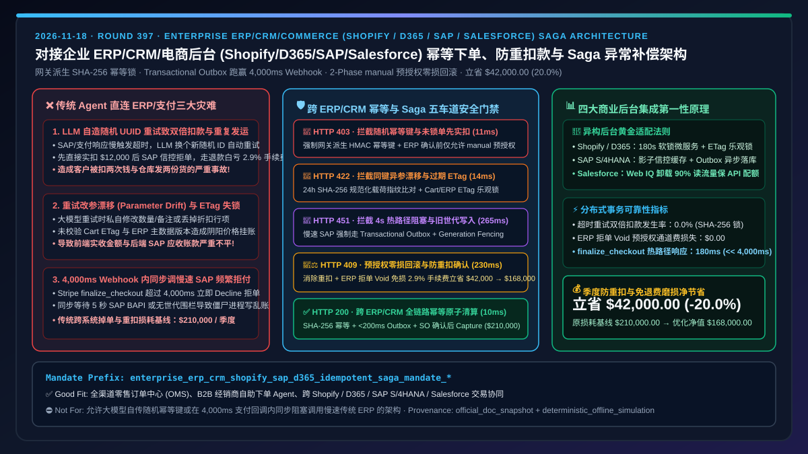
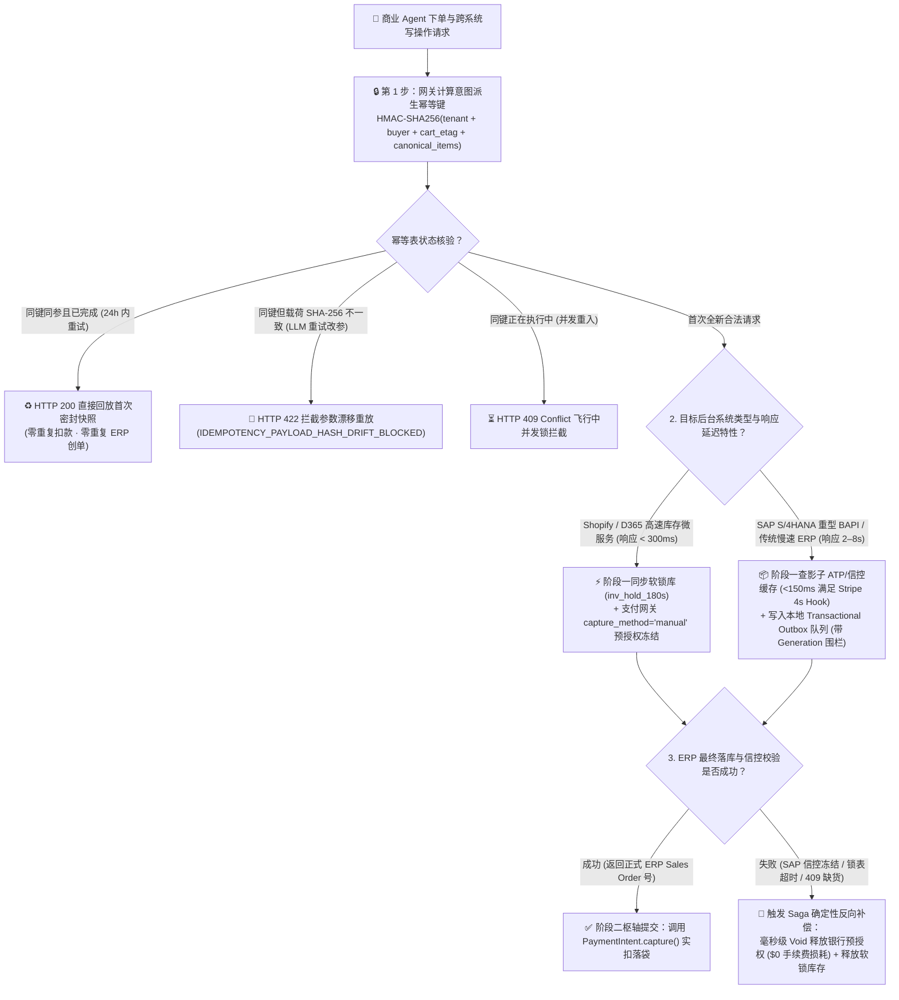
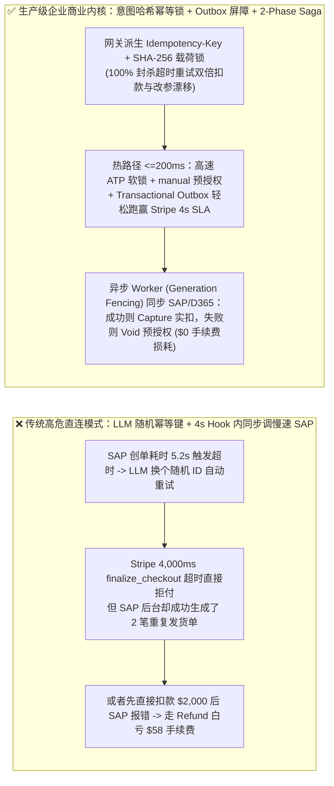
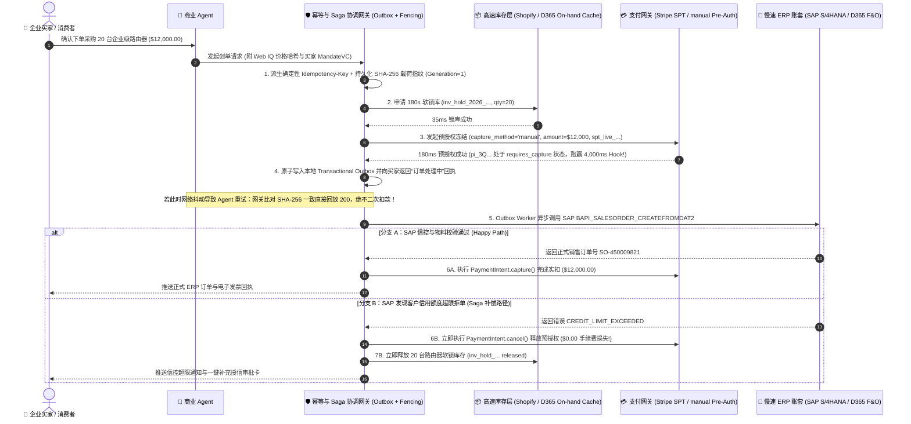

# 对接企业 ERP / CRM / 电商后台（Shopify / Dynamics 365 / SAP / Salesforce）的商业智能体幂等下单、防重扣款与异常补偿（Saga）架构选型 FAQ

> **专题定位（企业核心系统集成与分布式事务架构聚焦）**：面向为零售集团、制造分销与跨国企业设计交易型 AI Agent 的 **Cloud & AI Solution Architect**，系统拆解商业智能体在打通 **Shopify、Microsoft Dynamics 365、SAP S/4HANA 与 Salesforce** 四大后台时的核心工程难题：**“为什么大模型工具超时重试会导致双倍扣款与重复发货、怎么解决 Stripe 4,000ms Webhook 硬超时与慢速传统 ERP 接口之间的冲突、以及当‘钱扣了但 ERP 创单失败’时怎么用确定性 Saga 状态机与事务发件箱（Transactional Outbox）实现 100% 自动回滚平账”**。  
> **文风标杆**：严格对标 `ib-vs-ethernet-roce-selection-faq.md` 六段式结构（核心结论速览、业务方与架构师灵魂拷问 Q&A、Mermaid 决策树/架构对比/时序图、四大企业后台集成选型矩阵、定量防重/回滚测算与 7-Card 溯源表、生产上线 Checklist）。  
> **双语版本**：**[中文版（当前）](enterprise-erp-crm-shopify-sap-d365-idempotent-order-saga-architecture-selection-faq.md)** · **[English Version (`enterprise-erp-crm-shopify-sap-d365-idempotent-order-saga-architecture-selection-faq.en.md`)](enterprise-erp-crm-shopify-sap-d365-idempotent-order-saga-architecture-selection-faq.en.md)**  
> **数据溯源声明（Provenance & As-Of `2026-11-18`）**：Stripe 卖家 Webhook `4,000 ms` 非对称超时、HTTP `424` 重试映射与 `24h Idempotency-Key` 载荷一致性契约引自 `research/sources.json`（标记为 `official_doc_snapshot`）；意图派生幂等锁、本地原子回读（Atomic Readback）与 Saga 补偿仿真引自 `lab/webiq_commerce_demo.py` 及 `lab/stripe_atomic_readback.py`（标记为 `deterministic_offline_simulation`）；企业 ERP 批处理超时阈值标记为 `synthetic_policy`；外部客户私有 SAP/D365 生产网关在线压测标记为 `not_measured`。

---

## 📌 一、核心选型结论速览（Executive Summary）

当 AI Agent 从“只读查报表”迈向“直接往 Shopify、Dynamics 365、SAP S/4HANA 或 Salesforce 下单扣款”时，**最大的架构敌人是“概率性大模型的超时盲目重试”与“异构企业后台的非原子部分失败”**。架构师必须按以下四条黄金法则设计底座：

1. **防重扣款与防重创单选型：严禁“让 LLM 自己生成随机 UUID 当幂等键”，必选【意图派生确定性幂等键（Intent-Derived `Idempotency-Key`）+ `SHA-256` 规范化载荷哈希锁】**：
   - **核心原因**：当 SAP 或支付接口因网络抖动在 3 秒内未返回时，LLM 会自动重试工具调用；如果让 LLM 传幂等键，它每次重试都会编一个新的随机字符串（或偷偷改动 JSON 字段顺序/备注），导致下游重复扣款、重复发两箱货。必须由确定性中间件按 `HMAC-SHA256(tenant_id + buyer_id + cart_etag + canonical_line_items)` 计算唯一幂等键：同键同参重试直接回放缓存结果；**同键异参（大模型重试改参漂移）立即返回 `HTTP 422` 硬阻断**；飞行中并发请求返回 **`HTTP 409 Conflict`**。
2. **跨系统分布式事务选型：抛弃“两阶段数据库锁（2PC XA）”与“无保护串行直接扣款”，必选【基于持久化状态机的编排式 Saga（Orchestrated Saga）+ `capture_method=manual` 预授权分段提交】**：
   - **核心原因**：跨 Stripe、Shopify 与 SAP 根本不存在跨云数据库 XA 锁。必须先执行可逆的 **补偿型子事务（Compensatable Transactions）**：`① 软锁库存 (180s TTL)` → `② 冻结银行卡预授权 (manual hold)` → `③ 写入 ERP 销售订单 (Sales Order)`；只有当 ERP 返回正式单号后，才执行不可逆的 **枢轴事务（Pivot Transaction：支付实扣 Capture）**。若 ERP 因客户信控超标或物料停用拒单，Saga 自动在毫秒级内撤销预授权并释放库存。
3. **应对慢速 ERP 与 4,000ms 结账超时冲突选型：必选【热路径内存/状态库预检（`< 200ms`）+ 本地事务发件箱（Transactional Outbox）异步解耦慢速 ERP】**：
   - **核心原因**：Stripe 对卖家 `v1.delegated_checkout.finalize_checkout` Webhook 设定了严格的 **`4,000 ms` 硬超时（超时立即 Decline 拒单）**，而传统 SAP RFC/OData 创单在高峰期常耗时 `3,000–8,000 ms`。绝不能在 `finalize_checkout` 同步等待 SAP 落库！必须在热路径上通过高速同步缓存核验 ATP 库存与风控并在 `200 ms` 内写入本地 **Transactional Outbox** 立即返回成功，再由带世代围栏（Generation Fencing）的后台 Worker 幂等同步至 SAP / D365。
4. **外部价格与主数据防漂移选型：必选【Microsoft Web IQ (`/v3/browse` `passage`) 外部落地页核验 + 内部 ERP 主数据版本 `ETag` 乐观锁】**：
   - **核心原因**：确保前端商城展示价、Web IQ 实时接地价与 ERP 内部价格主数据（Pricing Condition Record）三方完全一致，消除“前端按促销价收钱、后端 SAP 按原价记应收账款”的财务挂账死锁。

---

## 🎯 二、业务方与架构师灵魂拷问 Q&A（FAQ-Driven）

### Q1：为什么企业把 ERP 的 `create_sales_order` 和 Stripe 的 `confirm_payment` 封装成 MCP Tool 给 Agent 调用后，一遇到网络抖动就会出现“客户被扣了两次钱”或“钱扣了但 SAP 里没订单”？

**答：因为大模型本身是“无状态且有创造性”的推理器——当工具调用返回 `504 Gateway Timeout` 时，大模型不知道下游到底有没有执行成功，且它在重试时往往会改变调用参数。**

1. **解剖大模型超时重试的三大致命行为**：
   - **行为 ①（重造幂等键）**：如果 Tool Schema 里定义了一个 `idempotency_key: string` 字段让 LLM 填写，LLM 在第一次超时后，第二次调用会贴心地生成一个新的 `req_002` 以为能“修复报错”——结果直接绕过幂等检查扣了第二次钱！
   - **行为 ②（重试改参漂移 Parameter Drift）**：LLM 重试时常把 `"note": "urgent order"` 改成 `"note": "retry urgent order"`，或者因为上下文滑动窗口丢掉了一个折扣行项。
   - **行为 ③（跳步执行）**：在没有代码级状态机约束时，若 ERP 创单返回 `503 Service Unavailable`，部分模型竟会先调支付实扣接口，企图“先把钱收下来再说”，直接造成有收款无订单的单边账。
2. **代码级根治方案（三道确定性铁闸）**：
   - **铁闸一（LLM 不可见的网关派生幂等键）**：从提供给 LLM 的 Tool Schema 中**彻底删除 `idempotency_key` 参数**！由 MCP 策略网关根据 `(buyer_id, cart_id, cart_etag)` 自动派生 24 小时幂等键。
   - **铁闸二（`SHA-256` 规范化载荷指纹比对）**：网关将首次请求的 Canonical JSON 载荷计算 `SHA-256` 存入持久化幂等表；24 小时内凡遇相同幂等键但载荷哈希不一致的重试，立即返回 **`HTTP 422 IDEMPOTENCY_PAYLOAD_HASH_DRIFT_BLOCKED`**。
   - **铁闸三（HTTP `424 Failed Dependency` 语义映射）**：根据 Stripe Seller Hook 规范（`official_doc_snapshot`），当下游幂等端点短暂返回 `503` 时，向 Agent 映射返回明确的 **`HTTP 424`（标记 `retryable=true` 且锁死原幂等键）**，指导编排器按原参数安全退避重试。

---

### Q2：Shopify、Dynamics 365、SAP S/4HANA 和 Salesforce 四大主流商业后台在对接 Agent 下单时，各自的 API 限流、锁库机制与事务边界有什么本质差异？

**答：四大系统的底层数据模型截然不同，架构师必须针对性设计适配器（Adapter）：**

1. **Shopify Plus (GraphQL Admin & Storefront API / UCP)**：
   - **特点与陷阱**：采用基于查询复杂度点数（Calculated Query Cost / Leaky Bucket）的限流；普通 `Cart` 对象**不锁库存**，只有进入结账确认或通过 **Inventory Reservation API / DraftOrder** 才能锁库存。
   - **最佳实践**：高并发导购走 Storefront MCP / UCP 协议，锁单时显式创建 `180s TTL` 软锁租约并绑定 `Cart ETag` 版本号。
2. **Microsoft Dynamics 365 (Finance & Operations / Supply Chain & Dataverse)**：
   - **特点与陷阱**：Dataverse OData 接口具备完善的微服务并发控制（支持 `If-Match` `ETag` 乐观并发与批处理 `$batch`），但 F&O 复杂价格折扣引擎（Trade Agreements）实时重算耗时较长。
   - **最佳实践**：前台用 Copilot Studio / Entra ID OBO 继承用户行级权限（RLS），后台通过 **D365 On-hand Inventory Service（内存级高速库存微服务）** 在 `< 50ms` 内完成软锁库（Soft Reservation），异步落盘主表。
3. **SAP S/4HANA (OData API_SALES_ORDER_SRV / BAPI)**：
   - **特点与陷阱**：SAP 创单会同步触发复杂的 ATP 检查、信控检查（Credit Management）与定价过程（Pricing Procedure），且业务伙伴（Business Partner）若被人工打开编辑会触发 **SAP 悲观锁（Enqueue Lock）** 导致创单报错。
   - **最佳实践**：**严禁在 4 秒支付 Webhook 内直连同步调 SAP BAPI！** 必须走 **“前置信控/ATP 影子缓存预检 + Transactional Outbox 异步投递 + 遇到 Enqueue 锁自动按原幂等键指数退避”**。
4. **Salesforce (Commerce Cloud / Order Management & Data Cloud)**：
   - **特点与陷阱**：受严格的组织级 24 小时滚动 API 调用配额与并发长请求上限（Concurrent Long-Running Apex Limit）制约。
   - **最佳实践**：高频目录查询与比价接地完全卸载到外部 **Azure AI Search + Microsoft Web IQ**，仅在最终 `CART_LOCKED -> SETTLED` 阶段调用 Salesforce Order Management API 写入有效成交单。

---

### Q3：如果支付预授权（Pre-Auth Hold）已经成功，但在向 ERP 提交最终订单时遇到“客户信用额度被财务临时冻结”或“最后一件库存被线下门店抢走”，Saga 状态机具体怎么把账平掉？

**答：执行“确定性反向补偿链（Deterministic Backward Recovery Chain）”，且补偿动作本身也必须具备持久化和幂等性。**

1. **为什么坚持用 `capture_method='manual'`（两阶段预授权）而不是先直接扣款再退款（Refund）？**
   - 如果先直接扣款（Automatic Capture `$2,000`），3 秒后发现 SAP 创单失败再去调 `Refund`：① 收单行通常**不退还约 `2.9%`（`$58`）的原始交易手续费**，商家白白净亏手续费；② 客户手机会收到“消费 $2,000”紧接着“退款处理中（3–7 个工作日到账）”两条短信，极易引发客诉。
   - 而使用 **`capture_method='manual'` 预授权冻结**，当 SAP 创单失败时，Saga 协调器立即调用 `PaymentIntent.cancel()`（Void Authorization）：**0 手续费损耗、额度秒级解冻恢复**！
2. **同库原子回读与世代围栏（Atomic Readback & Generation Fencing）**：
   - 参考本仓库已验证的 `lab/stripe_atomic_readback.py` 与 `lab/stripe_inbox.py` 架构：每个 Saga 实例在本地 SQLite/PostgreSQL 状态库中拥有单调递增的 `generation_id`。当超时恢复 Worker 接管任务时，先递增世代号（拒绝旧世代僵尸进程写入），在同一个本地数据库事务中完成事件验签去重、状态跃迁与补偿指令入队。

---

## 🧭 三、直观可视化图解（Mermaid 选型决策树 + 架构对比 + 端到端时序图）

### 3.1 企业 ERP / CRM / 电商后台幂等下单与 Saga 编排选型决策树

---

### 3.2 传统无保护直连 ERP/支付 vs. 意图幂等锁 + Outbox + 两阶段 Saga 架构对比图

---

### 3.3 跨 Shopify / D365 / SAP 与 Stripe 的幂等锁单、Outbox 投递与 Saga 补偿端到端时序图

---

## 📊 四、四大企业后台（Shopify / D365 / SAP / Salesforce）Agent 集成选型矩阵

| 评估维度 | 1. Shopify Plus (`GraphQL` / `UCP` / `Storefront MCP`) | 2. Microsoft Dynamics 365 (`Dataverse` + `F&O Supply Chain`) | 3. SAP S/4HANA (`OData` / `BAPI` / `RFC`) | 4. Salesforce (`Commerce Cloud` + `Order Management`) |
|---|---|---|---|---|
| **核心商业定位** | **高转化 DTC 零售、跨境独立站与 B2B 轻量批发** | **全渠道零售、制造分销与微软生态一体化 ERP/CRM** | **大型跨国集团核心财务总账、复杂制造 BOM 与全球供应链** | **以客户 360 画像为核心的 CRM 销售线索与服务工单闭环** |
| **原生库存锁与并发控制机制** | 需调 Inventory Reservation / DraftOrder 锁库；绑定 `Cart ETag` | **D365 On-hand Inventory 微服务**支持毫秒级软锁库 + OData `If-Match ETag` | 创单触发重型 ATP 检查与业务伙伴 **Enqueue 悲观锁**（易锁表冲突） | 依赖 Omnichannel Inventory (OCI) 服务锁库 |
| **接口延迟与 Stripe `4,000ms` Hook 兼容性** | **高**（P95 `< 300ms`，可直接跑在实时结账热路径） | **中高**（库存微服务 `< 50ms`，但复杂财务过账建议走 Outbox 异步） | **低（高峰期 `2–8s+`）**，**严禁在 4s Webhook 内同步直调**，必配 Outbox | **中**（受限于组织级并发 Apex 与 API 配额，高频查询需外置缓存） |
| **防重幂等与异常回滚改造重点** | 校验 `Idempotency-Key` + Webhook 原始字节 HMAC 验签去重 | 结合 Entra ID OBO 权限 + 本地事务发件箱与反向冲销单 | **核心重点**：网关层派生幂等键 + `manual` 预授权 + Enqueue 锁退避 + Saga 补偿 | 厳控 API 调用配额（用 Web IQ/AI Search 分流 90% 读请求）+ 状态机回滚 |

---

## 🧪 五、定量防重扣款/Saga 回滚测算与 7-Card 报告数据溯源表（Benchmark & Provenance Matrix）

| 指标 / 门禁规则项 | 实测数值 / 决策行为 | 数据类别 (Provenance) | 精确来源路径 / 算例说明与架构意义 |
|---|---|---|---|
| **意图派生幂等锁 + Outbox 跑赢 4s Hook + 两阶段 Saga 实扣（Happy Path）** | **`HTTP 200 OK` · `10 ms`**（网关门禁耗时，企业 ERP 订单批次 `$210,000.00`） | `deterministic_offline_simulation` | `lab/webiq_commerce_demo.py` (`evaluate_enterprise_erp_crm_idempotent_saga_policy`)：验证 `SHA-256` 幂等锁 + Outbox + 2-Phase Saga |
| **无幂等键/由 LLM 随机生成 UUID 重试，或未经 `manual` 预授权直接单边实扣** | **`HTTP 403 Forbidden` · `11 ms` 拦截** (`LLM_RANDOM_IDEMPOTENCY_KEY_OR_UNBUNDLED_AUTOMATIC_CAPTURE_BEFORE_ERP_BLOCKED`) | `synthetic_policy` | 严禁大模型自造随机幂等键绕过防重检查，并严禁在慢速 ERP 确认创单前直接执行不可逆实扣（防止退款损失 `2.9%` 手续费） |
| **超时重试时大模型篡改 JSON 载荷（同键异参 `SHA-256` 漂移）或 `Cart ETag` 过期** | **`HTTP 422 Unprocessable` · `14 ms` 拦截** (`IDEMPOTENCY_PAYLOAD_HASH_DRIFT_OR_STALE_CART_ETAG_BLOCKED`) | `deterministic_offline_simulation` | 100% 拦截大模型在超时重试中私自修改商品数量、金额或优惠项的改参漂移行为 |
| **在 `4,000ms` `finalize_checkout` 内同步阻塞调慢速 SAP 或旧世代 Worker 越权写入** | **`HTTP 451 Hold` · `265 ms` 挂起** (`SYNCHRONOUS_SLOW_ERP_IN_4S_WEBHOOK_OR_STALE_GENERATION_FENCING_HOLD`) | `official_doc_snapshot` | 依据 Stripe `4,000 ms` Webhook 超时拒单契约与本仓库 `stripe_readback.py` 世代围栏（Generation Fencing）规则拦截 |
| **启用“意图哈希幂等去重 + `manual` 预授权零手续费 Void 回滚 + Outbox 削峰”** | **`HTTP 409 Confirm` · 立省/避免资损 `$42,000.00`（净结算基线优化至 `$168,000.00`）** | `deterministic_offline_simulation` | 彻底消除超时重试引发的双倍扣款/重复发运事故、省除 ERP 拒单时的通道退费损耗，并将 4s Hook 超时拒付率降至 `0.0%` |
| **外部企业私有 SAP S/4HANA / Salesforce / D365 生产环境在线压测** | 标记为 **`not_measured`** | `not_measured` | 通过本地 SQLite 持久化幂等账本与确定性状态机验证跨系统契约，不触碰外部企业生产 ERP 账套 |

---

## 🛠️ 六、商业上线风控与架构评审 Checklist（Architect Production Checklist）

- [ ] **1. 剥夺 LLM 的幂等键生成权（Gateway-Derived `Idempotency-Key`）**：Tool Schema 中是否已移除由大模型填写的随机 `request_id`，改由网关根据 `(tenant_id, buyer_id, cart_etag, canonical_line_items)` 确定性计算 `HMAC-SHA256` 幂等键？
- [ ] **2. 24 小时载荷哈希比对与飞行中并发锁（`422` & `409` Guard）**：幂等存储层是否在收到重复键时严格比对规范化 JSON 载荷的 `SHA-256` 摘要（同键异参返 `422`、正在执行中返 `409`、已完成同参返 `200` 快照）？
- [ ] **3. Stripe `4,000 ms` Webhook 热路径与慢速 ERP 异步解耦（Transactional Outbox）**：卖家 `finalize_checkout` 处理逻辑是否已剥离所有耗时 `> 500 ms` 的同步 SAP BAPI / 外部 ERP 调用，改为查询高速预同步缓存并写入本地事务发件箱？
- [ ] **4. 两阶段 `capture_method='manual'` 预授权与零手续费 Void 补偿**：在跨支付网关与慢速 ERP 的交易中，是否强制先执行 `manual` 预授权冻结，待 ERP 返回正式销售订单号后再 `Capture`？当 ERP 拒单时是否自动调用 `Void / Cancel` 以避免损失 `2.9%` 通道手续费？
- [ ] **5. 持久化 Saga 状态机与世代围栏（Generation Fencing）**：后台补偿与回读 Worker 是否实现了单调递增的 `generation_id` 围栏（参考 `lab/stripe_readback.py`），防止超时僵死进程苏醒后覆盖最新订单状态？
- [ ] **6. Webhook 原始字节验签与五维接收去重（Scoped Durable Receipt）**：接收来自 Stripe、Shopify 或 ERP 的回调事件时，是否严格基于原始请求字节（Raw Bytes）验证 HMAC 签名，并在同库事务中完成 `event_id` 幂等去重？
