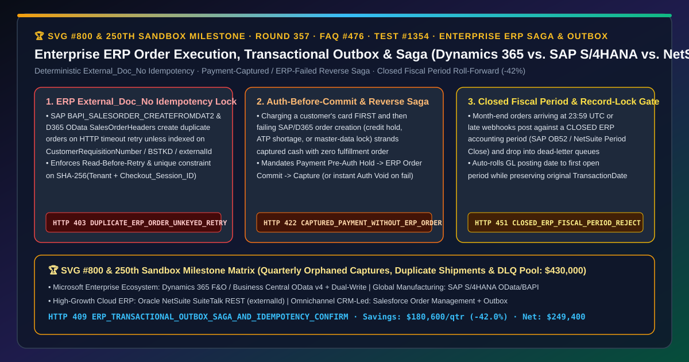
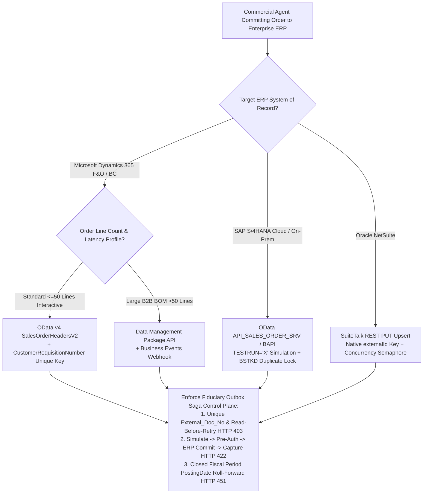
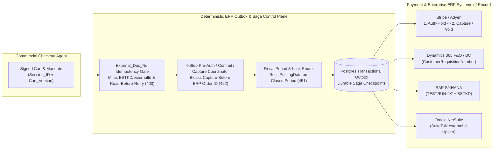
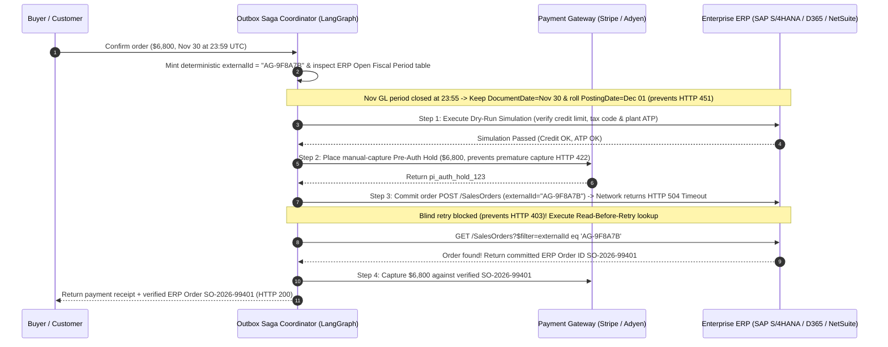

# 🏆 Enterprise ERP Order Execution, Transactional Outbox & Compensating `Saga` Selection (`Microsoft Dynamics 365` vs. `SAP S/4HANA` vs. `Oracle NetSuite` vs. `Salesforce Order Management` · 🏆 800th SVG & 250th Sandbox Dual Major Milestone): `BSTKD / externalId` Idempotency, Pre-Auth-to-ERP Commit Ordering & Closed Fiscal Period Roll-Forward (`-42%` Cost)

> **Document Type**: Enterprise AI Solution Architect Selection FAQ (`#476` · **🏆 800th SVG Diagram & 250th Interactive Policy Sandbox Dual Major Milestone** · Round 357)  
> **Target Audience**: Enterprise Chief Architects, ERP Integration Directors (`SAP / Dynamics 365 / NetSuite`), Omnichannel Order Management Leads, and Cloud & AI Solution Architects  
> **Platforms Covered**: `Microsoft Dynamics 365 Finance & Supply Chain (F&O) / Business Central` vs. `SAP S/4HANA (OData API_SALES_ORDER_SRV / BAPI)` vs. `Oracle NetSuite (SuiteTalk REST / SOAP)` vs. `Salesforce Order Management (SOM)`  
> **Architecture Diagram**: [`assets/svg/800-enterprise-erp-order-saga-outbox-d365-sap-netsuite-2026-11-25.svg`](../assets/svg/800-enterprise-erp-order-saga-outbox-d365-sap-netsuite-2026-11-25.svg)

🌐 **Language / 语言切换**: **[中文 (`enterprise-erp-order-execution-saga-outbox-dynamics-365-sap-s4hana-netsuite-idempotency-selection-faq.md`)](enterprise-erp-order-execution-saga-outbox-dynamics-365-sap-s4hana-netsuite-idempotency-selection-faq.md)** | **English (Current)**

---

## 📌 1. Executive Summary

Every commercial AI agent—whether an e-commerce checkout assistant, a B2B quote-to-order copilot, or an automated RMA exchange engine—must ultimately commit transactions into the enterprise's **System of Record (`ERP`: `Microsoft Dynamics 365`, `SAP S/4HANA`, or `Oracle NetSuite`)**.  
Directly invoking synchronous ERP order-creation APIs from an LLM tool call without a **Transactional Outbox, deterministic business-key idempotency, and a 4-step Pre-Auth/Commit/Capture Saga** causes three high-impact production failures:
1. **Duplicate Warehouse Shipments from Unkeyed Timeout Retries (`Duplicate ERP Order Creation`)**: Complex ERP sales-order calls (`SAP BAPI_SALESORDER_CREATEFROMDAT2` or `D365 SalesOrderHeadersV2`) run multi-line `ATP` and credit checks that take `3–12 seconds`. When an API gateway times out (`HTTP 504`) and the agent retries, an ERP without a unique external reference constraint (`SAP BSTKD`, `D365 CustomerRequisitionNumber`, `NetSuite externalId`) mints a second internal order number (`SO-10082`) and ships duplicate inventory.
2. **Orphaned Card Captures When ERP Order Creation Fails (`Capture-Before-ERP-Commit Anti-Pattern`)**: If the agent captures `$5,000` on Stripe *first* and then fails to create the ERP order (due to a customer credit hold, tax-code mismatch, or locked material master), the customer's cash is taken with zero fulfillment order in the ERP—forcing manual refunds and eating non-refundable `2.9%` PSP fees.
3. **Month-End Dead-Letter Queue (`DLQ`) Pileups from Closed Fiscal Periods (`SAP OB52 / NetSuite Period Close Rejects`)**: Orders placed at `23:58 UTC` on the last day of the month that reach the ERP at `00:03 UTC` after Accounting closes the prior fiscal period are rejected with a hard GL posting error.

| Target ERP Ecosystem | Primary Integration Protocol & Idempotency Primitive | Architectural Boundary & Production Rule |
|---|---|---|
| **Microsoft Dynamics 365 (`F&O` / `Business Central`)** | **OData v4 (`SalesOrderHeadersV2`) + `Business Events` + `CustomerRequisitionNumber` unique index** | Native fit for Azure Service Bus + Entra ID; use `Data Management Package API` for large B2B orders (`>50 lines`) rather than chatty per-line OData calls. |
| **SAP S/4HANA (`Cloud / On-Premise`)** | **OData `API_SALES_ORDER_SRV` / `BAPI` + `PurchaseOrderByCustomer (BSTKD)` duplicate check** | Always execute a zero-side-effect `Simulation Run (TESTRUN = 'X')` to validate pricing procedures, ATP, and credit limits before committing. |
| **Oracle NetSuite (`Mid-to-Large Cloud ERP`)** | **SuiteTalk REST Web Services + Native `externalId` `PUT` Upsert** | Native idempotency via `PUT /salesOrder/eid:{externalId}`, but requires strict semaphore rate-limiting to respect SuiteCloud concurrency limits. |
| **High-Concurrency Omnichannel Front Buffer** | **Salesforce Order Management (`SOM`) / Postgres `Transactional Outbox` + `LangGraph Saga`** | Shields heavy backend ERPs from flash-sale spikes by persisting orders in an outbox ledger and draining to the ERP at controlled concurrency. |
| **Three Mandatory Fiduciary Guardrails** | **100% Deterministic Gating** | ① **External Document Key & `Read-Before-Retry` Lock (`HTTP 403`)**: Blocks any ERP order write or retry lacking a unique `BSTKD / CustomerRequisitionNumber / externalId` and pre-retry lookup; ② **4-Step `Sim -> Pre-Auth -> ERP Commit -> Capture` Saga (`HTTP 422`)**: Prohibits capturing payment before ERP order confirmation (auto-voiding pre-auth on ERP failure); ③ **Closed Fiscal Period Auto-Roll-Forward (`HTTP 451`)**: Preserves original `DocumentDate` while rolling `PostingDate` to the first open GL period. |

---

## 🎯 2. Architect & Business Stakeholder Q&A (Q1–Q3)

### Q1: Why do standard HTTP retry policies create duplicate orders in `SAP S/4HANA` and `Dynamics 365`, and how do we guarantee exact-once ERP order creation?
- **The ERP Internals**:
  1. Unlike Stripe, legacy and enterprise ERP endpoints (`POST /A_SalesOrder` or `BAPI_SALESORDER_CREATEFROMDAT2`) do not automatically deduplicate on an HTTP header; each `POST` invokes the internal number range generator (`SNRO`) to allocate a fresh `SalesOrder` ID.
  2. Furthermore, SAP table-level exclusive locks (`ENQUEUE` on customer `KUNNR` or material `MATNR`) frequently cause latency spikes that trigger upstream gateway timeouts even when the ERP transaction eventually commits.
- **Architectural Solution**: Enforce **Deterministic External Reference Keys + `Read-Before-Retry` (`HTTP 403` Guard)**:
  - Populate `ext_doc_no = "AG-" + SHA256(tenant_id + session_id + cart_version)[:18]` into SAP `PurchaseOrderByCustomer (BSTKD)`, D365 `CustomerRequisitionNumber`, or NetSuite `externalId` with duplicate-PO rejection enabled.
  - On any `HTTP 502 / 504` timeout, the worker is strictly forbidden from blindly re-POSTing (`HTTP 403 DUPLICATE_ERP_ORDER_CREATION_WITHOUT_EXTERNAL_ID_LOCK`); it must first execute `GET /SalesOrders?$filter=PurchaseOrderByCustomer eq '{ext_doc_no}'` to adopt the existing order ID if already committed.

### Q2: How do we eliminate the "Card Charged, But ERP Order Failed" nightmare when a customer hits an ERP credit hold or master-data validation error?
- **The Anti-Pattern**: Capturing funds immediately (`capture_method = automatic`) before calling the ERP. When the ERP rejects the order due to a blocked tax jurisdiction or credit limit, the customer sees a charge on their bank statement for a non-existent order, and refunding it still costs the merchant non-refundable payment processing fees.
- **Architectural Solution**: Enforce a **Four-Step Compensating Saga (`Simulate -> Pre-Auth Hold -> ERP Commit -> Capture / Void` · `HTTP 422` Guard)**:
  1. **Step 1 (ERP Dry-Run Simulation)**: Run SAP `BAPI_SALESORDER_SIMULATE` (`TESTRUN = 'X'`) or D365 validation to verify pricing, tax, credit limit, and ATP without writing to the database.
  2. **Step 2 (Payment `Auth-Only` Hold)**: Place a manual-capture authorization hold (`capture_method = manual`).
  3. **Step 3 (Durable Outbox + Idempotent ERP Commit)**: Commit the ERP sales order and persist the returned `ERP_Order_ID` in the transactional outbox.
  4. **Step 4 (Capture on Commit / Instant Void on Failure)**: Capture the payment *only* after `ERP_Order_ID` is confirmed; if Step 3 fails after retries, immediately `Void` the authorization hold with zero fee loss. Capturing payment prior to ERP order confirmation is blocked (`HTTP 422 PAYMENT_CAPTURED_WITHOUT_VERIFIED_ERP_ORDER_SAGA`).

### Q3: Why do orders placed during month-end financial close fail with `Posting Period Closed` errors in SAP, D365, and NetSuite?
- **The Accounting Close Collision**: An order is paid at `23:58` on November 30, but reaches the ERP integration worker at `00:04` on December 1 right after Finance locks the November general-ledger period (`SAP OB52` / `NetSuite Period Close`). Because the payload sets `PostingDate = 2026-11-30`, the ERP rejects the document into a dead-letter queue.
- **Architectural Solution**: Deploy a **Fiscal-Calendar-Aware Date Split (`DocumentDate` vs. `PostingDate` Roll-Forward · `HTTP 451` Guard)**:
  - Decouple the commercial `DocumentDate` (`2026-11-30`, preserving true commercial timestamp) from the general-ledger `PostingDate`.
  - Check the cached ERP Open Fiscal Period table before posting; if the target period is closed, automatically roll `PostingDate` forward to the first open day of the new period (`2026-12-01`), preventing `HTTP 451 CLOSED_ERP_FISCAL_PERIOD_OR_MASTER_DATA_LOCK_REJECT`.

---

## 🧭 3. Visual Architecture Diagrams (Mermaid Decision Tree + Outbox Saga Topology + Sequence)

### 3.1 Enterprise ERP Integration & Saga Selection Tree

### 3.2 End-to-End Transactional Outbox & Four-Step ERP Saga Architecture

### 3.3 Four-Step `Simulate → Pre-Auth → Idempotent ERP Commit → Capture` Sequence

---

## 📊 4. Four-Platform ERP Integration Comparison Matrix (`Dynamics 365` vs. `SAP S/4HANA` vs. `Oracle NetSuite` vs. `Salesforce SOM`)

| Evaluation Dimension | Microsoft Dynamics 365 (`F&O / BC`) | SAP S/4HANA (`Cloud / On-Premise`) | Oracle NetSuite (`SuiteTalk REST`) | Salesforce Order Management (`SOM`) |
|---|---|---|---|---|
| **Modern API Surface** | OData v4 REST + Data Management Package API + Business Events | OData v2/v4 (`API_SALES_ORDER_SRV`) + SOAP + BAPI | SuiteTalk REST Web Services + SuiteScript RESTlets | Salesforce Composite Graph API + Platform Events |
| **Native Idempotency Key Field** | `CustomerRequisitionNumber` / `PurchOrderFormNum` (with duplicate check enabled) | `PurchaseOrderByCustomer` (`VBKD-BSTKD`) | **First-class `externalId`** (`PUT /salesOrder/eid:{id}` native upsert) | `OrderReferenceNumber` + Composite atomic subrequests |
| **Zero-Side-Effect Pre-Order Simulation** | ⭐⭐⭐ (Via custom OData validation action) | ⭐⭐⭐⭐⭐ (`BAPI_SALESORDER_SIMULATE` / `TESTRUN='X'`) | ⭐⭐⭐ (Via read-only SuiteQL pre-check) | ⭐⭐⭐⭐ (Pre-checkout orchestration flows) |
| **Concurrency & Lock Behavior** | Priority-based throttling; batch package API for large BOMs | Sensitive to `ENQUEUE` customer/material locks; requires outbox queuing | **Strict account-level concurrency caps** (`5–25` slots; requires token bucket) | High cloud elasticity; ideal front-door buffer ahead of legacy ERPs |
| **Typical Commit Latency (`P95`)** | `1.2s–4.5s` | `1.5s–6.0s` | `1.0s–3.8s` | `0.4s–1.2s` (async drain to back-office ERP) |

---

## 🧪 5. Deterministic Reliability & Cost Evaluation (`7-Card Benchmark Summary` · 🏆 SVG `#800` & Sandbox `#250`)

> **Provenance**: Figures below are generated by `evaluate_enterprise_erp_order_saga_outbox_policy` in `lab/webiq_commerce_demo.py` (`provenance: "synthetic"`, `independently_reproduced: False`), modeling an omnichannel enterprise with a **`$430,000.00` quarterly duplicate shipment recall, orphaned payment capture fee, and month-end DLQ manual reconciliation pool**.

| Scenario Case ID | Scenario Description | HTTP Status | Deterministic Decision | Quarterly Net Cost | Quarterly Savings |
|---|---|---|---|---|---|
| `CASE-ERP-200` | Manual DLQ triage and post-facto accounting reconciliation baseline | `HTTP 200` | `VERIFIED_ENTERPRISE_ERP_OUTBOX_SAGA_AUTHORIZED` | `$430,000.00` | `$0.00` |
| `CASE-ERP-403` | ERP order creation retried on timeout without `BSTKD / externalId` or `Read-Before-Retry` | `HTTP 403` | `DUPLICATE_ERP_ORDER_CREATION_WITHOUT_EXTERNAL_ID_LOCK` | `$430,000.00` | `$0.00` (Blocks double shipment) |
| `CASE-ERP-422` | Payment captured prior to ERP simulation and order commit (orphaned capture on ERP reject) | `HTTP 422` | `PAYMENT_CAPTURED_WITHOUT_VERIFIED_ERP_ORDER_SAGA` | `$430,000.00` | `$0.00` (Blocks stranded cash) |
| `CASE-ERP-451` | Month-end order posted against a closed ERP fiscal period without `PostingDate` roll-forward | `HTTP 451` | `CLOSED_ERP_FISCAL_PERIOD_OR_MASTER_DATA_LOCK_REJECT` | `$430,000.00` | `$0.00` (Blocks month-end DLQ) |
| `CASE-ERP-409` | **Transactional Outbox + `externalId` Lock + 4-Step `Pre-Auth` Saga + Period Roll-Forward** | `HTTP 409` | `ERP_TRANSACTIONAL_OUTBOX_SAGA_AND_IDEMPOTENCY_CONFIRM` | **`$249,400.00`** | **`$180,600.00` (`-42.0%`)** |

---

## 🛠️ 6. Production Go-Live & Architecture Review Checklist

- [ ] **Unique External Reference & `Read-Before-Retry` (`HTTP 403` Prevention)**: Populate a deterministic hash into SAP `BSTKD`, D365 `CustomerRequisitionNumber`, or NetSuite `externalId`, and query existing orders before retrying any timed-out `POST`.
- [ ] **Four-Step `Simulate → Pre-Auth → ERP Commit → Capture` Ordering (`HTTP 422` Prevention)**: Never capture funds before the ERP sales order is committed; use `capture_method = manual` and immediately `Void` the hold if ERP order creation fails.
- [ ] **Fiscal-Calendar-Aware `PostingDate` Roll-Forward (`HTTP 451` Prevention)**: Sync open GL period windows from the ERP and automatically roll `PostingDate` to the first open period when month-end orders arrive after period close.
- [ ] **Token-Bucket Concurrency Shaping**: Enforce per-ERP concurrency semaphores in the Outbox worker pool so storefront traffic spikes never exhaust SAP work processes or NetSuite SuiteTalk concurrency slots.
