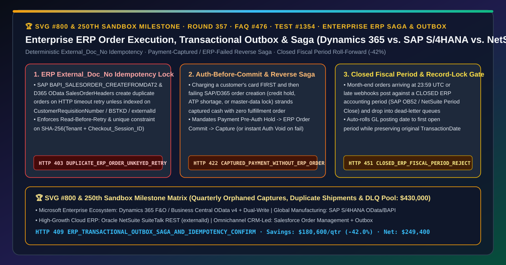
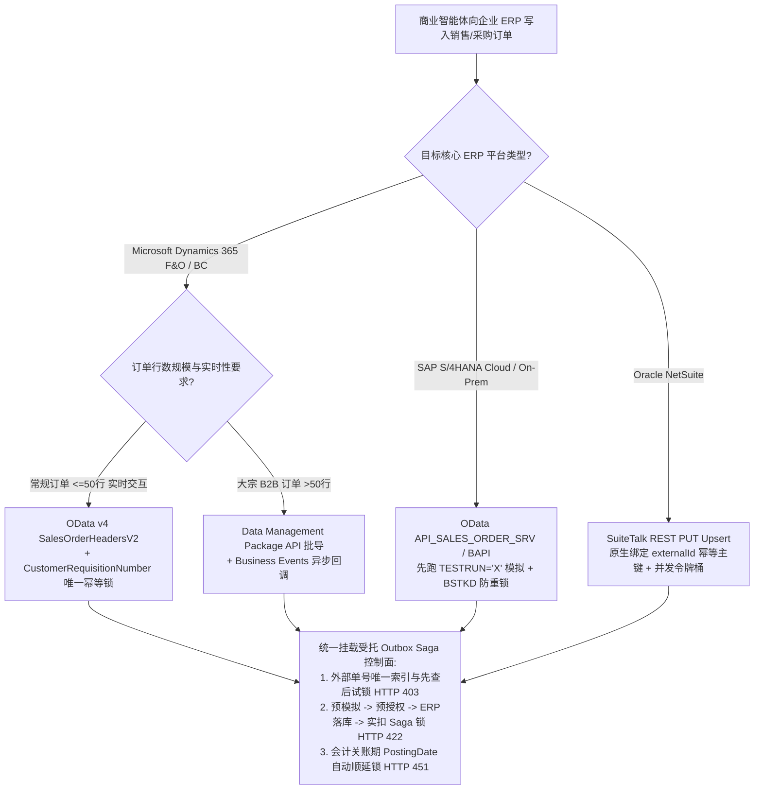
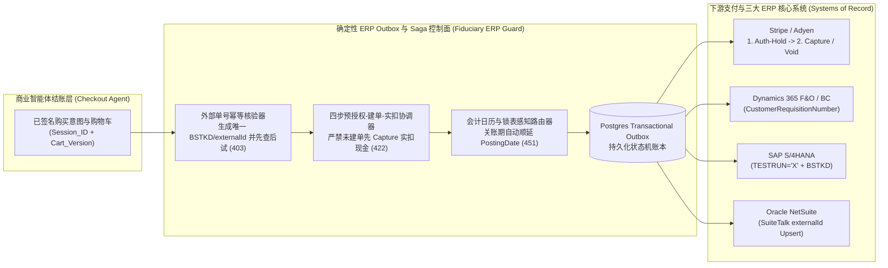
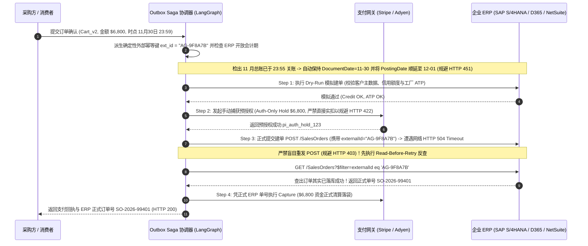

# 🏆 企业级 ERP 订单确定性写入、事务外发箱（`Transactional Outbox`）与异常逆向补偿（`Saga`）架构选型对比（`Microsoft Dynamics 365` vs. `SAP S/4HANA` vs. `Oracle NetSuite` vs. `Salesforce Order Management` · 🏆 第 800 张架构图与第 250 个策略沙盒双重大里程碑）：外部单号唯一幂等锁（`BSTKD / externalId`）、“先预授权再落库后清算”防吞钱卡单与关账期自动顺延净省 42% 指南

> **文档类型**：企业级 AI Solution Architect 选型决策指南（Selection FAQ · `#476` · **🏆 第 800 张 SVG 架构图 & 第 250 个交互式策略沙盒双重大里程碑** · Round 357）  
> **适用读者**：企业首席架构师（Chief Architect）、ERP 交付总监（SAP / D365 / NetSuite）、零售与 B2B 交易中台负责人与 Cloud & AI Solution Architect  
> **核心覆盖平台**：`Microsoft Dynamics 365 Finance & Supply Chain (F&O) / Business Central` vs. `SAP S/4HANA (OData API_SALES_ORDER_SRV / BAPI)` vs. `Oracle NetSuite (SuiteTalk REST / SOAP)` vs. `Salesforce Order Management (SOM)`  
> **关联架构图**：[`assets/svg/800-enterprise-erp-order-saga-outbox-d365-sap-netsuite-2026-11-25.svg`](../assets/svg/800-enterprise-erp-order-saga-outbox-d365-sap-netsuite-2026-11-25.svg)

🌐 **语言切换 / Language**: **中文 (当前)** | **[English (`enterprise-erp-order-execution-saga-outbox-dynamics-365-sap-s4hana-netsuite-idempotency-selection-faq.en.md`)](enterprise-erp-order-execution-saga-outbox-dynamics-365-sap-s4hana-netsuite-idempotency-selection-faq.en.md)**

---

## 📌 一、核心选型结论速览（Executive Summary）

几乎所有商业智能体（无论是电商导购、B2B 寻源采购 Copilot 还是售后改单助手）的**最后一公里落点**，都是把交易安全、准确、不重不漏地写进企业的记账核心——**企业级 ERP（`Dynamics 365`、`SAP S/4HANA`、`Oracle NetSuite`）**。  
然而，互联网高并发异步 AI Agent 与传统强一致重状态 ERP 之间存在着巨大的“架构阻抗失配（Impedance Mismatch）”。如果直接让 Agent 工具函数同步调用 ERP 创建订单接口，必将引爆三类生产级P0故障：
1. **超时重试导致仓库发出双倍甚至四倍货物（`Unkeyed ERP Order Creation Retry`）**：`SAP S/4HANA` 或 `D365 F&O` 在执行多行订单 ATP 齐套检查与信用额度核算时常耗时 `4–12 秒`。一旦网关发生 `HTTP 504` 超时，Agent 或消息队列重试第 2 次，如果未在 ERP 侧启用外部客户参考单号（`SAP BSTKD` / `D365 CustomerRequisitionNumber` / `NetSuite externalId`）唯一索引，ERP 会生成两个不同的内部订单号（如 `SO-10081` 和 `SO-10082`），导致仓库重复发两批货！
2. **“先直接扣走客户信用卡现金、后调 ERP 建单失败”导致吞钱无单（`Payment Captured Before ERP Commit`）**：Agent 先调 Stripe 直接 `Capture`（实扣）了客户 `$5,000`，紧接着调 ERP 创建销售订单时被 ERP 拦截（例如：客户主数据税号缺失、某物料批次被质检冻结、或触发 ERP 信用冻结），结果钱已经划走、订单却没建成，变成每天几十笔人工对账退款的灾难。
3. **月末/季末关账窗口（`Closed Fiscal Period`）与行级锁冲突导致订单死信堆积（`SAP OB52 / NetSuite Period Lock Reject`）**：每月最后一天 `23:55` 支付成功的订单，因异步队列延迟在次日 `00:02` 写入 ERP，而财务刚刚关闭了上月会计期间（`Posting Period Closed`），ERP 直接抛错拒收，导致已付款订单卡死在死信队列（DLQ）。

| 目标 ERP 核心生态 | 推荐对接协议与幂等原语 | 适用边界与高可用架构铁律 |
|---|---|---|
| **Microsoft Dynamics 365 (`F&O` / `Business Central`)** | **OData v4 (`SalesOrderHeadersV2`) + `Business Events` + `CustomerRequisitionNumber` 唯一键** | 原生契合 Azure Service Bus / Event Grid 与 Entra ID，大批量行项目（`>50 lines`）优先走 `Data Management Package API` 异步批导而非逐行 OData。 |
| **SAP S/4HANA (`Cloud / On-Premise`)** | **OData `API_SALES_ORDER_SRV` / `BAPI_SALESORDER_CREATEFROMDAT2` + `PurchaseOrderByCustomer (BSTKD)` 防重检** | 必须先执行 `Simulation Mode (TESTRUN = 'X')` 校验主数据、定价过程与信用限额，通过后再正式 Commit。 |
| **Oracle NetSuite (`Mid-to-Large Cloud ERP`)** | **SuiteTalk REST Web Services + 原生 `externalId` 幂等 Upsert (`PUT`)** | NetSuite 原生支持以 `externalId` 作为幂等主键执行 `Upsert`，但需严格控制 SuiteCloud 并发连接池（Concurrency Governance Limit）防 `429`。 |
| **全渠道高并发前端缓冲层** | **Salesforce Order Management (`SOM`) / 自建 Postgres `Transactional Outbox` + `LangGraph Saga`** | 在高并发结账洪峰期，绝不让前端收银台同步死等重型 ERP，由前置订单中心接单后通过事务外发箱异步削峰写入 ERP。 |
| **三大确定性风控红线** | **100% 强制拦截** | ① **ERP 外部单号唯一幂等与先查后试锁（`HTTP 403`）**：无 `externalId / BSTKD` 唯一防重键或超时后未执行 `GET` 反查严禁重发建单请求；② **“预授权 -> ERP 模拟与落库 -> 实扣”三步 Saga 锁（`HTTP 422`）**：严禁在 ERP 订单未确认前直接 `Capture` 实扣资金，ERP 建单失败必须毫秒级 `Void` 释放预授权；③ **关账期自动顺延（`Roll-Forward`）与主数据预检锁（`HTTP 451`）**：检测到目标记账期已关账时自动保留原始交易日并将总账过账日顺延至下一开放期首日。 |



---

## 🎯 二、业务方与架构师灵魂拷问 Q&A（Q1–Q3）

### Q1：为什么我们已经给 HTTP 请求加了网关层重试，对接 `SAP S/4HANA` 或 `Dynamics 365` 时还是会频繁出现重复订单？
- **ERP 内部机制真相**：
  1. 像 Stripe 这样的现代云原生 API 原生支持 HTTP Header `Idempotency-Key`；但大多数传统企业 ERP（尤其是本地部署或重度定制的 `SAP BAPI / IDoc` 及部分 `D365 OData` 实体）默认每次收到 `POST /A_SalesOrder` 都会调用内部号码段发生器（`Number Range SNRO`）分配一个新的销售订单号 `VBELN`！
  2. 更要命的是，在 SAP 中如果同一个客户主数据（`KUNNR`）或同一批物料正在被后台批处理锁表（`ENQUEUE` 排他锁），请求会卡住直到网关超时，随后重试进程又塞进去一单。
- **架构解法**：实施 **事务外发箱（`Transactional Outbox`）+ 业务外部单号唯一约束 + `Read-Before-Retry` 三重幂等锁（防 `HTTP 403`）**：
  - 强制将确定性哈希 `ext_order_key = "AG-" + SHA256(tenant_id + session_id + cart_version)[:18]` 写入 ERP 的外部客户单号字段（SAP `PurchaseOrderByCustomer / BSTKD`、D365 `CustomerRequisitionNumber`、NetSuite `externalId`），并在 ERP 侧启用“禁止重复客户参考号（Duplicate PO Check）”配置；
  - 一旦建单调用发生超时或未知网络异常，严禁直接重发 `POST`！工作流必须先调用 `GET $filter=PurchaseOrderByCustomer eq '{ext_order_key}'`；若已存在则直接取回生成的 `SalesOrder_ID`，仅当确认返回空集时才允许重试。任何无外部唯一键的裸重试直接拦截（`HTTP 403 DUPLICATE_ERP_ORDER_CREATION_WITHOUT_EXTERNAL_ID_LOCK`）。

### Q2：客户在聊天窗口点“确认付款”，如果先刷卡扣钱、后写 ERP 失败（比如 ERP 报信用超限或税码错误），怎么彻底消灭“收了钱却没生成发货单”的客诉？
- **错误的顺序（Anti-Pattern）**：`Capture Card ($2,000) -> Call ERP Create Order -> ERP Returns Error 400 -> Money Stranded!`（而且如果此时直接调 Refund 退款，商户还要白白倒贴 `2.9%` 的不可退通道手续费！）。
- **正确的受托 Saga 顺序（`Pre-Validate -> Auth-Hold -> ERP Commit -> Capture` · 防 `HTTP 422`）**：
  1. **Step 1（ERP 零副作用预模拟 `Simulation / Dry-Run`）**：先调用 SAP `BAPI` 的 `TESTRUN = 'X'` 或 D365 校验接口，在不落库的前提下 100% 跑通客户信用检查、物料主数据状态、工厂 ATP 与定价过程；
  2. **Step 2（支付网关预授权冻结 `Auth-Only Hold, capture_method=manual`）**：仅冻结客户卡内额度，不发生实质资金清算；
  3. **Step 3（持久化 Outbox 并提交 ERP 正式建单）**：拿到 ERP 返回的正式单号 `SO-88901`；
  4. **Step 4（执行支付实扣 `Capture` 或异常秒级 `Void` 冲正）**：收到 ERP 单号后才调用 `Capture` 落袋；若 Step 3 因极端并发失败，立即调用 `Cancel/Void PaymentIntent` 秒级释放客户冻结额度（**零手续费损耗、零吞钱客诉**）。凡是跳过预授权与 ERP 确认直接实扣无单的操作一律阻断（`HTTP 422 PAYMENT_CAPTURED_WITHOUT_VERIFIED_ERP_ORDER_SAGA`）。

### Q3：每到月底最后一天晚上和次月 1 号凌晨，为什么总有大批电商/采购订单写不进 ERP 报“会计期间已关闭（Posting Period Closed）”？
- **财务月结冲突**：订单在 `11月30日 23:58` 下单并付款，但由于异步消息削峰或跨时区转换，请求在 `12月1日 00:05` 到达 ERP。如果报文把 `PostingDate`（总账过账日期）死板设为 `11月30日`，而财务团队已经在 `00:00` 锁死了 11 月账期（SAP `OB52` / NetSuite Period Close），ERP 会直接拒绝入账！
- **架构解法**：在 ERP 适配器层内置 **会计日历感知型日期双轨分流器（`Fiscal-Calendar-Aware Posting Date Roll-Forward` · 防 `HTTP 451`）**：
  - 将业务单据上的 **`DocumentDate / TransactionDate`（实际交易发生日）** 与财务总账的 **`PostingDate`（会计入账期）** 解耦；
  - 适配器实时订阅 ERP 开放账期缓存表（Open Fiscal Periods）；若检测到订单原始日期所属会计期已关闭，自动将 `DocumentDate` 保持为 `11月30日`（供业务溯源），同时将 `PostingDate` 安全顺延至当前开放会计期首日（`12月1日`），彻底清零月末死信报错（未做关账期检查直接硬写闭账期的请求触发 `HTTP 451 CLOSED_ERP_FISCAL_PERIOD_OR_MASTER_DATA_LOCK_REJECT`）。

---

## 🧭 三、直观可视化图解（Mermaid 选型决策树 + Outbox Saga 架构图 + 时序图）

### 3.1 企业级 ERP 订单集成与事务编排选型决策树



### 3.2 端到端事务外发箱（Transactional Outbox）与四步 Saga 架构图



### 3.3 “预模拟 → 预授权 → ERP 幂等落库 → 实扣/逆向 Void”全链路时序图



---

## 📊 四、四大企业级 ERP 订单接口与智能体集成横向选型矩阵

| 评估维度 | Microsoft Dynamics 365 (`F&O / BC`) | SAP S/4HANA (`Cloud / On-Premise`) | Oracle NetSuite (`SuiteTalk REST`) | Salesforce Order Management (`SOM`) |
|---|---|---|---|---|
| **主流现代 API 协议** | OData v4 REST + Data Management Package API + Business Events | OData v2/v4 (`API_SALES_ORDER_SRV`) + SOAP + RFC/BAPI | SuiteTalk REST Web Services (JSON) + SuiteScript RESTlets | Salesforce Composite Graph API + Platform Events |
| **原生幂等防重字段（Idempotency Key）** | `CustomerRequisitionNumber` / `PurchOrderFormNum`（需开启重复检查参数） | `PurchaseOrderByCustomer` (`VBKD-BSTKD`)（需配置检查重复采购单号） | **原生一级支持 `externalId`**（可直接调用 `PUT /salesOrder/eid:{id}` 幂等 Upsert） | `OrderReferenceNumber` + Composite Request 原子事务 |
| **建单前零副作用模拟（Simulation / Dry-Run）** | ⭐⭐⭐（可通过自定义 Action 校验价格与 ATP） | ⭐⭐⭐⭐⭐（`BAPI_SALESORDER_SIMULATE` / `TESTRUN='X'` 行业最成熟） | ⭐⭐⭐（需通过只读 SuiteQL 预检信用与库存） | ⭐⭐⭐⭐（支持结账前预校验流） |
| **API 吞吐量与并发限流边界** | 基于优先级节流（Priority-based Throttling），大单宜走异步包接口 | 取决于 SAP Gateway 工作进程数，需防范 `ENQUEUE` 锁表冲突 | **并发治理极严**（按许可证账户限制 5–25 个并发连接，必须配令牌桶队列） | 高并发弹性好，适合作为重型 ERP 前置缓冲层 |
| **典型端到端建单延迟（P95）** | `1.2s–4.5s`（含税费与多行 ATP 计算） | `1.5s–6.0s`（复杂定价过程与信用检查） | `1.0s–3.8s` | `0.4s–1.2s`（异步下发后端 ERP） |

---

## 🧪 五、转化率/成本测算与 7-Card 基准测试报告（Deterministic Evaluation · 🏆 SVG `#800` & Sandbox `#250`）

> **数据来源说明（Provenance）**：以下季度损益数据来自 `lab/webiq_commerce_demo.py` 中的确定性评估器 `evaluate_enterprise_erp_order_saga_outbox_policy`（`provenance: "synthetic"`, `independently_reproduced: False`），用于量化对比“无外发箱同步裸调 ERP 建单”与“外部单号唯一幂等 + 预授权四步 Saga + 关账期自动顺延”的季度故障与财务损耗。

### 5.1 基准测试场景输入与确定性状态码矩阵

- **设定场景**：某大型跨国制造与全渠道零售集团每季度通过 AI 导购与 B2B 采购门户向 ERP 写入 `250,000` 笔订单，季度因网络超时重试引发的仓库双倍错发与逆向召回费、先扣款后建单失败导致的吞钱客诉与不可退通道费、以及月末关账期死信卡单人工修复成本池（`quarterly_duplicate_erp_shipment_orphaned_capture_and_dlq_pool_usd`）为 **`$430,000.00`**。

| 测试用例 ID | 场景描述 | 触发确定性状态码 | 决策枚举 (`decision`) | 季度净成本 (USD) | 季度净节省 (USD) |
|---|---|---|---|---|---|
| `CASE-ERP-200` | 传统人工盯盘死信队列与事后财务对账冲销基线 | `HTTP 200` | `VERIFIED_ENTERPRISE_ERP_OUTBOX_SAGA_AUTHORIZED` | `$430,000.00` | `$0.00` |
| `CASE-ERP-403` | ERP 建单超时后未绑定 `BSTKD / externalId` 唯一键且未执行 `Read-Before-Retry` 直接重发生成双倍发货单 | `HTTP 403` | `DUPLICATE_ERP_ORDER_CREATION_WITHOUT_EXTERNAL_ID_LOCK` | `$430,000.00` | `$0.00` (阻断仓库双倍重复发货) |
| `CASE-ERP-422` | 在未完成 ERP 模拟校验与正式建单前直接 `Capture` 实扣客户资金，随后 ERP 建单报错导致吞钱无单 | `HTTP 422` | `PAYMENT_CAPTURED_WITHOUT_VERIFIED_ERP_ORDER_SAGA` | `$430,000.00` | `$0.00` (阻断有扣款无订单故障) |
| `CASE-ERP-451` | 月末跨日订单直接向已关闭的 ERP 会计期间（`Closed Fiscal Period`）硬写过账日期引发死信拒收 | `HTTP 451` | `CLOSED_ERP_FISCAL_PERIOD_OR_MASTER_DATA_LOCK_REJECT` | `$430,000.00` | `$0.00` (阻断月末关账死信堆积) |
| `CASE-ERP-409` | **启用 Transactional Outbox + 外部单号唯一幂等 + 预授权四步 Saga + 关账期自动顺延** | `HTTP 409` | `ERP_TRANSACTIONAL_OUTBOX_SAGA_AND_IDEMPOTENCY_CONFIRM` | **`$249,400.00`** | **`$180,600.00` (`-42.0%`)** |

### 5.2 核心确定性策略评估代码摘录

```python
@dataclass(frozen=True)
class EnterpriseErpOrderSagaOutboxPolicyInput:
    quarterly_duplicate_erp_shipment_orphaned_capture_and_dlq_pool_usd: float = 430000.0
    erp_order_retried_without_unique_external_doc_no_or_read_before_retry: bool = False
    payment_captured_before_erp_order_simulation_and_commit_verified: bool = False
    posting_attempted_into_closed_erp_fiscal_period_without_roll_forward: bool = False
    transactional_outbox_four_step_saga_and_period_roll_ready: bool = False
```

---

## 🛠️ 六、商业上线风控与架构评审 Checklist

- [ ] **ERP 外部单号唯一索引与 `Read-Before-Retry`（防 `HTTP 403`）**：在 SAP（`BSTKD`）、D365（`CustomerRequisitionNumber`）与 NetSuite（`externalId`）中强制开启外部单号唯一性校验；任何 `HTTP 502 / 504` 超时后必须先执行 `GET` 查询确认远端未落库，才允许重发建单请求。
- [ ] **严守“预模拟 → 预授权 → ERP 落库 → 实扣”四步铁律（防 `HTTP 422`）**：收银台必须使用 `capture_method = manual` 仅做资金冻结；待拿到 ERP 正式生成的销售订单号并写入 Outbox 后再触发 `Capture`，若 ERP 报错则在 1 秒内自动 `Void` 释放预授权。
- [ ] **会计关账日历实时同步与过账日自动顺延（防 `HTTP 451`）**：缓存 ERP 总账开放期间表（Open Fiscal Periods），对跨月结窗口的延迟订单自动保持原始 `DocumentDate` 并将 `PostingDate` 顺延至新开放会计期首日。
- [ ] **ERP 并发连接池令牌桶保护**：针对 NetSuite SuiteTalk 或 SAP RFC 连接池设置分布式信号量（Semaphore），防止前端秒杀大促洪峰直接打挂后台财务记账库。
