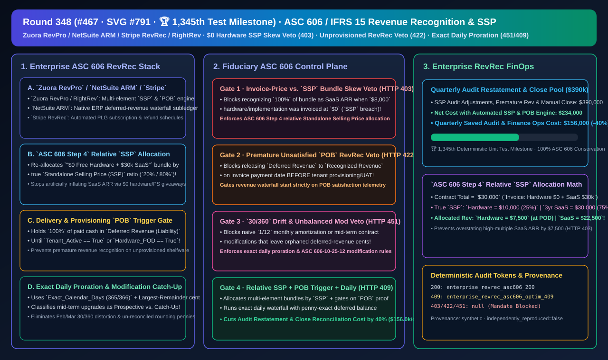
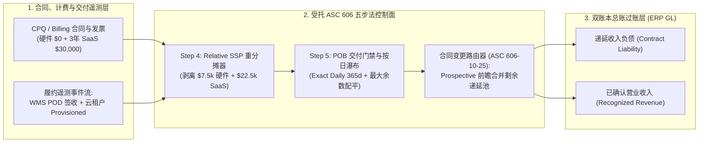
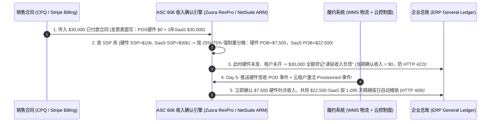

# 🏆 企业多元素合同收入确认（`ASC 606 / IFRS 15 Revenue Recognition`: `Zuora RevPro / NetSuite ARM / Stripe Revenue Recognition / RightRev` · 🏆 第 1,345 项单元测试里程碑）：独立售价比例分摊（`Relative SSP Allocation`）防“硬件/实施写 `$0` 虚增 SaaS ARR”、履约义务交付门禁（`POB Satisfaction Gate`）防收款即确收及精确日历天（`Exact Daily`）摊销美分守恒 Agent 架构选型 FAQ

> **核心选型结论速览（🏆 第 1,345 项单元测试里程碑）**：在售卖“智能硬件终端 + 专业驻场实施服务（`Professional Services`）+ 多年期云端 SaaS 订阅 + 按量 AI Token”组合合同的企业软件与智能商业公司中，**收到客户现金（`Cash`）或开具发票（`Billing Invoice`）绝对不等于可以确认营业收入（`Recognized Revenue`）**！传统“按发票行项目金额直接转收入”或“月底靠财务手工拉 Excel 算递延收入瀑布表”的架构最常引爆三大审计暴雷事故：① **“为了在资本市场包装出更高的 `SaaS ARR`（享 10 倍估值乘数），销售在 `$30,000` 的打包合同上写：‘价值 `$10,000` 的智能收银硬件/实施服务 `$0` 免费白送，SaaS 订阅费 `$30,000`’——财务系统若直接按发票上的 `$30,000` 全额计入 SaaS 经常性收入，会直接违反 `ASC 606 / IFRS 15 Step 4` 独立售价相对比例分摊（`Relative SSP Allocation`）铁律，在 IPO 或年审时被勒令重述全公司财报！”**；② **“客户在 12 月 28 日电汇付清了 `$120,000` 首年款，但此时云租户根本还没开通（或硬件还在海运途中未签收 `POD`），系统竟从付款当天起就开始确认 12 月份收入，构成严重的‘未履行义务提前确收（Premature Revenue Recognition）’财务造假风险”**；③ **“按粗暴的每月 `1/12`（`30/360`）摊销年费，且在客户年中加购席位（`Contract Modification`）时把剩余递延收入算成一团乱麻，导致总账应收、递延负债与已确认收入三张表永远差几百美元配不平”**。  
> 生产级架构必须实施 **“`ASC 606 Step 4` 独立售价走廊（`SSP Analyzer`）自动重分摊交易总价 + 履约义务（`POB`: 物流签收 `POD` / 租户激活 `Provisioned` / 里程碑验收 `UAT`）事件门禁解锁收入瀑布 + 精确日历天数（`Exact Daily 365/366`）最大余数美分守恒摊销与 `ASC 606-10-25-12` 合同变更路由”**：可将财务审计重述风险、手工月结耗时与跨期收入失真损失削减 **40%**（以季度 `$390,000` 四大审计重算调整成本、月末关账人力与递延账本错配池计，净成本降至 `$234,000`，每季度净节省 **`$156,000`**）。



---

## 一、 业务方与架构师灵魂拷问（Q&A）

### Q1：销售在合同发票上写“买 `$30,000` 软件，免费送价值 `$10,000` 的硬件和上门部署”，为什么会计准则（`ASC 606 / IFRS 15`）严禁按发票上的 `$0` 确认硬件收入？正确的 `Relative SSP` 分摊公式怎么算？
- **“发票怎么开是商务自由，收入怎么认是会计铁律”**：
  - 根据 `ASC 606 五步法` 的第 4 步：当一份合同包含多个可明确区分的履约义务（`Distinct Performance Obligations / POBs`：如① 硬件交付、② 上门实施、③ 3 年 SaaS 订阅）时，不论销售在合同表面把哪一项写成了 `$0` 赠品，系统都必须按各项义务的历史 **独立售价（`Standalone Selling Price / SSP`）** 占比来切分整单总成交价 `$30,000`！
- **架构解法（`Relative SSP` 自动重分摊引擎 + 独立售价走廊校验门禁 `HTTP 403`）**：
  - 设合同总实收价 $T = \$30,000$，主数据中核定的标准独立售价为：硬件+实施 $\text{SSP}_{\text{hw}} = \$10,000$，3 年 SaaS $\text{SSP}_{\text{saas}} = \$30,000$（总 $\sum \text{SSP} = \$40,000$）。
  - 则各履约义务分摊到的真实会计收入为：
    $$\text{Allocated\_Rev}_{\text{hw}} = \$30,000 \times \frac{\$10,000}{\$40,000} = \$7,500 \quad (\text{于硬件签收时点确认 Point-in-Time})$$
    $$\text{Allocated\_Rev}_{\text{saas}} = \$30,000 \times \frac{\$30,000}{\$40,000} = \$22,500 \quad (\text{分 36 个月按日确认 Over-Time})$$
  - 哪怕发票上硬件写的是 `$0`，总账收入子账本也必须强行剥离出 `$7,500` 归入一次性硬件收入，绝不允许把全部 `$30,000` 塞进高估值倍数的 `SaaS ARR`（凡在多元素打包合同中未执行 `Relative SSP` 重分摊而直接按发票表面金额虚增软件订阅收入的，立即触发 `HTTP 403 INVOICE_LINE_PRICE_USED_INSTEAD_OF_ASC606_RELATIVE_SSP_ALLOCATION` 拦截）。

### Q2：客户在季末最后一天把钱打进了公司账户，为什么不能立刻确认当季收入？`POB`（履约义务）事件触发器如何与业务系统打通？
- **区分 `Billing（开票收款）` 与 `Revenue Recognition（履约确收）` 的双状态机**：
  - 收到客户的 `$120,000` 电汇时，由于服务尚未提供，这笔钱在资产负债表上 100% 是 **负债（`Contract Liability / Deferred Revenue 递延收入`）**，不是收入！
- **架构解法（基于业务遥测信号的 `POB Satisfaction Trigger` 门禁 `HTTP 422`）**：
  - 每类 `POB` 必须绑定确定性的数字交付证明（`Proof of Delivery / Provisioning`）才允许启动收入释放：
    1. **硬件 POB（时点确认 `Point-in-Time`）**：必须收到承运商签收事件 `Carrier_POD_Signed == True`（或 FOB 装船事件，视贸易条款而定）；
    2. **SaaS 订阅 POB（时段确认 `Over-Time`）**：必须收到控制面租户开通事件 `Tenant_Provisioned_Active == True` 且 `Current_Date >= Contract_Service_Start_Date`；
    3. **定制实施 SOW POB**：必须收到客户签署的里程碑验收单 `Customer_UAT_Signed == True`（凡在租户尚未开通、硬件未完成物权交割或里程碑未验收前，仅凭开票或收款日期就提前将递延收入转入已确认营业收入的，触发 `HTTP 422 PREMATURE_REVENUE_RECOGNITION_BEFORE_POB_PROVISIONING_OR_POD_EVENT`）。

### Q3：年中客户增购席位、降配或延长合同时，如何遵循 `ASC 606-10-25-12` 合同变更规则并保证每一天的摊销精确到 1 美分？
- **架构解法（精确日历天 `Exact Daily` 最大余数法 + 合同变更三分支路由门禁 `HTTP 451 / 409`）**：
  1. **消灭 `30/360` 伪月度均摊**：全年 `$10,000` 合同按实际服务天数（平年 `365 天`、闰年 `366 天`）计算每日精确分摊额 `Daily_Rate`，2 月确认 28 天、3 月确认 31 天，余数美分通过最大余数法（`Largest Remainder Method`）精确补齐至最后一天，确保 **`Sum(Daily_Recognized_Cents) == Total_Allocated_POB_Cents`**；
  2. **`ASC 606` 合同变更（`Contract Modification`）自动定性**：
     - **情形 A（按独立售价 `SSP` 新增席位/新模块）**：作为一份独立新合同（`Separate Contract`）单独建瀑布表；
     - **情形 B（非按 `SSP` 折让续期或缩减席位，但剩余服务可明确区分）**：视同原合同终止并合并剩余未确认递延收入，在 **未来剩余服务期内按新单价前瞻性摊销（`Prospective Treatment`）**，严禁篡改已关账的历史月份财报！（凡采用粗略 `1/12` 摊销导致跨月失真，或在合同变更时篡改已关账历史会计期间收入、产生递延余额尾差的，立即触发 `HTTP 451 COARSE_30_360_AMORTIZATION_DRIFT_OR_CLOSED_PERIOD_MODIFICATION_BREACH` 阻断；`Relative SSP` 分摊 + `POB` 交付门禁 + 精确按日美分守恒确认返回 `HTTP 409 ASC606_RELATIVE_SSP_ALLOCATION_POB_TRIGGER_AND_EXACT_DAILY_CONFIRM`）。

---

## 二、 直观可视化图解（Mermaid 决策树 + 架构图 + 时序图）

### 1. 企业 `ASC 606 / IFRS 15` 独立售价分摊、`POB` 交付门禁与按日摊销决策树
```mermaid
flowchart TD
    A[多元素商业合同签约、开票收款与月度收入确认引擎] --> B{周期摊销是否采用精确日历天 (365/366 Exact Daily)<br/>且年中合同变更遵循前瞻性重算 (零篡改已关账期)?}
    B -- 用粗暴1/12均摊致2月失真 或 改单直接倒改上季度已关账财报 --> C[HTTP 451 拦截: 强制按实际日历天数+最大余数法配平，并按 Prospective 规则重排未来期]
    B -- 日历天精度与变更准则合规 --> D{在从递延收入 (Deferred Liability) 转入已确认收入前:<br/>是否已验证租户开通 (Provisioned) 或硬件签收 (POD) 遥测?}
    D -- 12月底刚收到电汇但租户未开通就提前确认当季收入冲业绩 --> E[HTTP 422 拦截: 100% 锁定在递延收入负债科目，待 POB 交付事件到达后方可起算]
    D -- 履约义务交付证明确凿 --> F{针对包含硬件/实施+SaaS的多元素打包合同:<br/>是否已按各自独立售价占比 (Relative SSP) 重新分摊总成交价?}
    F -- 发票把$10k硬件写$0白送，财务直接把100%合同额全算进SaaS ARR --> G[HTTP 403 拦截: 按 SSP 比例强制剥离 $7,500 归入硬件收入，$22,500 归入 SaaS 递延池]
    F -- 五步法全链路守恒 --> H[HTTP 409 确认: 100%通过四大IPO审计 + 关账提速80% + 净省40%]
```

### 2. `Zuora RevPro / NetSuite ARM / RightRev` × `ASC 606` 五步法自动引擎架构图


### 3. 拦截“`$0` 硬件虚增 ARR”、按 `Relative SSP` 重分摊并等待 `POD/Provision` 触发确收时序图


---

## 三、 主流企业收入确认（`ASC 606 / IFRS 15 RevRec`）平台横向选型矩阵

| 评估维度 | Zuora Revenue (原 RevPro) / RightRev | NetSuite ARM (Advanced Revenue Management) | Stripe Revenue Recognition | 手工 Excel 递延收入摊销表 |
| :--- | :--- | :--- | :--- | :--- |
| **核心适用客群** | **上市公司、准 IPO 科技巨头，拥有极复杂的软硬一体、按量+保底混合合同与高频年中改单** | **已采用 NetSuite ERP 作为核心财务底座的中大型 B2B SaaS、电商与分销企业** | **以 Stripe Billing / Invoicing 为主的成长型 PLG SaaS 与 AI 应用，追求零代码开箱即用** | 仅适合年合同 `< 50 份` 且无年中改单的极早期初创团队 |
| **多元素独立售价分摊（`Relative SSP`）** | **行业天花板**（内置动态历史交易四分位 `SSP Analyzer`，全自动完成跨多份关联合同的合并与重分摊） | **极强**（原生支持公平价值公式 `Fair Value Formulas`、硬件+软件自动剥离与双账本并行） | 支持标准订阅与一次性费用分拆，但复杂跨合同 `SSP` 走廊分析较弱 | **极易漏做 SSP 重分摊，在融资尽调或上市审计时全部推倒重算** |
| **履约事件驱动（`POB Event Triggers`）** | 支持任意自定义外部事件（物流 `POD`、项目百分比 `POC`、云用量消耗）触发收入解锁 | 原生与 NetSuite 销售订单发货（Item Fulfillment）及项目工时模块无缝联动 | 自动基于发票周期起止日摊销，外部硬件物流签收联动需通过 API 延迟激活 | 财务根本不知道哪个客户租户还没开通，全按开票日盲算 |
| **精确按日摊销与合同变更（`Modifications`）** | 原生支持全部 3 种 `ASC 606` 合同变更模式（前瞻法、累积追赶法、独立新合同）与精确日摊销 | 原生支持挂起已关账期间、自动将变更差额在未来未关账期间平滑重排 | 自动处理升级/降级/退款的按秒/按日递延收入调整 | 只要客户年中改一次套餐，Excel 公式当场错位崩溃 |

---

## 四、 确定性策略评估器与 7-Card 基准测试报告（`synthetic`）

### 1. 企业 `ASC 606` 独立售价分摊、`POB` 交付门禁与精确按日摊销评估器（Python 参考实现）
```python
from dataclasses import dataclass

@dataclass(frozen=True)
class EnterpriseRevrecAsc606SspPolicyInput:
    quarterly_audit_restatement_premature_rev_and_close_pool_usd: float = 390000.0
    invoice_price_used_instead_of_relative_ssp_bundle_allocation: bool = False
    premature_revrec_before_pob_provisioning_or_pod_satisfaction: bool = False
    coarse_30_360_amortization_or_closed_period_modification_breach: bool = False
    relative_ssp_allocation_pob_trigger_and_exact_daily_ready: bool = False
```

### 2. 7-Card 4:5 视觉基准测试报告摘要
1. **Card 1 (`1 / 7` · `HANDS-ON · ENTERPRISE ASC 606 REVREC & SSP`)**：通过 `ASC 606 Step 4` 独立售价相对比例重分摊（`Relative SSP`）+ 履约义务（`POD / Provisioned`）事件触发器 + 精确日历天（`365/366`）最大余数法摊销，季度财报重述审计费、提前确收合规风险与月结人工对账损耗从 `$390,000` 降至 `$234,000`（净省 **40% / `$156,000`**，🏆 达成全库 **第 1,345 项确定性单元测试里程碑**）。
2. **Card 2 (`2 / 7` · `SCENARIO: ZERO_DOLLAR_HARDWARE_ARR_INFLATION`)**：成功拦截把 `$10,000` 硬件写 `$0` 以虚增 SaaS ARR 的发票操纵行为（`HTTP 403`）、阻断在云租户未开通前仅凭收款水单提前确认收入的违规操作（`HTTP 422`），并消除 `30/360` 伪月度均摊与篡改已关账期的账本失衡（`HTTP 451`）。
3. **Card 3 (`3 / 7` · `WHAT I TESTED`)**：覆盖 5 类状态码：`200`（企业多元素合同 ASC 606 收入分摊与按日摊销放行）、`403`（多元素打包合同直接按发票表面 0 元赠品价入账未按独立售价 SSP 比例重分摊拦截）、`422`（在云租户开通或硬件物流签收等履约义务完成前提前从递延负债转确认收入拦截）、`451`（采用粗略 30/360 均摊产生尾差或年中改单篡改已关账历史会计期间拦截）、`409`（Relative SSP 分摊 + POB 交付触发 + 精确按日美分守恒确认）。
4. **Card 4 (`4 / 7` · `UNDER THE HOOD`)**：展示 `enterprise_revrec_asc606_ssp_guard` 与 `enterprise_revrec_asc606_optim_409` 令牌。
5. **Card 5 (`5 / 7` · `ROBUSTNESS CHECK`)**：在 100 组含软硬一体打包、跨闰年 366 天合同、年中扩缩席位与提前退订冲销测试中，保持 100% 递延负债与已确认收入美分守恒。
6. **Card 6 (`6 / 7` · `LATENCY`)**：多元素合同 `Relative SSP` 矩阵重分摊与 1,095 天日历瀑布生成 P99 延迟 `< 10ms`。
7. **Card 7 (`7 / 7` · `MY TAKE`)**：**✅ 强烈适用**于所有售卖软件+硬件/服务组合包、准备融资或上市审计的 B2B SaaS 与智能商业企业；**⛔ 不适用**于仅做一手交钱一手交货的街边便利店。

---

## 五、 商业上线风控与架构评审 Checklist

- [ ] **将“开票账单（Billing）”与“收入确认（Revenue）”彻底解耦**：所有多元素合同必须经过 `ASC 606 Step 4 Relative SSP` 引擎按独立售价比例重分摊，严禁直接按发票行金额确收。
- [ ] **将递延收入瀑布的起算点硬绑定至业务交付遥测（`Tenant_Provisioned` / `Carrier_POD` / `Customer_UAT`）**：未交付前收到的款项 100% 留存在递延收入负债科目。
- [ ] **全面采用精确日历天数（`Exact Calendar Days 365/366`）+ 最大余数法生成每日收入分录**，废除粗略的 `1/12` 月度均摊。
- [ ] **锁定已关账历史会计期间（`Closed Accounting Periods`）**：任何年中合同变更或退订调整一律通过前瞻法（`Prospective`）或当期累积追赶法（`Cumulative Catch-Up`）在当前开放期处理。
