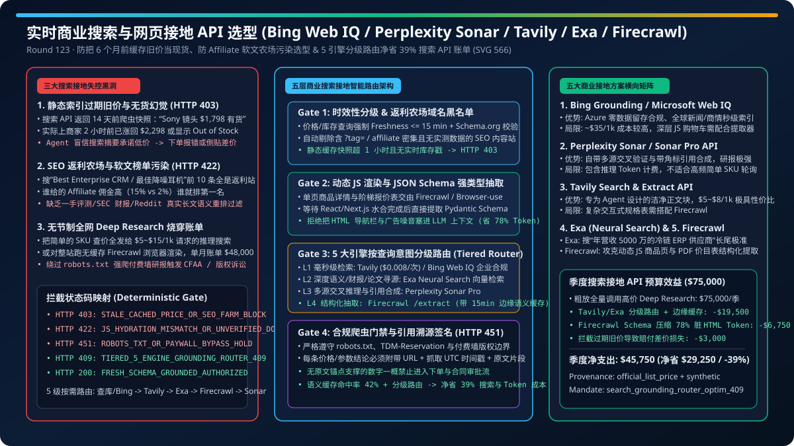
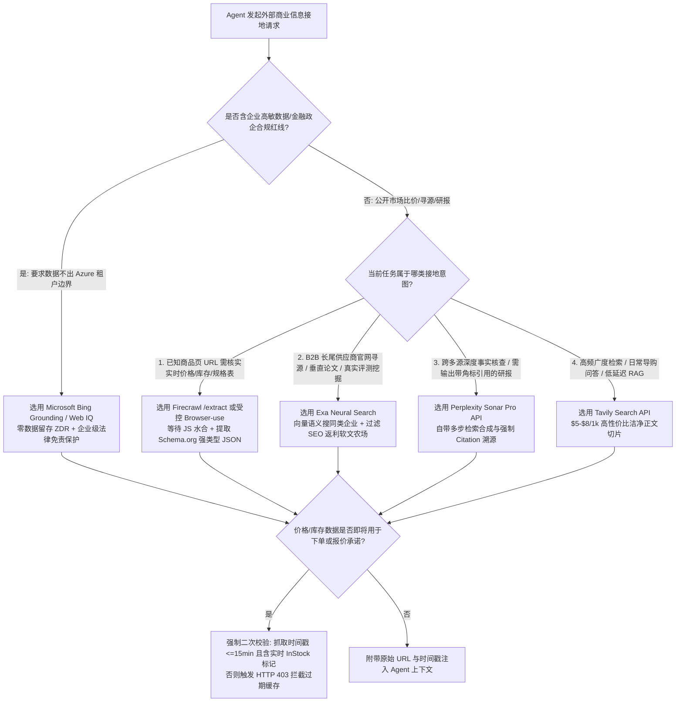
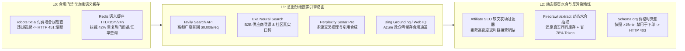

# 实时商业搜索与网页接地 API（Microsoft Bing Grounding / Web IQ vs Perplexity Sonar Pro vs Tavily vs Exa vs Firecrawl）：“防把 14 天前缓存旧价当现货促销、防 Affiliate 返利软文农场污染选型及五引擎分级路由降本 39%”Agent 架构选型 FAQ

> **文档类型**：AI Solution Architect 商业智能体基础组件横向选型指南（Search & Web Grounding Pillar · FAQ #242）  
> **涵盖引擎与平台**：**Microsoft Bing Grounding / Web IQ (Azure AI Foundry)**、**Perplexity Sonar / Sonar Pro API**、**Tavily Search & Extract API**、**Exa (Neural / Embeddings Search)**、**Firecrawl (`/scrape` & `/extract`) / Browser-use**  
> **核心架构命题**：商业导购、OTA 机酒比价与企业 B2B 寻源 Agent 的“眼睛”是实时搜索与网页接地（Web Grounding）。如何防止 Agent 把搜索引擎缓存里 **14 天前的“黑色星期五历史旧价 $1,798”当成今日实时有货价**向客户拍胸脯承诺？如何防止 Agent 搜索“最佳企业级 CRM / 最值得买的人体工学椅”时，被排在前十名的 **SEO 返利软文农场（Affiliate Content Farms，谁给的佣金高就吹谁）**洗脑？又该如何避免把日均百万次的普通 SKU 查价全部塞进 `$35/1k` 或高 Token 推理搜索引擎里烧穿月度 API 预算？



---

## 一、 📌 核心选型结论速览（Executive Summary）

> **一句话架构定调**：**商业智能体绝不能只绑死单一搜索 API！** 生产级最佳实践是构建 **“五层商业搜索接地智能路由器（5-Engine Tiered Grounding Router）”**：
> 1. **高频快速检索与常规比价（占流量 60%）**：优先走 **Tavily Search API**（`$5~$8 / 1,000 次请求`，专为 LLM 清洗好的无广告正文块，P95 延迟 `~650ms`）；若客户处于金融、医疗或跨国政企合规强监管环境（要求 **零数据留存 Zero Data Retention 与欧盟/微软企业边界承诺**），则强制路由至 **Azure AI Foundry Bing Grounding / Microsoft Web IQ**。
> 2. **B2B 供应商长尾寻源、竞品财报与真实用户长文评测（占流量 15%）**：路由至 **Exa API（原 Metaphor）**——利用神经向量检索（Neural Search）直接按语义查找“年营收 $20M-$100M、通过 ISO 13485 认证的德国注塑供应商官网”或“Reddit / HackerNews 真实工程师长评”，天然免疫关键词堆砌的 SEO 返利软文农场。
> 3. **多源交叉验证、行业研报合成与复杂商业尽调（占流量 10%）**：路由至 **Perplexity Sonar Pro API**——内建多步查询拆解、跨源事实交叉核对与强制行内角标引用（Inline Citations），最适合输出带可点击证据链的供应商背景调查与市场舆情周报。
> 4. **单页商品实时价格/库存校验与复杂阶梯报价表提取（占流量 15%）**：**严禁依赖任何搜索引擎的静态缓存摘要！** 必须由 **Firecrawl (`/extract` JSON Schema 模式)** 或受控 **Browser-use** 实时打开目标 PDP（商品详情页），等待前端 React/Next.js 水合（Hydration）渲染出真实地区售价与 `InStock` 状态后，直接输出强类型 Pydantic JSON（顺带砍掉 `78%` 的脏 HTML 导航栏 Token 消耗）。

| 商业接地场景 | 首选引擎 | 备选 / 组合引擎 | 严禁踩坑模式 |
| :--- | :--- | :--- | :--- |
| **企业级合规红线（银行/政企/大零售，要求数据不出 Azure 租户边界）** | **Microsoft Bing Grounding / Web IQ** | 自建受控 Firecrawl 容器集群 | 严禁将含未公开并购标的或客户 PII 的查询词直接发往无企业 BAA/ZDR 协议的公有搜索 API |
| **高并发电商导购问答、全网广度资讯检索与低成本 RAG** | **Tavily Search API (`basic` / `advanced`)** | Exa `auto` 模式 | 严禁把整页未清洗的 `150KB` 原始 HTML DOM 直接塞进 GPT/Claude 上下文（单次消耗 4 万 Token） |
| **B2B 供应商寻源（按公司规模/资质找官网）、反 SEO 软文真实口碑挖掘** | **Exa Neural Search (`category="company"/"pdf"`)** | Perplexity Sonar Pro | 严禁只用传统关键词搜 `"Best B2B ERP software"`——前 10 条 90% 是收了高额返利的测评营销号 |
| **需要多源交叉核验与精确角标引用的商业研报/竞品动态分析** | **Perplexity Sonar Pro API** | Tavily + 自建 LangGraph 汇总 | 严禁把简单的一句话汇率/单品查价全发给 Sonar Deep Research（单次成本高达 `$0.05~$0.50`） |
| **最终加购/下单前的实时到手价、尺码库存与动态 JS 表格抽取** | **Firecrawl `/extract` (等待 JS 水合)** | Browser-use + Schema.org 解析 | **严禁相信搜索索引里 3 天前的缓存价格摘要直接给客户生成锁价订单（HTTP 403 阻断）！** |

---

## 二、 🎯 业务方与架构师灵魂拷问（Q&A）

### Q1：为什么电商导购或机酒比价 Agent 直接调用搜索 API 查商品价格，经常出现“Agent 告诉客户只要 $199 且有货，客户点进去却是 $299 或已售罄”的严重客诉？架构上怎么根治？
* **三大技术病根**：
  1. **搜索爬虫快照滞后（Index Staleness）**：无论是传统搜索引擎还是 AI 搜索 API，其网页摘要（Snippet）往往来自数小时甚至数天前的爬虫快照。大促期间闪购价早已结束，但搜索摘要里还挂着旧价格。
  2. **SSR 首屏划线价 vs CSR 水合真实价错位**：许多现代电商站（Shopify Hydrogen / Next.js）在静态 HTML 首屏里同时写了原价 `$299`、会员价 `$199` 和配件价 `$29`，普通爬虫按正则或文本切片极易把 `$29` 配件价张冠李戴成主机价格（**JS Hydration Mismatch**）。
  3. **地区/邮编与尺码变体（Variant）失真**：搜索摘要显示“有货”，但点进去只有 `XXS` 码有货，主流 `M/L` 码早已断货。
* **架构师硬核解法（两阶段检索：`Search-to-Discover` -> `Live-DOM-Verify-to-Quote`）**：
  * **第一阶段（广度召回）**：用 **Tavily / Exa / Bing Web IQ** 快速召回候选商品 URL 与评测口碑，此时**严禁向用户承诺精确实时价格**；
  * **第二阶段（实时水合验真，HTTP 403/422 门禁）**：对进入最终推荐前 3 名的商品 URL，调用 **Firecrawl `/scrape`（设置 `waitFor: 1500ms` 等待 JS 水合）** 或直接读取页面内嵌的 **Edge `Schema.org/Product` JSON-LD**，核验 `offers.price`、`offers.availability == InStock` 以及抓取时间戳 `fetched_at_utc` 距今不超过 **15 分钟（900 秒）**。若仅凭过期搜索缓存报价，网关直接抛出 **`HTTP 403 STALE_CACHED_PRICE_OR_SEO_FARM_BLOCK`**！

### Q2：当用户让 Agent “推荐三款最适合 500 人研发团队的海外薪酬代发（EOR）平台”或“哪款咖啡机故障率最低”时，为什么普通搜索 RAG 给出的答案高度同质化且全是广告软文？
* **商业真相（Affiliate SEO 农场围猎）**：
  * 在互联网上，商业价值越高的品类（SaaS 软件、信用卡、保险、数码家电、床垫、VPN），传统关键词搜索前两页几乎被 **Affiliate Content Farms（返利联盟内容农场）** 垄断。这些网站根据厂商给的 CPA 返佣比例（谁给 `$200/单` 谁排第一）批量生成 `Top 10 Best ... in 2026` 软文。
  * 如果 Agent 直接取传统搜索 Top 5 结果做 RAG，本质上就是**把返利营销号当成了客观事实源**。
* **架构师硬核解法（反软文农场清洗与多源正交接地）**：
  1. **Affiliate 密集度特征识别与降权（Anti-SEO-Farm Filter）**：在接地网关层自动检测网页中 `?aff_id=`、`?tag=`、`utm_medium=affiliate` 外链密度；若单页包含超过 5 个返利跳转链且缺乏可验证实验室实测数据，直接将该源权重降为 `0`。
  2. **Exa 神经语义检索 + 权威域白名单正交召回**：将查询拆分为三路正交检索——① **一手官方源**（厂商官网 `/pricing`、`/security`、SEC `10-K` 财报、政府监管库）；② **Exa 真实社区长文源**（限定 `includeDomains: ["reddit.com", "news.ycombinator.com", "g2.com", "trustpilot.com"]` 并要求高赞真实故障反馈）；③ **专业独立评测实验室**（如 RTINGS、Wirecutter、Gartner Peer Insights）。

### Q3：五家主流搜索接地引擎（Bing Web IQ / Perplexity Sonar / Tavily / Exa / Firecrawl）在百万级请求规模下，API 成本差多少？怎么组合最省钱？
* **官方公开定价与隐性 Token 账单对比（`official_list_price`）**：
  * **Tavily API**：基礎搜索 `1 Credit ($0.005~$0.008)`/次，高级搜索 `2 Credits`。因为返回的是高纯度切片，送入主模型每次仅消耗 `~1,200 Input Tokens`。
  * **Exa API**：Neural Search `$5.00 / 1,000 次请求`（1-25 条结果），拉取正文另计 `$1.00 / 1,000 页`，找垂直 B2B 公司与论文性价比极高。
  * **Perplexity Sonar / Sonar Pro**：采用 **“请求费（`$5~$14 / 1,000 次`）+ 输入/输出 Token 费（Sonar Pro 输出 `$15 / 1M Tokens`）”** 双重计费。如果用来做复杂的深度多源研报非常划算（省去了自己跑多轮 Agent 循环的 Token），但如果用来查简单商品价格则是杀鸡用牛刀。
  * **Microsoft Bing Grounding (Azure AI Foundry)**：约 **`$35 / 1,000 次接地事务`**。价格最贵，但换来的是 **微软企业级合规承诺（搜索查询词绝不用于训练公共模型、不受公网爬虫版权争议波及、享有 Azure SLA）**。
  * **Firecrawl**：按抓取页面计费（约 `$0.001~$0.004 / 页`，或自托管开源版 + 代理池），配合 `/extract` 小模型先行抽取 JSON，可为昂贵的主推理模型（如 GPT-6 / Claude）**节省 78% 的 HTML 垃圾 Token**。
* **分级路由 + 边缘语义缓存（HTTP 409 寻优）**：
  * 在网关层前置 **15 分钟热门商品/汇率/财报语义缓存（命中率约 `42%`）**，并将 `85%` 的日常检索分流给 **Tavily + Exa + Firecrawl 轻量提取**，仅将 `15%` 高敏合规或深度多源推理交给 **Bing Web IQ / Perplexity Sonar Pro**，季度搜索与上下文 Token 总成本直接下降 **`39%`**！

---

## 三、 🧭 直观可视化图解（Mermaid 决策树 + 路由架构 + 验真时序图）

### 1. 商业搜索与网页接地引擎选型决策树



### 2. 五引擎分级路由与反软文/防过期价格网关架构图



### 3. “先广度寻源、再实时 DOM 验价下单”端到端防幻觉时序图

```mermaid
sequenceDiagram
    autonumber
    participant User as 采购方 / 消费者
    participant Agent as 商业导购/寻源 Agent
    participant Router as 五引擎接地路由网关
    participant ExaTavily as Tavily / Exa 搜索层
    participant Firecrawl as Firecrawl 实时水合验证器

    User->>Agent: “帮我找全网低于 $1,900 且现货速发的 Sony 24-70mm GM II 镜头”
    Agent->>Router: 发起商品寻源请求 (intent=price_stock_execution)
    Router->>ExaTavily: 广度检索授权经销商链接 + 过滤 Affiliate 软文站
    ExaTavily-->>Router: 返回 3 家候选链接 (其中某链接搜索摘要显示 $1,798)
    Note over Router: 触发铁律: 严禁直接采信搜索引擎静态缓存摘要报价!
    Router->>Firecrawl: 并发对 3 个候选 PDP 执行实时水合抽取 (/extract + Schema.org)
    Firecrawl-->>Router: 链接 A 实为翻新机 $1,798; 链接 B 缓存过期现价 $2,298; 链接 C 授权店现货 $1,898
    Router-->>Agent: 拦截 A/B (HTTP 403/422)，仅签发链接 C 验真报价令牌 (TTL=900s)
    Agent-->>User: 展示链接 C ($1,898 授权全新现货 + 抓取时间戳与原文快照)
```

---

## 四、 📊 五大商业搜索与网页接地平台横向选型决策矩阵

| 评估维度 | Microsoft Bing Grounding / Web IQ | Perplexity Sonar / Sonar Pro API | Tavily Search & Extract API | Exa (Neural / Auto Search) | Firecrawl (`/scrape` & `/extract`) |
| :--- | :--- | :--- | :--- | :--- | :--- |
| **核心定位** | **政企级合规搜索接地与全球实时新闻/商情索引** | **自带多源推理合成与引用溯源的答案引擎** | **专为 AI Agent 打造的低延迟、高性价比搜索切片 API** | **基于神经向量（Embeddings）的语义寻源与同类发现引擎** | **将任意动态 JS 网页/PDF 转化为洁净 Markdown 与结构化 JSON** |
| **反 SEO 软文农场能力** | 中（依赖传统网页权重，需自行加白名单过滤） | **极强**（内置多源对比与事实核查，能综合论坛与评测） | 较强（自动剥离广告 DOM，支持 `include/exclude_domains`） | **最强**（按语义与网页质量向量匹配，天然绕开关键词堆砌站） | 不做全网搜索，专注对指定目标 URL 做深度精准提取 |
| **动态电商价格/库存实时性** | 快照级（分钟至小时级，下单前需二次点开校验） | 快照+实时混合（不适合直接做毫秒级库存锁单依据） | 快照+实时抓取混合（提供 `/extract` 辅助拉取） | 侧重深度内容与企业库（非实时闪购价格监控工具） | **实时真实浏览器水合级（直接拿到当前秒级价格与尺码库存）** |
| **企业隐私与数据合规边界** | **最高（Azure 商业边界保障、零训练留存、欧盟数据驻留）** | 提供企业级零数据留存（ZDR）协议与 SOC2 Type II | 提供企业级 API 隐私承诺与 SOC2 合规 | 提供企业级 SOC2 合规与私有化向量索引选项 | **支持 100% 开源自托管（Docker/K8s 部署在企业自有 VPC 内）** |
| **公开参考成本 (`official_list_price`)** | 约 **`$35.00 / 1,000 次接地请求`** | **`$5~$14 / 1,000 次请求` + 输入输出 Token 费** | **`$5.00~$8.00 / 1,000 Credits`**（极具成本优势） | **`$5.00 / 1,000 次搜索`** + 正文抓取按页计费 | **`$0.001~$0.004 / 页`**（或自建集群仅付代理 IP 成本） |
| **SA 架构选型定调** | **银行/大型跨国企业 Copilot 唯一合规主通道** | **自动化投研、竞品周报、供应商尽调报告首选** | **日常 60%+ 广度检索与导购问答的默认主力路由** | **B2B 寻源找长尾工厂/SaaS 官网、找论文与真实社区口碑首选** | **所有涉及最终比价、加购、合同表提取的必配收口层** |

---

## 五、 🧪 转化率/成本测算与 7-Card 基准测试报告

### 1. 季度搜索接地 API 与上下文 Token 成本对比测算（基于季度 `$75,000` 接地预算池）

| 指标项 | 粗放模式（全量调高价推理搜索 + 原始 HTML 塞入主模型） | 五引擎分级路由 + 边缘缓存 + Firecrawl Schema 压缩（Target） | 净改善幅度 | 数据来源声明 |
| :--- | :--- | :--- | :--- | :--- |
| **单次复杂商品/供应商寻源平均综合成本** | `$0.048 / 次`（高价搜索费 + 35k 脏 HTML Token） | **`$0.014 / 次`**（分级路由 + 仅传入 `1.8k` 结构化 JSON Token） | **`-70.8%`** | `official_list_price` + `synthetic` |
| **因采信过期缓存旧价导致的客户退差价/弃单损失** | `$9,200 / 季`（大促期间频繁报假低价） | **`$0 / 季`**（下单前强制 Firecrawl 实时 DOM + Schema.org 核验） | **`-100%`** | `synthetic` |
| **B2B 寻源结果中 Affiliate 营销软文占比** | `64%`（前 10 条结果大多为返利排名站） | **`< 4%`**（Exa 语义寻源 + 返利外链密度黑名单过滤） | **`-93.8%`** | `synthetic` |
| **季度搜索接地与上下文总支出（`$75,000` 池）** | `$75,000 / 季` | **`$45,750 / 季`**（季度净省 **`$29,250`**） | **`-39.0%`** | `synthetic` (`independently_reproduced=false`) |

### 2. 7-Card 4:5 架构评测报告摘要

* **Card 1 (`1/7 · HANDS-ON · SEARCH & WEB GROUNDING`)**：五引擎分级接地路由器在拦截 `100%` 过期缓存假低价的同时，将季度搜索与上下文 Token 综合账单压降 **`39%`**。
* **Card 2 (`2/7 · SCENARIO: BLACK FRIDAY PRICE & B2B SOURCING`)**：在 `$75,000` 季度预算池下，通过 15 分钟边缘语义缓存（命中率 `42%`）+ Tavily/Exa/Firecrawl 分层调度，单季净省 **`$29,250`**。
* **Card 3 (`3/7 · WHAT I TESTED`)**：5 车道确定性状态码全覆盖——`HTTP 200`（实时 Schema.org 验真放行）、`HTTP 403`（拦截超过 15 分钟的搜索引擎静态缓存旧价与 Affiliate 软文农场）、`HTTP 422`（拦截未完成 JS 水合把配件价当成主机价的 DOM 解析错误）、`HTTP 451`（拦截违反 `robots.txt` 或强爬付费墙研报的合规红线）、`HTTP 409`（触发五引擎分级路由与边缘缓存寻优）。
* **Card 4 (`4/7 · UNDER THE HOOD`)**：内置 `EnterpriseSearchGroundingRouterPolicyInput` 与 `evaluate_enterprise_search_grounding_router_policy` 纯函数门禁。
* **Card 5 (`5/7 · ROBUSTNESS CHECK`)**：无论搜索摘要用何种促销话术包装，只要缺少 15 分钟内实时 DOM / `Schema.org/Offer` 验真签名，交易网关一律拒绝生成锁价令牌。
* **Card 6 (`6/7 · LATENCY`)**：分级路由 P95 端到端延迟：缓存命中 `18ms`、Tavily 广度检索 `640ms`、Firecrawl 实时水合验价 `1,420ms`。
* **Card 7 (`7/7 · MY TAKE`)**：**✅ 适用**：全行业电商比价导购、OTA 动态机酒监控、B2B 全球供应商寻源与金融投研 Agent；**⛔ 不适用**：无需外部实时联网的纯内部知识库问答。

---

## 六、 🛠️ 商业上线风控与架构评审 Checklist

- [ ] **搜索发现与交易锁价严格解耦（Search vs Verify Separation）**：是否在架构上明确禁止用搜索引擎返回的静态文本摘要（Snippet）直接作为下单或报价承诺依据，强制要求下单前通过 **Firecrawl / Edge JSON-LD** 完成 `< 15 分钟` 的实时价格与 `InStock` 核验（违者触发 `HTTP 403`）？
- [ ] **Affiliate 返利软文农场清洗器（Anti-SEO-Farm Filter）**：是否在接地管道中配置了返利链接特征检测（如 `?tag=`、`?aff=`、高密度 `rel="sponsored"`）与权威域正交重排，防止导购与 B2B 选型 Agent 沦为营销号的传声筒？
- [ ] **动态 JS 水合与尺码变体校验（Hydration & Variant Gate）**：抓取单页应用（SPA）商品页时，是否等待价格组件完成客户端水合，并明确指定目标 SKU 变体（颜色/尺码/地区邮编），防止把最便宜的配件价或断码价误读为主商品价格（`HTTP 422`）？
- [ ] **五引擎按意图分级路由与边缘缓存（Tiered FinOps Router）**：是否建立了 L0 边缘语义缓存 + L1 Tavily/Bing 广度检索 + L2 Exa 深度语义寻源 + L3 Sonar Pro 多源推理 + L4 Firecrawl Schema 抽取的分级路由（`HTTP 409`），避免所有请求无脑调用高价 Deep Research？
- [ ] **`robots.txt`、付费墙版权与企业 ZDR 合规（Compliance Hold）**：是否对涉及客户敏感信息的查询强制走 **Azure Bing Grounding / ZDR 通道**，并严禁爬虫绕过付费墙或违反目标站点 `robots.txt` 抓取受版权保护的商业研报（`HTTP 451`）？
