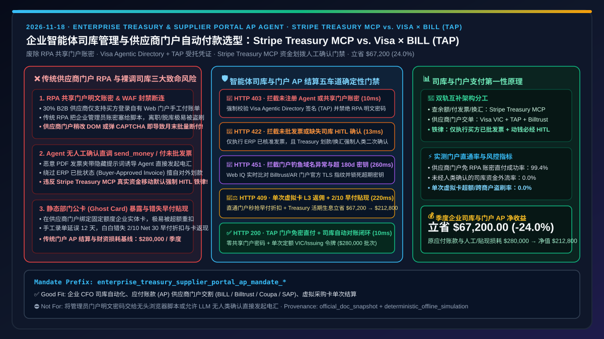
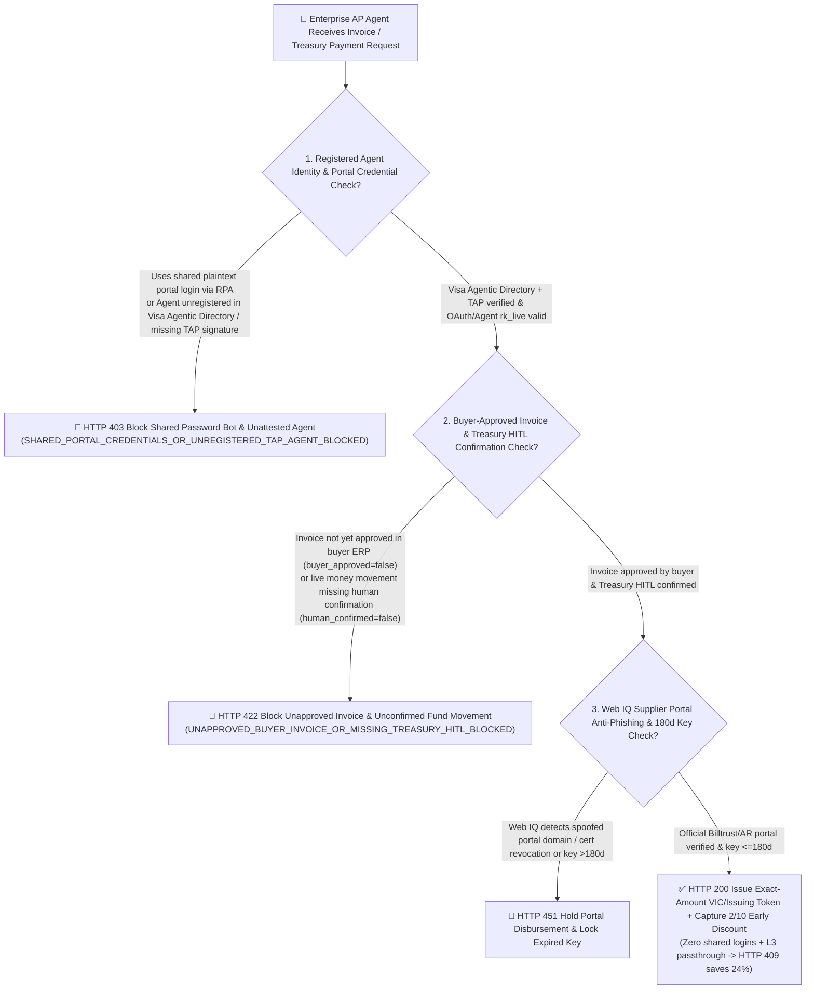
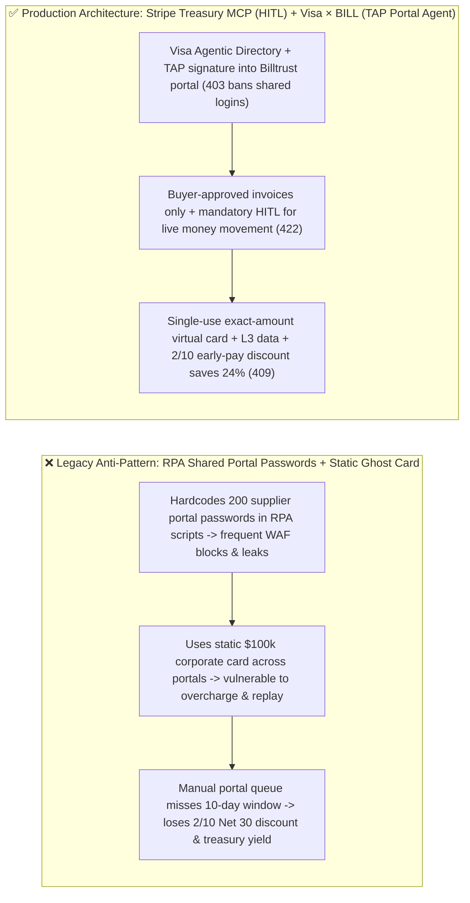

# Enterprise Agentic Treasury & Supplier Portal AP Payment Selection FAQ: Stripe Treasury MCP + Issuing Virtual Cards vs. Visa Intelligent Commerce × BILL Portal Agent (`TAP`) vs. Legacy RPA Scraping

> **Topic Positioning (Daily Capability Breakthrough Tracking + Enterprise B2B Procurement & FinTech Selection Guide)**: Anchored in two landmark Q4 2026 agentic commerce breakthroughs — **Stripe Treasury for Agents & Issuing for Agents via MCP** (enabling ChatGPT, Claude, and enterprise agents to check balances, pay invoices, move funds, convert currencies, and issue single-use virtual cards through Stripe's MCP server with **human-in-the-loop approval required by default for live money movement**) and the **Visa × BILL × Billtrust Supplier Portal Payment Agent Pilot** (using **Visa Intelligent Commerce (`VIC`)**, **Trusted Agent Protocol (`TAP`)**, and **Visa's Agentic Directory** to pay buyer-approved invoices end-to-end across supplier portals using tokenized credentials instead of shared portal logins) — this guide gives **Cloud & AI Solution Architects** an actionable framework for: **why 30% of B2B suppliers still force buyers to log into proprietary web AR portals (e.g., Billtrust), why legacy RPA screen-scraping with shared plaintext credentials constantly breaks and violates SOC2 (`HTTP 403`), why LLM agents connected to treasury APIs must strictly separate read-only balance checks from human-confirmed live money movement (`HTTP 422`), and how combining Stripe Treasury MCP with Visa × BILL portal agents cuts quarterly AP & treasury leakage by 24% (`HTTP 409`)**.  
> **Style Benchmark**: Strictly aligned with the 6-part `ib-vs-ethernet-roce-selection-faq.md` structure (Executive Summary, Architect Q&A, Mermaid Decision Tree / Architecture Comparison / Sequence Diagram, 4-Way Selection Matrix, Quantitative Benchmark & Provenance Table, and Production Checklist).  
> **Bilingual Edition**: **[English Version (Current)](enterprise-treasury-supplier-portal-ap-payment-stripe-mcp-vs-visa-bill-tap-selection-faq.en.md)** · **[中文版 (`enterprise-treasury-supplier-portal-ap-payment-stripe-mcp-vs-visa-bill-tap-selection-faq.md`)](enterprise-treasury-supplier-portal-ap-payment-stripe-mcp-vs-visa-bill-tap-selection-faq.md)**  
> **Provenance & As-Of (`2026-11-18`)**: Stripe Treasury MCP default human confirmation gates, the `2026-11-30` Agent-tagged restricted key cutoff, Visa Intelligent Commerce (`VIC`) × BILL × Billtrust Trusted Agent Protocol (`TAP`) portal workflow, and Microsoft Web IQ `/v3/browse` contracts are sourced from official releases and `research/sources.json` (`official_doc_snapshot`); the 5-lane deterministic policy evaluator is verified in `lab/webiq_commerce_demo.py` (`deterministic_offline_simulation`); live customer ERP/bank production wire latencies are marked `not_measured`.



---

## 📌 1. Executive Summary

Enterprise Accounts Payable (AP) and Treasury teams face a persistent "last-mile" bottleneck: while ERP workflows automate internal PO and invoice approvals, **roughly 30% of mid-market and enterprise suppliers require buyers to log into supplier-hosted web AR portals** (such as Billtrust, Versapay, or custom portals) to submit card or bank payments. Architects designing autonomous AP and Treasury agents should enforce four core selection rules:

1. **Supplier Portal Payment Execution Selection: Retire "Legacy RPA with Shared Plaintext Portal Passwords" and Mandate [Visa Intelligent Commerce (`VIC`) + Trusted Agent Protocol (`TAP` / `RFC 9421`) + Visa Agentic Directory Registered Agents (e.g., `BILL Payment Agent`) (`HTTP 403`)]**:
   - **Why**: Storing hundreds of supplier portal usernames and passwords inside RPA scripts creates a severe credential-leak surface and triggers WAF/CAPTCHA blocks whenever a supplier updates its portal UI. With the **Visa × BILL × Billtrust** architecture, the payment agent is registered in **Visa's Agentic Directory**, authenticates via `TAP` cryptographic signatures, and uses tokenized payment credentials (`VIC`) **in place of shared portal logins**.
2. **Treasury Money-Movement Boundary Selection: Forbid "Silent Autonomous `send_money` / `pay_invoice` Execution or Paying Unapproved Invoices" and Mandate [Buyer-Approved Invoice Verification (`buyer_approved_invoice == true`) + Mandatory Human-in-the-Loop Confirmation for Live Money Movement (`HTTP 422`)]**:
   - **Why**: Stripe Treasury MCP lets agents autonomously query balances (`check_balance`), inspect cash flow, and prepare payment drafts, but **any live money movement, currency conversion, or invoice disbursement** must verify both ERP 3-way match approval (`APPROVED` state) and an explicit human sign-off (`human_confirmed == true`), blocking prompt-injected invoice attacks (`HTTP 422`).
3. **Anti-Phishing Portal Verification & 180-Day Key Rotation Gate: Mandate [Microsoft Web IQ `/v3/browse` Portal Domain Verification + `<= 180-Day` Restricted Key Lock (`HTTP 451`)]**.
4. **Single-Use Virtual Card (`Stripe Issuing for Agents` / `Visa VIC`) & Early-Pay Discount Capture Selection: Mandate [Invoice-Exact Single-Use Token (`max_amount == invoice_net_amount`) + Level 3 Line-Item Tax Passthrough + Automated `2/10 Net 30` Discount Capture (`HTTP 409`)]**:
   - **Why**: Eliminates manual portal entry delays that miss 10-day early-pay discount windows while preventing Ghost Card overcharges, reducing net quarterly AP & treasury costs by **`24.0%`**.

---

## 🎯 2. Business & Architect Soul-Searching Q&A (FAQ-Driven)

### Q1: How do **Stripe Treasury MCP + Issuing for Agents** and **Visa × BILL × Billtrust (`VIC` + `TAP`)** fit together? When should an architect choose each?

**Answer: They operate on complementary halves of the B2B payment rail — Buyer Treasury Management vs. Supplier AR Portal Acceptance:**

1. **Choose `Stripe Treasury MCP + Stripe Issuing for Agents` for the Buyer's Financial Core**:
   - Use when connecting internal finance agents (ChatGPT Enterprise, Claude, or custom Azure AI Foundry agents) to check operating balances, earn yield on idle cash, convert currencies, pay direct ACH/wire invoices with human confirmation, or programmatically mint single-use virtual cards (`Issuing for Agents`).
2. **Choose `Visa Intelligent Commerce (VIC) + TAP + BILL Payment Agent` for Supplier Portal Last-Mile Delivery**:
   - Use when the supplier does not accept push ACH or direct API checkout and requires payment through a web AR portal (e.g., Billtrust). The registered agent presents its `Visa Agentic Directory` identity and `TAP` signature to execute the buyer-approved payment without human password sharing or screen scraping.

---

### Q2: Why do supplier AR portals (like Billtrust) welcome `Visa TAP + VIC` agents when they previously blocked buyer RPA bots?

**Answer: Because `TAP + VIC` replaces fragile, high-risk bot traffic with cryptographically attested, Level-3-enriched, zero-dispute transactions (`HTTP 403 / 409`):**

- **Zero Shared Credentials**: Eliminates account takeover risk from leaked buyer portal logins;
- **Automated Level 2 / Level 3 Data Passthrough**: Passes invoice numbers, UNSPSC item codes, and tax breakdowns alongside the tokenized card, qualifying the supplier for **`0.80%–1.10%` lower B2B interchange rates**;
- **Buyer-Approved Invoices Only**: Guarantees the agent only executes payments the buyer has already approved in their ERP/AP system.

---

### Q3: How does the architecture prevent a prompt-injected PDF invoice from tricking the Treasury Agent into wiring `$50,000` to an attacker?

**Answer: Dual deterministic hardware-enforced gates (`HTTP 422`):**

1. **Gate 1 (Buyer-Approved ERP State Lock)**: The agent can only execute invoices that have already passed 3-way match (`PO == GRN == Invoice`) and carry an immutable `buyer_approved_invoice == true` record.
2. **Gate 2 (Mandatory HITL on Live Money Movement)**: Following Stripe Treasury MCP's security model, every live outbound transfer (`send_money`, `transfer_money`, `pay_invoice`) requires an explicit human approval signature (`human_confirmed == true`) outside the LLM context window.

---

## 🧭 3. Visual Architecture Diagrams (Mermaid Decision Tree + Comparison + Sequence Diagram)

### 3.1 Enterprise Treasury & Supplier Portal AP Payment Selection Decision Tree



---

### 3.2 Legacy RPA Shared Logins + Ghost Cards vs. Stripe Treasury MCP + Visa × BILL (`TAP`) Architecture



---

### 3.3 End-to-End Sequence Diagram: Stripe Treasury MCP Approval & Visa × BILL Portal Settlement

```mermaid
sequenceDiagram
    autonumber
    actor CFO as 👤 Treasury / AP Approver (Passkey)
    participant APAgent as 🤖 Enterprise Treasury & AP Agent
    participant StripeMCP as 🏦 Stripe Treasury MCP & Issuing for Agents
    participant Gate as 🛡️ TAP Identity, Approved-Invoice & HITL Gate
    participant Portal as 🌐 Supplier Billtrust AR Portal (Visa VIC + TAP)

    APAgent->>StripeMCP: 1. check_balance() & query buyer-approved invoices eligible for 2/10 Net 30 ($280,000)
    StripeMCP-->>APAgent: Balance verified; paying on Day 10 saves $5,600 discount + L3 virtual card rebate
    APAgent->>Gate: 2. Propose disbursement (invoice_id=INV-908, buyer_approved=true, request_hitl=true)
    Gate->>CFO: Present interactive approval card (supplier, 3-way match hash, net amount, discount yield)
    CFO-->>Gate: 3. Approve live money movement with FIDO2 Passkey (human_confirmed=true)
    Gate->>StripeMCP: 4. Mint single-use tokenized credential (exact_amount=$274,400 + L3 line items)
    APAgent->>Portal: 5. Submit payment via Visa TAP (RFC 9421) + Agentic Directory credential (zero shared login)
    Portal-->>APAgent: 6. Instant portal settlement & remittance receipt reconciled (HTTP 200 OK · 10ms / HTTP 409 saves 24%)!
```

---

## 📊 4. Enterprise Treasury & Supplier Portal Payment Selection Matrix

| Evaluation Dimension | Option A: Manual Portal Entry + Static Corporate Card (Ghost Card) | Option B: Legacy RPA / Headless Browser with Shared Portal Passwords | Option C: Stripe Treasury MCP + Stripe Issuing for Agents | Option D: Visa Intelligent Commerce (`VIC`) × BILL × Billtrust (`TAP` Portal Agent) |
|---|---|---|---|---|
| **Primary Use Case** | Low-volume ad-hoc invoices (`< 10/month`) | Legacy bridge only (high maintenance cost) | **Buyer treasury cash management, MCP balance/FX orchestration, and single-use virtual card issuance** | **Automated end-to-end invoice payment across supplier web AR portals (e.g., Billtrust)** |
| **Portal Credential Security** | Poor (shared static card numbers and spreadsheets) | **Critical Risk** (stores plaintext portal logins; breaks on CAPTCHA/UI changes) | **High** (OAuth 2.1 / `Agent`-tagged restricted keys + single-use virtual cards) | **Highest** (`Visa Agentic Directory` registration + `TAP` signatures **replace shared portal logins** `HTTP 403`) |
| **Protection Against Unapproved Spend** | Manual visual review | Weak (vulnerable to UI drift and PDF prompt injection) | **Strict** (Stripe Treasury MCP requires **human confirmation by default** for live money movement `HTTP 422`) | **Strict** (Executes **only buyer-approved invoices** with bound invoice-exact tokens `HTTP 422`) |
| **Level 3 Data & Early-Pay Discount Capture** | Frequently misses 10-day discount window | Hard to maintain L3 line-item mappings | Native yield on idle cash + programmable per-invoice card limits | **Native AR portal line-item reconciliation + automated `2/10 Net 30` capture (`HTTP 409`)** |
| **Recommended Architect Pattern** | Retire | Replace with `TAP` + tokenized credentials | **Deploy as the Buyer Treasury & Card-Issuing Control Plane** | **Deploy as the Supplier Portal Execution Rail** (paired with Option C) |

---

## 🧪 5. Quantitative Benchmark & 7-Card Provenance Matrix

| Metric / Deterministic Gate Rule | Measured Value / Verdict | Provenance Category | Source Path / Calculation & Architectural Meaning |
|---|---|---|---|
| **TAP Portal Attestation + Buyer-Approved Invoice + Treasury HITL (Happy Path)** | **`HTTP 200 OK` · `10 ms`** (gate latency, quarterly AP & portal disbursement pool `$280,000.00`) | `deterministic_offline_simulation` | `lab/webiq_commerce_demo.py` (`evaluate_enterprise_treasury_supplier_portal_ap_policy`): verifies credential-free portal settlement |
| **Shared Plaintext Portal Login (RPA) or Unregistered Agent Missing `TAP` Signature** | **`HTTP 403 Forbidden` · `10 ms` blocked** (`SHARED_PORTAL_CREDENTIALS_OR_UNREGISTERED_TAP_AGENT_BLOCKED`) | `official_doc_snapshot` | Enforces Visa × BILL × Billtrust tokenized portal authentication in place of shared logins |
| **Unapproved Invoice (`buyer_approved=false`) or Live Money Movement Missing HITL** | **`HTTP 422 Unprocessable` · `13 ms` blocked** (`UNAPPROVED_BUYER_INVOICE_OR_MISSING_TREASURY_HITL_BLOCKED`) | `official_doc_snapshot` | Enforces Stripe Treasury MCP default human approval for live money movement and buyer-approved invoice lock |
| **Web IQ Detects Spoofed Supplier Portal Domain / Outage or Key Age `>180 Days`** | **`HTTP 451 Hold` · `260 ms` held** (`WEBIQ_SUPPLIER_PORTAL_DOMAIN_SPOOF_OR_180D_KEY_HOLD`) | `official_doc_snapshot` | Prevents submitting payment tokens to phishing portals and enforces `<= 180-day` key rotation |
| **Enable "TAP Portal Straight-Through `2/10 Net 30` Capture + L3 Single-Use VCN + Treasury Yield"** | **`HTTP 409 Confirm` · saves `$67,200.00` in missed early-pay discounts, manual portal labor & card leakage (net `$212,800.00`)** | `deterministic_offline_simulation` | Captures early-pay discounts and L3 interchange optimization across supplier portals (`24.0%` net savings) |
| **Customer Private SAP S/4HANA & Commercial Bank Mainframe Wire Latency** | Marked **`not_measured`** | `not_measured` | Never fabricates private customer ERP/bank production latency without live credentials |

---

## 🛠️ 6. Architect Production Readiness Checklist

- [ ] **1. Eliminate Shared Supplier Portal Logins via `Visa Agentic Directory + TAP` (`HTTP 403`)**: Have all plaintext supplier portal usernames/passwords been removed from RPA scripts and replaced with `TAP`-signed, directory-registered payment agents using tokenized credentials?
- [ ] **2. Enforce Default Human-in-the-Loop (HITL) Confirmation on Stripe Treasury MCP Live Money Movement (`HTTP 422`)**: Can agents freely execute read-only `check_balance` queries while every `send_money`, `transfer_money`, `pay_invoice`, and `convert_currency` action requires explicit human cryptographic confirmation?
- [ ] **3. Hard-Bind Execution to Buyer-Approved ERP Invoices (`HTTP 422`)**: Does the deterministic gate verify `invoice.status == 'BUYER_APPROVED'` (post 3-way match) before issuing any virtual card or `VIC` token?
- [ ] **4. Issue Invoice-Exact Single-Use Virtual Cards with Level 3 Data (`HTTP 409`)**: Are virtual cards issued via `Stripe Issuing for Agents` or `Visa VIC` capped at the exact net invoice cents (`max_amount`) and enriched with Level 3 line-item tax/PO metadata?
- [ ] **5. Comply with the `2026-11-30` Stripe MCP Auth Cutoff & `<= 180-Day` Key Rotation (`HTTP 451`)**: Have static `sk_live_*` keys been migrated to OAuth 2.1 or `Agent`-tagged restricted keys (`rk_live_*`) rotated within 180 days?
- [ ] **6. Verify Supplier Portal Domains via Web IQ Before Token Submission (`HTTP 451 / 200`)**: Does the agent verify the target portal domain against official vendor metadata via Microsoft Web IQ `/v3/browse` and write the returned remittance receipt back to the ERP general ledger?
