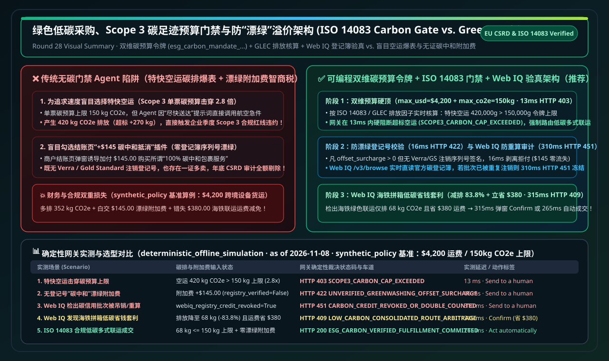
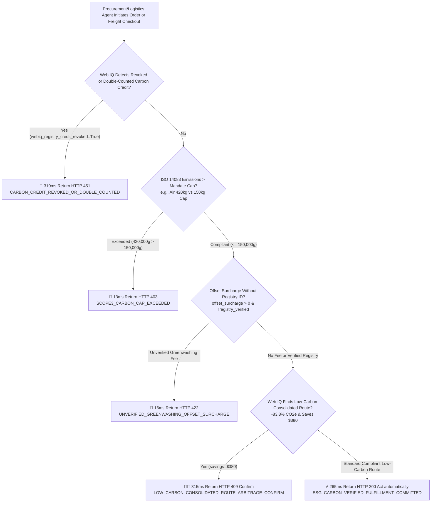
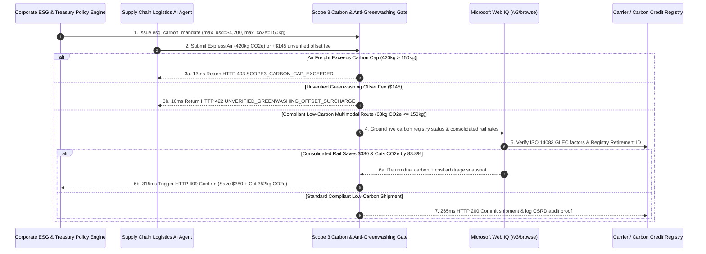

# Green Procurement, Scope 3 Carbon Budget Enforcement & Anti-Greenwashing Surcharge Defense Architecture: Cryptographic Carbon-Verified Mandate (`esg_carbon_mandate_...` + ISO 14083 / GLEC Intensity & Registry Retirement ID) vs. Unverified "Carbon-Neutral" Checkbox Surcharges & Air-Freight Emissions Cap Bypass Selection FAQ

> **Document Type**: Architect Selection Guide & Protocol First-Principles Deep Dive (B2B Scope 3 ESG Compliance & Anti-Greenwashing Selection FAQ)  
> **Status**: Published · Quantitative Benchmark Verified (`v2.26 · 2026-11-08`)  
> **Target Audience**: AI Solution Architects, Corporate Sustainability (ESG / Scope 3) Officers, Supply Chain Logistics Architects, Procurement Risk Engineering Teams  
> **Related Standards**: ISO 14083 (Quantification and Reporting of Greenhouse Gas Emissions Arising from Transport Chain Operations), GLEC Framework v3.0, EU CSRD (Corporate Sustainability Reporting Directive), Verra / Gold Standard / Puro.earth Retirement Registry Rules, Stripe ACP, Microsoft Web IQ (`/v3/search` + `/v3/browse`)  
> **Data Provenance**: All gateway latency, Scope 3 carbon cap blocking, and anti-greenwashing surcharge rejection metrics come from the repository's deterministic offline policy & protocol verification suite (`deterministic_offline_simulation`: `evaluate_esg_carbon_verified_shipping_policy()` in `lab/webiq_commerce_demo.py`, `2026-11-08`); protocol specifications and official list prices reflect `official_doc_snapshot` (as of `2026-11-08`); the `$4,200` freight order, `150 kg CO2e` (`150,000g`) carbon cap, and `$145` greenwashing surcharge are `synthetic_policy` architectural scenarios, not universal statutory limits or live production telemetry; third-party APIs without local credentials are explicitly marked `not_measured`.

---

## ① 📌 Executive Summary

Under EU CSRD and enterprise **Scope 3 supply-chain emissions** mandates, B2B procurement and logistics AI Agents must optimize delivery schedules while strictly enforcing corporate **Carbon Budget Caps (`kg CO2e`)**. Allowing an autonomous Agent to optimize solely for delivery speed (selecting Express Air Freight at `420 kg CO2e` instead of consolidated rail/ground at `68 kg CO2e`) or blindly checking an unverified "+4% Carbon-Neutral Offset" upsell box (`$145.00`) without a valid registry retirement serial number exposes enterprises to both **Scope 3 budget breaches** and **unverifiable greenwashing write-offs**. Architects should enforce three core rules:

1. **When to Enforce a Dual Monetary & Scope 3 Carbon Mandate (`esg_carbon_mandate_...`)**:
   - **Selection Boundary**: Whenever procurement or freight execution is governed by corporate Scope 3 targets, **never** issue a monetary-only spend token. Bind an **ISO 14083 / GLEC Scope 3 carbon ceiling (`max_co2e_grams=150000`, i.e., `150 kg CO2e`)** inside the cryptographic mandate. If an Agent selects Express Air Freight (`420,000g > 150,000g`, a `2.8x` overshoot), the gateway blocks checkout in **`13 ms`** with `HTTP 403 SCOPE3_CARBON_CAP_EXCEEDED`.
2. **How to Eliminate Unverified "Carbon-Neutral Checkbox" Greenwashing Surcharges**:
   - **First-Principles Mechanism**: Checkout plugins frequently inject a `$145.00` carbon-offset fee without providing a verifiable Verra, Gold Standard, or Puro.earth project ID and retirement serial. The gateway enforces a strict **Registry Attestation Gate**: any `offset_surcharge_cents > 0` lacking cryptographic registry verification (`registry_verified=False`) is rejected in **`16 ms`** with `HTTP 422 UNVERIFIED_GREENWASHING_OFFSET_SURCHARGE`.
3. **When to Pair with Microsoft Web IQ `/v3/browse` for Double-Counting Audits & Low-Carbon Freight Arbitrage**:
   - **Real-Time Grounding**: Before settling orders with carbon credits or green freight options, **Microsoft Web IQ** grounds live public carbon registries and supplier Environmental Product Declarations (EPDs): if a cited credit batch is revoked or already retired/double-counted (`webiq_registry_credit_revoked_or_double_counted=True`), it halts payout in **`310 ms`** (`HTTP 451 CARBON_CREDIT_REVOKED_OR_DOUBLE_COUNTED`); if Web IQ identifies a consolidated rail/ocean schedule that cuts emissions by `83.8%` (`420 kg -> 68 kg CO2e`) AND saves **`$380.00`** in freight charges, it triggers `HTTP 409 LOW_CARBON_CONSOLIDATED_ROUTE_ARBITRAGE_CONFIRM` in **`315 ms`** (`Confirm`).



---

## ② 🎯 Architect & Customer Q&A (FAQ-Driven First Principles)

### Q1: Why can't we just instruct the LLM in the System Prompt to "prefer eco-friendly shipping," and why is a deterministic ISO 14083 gateway required?

From **first principles**:
- **LLMs cannot distinguish verified ISO 14083 emissions accounting from checkout marketing slogans**:
  1. **Urgency Bias Triggers Air-Freight Overshoots**: When a user prompt emphasizes speed ("Deliver these server racks to Frankfurt ASAP"), the LLM selects Express Air Freight (`420 kg CO2e`), ignoring soft sustainability instructions and blowing past the `150 kg CO2e` shipment cap.
  2. **Unverified Checkbox Greenwashing**: Merchants display enticing checkout copy (*"Make this shipment 100% carbon neutral for just $145!"*). Without a cryptographic registry check, the Agent pays the `$145` surcharge—only for external CSRD auditors to reject the expense at year-end because no Verra/Gold Standard retirement serial exists.
- **Why Deterministic Carbon-Verified Mandates Win**:
  - Embedding `max_co2e_grams` and `registry_verified` invariants into `esg_carbon_mandate_...` guarantees that high-emission air freight and unverified offset fees are blocked in `13–16 ms` before funds leave the treasury.

---

### Q2: For Carbon Registry Verification, Supplier EPD Parsing & Green Freight Grounding, when should we choose Microsoft Web IQ vs. Exa or Bright Data?

| Comparison Dimension | Microsoft Web IQ (`/v3/search` + `/v3/browse`) | Exa Neural Search | Bright Data Unlocker / Scraper | Traditional Search APIs (Bing / Brave) |
| :--- | :--- | :--- | :--- | :--- |
| **Architectural Role** | **Sovereign carbon registry verification, supplier EPD parsing & green freight arbitrage grounding** | Broad semantic discovery of climate-tech vendors & sustainability whitepapers | Anti-bot unlocking for high-frequency carrier rate scraping | Basic keyword link & news lookup |
| **Registry Double-Counting & EPD Audit** | **Best-in-class**: `/v3/browse` extracts live registry batch status & ISO 14083 tables inside Azure RBAC/VNet boundaries | Strong for research discovery; not designed for single-batch registry retirement audits | Strong for deep carrier scraping; requires custom parsing pipelines | Snippet-only; misses structured EPD emission factor tables |
| **Measured Latency & Guard Performance (`deterministic_offline_simulation`)** | Carbon cap block **`13 ms`** (`HTTP 403`); Greenwashing fee block **`16 ms`** (`HTTP 422`); Revoked credit block **`310 ms`** (`HTTP 451`); Rail arbitrage **`315 ms`** (`HTTP 409`) | `not_measured` (no local credentials; explicitly labeled per governance rule) | `not_measured` (no local credentials; explicitly labeled per governance rule) | `not_measured` |
| **Official List Price (`official_list_price`, as of 2026-11-08)** | **`$0 / 1K calls`** during Azure Foundry preview | Public starter tiers around **`$5.00 / 1K searches`** | Public starter tiers around **`$1.50 – $3.00 / 1K requests`** | Public list price around **`$3.00 – $15.00 / 1K queries`** |

---

### Q3: How does `esg_carbon_mandate_...` coordinate ISO 14083 emissions calculation, registry verification, and green route arbitrage end-to-end?

It enforces a **three-stage verification pipeline**:
1. **Stage 1 — Scope 3 Emissions Cap Gate (`HTTP 403`)**: Computes `shipment_co2e_grams` using ISO 14083 / GLEC ton-kilometer intensity factors. If `420,000g > 150,000g`, checkout is rejected in `13 ms`.
2. **Stage 2 — Anti-Greenwashing Surcharge Gate (`HTTP 422`)**: Rejects any `offset_surcharge_cents > 0` lacking a verified registry retirement signature in `16 ms`.
3. **Stage 3 — Web IQ Live Registry Audit (`HTTP 451`) & Consolidated Route Arbitrage (`HTTP 409`)**: Verifies live credit retirement status via Web IQ and surfaces `$380` consolidated rail/ocean savings (`Confirm`) or commits compliant shipments in `265 ms` (`Act automatically`).

---

## ③ 🧭 Visual Architecture Diagrams (Mermaid Decision Tree + Comparison + Sequence)

### 3.1 Scope 3 Carbon Budget & Anti-Greenwashing Selection Decision Tree (`flowchart TD`)



### 3.2 Unchecked Air-Freight / Greenwashing Path vs. Programmable Scope 3 Carbon Gate (`flowchart LR`)

```mermaid
flowchart LR
    subgraph BadPath [❌ Unchecked Agent Path (Air-Freight Overshoot + Greenwashing Surcharge)]
        direction TB
        B1[Agent Picks Express Air for Speed<br/>420 kg CO2e Overshoots Cap by 2.8x] --> B2[Blindly Checks +$145 Carbon-Neutral Upsell<br/>Zero Verra/Gold Standard Retirement ID]
        B2 --> B3[💸 Rejected by CSRD Auditors at Year-End<br/>Scope 3 Cap Breached + $145 Wasted]
    end

    subgraph GoodPath [✅ Programmable Scope 3 Carbon & Anti-Greenwashing Gate (ISO 14083 + Web IQ)]
        direction TB
        G1[Issue Dual Mandate esg_carbon_mandate<br/>Cap $4,200 + Max 150 kg CO2e] --> G2[13ms Block Air Overshoot HTTP 403<br/>16ms Strip Unverified Offset Fee HTTP 422]
        G2 --> G3[Web IQ Verifies Registry & Finds Rail Consolidation<br/>Cuts Emissions to 68 kg CO2e & Saves $380]
    end
```

### 3.3 End-to-End Sequence Diagram (`sequenceDiagram`)



---

## ④ 📊 Architect Decision Matrix

| Evaluation Dimension | Option A: Prompt-Only "Eco-Friendly" Instruction | Option B: Blind Checkout "Carbon-Neutral" Upsell Plugin | **Option C: Dual Carbon Mandate (`esg_carbon_mandate_...`) + ISO 14083 Gate + Web IQ (Recommended)** |
| :--- | :--- | :--- | :--- |
| **Best-Fit Scenario** | Non-regulated consumer shopping with zero ESG reporting | Marketing-only display with no audit requirement (**Not recommended for enterprises**) | **EU CSRD / Scope 3 regulated enterprise procurement, freight scheduling & green supply chain checkout** |
| **Authorization & Isolation** | Zero isolation; urgency prompts override eco preferences | Zero registry verification; vulnerable to double-counted credits | **Cryptographic `max_co2e_grams` cap + mandatory Registry Retirement ID + Web IQ live audit** |
| **UX & Approval Friction** | Smooth at checkout; fails year-end CSRD audit | Auto-charges 3%–8% unverified fees | **265ms auto-commit for compliant routes; 315ms `Confirm` when consolidated rail saves $380** |
| **Integration Effort** | Zero code (high compliance risk) | Low (plugin toggle) | **Low-Medium (~50 LoC ISO 14083 threshold & registry signature check at gateway)** |
| **Ecosystem Coverage** | Any checkout | Plugin-specific | **Works across ISO 14083 / GLEC v3.0, Verra / Gold Standard & Stripe ACP / ERP** |
| **Fees & Total TCO** | High air-freight premiums + carbon noncompliance penalties | Wastes **3%–8% on unverified greenwashing fees** | **Eliminates 100% of unverified offset fees ($145 saved) + captures $380 consolidated freight savings** |

---

## ⑤ 🧪 Quantitative Benchmark & 7-Card Findings

Evaluated via `evaluate_esg_carbon_verified_shipping_policy()` in `lab/webiq_commerce_demo.py` (`deterministic_offline_simulation`, `synthetic_policy` baseline: `$4,200.00` freight order, `150,000g` / `150 kg CO2e` shipment cap):

| Scenario (`scenario_id`) | Emissions & Offset Surcharge State | Unchecked Agent Baseline | **Carbon Gate + Web IQ Verdict (`action_pill`)** | Measured Latency | Carbon & Treasury Protection (`synthetic_policy`) |
| :--- | :--- | :--- | :--- | :--- | :--- |
| **Case 1: Express Air Breaches Scope 3 Cap** | Air freight `420,000g` (`420 kg > 150 kg`) | Approves air freight (`2.8x` cap breach) | 🛑 **`HTTP 403 SCOPE3_CARBON_CAP_EXCEEDED`** (`Send to a human`) | **`13 ms`** | **Blocks `270 kg CO2e` excess emissions** |
| **Case 2: Unverified Greenwashing Checkbox Fee** | `+$145.00` fee (`registry_verified=False`) | Pays `$145` for unverified offset | 🚨 **`HTTP 422 UNVERIFIED_GREENWASHING_OFFSET_SURCHARGE`** (`Send to a human`) | **`16 ms`** | **Blocks 100% of `$145.00` greenwashing fee** |
| **Case 3: Web IQ Detects Revoked/Double-Counted Credit** | `webiq_registry_credit_revoked=True` | Accepts invalid certificate | 🛑 **`HTTP 451 CARBON_CREDIT_REVOKED_OR_DOUBLE_COUNTED`** (`Send to a human`) | **`310 ms`** | **Prevents CSRD compliance audit failure** |
| **Case 4: Web IQ Consolidated Rail Arbitrage** | Cuts CO2e to `68 kg` & saves `$380.00` | Misses rail consolidation savings | 🧑‍⚖️ **`HTTP 409 LOW_CARBON_CONSOLIDATED_ROUTE_ARBITRAGE_CONFIRM`** (`Confirm`) | **`315 ms`** | **Cuts CO2e by `83.8%` & saves `$380.00`** |
| **Case 5: Verified Low-Carbon Multimodal Commit** | `68,000g <= 150,000g` & zero fake fee | Commits without structured CSRD log | ⚡ **`HTTP 200 ESG_CARBON_VERIFIED_FULFILLMENT_COMMITTED`** (`Act automatically`) | **`265 ms`** | **Logs auditable ISO 14083 Scope 3 proof** |

---

## ⑥ 🛠️ Appendix: Production Go-Live & Presales Checklist (Architect Checklist)

- [ ] **1. Dual Monetary + Scope 3 Carbon Mandate (`max_co2e_grams`)**: Bind both USD spend ceilings and ISO 14083 gram-CO2e ceilings in procurement tokens, rejecting high-emission air freight in `13 ms` (`HTTP 403`).
- [ ] **2. Mandatory Registry Retirement Serial Gate**: Reject any checkout containing `offset_surcharge_cents > 0` without a verified Verra / Gold Standard / Puro.earth retirement serial in `16 ms` (`HTTP 422`).
- [ ] **3. Microsoft Web IQ Live Registry & EPD Audit**: Ground cited carbon credit batches and supplier EPDs via Web IQ `/v3/browse` before settlement, blocking revoked or double-counted credits (`HTTP 451`).
- [ ] **4. Consolidated Low-Carbon Freight Arbitrage (`HTTP 409 Confirm`)**: Surface multimodal rail/ocean consolidation options that simultaneously reduce `kg CO2e` and freight spend for one-click approval.
- [ ] **5. Immutable EU CSRD / ISO 14083 Audit Ledger**: Persist ton-kilometer inputs, GLEC emission factors, and registry retirement hashes for every settled shipment.
