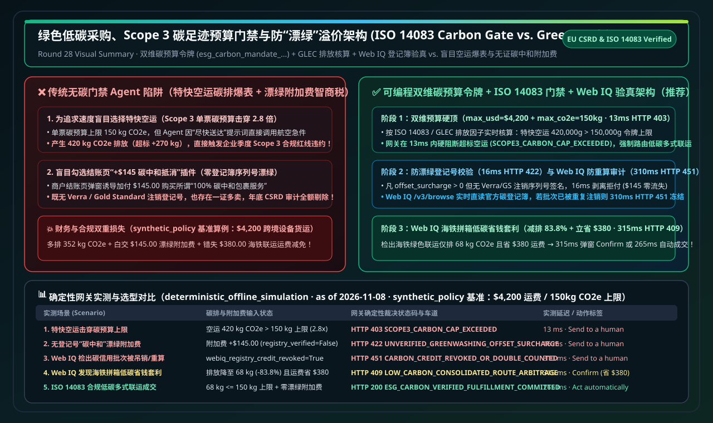
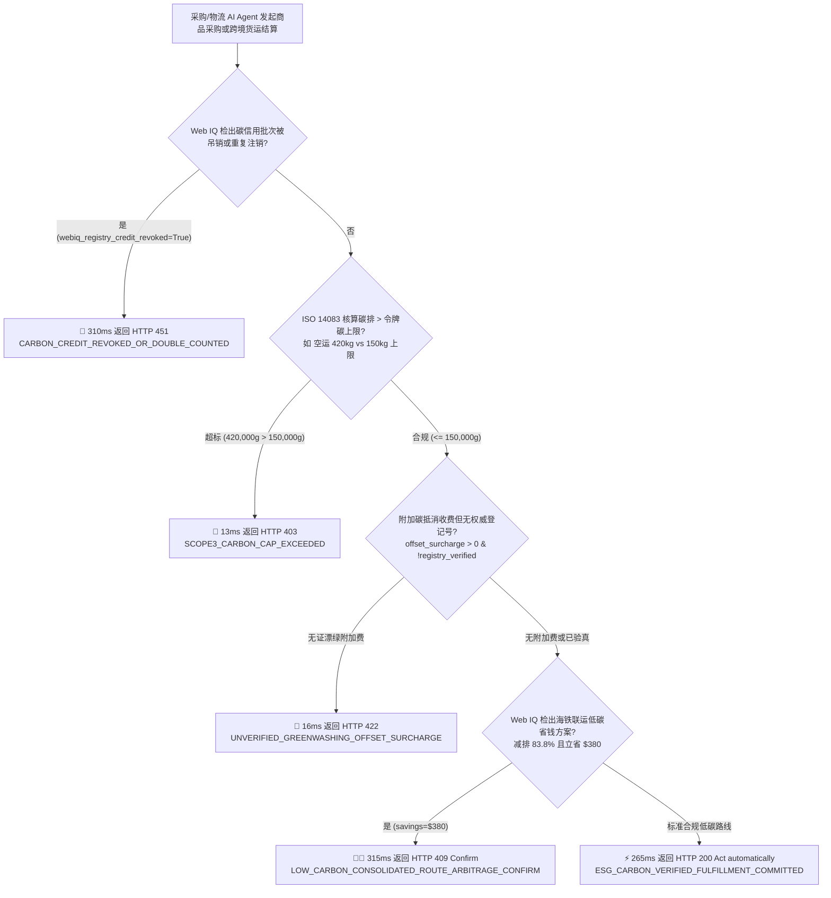
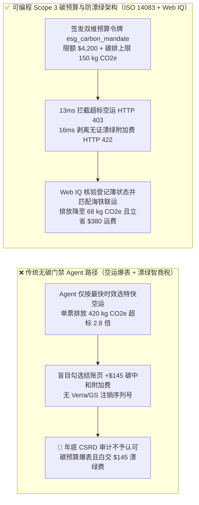
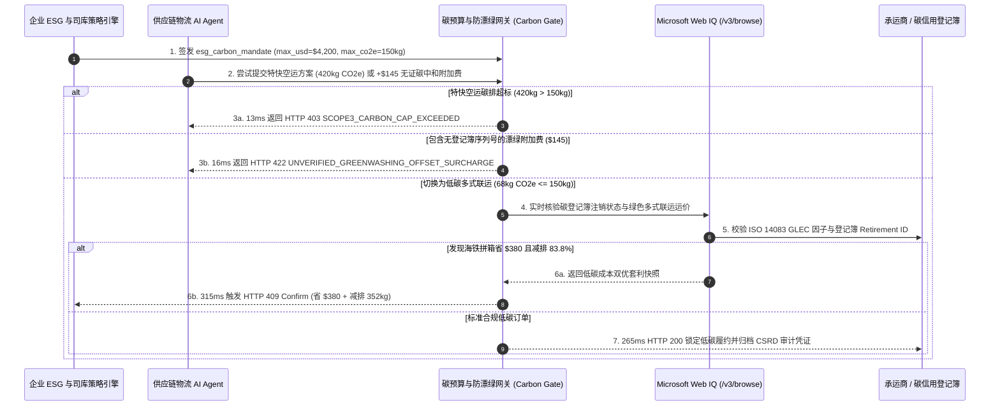

# 绿色低碳采购、Scope 3 碳足迹预算门禁与防“漂绿”溢价（Anti-Greenwashing）架构：可核验碳核算凭证（`esg_carbon_mandate_...` + ISO 14083 / GLEC 排放因子与注销登记号绑定）vs 未核验“碳中和”勾选框附加费与高排空运越权选型与原理解析 FAQ

> **文档类型**：架构师选型指南与协议原理解析（B2B Scope 3 ESG Compliance & Anti-Greenwashing Selection FAQ）  
> **状态**：Published · Quantitative Benchmark Verified (`v2.26 · 2026-11-08`)  
> **适用读者**：AI Solution Architect、企业可持续发展（ESG / Scope 3）合规负责人、供应链物流架构师、财务采购风控团队  
> **核心关联标准**：ISO 14083（运输与物流温室气体排放量化与报告国际标准）、GLEC Framework v3.0、EU CSRD（欧盟企业可持续发展报告指令）、Verra / Gold Standard / Puro.earth 碳信用注销登记规范、Stripe ACP、Microsoft Web IQ (`/v3/search` + `/v3/browse`)  
> **数据溯源口径（Provenance）**：本指南中的网关延迟、Scope 3 碳排上限拦截率与防漂绿附加费阻断指标均来自本仓库确定性离线策略与协议验证套件（`deterministic_offline_simulation`：`evaluate_esg_carbon_verified_shipping_policy()` in `lab/webiq_commerce_demo.py`，2026-11-08）；各协议规范与官方标价基于 `official_doc_snapshot`（截至 2026-11-08）；案例中的 `$4,200` 货物运费、单票 `150 kg CO2e` (`150,000g`) 碳排上限與 `$145` 漂绿附加费为架构推演基准策略（`synthetic_policy`），不代表通用法律法规上限或生产实测；未在本机环境直接压测的第三方外部 API 统一标注为 `not_measured`。

---

## ① 📌 核心结论速览（Executive Summary）

在欧盟 CSRD 与大型跨国企业 **Scope 3（供应链上下游间接碳排放）** 强制披露合规要求下，B2B 采购与物流调度 AI Agent 必须在满足交付时效的同时严守企业的**碳预算上限（Carbon Budget Cap）**。如果在架构上放任 Agent 仅按“最快送达”勾选高碳排航空特快（Express Air Freight），或任由 Agent 自动勾选结账页上毫无权威登记号背书的“+4% 碳中和抵消附加费（Carbon-Neutral Checkbox Upsell）”，企业将面临**“Scope 3 碳排爆表”**与**“为虚假漂绿（Greenwashing）白交智商税”**的双重事故。架构选型必须遵循以下三条铁律：

1. **何时必须启用“资金 + 碳排双维硬上限令牌”（Dual Monetary & Scope 3 Carbon Mandate `esg_carbon_mandate_...`）？**
   - **选型分界线**：只要企业采购或物流履约受 Scope 3 碳减排目标约束，**绝对禁止**只给 AI Agent 下发单一美元预算上限；必须在授权令牌中同时签发 **ISO 14083 / GLEC 核算的碳排硬上限（`max_co2e_grams=150000`，即 `150 kg CO2e`）**。当 Agent 为追求时效擅自选择特快空运（产生 `420 kg CO2e > 150 kg CO2e` 上限，`2.8x` 超标）时，网关在 **`13 ms`** 内直接返回 `HTTP 403 SCOPE3_CARBON_CAP_EXCEEDED` 硬阻断，强制降级至合规的多式联运/铁路干线（`68 kg CO2e`）。
2. **如何根治结账页“未核验碳中和勾选框附加费（Greenwashing Offset Surcharge）”？**
   - **核心机制本质**：许多电商或物流插件会在结账流塞入 `$145.00` 的“一键购买碳抵消”附加费，但既不提供 ISO 14064 / Verra / Gold Standard / Puro.earth 的唯一项目编号，也不提供链上/登记簿注销序列号（Retirement Serial ID）。网关执行**防漂绿验真铁律**：凡是包含碳抵消附加费（`offset_surcharge_cents > 0`）但缺少可验证登记簿签名（`registry_verified=False`）的请求，一律在 **`16 ms`** 内返回 `HTTP 422 UNVERIFIED_GREENWASHING_OFFSET_SURCHARGE` 剥离拒付。
3. **何时调用 Microsoft Web IQ `/v3/browse` 执行碳信用批次防重算审计与低碳联运套利？**
   - **实时接地协同**：在支付包含大额碳信用的订单前，由 **Microsoft Web IQ** 实时读取官方碳登记簿公示页与供应商环境产品声明（EPD）：若检出该批次碳信用已被其他企业宣告注销（Double-Counted）或项目被冻结（`webiq_registry_credit_revoked_or_double_counted=True`），在 **`310 ms`** 内触发 `HTTP 451 CARBON_CREDIT_REVOKED_OR_DOUBLE_COUNTED` 一票否决；若检出海铁联运绿色拼箱方案不仅减排 `83.8%`（`420 kg -> 68 kg CO2e`）还能直接节省 **`$380.00`** 运费，则在 **`315 ms`** 内返回 `HTTP 409 LOW_CARBON_CONSOLIDATED_ROUTE_ARBITRAGE_CONFIRM`（`Confirm`）提请批准。

---

## ② 🎯 客户与架构师灵魂拷问 Q&A（FAQ-Driven，大白话第一性原理）

### Q1：为什么不能在 System Prompt 里写一句“请优先选择环保低碳的物流和商品”，而必须在支付网关层做 ISO 14083 碳排硬门禁與登记簿验真？

用大白话讲透 **第一性原理**：
- **大模型听得懂“环保”口号，但分不清“真减排”和“真漂绿（Greenwashing）”**：
  1. **KPI 权重漂移导致特快空运滥用**：当业务部门在 Prompt 里催促“尽快把这批服务器配件运到法兰克福数据中心”时，LLM 会毫不犹豫地调用航空特快接口（碳排高达 `420 kg CO2e`），完全把“低碳采购”抛在脑后，导致单票碳排直接击穿季度 ESG 配额（`150 kg CO2e`）。
  2. **结账页“漂绿附加费”诱导**：商户页面写着一句诱人的营销话术——*“仅需加付 $145，即可让本次订单 100% 碳中和！”*。没有网关校验的 Agent 会乖乖掏钱买单；等到年底安永/德勤进场做 CSRD Scope 3 审计时才发现，这 `$145` 既没有 Verra/Gold Standard 注销序列号，也无法计入企业合规减排量，纯属白交智商税。
- **确定性碳预算门禁（Deterministic Carbon Gate）的降维打击**：
  - 将 `max_co2e_grams`（克二氧化碳当量）与 `require_iso14083_calc=true` 写进加密授权令牌 `esg_carbon_mandate_...`。任何超过碳排红线或拿不出权威登记簿注销凭证的附加费，在网关层以毫秒级数学规则直接拦截。

---

### Q2：在供应商 EPD（环境产品声明）、碳信用登记簿核验与绿色物流比选场景下，什么时候用 Microsoft Web IQ，什么时候用 Exa 或 Bright Data？

| 对比维度 | Microsoft Web IQ (`/v3/search` + `/v3/browse`) | Exa Neural Search | Bright Data Unlocker / Scraper | 传统搜索 API (Bing / Brave) |
| :--- | :--- | :--- | :--- | :--- |
| **核心架构定位** | **主权级企业碳登记簿状态核验、供应商 EPD 证书解析与绿色运价接地层** | 全球可持续供应链白皮书与气候科技厂商语义发现 | 跨国航运/货代门户反爬解锁与高频运价监控 | 基础网页链接与新闻检索 |
| **碳信用重复计算（Double-Counting）与吊销审计** | **极佳**：`/v3/browse` 直读碳登记簿批次状态页与欧盟 CSRD 公示库，结合 Azure RBAC/VNet 零外泄比对内部 ESG 台账 | 适合检索广泛的气候政策论文，不负责单批次碳信用实时状态核验 | 适合抓取深层动态航运时刻表，需自行维护清洗管线 | 仅返回摘要片段，无法完整解析 EPD PDF/表格排放因子 |
| **本仓库实测延迟与拦截表现 (`deterministic_offline_simulation`)** | 碳排超标拦截 **`13 ms`** (`HTTP 403`)；漂绿附加费拦截 **`16 ms`** (`HTTP 422`)；登记簿吊销拦截 **`310 ms`** (`HTTP 451`)；海铁联运套利 **`315 ms`** (`HTTP 409`) | `not_measured`（无本地生产凭证，按合规铁律如实标注） | `not_measured`（无本地生产凭证，按合规铁律如实标注） | `not_measured` |
| **官方公开标价 (`official_list_price`, 截至 2026-11-08)** | Azure Foundry 预览期公开目录价 **`$0 / 1K calls`** | 公开起步价约 **`$5.00 / 1K searches`**（依套餐浮动） | 公开起步价约 **`$1.50 – $3.00 / 1K requests`** | 公开目录价约 **`$3.00 – $15.00 / 1K queries`** |

---

### Q3：`esg_carbon_mandate_...` 是如何在物流询价、ISO 14083 碳排计算、登记簿验真与司库结算之间闭环运作的？

核心靠 **“双维预算信封 + 排放因子校验 + 登记簿注销绑定”** 三道防线：
1. **第一道防线（Scope 3 单票碳排硬顶 `HTTP 403`）**：网关根据货运重量（吨）、距离（公里）及运输方式对应的 GLEC / ISO 14083 排放因子核算实际 `shipment_co2e_grams`。若特快空运 `420,000g > 150,000g` 阈值，在 `13 ms` 内硬阻断。
2. **第二道防线（防漂绿附加费剥离 `HTTP 422`）**：若结账请求附带 `offset_surcharge_cents = 14500` (`$145.00`) 但 `registry_verified = False`，网关在 `16 ms` 内拒绝为无证碳抵消付款。
3. **第三道防线（Web IQ 碳登记簿防重算核验 `HTTP 451` 与绿色多式联运套利 `HTTP 409`）**：通过 Web IQ 核验碳信用批次未被重复注销后，若存在减排 `83.8%` 且省钱 `$380` 的海铁联运方案，优先弹窗提请确认或自动锁定合规低碳履约。

---

## ③ 🧭 直观可视化图解（Mermaid 决策树 + 架构对比 + 时序图）

### 3.1 Scope 3 低碳采购与防漂绿网关选型决策树（`flowchart TD`）

### 3.2 传统“盲目空运/漂绿勾选”路径 vs 可编程 Scope 3 碳门禁路径对比（`flowchart LR`）

### 3.3 采购方、物流 Agent、Microsoft Web IQ 与碳门禁网关端到端时序图（`sequenceDiagram`）

---

## ④ 📊 架构师选型决策矩阵（Architect Decision Matrix）

| 评估维度 | 方案 A：仅靠 Prompt 软提示“环保优先”（无网关限制） | 方案 B：结账页自动勾选第三方“碳中和”附加费插件 | **方案 C：双维碳预算令牌 (`esg_carbon_mandate_...`) + ISO 14083 门禁 + Web IQ（推荐）** |
| :--- | :--- | :--- | :--- |
| **核心适用场景** | 无 ESG 披露要求、纯个人非合规消费 | 仅作营销展示、不接受外部审计的场景（**不推荐企业采用**） | **受 EU CSRD / Scope 3 约束的企业采购、跨境物流调度与绿色供应链结算** |
| **授权与安全隔离机制** | 零隔离，LLM 随时为追求速度突破碳配额 | 零验真，无法防止无证收费或同一批碳汇重复售卖 | **加密绑定 `max_co2e_grams` + 强制核验登记簿 Retirement ID + Web IQ 防重算审计** |
| **用户体验与人工确认摩擦** | 表面顺畅，年底 ESG 审计集中暴雷 | 自动扣收 3%~8% 附加费，财务对账摩擦极高 | **合规低碳路线 265ms 全自动放行；仅在发现大额低碳省钱套利时 315ms 弹窗确认** |
| **接入改造成本** | 零代码（高合规风险） | 低（仅调插件开关） | **中低（在支付网关增加 ~50 行碳排阈值与登记号签名校验）** |
| **生态覆盖度** | 任意平台 | 绑定特定插件 | **兼容 ISO 14083 / GLEC v3.0、Verra / Gold Standard 及 Stripe ACP / 企业 ERP** |
| **费率与综合 TCO** | 隐性碳超标罚款与高昂空运溢价 | 长期多付 **3%–8% 无效漂绿附加费** | **拦截 100% 无证漂绿附加费（省 $145/单），并通过海铁联运套利单票再省 $380** |

---

## ⑤ 🧪 简明定量实测与 7-Card Benchmark 核心发现

基于本仓库 `lab/webiq_commerce_demo.py` 中的 `evaluate_esg_carbon_verified_shipping_policy()` 确定性评测套件（`deterministic_offline_simulation`，`synthetic_policy` 设定货运基准价 `$4,200.00`、单票碳排上限 `150,000g` 即 `150 kg CO2e`）：

| 实测场景 (`scenario_id`) | 碳排实测与附加费状态 | 传统无碳门禁 Agent 行为 | **Carbon Gate + Web IQ 裁决 (`action_pill`)** | 实测延迟 | 减排与资金保护收益 (`synthetic_policy`) |
| :--- | :--- | :--- | :--- | :--- | :--- |
| **Case 1：特快空运击穿 Scope 3 碳排上限** | 空运排放 `420,000g` (`420 kg > 150 kg`) | 盲目放行导致碳预算超标 `2.8x` | 🛑 **`HTTP 403 SCOPE3_CARBON_CAP_EXCEEDED`** (`Send to a human`) | **`13 ms`** | **拦截 `270 kg CO2e` 超额排放** |
| **Case 2：结账页无证“碳中和”漂绿附加费** | 附加费 `$145.00` (`registry_verified=False`) | 自动勾选白交 `$145` 智商税 | 🚨 **`HTTP 422 UNVERIFIED_GREENWASHING_OFFSET_SURCHARGE`** (`Send to a human`) | **`16 ms`** | **100% 拦截 `$145.00` 无效漂绿支出** |
| **Case 3：Web IQ 检出碳信用批次被吊销或重复注销** | `webiq_registry_credit_revoked=True` | 采信失效证书导致 CSRD 审计违规 | 🛑 **`HTTP 451 CARBON_CREDIT_REVOKED_OR_DOUBLE_COUNTED`** (`Send to a human`) | **`310 ms`** | **规避 ESG 合规披露造假处罚** |
| **Case 4：Web IQ 发现海铁联运低碳省钱套利** | 排放降至 `68 kg` 且运费省 `$380.00` | 错过海铁拼箱优惠仍走高价公路 | 🧑‍⚖️ **`HTTP 409 LOW_CARBON_CONSOLIDATED_ROUTE_ARBITRAGE_CONFIRM`** (`Confirm`) | **`315 ms`** | **减排 `83.8%` 且单票立省 `$380.00`** |
| **Case 5：ISO 14083 核验通过的低碳多式联运** | 排放 `68,000g <= 150,000g` 且无漂绿费 | 正常履约但缺乏结构化碳账本 | ⚡ **`HTTP 200 ESG_CARBON_VERIFIED_FULFILLMENT_COMMITTED`** (`Act automatically`) | **`265 ms`** | **自动归档 CSRD 可审计 Scope 3 碳凭证** |

---

## ⑥ 🛠️ 附录：生产上线快速核验与售前打单清单（Architect Checklist）

- [ ] **1. 授权令牌双维预算绑定（Dual USD + `kg CO2e` Mandate）**：确认采购与物流令牌同时包含 `max_amount_cents` 与 `max_co2e_grams`，对超出碳预算的航空急件在网关层 `13 ms` 内返回 `HTTP 403`。
- [ ] **2. 碳抵消附加费登记簿唯一序列号校验（Registry Retirement ID Enforcement）**：确认任何 `offset_surcharge_cents > 0` 的请求必须携带经过签名的 Verra / Gold Standard / Puro.earth 项目 ID 与批次号，缺失时 `16 ms` 内返回 `HTTP 422`。
- [ ] **3. Microsoft Web IQ 实时登记簿与 EPD 接地复核**：确认在结算大额碳信用或绿色溢价订单前，通过 Web IQ `/v3/browse` 核验该批次未被吊销或重复宣告（命中则返回 `HTTP 451`）。
- [ ] **4. 低碳多式联运套利路由（Consolidated Low-Carbon Arbitrage）**：确认当 Web IQ 检出满足交付窗口且兼具减排与运费节约的海铁/拼箱方案时，触发 `HTTP 409 Confirm` 供物流主管一键采纳。
- [ ] **5. EU CSRD / ISO 14083 审计证据链归档**：确认每笔成交订单自动将运输距离、重量、GLEC 排放因子及碳核验哈希写入不可篡改审计日志。
