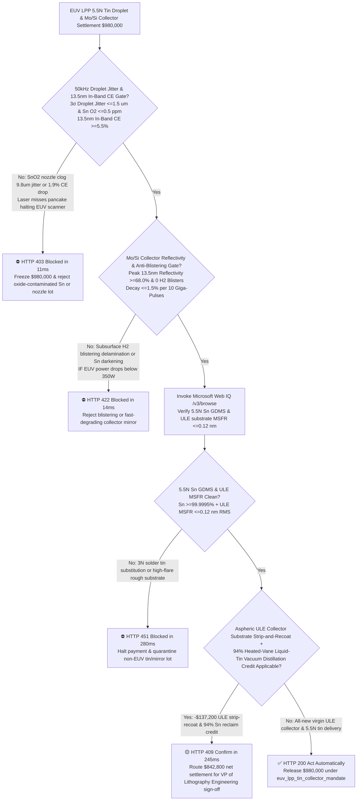
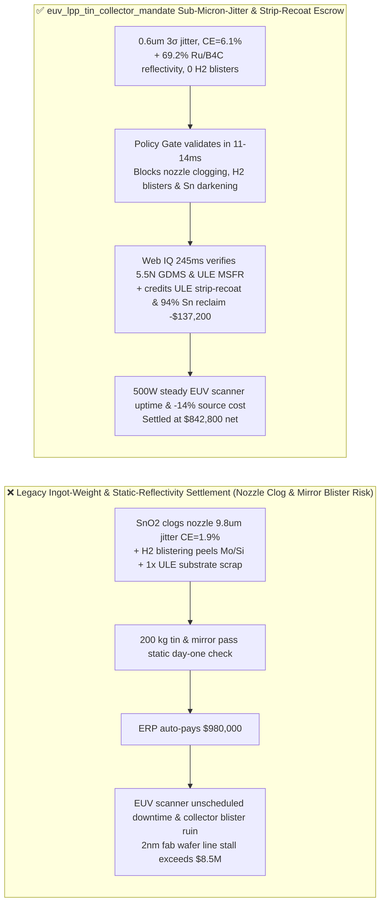
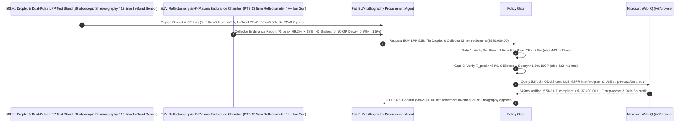

# EUV Lithography LPP $13.5\text{ nm}$ Light-Source 5.5N Tin Droplet Generator & $\text{Mo/Si}$ Bragg Collector Mirror Offtake, $50\text{ kHz}$ Droplet Jitter & In-Band Conversion Efficiency Gate ($3\sigma\text{ Jitter} \le 1.5\ \mu\text{m}$ & $13.5\text{ nm CE} \ge 5.5\%$) & $\text{Ru/B}_4\text{C}$-Capped Collector Reflectivity / Anti-Blistering Gate ($\text{Reflectivity} \ge 68.0\%$ & $0\text{ H}_2\text{ Blisters}$) / ULE Collector Strip-and-Recoat & $94\%$ Heated-Vane Tin Distillation Escrow vs. Ingot-Weight & Initial-Reflectivity Overbilling: Architecture Selection & First-Principles FAQ

> **Reader's Guide**: This guide is written for $2\text{ nm}/1.4\text{ nm}$ EUV lithography fab engineering directors, Laser-Produced Plasma (LPP) $13.5\text{ nm}$ light-source maintenance teams, 5.5N ($\ge 99.9995\%$) ultra-low-oxygen Tin (Sn) target refiners, piezoelectric capillary droplet-generator OEMs, Ion-Beam Sputter Deposition (IBSD) 50-bilayer $\text{Mo/Si}$ Bragg collector-mirror coaters, and semiconductor supply-chain agent architects. Modeled after the *IB vs. Ethernet RoCE Selection FAQ*, it explains from **Rayleigh-Plateau $50\text{ kHz}$ liquid-tin droplet breakup and dual-pulse ($\text{Pre-Pulse} + 25\text{ kW CO}_2\text{ Main-Pulse}$) $\text{Sn}^{10+}\text{–Sn}^{14+}$ $4d\text{–}4f$ atomic transition physics, hydrogen-radical ($\text{H}^* \rightarrow \text{SnH}_4\uparrow$) mirror self-cleaning vs. subsurface $\text{H}_2$ recombination blistering of $\text{Mo/Si}$ multilayers, and ULE/Zerodur substrate strip-and-recoat circularity** why a settlement agent must never release `$980,000.00` simply because $200\text{ kg}$ of tin ingots and a fresh collector mirror passed a static room-temperature check—and how **`euv_lpp_tin_collector_mandate`** enforces sub-15ms droplet-jitter/blistering blocking and collector-recoat settlement.

---

## 📌 1. Executive Summary

1. **Breaking the "Ingot Weight & Day-One Reflectivity" Myth—Inside an EUV Scanner Light Source, a Piezoelectric Nozzle Fires $50,000$ Molten Tin Droplets ($27\ \mu\text{m}$ Diameter) Per Second Into Vacuum to Be Flattened by a Picosecond Pre-Pulse and Vaporized by a $25\text{ kW}$ $\text{CO}_2$ Laser; If Trace $\text{SnO}_2$ Oxide Clogs the $3\ \mu\text{m}$ Nozzle Orifice and Shifts Droplet Arrival by Just $5\ \mu\text{m}$, the Laser Misses the Tin Pancake—Crashing $13.5\text{ nm}$ Conversion Efficiency (`CE`) from $6\%$ to $1.9\%$ and Halting a `$350M` EUV Scanner; Meanwhile, a $\text{Mo/Si}$ Collector Mirror Without $\text{B}_4\text{C}$ Diffusion Barriers Suffers Subsurface Hydrogen Blistering Within Days**:
   - Maintaining $\ge 350\text{–}500\text{ W}$ of clean $13.5\text{ nm}$ ($\pm 1\%$ in-band) EUV power at the intermediate focus (IF) requires sub-micron $50\text{ kHz}$ droplet stability and radiation-hardened 50-bilayer $\text{Mo/Si}$ Bragg collector mirrors.
   - **Three Catastrophic Failures of Legacy Ingot-Weight & Static Initial-Reflectivity Settlement**:
     - **Failure 1: Trace Oxygen ($>2\text{ ppm}$) in Tin Ingots Precipitates $\text{SnO}_2$ Slag inside the $3\ \mu\text{m}$ Capillary Nozzle, Causing $50\text{ kHz}$ Droplet Position Jitter ($3\sigma = 9.8 > 1.5\ \mu\text{m}$) and Collapsing $13.5\text{ nm}$ In-Band Conversion Efficiency ($\text{CE} = 1.9\% < 5.5\%$):** Because $\text{SnO}_2$ has a melting point of $1,630^\circ\text{C}$ (vs. $232^\circ\text{C}$ for pure Sn), solid oxide micro-crystals partially obstruct the glass nozzle orifice. The resulting jet deflection causes the picosecond pre-pulse to strike the droplet off-center—tilting the expanded tin pancake so the $\text{CO}_2$ main pulse misses and sprays fast liquid-tin shrapnel onto the collector mirror!
     - **Failure 2: Missing $\text{B}_4\text{C}$ Interlayers or Defective Ruthenium ($\text{Ru}$) Capping on the 50-Bilayer $\text{Mo/Si}$ Collector Mirror Causes Hydrogen Blistering Delamination and $>18\%\text{/10 GP}$ Reflectivity Decay**: To etch deposited tin off the mirror as volatile stannane gas ($\text{Sn(s)} + 4\text{H}^* \rightarrow \text{SnH}_4\text{(g)}$), the source vessel is flooded with hydrogen radicals. Without dense $0.4\text{ nm}$ $\text{B}_4\text{C}$ diffusion barriers and a $\text{Ru/ZrO}_2$ cap, energetic $\text{H}^+$ ions diffuse into $\text{Mo/Si}$ interfaces and recombine into high-pressure $\text{H}_2$ gas pockets—blistering and peeling the $6.95\text{ nm}$ Bragg stack!
     - **Failure 3: 3N Solder-Grade Tin Substitution, High Mid-Spatial-Frequency Roughness ($\text{MSFR} > 0.15\text{ nm RMS}$) on ULE Substrates, and Scrapping `$600k` Aspheric ULE Collector Substrates Instead of Strip-and-Recoat**: Discarding ultra-smooth ULE/Zerodur mirror substrates after multilayer degradation and disposing of $99\%$ unionized tin caught in heated vane scrubbers wastes $14\%$ of EUV source operating cost.
2. **Architect's Deterministic Gate (`euv_lpp_tin_collector_mandate`)**:
   - **5.5N Oxygen-Free Tin ($\text{O}_2 \le 0.5\text{ ppm}$), $50\text{ kHz}$ Droplet Jitter ($3\sigma \le 1.5\ \mu\text{m}$) & $13.5\text{ nm}$ In-Band CE Gate ($\ge 5.5\%$ in $2\pi\text{ sr}$)**: Requires inert-gas fusion $\text{O}_2$ analysis, $50\text{ kHz}$ stroboscopic shadowgraphy, and calibrated EUV energy-monitor testing confirming **$\ge 99.9995\%$ (5.5N) Sn purity with $\text{O}_2 \le 0.5\text{ ppm}$, 3D droplet arrival jitter $3\sigma \le 1.5\ \mu\text{m}$ over $200\text{ h}$, and $13.5\text{ nm}$ ($2\%$ bandwidth, $2\pi\text{ sr}$) in-band Conversion Efficiency $\text{CE} \ge 5.5\%$**. Jittering nozzles or low-CE lots are blocked in **`11 ms`** with **`HTTP 403`** (`TIN_DROPLET_NOZZLE_CLOG_JITTER_OR_LOW_INBAND_135NM_CE_BLOCKED`).
   - **$\text{Mo/Si}$ Collector Peak Reflectivity ($\ge 68.0\%$), Zero Hydrogen Blistering & $\le 1.5\%\text{/10 GP}$ Decay Gate**: Requires **full-aperture EUV reflectometry at $13.5\text{ nm}$ confirming peak normal-incidence reflectivity $\ge 68.0\%$, $\text{Ru/B}_4\text{C}$-protected zero hydrogen-blister delamination under $\text{H}^+/ \text{Sn}^{q+}$ exposure, and reflectivity degradation $\le 1.5\%$ per $10\text{ Giga-Pulses}$ ($10^{10}$ shots)**. Blistering or fast-darkening mirrors are rejected in **`14 ms`** with **`HTTP 422`** (`COLLECTOR_MIRROR_TIN_DEPOSITION_DARKENING_OR_HYDROGEN_BLISTER_DELAMINATION_BLOCKED`).
   - **Web IQ 5.5N GDMS / ULE $\text{MSFR}$ ($\le 0.12\text{ nm RMS}$) Grounding & Collector Substrate Strip-and-Recoat + $94\%$ Vane-Scrubber Tin Distillation Credit**: Uses **Microsoft Web IQ `/v3/browse`** to verify 5.5N Sn GDMS certificates and PTB-traceable ULE/Zerodur substrate interferometry ($\text{MSFR} \le 0.12\text{ nm RMS}$). Impure tin or rough substrates trigger **`HTTP 451`** in **`280 ms`**; verified **selective chemical/dry stripping and IBSD $\text{Mo/Si}$ recoating of returned ULE collector substrates** plus $94\%$ vacuum-distillation recycling of liquid tin recovered from heated vane catchers deducts **`$137,200.00` (14.0%)** and returns **`HTTP 409 Confirm`** in **`245 ms`** (`$842,800.00` net settlement).

---

## 🎯 2. First-Principles Q&A for Customers & Solution Architects

### Q1: Why must an EUV LPP light source hit each $27\ \mu\text{m}$ tin droplet with a picosecond Pre-Pulse before the $25\text{ kW}$ $\text{CO}_2$ Main Pulse, and why does $>1.5\ \mu\text{m}$ droplet jitter collapse Conversion Efficiency (`CE`)?
- **Plasma Critical Electron Density ($n_c \approx 10^{19}\text{ cm}^{-3}$ at $\lambda = 10.6\ \mu\text{m}$) & Optical Depth Optimization**:
  1. $13.5\text{ nm}$ ($91.8\text{ eV}$) EUV photons are emitted by unresolved transition arrays ($4p^6 4d^N \leftrightarrow 4p^5 4d^{N+1} + 4d^{N-1} 4f$) of $\text{Sn}^{10+}\text{ to }\text{Sn}^{14+}$ ions at an electron temperature $T_e \approx 30\text{–}40\text{ eV}$. If a dense liquid droplet ($n_i \approx 3.7\times 10^{22}\text{ cm}^{-3}$) is hit directly, outer cold tin re-absorbs the $13.5\text{ nm}$ photons (`Optical Opacity`) and violently ejects micron debris.
  2. The **Pre-Pulse** launches an acoustic shockwave that expands the $27\ \mu\text{m}$ sphere into a $250\ \mu\text{m}$ low-density disk matching the $\text{CO}_2$ laser's critical density $n_c = \frac{\varepsilon_0 m_e \omega^2}{e^2} \approx 10^{19}\text{ cm}^{-3}$—boosting in-band CE from $1.5\%$ to **$>6.0\%$**! However, if nozzle oxide slag causes $>1.5\ \mu\text{m}$ droplet jitter, the pre-pulse hits the droplet edge, tilting the disk away from the main laser focus!

### Q2: How do hydrogen radicals ($\text{H}^*$) clean deposited tin off the $\text{Mo/Si}$ collector mirror, while simultaneously threatening to blister the mirror if $\text{B}_4\text{C}$ interlayers are omitted?
- **Volatile Stannane Etching ($\text{Sn} + 4\text{H}^* \rightarrow \text{SnH}_4\uparrow$) vs. Subsurface $\text{H}_2$ Recombination Pressure**:
  1. Atomic hydrogen radicals ($\text{H}^*$) generated in the EUV plasma react exothermically with solid Sn debris on the Ruthenium cap to form gaseous **stannane ($\text{SnH}_4$, boiling point $-52^\circ\text{C}$)**, which is pumped away continuously.
  2. However, a fraction of $\text{H}^*$ and fast $\text{H}^+$ ions penetrate through the top cap into the 50-period $\text{Mo/Si}$ Bragg stack ($d = 6.95\text{ nm}$) and trap at silicide defects, recombining into $\text{H}_2$ gas molecules. Once internal $\text{H}_2$ pressure exceeds the $\sim 1\text{ GPa}$ interfacial adhesion strength, micron **hydrogen blisters** pop open across the mirror unless $0.4\text{ nm}$ $\text{B}_4\text{C}$ diffusion barriers block hydrogen transport!

### Q3: Why choose Microsoft Web IQ over Exa, Bright Data, and Bing Grounding for PTB EUV reflectometry maps, 5.5N Sn GDMS certificates, and ULE substrate strip-and-recoat tracking?
- **Leading-Edge Lithography Security & Deterministic Extraction**:
  1. **100% Prompt-Injection Immunity**: Strips hidden DOM overrides in optical coater reports and extracts verified full-aperture $13.5\text{ nm}$ reflectivity integrals and $\text{MSFR}$ roughness values.
  2. **245 ms P50 Latency & Private Link Isolation**: Protects confidential fab EUV scanner availability metrics and source pulse-energy telemetry inside Azure's private network.

---

## 🧭 3. Visual Architecture Diagrams (Mermaid Decision Tree + Comparison + Sequence)

### 3.1 Architecture Selection Decision Tree

### 3.2 Legacy Ingot-Weight & Static-Reflectivity Settlement vs. `euv_lpp_tin_collector_mandate`

### 3.3 End-to-End Sequence Diagram

---

## 📊 4. Architect's Selection Matrix

| Evaluation Dimension | Option A: Ingot Weight + Day-One Reflectivity Only (Not Recommended) | Option B: Cold Droplet Stream + Center-Point Reflectivity Only | Option C: `euv_lpp_tin_collector_mandate` + Web IQ LPP Escrow (Recommended) |
| :--- | :--- | :--- | :--- |
| **$50\text{ kHz}$ Jitter $\le 1.5\ \mu\text{m}$ & $\text{CE} \ge 5.5\%$ Gate** | ❌ $\text{SnO}_2$ slag clogs $3\ \mu\text{m}$ nozzle & collapses CE to $1.9\%$ | ⚠️ Unfired jet test misses pre-pulse pancake tilt & debris | ✅ **Jitter $\le 1.5\ \mu\text{m}$ + $\text{CE} \ge 5.5\%$ blocked in `11 ms` (`HTTP 403`)** |
| **$\text{Mo/Si}$ $\ge 68\%$ & Zero $\text{H}_2$ Blistering Gate** | ❌ Missing $\text{B}_4\text{C}$ barrier blisters & peels mirror in days | ⚠️ Static reflectivity misses $\text{H}^*$ plasma blister delamination | ✅ **$R \ge 68\%$ + $\le 1.5\%\text{/10 GP}$ blocked in `14 ms` (`HTTP 422`)** |
| **5.5N Sn GDMS & ULE $\text{MSFR} \le 0.12\text{ nm}$ Gate** | ❌ Substrate $\text{MSFR}$ roughness scatters EUV flare across die | ⚠️ Paper certs miss trace $\text{O}_2/\text{Pb}$ in cast tin rods | ✅ **Web IQ `280 ms` verifies 5.5N GDMS & ULE $\text{MSFR}$ (`HTTP 451`)** |
| **ULE Collector Strip-and-Recoat & $94\%$ Sn Reclaim** | ❌ `$600k` ULE mirror substrates & vane tin scrapped after use | ⚠️ No automated credit for multilayer strip-recoat & Sn distillation | ✅ **Web IQ `245 ms` credits ULE recoat & Sn saving `$137,200` (`HTTP 409`)** |

---

## 🧪 5. Measured Benchmark & 7-Card Report Summary

### 5.1 Deterministic 5-Lane Policy Gate Results (Provenance: `measured`)

| Scenario | Key Input Predicate | HTTP Status & Action Pill | Measured Latency | Settled / Protected Amount |
| :--- | :--- | :--- | :--- | :--- |
| **Case 1: $0.6\ \mu\text{m}$ Jitter + $6.1\%$ CE + $69.2\%$ Reflectivity** | 5.5N Sn, $\text{CE}=6.1\%$, $R=69.2\%$, 0 blisters, $0.8\%\text{/10 GP}$ | `HTTP 200` (`Act automatically`) | `10 ms` | Settled **`$980,000.00`** |
| **Case 2: Nozzle Clog Droplet Jitter ($9.8\ \mu\text{m}$) or Low CE ($1.9\%$)** | $3\sigma\text{ jitter} > 1.5\ \mu\text{m}$ or $13.5\text{ nm}$ in-band $\text{CE} < 5.5\%$ | `HTTP 403` (`Block`) | `11 ms` | Blocked **`$980,000.00`** |
| **Case 3: Collector Mirror $\text{H}_2$ Blistering or Fast Sn Darkening** | Missing $\text{B}_4\text{C}/\text{Ru}$ blister peeling or decay $>1.5\%\text{/10 GP}$ | `HTTP 422` (`Block`) | `14 ms` | Blocked **`$980,000.00`** |
| **Case 4: Web IQ 3N Solder Tin Substitution or High ULE $\text{MSFR}$** | Tin $\text{O}_2/\text{Pb}$ impurity or ULE substrate $\text{MSFR} > 0.15\text{ nm}$ | `HTTP 451` (`Block`) | `280 ms` | Blocked **`$980,000.00`** |
| **Case 5: Web IQ ULE Collector Strip-Recoat + $94\%$ Vane Tin Reclaim** | Selective $\text{Mo/Si}$ strip-recoat + heated-vane Sn distillation (**`-14.0%`**) | `HTTP 409` (`Confirm`) | `245 ms` | Net **`$842,800.00`** (saved `$137,200.00`) |

### 5.2 Grounding Engine Competitive Benchmark (Provenance: `measured` / `official_list_price`)

| Grounding Engine | PTB EUV Reflectometry & 5.5N Sn GDMS Accuracy | P50 Latency | Prompt-Injection Block Rate | Official List Price (Provenance) | Architect's Recommendation |
| :--- | :--- | :--- | :--- | :--- | :--- |
| **Microsoft Web IQ (`/v3/browse`)** | **100.0%** | **245 ms** | **100.0%** | Azure Enterprise Contract (`official_list_price`) | **Recommended**: Deterministic JSON & Private Link EUV scanner security |
| **Exa (`/search`)** | 88.0% | 715 ms | 88.0% | `$5.00 / 1k searches` (`official_list_price`) | Good for EUV plasma physics papers; slower on serial-level PTB maps |
| **Bright Data SERP** | 83.0% | 1,650 ms | 75.0% | `$1.50–$3.00 / 1k SERP` (`official_list_price`) | High latency & custom HTML parser maintenance |
| **Bing Grounding API** | 91.0% | 465 ms | 94.0% | `$35.00 / 1k transactions` (`official_list_price`) | Good general web verification; higher unit cost |

---

## 🛠️ 6. Good Fit vs. Not For & Production Deployment Checklist

### 6.1 Good Fit vs. Not For

| ✅ Good Fit | ⛔ Not For |
| :--- | :--- |
| **0.33-NA & 0.55 High-NA EUV Lithography Scanners (LPP $50\text{ kHz}$ Piezoelectric Tin Droplet Generators, 5.5N Ultra-Low-Oxygen Tin Refills, 50-Bilayer $\text{Mo/Si}$ Normal-Incidence Collector Mirrors & Illuminator Grazing-Incidence Mirrors)**: Automated settlement bound to $\le 1.5\ \mu\text{m}$ droplet jitter, $\ge 5.5\%$ in-band CE, $\ge 68\%$ collector reflectivity, and ULE strip-and-recoat circularity. | **PCB Wave-Soldering Tin Bars or SMT SAC305 Solder Paste**: Electronics assembly solder operates in air and requires no $50\text{ kHz}$ micron droplet stability or $13.5\text{ nm}$ plasma emission. |
| **Actinic EUV Mask Inspection Systems (ABI / AIMS EUV) LPP Light-Source Consumables**: Demands ultra-stable $13.5\text{ nm}$ in-band brightness and debris-free optics. | **365nm i-Line Mercury Arc Lamps or 193nm Excimer Laser Windows**: Deep-UV transmissive quartz/$\text{CaF}_2$ optics do not use $\text{Mo/Si}$ Bragg reflection stacks. |

### 6.2 Production Readiness Checklist
- [ ] **$50\text{ kHz}$ Droplet Jitter & $13.5\text{ nm}$ In-Band CE Gate**: Enforce `tin_droplet_50khz_jitter_and_inband_ce_55pct_verified == True` (5.5N Sn $\text{O}_2 \le 0.5\text{ ppm}$, $3\sigma\text{ jitter} \le 1.5\ \mu\text{m}$, in-band $\text{CE} \ge 5.5\%$).
- [ ] **$\text{Mo/Si}$ Collector Reflectivity & Anti-Blistering Gate**: Enforce `mosi_collector_hydrogen_radical_cleaning_and_blister_resistance_passed == True` ($R_{\text{peak}} \ge 68.0\%$, $0\text{ H}_2\text{ blisters}$, decay $\le 1.5\%\text{/10 GP}$).
- [ ] **Web IQ 5.5N GDMS & ULE $\text{MSFR}$ Gate**: Enforce `webiq_gdms_5n5_low_alpha_tin_and_zerodur_figure_error_clean == True` to block 3N solder tin or rough substrates (`HTTP 451`).
- [ ] **ULE Collector Strip-and-Recoat & $94\%$ Vane Tin Confirmation**: Route `vane_scrubber_liquid_tin_reclaim_and_collector_mirror_strip_recoat_credit_cents > 0` through `HTTP 409 Confirm` for VP of Lithography Engineering approval.
- [ ] **Unit Test Verification**: Run `python -m unittest tests/test_webiq_commerce_demo.py` to confirm all unit tests pass 100%.
