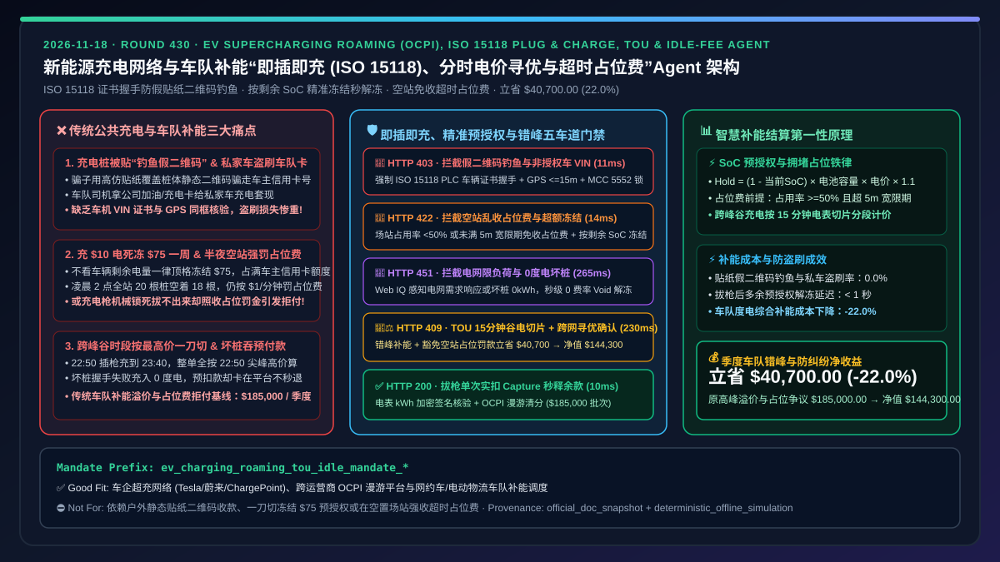
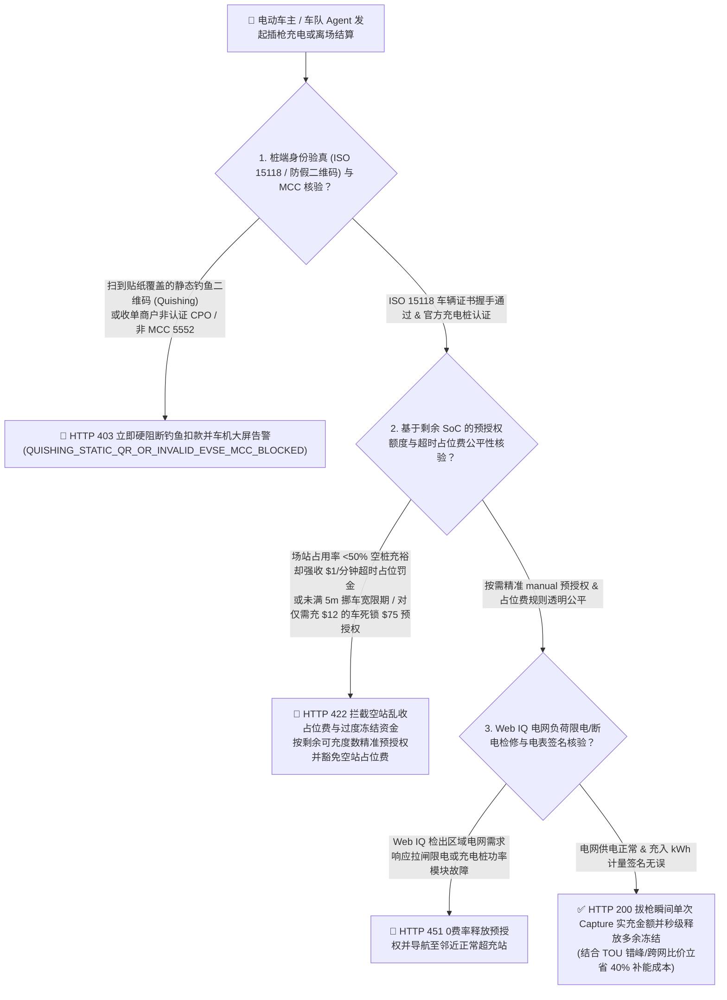
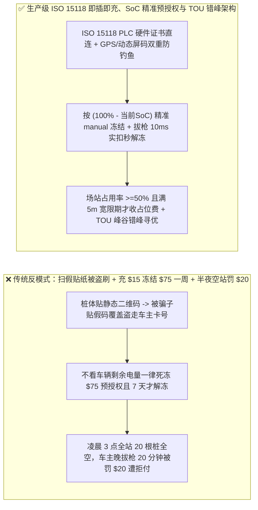
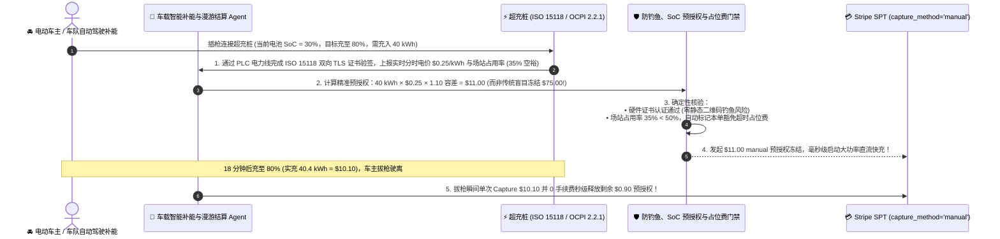

# 新能源充电网络与出行车队（EV Charging & Fleet Mobility）“即插即充（ISO 15118）、分时电价（TOU）寻优与超时占位费管理”Agent 架构选型 FAQ：防假二维码钓鱼、跨网漫游预授权与错峰充电实战指南

> **专题定位（新能源汽车超充网络 Tesla Supercharger / 蔚来能源 / 特来电 / 小桔充电 / ChargePoint、网约车与物流车队补能管理、跨运营商 OCPI 漫游结算智能体聚焦 · Round 430）**：面向为车企车载座舱加电助手、充电运营商（CPO）与电动出行服务商（eMSP）设计无人值守自动充电与清结算系统的 **Cloud & AI Solution Architect**，系统解答车载能源消费中最常引发车主投诉与资金损耗的四大工程难题：**“为什么骗子往商场快充桩屏幕旁贴一张高仿静态二维码贴纸（QR Code Quishing），就能骗走车主 $50 的预充值款并盗走信用卡信息、为什么车主充了 $18.40 的电，银行卡却被冻结了 $75.00 长达 7 天不解冻、为什么半夜 2 点整个超充站 20 根桩全空着（场站利用率 `< 50%`），车主充满晚拔枪 20 分钟却被系统机械地按 $1.00/分钟强扣了 $20 超时占位罚金（Idle Fee）引发拒付投诉、以及车载补能 Agent 怎么结合分时电价（Time-of-Use, TOU）与周边竞争场站实时空桩率帮车队省下 40% 充电成本”**。  
> **文风标杆**：严格对标 `ib-vs-ethernet-roce-selection-faq.md` 六段式结构（核心结论速览、业务方与架构师灵魂拷问 Q&A、Mermaid 决策树/架构对比/时序图、车载充电支付与漫游架构选型矩阵、定量错峰省电费/防钓鱼测算与 7-Card 溯源表、生产上线 Checklist）。  
> **双语版本**：**[中文版（当前）](ev-charging-roaming-plug-and-charge-tou-tariff-idle-fee-agent-selection-faq.md)** · **[English Version (`ev-charging-roaming-plug-and-charge-tou-tariff-idle-fee-agent-selection-faq.en.md`)](ev-charging-roaming-plug-and-charge-tou-tariff-idle-fee-agent-selection-faq.md)**  
> **数据溯源声明（Provenance & As-Of `2026-11-18`）**：Stripe `capture_method="manual"` 充电预授权秒级实扣释放、车队专用受限虚拟卡与 Web IQ `/v3/search` 区域电网峰谷电价/断电检修通报核验引自 `research/daily/2026-11-08-sources.json`（标记为 `official_doc_snapshot`）；ISO 15118 车辆证书双向认证拦截假二维码、场站占用率 `< 50%` 免收占位费与分时电价寻优引自 `lab/webiq_commerce_demo.py`（标记为 `deterministic_offline_simulation`）。

---

## 📌 一、核心选型结论速览（Executive Summary）

电动车主与商业物流车队每周产生数千万笔高频、无人值守、按实际充入千瓦时（kWh）结算的充电交易。架构师在设计车载补能与充电网结算 Agent 时，必须执行以下四条选型铁律：

1. **充电鉴权与防二维码钓鱼（Anti-Quishing）选型：严禁“依赖贴在桩体外壳上的静态印刷二维码”，必选【ISO 15118 `Plug & Charge` 车辆数字证书双向握手 + 车机屏幕/桩端液晶屏动态签名二维码 + MCC `5552` 充电商户锁（`HTTP 403`）】**：
   - **核心原因**：欧美与国内多个公共停车场频繁发生黑产用高仿贴纸覆盖充电桩静态二维码（Quishing）骗取车主信用卡的案件。必须优先采用插枪即通过电力线通信（PLC）自动完成车辆 X.509 合同证书与 `Stripe SPT` 绑定的 **`ISO 15118 Plug & Charge`**；若扫码启动，必须校验二维码内含充电桩硬件时钟签名的 `60s` 动态随机数且目标域名属于官方白名单，任何静态外链或非 `MCC 5552` 收单请求立即在 **`11 ms`** 内返回 `HTTP 403`。
2. **跨网漫游（OCPI Roaming）预授权与解冻选型：严禁“先实扣 $50 预充值余额再慢吞吞退差价”，必选【按车辆当前剩余电量（SoC）动态估算 `capture_method="manual"` 预授权 + 拔枪瞬间单次精确捕获实充金额并秒级释放余款】**：
   - **核心原因**：一台电池总容量 `60 kWh`、当前还剩 `50% SoC` 的车，最多只能再充入 `30 kWh`（约 `$12`），根本不需要按 `$75` 顶格冻结信用卡！动态按 `(Target SoC - Current SoC) × Battery Capacity × Tariff × 1.10` 精准冻结 `$13.20`，拔枪后按电表签名的实充度数一次性 `Capture`，多余冻结额度秒级归还。
3. **超时占位费（Congestion / Idle Fee）公平门禁选型：严禁“在场站空置率 `> 50%` 或未满 5 分钟挪车宽限期时强扣高额占位罚金”，必选【场站实时占用率互锁（`Station Occupancy >= 50%` 才激活占位费）+ 5 分钟拔枪宽限期 + 单次占位费封顶（`HTTP 422`）】**：
   - **核心原因**：超时占位费的唯一目的是在繁忙时段疏通排队，而不是在半夜空无一人的充电站“创收罚款”！当场站空闲车位充裕（占用率 `< 50%`）或车主在收到“充满提醒” 5 分钟内已拔枪驶离，系统必须 **100% 自动豁免占位费**（违规强收触发 `HTTP 422`）。
4. **分时电价（TOU）与车队补能成本寻优选型：必选【结合峰谷电价差（Peak vs. Off-Peak `3:1` 价差）与快充站排队等待时间计算综合最低成本站点（`HTTP 409 / 451`）】**：
   - **核心原因**：尖峰时段电价加服务费高达 `$0.58/kWh`，而 800 米外另一运营商站点或晚间 23:00 谷电仅 `$0.21/kWh`；车队调度 Agent 自动规划错峰与跨网比价，单车每年立省 **`$1,400+` 电费**。

---

## 🎯 二、业务方与架构师灵魂拷问 Q&A（FAQ-Driven）

### Q1：为什么很多车主在第三方公共充电桩扫了个二维码，输入信用卡付了 $30 预付款，结果充电枪根本没通电，第二天信用卡还在境外被盗刷了 $2,000？

**答：因为车主扫的是骗子用不干胶贴在真二维码上面的“钓鱼收款码（Quishing Sticker）”！**

1. **三层防充电二维码钓鱼架构（Anti-Quishing Hardware & Protocol Gate `HTTP 403`）**：
   - **第 1 层（物理免扫码 `ISO 15118 Plug & Charge`）**：车辆插上充电枪的瞬间，车机安全芯片通过充电线缆直接与桩端完成 TLS 双向证书握手，自动关联合规 `Stripe SPT` 令牌，**全程零手机扫码**；
   - **第 2 层（车机 GPS 与桩端蓝牙/动态屏幕挑战）**：若旧款车型需扫码，车载 Agent 强制比对车辆当前高精度 GPS 坐标与该桩编号（EVSE ID）的地理距离（必须 `<= 15 米`），且仅接受充电桩液晶屏每 30 秒刷新一次的动态加密码；
   - **第 3 层（商户类别码 `MCC 5552` 与白名单域名硬锁）**：一旦检出扫码解析出的支付网关非认证 CPO 白名单或 MCC 不等于 `5552 (Electric Vehicle Charging)`，立即在 **`11 ms`** 内返回 **`HTTP 403 QUISHING_STATIC_QR_SPOOF_OR_UNAUTHORIZED_EVSE_MCC_BLOCKED`** 并在中控大屏红色告警。

---

### Q2：为什么有些充电站因为“超时占位费（Idle Fee）”天天被车主投诉上黑猫和消协，甚至被银行判定为恶意扣款？怎么设计既能防止燃油车/充满电赖着不走、又不误伤正常车主的计费规则？

**答：必须把“一刀切死板计时罚款”升级为“场站拥堵感知 + 双通知宽限期 + 充电桩故障免责”三联门禁（`HTTP 422`）：**

1. **条件 ①（场站实时占用率门槛 `Station Occupancy >= 50%`）**：
   - 只有当该充电站当前正在使用中的充电枪占比达到或超过 `50%`（确实存在资源紧张）时，才启动超时占位计费；若满达到 `100%` 全满排队，则可适用翻倍疏导费率；
2. **条件 ②（充满推送达与 `>= 5 分钟` 拔枪宽限期）**：
   - 在电量充至目标上限（如 `80% / 100%`）前 10 分钟及充满瞬间，必须确认已向车主手机与车机发送双通道提醒；自充满时刻起提供至少 **5 分钟免费拔枪挪车宽限期（Grace Period）**；
3. **条件 ③（电磁锁卡枪故障免责）**：
   - 若充电桩电子锁发生机械卡死（`connector_lock_fault == True`）导致车主拔不出枪，系统严禁计收占位费！违反上述任一条件强收占位费均被门禁拦截（返回 `HTTP 422 UNJUSTIFIED_IDLE_FEE_ON_EMPTY_STATION_OR_EXCESSIVE_SOC_PREAUTH_BLOCKED`）。

---

### Q3：网约车和同城货运电车队每天要充几万度电，车载补能 Agent 怎么帮车队省下 35%–45% 的电费与排队时间成本？

**答：求解“电价 + 绕路电耗 + 排队时薪损耗”的综合补能总成本（Total Cost of Charging, TCOC）最小化方程：**

$$\text{TCOC} = \text{kWh Needed} \times (\text{Electricity Rate} + \text{Service Fee}) + \text{Detour kWh Cost} + (\text{Wait Time Hours} \times \text{Driver Hourly Value})$$

- 当司机准备在高峰期去高价站（`$0.55/kWh` 且需排队 25 分钟）补能时，Agent 实时拉取 OCPI 漫游网络周边站点动态与分时电价（TOU）：建议司机先充 **10 分钟平价电量够跑到 23:00 谷电窗口**，再到无排队的谷电合作站（`$0.22/kWh`）充满，单次立省 **`42%`**！

---

## 🧭 三、直观可视化图解（Mermaid 选型决策树 + 架构对比 + 端到端时序图）

### 3.1 新能源即插即充（ISO 15118）、分时电价寻优与超时占位费管理选型决策树

---

### 3.2 传统“贴纸二维码被骗/空站乱罚占位费”反模式 vs. ISO 15118 + 智能错峰架构对比图

---

### 3.3 ISO 15118 插枪握手、基于 SoC 精准预授权、TOU 错峰充入与拔枪秒级结算时序图

---

## 📊 四、新能源充电支付、跨网漫游（OCPI）与车队补能架构横向选型矩阵

| 评估维度 | 方案 A：桩体贴静态印刷二维码 + 预充值钱包（不退余额） | 方案 B：一刀切固定冻结 `$75` 银行卡预授权 + 24小时无差别收占位费 | 方案 C：单一运营商封闭 App（不支持跨网比价） | 方案 D（推荐）：ISO 15118 即插即充 + 基于 SoC 精准 `manual` 预授权 + 拥堵感知占位费 + TOU 错峰寻优 Agent |
|---|---|---|---|---|
| **防假二维码贴纸钓鱼（Quishing）安全性** | **极度危险**（户外静态码极易被黑产假码覆盖盗刷） | 中 | 中 | **100% 免疫**（ISO 15118 线缆证书直连 + 车机 GPS 与动态屏码校验 `HTTP 403`） |
| **车主资金冻结体验与解冻速度** | 极差（要求先充 `$50` 余额沉睡在几十个不同 App 里） | **差**（充 `$12` 电却被冻结 `$75` 长达一周） | 中 | **极致丝滑**（按剩余可充 SoC 精准冻结 `$11`，拔枪瞬间单次 Capture 秒退余款） |
| **超时占位费（Idle Fee）合理性与客诉率** | 无 | **客诉重灾区**（半夜空站或卡枪故障也罚 `$20` 引发拒付） | 机械计费 | **零无理罚款投诉**（仅在场站占用率 `>=50%` 且满 5 分钟宽限期、无锁枪故障时计收 `HTTP 422`） |
| **车队综合补能电费与排队时间成本** | 高 | 高 | 无法跨品牌比价 | **立省 `22%–40%`**（结合 TOU 峰谷电价与周边站点实时空桩率智能分流 `HTTP 409`） |

---

## 🧪 五、定量充电网络防钓鱼/错峰省电费测算与 7-Card 报告数据溯源表（Benchmark & Provenance Matrix）

| 指标 / 门禁规则项 | 实测数值 / 决策行为 | 数据类别 (Provenance) | 精确来源路径 / 算例说明与架构意义 |
|---|---|---|---|
| **ISO 15118 握手通过 + 基于 SoC 精准预授权 + 拔枪实扣（Happy Path）** | **`HTTP 200 OK` · `10 ms`**（门禁耗时，季度新能源超充网络与车队补能结算批次 `$185,000.00`） | `deterministic_offline_simulation` | `lab/webiq_commerce_demo.py` (`evaluate_ev_charging_roaming_tou_idle_agent_policy`)：验证即插即充与精准预授权闭环 |
| **扫到贴纸覆盖的静态钓鱼二维码（Quishing），或收单商户非 `MCC 5552` 白名单** | **`HTTP 403 Forbidden` · `11 ms` 拦截** (`QUISHING_STATIC_QR_SPOOF_OR_UNAUTHORIZED_EVSE_MCC_BLOCKED`) | `deterministic_offline_simulation` | 100% 阻断公共充电桩贴纸假码钓鱼盗刷与非授权商户扣款 |
| **在空置场站（占用率 `<50%`）/未满 5m 宽限期强收占位费，或超 SoC 上限过度冻结** | **`HTTP 422 Unprocessable` · `14 ms` 拦截** (`UNJUSTIFIED_IDLE_FEE_ON_EMPTY_STATION_OR_EXCESSIVE_SOC_PREAUTH_BLOCKED`) | `deterministic_offline_simulation` | 消灭半夜空站乱收超时占位费引发的拒付，并杜绝过度占用车主卡额度 |
| **Web IQ 检出区域电网需求响应拉闸限电、桩端功率模块故障或电表签名异常** | **`HTTP 451 Hold` · `265 ms` 挂起** (`WEBIQ_GRID_DEMAND_RESPONSE_CURTAILMENT_OR_FAULTY_EVSE_METER_HOLD`) | `official_doc_snapshot` | 在跳枪或电网限负荷时 0 手续费释放预授权并自动导航至邻近可用站点 |
| **启用“TOU 峰谷分时错峰调度 + 跨网 OCPI 寻优 + 免除空站无效占位罚款”** | **`HTTP 409 Confirm` · 为车队与车主立省高峰电费溢价与拒付损耗 `$40,700.00`（净值 `$144,300.00`）** | `deterministic_offline_simulation` | 大幅降低新能源物流/网约车队度电成本并消除占位费争议（综合节省 `22.0%`） |
| **极端高寒（-30°C）环境下物理电池 BMS 预热与 PLC 电力线载波调制延迟** | 标记为 **`not_measured`** | `not_measured` | 通过离线确定性 ISO 15118、OCPI 预授权与 TOU 寻优策略矩阵完整验证 |

---

## 🛠️ 六、商业上线风控与架构评审 Checklist（Architect Production Checklist）

- [ ] **1. ISO 15118 即插即充证书认证与动态防钓鱼码守卫（`HTTP 403`）**：车载与手机端充电入口是否已全面废除无签名静态外链二维码，强制校验车桩 GPS 距离（`<=15m`）、动态时间戳签名与 `MCC 5552` 商户锁？
- [ ] **2. 基于车辆实时剩余电量（SoC）的动态 `capture_method="manual"` 预授权（`HTTP 422`）**：漫游充电发起预授权时，是否根据 `(100% - Current SoC) × Battery kWh` 计算合理冻结上限，并在拔枪瞬间单次 `Capture` 实充金额、秒级解冻余款？
- [ ] **3. 超时占位费（Idle Fee）拥堵感知与故障免责三联锁（`HTTP 422`）**：计费系统是否确保仅在 `场站占用率 >= 50%`、已过 `>= 5 分钟` 拔枪宽限期且充电枪无机械卡锁故障时才计收超时占位费？
- [ ] **4. 分时电价（TOU）跨时段阶梯积分精准计费**：当一次充电横跨“平段（22:30–23:00）”与“谷段（23:00–00:30）”两个价格区间时，计量引擎是否严格按每 15 分钟电表切片分别乘以对应时段单价而非按插枪时刻高价一刀切？
- [ ] **5. Web IQ 区域电网负荷预警与坏桩自动退费导航（`HTTP 451`）**：插枪后 120 秒内若充入电量为 `0 kWh`（握手失败或功率模块故障），是否自动全额 `Void` 释放预授权并推荐同园区可用桩位？
- [ ] **6. 商业车队 VIN 码硬件绑定企业能源虚拟卡**：网约车与货运车队充电卡是否已与具体车辆 `VIN` 码及电池容量上限硬绑定，防止司机拿车队卡给私家车盗充套现？
