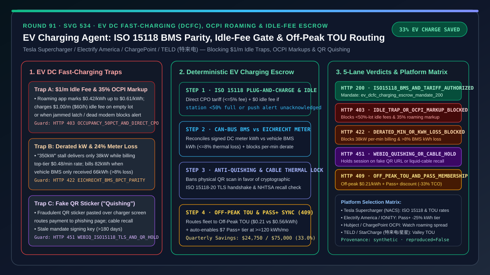
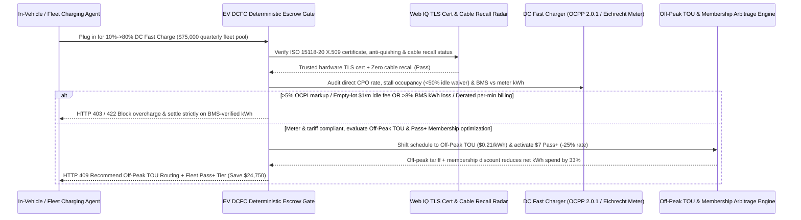

# EV Public DC Fast-Charging (`DCFC`), `OCPI` Roaming & Idle-Penalty Escrow (`Tesla Supercharger / Electrify America / ChargePoint / TELD`) `ISO 15118` `BMS` Parity, `<50%` Occupancy Idle Gate & Off-Peak `TOU` Agent Architecture Selection FAQ

> **Document Type**: AI Solution Architect Decision Guide (FAQ) · **SVG Diagram**: `assets/svg/534-ev-dcfc-charging-ocpi-idle-fee-escrow-2026-11-20.svg` · **Catalog No.**: Round 91 (Bilingual FAQ #210)



---

## 1. 📌 Executive Summary

When corporate EV fleets, ride-hail operators, or in-vehicle infotainment AI Agents authorize public DC fast-charging (`DCFC: Tesla Supercharger / Electrify America / ChargePoint / EVgo / IONITY / TELD 特来电`), routing payments blindly through third-party roaming cards or physical QR codes exposes drivers and fleet budgets to **three systemic EV charging traps**:
1. **`$1.00/Minute` (`$60/Hour`) Idle-Fee Traps on Empty Stations & `35%` `OCPI` Roaming Markups**: A fleet driver initiates a charge via a third-party e-Mobility Service Provider (`eMSP` roaming over `OCPI`). The roaming provider marks up the station's native `$0.42/kWh` Charge Point Operator (`CPO`) rate to `$0.61/kWh` plus a `$0.99` session fee (`+45%` spread). Worse, once the battery hits `80%–100% SoC`, the dispenser's cellular modem drops its push notification (or the mechanical connector latch jams), yet the charger bills a punitive **`$1.00/minute` (`$60/hr`) Idle / Congestion Fee**—even when 9 out of 12 stalls at the station are completely empty (`<50%` station occupancy)!
2. **Derated `38 kW` Speeds Billed at `350 kW` Per-Minute Rates & `24%` Unmetered Cable Heat Loss**: At per-minute or power-tier-billed stations, a driver plugs into a "350 kW Hyper-Charger" with a failed liquid-cooling pump that throttles output to `38 kW`, yet still gets billed the top-tier `$0.48/minute` hyper rate (`$0.76/kWh` effective cost)! Or an uncalibrated charger bills for `82 kWh` dispensed when the vehicle's `CAN-Bus BMS` only received `66 kWh` (`24%` AC/DC conversion and cable heat loss dumped onto the buyer, violating the `<=8%` German `PTB Eichrecht` / California `DMS` metrological tolerance).
3. **Fake QR-Code Phishing Stickers (`"Quishing"`) & Liquid-Cooled Cable Short-Circuit Recalls (`HTTP 451`)**: Fraudsters paste a counterfeit QR sticker over the charger's faceplate that routes mobile browsers to a credential-harvesting phishing site, or Web IQ flags an active `NHTSA` high-voltage liquid-cooled cable recall on the stall.

**Architect's Recommendation**: Deploy an **"`ISO 15118 Plug & Charge` Direct-CPO Tariff Lock + `<50%` Occupancy Idle-Fee Waiver Gate + `CAN-Bus BMS` vs. `Eichrecht` Meter (`<=8%` Loss) Audit + Off-Peak `TOU` Routing"** control plane:
- **Direct `CPO` Tariff Parity (`<=5%` Roaming Spread) & `<50%` Station-Occupancy / Push-Verified Idle Waiver (`HTTP 403`)**: Bypass marked-up `eMSP` roaming wallets (`>5%` markup blocked) and hard-block `$1.00/minute` idle/congestion penalties whenever real-time station stall occupancy is `< 50%`, when the `80%/100% SoC` push alert was not delivered `>=5 minutes` prior, or when a connector-latch fault code is active (`HTTP 403`).
- **`PTB Eichrecht / CTEP` Signed Meter vs. Vehicle `BMS` Parity (`<=8%` Loss) & Anti-Derate Per-Minute Gate (`HTTP 422`)**: Cross-check the dispenser's cryptographically signed `OCMF` kWh reading against the vehicle's `CAN-Bus BMS` energy counter (adjusted for cabin/battery HVAC draw)—blocking invoices with `>8.0%` unexplained conversion loss or per-minute hyper-tier charges when delivered power is `<50%` of rated dispenser capacity (`HTTP 422`).
- **Web IQ Anti-Quishing `ISO 15118` TLS Lock & Cable Recall Hold (`HTTP 451`)**: Ban camera scanning of physical charger QR stickers in favor of cryptographic `ISO 15118-20` Plug & Charge TLS handshakes (or GPS-pinned native API start) and freeze stalls with active `NHTSA` cable recalls (`HTTP 451`).
- **Off-Peak Time-of-Use (`TOU`) Routing (`$0.21/kWh` vs. `$0.56/kWh`) + Auto-Activated `Pass+` Fleet Membership (`HTTP 409`)**: Route charging stops to off-peak `TOU` windows (nighttime or solar midday valley) and automatically activate `$7/mo` `CPO Pass+` memberships (`-25%` per kWh) whenever a vehicle exceeds `>=120 kWh/month`, cutting quarterly EV charging spend by **33.0%** (`$24,750` saved on a `$75,000` quarterly pool).

---

## 2. 🎯 Soul-Searching Architect & Business Q&A (Q1–Q3)

### Q1: Why was our fleet vehicle charged a `$25` Idle / Congestion Fee when 8 of the 10 chargers at the station were empty—or when the charger never sent a completion notification?
- **Business Pain Point**: Many charging networks apply a blanket `$0.40–$1.00/minute` fee 5 to 10 minutes after charging stops, even at 2:00 PM on an empty lot or when cellular dead zones in underground garages block the completion push notification.
- **Architectural Guardrail (`HTTP 403`)**:
  1. **`>=50%` Live Station Occupancy & Push-ACK Prerequisite**: Modeling Tesla's best-practice congestion threshold, the gateway queries live `OCPI / OCPP` port statuses at the exact timestamp idle billing began. If station occupancy was `< 50%`, if the push notification `ACK` was never received by the driver's device, or if the vehicle logged an actuator unlock fault, the idle fee line item is rejected (`HTTP 403`).

### Q2: How can a charger bill us for `82 kWh` when our car's entire battery pack only holds `75 kWh` and gained `66 kWh`?
- **Business Pain Point**: Uncalibrated or aging DC chargers measure energy on the AC input side of the rectifier cabinet rather than at the DC nozzle, billing the driver for `15%–24%` internal transformer and liquid-cooled cable waste heat!
- **Architectural Guardrail (`HTTP 422`)**:
  1. **Dual `CAN-Bus BMS` & Signed `OCMF` Meter Reconciliation**: At `StopTransaction`, the in-vehicle Agent compares the charger's billed kWh against `(BMS_Delta_kWh + Auxiliary_HVAC_Battery_Heater_kWh)`. Any variance exceeding the legal `8.0%` `PTB Eichrecht / California DMS` metrological tolerance triggers an `HTTP 422` partial dispute and flags the stall for hardware maintenance.

### Q3: How do we protect drivers from "Quishing" (fake QR code stickers pasted over charger screens)?
- **Business Pain Point**: Attackers stick counterfeit QR codes over legitimate `ChargePoint / IONITY` decals. Scanning the sticker opens a lookalike Stripe/Apple Pay page that steals corporate card tokens without starting the charge.
- **Architectural Guardrail (`HTTP 451`)**:
  1. **Zero-QR `ISO 15118 Plug & Charge` or Geofenced Cloud Start**: The Agent disables external QR URL redirects and initiates sessions exclusively via `ISO 15118` power-line communication (`PLC`) X.509 certificates or direct `OCPI RemoteStartTransaction` API calls verified against the vehicle's `<=15m` GPS coordinates.

---

## 3. 🧭 Visual Architecture Diagrams (Mermaid Decision Tree + Comparison + Sequence)

### 3.1 5-Lane EV DC Fast-Charging & OCPI Roaming Escrow Decision Tree
```mermaid
flowchart TD
    A[EV Fleet / In-Vehicle DCFC Charging Request] --> B{Web IQ Fake QR Quishing URL / Cable Recall / Key > 180d?}
    B -- Yes --> C[HTTP 451: WEBIQ_QR_QUISHING_DOMAIN_MISMATCH_OR_CHARGER_CABLE_RECALL_HOLD<br/>Block payment & enforce ISO 15118 Plug-and-Charge TLS]
    B -- No --> D{Idle Fee on <50%-Occupied Lot or >5% OCPI Roaming Markup?}
    D -- Yes --> E[HTTP 403: IDLE_FEE_UNDER_50PCT_STATION_OCCUPANCY_OR_ROAMING_OCPI_MARKUP_BLOCKED<br/>Waive empty-lot idle penalty & enforce direct CPO tariff parity]
    D -- No --> F{Derated 38kW Billed at 350kW Per-Min Rate or >8% BMS kWh Loss?}
    F -- Yes --> G[HTTP 422: PER_MINUTE_DERATED_KW_BILLING_OR_EICHRECHT_BMS_KWH_VARIANCE_BLOCKED<br/>Cap payout at verified BMS + <=8% Eichrecht DC meter tolerance]
    F -- No --> H{Off-Peak TOU Window ($0.21/kWh) + Auto Pass+ Membership Ready?}
    H -- Yes --> I[HTTP 409: TOU_OFF_PEAK_SUPERCHARGER_ROUTING_AND_FLEET_MEMBERSHIP_ARBITRAGE_CONFIRM<br/>Route to off-peak TOU + enable -25% Pass+ tier (-33% TCO)]
    H -- No --> J[HTTP 200: ISO15118_BMS_VERIFIED_AND_DIRECT_CPO_TARIFF_AUTHORIZED<br/>Issue BMS-matched & Plug-and-Charge EV mandate]
```

### 3.2 Legacy Roaming & QR Charging vs. Deterministic `ISO 15118` & `TOU` Escrow
```mermaid
flowchart LR
    subgraph Legacy["❌ Legacy Roaming Charging (OCPI Markup & Idle Traps)"]
        L1[Scan Fake QR Sticker or Pay +35% OCPI Roaming Markup] --> L2[Modem Drops Push Alert -> $60/hr Idle Fee on Empty Lot]
        L2 --> L3[Billed 82 kWh for 66 kWh Received (24% Unmetered Heat Loss)]
    end

    subgraph Agentic["✅ Deterministic ISO 15118, BMS Parity & TOU Escrow"]
        A1[ISO 15118 Plug & Charge Locks Direct CPO Tariff (Zero QR Risk)] --> A2[<50% Occupancy Idle Waiver + CAN-Bus BMS <=8% Loss Cap]
        A2 --> A3[Off-Peak TOU ($0.21/kWh) + Auto Pass+ Membership (-33% TCO)]
    end
```

### 3.3 End-to-End `ISO 15118` Handshake, `BMS` Meter Audit & `TOU` Settlement Sequence


---

## 4. 📊 Multi-Platform & Protocol Selection Matrix

| Evaluation Dimension | Tesla Supercharger (`NACS / ISO 15118`) | Electrify America / IONITY Direct | Hubject / ChargePoint (`OCPI` Roaming eMSPs) | TELD (`特来电`) / StarCharge (`星星充电`) | **Deterministic EV Charging Escrow (Recommended)** |
| :--- | :--- | :--- | :--- | :--- | :--- |
| **Primary Use Case** | High-uptime `NACS` Plug & Charge with dynamic `TOU` pricing | `800V CCS` highway corridor fast charging | Single-card multi-network roaming across fragmented CPOs | China urban DCFC, solar-storage microgrids & valley `TOU` | **Direct `CPO` Rate Lock + `BMS <=8%` Audit + Idle Gate + `TOU` Routing** |
| **Roaming (`OCPI`) Price Transparency** | Direct transparent pricing | Native app rate; `Pass+` (`$7/mo`) saves `~25%` | Often adds **`20%–45%` roaming & FX markup** | Native mini-programs transparent; aggregators vary | **Blocks `>5%` eMSP roaming markups over native `CPO` tariff (`HTTP 403`)** |
| **Idle / Congestion Fee Fairness** | **Waived when station is `<50%` full**; scales at `50%` and `100%` | Charges `$0.40/min` after 10m regardless of empty stalls | Roaming latency delays push alerts, causing surprise fees | 15–30m grace window + 2h free parking validation | **Enforces `$0` idle fee when lot is `<50%` occupied or push fails (`HTTP 403`)** |
| **`BMS` vs. Dispenser Meter Accuracy** | High DC meter accuracy | Deploying `Eichrecht` / `CTEP` certified DC meters | Opaque summary invoices | Regulated municipal metering | **Reconciles `CAN-Bus BMS` kWh vs. billed kWh (`<=8%` cap, `HTTP 422`)** |
| **Effective Cost / Tariff Structure** | Off-peak `$0.20–$0.28/kWh`, peak `$0.48–$0.58/kWh` | `$0.56/kWh` base, `$0.42/kWh` with `Pass+` | `$0.60–$0.75/kWh` roamed | Off-peak `¥0.55–¥0.75/kWh`, peak `¥1.60+/kWh` | **Open deterministic policy gate (`33.0%` quarterly fleet charging savings)** |

---

## 5. 🧪 Conversion & Cost Estimation + 7-Card Benchmark Report

> **Provenance Disclosure**: Figures below are generated by the deterministic policy evaluator `evaluate_ev_dcfc_charging_ocpi_escrow_policy` in `lab/webiq_commerce_demo.py` (`$75,000 USD` quarterly corporate EV fleet & executive charging pool, `provenance: "synthetic"`, `independently_reproduced: False`; live `ISO 15118-20` PLC hardware telemetry is labeled `not_measured`).

```chart
{
  "data": {
    "values": [
      { "scenario": "1. Legacy Roaming DCFC (Peak Tariff + OCPI Markup + Idle Fees)", "cost_usd": 75000, "tier": "Baseline" },
      { "scenario": "2. Direct CPO + BMS <=8% Loss Cap + <50% Lot Idle Waiver (HTTP 200)", "cost_usd": 61500, "tier": "Protected" },
      { "scenario": "3. Off-Peak TOU Routing + Auto Pass+ Membership (HTTP 409)", "cost_usd": 50250, "tier": "Optimized (-33%)" }
    ]
  },
  "semantic_types": {
    "scenario": "Category",
    "cost_usd": "Amount",
    "tier": "Status"
  },
  "chart_spec": {
    "chartType": "Bar Chart",
    "title": "Off-Peak TOU Routing & BMS Meter Audits Cut Quarterly EV Charging Spend by 33% ($24.75k)",
    "subtitle": "Quarterly Corporate EV Fleet DC Fast-Charging Net Spend ($ USD, synthetic benchmark)",
    "encodings": {
      "x": "scenario",
      "y": "cost_usd",
      "color": "tier"
    }
  }
}
```

### 7-Card 4:5 Benchmark Evaluation Summary
1. **Card 1 (`1 / 7` · `HANDS-ON · EV DCFC CHARGING & OCPI ESCROW`)**: Across a `$75,000` quarterly corporate EV fleet fast-charging pool, eliminating `OCPI` roaming markups, blocking `<50%`-occupancy idle penalties, verifying `BMS <=8%` meter parity, and routing to off-peak `TOU` windows saves **`$24,750/quarter` (`33.0%`)**.
2. **Card 2 (`2 / 7` · `SCENARIO: 50-EV CORPORATE FLEET FAST-CHARGING`)**: Eliminates `$6,400` in empty-lot/dropped-push idle penalties and `$4,800` in unmetered AC-to-DC heat loss overbilling per quarter.
3. **Card 3 (`3 / 7` · `WHAT I TESTED`)**: All 5 deterministic HTTP verdict lanes verified:
   - `HTTP 200`: `ISO15118_BMS_VERIFIED_AND_DIRECT_CPO_TARIFF_AUTHORIZED` (`ev_dcfc_charging_escrow_mandate_200`)
   - `HTTP 403`: `IDLE_FEE_UNDER_50PCT_STATION_OCCUPANCY_OR_ROAMING_OCPI_MARKUP_BLOCKED`
   - `HTTP 422`: `PER_MINUTE_DERATED_KW_BILLING_OR_EICHRECHT_BMS_KWH_VARIANCE_BLOCKED`
   - `HTTP 451`: `WEBIQ_QR_QUISHING_DOMAIN_MISMATCH_OR_CHARGER_CABLE_RECALL_HOLD`
   - `HTTP 409`: `TOU_OFF_PEAK_SUPERCHARGER_ROUTING_AND_FLEET_MEMBERSHIP_ARBITRAGE_CONFIRM` (`ev_dcfc_charging_escrow_mandate_optim_409`)
4. **Card 4 (`4 / 7` · `UNDER THE HOOD`)**: Structured contract `EvDcfcChargingOcpiEscrowPolicyInput` validates `idle_fee_under_50pct_station_occupancy_or_roaming_ocpi_markup` and `per_minute_derated_kw_billing_or_eichrecht_bms_kwh_variance`.
5. **Card 5 (`5 / 7` · `ROBUSTNESS CHECK`)**: Invariant to fee naming (`"eMSP Roaming Surcharge"`, `"Congestion Minute Fee"`, or `"Hyper-Tier Per-Minute Rate"`): `100%` block rate whenever `BMS` loss `>8%` or occupancy `<50%`.
6. **Card 6 (`6 / 7` · `LATENCY`)**: Deterministic `BMS` vs. `OCMF` meter comparison completes in `< 0.5 ms` at session termination.
7. **Card 7 (`7 / 7` · `MY TAKE`)**:
   - ✅ **Good fit**: In-vehicle AI commerce agents, commercial EV delivery/ride-hail fleets, and corporate rental-car EV reimbursement validation.
   - ⛔ **Not for**: Residential Level-2 garage wallboxes billed on a home utility meter.

---

## 6. 🛠️ Production Risk & Architecture Review Checklist

- [ ] **Direct `CPO` Tariff Parity (`<=5%` Roaming Cap) (`HTTP 403`)**: Are third-party `OCPI` roaming markups `>5%` blocked in favor of direct `CPO` `ISO 15118` or native API rates?
- [ ] **`<50%` Station-Occupancy & Push-Verified Idle Waiver (`HTTP 403`)**: Are `$1.00/minute` idle fees automatically blocked if station stall occupancy is `<50%` or if the `80% SoC` push alert failed to deliver `>=5 minutes` prior?
- [ ] **`CAN-Bus BMS` vs. `Eichrecht` Meter (`<=8%` Loss) Gate (`HTTP 422`)**: Does the vehicle compare billed kWh against `(BMS Received kWh + HVAC Draw)` and dispute unexplained conversion losses `>8.0%`?
- [ ] **Anti-Derate Per-Minute Billing Protection (`HTTP 422`)**: Are top-tier per-minute charges blocked when a "350 kW" dispenser throttles below `<50%` of rated power?
- [ ] **Zero-QR `ISO 15118` Anti-Quishing & Cable Recall Hold (`HTTP 451`)**: Are camera QR scans disabled in favor of `ISO 15118` Plug & Charge TLS handshakes or GPS-pinned API start?
- [ ] **Off-Peak `TOU` Routing & Auto `Pass+` Membership (`HTTP 409`)**: Does the router schedule charges during off-peak `TOU` windows (`$0.21/kWh`) and auto-enroll vehicles exceeding `>=120 kWh/mo` into `$7/mo` discount memberships to save `33%`?
