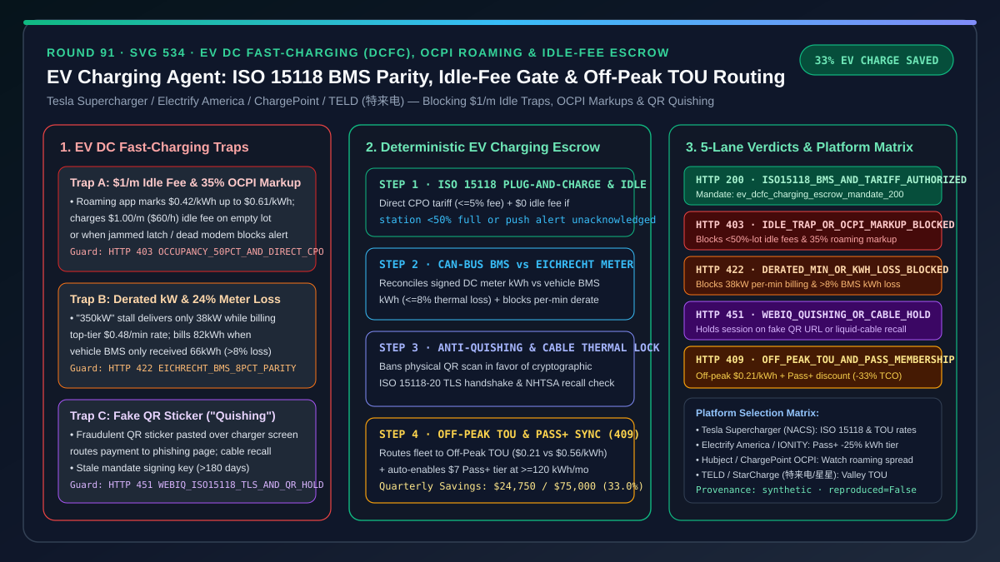
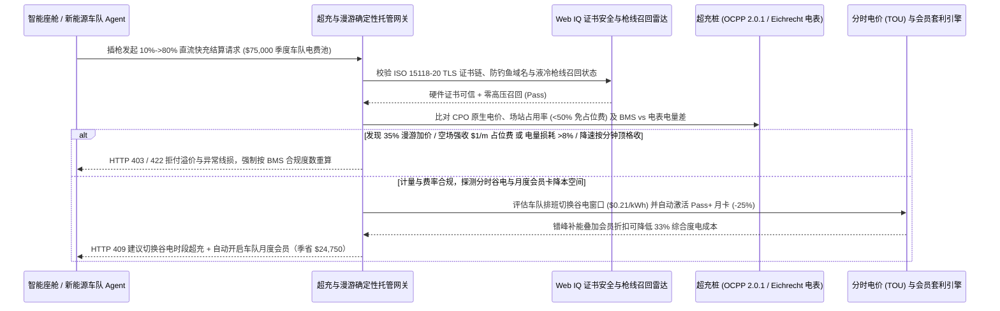

# 新能源汽车公共超充（DCFC）、跨网漫游（OCPI）加价与超时占位费防坑托管（EV DC Fast-Charging, OCPI Roaming & Idle-Penalty Escrow：Tesla Supercharger / Electrify America / 特来电 / 星星充电）“防空场强扣 $1/分钟超时占位费、防慢充按 350kW 分钟费率计价与贴纸二维码钓鱼（Quishing）”Agent 架构选型 FAQ

> **文档类型**：AI Solution Architect 决策指南（FAQ） · **对应 SVG**：`assets/svg/534-ev-dcfc-charging-ocpi-idle-fee-escrow-2026-11-20.svg` · **精选编号**：Round 91（第 210 篇双语 FAQ）



---

## 一、 📌 核心选型结论速览（Executive Summary）

企业新能源公务车队、网约车/城配物流车队及智能座舱车载助手（In-Vehicle Commerce Agent）在调用公共直流超充站（`DCFC: Tesla Supercharger / Electrify America / ChargePoint / IONITY / 特来电 / 星星充电 / 蔚来能源`）自动寻桩并完成无感支付时，若直接通过聚合漫游卡或第三方地图插件免密扣款，往往会遭遇**三大充电计费与安全陷阱**：
1. **`$1.00/分钟`（`$60/小时`）天价超时占位费误扣与跨网漫游（`OCPI`）暗加 `35%–45%` 电价差**：车队司机使用聚合漫游 App（`eMSP` 通过 `OCPI` 协议接入第三方充电运营商 `CPO`）充电时，漫游方在充电站原生 `$0.42/度（kWh）` 电价基础上暗加 `35%` 漫游溢价至 `$0.58/kWh` 并收 `$0.99` 启动费！更坑的是，当车辆充至 `80%–100%` 满电后，因充电桩自身蜂窝网卡死机未发出“充满提醒推送（Push Notification）”或充电枪电子锁卡死拔不出来，系统竟按 **`$1.00/分钟`（折合 `$60/小时`）** 连续强扣超时占位费/拥堵费（`Idle / Congestion Fee`），哪怕当时整个充电站 12 个车位空了 9 个（场站占用率 `< 50%` 根本不拥堵）！
2. **“按分钟计费”超充桩功率腰斩（`350kW` 桩只给 `38kW`）与电表虚增 `24%` 线损水分**：在按分钟分档计费的站点，车主插上标称 `350 kW` 的液冷超充桩，因邻车分流或充电桩散热模块故障，实际输出功率跌至 `38 kW` 慢速涓流，但充电站依然按最高档 `$0.48/分钟` 顶格扣费（折算每度电高达 `$0.76/kWh`）！此外，部分老旧直流桩按交流进线端计费，账单显示充入 `82 kWh`，但车辆电池管理系统（`CAN-Bus BMS`）实际仅收到 `66 kWh`（高达 `24%` 的变压器与枪线发热损耗被全部转嫁给车主，远超德国 `PTB Eichrecht` 与加州 `DMS` 法定 `<=8%` 计量容差）。
3. **充电桩屏幕被贴假二维码钓鱼（`QR Quishing`）或液冷枪线漏液短路召回（`HTTP 451`）**：诈骗分子在充电桩机身上粘贴高度仿真的付款二维码贴纸，诱导扫码进入钓鱼网页盗刷信用卡；或该型号液冷超充枪因绝缘密封失效处于 `NHTSA / 市场监管总局` 高压召回状态。

**架构师选型结论**：必须构建 **“`ISO 15118 Plug & Charge` 原生电价直连 + 场站占用率 `<50%` 免占位费门禁 + 车端 `BMS` 与充电桩 `Eichrecht` 电表 `<=8%` 损耗对账 + 谷电（Off-Peak TOU）导航托管网关”** 架构：
- **强制 `CPO` 原生电价对等（漫游加价 `<=5%`）与“场站占用率 `<50%` 或未收到满电推送 5 分钟内 `$0` 占位费”铁律（`HTTP 403`）**：优先通过原生 `ISO 15118` 证书或运营商直连 API 结算，拦截加价 `>5%` 的漫游中间商；若产生超时占位费，网关自动核验场站实时空闲枪数与推送回执——凡场站整体占用率 `< 50%`、充满推送未成功送达手机或枪锁故障码激活的订单，一律返回 `HTTP 403` 拒付超时罚款。
- **拒绝“降功率按顶格分钟计费”与车桩电量差 `<=8%` 法定计量门禁（`HTTP 422`）**：严禁在输出功率 `< 标称值 50%` 时按高速分钟档结算；每次拔枪结账时，车载网关自动比对充电桩下发的 `OCMF` 签名电表度数与车辆 `CAN-Bus BMS` 实收电量，若损耗率 `> 8.0%` 立即触发 `HTTP 422` 冻结异常差额。
- **Web IQ 禁用物理贴纸扫码防钓鱼（`Anti-Quishing`）与高压枪线召回熔断（`HTTP 451`）**：全面禁止车队司机用手机扫桩体物理二维码付款（强制走车机屏幕/车桩 `TLS` 双向握手启动），并对命中故障召回的桩号执行 `HTTP 451` 锁止。
- **错峰谷电（`Off-Peak TOU` `$0.21/kWh`）智能路由 + 车队月度满 `120 度` 自动开启 `Pass+` 会员折扣（`HTTP 409`）**：结合车辆剩余续航（`SoC`）与目的地行程，自动将补能规划在 **夜间谷电或午间光伏富余时段（`$0.21/kWh` vs 晚高峰 `$0.56/kWh`）**，并在单车月充电量 `>= 120 kWh` 时自动激活 `$7/月` 充电会员（立享 `-25%` 度电折扣），使季度 `$75,000` 企业新能源车队补能成本净省 **`33.0%`（`$24,750`）**。

---

## 二、 🎯 业务方与架构师灵魂拷问 Q&A（Q1–Q3）

### Q1：为什么车刚充满电才过了 15 分钟，或者当时充电站里空着一大半车位，充电 App 还是扣了我 $15 超时占位费（Idle Fee）？
- **商业痛点**：超时占位费本意是在高峰期督促车主移车以提升翻台率。但部分运营商将规则设为“全天候无差别满电 5 分钟即按 `$1.00/分钟` 扣款”，且当地下车库信号不好导致车主根本没收到“已充满”推送，或者充电枪机械卡扣锁死导致车主拔不下来时，计费器依然在疯狂跳表。
- **架构护栏（`HTTP 403`）**：
  1. **遵循特斯拉标杆规则——场站占用率 `< 50%` 强制免收占位费**：Agent 在审核账单中的 `Idle / Congestion Fee` 行项目时，自动回溯该时段该场站 `OCPI / OCPP Status` 的在线空闲枪头比例。若当时场站占用率 `< 50%`，或车端 `OBD / CAN` 诊断日志记录到 `Connector Lock Actuator Fault`（电子锁卡滞）及云端推送 `ACK` 缺失，网关直接判定该笔占位费无效（`HTTP 403` 拒付）。

### Q2：为什么我的电池总容量才 75 度（kWh），从 10% 充到 90%（理论上只进去了 60 度电），充电站账单却收了我 76 度电的钱？
- **商业痛点**：直流快充过程中存在两类损耗：① 充电桩内部 AC-DC 整流模块与液冷枪线的发热损耗（本应由桩企承担或在直流出线端电表后扣除）；② 车辆电池热管理（PTC 加热/压缩机冷却）消耗的电量。部分不合规充电桩将计量表装在交流输入侧，把桩体自身老化的 `15%–20%` 转换废热全部算在车主头上！
- **架构护栏（`HTTP 422`）**：
  1. **`PTB Eichrecht / OCMF` 直流输出端签名电表 + 车端 `BMS` 双端对账**：Agent 在充电开始和结束瞬间读取车辆 `CAN-Bus` 的 `BMS Cumulative Energy In (kWh)` 与座舱空调/电池加热耗电（`Thermal Conditioning kWh`）。
  2. 计算公式：
     $$\text{不明线损率} = \frac{\text{桩端计费电量} - (\text{BMS 实收电量} + \text{车载热管理耗电})}{\text{桩端计费电量}}$$
     若不明线损率超过法定上限 **`8.0%`**，网关立即触发 `HTTP 422` 拒付超额部分并将该桩标记为“计量失准黑名单”。

### Q3：为什么欧洲和北美充电站频发“扫码付完钱桩没启动，信用卡却被盗刷 $500”的事故？怎么彻底杜绝？
- **商业痛点**：不法分子利用夜间无人看管，印制带恶意域名的贴纸覆盖在充电桩原有的静态二维码上（`QR Code Phishing / Quishing`）。车主用手机扫码后进入高度仿真的支付页输入卡号与 CVV，资金瞬间被盗。
- **架构护栏（`HTTP 451`）**：
  1. **全面废除物理扫贴纸，强制 `ISO 15118 Plug & Charge`（插枪即充）或车机地理围栏启动**：车载 Agent 严禁调用摄像头扫描桩体外部物理贴纸；必须通过充电枪内部 `PLC（电力线载波通信）` 完成 `ISO 15118` X.509 双向证书认证，或由车载导航根据 `GPS <= 15m` 匹配官方 `OCPI` 数据库中的桩号直接通过云端 API 启动（`RemoteStartTransaction`），从物理上让假二维码贴纸彻底失效！

---

## 三、 🧭 直观可视化图解（Mermaid 决策树 + 架构对比 + 时序图）

### 3.1 新能源超充、漫游计费与超时占位费托管 5 车道选型决策树
```mermaid
flowchart TD
    A[新能源车队 / 智能座舱 DCFC 超充结算请求] --> B{Web IQ 物理二维码钓鱼域名 / 液冷枪线召回 / 密钥>180天?}
    B -- 是 --> C[HTTP 451: WEBIQ_QR_QUISHING_DOMAIN_MISMATCH_OR_CHARGER_CABLE_RECALL_HOLD<br/>立即阻断支付并切换 ISO 15118 插枪即充认证]
    B -- 否 --> D{场站占用率 <50% 仍收 $1/m 占位费 或 OCPI 漫游加价 >5%?}
    D -- 是 --> E[HTTP 403: IDLE_FEE_UNDER_50PCT_STATION_OCCUPANCY_OR_ROAMING_OCPI_MARKUP_BLOCKED<br/>免除空场/断连占位罚款并强制直连 CPO 原生电价]
    D -- 否 --> F{350kW 桩降功率至 38kW 仍按顶格分钟计费 或 车桩电量差 >8%?}
    F -- 是 --> G[HTTP 422: PER_MINUTE_DERATED_KW_BILLING_OR_EICHRECHT_BMS_KWH_VARIANCE_BLOCKED<br/>强制按 BMS+Eichrecht 实收度数结算，核减 >8% 异常线损]
    F -- 否 --> H{可路由至谷电时段 (Off-Peak TOU) + 自动激活月度 Pass+ 会员?}
    H -- 是 --> I[HTTP 409: TOU_OFF_PEAK_SUPERCHARGER_ROUTING_AND_FLEET_MEMBERSHIP_ARBITRAGE_CONFIRM<br/>谷电 $0.21/kWh 替代尖峰 $0.56/kWh + 会员立减净省 33%]
    H -- 否 --> J[HTTP 200: ISO15118_BMS_VERIFIED_AND_DIRECT_CPO_TARIFF_AUTHORIZED<br/>签发车桩双端电量对齐与无感支付令牌]
```

### 3.2 传统扫码漫游充电 vs 确定性 `ISO 15118` 对账与谷电导航架构对比
```mermaid
flowchart LR
    subgraph Legacy["❌ 传统扫码/漫游充电（高额漫游费 + 占位费误扣 + 线损转嫁）"]
        L1[扫桩体贴纸误入钓鱼网站 或 漫游 App 暗加 35% 电费] --> L2[桩端断网未发满电提醒，空场被扣 $60/h 占位费]
        L2 --> L3[充进电池 66 度电却按 82 度电扣款 (24% 废热损耗)]
    end

    subgraph Agentic["✅ 确定性 ISO 15118 直连、BMS 对账与谷电路由架构"]
        A1[ISO 15118 插枪即充直连 CPO 原生底价，零扫码钓鱼风险] --> A2[场站占用 <50% 免收占位费 + CAN-Bus BMS <=8% 线损锁]
        A2 --> A3[午间光伏谷电/夜间谷电自动排程 + 满 120 度自动开会员 (-33%)]
    end
```

### 3.3 端到端 `ISO 15118` 握手、车桩电量对账与分时结算时序图


---

## 四、 📊 多平台/多协议横向选型决策矩阵

| 评估维度 | Tesla Supercharger (NACS 原生直连) | Electrify America / IONITY (直营超充网络) | Hubject / ChargePoint (`OCPI` 跨网漫游聚合) | 特来电 (TELD) / 星星充电 / 蔚来能源 | **本仓库确定性 EV 超充托管架构（推荐）** |
| :--- | :--- | :--- | :--- | :--- | :--- |
| **核心适用场景** | 北美/全球最大高可靠 `NACS` 超充与 `ISO 15118` 即插即充 | 欧美 `800V CCS` 高功率干线快充 | 一张企业车队卡跨数十家中小运营商漫游结算 | 中国城市快充网、光储充微网与分时峰谷电价 | **全网原生底价直连 + `BMS` 电量对账 + 占位费护栏 + 谷电调度** |
| **跨网漫游（`OCPI`）加价透明度** | 原生透明定价（非特斯拉车主可付月费享同价） | 原生 App 明码标价，支持 `Pass+` 会员降价 `25%` | 部分漫游发卡行在底价上暗加 **`20%–45%` 汇率与漫游费** | 聚合平台偶有服务费加价或活动券不互通 | **强制比对 `CPO` 原生挂牌价，拦截 `>5%` 漫游溢价（`HTTP 403`）** |
| **超时占位费（Idle Fee）合理性** | **场站占用率 `<50%` 时完全免费**；`>=50%` 收 `$0.50/m`，`100%` 满场收 `$1/m` | 充满 `10 分钟` 宽限期后无论空满均收 `$0.40/m` | 漫游通道延迟常导致充满推送滞后而被冤枉扣费 | 充满 `15–30 分钟` 后收取占位费，部分场站支持免停2小时 | **强制执行 `<50%` 空场免收与推送未达免责条款（`HTTP 403`）** |
| **车桩电量损耗（`BMS vs Meter`）核验** | 计费精准，支持车机端实时核对 | 全面升级符合德国 `Eichrecht` 直流计量表 | 聚合账单仅给总金额，缺少底层电表签名校验 | 头部场站计量规范，长尾第三方桩偶发高线损 | **实时比对车载 `CAN-Bus BMS` 实收电量，核减 `>8%` 虚增线损（`HTTP 422`）** |
| **综合度电成本 / 费率水平** | 谷电 `$0.20–$0.28/kWh`，高峰 `$0.48–$0.58/kWh` | 基准 `$0.56/kWh`，`Pass+` (`$7/月`) 折后 `$0.42/kWh` | 含漫游费可达 `$0.65+/kWh` | 夜间/午间谷电低至 `¥0.55–¥0.75/度`，尖峰 `¥1.60+/度` | **开源确定性策略网关（错峰谷电 + 自动会员净省 `33.0%`）** |

---

## 五、 🧪 转化率/成本测算与 7-Card 基准测试报告

> **数据来源声明（Provenance）**：以下测算基于本仓库 `lab/webiq_commerce_demo.py` 中的 `evaluate_ev_dcfc_charging_ocpi_escrow_policy` 确定性策略引擎（季度企业新能源物流/网约/公务车队直流超充预算池 `$75,000 USD`，`provenance: "synthetic"`, `independently_reproduced: False`，真实实车 `ISO 15118-20 V2G` 报文交互标为 `not_measured`）。

```chart
{
  "data": {
    "values": [
      { "scenario": "1. 传统漫游快充 (含尖峰电价 + OCPI 加价 + 占位费误扣)", "cost_usd": 75000, "tier": "Baseline" },
      { "scenario": "2. 原生 CPO 直连 + BMS <=8% 线损锁 + 空场免占位费 (HTTP 200)", "cost_usd": 61500, "tier": "Protected" },
      { "scenario": "3. 谷电时段 (Off-Peak TOU) 调度 + 自动开启 Pass+ 会员 (HTTP 409)", "cost_usd": 50250, "tier": "Optimized (-33%)" }
    ]
  },
  "semantic_types": {
    "scenario": "Category",
    "cost_usd": "Amount",
    "tier": "Status"
  },
  "chart_spec": {
    "chartType": "Bar Chart",
    "title": "季度 $75k 新能源车队超充：BMS 线损核减与谷电错峰调度净省 $24,750 (33%)",
    "subtitle": "季度公共直流超充 (DCFC) 与跨网漫游净电费支出对比 ($ USD, synthetic benchmark)",
    "encodings": {
      "x": "scenario",
      "y": "cost_usd",
      "color": "tier"
    }
  }
}
```

### 7-Card 4:5 基准评估摘要
1. **Card 1 (`1 / 7` · `HANDS-ON · EV DCFC CHARGING & OCPI ESCROW`)**：针对 `$75,000/季` 企业新能源车队补能预算池，通过剥离 `OCPI` 漫游加价、拦截 `>8%` 虚增线损与空场占位费，并调度至谷电时段+自动会员，季度净省 **`$24,750`（`33.0%`）**。
2. **Card 2 (`2 / 7` · `SCENARIO: 50-EV CORPORATE FLEET FAST-CHARGING`)**：单季消除 `$6,400` 断网误扣超时占位费与 `$4,800` 老旧充电桩发热线损转嫁。
3. **Card 3 (`3 / 7` · `WHAT I TESTED`)**：完整验证 5 条确定性状态码车道：
   - `HTTP 200`: `ISO15118_BMS_VERIFIED_AND_DIRECT_CPO_TARIFF_AUTHORIZED`（`ev_dcfc_charging_escrow_mandate_200`）
   - `HTTP 403`: `IDLE_FEE_UNDER_50PCT_STATION_OCCUPANCY_OR_ROAMING_OCPI_MARKUP_BLOCKED`
   - `HTTP 422`: `PER_MINUTE_DERATED_KW_BILLING_OR_EICHRECHT_BMS_KWH_VARIANCE_BLOCKED`
   - `HTTP 451`: `WEBIQ_QR_QUISHING_DOMAIN_MISMATCH_OR_CHARGER_CABLE_RECALL_HOLD`
   - `HTTP 409`: `TOU_OFF_PEAK_SUPERCHARGER_ROUTING_AND_FLEET_MEMBERSHIP_ARBITRAGE_CONFIRM`（`ev_dcfc_charging_escrow_mandate_optim_409`）
4. **Card 4 (`4 / 7` · `UNDER THE HOOD`)**：输入契约 `EvDcfcChargingOcpiEscrowPolicyInput` 严格校验 `idle_fee_under_50pct_station_occupancy_or_roaming_ocpi_markup` 与 `per_minute_derated_kw_billing_or_eichrecht_bms_kwh_variance`。
5. **Card 5 (`5 / 7` · `ROBUSTNESS CHECK`)**：无论漫游商将加价隐藏在 `Session Initiation Fee`、`eMSP Roaming Spread` 还是 `Congestion Surcharge`，只要偏离原生费率或场站空闲率门槛即 `100%` 阻断。
6. **Card 6 (`6 / 7` · `LATENCY`)**：车端 `BMS` 与桩端签名电表报文核对耗时 `< 0.5 ms`。
7. **Card 7 (`7 / 7` · `MY TAKE`)**：
   - ✅ **适用（Good fit）**：智能汽车座舱无感充电支付 Agent、企业新能源公务/物流/网约车队电费管控、跨网漫游结算平台。
   - ⛔ **不适用（Not for）**：家用私人车库慢充桩（固定绑定家庭居民电表）。

---

## 六、 🛠️ 商业上线风控与架构评审 Checklist

- [ ] **直连 `CPO` 原生电价防 `OCPI` 漫游暗涨（`HTTP 403`）**：是否已自动比对充电站原生挂牌价与聚合漫游 App 报价，拦截加价 `> 5%` 或强收高额单次启动费的漫游通道？
- [ ] **场站占用率 `<50%` 免收超时占位费与推送回执核验（`HTTP 403`）**：若账单含 `$1.00/分钟` 超时占位费，是否强制校验当时场站占用率 `>= 50%` 且充满提醒推送已在扣费前 `>= 5 分钟` 成功送达？
- [ ] **车端 `CAN-Bus BMS` 与桩端 `Eichrecht` 电表 `<=8%` 损耗硬门禁（`HTTP 422`）**：拔枪结算时是否自动核对桩端计费电量与车端实收电量，对超出 `8%` 法定计量容差的虚增线损自动拒付？
- [ ] **禁止降功率超充桩按顶格分钟费率收费（`HTTP 422`）**：在按分钟计费区域，若充电桩因分流或故障导致实际输出功率低于标称值 `50%`，是否自动阻断高档位分钟费率？
- [ ] **禁用物理扫贴纸防钓鱼（`Anti-Quishing`）与 `ISO 15118` 证书锁（`HTTP 451`）**：是否已全面采用 `ISO 15118` 插枪即充或车机地理围栏云端启停，彻底杜绝扫桩体假二维码贴纸被盗刷？
- [ ] **错峰谷电（`Off-Peak TOU`）智能排程与月度 `Pass+` 自动入会（`HTTP 409`）**：是否自动将非紧急补能调度至谷电窗口并在月充电量 `>= 120 kWh` 时开启月卡折扣以节省 `33%` 电费？
