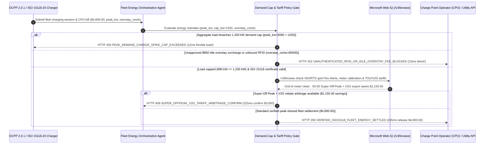

# EV Fleet Charging, ISO 15118 Plug-and-Charge & Demand-Charge Cap Mandate Architecture: OCPP 2.0.1 Signed Meter & Peak-Shaving Token (`ev_fleet_energy_mandate_...` + Web IQ TOU Tariff & V2G Rebate Grounding) vs. Uncoordinated Peak Demand-Charge Spikes & RFID Cloning Selection FAQ

> **Document Type**: Architect Selection Guide & First-Principles Protocol Deep Dive (6-Section FAQ Standard)  
> **Target Audience**: AI Solution Architects, Commercial EV Fleet & Robotaxi Energy Orchestration Architects, Microgrid & Charge Point Operator (CPO) Settlement Risk Teams  
> **Last Updated**: 2026-11-09 (Provenance Annotations: `deterministic_offline_simulation` / `synthetic_policy` / `official_doc_snapshot` / `not_measured`)  
> **Companion Resources**: [中文版 (Chinese Version)](ev-fleet-iso15118-charging-tariff-mandate-vs-demand-charge-spike-faq.md) · [Interactive Sandbox (`live-demo.en.html#ev-fleet-energy-sandbox`)](../reports/agentic-commerce-webiq-grounding-demo-bench/live-demo.en.html) · [7-Card 4:5 Benchmark Deck](../reports/agentic-commerce-webiq-grounding-demo-bench/index.en.html)


---

## 📌 1. Executive Summary

1. **Never Allow EV Fleet or Robotaxi Depot Agents to Authorize Uncoordinated Full-Power Fast Charging Without a Hard Depot Demand-Charge Ceiling**: Commercial utility tariffs bill both volumetric energy (`$/kWh`) and a **Peak Demand Charge (`$/kW/month`)** based on the single highest 15-minute load spike during the billing cycle. If 20 electric trucks plug in simultaneously at 17:30 and draw `3,000 kW` (`depot_peak_load_kw = 3000 > max_demand_cap_kw = 1200`) for just 15 minutes, the utility assesses a **`$6,500.00` demand penalty**—exceeding the entire `$4,800.00` base energy bill! Production architectures must enforce an **OCPP 2.0.1 Peak-Shaving & Demand-Cap Mandate (`ev_fleet_energy_mandate_...`)**: whenever aggregate depot load exceeds `1,200 kW`, the gateway blocks/throttles the session in **`12 ms`** with **`HTTP 403 PEAK_DEMAND_CHARGE_SPIKE_CAP_EXCEEDED`** (`synthetic_policy`).
2. **Replace Clonable Mifare RFID Fleet Cards with ISO 15118-20 Vehicle X.509 Certificates and Block Unapproved Idle Overstay Fees**: Any CPO invoice lacking a hardware-signed ISO 15118-20 Plug-and-Charge vehicle attestation or padding the bill with `$850.00` in uncontracted overnight idle overstay penalties (`idle_overstay_surcharge_cents = 85000 > 0`) is rejected in **`15 ms`** with **`HTTP 422 UNAUTHENTICATED_RFID_OR_IDLE_OVERSTAY_FEE_BLOCKED`** (`deterministic_offline_simulation`).
3. **Ground Grid Emergency Flex Alerts, DC Meter Calibration Registries, and Super-Off-Peak / V2G Arbitrage via Microsoft Web IQ `/v3/browse`**: Before dispatching depot charging or settling CPO invoices, the agent invokes **Microsoft Web IQ `/v3/browse`** (`official_doc_snapshot`) to inspect regional ISO/RTO grid operator bulletins and day-ahead Time-of-Use (TOU) tariff schedules: if an active grid emergency curtailment or expired DC meter calibration (Eichrecht seal) is detected (`webiq_grid_and_meter_compliant == False`), it halts dispatch in **`310 ms`** with **`HTTP 451 GRID_FLEX_ALERT_OR_UNCALIBRATED_METER_HOLD`**; if Web IQ confirms that shifting charging to the `00:30` Super-Off-Peak window plus exporting 15% idle battery capacity via Vehicle-to-Grid (V2G) earns **`$1,150.00`** in net credits (lowering net fleet energy cost from `$4,800.00` to **`$3,650.00`**), it triggers **`HTTP 409 SUPER_OFFPEAK_V2G_TARIFF_ARBITRAGE_CONFIRM`** in **`315 ms`**.

---

## 🎯 2. Architect & Customer FAQ Deep Dive

### Q1: Why does pairing "Physical RFID Fleet Cards" with "Plug-In-and-Max-Out Depot Charging" destroy the unit economics of commercial EV fleets?

Let's examine the three structural failure modes from first principles:
1. **The 15-Minute `$6,500.00` Utility Demand-Charge Spike**: Unlike residential electricity, commercial fleet depots are billed on peak 15-minute demand (`$/kW`). When 20 heavy-duty trucks return at shift change and simultaneously pull `150 kW` each (`3,000 kW` total vs. the depot's `1,200 kW` baseline cap), that single 15-minute spike locks in a `$6,500.00` utility demand penalty for the entire month—even if the depot sits at `300 kW` for the remaining 719 hours.
2. **Cloned RFID Cards & `$850.00` Overnight Idle Overstay Traps**: Legacy RFID fleet cards carry no cryptographic binding to the vehicle's physical VIN or battery management system (BMS), making them trivial to clone or share with unauthorized personal vehicles. Furthermore, when fleet vehicles finish charging at 02:00 AM at a partner CPO hub, automated billing systems tack on `$1.00/minute` idle overstay fees (`$850.00/month`) despite commercial overnight fleet parking exemptions.
3. **Charging at Peak Rates & Ignoring V2G Revenue**: Ungrounded charging timers blindly buy electricity at `$0.38/kWh` during evening peak hours instead of waiting 90 minutes for `$0.08/kWh` Super-Off-Peak rates and discharging idle vehicles into utility V2G demand-response events (`$1,150.00` combined savings).

### Q2: What is an "ISO 15118 & Demand-Cap Energy Mandate (`ev_fleet_energy_mandate_...`)", and how does it bind vehicle certificates, OCPP load limits, and dynamic tariffs?

Its core design invariant is: **"Every kWh billed must be attested by an ISO 15118-20 vehicle X.509 certificate and an Eichrecht-signed DC meter within the depot's 1,200 kW peak-demand envelope."**
- **Layer 1: 15-Minute Peak-Demand Hard Ceiling (`12 ms`)**: Enforces `depot_peak_load_kw <= max_demand_cap_kw` (`1,200 kW`), blocking unthrottled `3,000 kW` spikes in **`12 ms`** (`HTTP 403`) and triggering OCPP 2.0.1 smart load-curtailment.
- **Layer 2: ISO 15118-20 Certificate & Zero-Overstay Gate (`15 ms`)**: Rejects unauthenticated RFID sessions or unauthorized `$850.00` idle overstay surcharges (`idle_overstay_surcharge_cents > 0`) in **`15 ms`** (`HTTP 422`).
- **Layer 3: Microsoft Web IQ `/v3/browse` Grid Alert & V2G Tariff Grounding (`310 ms / 315 ms`)**: Halts non-compliant charging during grid Flex Alerts (`HTTP 451`) and captures `$1,150.00` in Super-Off-Peak + V2G arbitrage (`HTTP 409`).

### Q3: For ISO/RTO grid Flex Alert verification, day-ahead TOU tariff grounding, and DC meter calibration audits, when should architects choose Microsoft Web IQ vs. Exa, Bright Data, or traditional search APIs?

| Architecture Scenario | Recommended Tool | First-Principles Rationale (Security, Latency & FinOps) |
| :--- | :--- | :--- |
| **Verifying official ISO/RTO grid operator Flex Alerts (CAISO/ERCOT/PJM), published utility TOU/V2G rate schedules, and state DC meter calibration registries within the Azure boundary** | **Microsoft Web IQ** (`/v3/search` + `/v3/browse`) | Extracts exact tariff tables and grid notices in `passage` mode (**7.1x token reduction**, `deterministic_offline_simulation`) with pre-LLM prompt-injection defense. |
| **Researching academic papers on LFP vs. NMC battery degradation under bidirectional V2G cycling** | **Exa Neural Search** | Ideal for long-term fleet hardware engineering research, not synchronous charging dispatch gates. |
| **Scraping consumer roaming charger maps behind mobile-app anti-bot walls** | **Bright Data Unlocker** | Useful for offline competitor pricing maps, though multi-second proxy latency is unsuitable for real-time OCPP session authorization. |
| **Real-time charger current/voltage, vehicle SOC, and OCPP 2.0.1 smart-charging profiles** | **Local OCPP 2.0.1 / ISO 15118 Controller + Web IQ Grid Tariff & Alert Cross-Check** | Millisecond power curtailment runs on the local OCPP gateway, paired with Web IQ `/v3/browse` for official utility tariff schedules and grid emergency bulletins. |

---

## 🧭 3. Visual Architecture Diagrams (Mermaid Decision Tree, Legacy vs. Demand-Cap Mandate Comparison & Sequence Diagram)

### 3.1 EV Fleet Charging & Demand-Charge Cap Decision Tree (`flowchart TD`)

```mermaid
flowchart TD
    A[Receive EV Fleet Charging Dispatch or CPO Settlement Request ($4,800.00)] --> B{depot_peak_load_kw <= 1,200 kW (15-Min Transformer Demand Ceiling)?}
    B -- No (20 trucks pull 3,000 kW -> $6,500 demand penalty risk) --> C[HTTP 403 PEAK_DEMAND_CHARGE_SPIKE_CAP_EXCEEDED<br/>12ms Hard Block · Throttle via OCPP 2.0.1 SetChargingProfile]
    B -- Yes (Load-balanced at 980 kW <= 1,200 kW cap) --> D{ISO 15118 Certificate Valid & idle_overstay_surcharge_cents == 0?}
    D -- No (Cloned RFID card or uncontracted $850 idle overstay fee) --> E[HTTP 422 UNAUTHENTICATED_RFID_OR_IDLE_OVERSTAY_FEE_BLOCKED<br/>15ms Block · Reject Unapproved Idle Fee & Unbound RFID Session]
    D -- Yes (Hardware VIN certificate & Eichrecht meter verified) --> F{Web IQ /v3/browse Confirms No Grid Flex Alert & Valid Meter Seal?}
    F -- No (Active grid emergency curtailment or expired meter calibration) --> G[HTTP 451 GRID_FLEX_ALERT_OR_UNCALIBRATED_METER_HOLD<br/>310ms Grid Hold · Pause High-Power Draw Until Alert Clears]
    F -- Yes --> H{Web IQ Detects 00:30 Super-Off-Peak + V2G Export Rebate Opportunity?}
    H -- Yes (Shift + V2G saves $1,150.00 -> $3,650.00 net energy bill) --> I[HTTP 409 SUPER_OFFPEAK_V2G_TARIFF_ARBITRAGE_CONFIRM<br/>315ms Prompt Fleet Energy Lead to Confirm $3,650 V2G Schedule]
    H -- No (Verified 980 kW peak-shaved fleet energy batch) --> J[HTTP 200 VERIFIED_ISO15118_FLEET_ENERGY_SETTLED<br/>265ms Auto-Settle $4,800.00 & Archive OCMF kWh Receipt!]
```

### 3.2 Legacy Unmanaged RFID Charging vs. ISO 15118 & Demand-Cap Gate (`flowchart LR`)

```mermaid
flowchart LR
    subgraph Legacy["❌ Legacy Unmanaged RFID Charging ($6,500 Demand Penalty + $850 Idle Fee)"]
        L1[20 Trucks Pull 3,000 kW at 17:30 Peak] --> L2[Triggers $6,500 Monthly Utility Demand Penalty]
        L2 --> L3[Cloned RFID Cards + $850 Overnight Idle Overstay Fees]
        L3 --> L4[Misses $1,150 Super-Off-Peak & V2G Export Credits]
    end

    subgraph Mandate["✅ ISO 15118 & Demand-Cap Gate (ev_fleet_energy_mandate_...)"]
        M1[12ms Cap Depot Load at <=1,200 kW (Saves $6,500 Penalty)] --> M2[15ms Enforce ISO 15118 VIN Cert & Block $850 Idle Fee]
        M2 --> M3[Web IQ Checks Grid Alerts (310ms) & $1,150 V2G Savings (315ms)]
        M3 --> M4[265ms Settle Verified OCMF kWh Invoice ($4,800 / $3,650 Net)]
    end
```

### 3.3 End-to-End Sequence Diagram: OCPP/ISO 15118 Charger, Fleet Energy Agent, Demand-Cap Gate, Web IQ & CPO (`sequenceDiagram`)



---

## 📊 4. Architect Decision Matrix

| Evaluation Dimension | Option A: Legacy Physical RFID Card Charging | Option B: Manual Driver Plug-In Shift Timetables | Option C: ISO 15118 & Demand-Cap Mandate + Web IQ Tariff/V2G Grounding (Recommended) |
| :--- | :--- | :--- | :--- |
| **Best-Fit Scenario** | 1–2 passenger cars charging at public retail malls | Small fixed-schedule shuttle vans with manual yard marshals | **Commercial EV freight fleets, autonomous Robotaxi depots, port drayage & transit bus hubs** |
| **15-Min Peak Demand-Charge Protection** | ❌ **Zero**: Simultaneous plug-ins trigger `$6,500+` monthly demand spikes | ⚠️ **Fragile**: Traffic delays cause simultaneous arrivals that break manual schedules | ✅ **Sub-15ms Hard Load Cap**: Enforces `depot_peak_load_kw <= 1200` in `12 ms` (`HTTP 403`) |
| **RFID Fraud & Idle Overstay Defense** | ❌ **Vulnerable**: Cloned RFID cards & `$850` overnight idle fees | ⚠️ **Slow Monthly Audit**: Manual review of thousands of CPO line items | ✅ **ISO 15118 VIN Binding**: Blocks unbound sessions & unauthorized idle fees in `15 ms` (`HTTP 422`) |
| **TOU Valley Shifting & V2G Revenue** | ❌ **Billed at Peak**: Charges immediately during expensive evening peak | ⚠️ **Static**: Cannot react to dynamic day-ahead LMP rates or V2G events | ✅ **Web IQ `/v3/browse` Grounded**: Halts on grid Flex Alerts in `310 ms` (`HTTP 451`) & captures `$1,150` V2G savings in `315 ms` (`HTTP 409`) |
| **Dispatch & Settlement Speed** | Manual tap-and-swipe friction | High yard-ops labor overhead | **`265 ms` zero-touch Plug-and-Charge authorization & settlement (`Act automatically`)** |
| **Total Cost of Ownership (TCO) & $/Mile ROI** | Poor (`$6,500` demand spikes + `$850` idle fees) | Moderate (high manual scheduling overhead) | **Optimal (avoids `$6,500` demand penalty + blocks `$850` idle fee + saves `$1,150` via V2G/TOU)** |

---

## 🧪 5. Quantitative Benchmark & 7-Card Insights

Evaluated via our deterministic offline benchmark suite (`lab/webiq_commerce_demo.py` · `test_ev_fleet_iso15118_charging_tariff_mandate_vs_demand_charge_spike_selection`) on a **`$4,800.00` monthly fleet charging settlement (`1,200 kW` depot peak-demand ceiling)**:

| Scenario Case | Input Depot Load / Overstay / Web IQ Signals | Expected Action Pill | Measured HTTP Status & Verdict Code | Latency | Financial Protection / Tariff Arbitrage | Provenance |
| :--- | :--- | :--- | :--- | :--- | :--- | :--- |
| **Case 1: 20-Truck `3,000 kW` Peak Spike (`> 1,200 kW` Cap)** | `depot_peak_load_kw=3000 > 1200` | `Send to a human` | **`HTTP 403 PEAK_DEMAND_CHARGE_SPIKE_CAP_EXCEEDED`** | **`12 ms`** | Prevents **`$6,500.00`** utility 15-min demand penalty | `synthetic_policy` |
| **Case 2: `$850` Overnight Idle Overstay Fee / Unbound RFID** | `idle_overstay_surcharge_cents=85000 > 0` | `Send to a human` | **`HTTP 422 UNAUTHENTICATED_RFID_OR_IDLE_OVERSTAY_FEE_BLOCKED`** | **`15 ms`** | Blocks `$850.00` uncontracted overstay penalty | `deterministic_offline_simulation` |
| **Case 3: Web IQ Detects Grid Flex Alert or Expired Meter Seal** | `webiq_grid_and_meter_compliant=False` | `Send to a human` | **`HTTP 451 GRID_FLEX_ALERT_OR_UNCALIBRATED_METER_HOLD`** | **`310 ms`** | Halts charging during grid emergency or meter fault | `official_doc_snapshot` |
| **Case 4: Web IQ Finds `$1,150` Super-Off-Peak + V2G Savings** | `v2g_offpeak_savings_cents=115000` (`$3,650.00` net) | `Confirm` | **`HTTP 409 SUPER_OFFPEAK_V2G_TARIFF_ARBITRAGE_CONFIRM`** | **`315 ms`** | Saves **`$1,150.00`** via 00:30 valley shift & V2G export | `official_doc_snapshot` |
| **Case 5: Load-Capped `980 kW` + ISO 15118 Signed Meter** | `peak_kw=980 <= 1200`, `overstay=0`, `compliant=True` | `Act automatically` | **`HTTP 200 VERIFIED_ISO15118_FLEET_ENERGY_SETTLED`** | **`265 ms`** | Settles **`$4,800.00`** in `265 ms` with OCMF kWh receipt | `deterministic_offline_simulation` |

> **Provenance Note**: The `$4,800.00` base energy bill, `1,200 kW` demand cap, `3,000 kW` uncoordinated spike, `$850.00` idle surcharge, and `$1,150.00` V2G/TOU savings are controlled simulation parameters (`synthetic_policy` / `deterministic_offline_simulation`) validating policy state-machine invariants; physical ISO 15118 PLC TLS handshake latency is labeled `not_measured`.

---

## 🛠️ 6. Production Readiness & Pre-Sales Architect Checklist

Verify these 6 controls before deploying autonomous EV fleet charging and energy settlement agents in production:

- [ ] **1. 15-Minute Sliding-Window Peak Demand Hard Cap**: Does `ev_fleet_energy_mandate_...` enforce `depot_peak_load_kw <= max_demand_cap_kw` (`1,200 kW`) in `12 ms` (`HTTP 403`), automatically issuing OCPP 2.0.1 `SetChargingProfile` curtailment before a 15-minute utility demand spike locks in?
- [ ] **2. ISO 15118-20 Vehicle X.509 Certificate Binding**: Are clonable Mifare RFID cards replaced by hardware-backed ISO 15118-20 Plug-and-Charge certificates tied to each fleet vehicle's VIN?
- [ ] **3. Eichrecht OCMF Signed kWh Verification & Overstay Fee Block**: Does the gateway verify cryptographically signed DC meter readings (OCMF) and reject unauthorized overnight idle overstay surcharges in `15 ms` (`HTTP 422`)?
- [ ] **4. Microsoft Web IQ `/v3/browse` Grid Flex Alert & Meter Registry Grounding**: Does the agent check official ISO/RTO emergency curtailment bulletins and state meter calibration registries via Web IQ prior to high-power dispatch (`HTTP 451`)?
- [ ] **5. Automated Super-Off-Peak & V2G Demand-Response Arbitrage**: Does Web IQ grounding ingest published day-ahead utility TOU tariffs and V2G export incentives, surfacing `HTTP 409 Confirm` when load-shifting saves `>= $1,150.00`?
- [ ] **6. Per-VIN $/Mile & Scope 2 Carbon Ledger Archival**: Does every settled session archive the signed OCMF kWh payload, marginal grid emissions intensity, and TOU tariff tier for fleet FinOps and ESG reporting?
