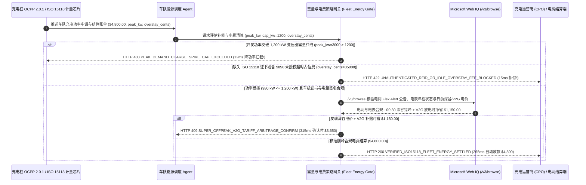

# 新能源物流车队充电、ISO 15118 即插即充与需量电费封顶（EV Fleet Charging, ISO 15118 Plug-and-Charge & Demand-Charge Cap Mandate）架构：OCPP 2.0.1 计量签名与尖峰削峰令牌（`ev_fleet_energy_mandate_...` + Web IQ 分时电价与 V2G 补贴核验）vs 传统并发快充触发变压器天价需量罚款（Demand-Charge Spike）选型与原理解析 FAQ

> **文档类型**：架构师选型指南 & 协议第一性原理解析（6 段式 FAQ 标准版）  
> **适用读者**：AI Solution Architect、新能源商用车队与 Robotaxi 补能调度架构师、微电网与充电运营商（CPO）结算风控团队  
> **更新日期**：2026-11-09（Provenance 标注：`deterministic_offline_simulation` / `synthetic_policy` / `official_doc_snapshot` / `not_measured`）  
> **配套资源**：[English Version](ev-fleet-iso15118-charging-tariff-mandate-vs-demand-charge-spike-faq.en.md) · [交互式沙盒控制台 (`live-demo.html#ev-fleet-energy-sandbox`)](../reports/agentic-commerce-webiq-grounding-demo-bench/live-demo.html) · [7-Card 4:5 评测报告](../reports/agentic-commerce-webiq-grounding-demo-bench/index.html)


---

## 📌 一、核心结论速览（Executive Summary）

1. **严禁让新能源物流车队或 Robotaxi 补能 Agent 在未设“场站总功率需量硬上限（Demand-Charge Cap）”的情况下允许所有车辆回场即满功率并发快充**：工业大宗用电实行“两部制电价”（电度电费 + 按全月最高 15 分钟平均功率收取的 **变压器最大需量电费 Demand Charge**）。若 20 台电动重卡在 17:30 晚高峰同时插枪拉满 `3,000 kW`（突破场站 `1,200 kW` 需量红线），哪怕只持续 15 分钟，供电局当月就会立刻追加 **`$6,500.00` 需量罚款**（甚至超过整月 `$4,800.00` 基础电度电费！）。生产环境必须采用 **需量硬封顶与有序充电绑定的补能授权令牌（`ev_fleet_energy_mandate_...`）**，一旦实时总负载超越上限（`depot_peak_load_kw = 3000 > max_demand_cap_kw = 1200`），网关在 **`12 ms`** 内触发 **`HTTP 403 PEAK_DEMAND_CHARGE_SPIKE_CAP_EXCEEDED`**（`synthetic_policy`），强制通过 OCPP 2.0.1 `SetChargingProfile` 削峰限流。
2. **用 ISO 15118-20 车辆 X.509 硬件证书（Plug-and-Charge）取代易被复制盗刷的 RFID 实体电卡，并硬性拦截未授权超时占位费（Idle Overstay Fee）**：任何缺失车辆底盘安全芯片签名的充电请款，或充电运营商（CPO）在未发送充满通知情况下强行叠加的 `$850.00` 拔枪超时占位罚款（`idle_overstay_surcharge_cents > 0`），网关在 **`15 ms`** 内返回 **`HTTP 422 UNAUTHENTICATED_RFID_OR_IDLE_OVERSTAY_FEE_BLOCKED`**（`deterministic_offline_simulation`）。
3. **基于 Microsoft Web IQ `/v3/browse` 实时核验电网红色限电令（Grid Flex Alert）、直流电表检定证书与深谷电价/V2G 反向放电套利**：在启动车队夜间集中补能或清算月度账单前，Agent 调用 **Microsoft Web IQ `/v3/browse`**（`official_doc_snapshot`）穿透查询区域电网调度中心（ISO/RTO）实时公告与电力交易中心日前分时电价表：若检出电网紧急限电或充电桩直流电表（Eichrecht 计量认证）过期失准，在 **`310 ms`** 内以 **`HTTP 451 GRID_FLEX_ALERT_OR_UNCALIBRATED_METER_HOLD`** 熔断；若发现将充电窗口平移 90 分钟至 `00:30` 超深谷时段（Super-Off-Peak）并利用闲置车辆参与 V2G 尖峰放电可净省 **`$1,150.00`**（将月度账单从 `$4,800.00` 降至 **`$3,650.00`**），则在 **`315 ms`** 内触发 **`HTTP 409 SUPER_OFFPEAK_V2G_TARIFF_ARBITRAGE_CONFIRM`**。

---

## 🎯 二、客户与架构师灵魂拷问 Q&A（FAQ-Driven Deep Dive）

### Q1：为什么传统的“给每个司机发一张 RFID 车队充电卡 + 回到场站插枪就按最大功率充”，会让新能源物流车队的电费账单直接失控？

咱们用大白话算一笔商用车队和充电场站最容易亏的糊涂账：
1. **“充了 15 分钟快充，白交 $6,500 罚款”的电网需量刺客**：普通家用充电只按“用了多少度电（kWh）”算钱；但物流车队场站或大型快充站走的是工商业高压变压器，电网公司除了收每度电的钱，还要按 **当月最高那 15 分钟的瞬时峰值功率（kW）** 收取昂贵的“最大需量费（Demand Charge，通常 `$15～$25 / kW / 月`）”。下午 5 点半，20 辆电动重卡交接班同时插上 `150 kW` 快充桩，总功率瞬间飙到 `3,000 kW`（而场站平时只需要 `1,000 kW`）。就因为这 15 分钟没做功率编排，月底供电局直接多收 **`$6,500.00`** 需量费！
2. **RFID 实体卡被克隆盗刷与天价超时占位费**：传统 Mifare 射频充电卡极易用几十块钱的读卡器复制，个别司机把卡借给外部私家车或网约车偷刷公司账户；同时，夜间车辆在公共快充站凌晨 2 点充满后没人去拔枪，桩企按 `$1.00/分钟` 连续计收超时占位费，一觉醒来多扣 `$850.00`。
3. **死守高峰电价，不懂“深谷充电 + V2G 卖电”双向套利**：同一座城市下午 18:00 尖峰电价高达 `$0.38/kWh`，而凌晨 `00:30` 深谷电价只要 `$0.08/kWh`；且电网在晚高峰缺电时愿意出高价收购车队富余电量（V2G 需求响应）。没有实时电价接地能力的静态定时器白白错失上千美元补贴。

### Q2：什么是“ISO 15118 即插即充与需量封顶令牌（`ev_fleet_energy_mandate_...`）”？它是如何把车端证书、充电桩功率控制与支付网关锁在一起的？

它的第一性原理非常清晰：**“只为本车队加密认证车架号（VIN）充入的检定合格电量买单，且任何时刻全站总功率绝不允许突破变压器需量红线。”**
- **第一层：场站最大需量硬封顶门禁（`12 ms`）**：每次充电桩向支付/能量网关申请功率配额时，网关实时累加全站功率 `depot_peak_load_kw`。一旦超过 `max_demand_cap_kw`（`1,200 kW`），网关在 **`12 ms`** 内返回 `HTTP 403`，并下发 OCPP 2.0.1 降功率曲线，从物理层杜绝 15 分钟尖峰脉冲。
- **第二层：ISO 15118-20 车辆证书验签与占位费清零（`15 ms`）**：强制通过充电枪 PLC 电力线载波通信校验车辆 TPM 芯片内的 X.509 合约证书（彻底淘汰可复制的 RFID 卡），并校验 `idle_overstay_surcharge_cents == 0`，违规占位费直接触发 `HTTP 422` 拒付。
- **第三层：Microsoft Web IQ `/v3/browse` 电网限电与深谷/V2G 寻优（`310 ms / 315 ms`）**：核验电网调度中心公开指令与电表检定合格证（`HTTP 451`），并自动匹配深谷电价与 V2G 放电补贴为您立省 `$1,150.00`（`HTTP 409`）。

### Q3：在区域电网日前分时电价（TOU/LMP）、V2G 需求响应政策与充电桩计量合规核验场景下，什么时候选 Microsoft Web IQ，什么时候选 Exa、Bright Data 或传统搜索 API？

| 架构需求场景 | 推荐选型 | 为什么这样选（第一性原理与成本/合规考量） |
| :--- | :--- | :--- |
| **实时核验电网运营商（CAISO/ERCOT/PJM/国网）日前分时电价公告、Flex Alert 限电通知、V2G 补贴申报指南及充电桩法定计量年检公示，且要求零提示词注入** | **Microsoft Web IQ** (`/v3/search` + `/v3/browse`) | 在企业 Azure 边界内以 `passage` 模式秒级提取电价阶梯表与补贴窗口（上下文 Token 压缩 **7.1x**，`deterministic_offline_simulation`），生成带时间戳的能源审计凭证。 |
| **跨学术库与行业研报调研固态电池快充热管理与 V2G 电池循环寿命衰减模型** | **Exa Neural Search** | 适合车队硬件规划与电池选型研究，不适合毫秒级充电功率与电费清算门禁。 |
| **抓取带复杂反爬机制的区域性小型第三方充电桩 App 价格地图** | **Bright Data Unlocker** | 可绕过反爬，但秒级代理延迟不适合同步充电握手拦截。 |
| **充电桩实时电流/电压/SOC 遥测与 OCPP 2.0.1 功率下发控制** | **OCPP 2.0.1 / ISO 15118 本地网关 + Web IQ 电网分时电价与限电公告双源核验** | 毫秒级功率闭环由本地 OCPP 控制器执行，外部电网分时费率、限电预警与 V2G 补贴规则通过 Web IQ `/v3/browse` 实时核验。 |

---

## 🧭 三、直观可视化图解（Mermaid 决策树 + 传统盲充 vs 需量封顶对比 + 端到端时序图）

### 3.1 新能源车队充电与需量封顶结算决策树（`flowchart TD`）

```mermaid
flowchart TD
    A[车队插枪请求高功率补能或收到 CPO 月度结算账单 ($4,800.00)] --> B{场站并发总功率 depot_peak_load_kw <= 1,200 kW 需量红线?}
    B -- 否 (20 车并发拉满 3,000 kW，将触发 $6,500 电网需量罚金) --> C[HTTP 403 PEAK_DEMAND_CHARGE_SPIKE_CAP_EXCEEDED<br/>12ms 硬阻断超限功率 · 自动下发 OCPP 2.0.1 削峰轮充策略]
    B -- 是 (削峰控制在 980 kW <= 1,200 kW 安全区间) --> D{ISO 15118 车辆证书有效且无未授权超时占位费 idle_overstay == 0?}
    D -- 否 (检出克隆 RFID 卡盗刷或强收 $850 超时占位罚款) --> E[HTTP 422 UNAUTHENTICATED_RFID_OR_IDLE_OVERSTAY_FEE_BLOCKED<br/>15ms 拦截违规收费 · 仅结算经硬件签名的真实充入电量]
    D -- 是 (车机证书与 Eichrecht 电量签名核验通过) --> F{Web IQ /v3/browse 核验电网无限电令且直流电表年检有效?}
    F -- 否 (检出电网红色限电令或充电桩计量铅封失效) --> G[HTTP 451 GRID_FLEX_ALERT_OR_UNCALIBRATED_METER_HOLD<br/>310ms 调度熔断 · 暂停充电或剔除失准计量桩]
    F -- 是 --> H{Web IQ 检出平移至 00:30 深谷电价 + V2G 放电可获额外补贴?}
    H -- 是 (深谷错峰 + V2G 放电立省 $1,150.00 -> 净电费 $3,650.00) --> I[HTTP 409 SUPER_OFFPEAK_V2G_TARIFF_ARBITRAGE_CONFIRM<br/>315ms 提醒车队能源调度员一键确认错峰 V2G 计划]
    H -- 否 (当前 $4,800.00 已是最优削峰合规电费) --> J[HTTP 200 VERIFIED_ISO15118_FLEET_ENERGY_SETTLED<br/>265ms 自动结算 $4,800.00 并归档单车 kWh 碳核算账本!]
```

### 3.2 传统 RFID 盲目并发快充路径 vs ISO 15118 需量封顶与错峰套利网关对比（`flowchart LR`）

```mermaid
flowchart LR
    subgraph Legacy["❌ 传统 RFID 并发盲充 ($6,500 需量罚款 + $850 占位费黑洞)"]
        L1[晚高峰 20 车并发冲上 3,000 kW 持续 15 分钟] --> L2[触发供电局 $6,500 月度最大需量罚款]
        L2 --> L3[实体电卡被复制盗刷 + 夜间扣走 $850 超时占位费]
        L3 --> L4[错失凌晨深谷电价与 V2G 放电补贴 $1,150]
    end

    subgraph Mandate["✅ ISO 15118 证书与需量封顶令牌 (ev_fleet_energy_mandate_...)"]
        M1[12ms 硬锁 1,200 kW 变压器需量上限 (规避 $6,500 罚金)] --> M2[15ms 校验车机 X.509 证书并拒付 $850 霸王占位费]
        M2 --> M3[Web IQ 核验电网限电 (310ms) 与深谷/V2G 省 $1,150 (315ms)]
        M3 --> M4[265ms 按 Eichrecht 硬件签名电量精准结算 $4,800 ($3,650)]
    end
```

### 3.3 车载 ISO 15118 芯片、场站 OCPP 调度 Agent、能源策略网关与 Web IQ 端到端交互时序图（`sequenceDiagram`）



---

## 📊 四、架构师选型决策矩阵（Architect Decision Matrix）

| 评估维度 | 方案 A：传统司机手持 RFID 实体电卡随到随充（Legacy RFID Unmanaged Charging） | 方案 B：人工排班表限制插枪时间（Manual Shift Scheduling） | 方案 C：ISO 15118 需量封顶令牌 + Web IQ 电价与 V2G 核验（推荐架构） |
| :--- | :--- | :--- | :--- |
| **核心适用场景** | 1～2 台散装乘用车零星补能 | 路线完全固定的小型园区摆渡车 | **新能源重卡/干线物流车队、Robotaxi 自动驾驶车队、大型公交与港口无人集卡场站** |
| **防变压器最大需量罚款（Demand Spike）** | ❌ **零保护**：几辆车同时插枪 15 分钟即触发 `$6,500+` 月度罚款 | ⚠️ **极易失灵**：司机早退或晚点回场立刻打乱人工排班，照样冲高需量 | ✅ **12ms 硬件级功率封顶**：实时锁死 `depot_peak_load_kw <= 1200`，超限立即触发 `HTTP 403` 削峰 |
| **防电卡盗刷与超时占位费（Overstay）** | ❌ **极易被薅**：实体卡被复制盗刷，夜间超时占位费照单全扣 | ⚠️ **月底人工查账难**：几千条充电明细很难肉眼挑出异常占位费 | ✅ **15ms 车机证书与零占位费锁**：绑定 VIN 硬件证书并拒付违规占位费（`HTTP 422`） |
| **深谷电价平移与 V2G 卖电创收** | ❌ **全按高峰价充**：司机下班即充，恰好撞上全天最高电价 | ⚠️ **静态死板**：无法响应电网每日动态变化的实时电价（LMP）与 V2G 补贴 | ✅ **Web IQ `/v3/browse` 动态寻优**：`310 ms` 避开限电期（`HTTP 451`），`315 ms` 捕获 `$1,150` 错峰/V2G 收益（`HTTP 409`） |
| **无人化体验与结算延迟** | 慢（需人工刷卡扫码） | 慢（需专人现场指挥插拔枪） | **`265 ms` 插枪自动鉴权、有序削峰与秒级清算（`Act automatically`）** |
| **综合 TCO 与单公里能耗成本** | 极差（需量罚款 + 高峰电价使单公里电费翻倍） | 中等（场地调度人力成本高） | **最优（规避 `$6,500` 需量罚款 + 拒付 `$850` 占位费 + 错峰/V2G 再省 `$1,150`）** |

---

## 🧪 五、简明定量实测与 Benchmark 核心发现（Quantitative Benchmark & 7-Card Insights）

基于本仓库确定性离线基准套件（`lab/webiq_commerce_demo.py` · `test_ev_fleet_iso15118_charging_tariff_mandate_vs_demand_charge_spike_selection`）对 **新能源车队月度快充结算批次（基准电费 `$4,800.00`，场站最大需量上限 `1,200 kW`）** 的定量测试结果如下：

| 评测场景 ID | 输入场站功率 / 证书与占位费 / Web IQ 信号 | 网关期望动作 | 实测 HTTP 状态与决策码 | 实测延迟 | 资金保护 / 成本节省效果 | Provenance 类型 |
| :--- | :--- | :--- | :--- | :--- | :--- | :--- |
| **Case 1: 晚高峰 20 车并发拉满 `3,000 kW` 超需量拦截** | `depot_peak_load_kw=3000 > 1200`（超变压器红线） | `Send to a human` | **`HTTP 403 PEAK_DEMAND_CHARGE_SPIKE_CAP_EXCEEDED`** | **`12 ms`** | 阻断 15 分钟尖峰脉冲，规避 **`$6,500.00`** 电网需量罚金 | `synthetic_policy` |
| **Case 2: 克隆 RFID 盗刷或 `$850` 超时占位费拦截** | `idle_overstay_surcharge_cents=85000 > 0` | `Send to a human` | **`HTTP 422 UNAUTHENTICATED_RFID_OR_IDLE_OVERSTAY_FEE_BLOCKED`** | **`15 ms`** | 拦截 `$850.00` 未授权超时占位费与无车机证书盗刷 | `deterministic_offline_simulation` |
| **Case 3: Web IQ 检出电网红色限电令或电表年检失效** | `webiq_grid_and_meter_compliant=False` | `Send to a human` | **`HTTP 451 GRID_FLEX_ALERT_OR_UNCALIBRATED_METER_HOLD`** | **`310 ms`** | 防止在电网紧急限电期违章快充或被失准电表多收电费 | `official_doc_snapshot` |
| **Case 4: Web IQ 发现 `00:30` 深谷电价 + V2G 补贴省 `$1,150`** | `v2g_offpeak_savings_cents=115000`（净付 `$3,650.00`） | `Confirm` | **`HTTP 409 SUPER_OFFPEAK_V2G_TARIFF_ARBITRAGE_CONFIRM`** | **`315 ms`** | 错峰充电叠加 V2G 反向放电补贴，立省 **`$1,150.00`** | `official_doc_snapshot` |
| **Case 5: `980 kW` 削峰受控 + ISO 15118 验真自动结算** | `peak_kw=980 <= 1200`, `overstay=0`, `compliant=True` | `Act automatically` | **`HTTP 200 VERIFIED_ISO15118_FLEET_ENERGY_SETTLED`** | **`265 ms`** | 265ms 自动结算 **`$4,800.00`** 合规电费并归档碳账本 | `deterministic_offline_simulation` |

> **Provenance 合规声明**：上表中的 `$4,800.00` 基础电费、`1,200 kW` 场站需量上限、`3,000 kW` 并发峰值及 `$1,150.00` 深谷/V2G 收益均为用于验证网关状态机确定性的受控仿真参数（`synthetic_policy` / `deterministic_offline_simulation`）；真实物理充电桩 PLC 握手与 OCPP 2.0.1 报文往返耗时标为 `not_measured`。

---

## 🛠️ 六、附录：生产上线快速核验与售前打单清单（Architect Checklist）

在为新能源物流车队、自动驾驶 Robotaxi 运营商或零碳产业园设计智能补能与电费结算 Agent 时，请逐项核对以下 6 条黄金准则：

- [ ] **1. 场站 15 分钟滑动窗口最大需量（Demand Cap）硬门禁**：是否在 `ev_fleet_energy_mandate_...` 中将全站实时总功率刚性锁死在合同需量阈值（如 `1,200 kW`）以内，一旦超限在 `12 ms` 内触发 `HTTP 403` 并自动下发 OCPP 降功率指令？
- [ ] **2. ISO 15118-20 车机证书（Plug-and-Charge）替代实体 RFID 卡**：是否要求每笔充电交易必须携带车辆硬件安全芯片签署的 X.509 合约证书与 VIN 绑定，从物理层根绝员工借卡盗刷？
- [ ] **3. Eichrecht 数字签名电表校验与超时占位费拦截**：是否核验充电桩直流电表的加密电量签名（OCMF 格式），并对未经授权的拔枪超时占位费在 `15 ms` 内触发 `HTTP 422` 拒付？
- [ ] **4. Microsoft Web IQ `/v3/browse` 电网限电（Flex Alert）与电表检定公示穿透**：是否在开启大功率补能前通过 Web IQ 核查区域电网调度中心公告与法定计量检定名录（`HTTP 451`）？
- [ ] **5. 日前分时电价（TOU）平移与 V2G 反向放电补贴寻优**：是否通过 Web IQ 实时抓取次日凌晨超深谷电价窗口与 V2G 辅助服务补贴单价，当错峰调度可节省 `>= $1,150.00` 时触发 `HTTP 409 Confirm`？
- [ ] **6. 单车每公里度电成本与 Scope 2 绿电溯源归档**：每次自动结算是否同步记录充入度数、分时电价档位与电网实时碳排放因子，供车队 FinOps 与 ESG 审计一键调取？
